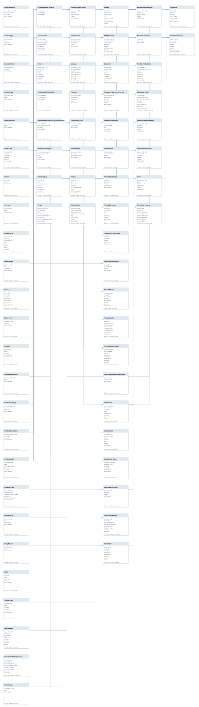

# adventureworks — Database Inspection

Original SQLite records; **not model input**. Click a table name to inspect its actual first 10 rows.

| Table | Rows | Columns | Open preview |
|---|---:|---:|---|
| AWBuildVersion | 1 | 4 | [First 10 rows](tables/AWBuildVersion.md) |
| Address | 19614 | 9 | [First 10 rows](tables/Address.md) |
| AddressType | 6 | 4 | [First 10 rows](tables/AddressType.md) |
| BillOfMaterials | 2679 | 9 | [First 10 rows](tables/BillOfMaterials.md) |
| BusinessEntity | 20777 | 3 | [First 10 rows](tables/BusinessEntity.md) |
| BusinessEntityAddress | 19614 | 5 | [First 10 rows](tables/BusinessEntityAddress.md) |
| BusinessEntityContact | 909 | 5 | [First 10 rows](tables/BusinessEntityContact.md) |
| ContactType | 20 | 3 | [First 10 rows](tables/ContactType.md) |
| CountryRegion | 238 | 3 | [First 10 rows](tables/CountryRegion.md) |
| CountryRegionCurrency | 109 | 3 | [First 10 rows](tables/CountryRegionCurrency.md) |
| CreditCard | 19118 | 6 | [First 10 rows](tables/CreditCard.md) |
| Culture | 8 | 3 | [First 10 rows](tables/Culture.md) |
| Currency | 105 | 3 | [First 10 rows](tables/Currency.md) |
| CurrencyRate | 13532 | 7 | [First 10 rows](tables/CurrencyRate.md) |
| Customer | 19820 | 7 | [First 10 rows](tables/Customer.md) |
| DatabaseLog | 0 | 8 | [First 10 rows](tables/DatabaseLog.md) |
| Department | 16 | 4 | [First 10 rows](tables/Department.md) |
| Document | 12 | 14 | [First 10 rows](tables/Document.md) |
| EmailAddress | 19972 | 5 | [First 10 rows](tables/EmailAddress.md) |
| Employee | 290 | 16 | [First 10 rows](tables/Employee.md) |
| EmployeeDepartmentHistory | 296 | 6 | [First 10 rows](tables/EmployeeDepartmentHistory.md) |
| EmployeePayHistory | 316 | 5 | [First 10 rows](tables/EmployeePayHistory.md) |
| ErrorLog | 0 | 9 | [First 10 rows](tables/ErrorLog.md) |
| Illustration | 5 | 3 | [First 10 rows](tables/Illustration.md) |
| JobCandidate | 13 | 4 | [First 10 rows](tables/JobCandidate.md) |
| Location | 14 | 5 | [First 10 rows](tables/Location.md) |
| Password | 19972 | 5 | [First 10 rows](tables/Password.md) |
| Person | 19972 | 13 | [First 10 rows](tables/Person.md) |
| PersonCreditCard | 19118 | 3 | [First 10 rows](tables/PersonCreditCard.md) |
| PersonPhone | 19972 | 4 | [First 10 rows](tables/PersonPhone.md) |
| PhoneNumberType | 3 | 3 | [First 10 rows](tables/PhoneNumberType.md) |
| Product | 504 | 25 | [First 10 rows](tables/Product.md) |
| ProductCategory | 4 | 4 | [First 10 rows](tables/ProductCategory.md) |
| ProductCostHistory | 395 | 5 | [First 10 rows](tables/ProductCostHistory.md) |
| ProductDescription | 762 | 4 | [First 10 rows](tables/ProductDescription.md) |
| ProductDocument | 32 | 3 | [First 10 rows](tables/ProductDocument.md) |
| ProductInventory | 1069 | 7 | [First 10 rows](tables/ProductInventory.md) |
| ProductListPriceHistory | 395 | 5 | [First 10 rows](tables/ProductListPriceHistory.md) |
| ProductModel | 128 | 6 | [First 10 rows](tables/ProductModel.md) |
| ProductModelIllustration | 7 | 3 | [First 10 rows](tables/ProductModelIllustration.md) |
| ProductModelProductDescriptionCulture | 762 | 4 | [First 10 rows](tables/ProductModelProductDescriptionCulture.md) |
| ProductPhoto | 101 | 6 | [First 10 rows](tables/ProductPhoto.md) |
| ProductProductPhoto | 504 | 4 | [First 10 rows](tables/ProductProductPhoto.md) |
| ProductReview | 4 | 8 | [First 10 rows](tables/ProductReview.md) |
| ProductSubcategory | 37 | 5 | [First 10 rows](tables/ProductSubcategory.md) |
| ProductVendor | 460 | 11 | [First 10 rows](tables/ProductVendor.md) |
| PurchaseOrderDetail | 8845 | 11 | [First 10 rows](tables/PurchaseOrderDetail.md) |
| PurchaseOrderHeader | 4012 | 13 | [First 10 rows](tables/PurchaseOrderHeader.md) |
| SalesOrderDetail | 121317 | 11 | [First 10 rows](tables/SalesOrderDetail.md) |
| SalesOrderHeader | 31465 | 26 | [First 10 rows](tables/SalesOrderHeader.md) |
| SalesOrderHeaderSalesReason | 27647 | 3 | [First 10 rows](tables/SalesOrderHeaderSalesReason.md) |
| SalesPerson | 17 | 9 | [First 10 rows](tables/SalesPerson.md) |
| SalesPersonQuotaHistory | 163 | 5 | [First 10 rows](tables/SalesPersonQuotaHistory.md) |
| SalesReason | 10 | 4 | [First 10 rows](tables/SalesReason.md) |
| SalesTaxRate | 29 | 7 | [First 10 rows](tables/SalesTaxRate.md) |
| SalesTerritory | 10 | 10 | [First 10 rows](tables/SalesTerritory.md) |
| SalesTerritoryHistory | 17 | 6 | [First 10 rows](tables/SalesTerritoryHistory.md) |
| ScrapReason | 16 | 3 | [First 10 rows](tables/ScrapReason.md) |
| Shift | 3 | 5 | [First 10 rows](tables/Shift.md) |
| ShipMethod | 5 | 6 | [First 10 rows](tables/ShipMethod.md) |
| ShoppingCartItem | 3 | 6 | [First 10 rows](tables/ShoppingCartItem.md) |
| SpecialOffer | 16 | 11 | [First 10 rows](tables/SpecialOffer.md) |
| SpecialOfferProduct | 538 | 4 | [First 10 rows](tables/SpecialOfferProduct.md) |
| StateProvince | 181 | 8 | [First 10 rows](tables/StateProvince.md) |
| Store | 701 | 6 | [First 10 rows](tables/Store.md) |
| TransactionHistory | 113443 | 9 | [First 10 rows](tables/TransactionHistory.md) |
| TransactionHistoryArchive | 89253 | 9 | [First 10 rows](tables/TransactionHistoryArchive.md) |
| UnitMeasure | 38 | 3 | [First 10 rows](tables/UnitMeasure.md) |
| Vendor | 104 | 8 | [First 10 rows](tables/Vendor.md) |
| WorkOrder | 72591 | 10 | [First 10 rows](tables/WorkOrder.md) |
| WorkOrderRouting | 67131 | 12 | [First 10 rows](tables/WorkOrderRouting.md) |

The table links are the dependable GitHub navigation path; SVG click-through may vary by GitHub's rendering/security restrictions.
FK arrows are based on declared SQLite foreign keys. Informal semantic links are not asserted as physical FKs.
