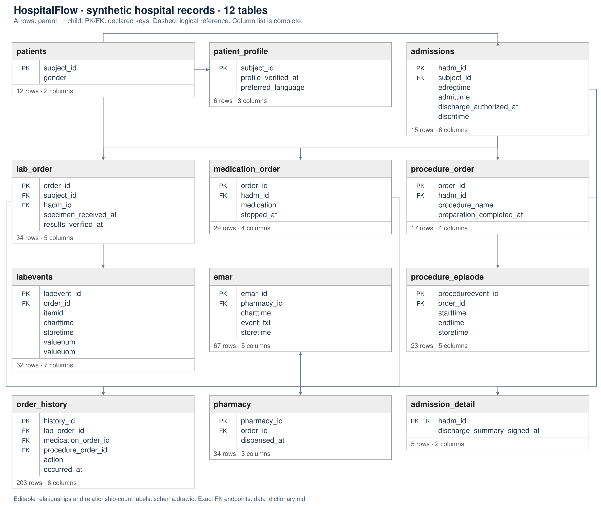

# HospitalFlow dataset

- **Purpose:** evaluate whether different Physical Objects represent the SAME business object type with compatible instance identity.
- **Source:** public MIMIC-IV documentation with wholly synthetic records. Split-storage extensions are authored, not original MIMIC tables.
- The database contains ordinary hospital business tables. It has no object, object_type or clinical_order registry/supertype table and no persisted generic object/type identifier.

| Dataset | Tables | Object / case types | Activity types | Timestamp columns | Event timestamp columns | Distinct events | Questions | Gold CSVs |
|---|---:|---:|---:|---:|---:|---:|---:|---:|
| HospitalFlow | 12 | 10 | 20 | 19 | 17 | 628 | 44 | 42 |

- **Physical Objects:** 12 table/PK representations. **Expected identity-compatible groups:** 10. **Distinct business/occurrence instances:** 496.

## Identity grouping scenarios

- patients and patient_profile store different information about the SAME patient. The subject_id namespace is shared; 6 of 12 patients have profile rows. There is intentionally no FK between these tables; the dictionary explicitly documents the identifier relationship.
- admissions and admission_detail store different information about the SAME hospital stay. Their hadm_id namespace is shared, corroborated by a shared-PK FK; 5 of 15 admissions have supplementary summary records.
- Patient Profile Verified originates in patient_profile; admission events originate in admissions and Discharge Summary Signed originates in admission_detail. Grouping does not erase the physical source or collapse different events.
- lab_order, medication_order and procedure_order identify different requests. Their local order_id values overlap deliberately; this does not justify grouping them as one identity-compatible type.
- order_history.history_id identifies a history occurrence. Its order FK does not make it the same object as an order. Measurement, dose and procedure episode records also keep their own identities.
- **Gold grouping:** 12 Physical Objects → 10 groups, with exactly two expected MERGE pairs. The pair labels are reference answers, not results of running the user's Step 2 implementation.
- [Grouping examples and evaluation boundary](docs/object_type_verification.md)

## Scenarios and activities

| Object Type | Instances | Activity types | Activity scope |
| --- | --- | --- | --- |
| Patient | 12 | 20 | Discharge Authorized, Discharge Summary Signed, Emergency Department Registered, Hospital Admitted, Hospital Discharged, Lab Result Available, Lab Results Verified, Medication Administered, Medication Dispensed, Medication Not Given, Medication Stopped, Order Cancelled, Order Entered, Order Reviewed, Patient Profile Verified, Procedure Completed, Procedure Preparation Completed, Procedure Started, Specimen Collected, Specimen Received |
| Hospital Admission | 15 | 19 | Discharge Authorized, Discharge Summary Signed, Emergency Department Registered, Hospital Admitted, Hospital Discharged, Lab Result Available, Lab Results Verified, Medication Administered, Medication Dispensed, Medication Not Given, Medication Stopped, Order Cancelled, Order Entered, Order Reviewed, Procedure Completed, Procedure Preparation Completed, Procedure Started, Specimen Collected, Specimen Received |
| Laboratory Order | 34 | 6 | Lab Result Available, Lab Results Verified, Order Entered, Order Reviewed, Specimen Collected, Specimen Received |
| Medication Order | 29 | 6 | Medication Administered, Medication Dispensed, Medication Not Given, Medication Stopped, Order Entered, Order Reviewed |
| Procedure Order | 17 | 6 | Order Cancelled, Order Entered, Order Reviewed, Procedure Completed, Procedure Preparation Completed, Procedure Started |
| Order History Record | 203 | 3 | Order Cancelled, Order Entered, Order Reviewed |
| Lab Measurement | 62 | 2 | Lab Result Available, Specimen Collected |
| Medication Administration | 67 | 2 | Medication Administered, Medication Not Given |
| Procedure Episode | 23 | 2 | Procedure Completed, Procedure Started |
| Pharmacy Dispensing | 34 | 3 | Medication Administered, Medication Dispensed, Medication Not Given |

- Twelve Physical Objects map to ten expected identity-compatible Object Type groups. History/measurement/dose/episode records retain independent occurrence identities.
- Individual instances may contain fewer activities due to cancellation, ongoing care or missing records.

## Event storage

| Table | Encoding | Activity carrier |
| --- | --- | --- |
| patients | No event encoding | None |
| patient_profile | Column encoding | None |
| admissions | Column encoding | None |
| admission_detail | Column encoding | None |
| lab_order | Column encoding | None |
| medication_order | Column encoding | None |
| procedure_order | Column encoding | None |
| pharmacy | Column encoding | None |
| order_history | Row encoding | action |
| emar | Row encoding | event_txt |
| labevents | Column encoding | None |
| procedure_episode | Column encoding | None |

- Row identity is selected by action (order_history) or event_txt (emar). Column identity is selected by the timestamp meaning, including repeated lab measurements and procedure episodes. Repeated rows alone do not imply Row encoding. labevents.itemid names a measurement, not an activity carrier at the declared measurement/result activity granularity. pharmacy uses one timestamp and no activity carrier.
- Only identical case/event occurrences are deduplicated; grouping never merges different event IDs.

## Question types and pairs

| Type | Questions | Answerable | Non-answerable | Avg. requested activity types |
| --- | --- | --- | --- | --- |
| Q1 | 12 | 11 | 1 | 2.75 |
| Q2 | 12 | 11 | 1 | 2.75 |
| Q3 | 10 | 10 | 0 | 6.90 |
| Q4 | 10 | 10 | 0 | 6.90 |

- Q1/Q3 seeds are frozen before the assistant LLM creates Q2/Q4. Prompts, outputs and review notes are stored in source/llm_paraphrases.json. No external API call is claimed.
- Each pair has identical scope, answerability, ES and Gold. Unsupported pairs have no CSV.
- [Questions, counts and requested activities](docs/questions.md)

## Model input and evaluation answers

- Default model inputs are allowlisted in input/model_input_manifest.json: DB, SQL schema, business dictionary and question text.
- Optional input/task_scope_catalog.json supplies explicit default activity lists. It is excluded from the default allowlist; use it only in a separately declared catalog-assisted condition.
- private/identity_gold.json contains author-assigned table/PK grouping answers and full-key statistics. It must not be provided to the identity judge.
- private/event_binding_provenance.json records each source table, complete PK and own versus FK attribution. private/case_population.json and private/object_event_links.json are Gold annotations.
- design/, docs/ and this README include construction explanations and answers; exclude them from model inputs. The data dictionary is legitimate input evidence and explicitly describes identifier semantics without supplying final MERGE/SEPARATE labels.
- Main-schema gold pairs cover two positive split-storage cases and distinct-identity negatives. UNRESOLVED and group-conflict scenarios are separately specified in private/identity_edge_cases.json; these are not claimed live-table cases or executed semantic-judge tests.

## Dictionary conditions

- [Dictionary semantics review](docs/semantic_review.md) · [Dictionary ablation setup](docs/dictionary_ablation.md)
- Full, concise and no-dictionary conditions share exactly the same DB, schema, questions and Gold. Detailed identifier evidence is retained in the full condition; the concise condition omits repeated identity explanations and documentation references. No model performance result is claimed.
- Missing clinical timestamp means no time is recorded and occurrence status is unknown. NULL admission associations and non-applicable history references have separately documented structural meanings.
- Laboratory charttime is specimen collection; result availability is storetime. Collection → receipt → result availability → verification are checked against persisted data.
- Discharge summaries are signed after discharge. The constant summary_status column was removed; drafts are outside this table.

## Realism revision

- [Changes, distributions and negative JOIN controls](docs/realism_review.md)
- Twelve tables keep the design compact: independent order tables are retained intentionally; pharmacy separates dispensing from prescriptions and doses. procedure_episode is authored hospital-level storage, not MIMIC ICU procedureevents.
- Four outpatient laboratory requests have no hadm_id. Their events belong to the patient and laboratory order, but not to an admission.
- UTC 2026 timestamps and clean integrity constraints are intentional. Simulation parameters are illustrative and not fitted to MIMIC patient records. ICU, transfers and a noisy variant are deferred.

## Build and validation

- Run `python datasets/hospitalflow/build.py`, `python make_docs.py`, `python question_summary.py`, `python validate_lifecycles.py` and `python validate_timestamp_columns.py` from the repository root.
- SQL/CSV outputs are compared with independent generation-time histories. Tests check identity groups, optional extensions, no-FK identity evidence, order/history separation, own/FK provenance, time order, repeated occurrences, empty cases and frozen question pairs.
- The NL2EventLog Step 2 identity classifier is not present in this dataset repository. This provides test inputs and Gold answers; it does not claim measured classifier accuracy, LLM identity decisions or candidate/decision audit statistics.
- [Construction plan](design/plan.md)
- [Source mapping](design/source_mapping.json)
- [Source references](source/references.md)
- [Object-specific Gold logs](docs/object_event_logs.md)

## Business dictionary review

- [Revised business dictionary](docs/data_dictionary.md) follows Harvard HMS/OSF variable guidance with relational schema extensions; basic information is context rather than a mandatory variable field.
- [Field checklist and documentation basis](docs/data_dictionary_profile.md) · [Before/after review and remaining questions](docs/data_dictionary_review.md)
- All 12 tables and 52 variables have readable names, definitions, value domains, NULL meanings and storage metadata. The 19 datetime variables have explicit representation and timezone.
- The dictionary excludes event classifications, extraction-time selection counts, query scopes and model/Ground-truth instructions. Code meanings and documented identifier relationships remain legitimate business metadata.
- Use input/model_input_manifest.json for the default model inputs. task_scope_catalog.json remains an optional separate catalog-assisted condition because it supplies explicit activity scopes.
- Reviewed definitions live in source/dictionary_profile.json. Regenerate with `python hospital_dictionary.py datasets/hospitalflow`; check with `python datasets/hospitalflow/validate_dictionary.py`.
- The current realism revision changes the DB and regenerates all dependent Gold records. Runtime dictionary, schema and Gold checks pass; the earlier metadata-only review is retained as historical context.

## Schema and documentation

- [Table inventory and relationships](docs/schema_overview.md)
- [English column dictionary](docs/data_dictionary.md)
- [CSV dictionary](docs/data_dictionary.csv)
- [Editable draw.io diagram](docs/schema.drawio)
- [Object-based Gold logs and coverage](docs/object_event_logs.md)

## Timestamp columns

- Timestamp columns count physical table.column pairs storing date-and-time instants. Date-only birth/planning fields and recurring class schedules are excluded. Event timestamp columns are the subset actually selected as event times by the current ES; roles distinguish plans, technical times, snapshots, interval starts and copied key timestamps. Phase-aware variants may select actual interval starts as event times.
- [Timestamp inventory and roles](docs/timestamp_columns.md)
- [Milestone-column extraction questions and Gold activity counts](docs/questions.md)
- Single-occurrence milestone times are stored on the existing business record. Repeated actions remain row encoded; the same event is not stored twice.
