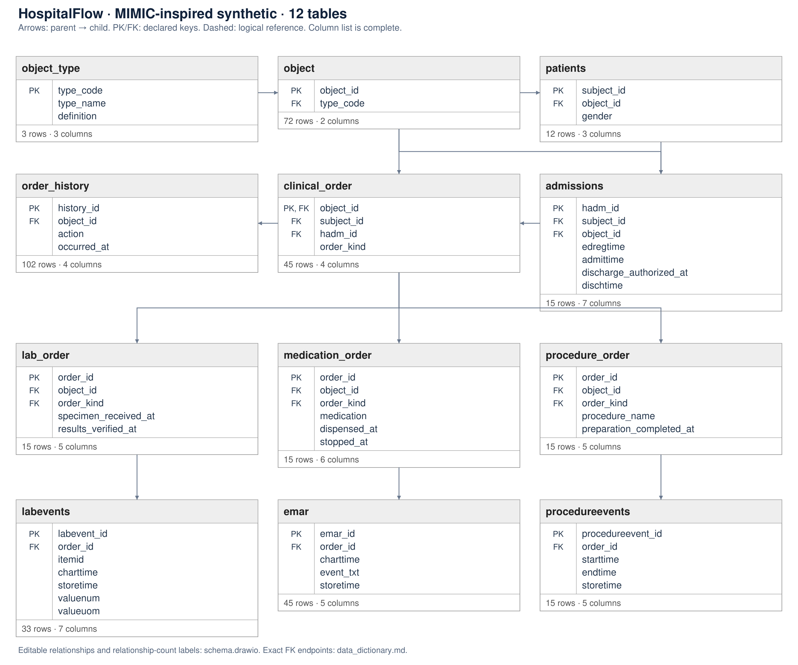

# HospitalFlow dataset

- **Purpose:** validate one semantic object type spanning multiple business tables.
- **Source:** public MIMIC-IV schema documentation with wholly synthetic records and authored extensions.

| Dataset | Tables | Object / case types | Activity types | Timestamp columns | Event timestamp columns | Distinct events | Questions | Gold CSVs |
|---|---:|---:|---:|---:|---:|---:|---:|---:|
| HospitalFlow | 12 | 3 | 18 | 17 | 15 | 361 | 28 | 26 |

- **Objects:** 72 actual instances; six case population scopes over three semantic types.
- Counts include identity/type infrastructure tables; these do not create business events.

## Object and object type design

- object_type defines Patient, Hospital Admission and Clinical Order.
- object assigns every actual object a globally unique identity and exactly one type.
- lab_order, medication_order and procedure_order all refer to clinical_order; all these objects share Clinical Order type.
- LAB:1, MED:1 and PROC:1 deliberately share local order_id=1, while remaining three separate cases.
- The common-type lifecycle must equal the union of the three subtype populations without ID collisions or duplicate case/event pairs.
- This supertype/subtype design is authored for the benchmark, not supplied by MIMIC.
- [Inspectable type membership and SQL examples](docs/object_type_verification.md)

## Scenarios and activities

| Case population | Semantic type | Objects | Activity types | Activity scope |
| --- | --- | --- | --- | --- |
| Patient | PATIENT | 12 | 18 | Discharge Authorized, Emergency Department Registered, Hospital Admitted, Hospital Discharged, Lab Measurement Charted, Lab Result Available, Lab Results Verified, Medication Administered, Medication Dispensed, Medication Not Given, Medication Stopped, Order Cancelled, Order Entered, Order Reviewed, Procedure Completed, Procedure Preparation Completed, Procedure Started, Specimen Received |
| Hospital Admission | ADMISSION | 15 | 18 | Discharge Authorized, Emergency Department Registered, Hospital Admitted, Hospital Discharged, Lab Measurement Charted, Lab Result Available, Lab Results Verified, Medication Administered, Medication Dispensed, Medication Not Given, Medication Stopped, Order Cancelled, Order Entered, Order Reviewed, Procedure Completed, Procedure Preparation Completed, Procedure Started, Specimen Received |
| Clinical Order | CLINICAL_ORDER | 45 | 14 | Lab Measurement Charted, Lab Result Available, Lab Results Verified, Medication Administered, Medication Dispensed, Medication Not Given, Medication Stopped, Order Cancelled, Order Entered, Order Reviewed, Procedure Completed, Procedure Preparation Completed, Procedure Started, Specimen Received |
| Laboratory Order | CLINICAL_ORDER | 15 | 6 | Lab Measurement Charted, Lab Result Available, Lab Results Verified, Order Entered, Order Reviewed, Specimen Received |
| Medication Order | CLINICAL_ORDER | 15 | 6 | Medication Administered, Medication Dispensed, Medication Not Given, Medication Stopped, Order Entered, Order Reviewed |
| Procedure Order | CLINICAL_ORDER | 15 | 6 | Order Cancelled, Order Entered, Order Reviewed, Procedure Completed, Procedure Preparation Completed, Procedure Started |

- Six case population scopes use three semantic object types; subtype scopes are not additional semantic types.
- Individual instances may have fewer activities due to cancellation, ongoing care or no records.

## Event storage

| Table | Encoding |
| --- | --- |
| object_type | No event encoding |
| object | No event encoding |
| patients | No event encoding |
| admissions | Column encoding |
| clinical_order | No event encoding |
| lab_order | Column encoding |
| medication_order | Column encoding |
| procedure_order | Column encoding |
| order_history | Row encoding |
| labevents | Mixed (row + column) |
| emar | Row encoding |
| procedureevents | Mixed (row + column) |

- Column tables store one-time milestones; row tables preserve repeated actions.
- Mixed tables preserve repeated occurrences and split their distinct milestones into activities.
- [Timestamp meanings](docs/timestamp_columns.md)

## Question types and pairs

| Type | Questions | Answerable | Non-answerable | Avg. requested activity types |
|---|---:|---:|---:|---:|
| Q1 | 8 | 7 | 1 | 3.25 |
| Q2 | 8 | 7 | 1 | 3.25 |
| Q3 | 6 | 6 | 0 | 11.33 |
| Q4 | 6 | 6 | 0 | 11.33 |

- Avg. requested activity types = sum of requested activity-type counts / all questions in that row, including non-answerable questions. Q3/Q4 counts use the Gold catalog scope. This counts distinct activity types, not event occurrences.

- Q1/Q3 seeds are frozen before assistant-LLM paraphrasing into Q2/Q4; rebuilding reuses saved outputs. No external model call is claimed.
- Each pair has identical ES and Gold; unsupported pairs have no CSV.
- Avg. requested activity types includes unsupported requests.
- [Questions and activity counts](docs/questions.md)
- [LLM paraphrase prompts and outputs](source/llm_paraphrases.json)

## Build and validation

- Run `python datasets/hospitalflow/build.py`, `python make_docs.py`, then `python datasets/hospitalflow/validate.py` from the repository root.
- Independent generation-time event/object history is compared with each SQL result and CSV.
- Checks cover wrong types, wrong subtypes, cross-patient admissions, orphan events, local ID collisions, repetition, cancellation, ongoing care, empty cases and exact pairs.
- Tests establish internal consistency, not clinical realism or model accuracy.
- Model-facing questions are input/model_questions.jsonl; enriched questions.jsonl contains evaluation annotations.
- [Source and adaptation mapping](design/source_mapping.json)
- [Source references](source/references.md)
- [Construction plan](design/plan.md)
- [Object-specific Gold logs](docs/object_event_logs.md)

## Schema and documentation

- [Table inventory and relationships](docs/schema_overview.md)
- [English column dictionary](docs/data_dictionary.md)
- [CSV dictionary](docs/data_dictionary.csv)
- [Editable draw.io diagram](docs/schema.drawio)
- [Object-based Gold logs and coverage](docs/object_event_logs.md)

## Timestamp columns

- Timestamp columns count physical table.column pairs storing date-and-time instants. Date-only birth/planning fields and recurring class schedules are excluded. Event timestamp columns are the subset actually selected as event times by the current ES; plans, technical times, snapshots, interval starts and copied key timestamps are listed separately.
- [Timestamp inventory and roles](docs/timestamp_columns.md)
- [Milestone-column extraction questions and Gold activity counts](docs/questions.md)
- Single-occurrence milestone times are stored on the existing business record. Repeated actions remain row encoded; the same event is not stored twice.
