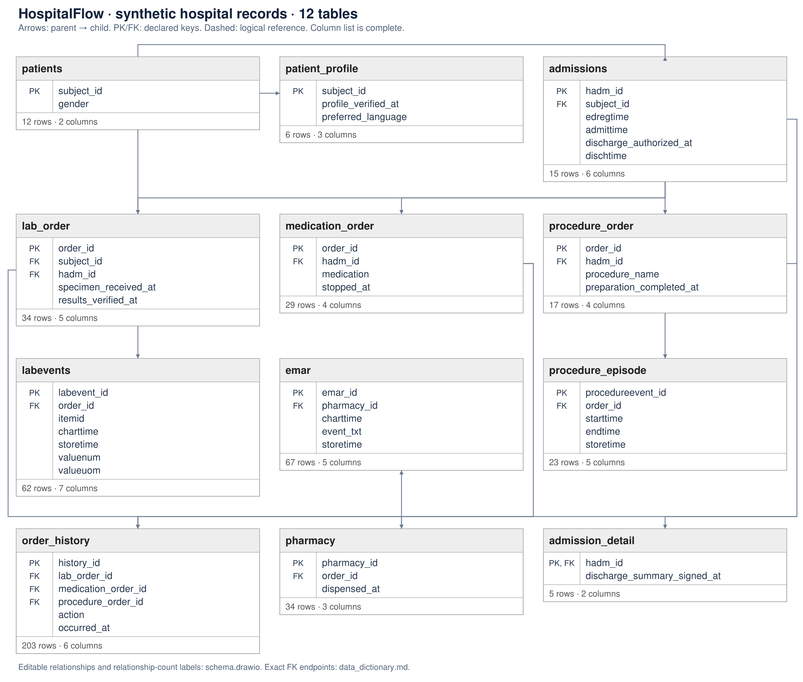

# HospitalFlow · synthetic hospital records — Schema overview

[Editable draw.io diagram](schema.drawio) · [Column dictionary](data_dictionary.md) · [CSV dictionary](data_dictionary.csv)

| Table | Rows | Columns | Event encoding | Primary key | Role |
|---|---:|---:|---|---|---|
| patients | 12 | 2 | See author README | subject_id | Patient identifiers and demographic categories. |
| admissions | 15 | 6 | See author README | hadm_id | Distinct hospital stays per patient with actual admission/discharge milestones. |
| patient_profile | 6 | 3 | See author README | subject_id | Supplementary patient information keyed by patients.subject_id. Matching subject_id refers to the patient in patients; no SQL foreign key is declared. |
| admission_detail | 5 | 2 | See author README | hadm_id | Recorded signed discharge summaries associated with hospital admissions. |
| lab_order | 34 | 5 | See author README | order_id | Laboratory request; multiple measurements can fulfill it. subject_id identifies the patient even when hadm_id is NULL for a request outside an admission. |
| medication_order | 29 | 4 | See author README | order_id | One medication prescription, including its stop time. Dispensing is recorded separately in pharmacy. |
| procedure_order | 17 | 4 | See author README | order_id | Distinct procedure order; repeated execution episodes belong to one order. |
| order_history | 203 | 6 | See author README | history_id | Recorded actions on laboratory, medication or procedure requests, including repeated reviews. |
| labevents | 62 | 7 | See author README | labevent_id | Laboratory measurement results with specimen collection and result-availability times. charttime denotes specimen collection, not measurement execution. |
| emar | 67 | 5 | See author README | emar_id | Medication administration or omission records associated with pharmacy dispensing records. |
| procedure_episode | 23 | 5 | See author README | procedureevent_id | Hospital-level procedure execution episodes; the ICU stay_id hierarchy is excluded. |
| pharmacy | 34 | 3 | See author README | pharmacy_id | One distinct dispensing record for a medication prescription; repeated dispensing records can fulfill the same prescription. |

- Row encoding: each occurrence is a separate row; its activity comes from a code, label or the table meaning.
- Column encoding: an object row stores actual milestone times in dedicated columns. It can contain one or several milestones.
- No event encoding: the table supplies context, plans, identities or links rather than direct events.
- Planned dates, snapshots and technical timestamps do not automatically become events.

## Relationships

| Parent | Child | Child FK | Parent key | Parent-to-child count | Kind |
|---|---|---|---|---|---|
| patients | admissions | subject_id | subject_id | 1 : 0..N | declared |
| admissions | admission_detail | hadm_id | hadm_id | 1 : 0..N | declared |
| admissions | lab_order | hadm_id | hadm_id | 1 : 0..N | declared |
| patients | lab_order | subject_id | subject_id | 1 : 0..N | declared |
| admissions | medication_order | hadm_id | hadm_id | 1 : 0..N | declared |
| admissions | procedure_order | hadm_id | hadm_id | 1 : 0..N | declared |
| procedure_order | order_history | procedure_order_id | order_id | 1 : 0..N | declared |
| medication_order | order_history | medication_order_id | order_id | 1 : 0..N | declared |
| lab_order | order_history | lab_order_id | order_id | 1 : 0..N | declared |
| lab_order | labevents | order_id | order_id | 1 : 0..N | declared |
| pharmacy | emar | pharmacy_id | pharmacy_id | 1 : 0..N | declared |
| procedure_order | procedure_episode | order_id | order_id | 1 : 0..N | declared |
| medication_order | pharmacy | order_id | order_id | 1 : 0..N | declared |
| patients | patient_profile | subject_id | subject_id | documented same identity; no FK | logical |
