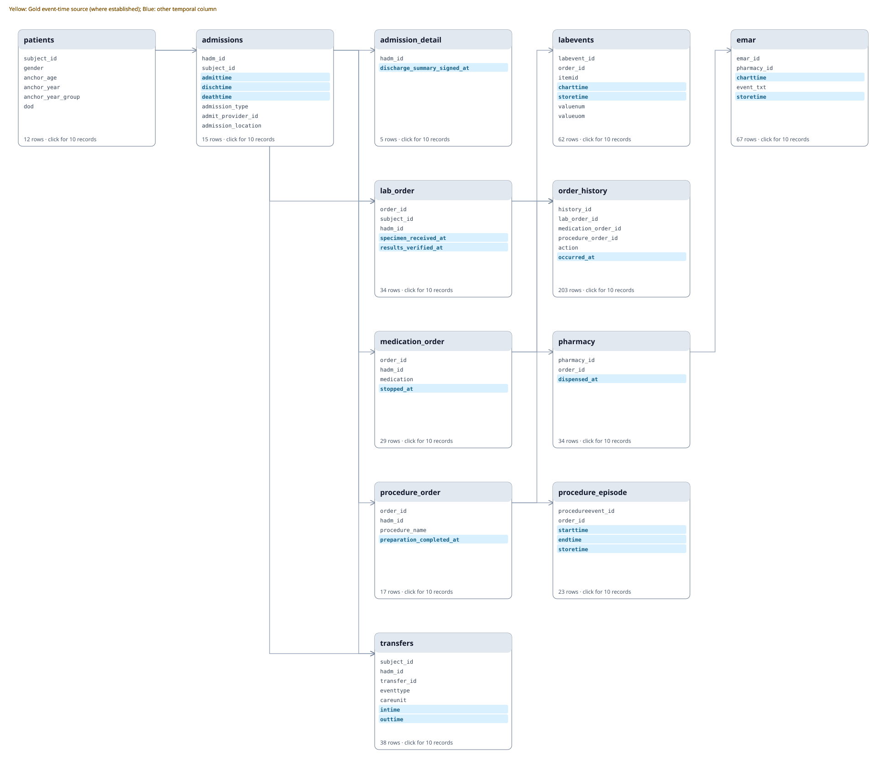
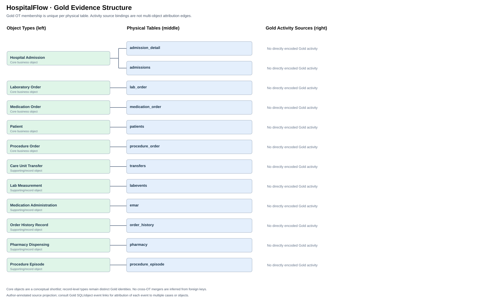

# hospitalflow — Database Inspection

Original SQLite records; **not model input**. Click a table name to inspect its actual first 10 rows.

| Table | Rows | Columns | Open preview |
|---|---:|---:|---|
| admission_detail | 5 | 2 | [First 10 rows](tables/admission_detail.md) |
| admissions | 15 | 16 | [First 10 rows](tables/admissions.md) |
| emar | 67 | 5 | [First 10 rows](tables/emar.md) |
| lab_order | 34 | 5 | [First 10 rows](tables/lab_order.md) |
| labevents | 62 | 7 | [First 10 rows](tables/labevents.md) |
| medication_order | 29 | 4 | [First 10 rows](tables/medication_order.md) |
| order_history | 203 | 6 | [First 10 rows](tables/order_history.md) |
| patients | 12 | 6 | [First 10 rows](tables/patients.md) |
| pharmacy | 34 | 3 | [First 10 rows](tables/pharmacy.md) |
| procedure_episode | 23 | 5 | [First 10 rows](tables/procedure_episode.md) |
| procedure_order | 17 | 4 | [First 10 rows](tables/procedure_order.md) |
| transfers | 38 | 7 | [First 10 rows](tables/transfers.md) |

The table links are the dependable GitHub navigation path; SVG click-through may vary by GitHub's rendering/security restrictions.
FK arrows are based on declared SQLite foreign keys. Informal semantic links are not asserted as physical FKs.

## MIMIC-IV-inspired schema

This dataset contains synthetic records, not real MIMIC-IV patient rows.

Patient master: patients (gender, anchor_age, anchor_year, anchor_year_group, dod). The patient_profile table was removed.

Admission times retain the MIMIC names admittime, dischtime, deathtime, edregtime, edouttime. Newly introduced transfers uses eventtype, careunit, intime, outtime.

The transfer event is eventtype=transfer at intime. Admission and discharge interval rows are not separately treated as new events.

[MIMIC-IV hosp reference](https://mimic.mit.edu/docs/iv/modules/hosp/).

## Gold Evidence Graph: OT → Physical Table → Direct Activities

OT (left), physical table (middle) and directly recorded event sources (right). Each physical table has exactly one Gold OT; foreign-key/event associations to several objects are distinct from OT membership. The three domain bands are visual grouping only, not merged object types.

[Gold source inventory](../gold_dfg/event_graph.md) · [Question-level Gold SQL and DFG](../gold_dfg/README.md)
