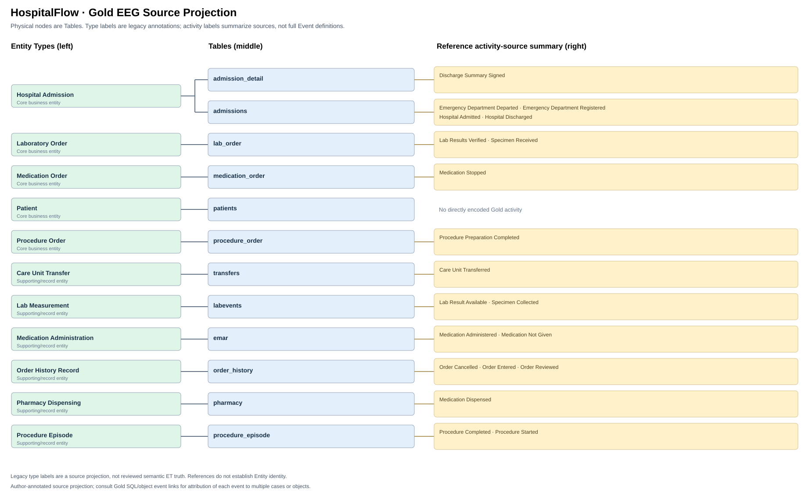
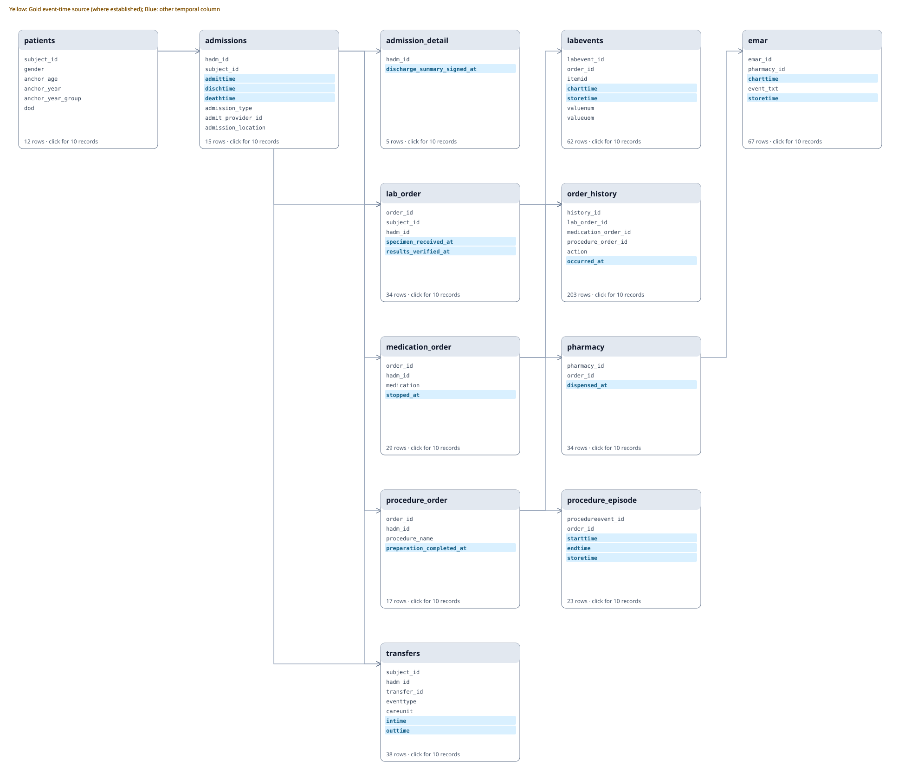

# HospitalFlow — Database and Gold Evidence Review

HospitalFlow models synthetic patient encounters, clinical orders, medication administration, laboratory testing, procedures, and care-unit transfers. Its patient and admission structures and time-column vocabulary are inspired by the public MIMIC-IV hospital schema; all records are synthetic, not MIMIC-IV patient records.

## Gold Event Extraction Graph (EEG) Source Projection

The diagram distinguishes core business entity concepts from supporting entity and event-record types. 
A table may identify or reference several ETs through different keys. These legacy source labels do not enumerate or validate those interpretations.

**This is a source-level author-annotated projection, not an inferred EEG or a validated semantic ET Gold.**
Gold SQL and record-level evidence are available in the linked inspection materials. The current membership labels originate from the legacy Gold; an independently validated ET/Entity identification context Gold is a separate evaluation task.

## Relational Schema (SQL foreign keys)

## Table inspector

| Physical table | Rows | Columns | ET candidate | First ten records |
|---|---:|---:|---|---|
| admission_detail | 5 | 2 | Hospital Admission | [Preview](tables/admission_detail.md) |
| admissions | 15 | 16 | Hospital Admission | [Preview](tables/admissions.md) |
| emar | 67 | 5 | Medication Administration | [Preview](tables/emar.md) |
| lab_order | 34 | 5 | Laboratory Order | [Preview](tables/lab_order.md) |
| labevents | 62 | 7 | Lab Measurement | [Preview](tables/labevents.md) |
| medication_order | 29 | 4 | Medication Order | [Preview](tables/medication_order.md) |
| order_history | 203 | 6 | Order History Record | [Preview](tables/order_history.md) |
| patients | 12 | 6 | Patient | [Preview](tables/patients.md) |
| pharmacy | 34 | 3 | Pharmacy Dispensing | [Preview](tables/pharmacy.md) |
| procedure_episode | 23 | 5 | Procedure Episode | [Preview](tables/procedure_episode.md) |
| procedure_order | 17 | 4 | Procedure Order | [Preview](tables/procedure_order.md) |
| transfers | 38 | 7 | Care Unit Transfer | [Preview](tables/transfers.md) |

## Entity Type candidates vs. core business objects

Legacy identity groups (ET candidates): **11**; principal business object concepts in this domain: **5**. 
The core set is a candidate semantic grouping, not a rule for merging unrelated instances or Entity identities.

**Core business concepts:** Hospital Admission, Laboratory Order, Medication Order, Patient, Procedure Order.

Supporting Gold types: Care Unit Transfer, Lab Measurement, Medication Administration, Order History Record, Pharmacy Dispensing, Procedure Episode.

## Evaluation evidence

- Gold SQL/CSV pairs executable and consistent: 42; compared event rows across questions: 6656.
- [Gold source inventory](../gold_dfg/event_graph.md)
- [Question-level Gold DFGs](../gold_dfg/README.md)
- [Editable Draw.io schema](../../docs/schema.drawio)

## MIMIC-IV provenance

HospitalFlow is a synthetic database informed by the [MIMIC-IV hospital schema](https://mimic.mit.edu/docs/iv/modules/hosp/).
The patient master contains gender, anchor_age, anchor_year, anchor_year_group and dod. The admissions record uses admittime, dischtime, deathtime, edregtime and edouttime. Transfer intervals use eventtype, careunit, intime and outtime.
All individual records are synthetic.
