# hospitalflow: questions and Gold DFGs

**EVALUATION ONLY — NEVER PROVIDE TO A MODEL.**

Source commit: `a0ba4c9631d12730d60bf7720d783a3a827b88dc`. Open index.html for search, review notes and complete case traces.

Node counts = event occurrences. Edge counts = adjacent selected events within a case. Dashed amber edges touch timestamp ties and depend on the tie-break rule. DFGs are projections of the selected log, not causal models.

All HospitalFlow records and row examples are synthetic. See the [dataset provenance](../../../datasets/hospitalflow/README.md) and [simulation code](../../../datasets/hospitalflow/simulation.py).

[Event graph inventory · tables, objects, OTs and activities](event_graph.md)

**Source tables** produced matched Gold events. **SQL tables** are all physical tables read by the Gold SQL, including join tables and shared CTE branches.

## Dataset overview

[Full DB schema](../../../datasets/hospitalflow/docs/schema_overview.md) · [Full-size ER diagram](../../../datasets/hospitalflow/docs/schema.png) · [SQL DDL](../../../datasets/hospitalflow/input/schema.sql)

Row examples in this review come from the [synthetic dataset generator](../../../datasets/hospitalflow/simulation.py).

Show all 44 questions and the schema preview

<table><tr><td width="50%" valign="top"><h3>All questions (44)</h3><table><thead><tr><th>ID</th><th>Type</th><th>Question</th></tr></thead><tbody><tr><td><a href="#h01--q1">H01</a></td><td>Q1</td><td>For each hospital admission, extract Order Entered, Order Reviewed and Order Cancelled events.</td></tr><tr><td><a href="#h01p--q2">H01P</a></td><td>Q2</td><td>For every hospital stay, build a timeline of when its orders were placed, checked and, if applicable, cancelled.</td></tr><tr><td><a href="#h02--q1">H02</a></td><td>Q1</td><td>For each hospital admission, extract Lab Result Available, Medication Administered and Procedure Completed events.</td></tr><tr><td><a href="#h02p--q2">H02P</a></td><td>Q2</td><td>For every hospital stay, show when laboratory findings became available, medicines were given and procedures finished.</td></tr><tr><td><a href="#h03--q1">H03</a></td><td>Q1</td><td>For each laboratory order, extract Specimen Collected, Lab Result Available and Lab Results Verified events.</td></tr><tr><td><a href="#h03p--q2">H03P</a></td><td>Q2</td><td>For every laboratory request, show when specimens were collected, when results became available and when those results were verified.</td></tr><tr><td><a href="#h04--q1">H04</a></td><td>Q1</td><td>For each medication order, extract Medication Dispensed, Medication Administered, Medication Not Given and Medication Stopped events.</td></tr><tr><td><a href="#h04p--q2">H04P</a></td><td>Q2</td><td>Create a timeline for each medication order covering dispensing, each dose given or not given, and the stopping of the medication.</td></tr><tr><td><a href="#h05--q1">H05</a></td><td>Q1</td><td>For each procedure order, extract Procedure Preparation Completed, Procedure Started and Procedure Completed events.</td></tr><tr><td><a href="#h05p--q2">H05P</a></td><td>Q2</td><td>For every procedure order, show when preparation finished and when each procedure occurrence began and ended.</td></tr><tr><td><a href="#h06--q1">H06</a></td><td>Q1</td><td>For each hospital admission, extract Emergency Department Registered, Hospital Admitted, Discharge Authorized and Hospital Discharged events.</td></tr><tr><td><a href="#h06p--q2">H06P</a></td><td>Q2</td><td>For every hospital stay, show arrival registration in the emergency department, admission, authorization to leave and actual discharge.</td></tr><tr><td><a href="#h07--q1">H07</a></td><td>Q1</td><td>For each patient, extract Hospital Admitted, Lab Result Available, Medication Administered, Procedure Completed and Hospital Discharged events.</td></tr><tr><td><a href="#h07p--q2">H07P</a></td><td>Q2</td><td>For each patient, collect the recorded hospital entries and departures, availability of laboratory findings, medicine administrations and finishes of procedures.</td></tr><tr><td><a href="#h08--q1">H08</a></td><td>Q1</td><td>For each hospital admission, extract Insurance Claim Paid events.</td></tr><tr><td><a href="#h08p--q2">H08P</a></td><td>Q2</td><td>For each hospital stay, show when its insurance claim was settled by payment.</td></tr><tr><td><a href="#hf01--q3">HF01</a></td><td>Q3</td><td>Extract the full recorded lifecycle for each patient.</td></tr><tr><td><a href="#hf01p--q4">HF01P</a></td><td>Q4</td><td>Build a complete timeline of all recorded care events for every patient.</td></tr><tr><td><a href="#hf02--q3">HF02</a></td><td>Q3</td><td>Extract the full recorded lifecycle for each hospital admission.</td></tr><tr><td><a href="#hf02p--q4">HF02P</a></td><td>Q4</td><td>Show the entire recorded history of each individual hospital stay.</td></tr><tr><td><a href="#hf03--q3">HF03</a></td><td>Q3</td><td>Extract the full recorded lifecycle for each order history record.</td></tr><tr><td><a href="#hf03p--q4">HF03P</a></td><td>Q4</td><td>Show the complete recorded history of every individual order history record.</td></tr><tr><td><a href="#hf04--q3">HF04</a></td><td>Q3</td><td>Extract the full recorded lifecycle for each laboratory order.</td></tr><tr><td><a href="#hf04p--q4">HF04P</a></td><td>Q4</td><td>Show everything recorded over the life of each laboratory order.</td></tr><tr><td><a href="#hf05--q3">HF05</a></td><td>Q3</td><td>Extract the full recorded lifecycle for each medication order.</td></tr><tr><td><a href="#hf05p--q4">HF05P</a></td><td>Q4</td><td>Build the complete recorded history of each medication order.</td></tr><tr><td><a href="#hf06--q3">HF06</a></td><td>Q3</td><td>Extract the full recorded lifecycle for each procedure order.</td></tr><tr><td><a href="#hf06p--q4">HF06P</a></td><td>Q4</td><td>Trace the whole recorded lifecycle of every procedure order.</td></tr><tr><td><a href="#h09--q1">H09</a></td><td>Q1</td><td>For each patient, extract Patient Profile Verified events.</td></tr><tr><td><a href="#h09p--q2">H09P</a></td><td>Q2</td><td>For each patient, show when their supplementary personal information was verified.</td></tr><tr><td><a href="#h10--q1">H10</a></td><td>Q1</td><td>For each hospital admission, extract Discharge Summary Signed events.</td></tr><tr><td><a href="#h10p--q2">H10P</a></td><td>Q2</td><td>For each hospital stay, show when its discharge summary was signed.</td></tr><tr><td><a href="#h11--q1">H11</a></td><td>Q1</td><td>For each patient, extract Patient Profile Verified and Hospital Admitted events.</td></tr><tr><td><a href="#h11p--q2">H11P</a></td><td>Q2</td><td>Build a timeline for every patient showing verification of their supplementary personal information and their entries into hospital.</td></tr><tr><td><a href="#hf07--q3">HF07</a></td><td>Q3</td><td>Extract the full recorded lifecycle for each lab measurement.</td></tr><tr><td><a href="#hf07p--q4">HF07P</a></td><td>Q4</td><td>Show the entire recorded history of each individual laboratory measurement.</td></tr><tr><td><a href="#hf08--q3">HF08</a></td><td>Q3</td><td>Extract the full recorded lifecycle for each medication administration.</td></tr><tr><td><a href="#hf08p--q4">HF08P</a></td><td>Q4</td><td>Build the complete recorded history of every individual medication administration record.</td></tr><tr><td><a href="#hf09--q3">HF09</a></td><td>Q3</td><td>Extract the full recorded lifecycle for each procedure episode.</td></tr><tr><td><a href="#hf09p--q4">HF09P</a></td><td>Q4</td><td>Trace each individual procedure episode through its whole recorded lifecycle.</td></tr><tr><td><a href="#hf10--q3">HF10</a></td><td>Q3</td><td>Extract the full recorded lifecycle for each pharmacy dispensing record.</td></tr><tr><td><a href="#hf10p--q4">HF10P</a></td><td>Q4</td><td>Show the complete recorded course associated with each individual pharmacy dispensing record.</td></tr><tr><td><a href="#h12--q1">H12</a></td><td>Q1</td><td>For each pharmacy dispensing record, extract Medication Dispensed, Medication Administered and Medication Not Given events.</td></tr><tr><td><a href="#h12p--q2">H12P</a></td><td>Q2</td><td>Group the medication dispensing, subsequent doses given and doses not given by the pharmacy dispensing record they refer to.</td></tr></tbody></table></td><td width="50%" valign="top"><h3>Database schema</h3>

<a href="../../../datasets/hospitalflow/docs/schema.png">Full-size diagram</a> · <a href="../../../datasets/hospitalflow/input/schema.sql">Full SQL schema</a>
</td></tr></table>

## H01 — Q1

For each hospital admission, extract Order Entered, Order Reviewed and Order Cancelled events.

Events: **194** · Cases with events: **15** · Activities: **3** · Edges: **8** · Source tables: **1** · SQL tables: **11**

<table><tr><td width="42%" valign="top"><a href="graphs/H01.svg">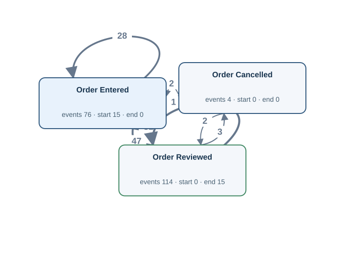</a></td><td width="58%" valign="top">
<a href="../../../datasets/hospitalflow/private/gold_sql/H01.sql">Gold SQL</a> · <a href="../../../datasets/hospitalflow/private/gold_logs/H01.csv">Gold CSV</a> · <a href="../../../datasets/hospitalflow/input/database.sqlite">Full source database (SQLite)</a>

<code>order_history</code> · 194 matched source rows
<table><tr><th>Column</th><th>Row 1</th><th>Row 2</th><th>Row 3</th></tr><tr><th>history_id</th><td>1</td><td>2</td><td>35</td></tr><tr><th>lab_order_id</th><td><em>NULL</em></td><td><em>NULL</em></td><td><em>NULL</em></td></tr><tr><th>medication_order_id</th><td>32064975</td><td>32064975</td><td><em>NULL</em></td></tr><tr><th>procedure_order_id</th><td><em>NULL</em></td><td><em>NULL</em></td><td>33060273</td></tr><tr><th>action</th><td>ENTERED</td><td>REVIEWED</td><td>CANCELLED</td></tr><tr><th>occurred_at</th><td>2026-01-17T17:00:00Z</td><td>2026-01-17T17:22:00Z</td><td>2026-02-15T00:40:01Z</td></tr></table>
<strong>Gold output for the same source rows</strong>
<ul><li>Row 1 → Order Entered · event OH:1 · case A:20000001 · time from <code>occurred_at</code></li><li>Row 2 → Order Reviewed · event OH:2 · case A:20000001 · time from <code>occurred_at</code></li><li>Row 3 → Order Cancelled · event OH:35 · case A:20000004 · time from <code>occurred_at</code></li></ul>

FK-linked case and join evidence
<ul><li><code>medication_order</code> → <code>admissions</code> · hadm_id → hadm_id · hadm_id = 20000001</li><li><code>order_history</code> → <code>lab_order</code> · lab_order_id → order_id · order_id = 31070762</li><li><code>order_history</code> → <code>medication_order</code> · medication_order_id → order_id · order_id = 32064975</li><li><code>order_history</code> → <code>procedure_order</code> · procedure_order_id → order_id · order_id = 33032683</li></ul>
</td></tr></table>

## H01P — Q2

For every hospital stay, build a timeline of when its orders were placed, checked and, if applicable, cancelled.

Events: **194** · Cases with events: **15** · Activities: **3** · Edges: **8** · Source tables: **1** · SQL tables: **11**

<table><tr><td width="42%" valign="top"></td><td width="58%" valign="top">
<a href="../../../datasets/hospitalflow/private/gold_sql/H01P.sql">Gold SQL</a> · <a href="../../../datasets/hospitalflow/private/gold_logs/H01P.csv">Gold CSV</a> · <a href="../../../datasets/hospitalflow/input/database.sqlite">Full source database (SQLite)</a>

<code>order_history</code> · 194 matched source rows
<table><tr><th>Column</th><th>Row 1</th><th>Row 2</th><th>Row 3</th></tr><tr><th>history_id</th><td>1</td><td>2</td><td>35</td></tr><tr><th>lab_order_id</th><td><em>NULL</em></td><td><em>NULL</em></td><td><em>NULL</em></td></tr><tr><th>medication_order_id</th><td>32064975</td><td>32064975</td><td><em>NULL</em></td></tr><tr><th>procedure_order_id</th><td><em>NULL</em></td><td><em>NULL</em></td><td>33060273</td></tr><tr><th>action</th><td>ENTERED</td><td>REVIEWED</td><td>CANCELLED</td></tr><tr><th>occurred_at</th><td>2026-01-17T17:00:00Z</td><td>2026-01-17T17:22:00Z</td><td>2026-02-15T00:40:01Z</td></tr></table>
<strong>Gold output for the same source rows</strong>
<ul><li>Row 1 → Order Entered · event OH:1 · case A:20000001 · time from <code>occurred_at</code></li><li>Row 2 → Order Reviewed · event OH:2 · case A:20000001 · time from <code>occurred_at</code></li><li>Row 3 → Order Cancelled · event OH:35 · case A:20000004 · time from <code>occurred_at</code></li></ul>

FK-linked case and join evidence
<ul><li><code>medication_order</code> → <code>admissions</code> · hadm_id → hadm_id · hadm_id = 20000001</li><li><code>order_history</code> → <code>lab_order</code> · lab_order_id → order_id · order_id = 31070762</li><li><code>order_history</code> → <code>medication_order</code> · medication_order_id → order_id · order_id = 32064975</li><li><code>order_history</code> → <code>procedure_order</code> · procedure_order_id → order_id · order_id = 33032683</li></ul>
</td></tr></table>

## H02 — Q1

For each hospital admission, extract Lab Result Available, Medication Administered and Procedure Completed events.

Events: **124** · Cases with events: **14** · Activities: **3** · Edges: **9** · Source tables: **3** · SQL tables: **11**

<table><tr><td width="42%" valign="top"><a href="graphs/H02.svg">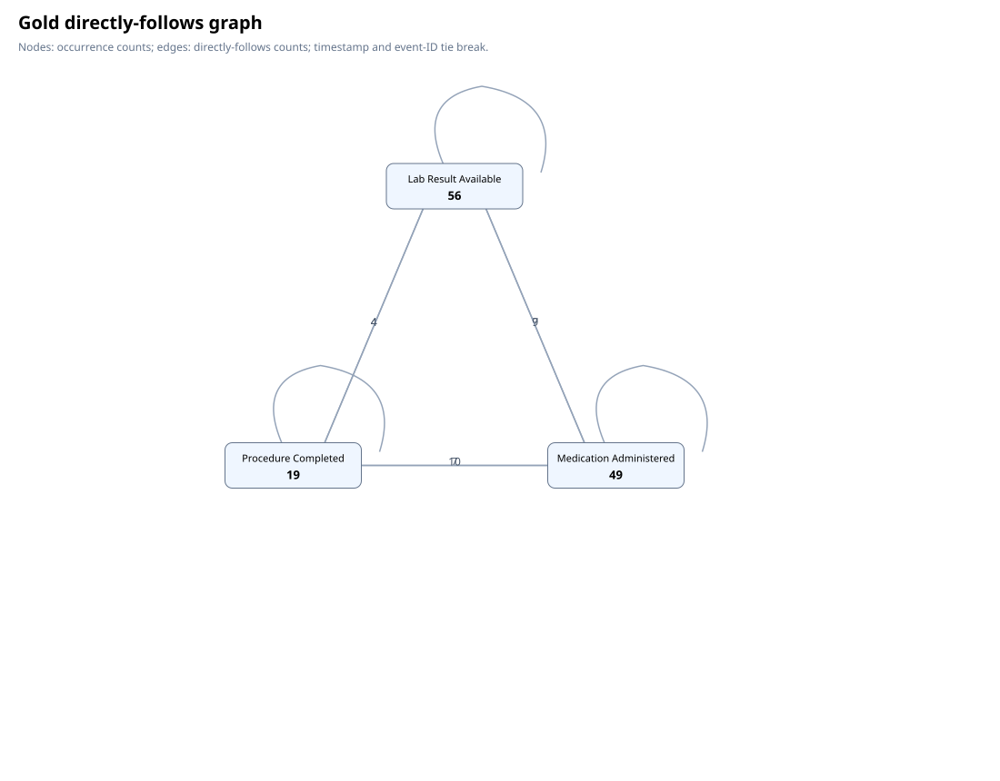</a></td><td width="58%" valign="top">
<a href="../../../datasets/hospitalflow/private/gold_sql/H02.sql">Gold SQL</a> · <a href="../../../datasets/hospitalflow/private/gold_logs/H02.csv">Gold CSV</a> · <a href="../../../datasets/hospitalflow/input/database.sqlite">Full source database (SQLite)</a>

<code>emar</code> · 49 matched source rows
<table><tr><th>Column</th><th>Row 1</th><th>Row 2</th><th>Row 3</th></tr><tr><th>emar_id</th><td>1</td><td>8</td><td>3</td></tr><tr><th>pharmacy_id</th><td>40000001</td><td>40000003</td><td>40000001</td></tr><tr><th>charttime</th><td>2026-01-17T19:31:00Z</td><td>2026-01-17T23:03:00Z</td><td>2026-01-17T23:09:00Z</td></tr><tr><th>event_txt</th><td>Administered</td><td>Administered</td><td>Administered</td></tr><tr><th>storetime</th><td>2026-01-17T20:12:00Z</td><td>2026-01-17T23:12:00Z</td><td>2026-01-17T23:56:00Z</td></tr></table>
<strong>Gold output for the same source rows</strong>
<ul><li>Row 1 → Medication Administered · event EMAR:1 · case A:20000001 · time from <code>charttime</code></li><li>Row 2 → Medication Administered · event EMAR:8 · case A:20000001 · time from <code>charttime</code></li><li>Row 3 → Medication Administered · event EMAR:3 · case A:20000001 · time from <code>charttime</code></li></ul>

<code>labevents</code> · 56 matched source rows
<table><tr><th>Column</th><th>Row 1</th><th>Row 2</th><th>Row 3</th></tr><tr><th>labevent_id</th><td>1</td><td>4</td><td>2</td></tr><tr><th>order_id</th><td>31070762</td><td>31073704</td><td>31079248</td></tr><tr><th>itemid</th><td>1003</td><td>1001</td><td>1003</td></tr><tr><th>charttime</th><td>2026-01-27T19:38:00Z</td><td>2026-02-03T15:46:00Z</td><td>2026-02-03T16:09:00Z</td></tr><tr><th>storetime</th><td>2026-01-27T23:09:00Z</td><td>2026-02-03T17:28:00Z</td><td>2026-02-03T19:00:00Z</td></tr><tr><th>valuenum</th><td>14.6</td><td>1.13</td><td>14.1</td></tr><tr><th>valueuom</th><td>g/dL</td><td>mg/dL</td><td>g/dL</td></tr></table>
<strong>Gold output for the same source rows</strong>
<ul><li>Row 1 → Lab Result Available · event LABEV:1:result · case A:20000002 · time from <code>storetime</code></li><li>Row 2 → Lab Result Available · event LABEV:4:result · case A:20000003 · time from <code>storetime</code></li><li>Row 3 → Lab Result Available · event LABEV:2:result · case A:20000003 · time from <code>storetime</code></li></ul>

<code>procedure_episode</code> · 19 matched source rows
<table><tr><th>Column</th><th>Row 1</th><th>Row 2</th><th>Row 3</th></tr><tr><th>procedureevent_id</th><td>1</td><td>2</td><td>3</td></tr><tr><th>order_id</th><td>33032683</td><td>33088335</td><td>33088335</td></tr><tr><th>starttime</th><td>2026-01-27T18:22:00Z</td><td>2026-02-15T01:42:00Z</td><td>2026-02-15T05:27:00Z</td></tr><tr><th>endtime</th><td>2026-01-27T19:24:00Z</td><td>2026-02-15T02:25:00Z</td><td>2026-02-15T06:34:00Z</td></tr><tr><th>storetime</th><td>2026-01-27T18:40:00Z</td><td>2026-02-15T02:16:00Z</td><td>2026-02-15T05:53:00Z</td></tr></table>
<strong>Gold output for the same source rows</strong>
<ul><li>Row 1 → Procedure Completed · event PROCEV:1:end · case A:20000002 · time from <code>endtime</code></li><li>Row 2 → Procedure Completed · event PROCEV:2:end · case A:20000004 · time from <code>endtime</code></li><li>Row 3 → Procedure Completed · event PROCEV:3:end · case A:20000004 · time from <code>endtime</code></li></ul>

FK-linked case and join evidence
<ul><li><code>procedure_order</code> → <code>admissions</code> · hadm_id → hadm_id · hadm_id = 20000002</li><li><code>labevents</code> → <code>lab_order</code> · order_id → order_id · order_id = 31070762</li><li><code>pharmacy</code> → <code>medication_order</code> · order_id → order_id · order_id = 32064975</li><li><code>emar</code> → <code>pharmacy</code> · pharmacy_id → pharmacy_id · pharmacy_id = 40000001</li><li><code>procedure_episode</code> → <code>procedure_order</code> · order_id → order_id · order_id = 33032683</li></ul>
</td></tr></table>

## H02P — Q2

For every hospital stay, show when laboratory findings became available, medicines were given and procedures finished.

Events: **124** · Cases with events: **14** · Activities: **3** · Edges: **9** · Source tables: **3** · SQL tables: **11**

<table><tr><td width="42%" valign="top"></td><td width="58%" valign="top">
<a href="../../../datasets/hospitalflow/private/gold_sql/H02P.sql">Gold SQL</a> · <a href="../../../datasets/hospitalflow/private/gold_logs/H02P.csv">Gold CSV</a> · <a href="../../../datasets/hospitalflow/input/database.sqlite">Full source database (SQLite)</a>

<code>emar</code> · 49 matched source rows
<table><tr><th>Column</th><th>Row 1</th><th>Row 2</th><th>Row 3</th></tr><tr><th>emar_id</th><td>1</td><td>8</td><td>3</td></tr><tr><th>pharmacy_id</th><td>40000001</td><td>40000003</td><td>40000001</td></tr><tr><th>charttime</th><td>2026-01-17T19:31:00Z</td><td>2026-01-17T23:03:00Z</td><td>2026-01-17T23:09:00Z</td></tr><tr><th>event_txt</th><td>Administered</td><td>Administered</td><td>Administered</td></tr><tr><th>storetime</th><td>2026-01-17T20:12:00Z</td><td>2026-01-17T23:12:00Z</td><td>2026-01-17T23:56:00Z</td></tr></table>
<strong>Gold output for the same source rows</strong>
<ul><li>Row 1 → Medication Administered · event EMAR:1 · case A:20000001 · time from <code>charttime</code></li><li>Row 2 → Medication Administered · event EMAR:8 · case A:20000001 · time from <code>charttime</code></li><li>Row 3 → Medication Administered · event EMAR:3 · case A:20000001 · time from <code>charttime</code></li></ul>

<code>labevents</code> · 56 matched source rows
<table><tr><th>Column</th><th>Row 1</th><th>Row 2</th><th>Row 3</th></tr><tr><th>labevent_id</th><td>1</td><td>4</td><td>2</td></tr><tr><th>order_id</th><td>31070762</td><td>31073704</td><td>31079248</td></tr><tr><th>itemid</th><td>1003</td><td>1001</td><td>1003</td></tr><tr><th>charttime</th><td>2026-01-27T19:38:00Z</td><td>2026-02-03T15:46:00Z</td><td>2026-02-03T16:09:00Z</td></tr><tr><th>storetime</th><td>2026-01-27T23:09:00Z</td><td>2026-02-03T17:28:00Z</td><td>2026-02-03T19:00:00Z</td></tr><tr><th>valuenum</th><td>14.6</td><td>1.13</td><td>14.1</td></tr><tr><th>valueuom</th><td>g/dL</td><td>mg/dL</td><td>g/dL</td></tr></table>
<strong>Gold output for the same source rows</strong>
<ul><li>Row 1 → Lab Result Available · event LABEV:1:result · case A:20000002 · time from <code>storetime</code></li><li>Row 2 → Lab Result Available · event LABEV:4:result · case A:20000003 · time from <code>storetime</code></li><li>Row 3 → Lab Result Available · event LABEV:2:result · case A:20000003 · time from <code>storetime</code></li></ul>

<code>procedure_episode</code> · 19 matched source rows
<table><tr><th>Column</th><th>Row 1</th><th>Row 2</th><th>Row 3</th></tr><tr><th>procedureevent_id</th><td>1</td><td>2</td><td>3</td></tr><tr><th>order_id</th><td>33032683</td><td>33088335</td><td>33088335</td></tr><tr><th>starttime</th><td>2026-01-27T18:22:00Z</td><td>2026-02-15T01:42:00Z</td><td>2026-02-15T05:27:00Z</td></tr><tr><th>endtime</th><td>2026-01-27T19:24:00Z</td><td>2026-02-15T02:25:00Z</td><td>2026-02-15T06:34:00Z</td></tr><tr><th>storetime</th><td>2026-01-27T18:40:00Z</td><td>2026-02-15T02:16:00Z</td><td>2026-02-15T05:53:00Z</td></tr></table>
<strong>Gold output for the same source rows</strong>
<ul><li>Row 1 → Procedure Completed · event PROCEV:1:end · case A:20000002 · time from <code>endtime</code></li><li>Row 2 → Procedure Completed · event PROCEV:2:end · case A:20000004 · time from <code>endtime</code></li><li>Row 3 → Procedure Completed · event PROCEV:3:end · case A:20000004 · time from <code>endtime</code></li></ul>

FK-linked case and join evidence
<ul><li><code>procedure_order</code> → <code>admissions</code> · hadm_id → hadm_id · hadm_id = 20000002</li><li><code>labevents</code> → <code>lab_order</code> · order_id → order_id · order_id = 31070762</li><li><code>pharmacy</code> → <code>medication_order</code> · order_id → order_id · order_id = 32064975</li><li><code>emar</code> → <code>pharmacy</code> · pharmacy_id → pharmacy_id · pharmacy_id = 40000001</li><li><code>procedure_episode</code> → <code>procedure_order</code> · order_id → order_id · order_id = 33032683</li></ul>
</td></tr></table>

## H03 — Q1

For each laboratory order, extract Specimen Collected, Lab Result Available and Lab Results Verified events.

Events: **154** · Cases with events: **30** · Activities: **3** · Edges: **4** · Source tables: **2** · SQL tables: **11**

<table><tr><td width="42%" valign="top"><a href="graphs/H03.svg">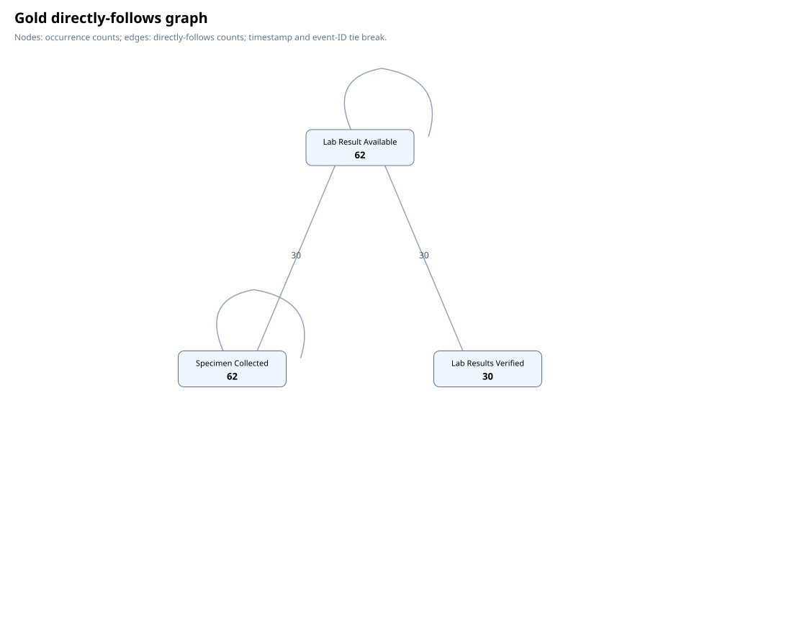</a></td><td width="58%" valign="top">
<a href="../../../datasets/hospitalflow/private/gold_sql/H03.sql">Gold SQL</a> · <a href="../../../datasets/hospitalflow/private/gold_logs/H03.csv">Gold CSV</a> · <a href="../../../datasets/hospitalflow/input/database.sqlite">Full source database (SQLite)</a>

<code>lab_order</code> · 30 matched source rows
<table><tr><th>Column</th><th>Row 1</th><th>Row 2</th><th>Row 3</th></tr><tr><th>order_id</th><td>30000117</td><td>30000691</td><td>30000983</td></tr><tr><th>subject_id</th><td>10000005</td><td>10000003</td><td>10000009</td></tr><tr><th>hadm_id</th><td>20000009</td><td>20000006</td><td>20000013</td></tr><tr><th>specimen_received_at</th><td>2026-03-25T19:11:00Z</td><td>2026-03-06T10:37:00Z</td><td>2026-05-31T07:57:00Z</td></tr><tr><th>results_verified_at</th><td>2026-03-25T20:41:00Z</td><td>2026-03-06T15:06:00Z</td><td>2026-05-31T13:32:00Z</td></tr></table>
<strong>Gold output for the same source rows</strong>
<ul><li>Row 1 → Lab Results Verified · event LAB:30000117:verified · case LAB:30000117 · time from <code>results_verified_at</code></li><li>Row 2 → Lab Results Verified · event LAB:30000691:verified · case LAB:30000691 · time from <code>results_verified_at</code></li><li>Row 3 → Lab Results Verified · event LAB:30000983:verified · case LAB:30000983 · time from <code>results_verified_at</code></li></ul>

<code>labevents</code> · 62 matched source rows
<table><tr><th>Column</th><th>Row 1</th><th>Row 2</th><th>Row 3</th></tr><tr><th>labevent_id</th><td>33</td><td>10</td><td>8</td></tr><tr><th>order_id</th><td>30000117</td><td>30000691</td><td>30000691</td></tr><tr><th>itemid</th><td>1003</td><td>1003</td><td>1001</td></tr><tr><th>charttime</th><td>2026-03-25T18:19:00Z</td><td>2026-03-06T08:37:00Z</td><td>2026-03-06T09:13:00Z</td></tr><tr><th>storetime</th><td>2026-03-25T19:43:00Z</td><td>2026-03-06T11:15:00Z</td><td>2026-03-06T13:48:00Z</td></tr><tr><th>valuenum</th><td>14.3</td><td>12.5</td><td>1.66</td></tr><tr><th>valueuom</th><td>g/dL</td><td>g/dL</td><td>mg/dL</td></tr></table>
<strong>Gold output for the same source rows</strong>
<ul><li>Row 1 → Specimen Collected · event LABEV:33:chart · case LAB:30000117 · time from <code>charttime</code></li><li>Row 1 → Lab Result Available · event LABEV:33:result · case LAB:30000117 · time from <code>storetime</code></li><li>Row 2 → Specimen Collected · event LABEV:10:chart · case LAB:30000691 · time from <code>charttime</code></li><li>Row 2 → Lab Result Available · event LABEV:10:result · case LAB:30000691 · time from <code>storetime</code></li><li>Row 3 → Specimen Collected · event LABEV:8:chart · case LAB:30000691 · time from <code>charttime</code></li><li>Row 3 → Lab Result Available · event LABEV:8:result · case LAB:30000691 · time from <code>storetime</code></li></ul>

FK-linked case and join evidence
<ul><li><code>lab_order</code> → <code>admissions</code> · hadm_id → hadm_id · hadm_id = 20000009</li></ul>
</td></tr></table>

## H03P — Q2

For every laboratory request, show when specimens were collected, when results became available and when those results were verified.

Events: **154** · Cases with events: **30** · Activities: **3** · Edges: **4** · Source tables: **2** · SQL tables: **11**

<table><tr><td width="42%" valign="top"></td><td width="58%" valign="top">
<a href="../../../datasets/hospitalflow/private/gold_sql/H03P.sql">Gold SQL</a> · <a href="../../../datasets/hospitalflow/private/gold_logs/H03P.csv">Gold CSV</a> · <a href="../../../datasets/hospitalflow/input/database.sqlite">Full source database (SQLite)</a>

<code>lab_order</code> · 30 matched source rows
<table><tr><th>Column</th><th>Row 1</th><th>Row 2</th><th>Row 3</th></tr><tr><th>order_id</th><td>30000117</td><td>30000691</td><td>30000983</td></tr><tr><th>subject_id</th><td>10000005</td><td>10000003</td><td>10000009</td></tr><tr><th>hadm_id</th><td>20000009</td><td>20000006</td><td>20000013</td></tr><tr><th>specimen_received_at</th><td>2026-03-25T19:11:00Z</td><td>2026-03-06T10:37:00Z</td><td>2026-05-31T07:57:00Z</td></tr><tr><th>results_verified_at</th><td>2026-03-25T20:41:00Z</td><td>2026-03-06T15:06:00Z</td><td>2026-05-31T13:32:00Z</td></tr></table>
<strong>Gold output for the same source rows</strong>
<ul><li>Row 1 → Lab Results Verified · event LAB:30000117:verified · case LAB:30000117 · time from <code>results_verified_at</code></li><li>Row 2 → Lab Results Verified · event LAB:30000691:verified · case LAB:30000691 · time from <code>results_verified_at</code></li><li>Row 3 → Lab Results Verified · event LAB:30000983:verified · case LAB:30000983 · time from <code>results_verified_at</code></li></ul>

<code>labevents</code> · 62 matched source rows
<table><tr><th>Column</th><th>Row 1</th><th>Row 2</th><th>Row 3</th></tr><tr><th>labevent_id</th><td>33</td><td>10</td><td>8</td></tr><tr><th>order_id</th><td>30000117</td><td>30000691</td><td>30000691</td></tr><tr><th>itemid</th><td>1003</td><td>1003</td><td>1001</td></tr><tr><th>charttime</th><td>2026-03-25T18:19:00Z</td><td>2026-03-06T08:37:00Z</td><td>2026-03-06T09:13:00Z</td></tr><tr><th>storetime</th><td>2026-03-25T19:43:00Z</td><td>2026-03-06T11:15:00Z</td><td>2026-03-06T13:48:00Z</td></tr><tr><th>valuenum</th><td>14.3</td><td>12.5</td><td>1.66</td></tr><tr><th>valueuom</th><td>g/dL</td><td>g/dL</td><td>mg/dL</td></tr></table>
<strong>Gold output for the same source rows</strong>
<ul><li>Row 1 → Specimen Collected · event LABEV:33:chart · case LAB:30000117 · time from <code>charttime</code></li><li>Row 1 → Lab Result Available · event LABEV:33:result · case LAB:30000117 · time from <code>storetime</code></li><li>Row 2 → Specimen Collected · event LABEV:10:chart · case LAB:30000691 · time from <code>charttime</code></li><li>Row 2 → Lab Result Available · event LABEV:10:result · case LAB:30000691 · time from <code>storetime</code></li><li>Row 3 → Specimen Collected · event LABEV:8:chart · case LAB:30000691 · time from <code>charttime</code></li><li>Row 3 → Lab Result Available · event LABEV:8:result · case LAB:30000691 · time from <code>storetime</code></li></ul>

FK-linked case and join evidence
<ul><li><code>lab_order</code> → <code>admissions</code> · hadm_id → hadm_id · hadm_id = 20000009</li></ul>
</td></tr></table>

## H04 — Q1

For each medication order, extract Medication Dispensed, Medication Administered, Medication Not Given and Medication Stopped events.

Events: **126** · Cases with events: **28** · Activities: **4** · Edges: **11** · Source tables: **3** · SQL tables: **11**

<table><tr><td width="42%" valign="top"><a href="graphs/H04.svg">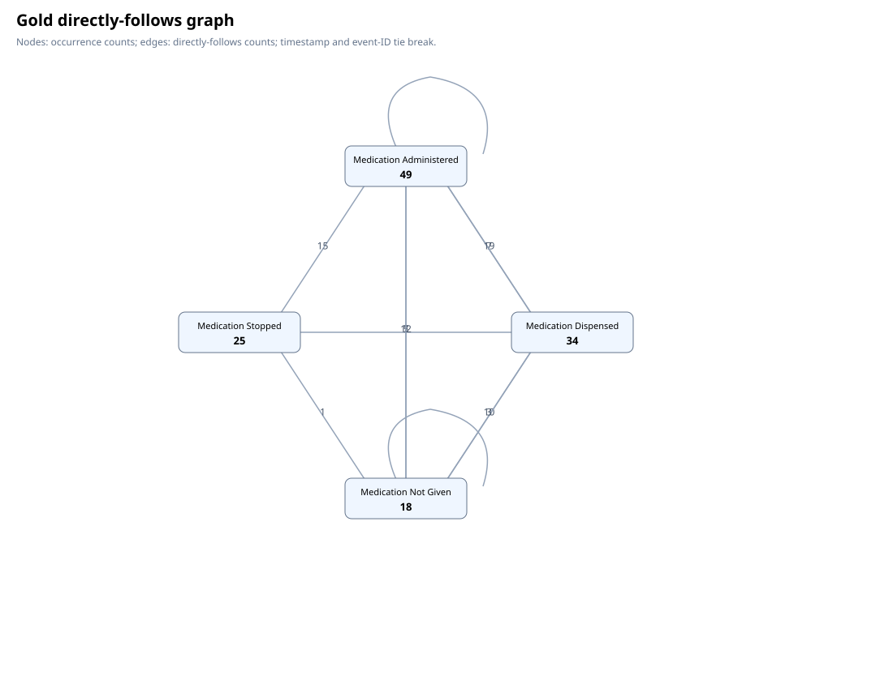</a></td><td width="58%" valign="top">
<a href="../../../datasets/hospitalflow/private/gold_sql/H04.sql">Gold SQL</a> · <a href="../../../datasets/hospitalflow/private/gold_logs/H04.csv">Gold CSV</a> · <a href="../../../datasets/hospitalflow/input/database.sqlite">Full source database (SQLite)</a>

<code>emar</code> · 67 matched source rows
<table><tr><th>Column</th><th>Row 1</th><th>Row 2</th><th>Row 3</th></tr><tr><th>emar_id</th><td>20</td><td>23</td><td>21</td></tr><tr><th>pharmacy_id</th><td>40000009</td><td>40000010</td><td>40000009</td></tr><tr><th>charttime</th><td>2026-03-08T23:22:00Z</td><td>2026-03-09T00:44:00Z</td><td>2026-03-09T01:43:00Z</td></tr><tr><th>event_txt</th><td>Administered</td><td>Not Given</td><td>Not Given</td></tr><tr><th>storetime</th><td>2026-03-08T23:41:00Z</td><td>2026-03-09T01:30:00Z</td><td>2026-03-09T02:25:00Z</td></tr></table>
<strong>Gold output for the same source rows</strong>
<ul><li>Row 1 → Medication Administered · event EMAR:20 · case MED:30000691 · time from <code>charttime</code></li><li>Row 2 → Medication Not Given · event EMAR:23 · case MED:30000691 · time from <code>charttime</code></li><li>Row 3 → Medication Not Given · event EMAR:21 · case MED:30000691 · time from <code>charttime</code></li></ul>

<code>medication_order</code> · 25 matched source rows
<table><tr><th>Column</th><th>Row 1</th><th>Row 2</th><th>Row 3</th></tr><tr><th>order_id</th><td>30000117</td><td>30000691</td><td>30000983</td></tr><tr><th>hadm_id</th><td>20000010</td><td>20000007</td><td>20000013</td></tr><tr><th>medication</th><td>Metformin</td><td>Omeprazole</td><td>Amoxicillin</td></tr><tr><th>stopped_at</th><td>2026-04-11T22:04:00Z</td><td>2026-03-09T18:11:00Z</td><td>2026-05-31T17:45:00Z</td></tr></table>
<strong>Gold output for the same source rows</strong>
<ul><li>Row 1 → Medication Stopped · event MED:30000117:stop · case MED:30000117 · time from <code>stopped_at</code></li><li>Row 2 → Medication Stopped · event MED:30000691:stop · case MED:30000691 · time from <code>stopped_at</code></li><li>Row 3 → Medication Stopped · event MED:30000983:stop · case MED:30000983 · time from <code>stopped_at</code></li></ul>

<code>pharmacy</code> · 34 matched source rows
<table><tr><th>Column</th><th>Row 1</th><th>Row 2</th><th>Row 3</th></tr><tr><th>pharmacy_id</th><td>40000022</td><td>40000009</td><td>40000010</td></tr><tr><th>order_id</th><td>30000117</td><td>30000691</td><td>30000691</td></tr><tr><th>dispensed_at</th><td>2026-04-11T06:53:00Z</td><td>2026-03-08T21:16:00Z</td><td>2026-03-08T23:40:00Z</td></tr></table>
<strong>Gold output for the same source rows</strong>
<ul><li>Row 1 → Medication Dispensed · event PHARM:40000022:dispense · case MED:30000117 · time from <code>dispensed_at</code></li><li>Row 2 → Medication Dispensed · event PHARM:40000009:dispense · case MED:30000691 · time from <code>dispensed_at</code></li><li>Row 3 → Medication Dispensed · event PHARM:40000010:dispense · case MED:30000691 · time from <code>dispensed_at</code></li></ul>

FK-linked case and join evidence
<ul><li><code>medication_order</code> → <code>admissions</code> · hadm_id → hadm_id · hadm_id = 20000010</li><li><code>pharmacy</code> → <code>medication_order</code> · order_id → order_id · order_id = 32010923</li></ul>
</td></tr></table>

## H04P — Q2

Create a timeline for each medication order covering dispensing, each dose given or not given, and the stopping of the medication.

Events: **126** · Cases with events: **28** · Activities: **4** · Edges: **11** · Source tables: **3** · SQL tables: **11**

<table><tr><td width="42%" valign="top"></td><td width="58%" valign="top">
<a href="../../../datasets/hospitalflow/private/gold_sql/H04P.sql">Gold SQL</a> · <a href="../../../datasets/hospitalflow/private/gold_logs/H04P.csv">Gold CSV</a> · <a href="../../../datasets/hospitalflow/input/database.sqlite">Full source database (SQLite)</a>

<code>emar</code> · 67 matched source rows
<table><tr><th>Column</th><th>Row 1</th><th>Row 2</th><th>Row 3</th></tr><tr><th>emar_id</th><td>20</td><td>23</td><td>21</td></tr><tr><th>pharmacy_id</th><td>40000009</td><td>40000010</td><td>40000009</td></tr><tr><th>charttime</th><td>2026-03-08T23:22:00Z</td><td>2026-03-09T00:44:00Z</td><td>2026-03-09T01:43:00Z</td></tr><tr><th>event_txt</th><td>Administered</td><td>Not Given</td><td>Not Given</td></tr><tr><th>storetime</th><td>2026-03-08T23:41:00Z</td><td>2026-03-09T01:30:00Z</td><td>2026-03-09T02:25:00Z</td></tr></table>
<strong>Gold output for the same source rows</strong>
<ul><li>Row 1 → Medication Administered · event EMAR:20 · case MED:30000691 · time from <code>charttime</code></li><li>Row 2 → Medication Not Given · event EMAR:23 · case MED:30000691 · time from <code>charttime</code></li><li>Row 3 → Medication Not Given · event EMAR:21 · case MED:30000691 · time from <code>charttime</code></li></ul>

<code>medication_order</code> · 25 matched source rows
<table><tr><th>Column</th><th>Row 1</th><th>Row 2</th><th>Row 3</th></tr><tr><th>order_id</th><td>30000117</td><td>30000691</td><td>30000983</td></tr><tr><th>hadm_id</th><td>20000010</td><td>20000007</td><td>20000013</td></tr><tr><th>medication</th><td>Metformin</td><td>Omeprazole</td><td>Amoxicillin</td></tr><tr><th>stopped_at</th><td>2026-04-11T22:04:00Z</td><td>2026-03-09T18:11:00Z</td><td>2026-05-31T17:45:00Z</td></tr></table>
<strong>Gold output for the same source rows</strong>
<ul><li>Row 1 → Medication Stopped · event MED:30000117:stop · case MED:30000117 · time from <code>stopped_at</code></li><li>Row 2 → Medication Stopped · event MED:30000691:stop · case MED:30000691 · time from <code>stopped_at</code></li><li>Row 3 → Medication Stopped · event MED:30000983:stop · case MED:30000983 · time from <code>stopped_at</code></li></ul>

<code>pharmacy</code> · 34 matched source rows
<table><tr><th>Column</th><th>Row 1</th><th>Row 2</th><th>Row 3</th></tr><tr><th>pharmacy_id</th><td>40000022</td><td>40000009</td><td>40000010</td></tr><tr><th>order_id</th><td>30000117</td><td>30000691</td><td>30000691</td></tr><tr><th>dispensed_at</th><td>2026-04-11T06:53:00Z</td><td>2026-03-08T21:16:00Z</td><td>2026-03-08T23:40:00Z</td></tr></table>
<strong>Gold output for the same source rows</strong>
<ul><li>Row 1 → Medication Dispensed · event PHARM:40000022:dispense · case MED:30000117 · time from <code>dispensed_at</code></li><li>Row 2 → Medication Dispensed · event PHARM:40000009:dispense · case MED:30000691 · time from <code>dispensed_at</code></li><li>Row 3 → Medication Dispensed · event PHARM:40000010:dispense · case MED:30000691 · time from <code>dispensed_at</code></li></ul>

FK-linked case and join evidence
<ul><li><code>medication_order</code> → <code>admissions</code> · hadm_id → hadm_id · hadm_id = 20000010</li><li><code>pharmacy</code> → <code>medication_order</code> · order_id → order_id · order_id = 32010923</li></ul>
</td></tr></table>

## H05 — Q1

For each procedure order, extract Procedure Preparation Completed, Procedure Started and Procedure Completed events.

Events: **55** · Cases with events: **13** · Activities: **3** · Edges: **4** · Source tables: **2** · SQL tables: **11**

<table><tr><td width="42%" valign="top"><a href="graphs/H05.svg">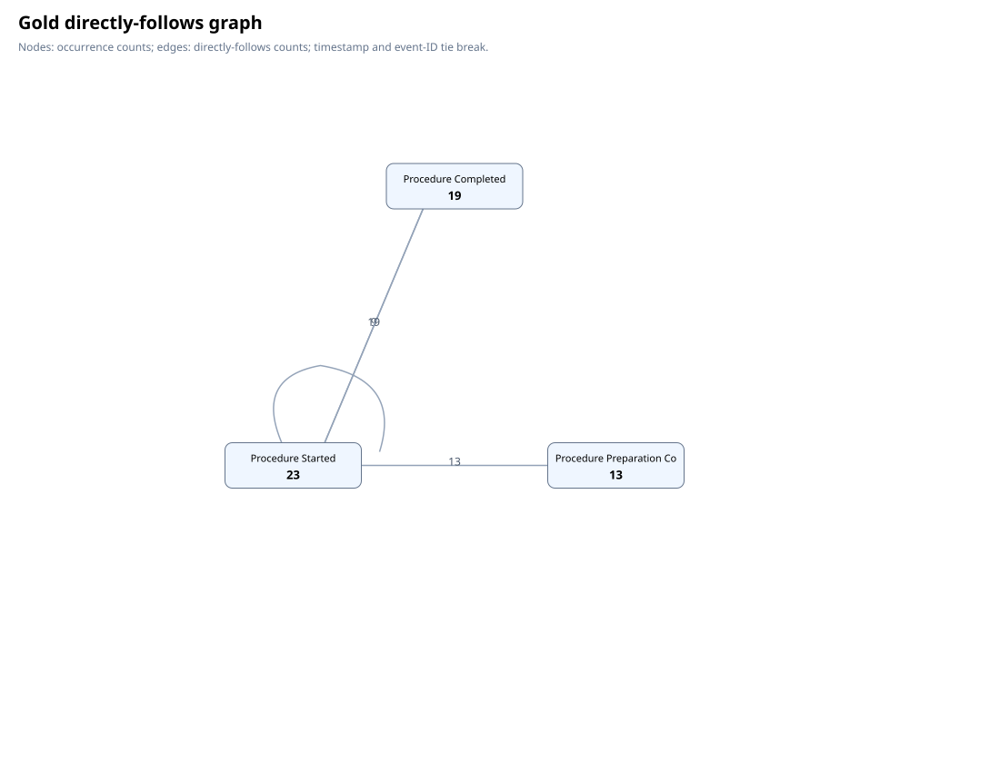</a></td><td width="58%" valign="top">
<a href="../../../datasets/hospitalflow/private/gold_sql/H05.sql">Gold SQL</a> · <a href="../../../datasets/hospitalflow/private/gold_logs/H05.csv">Gold CSV</a> · <a href="../../../datasets/hospitalflow/input/database.sqlite">Full source database (SQLite)</a>

<code>procedure_episode</code> · 23 matched source rows
<table><tr><th>Column</th><th>Row 1</th><th>Row 2</th><th>Row 3</th></tr><tr><th>procedureevent_id</th><td>6</td><td>7</td><td>23</td></tr><tr><th>order_id</th><td>30000691</td><td>30000983</td><td>33023112</td></tr><tr><th>starttime</th><td>2026-03-08T21:46:00Z</td><td>2026-03-18T21:29:00Z</td><td>2026-07-03T16:40:00Z</td></tr><tr><th>endtime</th><td>2026-03-08T22:28:01Z</td><td>2026-03-18T21:58:00Z</td><td><em>NULL</em></td></tr><tr><th>storetime</th><td>2026-03-08T22:01:00Z</td><td>2026-03-18T21:58:00Z</td><td>2026-07-03T17:12:00Z</td></tr></table>
<strong>Gold output for the same source rows</strong>
<ul><li>Row 1 → Procedure Completed · event PROCEV:6:end · case PROC:30000691 · time from <code>endtime</code></li><li>Row 1 → Procedure Started · event PROCEV:6:start · case PROC:30000691 · time from <code>starttime</code></li><li>Row 2 → Procedure Completed · event PROCEV:7:end · case PROC:30000983 · time from <code>endtime</code></li><li>Row 2 → Procedure Started · event PROCEV:7:start · case PROC:30000983 · time from <code>starttime</code></li><li>Row 3 → Procedure Started · event PROCEV:23:start · case PROC:33023112 · time from <code>starttime</code></li></ul>

<code>procedure_order</code> · 13 matched source rows
<table><tr><th>Column</th><th>Row 1</th><th>Row 2</th><th>Row 3</th></tr><tr><th>order_id</th><td>30000691</td><td>30000983</td><td>33023112</td></tr><tr><th>hadm_id</th><td>20000007</td><td>20000008</td><td>20000015</td></tr><tr><th>procedure_name</th><td>Bronchoscopy</td><td>Endoscopy</td><td>Wound Debridement</td></tr><tr><th>preparation_completed_at</th><td>2026-03-08T20:31:00Z</td><td>2026-03-18T20:27:00Z</td><td>2026-07-03T15:31:00Z</td></tr></table>
<strong>Gold output for the same source rows</strong>
<ul><li>Row 1 → Procedure Preparation Completed · event PROC:30000691:prep · case PROC:30000691 · time from <code>preparation_completed_at</code></li><li>Row 2 → Procedure Preparation Completed · event PROC:30000983:prep · case PROC:30000983 · time from <code>preparation_completed_at</code></li><li>Row 3 → Procedure Preparation Completed · event PROC:33023112:prep · case PROC:33023112 · time from <code>preparation_completed_at</code></li></ul>

FK-linked case and join evidence
<ul><li><code>procedure_order</code> → <code>admissions</code> · hadm_id → hadm_id · hadm_id = 20000007</li></ul>
</td></tr></table>

## H05P — Q2

For every procedure order, show when preparation finished and when each procedure occurrence began and ended.

Events: **55** · Cases with events: **13** · Activities: **3** · Edges: **4** · Source tables: **2** · SQL tables: **11**

<table><tr><td width="42%" valign="top"></td><td width="58%" valign="top">
<a href="../../../datasets/hospitalflow/private/gold_sql/H05P.sql">Gold SQL</a> · <a href="../../../datasets/hospitalflow/private/gold_logs/H05P.csv">Gold CSV</a> · <a href="../../../datasets/hospitalflow/input/database.sqlite">Full source database (SQLite)</a>

<code>procedure_episode</code> · 23 matched source rows
<table><tr><th>Column</th><th>Row 1</th><th>Row 2</th><th>Row 3</th></tr><tr><th>procedureevent_id</th><td>6</td><td>7</td><td>23</td></tr><tr><th>order_id</th><td>30000691</td><td>30000983</td><td>33023112</td></tr><tr><th>starttime</th><td>2026-03-08T21:46:00Z</td><td>2026-03-18T21:29:00Z</td><td>2026-07-03T16:40:00Z</td></tr><tr><th>endtime</th><td>2026-03-08T22:28:01Z</td><td>2026-03-18T21:58:00Z</td><td><em>NULL</em></td></tr><tr><th>storetime</th><td>2026-03-08T22:01:00Z</td><td>2026-03-18T21:58:00Z</td><td>2026-07-03T17:12:00Z</td></tr></table>
<strong>Gold output for the same source rows</strong>
<ul><li>Row 1 → Procedure Completed · event PROCEV:6:end · case PROC:30000691 · time from <code>endtime</code></li><li>Row 1 → Procedure Started · event PROCEV:6:start · case PROC:30000691 · time from <code>starttime</code></li><li>Row 2 → Procedure Completed · event PROCEV:7:end · case PROC:30000983 · time from <code>endtime</code></li><li>Row 2 → Procedure Started · event PROCEV:7:start · case PROC:30000983 · time from <code>starttime</code></li><li>Row 3 → Procedure Started · event PROCEV:23:start · case PROC:33023112 · time from <code>starttime</code></li></ul>

<code>procedure_order</code> · 13 matched source rows
<table><tr><th>Column</th><th>Row 1</th><th>Row 2</th><th>Row 3</th></tr><tr><th>order_id</th><td>30000691</td><td>30000983</td><td>33023112</td></tr><tr><th>hadm_id</th><td>20000007</td><td>20000008</td><td>20000015</td></tr><tr><th>procedure_name</th><td>Bronchoscopy</td><td>Endoscopy</td><td>Wound Debridement</td></tr><tr><th>preparation_completed_at</th><td>2026-03-08T20:31:00Z</td><td>2026-03-18T20:27:00Z</td><td>2026-07-03T15:31:00Z</td></tr></table>
<strong>Gold output for the same source rows</strong>
<ul><li>Row 1 → Procedure Preparation Completed · event PROC:30000691:prep · case PROC:30000691 · time from <code>preparation_completed_at</code></li><li>Row 2 → Procedure Preparation Completed · event PROC:30000983:prep · case PROC:30000983 · time from <code>preparation_completed_at</code></li><li>Row 3 → Procedure Preparation Completed · event PROC:33023112:prep · case PROC:33023112 · time from <code>preparation_completed_at</code></li></ul>

FK-linked case and join evidence
<ul><li><code>procedure_order</code> → <code>admissions</code> · hadm_id → hadm_id · hadm_id = 20000007</li></ul>
</td></tr></table>

## H06 — Q1

For each hospital admission, extract Emergency Department Registered, Hospital Admitted, Discharge Authorized and Hospital Discharged events.

Events: **49** · Cases with events: **15** · Activities: **4** · Edges: **3** · Source tables: **1** · SQL tables: **11**

<table><tr><td width="42%" valign="top"><a href="graphs/H06.svg">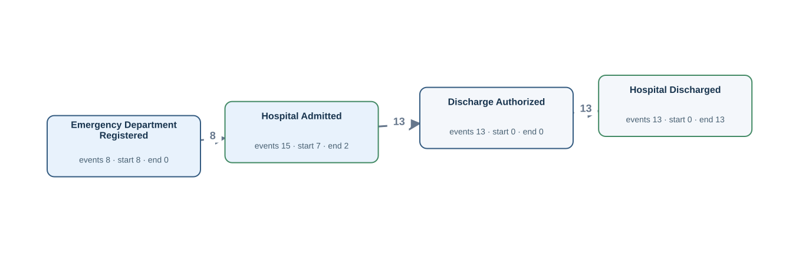</a></td><td width="58%" valign="top">
<a href="../../../datasets/hospitalflow/private/gold_sql/H06.sql">Gold SQL</a> · <a href="../../../datasets/hospitalflow/private/gold_logs/H06.csv">Gold CSV</a> · <a href="../../../datasets/hospitalflow/input/database.sqlite">Full source database (SQLite)</a>

<code>admissions</code> · 15 matched source rows
<table><tr><th>Column</th><th>Row 1</th><th>Row 2</th><th>Row 3</th></tr><tr><th>hadm_id</th><td>20000001</td><td>20000002</td><td>20000003</td></tr><tr><th>subject_id</th><td>10000001</td><td>10000001</td><td>10000002</td></tr><tr><th>edregtime</th><td>2026-01-17T13:42:00Z</td><td><em>NULL</em></td><td>2026-02-03T09:01:00Z</td></tr><tr><th>admittime</th><td>2026-01-17T16:12:00Z</td><td>2026-01-27T13:19:00Z</td><td>2026-02-03T09:23:00Z</td></tr><tr><th>discharge_authorized_at</th><td>2026-01-19T13:33:00Z</td><td>2026-01-29T16:16:00Z</td><td>2026-02-08T17:49:00Z</td></tr><tr><th>dischtime</th><td>2026-01-19T15:01:00Z</td><td>2026-01-29T18:54:00Z</td><td>2026-02-08T20:38:00Z</td></tr></table>
<strong>Gold output for the same source rows</strong>
<ul><li>Row 1 → Discharge Authorized · event ADM:20000001:auth · case A:20000001 · time from <code>discharge_authorized_at</code></li><li>Row 1 → Emergency Department Registered · event ADM:20000001:ed · case A:20000001 · time from <code>edregtime</code></li><li>Row 1 → Hospital Admitted · event ADM:20000001:in · case A:20000001 · time from <code>admittime</code></li><li>Row 1 → Hospital Discharged · event ADM:20000001:out · case A:20000001 · time from <code>dischtime</code></li><li>Row 2 → Discharge Authorized · event ADM:20000002:auth · case A:20000002 · time from <code>discharge_authorized_at</code></li><li>Row 2 → Hospital Admitted · event ADM:20000002:in · case A:20000002 · time from <code>admittime</code></li><li>Row 2 → Hospital Discharged · event ADM:20000002:out · case A:20000002 · time from <code>dischtime</code></li><li>Row 3 → Discharge Authorized · event ADM:20000003:auth · case A:20000003 · time from <code>discharge_authorized_at</code></li><li>Row 3 → Emergency Department Registered · event ADM:20000003:ed · case A:20000003 · time from <code>edregtime</code></li><li>Row 3 → Hospital Admitted · event ADM:20000003:in · case A:20000003 · time from <code>admittime</code></li><li>Row 3 → Hospital Discharged · event ADM:20000003:out · case A:20000003 · time from <code>dischtime</code></li></ul>
</td></tr></table>

## H06P — Q2

For every hospital stay, show arrival registration in the emergency department, admission, authorization to leave and actual discharge.

Events: **49** · Cases with events: **15** · Activities: **4** · Edges: **3** · Source tables: **1** · SQL tables: **11**

<table><tr><td width="42%" valign="top"></td><td width="58%" valign="top">
<a href="../../../datasets/hospitalflow/private/gold_sql/H06P.sql">Gold SQL</a> · <a href="../../../datasets/hospitalflow/private/gold_logs/H06P.csv">Gold CSV</a> · <a href="../../../datasets/hospitalflow/input/database.sqlite">Full source database (SQLite)</a>

<code>admissions</code> · 15 matched source rows
<table><tr><th>Column</th><th>Row 1</th><th>Row 2</th><th>Row 3</th></tr><tr><th>hadm_id</th><td>20000001</td><td>20000002</td><td>20000003</td></tr><tr><th>subject_id</th><td>10000001</td><td>10000001</td><td>10000002</td></tr><tr><th>edregtime</th><td>2026-01-17T13:42:00Z</td><td><em>NULL</em></td><td>2026-02-03T09:01:00Z</td></tr><tr><th>admittime</th><td>2026-01-17T16:12:00Z</td><td>2026-01-27T13:19:00Z</td><td>2026-02-03T09:23:00Z</td></tr><tr><th>discharge_authorized_at</th><td>2026-01-19T13:33:00Z</td><td>2026-01-29T16:16:00Z</td><td>2026-02-08T17:49:00Z</td></tr><tr><th>dischtime</th><td>2026-01-19T15:01:00Z</td><td>2026-01-29T18:54:00Z</td><td>2026-02-08T20:38:00Z</td></tr></table>
<strong>Gold output for the same source rows</strong>
<ul><li>Row 1 → Discharge Authorized · event ADM:20000001:auth · case A:20000001 · time from <code>discharge_authorized_at</code></li><li>Row 1 → Emergency Department Registered · event ADM:20000001:ed · case A:20000001 · time from <code>edregtime</code></li><li>Row 1 → Hospital Admitted · event ADM:20000001:in · case A:20000001 · time from <code>admittime</code></li><li>Row 1 → Hospital Discharged · event ADM:20000001:out · case A:20000001 · time from <code>dischtime</code></li><li>Row 2 → Discharge Authorized · event ADM:20000002:auth · case A:20000002 · time from <code>discharge_authorized_at</code></li><li>Row 2 → Hospital Admitted · event ADM:20000002:in · case A:20000002 · time from <code>admittime</code></li><li>Row 2 → Hospital Discharged · event ADM:20000002:out · case A:20000002 · time from <code>dischtime</code></li><li>Row 3 → Discharge Authorized · event ADM:20000003:auth · case A:20000003 · time from <code>discharge_authorized_at</code></li><li>Row 3 → Emergency Department Registered · event ADM:20000003:ed · case A:20000003 · time from <code>edregtime</code></li><li>Row 3 → Hospital Admitted · event ADM:20000003:in · case A:20000003 · time from <code>admittime</code></li><li>Row 3 → Hospital Discharged · event ADM:20000003:out · case A:20000003 · time from <code>dischtime</code></li></ul>
</td></tr></table>

## H07 — Q1

For each patient, extract Hospital Admitted, Lab Result Available, Medication Administered, Procedure Completed and Hospital Discharged events.

Events: **158** · Cases with events: **11** · Activities: **5** · Edges: **18** · Source tables: **4** · SQL tables: **11**

<table><tr><td width="42%" valign="top"><a href="graphs/H07.svg">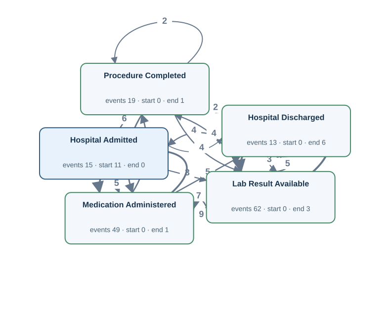</a></td><td width="58%" valign="top">
<a href="../../../datasets/hospitalflow/private/gold_sql/H07.sql">Gold SQL</a> · <a href="../../../datasets/hospitalflow/private/gold_logs/H07.csv">Gold CSV</a> · <a href="../../../datasets/hospitalflow/input/database.sqlite">Full source database (SQLite)</a>

<code>admissions</code> · 15 matched source rows
<table><tr><th>Column</th><th>Row 1</th><th>Row 2</th><th>Row 3</th></tr><tr><th>hadm_id</th><td>20000001</td><td>20000002</td><td>20000003</td></tr><tr><th>subject_id</th><td>10000001</td><td>10000001</td><td>10000002</td></tr><tr><th>edregtime</th><td>2026-01-17T13:42:00Z</td><td><em>NULL</em></td><td>2026-02-03T09:01:00Z</td></tr><tr><th>admittime</th><td>2026-01-17T16:12:00Z</td><td>2026-01-27T13:19:00Z</td><td>2026-02-03T09:23:00Z</td></tr><tr><th>discharge_authorized_at</th><td>2026-01-19T13:33:00Z</td><td>2026-01-29T16:16:00Z</td><td>2026-02-08T17:49:00Z</td></tr><tr><th>dischtime</th><td>2026-01-19T15:01:00Z</td><td>2026-01-29T18:54:00Z</td><td>2026-02-08T20:38:00Z</td></tr></table>
<strong>Gold output for the same source rows</strong>
<ul><li>Row 1 → Hospital Admitted · event ADM:20000001:in · case P:10000001 · time from <code>admittime</code></li><li>Row 1 → Hospital Discharged · event ADM:20000001:out · case P:10000001 · time from <code>dischtime</code></li><li>Row 2 → Hospital Admitted · event ADM:20000002:in · case P:10000001 · time from <code>admittime</code></li><li>Row 2 → Hospital Discharged · event ADM:20000002:out · case P:10000001 · time from <code>dischtime</code></li><li>Row 3 → Hospital Admitted · event ADM:20000003:in · case P:10000002 · time from <code>admittime</code></li><li>Row 3 → Hospital Discharged · event ADM:20000003:out · case P:10000002 · time from <code>dischtime</code></li></ul>

<code>emar</code> · 49 matched source rows
<table><tr><th>Column</th><th>Row 1</th><th>Row 2</th><th>Row 3</th></tr><tr><th>emar_id</th><td>1</td><td>8</td><td>3</td></tr><tr><th>pharmacy_id</th><td>40000001</td><td>40000003</td><td>40000001</td></tr><tr><th>charttime</th><td>2026-01-17T19:31:00Z</td><td>2026-01-17T23:03:00Z</td><td>2026-01-17T23:09:00Z</td></tr><tr><th>event_txt</th><td>Administered</td><td>Administered</td><td>Administered</td></tr><tr><th>storetime</th><td>2026-01-17T20:12:00Z</td><td>2026-01-17T23:12:00Z</td><td>2026-01-17T23:56:00Z</td></tr></table>
<strong>Gold output for the same source rows</strong>
<ul><li>Row 1 → Medication Administered · event EMAR:1 · case P:10000001 · time from <code>charttime</code></li><li>Row 2 → Medication Administered · event EMAR:8 · case P:10000001 · time from <code>charttime</code></li><li>Row 3 → Medication Administered · event EMAR:3 · case P:10000001 · time from <code>charttime</code></li></ul>

<code>labevents</code> · 62 matched source rows
<table><tr><th>Column</th><th>Row 1</th><th>Row 2</th><th>Row 3</th></tr><tr><th>labevent_id</th><td>1</td><td>57</td><td>58</td></tr><tr><th>order_id</th><td>31070762</td><td>35001904</td><td>35001904</td></tr><tr><th>itemid</th><td>1003</td><td>1001</td><td>1002</td></tr><tr><th>charttime</th><td>2026-01-27T19:38:00Z</td><td>2026-07-28T12:11:00Z</td><td>2026-07-28T12:11:01Z</td></tr><tr><th>storetime</th><td>2026-01-27T23:09:00Z</td><td>2026-07-28T14:03:00Z</td><td>2026-07-28T15:31:00Z</td></tr><tr><th>valuenum</th><td>14.6</td><td>1.93</td><td>145.5</td></tr><tr><th>valueuom</th><td>g/dL</td><td>mg/dL</td><td>mmol/L</td></tr></table>
<strong>Gold output for the same source rows</strong>
<ul><li>Row 1 → Lab Result Available · event LABEV:1:result · case P:10000001 · time from <code>storetime</code></li><li>Row 2 → Lab Result Available · event LABEV:57:result · case P:10000001 · time from <code>storetime</code></li><li>Row 3 → Lab Result Available · event LABEV:58:result · case P:10000001 · time from <code>storetime</code></li></ul>

<code>procedure_episode</code> · 19 matched source rows
<table><tr><th>Column</th><th>Row 1</th><th>Row 2</th><th>Row 3</th></tr><tr><th>procedureevent_id</th><td>1</td><td>2</td><td>3</td></tr><tr><th>order_id</th><td>33032683</td><td>33088335</td><td>33088335</td></tr><tr><th>starttime</th><td>2026-01-27T18:22:00Z</td><td>2026-02-15T01:42:00Z</td><td>2026-02-15T05:27:00Z</td></tr><tr><th>endtime</th><td>2026-01-27T19:24:00Z</td><td>2026-02-15T02:25:00Z</td><td>2026-02-15T06:34:00Z</td></tr><tr><th>storetime</th><td>2026-01-27T18:40:00Z</td><td>2026-02-15T02:16:00Z</td><td>2026-02-15T05:53:00Z</td></tr></table>
<strong>Gold output for the same source rows</strong>
<ul><li>Row 1 → Procedure Completed · event PROCEV:1:end · case P:10000001 · time from <code>endtime</code></li><li>Row 2 → Procedure Completed · event PROCEV:2:end · case P:10000002 · time from <code>endtime</code></li><li>Row 3 → Procedure Completed · event PROCEV:3:end · case P:10000002 · time from <code>endtime</code></li></ul>

FK-linked case and join evidence
<ul><li><code>labevents</code> → <code>lab_order</code> · order_id → order_id · order_id = 31070762</li><li><code>pharmacy</code> → <code>medication_order</code> · order_id → order_id · order_id = 32064975</li><li><code>emar</code> → <code>pharmacy</code> · pharmacy_id → pharmacy_id · pharmacy_id = 40000001</li><li><code>procedure_episode</code> → <code>procedure_order</code> · order_id → order_id · order_id = 33032683</li></ul>
</td></tr></table>

## H07P — Q2

For each patient, collect the recorded hospital entries and departures, availability of laboratory findings, medicine administrations and finishes of procedures.

Events: **158** · Cases with events: **11** · Activities: **5** · Edges: **18** · Source tables: **4** · SQL tables: **11**

<table><tr><td width="42%" valign="top"></td><td width="58%" valign="top">
<a href="../../../datasets/hospitalflow/private/gold_sql/H07P.sql">Gold SQL</a> · <a href="../../../datasets/hospitalflow/private/gold_logs/H07P.csv">Gold CSV</a> · <a href="../../../datasets/hospitalflow/input/database.sqlite">Full source database (SQLite)</a>

<code>admissions</code> · 15 matched source rows
<table><tr><th>Column</th><th>Row 1</th><th>Row 2</th><th>Row 3</th></tr><tr><th>hadm_id</th><td>20000001</td><td>20000002</td><td>20000003</td></tr><tr><th>subject_id</th><td>10000001</td><td>10000001</td><td>10000002</td></tr><tr><th>edregtime</th><td>2026-01-17T13:42:00Z</td><td><em>NULL</em></td><td>2026-02-03T09:01:00Z</td></tr><tr><th>admittime</th><td>2026-01-17T16:12:00Z</td><td>2026-01-27T13:19:00Z</td><td>2026-02-03T09:23:00Z</td></tr><tr><th>discharge_authorized_at</th><td>2026-01-19T13:33:00Z</td><td>2026-01-29T16:16:00Z</td><td>2026-02-08T17:49:00Z</td></tr><tr><th>dischtime</th><td>2026-01-19T15:01:00Z</td><td>2026-01-29T18:54:00Z</td><td>2026-02-08T20:38:00Z</td></tr></table>
<strong>Gold output for the same source rows</strong>
<ul><li>Row 1 → Hospital Admitted · event ADM:20000001:in · case P:10000001 · time from <code>admittime</code></li><li>Row 1 → Hospital Discharged · event ADM:20000001:out · case P:10000001 · time from <code>dischtime</code></li><li>Row 2 → Hospital Admitted · event ADM:20000002:in · case P:10000001 · time from <code>admittime</code></li><li>Row 2 → Hospital Discharged · event ADM:20000002:out · case P:10000001 · time from <code>dischtime</code></li><li>Row 3 → Hospital Admitted · event ADM:20000003:in · case P:10000002 · time from <code>admittime</code></li><li>Row 3 → Hospital Discharged · event ADM:20000003:out · case P:10000002 · time from <code>dischtime</code></li></ul>

<code>emar</code> · 49 matched source rows
<table><tr><th>Column</th><th>Row 1</th><th>Row 2</th><th>Row 3</th></tr><tr><th>emar_id</th><td>1</td><td>8</td><td>3</td></tr><tr><th>pharmacy_id</th><td>40000001</td><td>40000003</td><td>40000001</td></tr><tr><th>charttime</th><td>2026-01-17T19:31:00Z</td><td>2026-01-17T23:03:00Z</td><td>2026-01-17T23:09:00Z</td></tr><tr><th>event_txt</th><td>Administered</td><td>Administered</td><td>Administered</td></tr><tr><th>storetime</th><td>2026-01-17T20:12:00Z</td><td>2026-01-17T23:12:00Z</td><td>2026-01-17T23:56:00Z</td></tr></table>
<strong>Gold output for the same source rows</strong>
<ul><li>Row 1 → Medication Administered · event EMAR:1 · case P:10000001 · time from <code>charttime</code></li><li>Row 2 → Medication Administered · event EMAR:8 · case P:10000001 · time from <code>charttime</code></li><li>Row 3 → Medication Administered · event EMAR:3 · case P:10000001 · time from <code>charttime</code></li></ul>

<code>labevents</code> · 62 matched source rows
<table><tr><th>Column</th><th>Row 1</th><th>Row 2</th><th>Row 3</th></tr><tr><th>labevent_id</th><td>1</td><td>57</td><td>58</td></tr><tr><th>order_id</th><td>31070762</td><td>35001904</td><td>35001904</td></tr><tr><th>itemid</th><td>1003</td><td>1001</td><td>1002</td></tr><tr><th>charttime</th><td>2026-01-27T19:38:00Z</td><td>2026-07-28T12:11:00Z</td><td>2026-07-28T12:11:01Z</td></tr><tr><th>storetime</th><td>2026-01-27T23:09:00Z</td><td>2026-07-28T14:03:00Z</td><td>2026-07-28T15:31:00Z</td></tr><tr><th>valuenum</th><td>14.6</td><td>1.93</td><td>145.5</td></tr><tr><th>valueuom</th><td>g/dL</td><td>mg/dL</td><td>mmol/L</td></tr></table>
<strong>Gold output for the same source rows</strong>
<ul><li>Row 1 → Lab Result Available · event LABEV:1:result · case P:10000001 · time from <code>storetime</code></li><li>Row 2 → Lab Result Available · event LABEV:57:result · case P:10000001 · time from <code>storetime</code></li><li>Row 3 → Lab Result Available · event LABEV:58:result · case P:10000001 · time from <code>storetime</code></li></ul>

<code>procedure_episode</code> · 19 matched source rows
<table><tr><th>Column</th><th>Row 1</th><th>Row 2</th><th>Row 3</th></tr><tr><th>procedureevent_id</th><td>1</td><td>2</td><td>3</td></tr><tr><th>order_id</th><td>33032683</td><td>33088335</td><td>33088335</td></tr><tr><th>starttime</th><td>2026-01-27T18:22:00Z</td><td>2026-02-15T01:42:00Z</td><td>2026-02-15T05:27:00Z</td></tr><tr><th>endtime</th><td>2026-01-27T19:24:00Z</td><td>2026-02-15T02:25:00Z</td><td>2026-02-15T06:34:00Z</td></tr><tr><th>storetime</th><td>2026-01-27T18:40:00Z</td><td>2026-02-15T02:16:00Z</td><td>2026-02-15T05:53:00Z</td></tr></table>
<strong>Gold output for the same source rows</strong>
<ul><li>Row 1 → Procedure Completed · event PROCEV:1:end · case P:10000001 · time from <code>endtime</code></li><li>Row 2 → Procedure Completed · event PROCEV:2:end · case P:10000002 · time from <code>endtime</code></li><li>Row 3 → Procedure Completed · event PROCEV:3:end · case P:10000002 · time from <code>endtime</code></li></ul>

FK-linked case and join evidence
<ul><li><code>labevents</code> → <code>lab_order</code> · order_id → order_id · order_id = 31070762</li><li><code>pharmacy</code> → <code>medication_order</code> · order_id → order_id · order_id = 32064975</li><li><code>emar</code> → <code>pharmacy</code> · pharmacy_id → pharmacy_id · pharmacy_id = 40000001</li><li><code>procedure_episode</code> → <code>procedure_order</code> · order_id → order_id · order_id = 33032683</li></ul>
</td></tr></table>

## H08 — Q1

For each hospital admission, extract Insurance Claim Paid events.

**No Gold log:** No claim or payment records/timestamps exist in this DB; no Gold CSV is emitted.

## H08P — Q2

For each hospital stay, show when its insurance claim was settled by payment.

**No Gold log:** No claim or payment records/timestamps exist in this DB; no Gold CSV is emitted.

## HF01 — Q3

Extract the full recorded lifecycle for each patient.

Events: **628** · Cases with events: **11** · Activities: **20** · Edges: **132** · Source tables: **11** · SQL tables: **11**

<table><tr><td width="42%" valign="top"><a href="graphs/HF01.svg">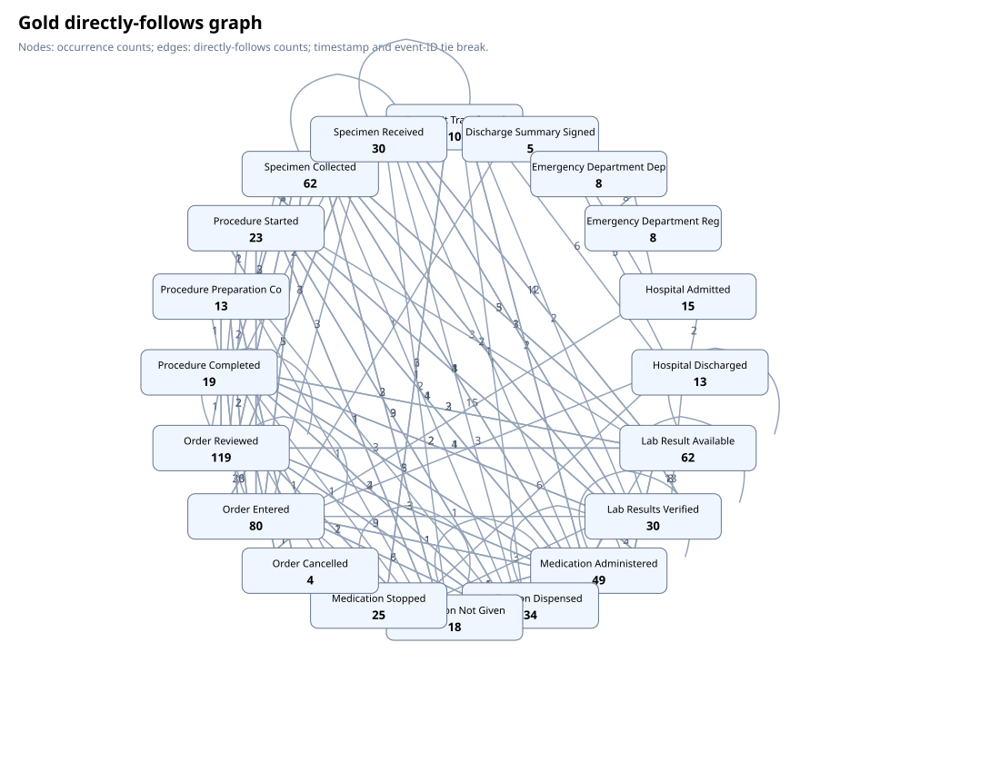</a></td><td width="58%" valign="top">
<a href="../../../datasets/hospitalflow/private/gold_sql/HF01.sql">Gold SQL</a> · <a href="../../../datasets/hospitalflow/private/gold_logs/HF01.csv">Gold CSV</a> · <a href="../../../datasets/hospitalflow/input/database.sqlite">Full source database (SQLite)</a>

<code>admission_detail</code> · 5 matched source rows
<table><tr><th>Column</th><th>Row 1</th><th>Row 2</th><th>Row 3</th></tr><tr><th>hadm_id</th><td>20000001</td><td>20000004</td><td>20000007</td></tr><tr><th>discharge_summary_signed_at</th><td>2026-01-19T18:13:00Z</td><td>2026-02-19T17:04:00Z</td><td>2026-03-11T15:45:00Z</td></tr></table>
<strong>Gold output for the same source rows</strong>
<ul><li>Row 1 → Discharge Summary Signed · event ADM:20000001:summary · case P:10000001 · time from <code>discharge_summary_signed_at</code></li><li>Row 2 → Discharge Summary Signed · event ADM:20000004:summary · case P:10000002 · time from <code>discharge_summary_signed_at</code></li><li>Row 3 → Discharge Summary Signed · event ADM:20000007:summary · case P:10000004 · time from <code>discharge_summary_signed_at</code></li></ul>

<code>admissions</code> · 15 matched source rows
<table><tr><th>Column</th><th>Row 1</th><th>Row 2</th><th>Row 3</th></tr><tr><th>hadm_id</th><td>20000001</td><td>20000002</td><td>20000003</td></tr><tr><th>subject_id</th><td>10000001</td><td>10000001</td><td>10000002</td></tr><tr><th>edregtime</th><td>2026-01-17T13:42:00Z</td><td><em>NULL</em></td><td>2026-02-03T09:01:00Z</td></tr><tr><th>admittime</th><td>2026-01-17T16:12:00Z</td><td>2026-01-27T13:19:00Z</td><td>2026-02-03T09:23:00Z</td></tr><tr><th>discharge_authorized_at</th><td>2026-01-19T13:33:00Z</td><td>2026-01-29T16:16:00Z</td><td>2026-02-08T17:49:00Z</td></tr><tr><th>dischtime</th><td>2026-01-19T15:01:00Z</td><td>2026-01-29T18:54:00Z</td><td>2026-02-08T20:38:00Z</td></tr></table>
<strong>Gold output for the same source rows</strong>
<ul><li>Row 1 → Discharge Authorized · event ADM:20000001:auth · case P:10000001 · time from <code>discharge_authorized_at</code></li><li>Row 1 → Emergency Department Registered · event ADM:20000001:ed · case P:10000001 · time from <code>edregtime</code></li><li>Row 1 → Hospital Admitted · event ADM:20000001:in · case P:10000001 · time from <code>admittime</code></li><li>Row 1 → Hospital Discharged · event ADM:20000001:out · case P:10000001 · time from <code>dischtime</code></li><li>Row 2 → Discharge Authorized · event ADM:20000002:auth · case P:10000001 · time from <code>discharge_authorized_at</code></li><li>Row 2 → Hospital Admitted · event ADM:20000002:in · case P:10000001 · time from <code>admittime</code></li><li>Row 2 → Hospital Discharged · event ADM:20000002:out · case P:10000001 · time from <code>dischtime</code></li><li>Row 3 → Discharge Authorized · event ADM:20000003:auth · case P:10000002 · time from <code>discharge_authorized_at</code></li><li>Row 3 → Emergency Department Registered · event ADM:20000003:ed · case P:10000002 · time from <code>edregtime</code></li><li>Row 3 → Hospital Admitted · event ADM:20000003:in · case P:10000002 · time from <code>admittime</code></li><li>Row 3 → Hospital Discharged · event ADM:20000003:out · case P:10000002 · time from <code>dischtime</code></li></ul>

<code>emar</code> · 67 matched source rows
<table><tr><th>Column</th><th>Row 1</th><th>Row 2</th><th>Row 3</th></tr><tr><th>emar_id</th><td>1</td><td>7</td><td>2</td></tr><tr><th>pharmacy_id</th><td>40000001</td><td>40000003</td><td>40000001</td></tr><tr><th>charttime</th><td>2026-01-17T19:31:00Z</td><td>2026-01-17T20:59:00Z</td><td>2026-01-17T21:22:00Z</td></tr><tr><th>event_txt</th><td>Administered</td><td>Not Given</td><td>Not Given</td></tr><tr><th>storetime</th><td>2026-01-17T20:12:00Z</td><td>2026-01-17T21:21:00Z</td><td>2026-01-17T21:44:00Z</td></tr></table>
<strong>Gold output for the same source rows</strong>
<ul><li>Row 1 → Medication Administered · event EMAR:1 · case P:10000001 · time from <code>charttime</code></li><li>Row 2 → Medication Not Given · event EMAR:7 · case P:10000001 · time from <code>charttime</code></li><li>Row 3 → Medication Not Given · event EMAR:2 · case P:10000001 · time from <code>charttime</code></li></ul>

<code>lab_order</code> · 30 matched source rows
<table><tr><th>Column</th><th>Row 1</th><th>Row 2</th><th>Row 3</th></tr><tr><th>order_id</th><td>31070762</td><td>35001904</td><td>31079248</td></tr><tr><th>subject_id</th><td>10000001</td><td>10000001</td><td>10000002</td></tr><tr><th>hadm_id</th><td>20000002</td><td><em>NULL</em></td><td>20000003</td></tr><tr><th>specimen_received_at</th><td>2026-01-27T19:52:00Z</td><td>2026-07-28T12:46:00Z</td><td>2026-02-03T16:16:00Z</td></tr><tr><th>results_verified_at</th><td>2026-01-28T00:32:00Z</td><td>2026-07-28T17:38:00Z</td><td>2026-02-03T20:48:00Z</td></tr></table>
<strong>Gold output for the same source rows</strong>
<ul><li>Row 1 → Specimen Received · event LAB:31070762:received · case P:10000001 · time from <code>specimen_received_at</code></li><li>Row 1 → Lab Results Verified · event LAB:31070762:verified · case P:10000001 · time from <code>results_verified_at</code></li><li>Row 2 → Specimen Received · event LAB:35001904:received · case P:10000001 · time from <code>specimen_received_at</code></li><li>Row 2 → Lab Results Verified · event LAB:35001904:verified · case P:10000001 · time from <code>results_verified_at</code></li><li>Row 3 → Specimen Received · event LAB:31079248:received · case P:10000002 · time from <code>specimen_received_at</code></li><li>Row 3 → Lab Results Verified · event LAB:31079248:verified · case P:10000002 · time from <code>results_verified_at</code></li></ul>

<code>labevents</code> · 62 matched source rows
<table><tr><th>Column</th><th>Row 1</th><th>Row 2</th><th>Row 3</th></tr><tr><th>labevent_id</th><td>1</td><td>57</td><td>58</td></tr><tr><th>order_id</th><td>31070762</td><td>35001904</td><td>35001904</td></tr><tr><th>itemid</th><td>1003</td><td>1001</td><td>1002</td></tr><tr><th>charttime</th><td>2026-01-27T19:38:00Z</td><td>2026-07-28T12:11:00Z</td><td>2026-07-28T12:11:01Z</td></tr><tr><th>storetime</th><td>2026-01-27T23:09:00Z</td><td>2026-07-28T14:03:00Z</td><td>2026-07-28T15:31:00Z</td></tr><tr><th>valuenum</th><td>14.6</td><td>1.93</td><td>145.5</td></tr><tr><th>valueuom</th><td>g/dL</td><td>mg/dL</td><td>mmol/L</td></tr></table>
<strong>Gold output for the same source rows</strong>
<ul><li>Row 1 → Specimen Collected · event LABEV:1:chart · case P:10000001 · time from <code>charttime</code></li><li>Row 1 → Lab Result Available · event LABEV:1:result · case P:10000001 · time from <code>storetime</code></li><li>Row 2 → Specimen Collected · event LABEV:57:chart · case P:10000001 · time from <code>charttime</code></li><li>Row 2 → Lab Result Available · event LABEV:57:result · case P:10000001 · time from <code>storetime</code></li><li>Row 3 → Specimen Collected · event LABEV:58:chart · case P:10000001 · time from <code>charttime</code></li><li>Row 3 → Lab Result Available · event LABEV:58:result · case P:10000001 · time from <code>storetime</code></li></ul>

<code>medication_order</code> · 25 matched source rows
<table><tr><th>Column</th><th>Row 1</th><th>Row 2</th><th>Row 3</th></tr><tr><th>order_id</th><td>32064975</td><td>32028896</td><td>32091033</td></tr><tr><th>hadm_id</th><td>20000001</td><td>20000001</td><td>20000003</td></tr><tr><th>medication</th><td>Amoxicillin</td><td>Acetaminophen</td><td>Acetaminophen</td></tr><tr><th>stopped_at</th><td>2026-01-18T09:54:00Z</td><td>2026-01-18T20:48:00Z</td><td>2026-02-04T14:42:00Z</td></tr></table>
<strong>Gold output for the same source rows</strong>
<ul><li>Row 1 → Medication Stopped · event MED:32064975:stop · case P:10000001 · time from <code>stopped_at</code></li><li>Row 2 → Medication Stopped · event MED:32028896:stop · case P:10000001 · time from <code>stopped_at</code></li><li>Row 3 → Medication Stopped · event MED:32091033:stop · case P:10000002 · time from <code>stopped_at</code></li></ul>

<code>order_history</code> · 203 matched source rows
<table><tr><th>Column</th><th>Row 1</th><th>Row 2</th><th>Row 3</th></tr><tr><th>history_id</th><td>1</td><td>2</td><td>35</td></tr><tr><th>lab_order_id</th><td><em>NULL</em></td><td><em>NULL</em></td><td><em>NULL</em></td></tr><tr><th>medication_order_id</th><td>32064975</td><td>32064975</td><td><em>NULL</em></td></tr><tr><th>procedure_order_id</th><td><em>NULL</em></td><td><em>NULL</em></td><td>33060273</td></tr><tr><th>action</th><td>ENTERED</td><td>REVIEWED</td><td>CANCELLED</td></tr><tr><th>occurred_at</th><td>2026-01-17T17:00:00Z</td><td>2026-01-17T17:22:00Z</td><td>2026-02-15T00:40:01Z</td></tr></table>
<strong>Gold output for the same source rows</strong>
<ul><li>Row 1 → Order Entered · event OH:1 · case P:10000001 · time from <code>occurred_at</code></li><li>Row 2 → Order Reviewed · event OH:2 · case P:10000001 · time from <code>occurred_at</code></li><li>Row 3 → Order Cancelled · event OH:35 · case P:10000002 · time from <code>occurred_at</code></li></ul>

<code>patient_profile</code> · 6 matched source rows
<table><tr><th>Column</th><th>Row 1</th><th>Row 2</th><th>Row 3</th></tr><tr><th>subject_id</th><td>10000001</td><td>10000003</td><td>10000005</td></tr><tr><th>profile_verified_at</th><td>2026-01-17T12:54:00Z</td><td>2026-02-19T07:52:00Z</td><td>2026-03-24T20:26:00Z</td></tr><tr><th>preferred_language</th><td>English</td><td>English</td><td>English</td></tr></table>
<strong>Gold output for the same source rows</strong>
<ul><li>Row 1 → Patient Profile Verified · event PAT:10000001:profile · case P:10000001 · time from <code>profile_verified_at</code></li><li>Row 2 → Patient Profile Verified · event PAT:10000003:profile · case P:10000003 · time from <code>profile_verified_at</code></li><li>Row 3 → Patient Profile Verified · event PAT:10000005:profile · case P:10000005 · time from <code>profile_verified_at</code></li></ul>

<code>pharmacy</code> · 34 matched source rows
<table><tr><th>Column</th><th>Row 1</th><th>Row 2</th><th>Row 3</th></tr><tr><th>pharmacy_id</th><td>40000001</td><td>40000003</td><td>40000002</td></tr><tr><th>order_id</th><td>32064975</td><td>32028896</td><td>32064975</td></tr><tr><th>dispensed_at</th><td>2026-01-17T18:40:00Z</td><td>2026-01-17T19:12:00Z</td><td>2026-01-17T22:07:00Z</td></tr></table>
<strong>Gold output for the same source rows</strong>
<ul><li>Row 1 → Medication Dispensed · event PHARM:40000001:dispense · case P:10000001 · time from <code>dispensed_at</code></li><li>Row 2 → Medication Dispensed · event PHARM:40000003:dispense · case P:10000001 · time from <code>dispensed_at</code></li><li>Row 3 → Medication Dispensed · event PHARM:40000002:dispense · case P:10000001 · time from <code>dispensed_at</code></li></ul>

<code>procedure_episode</code> · 23 matched source rows
<table><tr><th>Column</th><th>Row 1</th><th>Row 2</th><th>Row 3</th></tr><tr><th>procedureevent_id</th><td>1</td><td>2</td><td>3</td></tr><tr><th>order_id</th><td>33032683</td><td>33088335</td><td>33088335</td></tr><tr><th>starttime</th><td>2026-01-27T18:22:00Z</td><td>2026-02-15T01:42:00Z</td><td>2026-02-15T05:27:00Z</td></tr><tr><th>endtime</th><td>2026-01-27T19:24:00Z</td><td>2026-02-15T02:25:00Z</td><td>2026-02-15T06:34:00Z</td></tr><tr><th>storetime</th><td>2026-01-27T18:40:00Z</td><td>2026-02-15T02:16:00Z</td><td>2026-02-15T05:53:00Z</td></tr></table>
<strong>Gold output for the same source rows</strong>
<ul><li>Row 1 → Procedure Completed · event PROCEV:1:end · case P:10000001 · time from <code>endtime</code></li><li>Row 1 → Procedure Started · event PROCEV:1:start · case P:10000001 · time from <code>starttime</code></li><li>Row 2 → Procedure Completed · event PROCEV:2:end · case P:10000002 · time from <code>endtime</code></li><li>Row 2 → Procedure Started · event PROCEV:2:start · case P:10000002 · time from <code>starttime</code></li><li>Row 3 → Procedure Completed · event PROCEV:3:end · case P:10000002 · time from <code>endtime</code></li><li>Row 3 → Procedure Started · event PROCEV:3:start · case P:10000002 · time from <code>starttime</code></li></ul>

<code>procedure_order</code> · 13 matched source rows
<table><tr><th>Column</th><th>Row 1</th><th>Row 2</th><th>Row 3</th></tr><tr><th>order_id</th><td>33032683</td><td>33088335</td><td>33092897</td></tr><tr><th>hadm_id</th><td>20000002</td><td>20000004</td><td>20000005</td></tr><tr><th>procedure_name</th><td>Bronchoscopy</td><td>Endoscopy</td><td>Bronchoscopy</td></tr><tr><th>preparation_completed_at</th><td>2026-01-27T16:50:00Z</td><td>2026-02-15T01:07:00Z</td><td>2026-02-20T03:02:00Z</td></tr></table>
<strong>Gold output for the same source rows</strong>
<ul><li>Row 1 → Procedure Preparation Completed · event PROC:33032683:prep · case P:10000001 · time from <code>preparation_completed_at</code></li><li>Row 2 → Procedure Preparation Completed · event PROC:33088335:prep · case P:10000002 · time from <code>preparation_completed_at</code></li><li>Row 3 → Procedure Preparation Completed · event PROC:33092897:prep · case P:10000003 · time from <code>preparation_completed_at</code></li></ul>

FK-linked case and join evidence
<ul><li><code>order_history</code> → <code>lab_order</code> · lab_order_id → order_id · order_id = 31073842</li><li><code>order_history</code> → <code>medication_order</code> · medication_order_id → order_id · order_id = 32034941</li><li><code>order_history</code> → <code>procedure_order</code> · procedure_order_id → order_id · order_id = 33060273</li></ul>
</td></tr></table>

## HF01P — Q4

Build a complete timeline of all recorded care events for every patient.

Events: **628** · Cases with events: **11** · Activities: **20** · Edges: **132** · Source tables: **11** · SQL tables: **11**

<table><tr><td width="42%" valign="top"></td><td width="58%" valign="top">
<a href="../../../datasets/hospitalflow/private/gold_sql/HF01P.sql">Gold SQL</a> · <a href="../../../datasets/hospitalflow/private/gold_logs/HF01P.csv">Gold CSV</a> · <a href="../../../datasets/hospitalflow/input/database.sqlite">Full source database (SQLite)</a>

<code>admission_detail</code> · 5 matched source rows
<table><tr><th>Column</th><th>Row 1</th><th>Row 2</th><th>Row 3</th></tr><tr><th>hadm_id</th><td>20000001</td><td>20000004</td><td>20000007</td></tr><tr><th>discharge_summary_signed_at</th><td>2026-01-19T18:13:00Z</td><td>2026-02-19T17:04:00Z</td><td>2026-03-11T15:45:00Z</td></tr></table>
<strong>Gold output for the same source rows</strong>
<ul><li>Row 1 → Discharge Summary Signed · event ADM:20000001:summary · case P:10000001 · time from <code>discharge_summary_signed_at</code></li><li>Row 2 → Discharge Summary Signed · event ADM:20000004:summary · case P:10000002 · time from <code>discharge_summary_signed_at</code></li><li>Row 3 → Discharge Summary Signed · event ADM:20000007:summary · case P:10000004 · time from <code>discharge_summary_signed_at</code></li></ul>

<code>admissions</code> · 15 matched source rows
<table><tr><th>Column</th><th>Row 1</th><th>Row 2</th><th>Row 3</th></tr><tr><th>hadm_id</th><td>20000001</td><td>20000002</td><td>20000003</td></tr><tr><th>subject_id</th><td>10000001</td><td>10000001</td><td>10000002</td></tr><tr><th>edregtime</th><td>2026-01-17T13:42:00Z</td><td><em>NULL</em></td><td>2026-02-03T09:01:00Z</td></tr><tr><th>admittime</th><td>2026-01-17T16:12:00Z</td><td>2026-01-27T13:19:00Z</td><td>2026-02-03T09:23:00Z</td></tr><tr><th>discharge_authorized_at</th><td>2026-01-19T13:33:00Z</td><td>2026-01-29T16:16:00Z</td><td>2026-02-08T17:49:00Z</td></tr><tr><th>dischtime</th><td>2026-01-19T15:01:00Z</td><td>2026-01-29T18:54:00Z</td><td>2026-02-08T20:38:00Z</td></tr></table>
<strong>Gold output for the same source rows</strong>
<ul><li>Row 1 → Discharge Authorized · event ADM:20000001:auth · case P:10000001 · time from <code>discharge_authorized_at</code></li><li>Row 1 → Emergency Department Registered · event ADM:20000001:ed · case P:10000001 · time from <code>edregtime</code></li><li>Row 1 → Hospital Admitted · event ADM:20000001:in · case P:10000001 · time from <code>admittime</code></li><li>Row 1 → Hospital Discharged · event ADM:20000001:out · case P:10000001 · time from <code>dischtime</code></li><li>Row 2 → Discharge Authorized · event ADM:20000002:auth · case P:10000001 · time from <code>discharge_authorized_at</code></li><li>Row 2 → Hospital Admitted · event ADM:20000002:in · case P:10000001 · time from <code>admittime</code></li><li>Row 2 → Hospital Discharged · event ADM:20000002:out · case P:10000001 · time from <code>dischtime</code></li><li>Row 3 → Discharge Authorized · event ADM:20000003:auth · case P:10000002 · time from <code>discharge_authorized_at</code></li><li>Row 3 → Emergency Department Registered · event ADM:20000003:ed · case P:10000002 · time from <code>edregtime</code></li><li>Row 3 → Hospital Admitted · event ADM:20000003:in · case P:10000002 · time from <code>admittime</code></li><li>Row 3 → Hospital Discharged · event ADM:20000003:out · case P:10000002 · time from <code>dischtime</code></li></ul>

<code>emar</code> · 67 matched source rows
<table><tr><th>Column</th><th>Row 1</th><th>Row 2</th><th>Row 3</th></tr><tr><th>emar_id</th><td>1</td><td>7</td><td>2</td></tr><tr><th>pharmacy_id</th><td>40000001</td><td>40000003</td><td>40000001</td></tr><tr><th>charttime</th><td>2026-01-17T19:31:00Z</td><td>2026-01-17T20:59:00Z</td><td>2026-01-17T21:22:00Z</td></tr><tr><th>event_txt</th><td>Administered</td><td>Not Given</td><td>Not Given</td></tr><tr><th>storetime</th><td>2026-01-17T20:12:00Z</td><td>2026-01-17T21:21:00Z</td><td>2026-01-17T21:44:00Z</td></tr></table>
<strong>Gold output for the same source rows</strong>
<ul><li>Row 1 → Medication Administered · event EMAR:1 · case P:10000001 · time from <code>charttime</code></li><li>Row 2 → Medication Not Given · event EMAR:7 · case P:10000001 · time from <code>charttime</code></li><li>Row 3 → Medication Not Given · event EMAR:2 · case P:10000001 · time from <code>charttime</code></li></ul>

<code>lab_order</code> · 30 matched source rows
<table><tr><th>Column</th><th>Row 1</th><th>Row 2</th><th>Row 3</th></tr><tr><th>order_id</th><td>31070762</td><td>35001904</td><td>31079248</td></tr><tr><th>subject_id</th><td>10000001</td><td>10000001</td><td>10000002</td></tr><tr><th>hadm_id</th><td>20000002</td><td><em>NULL</em></td><td>20000003</td></tr><tr><th>specimen_received_at</th><td>2026-01-27T19:52:00Z</td><td>2026-07-28T12:46:00Z</td><td>2026-02-03T16:16:00Z</td></tr><tr><th>results_verified_at</th><td>2026-01-28T00:32:00Z</td><td>2026-07-28T17:38:00Z</td><td>2026-02-03T20:48:00Z</td></tr></table>
<strong>Gold output for the same source rows</strong>
<ul><li>Row 1 → Specimen Received · event LAB:31070762:received · case P:10000001 · time from <code>specimen_received_at</code></li><li>Row 1 → Lab Results Verified · event LAB:31070762:verified · case P:10000001 · time from <code>results_verified_at</code></li><li>Row 2 → Specimen Received · event LAB:35001904:received · case P:10000001 · time from <code>specimen_received_at</code></li><li>Row 2 → Lab Results Verified · event LAB:35001904:verified · case P:10000001 · time from <code>results_verified_at</code></li><li>Row 3 → Specimen Received · event LAB:31079248:received · case P:10000002 · time from <code>specimen_received_at</code></li><li>Row 3 → Lab Results Verified · event LAB:31079248:verified · case P:10000002 · time from <code>results_verified_at</code></li></ul>

<code>labevents</code> · 62 matched source rows
<table><tr><th>Column</th><th>Row 1</th><th>Row 2</th><th>Row 3</th></tr><tr><th>labevent_id</th><td>1</td><td>57</td><td>58</td></tr><tr><th>order_id</th><td>31070762</td><td>35001904</td><td>35001904</td></tr><tr><th>itemid</th><td>1003</td><td>1001</td><td>1002</td></tr><tr><th>charttime</th><td>2026-01-27T19:38:00Z</td><td>2026-07-28T12:11:00Z</td><td>2026-07-28T12:11:01Z</td></tr><tr><th>storetime</th><td>2026-01-27T23:09:00Z</td><td>2026-07-28T14:03:00Z</td><td>2026-07-28T15:31:00Z</td></tr><tr><th>valuenum</th><td>14.6</td><td>1.93</td><td>145.5</td></tr><tr><th>valueuom</th><td>g/dL</td><td>mg/dL</td><td>mmol/L</td></tr></table>
<strong>Gold output for the same source rows</strong>
<ul><li>Row 1 → Specimen Collected · event LABEV:1:chart · case P:10000001 · time from <code>charttime</code></li><li>Row 1 → Lab Result Available · event LABEV:1:result · case P:10000001 · time from <code>storetime</code></li><li>Row 2 → Specimen Collected · event LABEV:57:chart · case P:10000001 · time from <code>charttime</code></li><li>Row 2 → Lab Result Available · event LABEV:57:result · case P:10000001 · time from <code>storetime</code></li><li>Row 3 → Specimen Collected · event LABEV:58:chart · case P:10000001 · time from <code>charttime</code></li><li>Row 3 → Lab Result Available · event LABEV:58:result · case P:10000001 · time from <code>storetime</code></li></ul>

<code>medication_order</code> · 25 matched source rows
<table><tr><th>Column</th><th>Row 1</th><th>Row 2</th><th>Row 3</th></tr><tr><th>order_id</th><td>32064975</td><td>32028896</td><td>32091033</td></tr><tr><th>hadm_id</th><td>20000001</td><td>20000001</td><td>20000003</td></tr><tr><th>medication</th><td>Amoxicillin</td><td>Acetaminophen</td><td>Acetaminophen</td></tr><tr><th>stopped_at</th><td>2026-01-18T09:54:00Z</td><td>2026-01-18T20:48:00Z</td><td>2026-02-04T14:42:00Z</td></tr></table>
<strong>Gold output for the same source rows</strong>
<ul><li>Row 1 → Medication Stopped · event MED:32064975:stop · case P:10000001 · time from <code>stopped_at</code></li><li>Row 2 → Medication Stopped · event MED:32028896:stop · case P:10000001 · time from <code>stopped_at</code></li><li>Row 3 → Medication Stopped · event MED:32091033:stop · case P:10000002 · time from <code>stopped_at</code></li></ul>

<code>order_history</code> · 203 matched source rows
<table><tr><th>Column</th><th>Row 1</th><th>Row 2</th><th>Row 3</th></tr><tr><th>history_id</th><td>1</td><td>2</td><td>35</td></tr><tr><th>lab_order_id</th><td><em>NULL</em></td><td><em>NULL</em></td><td><em>NULL</em></td></tr><tr><th>medication_order_id</th><td>32064975</td><td>32064975</td><td><em>NULL</em></td></tr><tr><th>procedure_order_id</th><td><em>NULL</em></td><td><em>NULL</em></td><td>33060273</td></tr><tr><th>action</th><td>ENTERED</td><td>REVIEWED</td><td>CANCELLED</td></tr><tr><th>occurred_at</th><td>2026-01-17T17:00:00Z</td><td>2026-01-17T17:22:00Z</td><td>2026-02-15T00:40:01Z</td></tr></table>
<strong>Gold output for the same source rows</strong>
<ul><li>Row 1 → Order Entered · event OH:1 · case P:10000001 · time from <code>occurred_at</code></li><li>Row 2 → Order Reviewed · event OH:2 · case P:10000001 · time from <code>occurred_at</code></li><li>Row 3 → Order Cancelled · event OH:35 · case P:10000002 · time from <code>occurred_at</code></li></ul>

<code>patient_profile</code> · 6 matched source rows
<table><tr><th>Column</th><th>Row 1</th><th>Row 2</th><th>Row 3</th></tr><tr><th>subject_id</th><td>10000001</td><td>10000003</td><td>10000005</td></tr><tr><th>profile_verified_at</th><td>2026-01-17T12:54:00Z</td><td>2026-02-19T07:52:00Z</td><td>2026-03-24T20:26:00Z</td></tr><tr><th>preferred_language</th><td>English</td><td>English</td><td>English</td></tr></table>
<strong>Gold output for the same source rows</strong>
<ul><li>Row 1 → Patient Profile Verified · event PAT:10000001:profile · case P:10000001 · time from <code>profile_verified_at</code></li><li>Row 2 → Patient Profile Verified · event PAT:10000003:profile · case P:10000003 · time from <code>profile_verified_at</code></li><li>Row 3 → Patient Profile Verified · event PAT:10000005:profile · case P:10000005 · time from <code>profile_verified_at</code></li></ul>

<code>pharmacy</code> · 34 matched source rows
<table><tr><th>Column</th><th>Row 1</th><th>Row 2</th><th>Row 3</th></tr><tr><th>pharmacy_id</th><td>40000001</td><td>40000003</td><td>40000002</td></tr><tr><th>order_id</th><td>32064975</td><td>32028896</td><td>32064975</td></tr><tr><th>dispensed_at</th><td>2026-01-17T18:40:00Z</td><td>2026-01-17T19:12:00Z</td><td>2026-01-17T22:07:00Z</td></tr></table>
<strong>Gold output for the same source rows</strong>
<ul><li>Row 1 → Medication Dispensed · event PHARM:40000001:dispense · case P:10000001 · time from <code>dispensed_at</code></li><li>Row 2 → Medication Dispensed · event PHARM:40000003:dispense · case P:10000001 · time from <code>dispensed_at</code></li><li>Row 3 → Medication Dispensed · event PHARM:40000002:dispense · case P:10000001 · time from <code>dispensed_at</code></li></ul>

<code>procedure_episode</code> · 23 matched source rows
<table><tr><th>Column</th><th>Row 1</th><th>Row 2</th><th>Row 3</th></tr><tr><th>procedureevent_id</th><td>1</td><td>2</td><td>3</td></tr><tr><th>order_id</th><td>33032683</td><td>33088335</td><td>33088335</td></tr><tr><th>starttime</th><td>2026-01-27T18:22:00Z</td><td>2026-02-15T01:42:00Z</td><td>2026-02-15T05:27:00Z</td></tr><tr><th>endtime</th><td>2026-01-27T19:24:00Z</td><td>2026-02-15T02:25:00Z</td><td>2026-02-15T06:34:00Z</td></tr><tr><th>storetime</th><td>2026-01-27T18:40:00Z</td><td>2026-02-15T02:16:00Z</td><td>2026-02-15T05:53:00Z</td></tr></table>
<strong>Gold output for the same source rows</strong>
<ul><li>Row 1 → Procedure Completed · event PROCEV:1:end · case P:10000001 · time from <code>endtime</code></li><li>Row 1 → Procedure Started · event PROCEV:1:start · case P:10000001 · time from <code>starttime</code></li><li>Row 2 → Procedure Completed · event PROCEV:2:end · case P:10000002 · time from <code>endtime</code></li><li>Row 2 → Procedure Started · event PROCEV:2:start · case P:10000002 · time from <code>starttime</code></li><li>Row 3 → Procedure Completed · event PROCEV:3:end · case P:10000002 · time from <code>endtime</code></li><li>Row 3 → Procedure Started · event PROCEV:3:start · case P:10000002 · time from <code>starttime</code></li></ul>

<code>procedure_order</code> · 13 matched source rows
<table><tr><th>Column</th><th>Row 1</th><th>Row 2</th><th>Row 3</th></tr><tr><th>order_id</th><td>33032683</td><td>33088335</td><td>33092897</td></tr><tr><th>hadm_id</th><td>20000002</td><td>20000004</td><td>20000005</td></tr><tr><th>procedure_name</th><td>Bronchoscopy</td><td>Endoscopy</td><td>Bronchoscopy</td></tr><tr><th>preparation_completed_at</th><td>2026-01-27T16:50:00Z</td><td>2026-02-15T01:07:00Z</td><td>2026-02-20T03:02:00Z</td></tr></table>
<strong>Gold output for the same source rows</strong>
<ul><li>Row 1 → Procedure Preparation Completed · event PROC:33032683:prep · case P:10000001 · time from <code>preparation_completed_at</code></li><li>Row 2 → Procedure Preparation Completed · event PROC:33088335:prep · case P:10000002 · time from <code>preparation_completed_at</code></li><li>Row 3 → Procedure Preparation Completed · event PROC:33092897:prep · case P:10000003 · time from <code>preparation_completed_at</code></li></ul>

FK-linked case and join evidence
<ul><li><code>order_history</code> → <code>lab_order</code> · lab_order_id → order_id · order_id = 31073842</li><li><code>order_history</code> → <code>medication_order</code> · medication_order_id → order_id · order_id = 32034941</li><li><code>order_history</code> → <code>procedure_order</code> · procedure_order_id → order_id · order_id = 33060273</li></ul>
</td></tr></table>

## HF02 — Q3

Extract the full recorded lifecycle for each hospital admission.

Events: **595** · Cases with events: **15** · Activities: **19** · Edges: **127** · Source tables: **10** · SQL tables: **11**

<table><tr><td width="42%" valign="top"><a href="graphs/HF02.svg">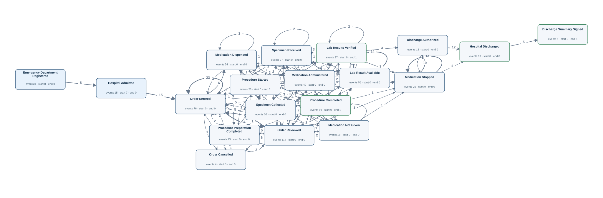</a></td><td width="58%" valign="top">
<a href="../../../datasets/hospitalflow/private/gold_sql/HF02.sql">Gold SQL</a> · <a href="../../../datasets/hospitalflow/private/gold_logs/HF02.csv">Gold CSV</a> · <a href="../../../datasets/hospitalflow/input/database.sqlite">Full source database (SQLite)</a>

<code>admission_detail</code> · 5 matched source rows
<table><tr><th>Column</th><th>Row 1</th><th>Row 2</th><th>Row 3</th></tr><tr><th>hadm_id</th><td>20000001</td><td>20000004</td><td>20000007</td></tr><tr><th>discharge_summary_signed_at</th><td>2026-01-19T18:13:00Z</td><td>2026-02-19T17:04:00Z</td><td>2026-03-11T15:45:00Z</td></tr></table>
<strong>Gold output for the same source rows</strong>
<ul><li>Row 1 → Discharge Summary Signed · event ADM:20000001:summary · case A:20000001 · time from <code>discharge_summary_signed_at</code></li><li>Row 2 → Discharge Summary Signed · event ADM:20000004:summary · case A:20000004 · time from <code>discharge_summary_signed_at</code></li><li>Row 3 → Discharge Summary Signed · event ADM:20000007:summary · case A:20000007 · time from <code>discharge_summary_signed_at</code></li></ul>

<code>admissions</code> · 15 matched source rows
<table><tr><th>Column</th><th>Row 1</th><th>Row 2</th><th>Row 3</th></tr><tr><th>hadm_id</th><td>20000001</td><td>20000002</td><td>20000003</td></tr><tr><th>subject_id</th><td>10000001</td><td>10000001</td><td>10000002</td></tr><tr><th>edregtime</th><td>2026-01-17T13:42:00Z</td><td><em>NULL</em></td><td>2026-02-03T09:01:00Z</td></tr><tr><th>admittime</th><td>2026-01-17T16:12:00Z</td><td>2026-01-27T13:19:00Z</td><td>2026-02-03T09:23:00Z</td></tr><tr><th>discharge_authorized_at</th><td>2026-01-19T13:33:00Z</td><td>2026-01-29T16:16:00Z</td><td>2026-02-08T17:49:00Z</td></tr><tr><th>dischtime</th><td>2026-01-19T15:01:00Z</td><td>2026-01-29T18:54:00Z</td><td>2026-02-08T20:38:00Z</td></tr></table>
<strong>Gold output for the same source rows</strong>
<ul><li>Row 1 → Discharge Authorized · event ADM:20000001:auth · case A:20000001 · time from <code>discharge_authorized_at</code></li><li>Row 1 → Emergency Department Registered · event ADM:20000001:ed · case A:20000001 · time from <code>edregtime</code></li><li>Row 1 → Hospital Admitted · event ADM:20000001:in · case A:20000001 · time from <code>admittime</code></li><li>Row 1 → Hospital Discharged · event ADM:20000001:out · case A:20000001 · time from <code>dischtime</code></li><li>Row 2 → Discharge Authorized · event ADM:20000002:auth · case A:20000002 · time from <code>discharge_authorized_at</code></li><li>Row 2 → Hospital Admitted · event ADM:20000002:in · case A:20000002 · time from <code>admittime</code></li><li>Row 2 → Hospital Discharged · event ADM:20000002:out · case A:20000002 · time from <code>dischtime</code></li><li>Row 3 → Discharge Authorized · event ADM:20000003:auth · case A:20000003 · time from <code>discharge_authorized_at</code></li><li>Row 3 → Emergency Department Registered · event ADM:20000003:ed · case A:20000003 · time from <code>edregtime</code></li><li>Row 3 → Hospital Admitted · event ADM:20000003:in · case A:20000003 · time from <code>admittime</code></li><li>Row 3 → Hospital Discharged · event ADM:20000003:out · case A:20000003 · time from <code>dischtime</code></li></ul>

<code>emar</code> · 67 matched source rows
<table><tr><th>Column</th><th>Row 1</th><th>Row 2</th><th>Row 3</th></tr><tr><th>emar_id</th><td>1</td><td>7</td><td>2</td></tr><tr><th>pharmacy_id</th><td>40000001</td><td>40000003</td><td>40000001</td></tr><tr><th>charttime</th><td>2026-01-17T19:31:00Z</td><td>2026-01-17T20:59:00Z</td><td>2026-01-17T21:22:00Z</td></tr><tr><th>event_txt</th><td>Administered</td><td>Not Given</td><td>Not Given</td></tr><tr><th>storetime</th><td>2026-01-17T20:12:00Z</td><td>2026-01-17T21:21:00Z</td><td>2026-01-17T21:44:00Z</td></tr></table>
<strong>Gold output for the same source rows</strong>
<ul><li>Row 1 → Medication Administered · event EMAR:1 · case A:20000001 · time from <code>charttime</code></li><li>Row 2 → Medication Not Given · event EMAR:7 · case A:20000001 · time from <code>charttime</code></li><li>Row 3 → Medication Not Given · event EMAR:2 · case A:20000001 · time from <code>charttime</code></li></ul>

<code>lab_order</code> · 27 matched source rows
<table><tr><th>Column</th><th>Row 1</th><th>Row 2</th><th>Row 3</th></tr><tr><th>order_id</th><td>31070762</td><td>31079248</td><td>31073704</td></tr><tr><th>subject_id</th><td>10000001</td><td>10000002</td><td>10000002</td></tr><tr><th>hadm_id</th><td>20000002</td><td>20000003</td><td>20000003</td></tr><tr><th>specimen_received_at</th><td>2026-01-27T19:52:00Z</td><td>2026-02-03T16:16:00Z</td><td>2026-02-03T16:24:00Z</td></tr><tr><th>results_verified_at</th><td>2026-01-28T00:32:00Z</td><td>2026-02-03T20:48:00Z</td><td>2026-02-03T18:34:00Z</td></tr></table>
<strong>Gold output for the same source rows</strong>
<ul><li>Row 1 → Specimen Received · event LAB:31070762:received · case A:20000002 · time from <code>specimen_received_at</code></li><li>Row 1 → Lab Results Verified · event LAB:31070762:verified · case A:20000002 · time from <code>results_verified_at</code></li><li>Row 2 → Specimen Received · event LAB:31079248:received · case A:20000003 · time from <code>specimen_received_at</code></li><li>Row 2 → Lab Results Verified · event LAB:31079248:verified · case A:20000003 · time from <code>results_verified_at</code></li><li>Row 3 → Specimen Received · event LAB:31073704:received · case A:20000003 · time from <code>specimen_received_at</code></li><li>Row 3 → Lab Results Verified · event LAB:31073704:verified · case A:20000003 · time from <code>results_verified_at</code></li></ul>

<code>labevents</code> · 56 matched source rows
<table><tr><th>Column</th><th>Row 1</th><th>Row 2</th><th>Row 3</th></tr><tr><th>labevent_id</th><td>1</td><td>3</td><td>4</td></tr><tr><th>order_id</th><td>31070762</td><td>31079248</td><td>31073704</td></tr><tr><th>itemid</th><td>1003</td><td>1002</td><td>1001</td></tr><tr><th>charttime</th><td>2026-01-27T19:38:00Z</td><td>2026-02-03T15:16:00Z</td><td>2026-02-03T15:46:00Z</td></tr><tr><th>storetime</th><td>2026-01-27T23:09:00Z</td><td>2026-02-03T19:38:00Z</td><td>2026-02-03T17:28:00Z</td></tr><tr><th>valuenum</th><td>14.6</td><td>141.8</td><td>1.13</td></tr><tr><th>valueuom</th><td>g/dL</td><td>mmol/L</td><td>mg/dL</td></tr></table>
<strong>Gold output for the same source rows</strong>
<ul><li>Row 1 → Specimen Collected · event LABEV:1:chart · case A:20000002 · time from <code>charttime</code></li><li>Row 1 → Lab Result Available · event LABEV:1:result · case A:20000002 · time from <code>storetime</code></li><li>Row 2 → Specimen Collected · event LABEV:3:chart · case A:20000003 · time from <code>charttime</code></li><li>Row 2 → Lab Result Available · event LABEV:3:result · case A:20000003 · time from <code>storetime</code></li><li>Row 3 → Specimen Collected · event LABEV:4:chart · case A:20000003 · time from <code>charttime</code></li><li>Row 3 → Lab Result Available · event LABEV:4:result · case A:20000003 · time from <code>storetime</code></li></ul>

<code>medication_order</code> · 25 matched source rows
<table><tr><th>Column</th><th>Row 1</th><th>Row 2</th><th>Row 3</th></tr><tr><th>order_id</th><td>32064975</td><td>32028896</td><td>32091033</td></tr><tr><th>hadm_id</th><td>20000001</td><td>20000001</td><td>20000003</td></tr><tr><th>medication</th><td>Amoxicillin</td><td>Acetaminophen</td><td>Acetaminophen</td></tr><tr><th>stopped_at</th><td>2026-01-18T09:54:00Z</td><td>2026-01-18T20:48:00Z</td><td>2026-02-04T14:42:00Z</td></tr></table>
<strong>Gold output for the same source rows</strong>
<ul><li>Row 1 → Medication Stopped · event MED:32064975:stop · case A:20000001 · time from <code>stopped_at</code></li><li>Row 2 → Medication Stopped · event MED:32028896:stop · case A:20000001 · time from <code>stopped_at</code></li><li>Row 3 → Medication Stopped · event MED:32091033:stop · case A:20000003 · time from <code>stopped_at</code></li></ul>

<code>order_history</code> · 194 matched source rows
<table><tr><th>Column</th><th>Row 1</th><th>Row 2</th><th>Row 3</th></tr><tr><th>history_id</th><td>1</td><td>2</td><td>35</td></tr><tr><th>lab_order_id</th><td><em>NULL</em></td><td><em>NULL</em></td><td><em>NULL</em></td></tr><tr><th>medication_order_id</th><td>32064975</td><td>32064975</td><td><em>NULL</em></td></tr><tr><th>procedure_order_id</th><td><em>NULL</em></td><td><em>NULL</em></td><td>33060273</td></tr><tr><th>action</th><td>ENTERED</td><td>REVIEWED</td><td>CANCELLED</td></tr><tr><th>occurred_at</th><td>2026-01-17T17:00:00Z</td><td>2026-01-17T17:22:00Z</td><td>2026-02-15T00:40:01Z</td></tr></table>
<strong>Gold output for the same source rows</strong>
<ul><li>Row 1 → Order Entered · event OH:1 · case A:20000001 · time from <code>occurred_at</code></li><li>Row 2 → Order Reviewed · event OH:2 · case A:20000001 · time from <code>occurred_at</code></li><li>Row 3 → Order Cancelled · event OH:35 · case A:20000004 · time from <code>occurred_at</code></li></ul>

<code>pharmacy</code> · 34 matched source rows
<table><tr><th>Column</th><th>Row 1</th><th>Row 2</th><th>Row 3</th></tr><tr><th>pharmacy_id</th><td>40000001</td><td>40000003</td><td>40000002</td></tr><tr><th>order_id</th><td>32064975</td><td>32028896</td><td>32064975</td></tr><tr><th>dispensed_at</th><td>2026-01-17T18:40:00Z</td><td>2026-01-17T19:12:00Z</td><td>2026-01-17T22:07:00Z</td></tr></table>
<strong>Gold output for the same source rows</strong>
<ul><li>Row 1 → Medication Dispensed · event PHARM:40000001:dispense · case A:20000001 · time from <code>dispensed_at</code></li><li>Row 2 → Medication Dispensed · event PHARM:40000003:dispense · case A:20000001 · time from <code>dispensed_at</code></li><li>Row 3 → Medication Dispensed · event PHARM:40000002:dispense · case A:20000001 · time from <code>dispensed_at</code></li></ul>

<code>procedure_episode</code> · 23 matched source rows
<table><tr><th>Column</th><th>Row 1</th><th>Row 2</th><th>Row 3</th></tr><tr><th>procedureevent_id</th><td>1</td><td>2</td><td>3</td></tr><tr><th>order_id</th><td>33032683</td><td>33088335</td><td>33088335</td></tr><tr><th>starttime</th><td>2026-01-27T18:22:00Z</td><td>2026-02-15T01:42:00Z</td><td>2026-02-15T05:27:00Z</td></tr><tr><th>endtime</th><td>2026-01-27T19:24:00Z</td><td>2026-02-15T02:25:00Z</td><td>2026-02-15T06:34:00Z</td></tr><tr><th>storetime</th><td>2026-01-27T18:40:00Z</td><td>2026-02-15T02:16:00Z</td><td>2026-02-15T05:53:00Z</td></tr></table>
<strong>Gold output for the same source rows</strong>
<ul><li>Row 1 → Procedure Completed · event PROCEV:1:end · case A:20000002 · time from <code>endtime</code></li><li>Row 1 → Procedure Started · event PROCEV:1:start · case A:20000002 · time from <code>starttime</code></li><li>Row 2 → Procedure Completed · event PROCEV:2:end · case A:20000004 · time from <code>endtime</code></li><li>Row 2 → Procedure Started · event PROCEV:2:start · case A:20000004 · time from <code>starttime</code></li><li>Row 3 → Procedure Completed · event PROCEV:3:end · case A:20000004 · time from <code>endtime</code></li><li>Row 3 → Procedure Started · event PROCEV:3:start · case A:20000004 · time from <code>starttime</code></li></ul>

<code>procedure_order</code> · 13 matched source rows
<table><tr><th>Column</th><th>Row 1</th><th>Row 2</th><th>Row 3</th></tr><tr><th>order_id</th><td>33032683</td><td>33088335</td><td>33092897</td></tr><tr><th>hadm_id</th><td>20000002</td><td>20000004</td><td>20000005</td></tr><tr><th>procedure_name</th><td>Bronchoscopy</td><td>Endoscopy</td><td>Bronchoscopy</td></tr><tr><th>preparation_completed_at</th><td>2026-01-27T16:50:00Z</td><td>2026-02-15T01:07:00Z</td><td>2026-02-20T03:02:00Z</td></tr></table>
<strong>Gold output for the same source rows</strong>
<ul><li>Row 1 → Procedure Preparation Completed · event PROC:33032683:prep · case A:20000002 · time from <code>preparation_completed_at</code></li><li>Row 2 → Procedure Preparation Completed · event PROC:33088335:prep · case A:20000004 · time from <code>preparation_completed_at</code></li><li>Row 3 → Procedure Preparation Completed · event PROC:33092897:prep · case A:20000005 · time from <code>preparation_completed_at</code></li></ul>

FK-linked case and join evidence
<ul><li><code>order_history</code> → <code>lab_order</code> · lab_order_id → order_id · order_id = 31073842</li><li><code>order_history</code> → <code>medication_order</code> · medication_order_id → order_id · order_id = 32034941</li><li><code>order_history</code> → <code>procedure_order</code> · procedure_order_id → order_id · order_id = 33060273</li></ul>
</td></tr></table>

## HF02P — Q4

Show the entire recorded history of each individual hospital stay.

Events: **595** · Cases with events: **15** · Activities: **19** · Edges: **127** · Source tables: **10** · SQL tables: **11**

<table><tr><td width="42%" valign="top"></td><td width="58%" valign="top">
<a href="../../../datasets/hospitalflow/private/gold_sql/HF02P.sql">Gold SQL</a> · <a href="../../../datasets/hospitalflow/private/gold_logs/HF02P.csv">Gold CSV</a> · <a href="../../../datasets/hospitalflow/input/database.sqlite">Full source database (SQLite)</a>

<code>admission_detail</code> · 5 matched source rows
<table><tr><th>Column</th><th>Row 1</th><th>Row 2</th><th>Row 3</th></tr><tr><th>hadm_id</th><td>20000001</td><td>20000004</td><td>20000007</td></tr><tr><th>discharge_summary_signed_at</th><td>2026-01-19T18:13:00Z</td><td>2026-02-19T17:04:00Z</td><td>2026-03-11T15:45:00Z</td></tr></table>
<strong>Gold output for the same source rows</strong>
<ul><li>Row 1 → Discharge Summary Signed · event ADM:20000001:summary · case A:20000001 · time from <code>discharge_summary_signed_at</code></li><li>Row 2 → Discharge Summary Signed · event ADM:20000004:summary · case A:20000004 · time from <code>discharge_summary_signed_at</code></li><li>Row 3 → Discharge Summary Signed · event ADM:20000007:summary · case A:20000007 · time from <code>discharge_summary_signed_at</code></li></ul>

<code>admissions</code> · 15 matched source rows
<table><tr><th>Column</th><th>Row 1</th><th>Row 2</th><th>Row 3</th></tr><tr><th>hadm_id</th><td>20000001</td><td>20000002</td><td>20000003</td></tr><tr><th>subject_id</th><td>10000001</td><td>10000001</td><td>10000002</td></tr><tr><th>edregtime</th><td>2026-01-17T13:42:00Z</td><td><em>NULL</em></td><td>2026-02-03T09:01:00Z</td></tr><tr><th>admittime</th><td>2026-01-17T16:12:00Z</td><td>2026-01-27T13:19:00Z</td><td>2026-02-03T09:23:00Z</td></tr><tr><th>discharge_authorized_at</th><td>2026-01-19T13:33:00Z</td><td>2026-01-29T16:16:00Z</td><td>2026-02-08T17:49:00Z</td></tr><tr><th>dischtime</th><td>2026-01-19T15:01:00Z</td><td>2026-01-29T18:54:00Z</td><td>2026-02-08T20:38:00Z</td></tr></table>
<strong>Gold output for the same source rows</strong>
<ul><li>Row 1 → Discharge Authorized · event ADM:20000001:auth · case A:20000001 · time from <code>discharge_authorized_at</code></li><li>Row 1 → Emergency Department Registered · event ADM:20000001:ed · case A:20000001 · time from <code>edregtime</code></li><li>Row 1 → Hospital Admitted · event ADM:20000001:in · case A:20000001 · time from <code>admittime</code></li><li>Row 1 → Hospital Discharged · event ADM:20000001:out · case A:20000001 · time from <code>dischtime</code></li><li>Row 2 → Discharge Authorized · event ADM:20000002:auth · case A:20000002 · time from <code>discharge_authorized_at</code></li><li>Row 2 → Hospital Admitted · event ADM:20000002:in · case A:20000002 · time from <code>admittime</code></li><li>Row 2 → Hospital Discharged · event ADM:20000002:out · case A:20000002 · time from <code>dischtime</code></li><li>Row 3 → Discharge Authorized · event ADM:20000003:auth · case A:20000003 · time from <code>discharge_authorized_at</code></li><li>Row 3 → Emergency Department Registered · event ADM:20000003:ed · case A:20000003 · time from <code>edregtime</code></li><li>Row 3 → Hospital Admitted · event ADM:20000003:in · case A:20000003 · time from <code>admittime</code></li><li>Row 3 → Hospital Discharged · event ADM:20000003:out · case A:20000003 · time from <code>dischtime</code></li></ul>

<code>emar</code> · 67 matched source rows
<table><tr><th>Column</th><th>Row 1</th><th>Row 2</th><th>Row 3</th></tr><tr><th>emar_id</th><td>1</td><td>7</td><td>2</td></tr><tr><th>pharmacy_id</th><td>40000001</td><td>40000003</td><td>40000001</td></tr><tr><th>charttime</th><td>2026-01-17T19:31:00Z</td><td>2026-01-17T20:59:00Z</td><td>2026-01-17T21:22:00Z</td></tr><tr><th>event_txt</th><td>Administered</td><td>Not Given</td><td>Not Given</td></tr><tr><th>storetime</th><td>2026-01-17T20:12:00Z</td><td>2026-01-17T21:21:00Z</td><td>2026-01-17T21:44:00Z</td></tr></table>
<strong>Gold output for the same source rows</strong>
<ul><li>Row 1 → Medication Administered · event EMAR:1 · case A:20000001 · time from <code>charttime</code></li><li>Row 2 → Medication Not Given · event EMAR:7 · case A:20000001 · time from <code>charttime</code></li><li>Row 3 → Medication Not Given · event EMAR:2 · case A:20000001 · time from <code>charttime</code></li></ul>

<code>lab_order</code> · 27 matched source rows
<table><tr><th>Column</th><th>Row 1</th><th>Row 2</th><th>Row 3</th></tr><tr><th>order_id</th><td>31070762</td><td>31079248</td><td>31073704</td></tr><tr><th>subject_id</th><td>10000001</td><td>10000002</td><td>10000002</td></tr><tr><th>hadm_id</th><td>20000002</td><td>20000003</td><td>20000003</td></tr><tr><th>specimen_received_at</th><td>2026-01-27T19:52:00Z</td><td>2026-02-03T16:16:00Z</td><td>2026-02-03T16:24:00Z</td></tr><tr><th>results_verified_at</th><td>2026-01-28T00:32:00Z</td><td>2026-02-03T20:48:00Z</td><td>2026-02-03T18:34:00Z</td></tr></table>
<strong>Gold output for the same source rows</strong>
<ul><li>Row 1 → Specimen Received · event LAB:31070762:received · case A:20000002 · time from <code>specimen_received_at</code></li><li>Row 1 → Lab Results Verified · event LAB:31070762:verified · case A:20000002 · time from <code>results_verified_at</code></li><li>Row 2 → Specimen Received · event LAB:31079248:received · case A:20000003 · time from <code>specimen_received_at</code></li><li>Row 2 → Lab Results Verified · event LAB:31079248:verified · case A:20000003 · time from <code>results_verified_at</code></li><li>Row 3 → Specimen Received · event LAB:31073704:received · case A:20000003 · time from <code>specimen_received_at</code></li><li>Row 3 → Lab Results Verified · event LAB:31073704:verified · case A:20000003 · time from <code>results_verified_at</code></li></ul>

<code>labevents</code> · 56 matched source rows
<table><tr><th>Column</th><th>Row 1</th><th>Row 2</th><th>Row 3</th></tr><tr><th>labevent_id</th><td>1</td><td>3</td><td>4</td></tr><tr><th>order_id</th><td>31070762</td><td>31079248</td><td>31073704</td></tr><tr><th>itemid</th><td>1003</td><td>1002</td><td>1001</td></tr><tr><th>charttime</th><td>2026-01-27T19:38:00Z</td><td>2026-02-03T15:16:00Z</td><td>2026-02-03T15:46:00Z</td></tr><tr><th>storetime</th><td>2026-01-27T23:09:00Z</td><td>2026-02-03T19:38:00Z</td><td>2026-02-03T17:28:00Z</td></tr><tr><th>valuenum</th><td>14.6</td><td>141.8</td><td>1.13</td></tr><tr><th>valueuom</th><td>g/dL</td><td>mmol/L</td><td>mg/dL</td></tr></table>
<strong>Gold output for the same source rows</strong>
<ul><li>Row 1 → Specimen Collected · event LABEV:1:chart · case A:20000002 · time from <code>charttime</code></li><li>Row 1 → Lab Result Available · event LABEV:1:result · case A:20000002 · time from <code>storetime</code></li><li>Row 2 → Specimen Collected · event LABEV:3:chart · case A:20000003 · time from <code>charttime</code></li><li>Row 2 → Lab Result Available · event LABEV:3:result · case A:20000003 · time from <code>storetime</code></li><li>Row 3 → Specimen Collected · event LABEV:4:chart · case A:20000003 · time from <code>charttime</code></li><li>Row 3 → Lab Result Available · event LABEV:4:result · case A:20000003 · time from <code>storetime</code></li></ul>

<code>medication_order</code> · 25 matched source rows
<table><tr><th>Column</th><th>Row 1</th><th>Row 2</th><th>Row 3</th></tr><tr><th>order_id</th><td>32064975</td><td>32028896</td><td>32091033</td></tr><tr><th>hadm_id</th><td>20000001</td><td>20000001</td><td>20000003</td></tr><tr><th>medication</th><td>Amoxicillin</td><td>Acetaminophen</td><td>Acetaminophen</td></tr><tr><th>stopped_at</th><td>2026-01-18T09:54:00Z</td><td>2026-01-18T20:48:00Z</td><td>2026-02-04T14:42:00Z</td></tr></table>
<strong>Gold output for the same source rows</strong>
<ul><li>Row 1 → Medication Stopped · event MED:32064975:stop · case A:20000001 · time from <code>stopped_at</code></li><li>Row 2 → Medication Stopped · event MED:32028896:stop · case A:20000001 · time from <code>stopped_at</code></li><li>Row 3 → Medication Stopped · event MED:32091033:stop · case A:20000003 · time from <code>stopped_at</code></li></ul>

<code>order_history</code> · 194 matched source rows
<table><tr><th>Column</th><th>Row 1</th><th>Row 2</th><th>Row 3</th></tr><tr><th>history_id</th><td>1</td><td>2</td><td>35</td></tr><tr><th>lab_order_id</th><td><em>NULL</em></td><td><em>NULL</em></td><td><em>NULL</em></td></tr><tr><th>medication_order_id</th><td>32064975</td><td>32064975</td><td><em>NULL</em></td></tr><tr><th>procedure_order_id</th><td><em>NULL</em></td><td><em>NULL</em></td><td>33060273</td></tr><tr><th>action</th><td>ENTERED</td><td>REVIEWED</td><td>CANCELLED</td></tr><tr><th>occurred_at</th><td>2026-01-17T17:00:00Z</td><td>2026-01-17T17:22:00Z</td><td>2026-02-15T00:40:01Z</td></tr></table>
<strong>Gold output for the same source rows</strong>
<ul><li>Row 1 → Order Entered · event OH:1 · case A:20000001 · time from <code>occurred_at</code></li><li>Row 2 → Order Reviewed · event OH:2 · case A:20000001 · time from <code>occurred_at</code></li><li>Row 3 → Order Cancelled · event OH:35 · case A:20000004 · time from <code>occurred_at</code></li></ul>

<code>pharmacy</code> · 34 matched source rows
<table><tr><th>Column</th><th>Row 1</th><th>Row 2</th><th>Row 3</th></tr><tr><th>pharmacy_id</th><td>40000001</td><td>40000003</td><td>40000002</td></tr><tr><th>order_id</th><td>32064975</td><td>32028896</td><td>32064975</td></tr><tr><th>dispensed_at</th><td>2026-01-17T18:40:00Z</td><td>2026-01-17T19:12:00Z</td><td>2026-01-17T22:07:00Z</td></tr></table>
<strong>Gold output for the same source rows</strong>
<ul><li>Row 1 → Medication Dispensed · event PHARM:40000001:dispense · case A:20000001 · time from <code>dispensed_at</code></li><li>Row 2 → Medication Dispensed · event PHARM:40000003:dispense · case A:20000001 · time from <code>dispensed_at</code></li><li>Row 3 → Medication Dispensed · event PHARM:40000002:dispense · case A:20000001 · time from <code>dispensed_at</code></li></ul>

<code>procedure_episode</code> · 23 matched source rows
<table><tr><th>Column</th><th>Row 1</th><th>Row 2</th><th>Row 3</th></tr><tr><th>procedureevent_id</th><td>1</td><td>2</td><td>3</td></tr><tr><th>order_id</th><td>33032683</td><td>33088335</td><td>33088335</td></tr><tr><th>starttime</th><td>2026-01-27T18:22:00Z</td><td>2026-02-15T01:42:00Z</td><td>2026-02-15T05:27:00Z</td></tr><tr><th>endtime</th><td>2026-01-27T19:24:00Z</td><td>2026-02-15T02:25:00Z</td><td>2026-02-15T06:34:00Z</td></tr><tr><th>storetime</th><td>2026-01-27T18:40:00Z</td><td>2026-02-15T02:16:00Z</td><td>2026-02-15T05:53:00Z</td></tr></table>
<strong>Gold output for the same source rows</strong>
<ul><li>Row 1 → Procedure Completed · event PROCEV:1:end · case A:20000002 · time from <code>endtime</code></li><li>Row 1 → Procedure Started · event PROCEV:1:start · case A:20000002 · time from <code>starttime</code></li><li>Row 2 → Procedure Completed · event PROCEV:2:end · case A:20000004 · time from <code>endtime</code></li><li>Row 2 → Procedure Started · event PROCEV:2:start · case A:20000004 · time from <code>starttime</code></li><li>Row 3 → Procedure Completed · event PROCEV:3:end · case A:20000004 · time from <code>endtime</code></li><li>Row 3 → Procedure Started · event PROCEV:3:start · case A:20000004 · time from <code>starttime</code></li></ul>

<code>procedure_order</code> · 13 matched source rows
<table><tr><th>Column</th><th>Row 1</th><th>Row 2</th><th>Row 3</th></tr><tr><th>order_id</th><td>33032683</td><td>33088335</td><td>33092897</td></tr><tr><th>hadm_id</th><td>20000002</td><td>20000004</td><td>20000005</td></tr><tr><th>procedure_name</th><td>Bronchoscopy</td><td>Endoscopy</td><td>Bronchoscopy</td></tr><tr><th>preparation_completed_at</th><td>2026-01-27T16:50:00Z</td><td>2026-02-15T01:07:00Z</td><td>2026-02-20T03:02:00Z</td></tr></table>
<strong>Gold output for the same source rows</strong>
<ul><li>Row 1 → Procedure Preparation Completed · event PROC:33032683:prep · case A:20000002 · time from <code>preparation_completed_at</code></li><li>Row 2 → Procedure Preparation Completed · event PROC:33088335:prep · case A:20000004 · time from <code>preparation_completed_at</code></li><li>Row 3 → Procedure Preparation Completed · event PROC:33092897:prep · case A:20000005 · time from <code>preparation_completed_at</code></li></ul>

FK-linked case and join evidence
<ul><li><code>order_history</code> → <code>lab_order</code> · lab_order_id → order_id · order_id = 31073842</li><li><code>order_history</code> → <code>medication_order</code> · medication_order_id → order_id · order_id = 32034941</li><li><code>order_history</code> → <code>procedure_order</code> · procedure_order_id → order_id · order_id = 33060273</li></ul>
</td></tr></table>

## HF03 — Q3

Extract the full recorded lifecycle for each order history record.

Events: **203** · Cases with events: **203** · Activities: **3** · Edges: **0** · Source tables: **1** · SQL tables: **11**

<table><tr><td width="42%" valign="top"><a href="graphs/HF03.svg">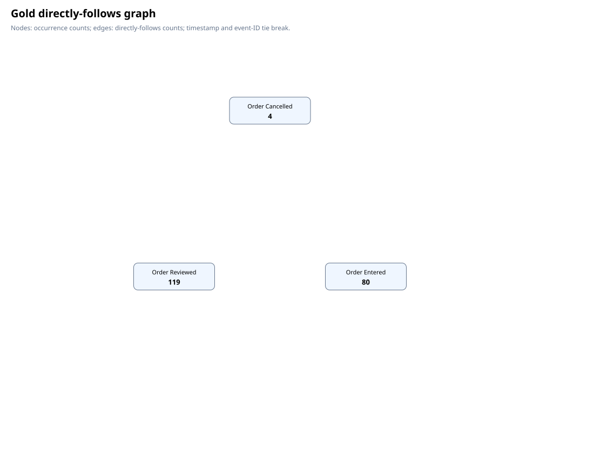</a></td><td width="58%" valign="top">
<a href="../../../datasets/hospitalflow/private/gold_sql/HF03.sql">Gold SQL</a> · <a href="../../../datasets/hospitalflow/private/gold_logs/HF03.csv">Gold CSV</a> · <a href="../../../datasets/hospitalflow/input/database.sqlite">Full source database (SQLite)</a>

<code>order_history</code> · 203 matched source rows
<table><tr><th>Column</th><th>Row 1</th><th>Row 2</th><th>Row 3</th></tr><tr><th>history_id</th><td>1</td><td>10</td><td>140</td></tr><tr><th>lab_order_id</th><td><em>NULL</em></td><td><em>NULL</em></td><td><em>NULL</em></td></tr><tr><th>medication_order_id</th><td>32064975</td><td><em>NULL</em></td><td><em>NULL</em></td></tr><tr><th>procedure_order_id</th><td><em>NULL</em></td><td>33032683</td><td>30000117</td></tr><tr><th>action</th><td>ENTERED</td><td>REVIEWED</td><td>CANCELLED</td></tr><tr><th>occurred_at</th><td>2026-01-17T17:00:00Z</td><td>2026-01-27T15:11:00Z</td><td>2026-04-27T20:17:00Z</td></tr></table>
<strong>Gold output for the same source rows</strong>
<ul><li>Row 1 → Order Entered · event OH:1 · case H:1 · time from <code>occurred_at</code></li><li>Row 2 → Order Reviewed · event OH:10 · case H:10 · time from <code>occurred_at</code></li><li>Row 3 → Order Cancelled · event OH:140 · case H:140 · time from <code>occurred_at</code></li></ul>

FK-linked case and join evidence
<ul><li><code>medication_order</code> → <code>admissions</code> · hadm_id → hadm_id · hadm_id = 20000001</li><li><code>order_history</code> → <code>lab_order</code> · lab_order_id → order_id · order_id = 31007707</li><li><code>order_history</code> → <code>medication_order</code> · medication_order_id → order_id · order_id = 32064975</li><li><code>order_history</code> → <code>procedure_order</code> · procedure_order_id → order_id · order_id = 33032683</li></ul>
</td></tr></table>

## HF03P — Q4

Show the complete recorded history of every individual order history record.

Events: **203** · Cases with events: **203** · Activities: **3** · Edges: **0** · Source tables: **1** · SQL tables: **11**

<table><tr><td width="42%" valign="top"></td><td width="58%" valign="top">
<a href="../../../datasets/hospitalflow/private/gold_sql/HF03P.sql">Gold SQL</a> · <a href="../../../datasets/hospitalflow/private/gold_logs/HF03P.csv">Gold CSV</a> · <a href="../../../datasets/hospitalflow/input/database.sqlite">Full source database (SQLite)</a>

<code>order_history</code> · 203 matched source rows
<table><tr><th>Column</th><th>Row 1</th><th>Row 2</th><th>Row 3</th></tr><tr><th>history_id</th><td>1</td><td>10</td><td>140</td></tr><tr><th>lab_order_id</th><td><em>NULL</em></td><td><em>NULL</em></td><td><em>NULL</em></td></tr><tr><th>medication_order_id</th><td>32064975</td><td><em>NULL</em></td><td><em>NULL</em></td></tr><tr><th>procedure_order_id</th><td><em>NULL</em></td><td>33032683</td><td>30000117</td></tr><tr><th>action</th><td>ENTERED</td><td>REVIEWED</td><td>CANCELLED</td></tr><tr><th>occurred_at</th><td>2026-01-17T17:00:00Z</td><td>2026-01-27T15:11:00Z</td><td>2026-04-27T20:17:00Z</td></tr></table>
<strong>Gold output for the same source rows</strong>
<ul><li>Row 1 → Order Entered · event OH:1 · case H:1 · time from <code>occurred_at</code></li><li>Row 2 → Order Reviewed · event OH:10 · case H:10 · time from <code>occurred_at</code></li><li>Row 3 → Order Cancelled · event OH:140 · case H:140 · time from <code>occurred_at</code></li></ul>

FK-linked case and join evidence
<ul><li><code>medication_order</code> → <code>admissions</code> · hadm_id → hadm_id · hadm_id = 20000001</li><li><code>order_history</code> → <code>lab_order</code> · lab_order_id → order_id · order_id = 31007707</li><li><code>order_history</code> → <code>medication_order</code> · medication_order_id → order_id · order_id = 32064975</li><li><code>order_history</code> → <code>procedure_order</code> · procedure_order_id → order_id · order_id = 33032683</li></ul>
</td></tr></table>

## HF04 — Q3

Extract the full recorded lifecycle for each laboratory order.

Events: **267** · Cases with events: **34** · Activities: **6** · Edges: **8** · Source tables: **3** · SQL tables: **11**

<table><tr><td width="42%" valign="top"><a href="graphs/HF04.svg">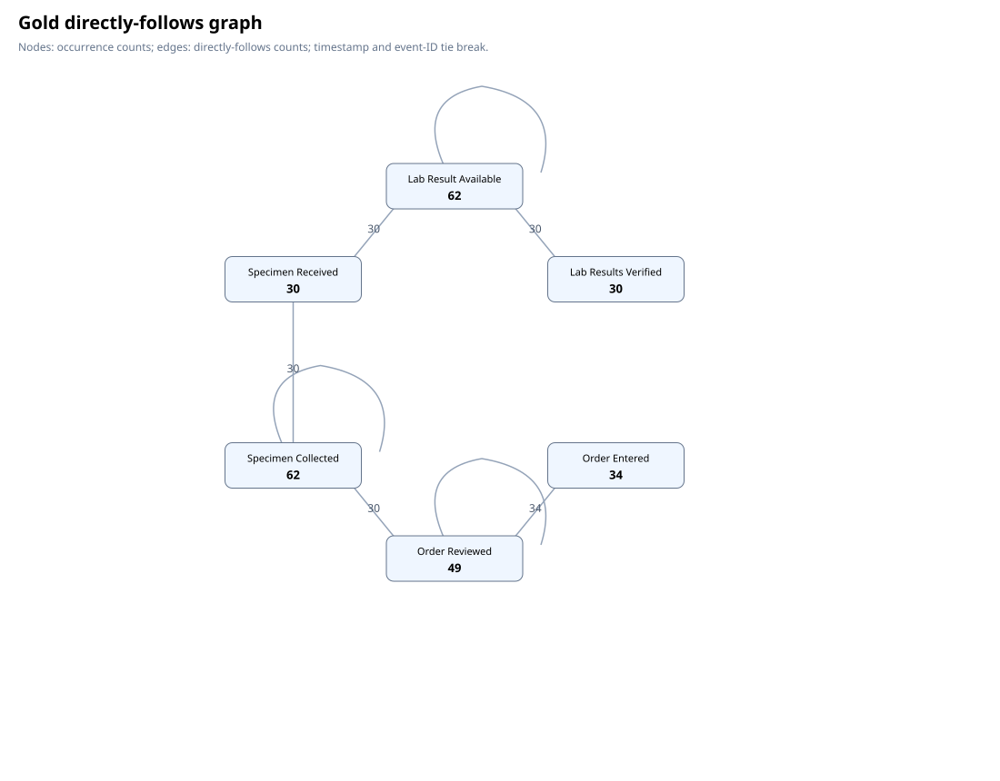</a></td><td width="58%" valign="top">
<a href="../../../datasets/hospitalflow/private/gold_sql/HF04.sql">Gold SQL</a> · <a href="../../../datasets/hospitalflow/private/gold_logs/HF04.csv">Gold CSV</a> · <a href="../../../datasets/hospitalflow/input/database.sqlite">Full source database (SQLite)</a>

<code>lab_order</code> · 30 matched source rows
<table><tr><th>Column</th><th>Row 1</th><th>Row 2</th><th>Row 3</th></tr><tr><th>order_id</th><td>30000117</td><td>30000691</td><td>30000983</td></tr><tr><th>subject_id</th><td>10000005</td><td>10000003</td><td>10000009</td></tr><tr><th>hadm_id</th><td>20000009</td><td>20000006</td><td>20000013</td></tr><tr><th>specimen_received_at</th><td>2026-03-25T19:11:00Z</td><td>2026-03-06T10:37:00Z</td><td>2026-05-31T07:57:00Z</td></tr><tr><th>results_verified_at</th><td>2026-03-25T20:41:00Z</td><td>2026-03-06T15:06:00Z</td><td>2026-05-31T13:32:00Z</td></tr></table>
<strong>Gold output for the same source rows</strong>
<ul><li>Row 1 → Specimen Received · event LAB:30000117:received · case LAB:30000117 · time from <code>specimen_received_at</code></li><li>Row 1 → Lab Results Verified · event LAB:30000117:verified · case LAB:30000117 · time from <code>results_verified_at</code></li><li>Row 2 → Specimen Received · event LAB:30000691:received · case LAB:30000691 · time from <code>specimen_received_at</code></li><li>Row 2 → Lab Results Verified · event LAB:30000691:verified · case LAB:30000691 · time from <code>results_verified_at</code></li><li>Row 3 → Specimen Received · event LAB:30000983:received · case LAB:30000983 · time from <code>specimen_received_at</code></li><li>Row 3 → Lab Results Verified · event LAB:30000983:verified · case LAB:30000983 · time from <code>results_verified_at</code></li></ul>

<code>labevents</code> · 62 matched source rows
<table><tr><th>Column</th><th>Row 1</th><th>Row 2</th><th>Row 3</th></tr><tr><th>labevent_id</th><td>33</td><td>10</td><td>8</td></tr><tr><th>order_id</th><td>30000117</td><td>30000691</td><td>30000691</td></tr><tr><th>itemid</th><td>1003</td><td>1003</td><td>1001</td></tr><tr><th>charttime</th><td>2026-03-25T18:19:00Z</td><td>2026-03-06T08:37:00Z</td><td>2026-03-06T09:13:00Z</td></tr><tr><th>storetime</th><td>2026-03-25T19:43:00Z</td><td>2026-03-06T11:15:00Z</td><td>2026-03-06T13:48:00Z</td></tr><tr><th>valuenum</th><td>14.3</td><td>12.5</td><td>1.66</td></tr><tr><th>valueuom</th><td>g/dL</td><td>g/dL</td><td>mg/dL</td></tr></table>
<strong>Gold output for the same source rows</strong>
<ul><li>Row 1 → Specimen Collected · event LABEV:33:chart · case LAB:30000117 · time from <code>charttime</code></li><li>Row 1 → Lab Result Available · event LABEV:33:result · case LAB:30000117 · time from <code>storetime</code></li><li>Row 2 → Specimen Collected · event LABEV:10:chart · case LAB:30000691 · time from <code>charttime</code></li><li>Row 2 → Lab Result Available · event LABEV:10:result · case LAB:30000691 · time from <code>storetime</code></li><li>Row 3 → Specimen Collected · event LABEV:8:chart · case LAB:30000691 · time from <code>charttime</code></li><li>Row 3 → Lab Result Available · event LABEV:8:result · case LAB:30000691 · time from <code>storetime</code></li></ul>

<code>order_history</code> · 83 matched source rows
<table><tr><th>Column</th><th>Row 1</th><th>Row 2</th><th>Row 3</th></tr><tr><th>history_id</th><td>96</td><td>97</td><td>98</td></tr><tr><th>lab_order_id</th><td>30000117</td><td>30000117</td><td>30000117</td></tr><tr><th>medication_order_id</th><td><em>NULL</em></td><td><em>NULL</em></td><td><em>NULL</em></td></tr><tr><th>procedure_order_id</th><td><em>NULL</em></td><td><em>NULL</em></td><td><em>NULL</em></td></tr><tr><th>action</th><td>ENTERED</td><td>REVIEWED</td><td>REVIEWED</td></tr><tr><th>occurred_at</th><td>2026-03-25T14:29:00Z</td><td>2026-03-25T15:29:00Z</td><td>2026-03-25T15:54:01Z</td></tr></table>
<strong>Gold output for the same source rows</strong>
<ul><li>Row 1 → Order Entered · event OH:96 · case LAB:30000117 · time from <code>occurred_at</code></li><li>Row 2 → Order Reviewed · event OH:97 · case LAB:30000117 · time from <code>occurred_at</code></li><li>Row 3 → Order Reviewed · event OH:98 · case LAB:30000117 · time from <code>occurred_at</code></li></ul>

FK-linked case and join evidence
<ul><li><code>lab_order</code> → <code>admissions</code> · hadm_id → hadm_id · hadm_id = 20000009</li><li><code>order_history</code> → <code>lab_order</code> · lab_order_id → order_id · order_id = 31073842</li></ul>
</td></tr></table>

## HF04P — Q4

Show everything recorded over the life of each laboratory order.

Events: **267** · Cases with events: **34** · Activities: **6** · Edges: **8** · Source tables: **3** · SQL tables: **11**

<table><tr><td width="42%" valign="top"></td><td width="58%" valign="top">
<a href="../../../datasets/hospitalflow/private/gold_sql/HF04P.sql">Gold SQL</a> · <a href="../../../datasets/hospitalflow/private/gold_logs/HF04P.csv">Gold CSV</a> · <a href="../../../datasets/hospitalflow/input/database.sqlite">Full source database (SQLite)</a>

<code>lab_order</code> · 30 matched source rows
<table><tr><th>Column</th><th>Row 1</th><th>Row 2</th><th>Row 3</th></tr><tr><th>order_id</th><td>30000117</td><td>30000691</td><td>30000983</td></tr><tr><th>subject_id</th><td>10000005</td><td>10000003</td><td>10000009</td></tr><tr><th>hadm_id</th><td>20000009</td><td>20000006</td><td>20000013</td></tr><tr><th>specimen_received_at</th><td>2026-03-25T19:11:00Z</td><td>2026-03-06T10:37:00Z</td><td>2026-05-31T07:57:00Z</td></tr><tr><th>results_verified_at</th><td>2026-03-25T20:41:00Z</td><td>2026-03-06T15:06:00Z</td><td>2026-05-31T13:32:00Z</td></tr></table>
<strong>Gold output for the same source rows</strong>
<ul><li>Row 1 → Specimen Received · event LAB:30000117:received · case LAB:30000117 · time from <code>specimen_received_at</code></li><li>Row 1 → Lab Results Verified · event LAB:30000117:verified · case LAB:30000117 · time from <code>results_verified_at</code></li><li>Row 2 → Specimen Received · event LAB:30000691:received · case LAB:30000691 · time from <code>specimen_received_at</code></li><li>Row 2 → Lab Results Verified · event LAB:30000691:verified · case LAB:30000691 · time from <code>results_verified_at</code></li><li>Row 3 → Specimen Received · event LAB:30000983:received · case LAB:30000983 · time from <code>specimen_received_at</code></li><li>Row 3 → Lab Results Verified · event LAB:30000983:verified · case LAB:30000983 · time from <code>results_verified_at</code></li></ul>

<code>labevents</code> · 62 matched source rows
<table><tr><th>Column</th><th>Row 1</th><th>Row 2</th><th>Row 3</th></tr><tr><th>labevent_id</th><td>33</td><td>10</td><td>8</td></tr><tr><th>order_id</th><td>30000117</td><td>30000691</td><td>30000691</td></tr><tr><th>itemid</th><td>1003</td><td>1003</td><td>1001</td></tr><tr><th>charttime</th><td>2026-03-25T18:19:00Z</td><td>2026-03-06T08:37:00Z</td><td>2026-03-06T09:13:00Z</td></tr><tr><th>storetime</th><td>2026-03-25T19:43:00Z</td><td>2026-03-06T11:15:00Z</td><td>2026-03-06T13:48:00Z</td></tr><tr><th>valuenum</th><td>14.3</td><td>12.5</td><td>1.66</td></tr><tr><th>valueuom</th><td>g/dL</td><td>g/dL</td><td>mg/dL</td></tr></table>
<strong>Gold output for the same source rows</strong>
<ul><li>Row 1 → Specimen Collected · event LABEV:33:chart · case LAB:30000117 · time from <code>charttime</code></li><li>Row 1 → Lab Result Available · event LABEV:33:result · case LAB:30000117 · time from <code>storetime</code></li><li>Row 2 → Specimen Collected · event LABEV:10:chart · case LAB:30000691 · time from <code>charttime</code></li><li>Row 2 → Lab Result Available · event LABEV:10:result · case LAB:30000691 · time from <code>storetime</code></li><li>Row 3 → Specimen Collected · event LABEV:8:chart · case LAB:30000691 · time from <code>charttime</code></li><li>Row 3 → Lab Result Available · event LABEV:8:result · case LAB:30000691 · time from <code>storetime</code></li></ul>

<code>order_history</code> · 83 matched source rows
<table><tr><th>Column</th><th>Row 1</th><th>Row 2</th><th>Row 3</th></tr><tr><th>history_id</th><td>96</td><td>97</td><td>98</td></tr><tr><th>lab_order_id</th><td>30000117</td><td>30000117</td><td>30000117</td></tr><tr><th>medication_order_id</th><td><em>NULL</em></td><td><em>NULL</em></td><td><em>NULL</em></td></tr><tr><th>procedure_order_id</th><td><em>NULL</em></td><td><em>NULL</em></td><td><em>NULL</em></td></tr><tr><th>action</th><td>ENTERED</td><td>REVIEWED</td><td>REVIEWED</td></tr><tr><th>occurred_at</th><td>2026-03-25T14:29:00Z</td><td>2026-03-25T15:29:00Z</td><td>2026-03-25T15:54:01Z</td></tr></table>
<strong>Gold output for the same source rows</strong>
<ul><li>Row 1 → Order Entered · event OH:96 · case LAB:30000117 · time from <code>occurred_at</code></li><li>Row 2 → Order Reviewed · event OH:97 · case LAB:30000117 · time from <code>occurred_at</code></li><li>Row 3 → Order Reviewed · event OH:98 · case LAB:30000117 · time from <code>occurred_at</code></li></ul>

FK-linked case and join evidence
<ul><li><code>lab_order</code> → <code>admissions</code> · hadm_id → hadm_id · hadm_id = 20000009</li><li><code>order_history</code> → <code>lab_order</code> · lab_order_id → order_id · order_id = 31073842</li></ul>
</td></tr></table>

## HF05 — Q3

Extract the full recorded lifecycle for each medication order.

Events: **198** · Cases with events: **29** · Activities: **6** · Edges: **15** · Source tables: **4** · SQL tables: **11**

<table><tr><td width="42%" valign="top"><a href="graphs/HF05.svg">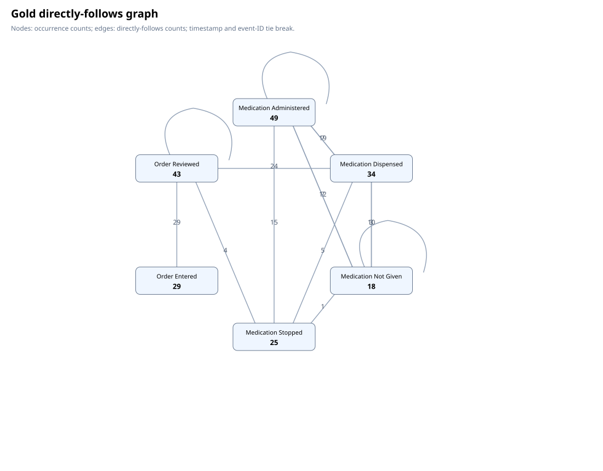</a></td><td width="58%" valign="top">
<a href="../../../datasets/hospitalflow/private/gold_sql/HF05.sql">Gold SQL</a> · <a href="../../../datasets/hospitalflow/private/gold_logs/HF05.csv">Gold CSV</a> · <a href="../../../datasets/hospitalflow/input/database.sqlite">Full source database (SQLite)</a>

<code>emar</code> · 67 matched source rows
<table><tr><th>Column</th><th>Row 1</th><th>Row 2</th><th>Row 3</th></tr><tr><th>emar_id</th><td>20</td><td>23</td><td>21</td></tr><tr><th>pharmacy_id</th><td>40000009</td><td>40000010</td><td>40000009</td></tr><tr><th>charttime</th><td>2026-03-08T23:22:00Z</td><td>2026-03-09T00:44:00Z</td><td>2026-03-09T01:43:00Z</td></tr><tr><th>event_txt</th><td>Administered</td><td>Not Given</td><td>Not Given</td></tr><tr><th>storetime</th><td>2026-03-08T23:41:00Z</td><td>2026-03-09T01:30:00Z</td><td>2026-03-09T02:25:00Z</td></tr></table>
<strong>Gold output for the same source rows</strong>
<ul><li>Row 1 → Medication Administered · event EMAR:20 · case MED:30000691 · time from <code>charttime</code></li><li>Row 2 → Medication Not Given · event EMAR:23 · case MED:30000691 · time from <code>charttime</code></li><li>Row 3 → Medication Not Given · event EMAR:21 · case MED:30000691 · time from <code>charttime</code></li></ul>

<code>medication_order</code> · 25 matched source rows
<table><tr><th>Column</th><th>Row 1</th><th>Row 2</th><th>Row 3</th></tr><tr><th>order_id</th><td>30000117</td><td>30000691</td><td>30000983</td></tr><tr><th>hadm_id</th><td>20000010</td><td>20000007</td><td>20000013</td></tr><tr><th>medication</th><td>Metformin</td><td>Omeprazole</td><td>Amoxicillin</td></tr><tr><th>stopped_at</th><td>2026-04-11T22:04:00Z</td><td>2026-03-09T18:11:00Z</td><td>2026-05-31T17:45:00Z</td></tr></table>
<strong>Gold output for the same source rows</strong>
<ul><li>Row 1 → Medication Stopped · event MED:30000117:stop · case MED:30000117 · time from <code>stopped_at</code></li><li>Row 2 → Medication Stopped · event MED:30000691:stop · case MED:30000691 · time from <code>stopped_at</code></li><li>Row 3 → Medication Stopped · event MED:30000983:stop · case MED:30000983 · time from <code>stopped_at</code></li></ul>

<code>order_history</code> · 72 matched source rows
<table><tr><th>Column</th><th>Row 1</th><th>Row 2</th><th>Row 3</th></tr><tr><th>history_id</th><td>114</td><td>115</td><td>54</td></tr><tr><th>lab_order_id</th><td><em>NULL</em></td><td><em>NULL</em></td><td><em>NULL</em></td></tr><tr><th>medication_order_id</th><td>30000117</td><td>30000117</td><td>30000691</td></tr><tr><th>procedure_order_id</th><td><em>NULL</em></td><td><em>NULL</em></td><td><em>NULL</em></td></tr><tr><th>action</th><td>ENTERED</td><td>REVIEWED</td><td>ENTERED</td></tr><tr><th>occurred_at</th><td>2026-04-11T04:07:00Z</td><td>2026-04-11T05:33:00Z</td><td>2026-03-08T18:24:00Z</td></tr></table>
<strong>Gold output for the same source rows</strong>
<ul><li>Row 1 → Order Entered · event OH:114 · case MED:30000117 · time from <code>occurred_at</code></li><li>Row 2 → Order Reviewed · event OH:115 · case MED:30000117 · time from <code>occurred_at</code></li><li>Row 3 → Order Entered · event OH:54 · case MED:30000691 · time from <code>occurred_at</code></li></ul>

<code>pharmacy</code> · 34 matched source rows
<table><tr><th>Column</th><th>Row 1</th><th>Row 2</th><th>Row 3</th></tr><tr><th>pharmacy_id</th><td>40000022</td><td>40000009</td><td>40000010</td></tr><tr><th>order_id</th><td>30000117</td><td>30000691</td><td>30000691</td></tr><tr><th>dispensed_at</th><td>2026-04-11T06:53:00Z</td><td>2026-03-08T21:16:00Z</td><td>2026-03-08T23:40:00Z</td></tr></table>
<strong>Gold output for the same source rows</strong>
<ul><li>Row 1 → Medication Dispensed · event PHARM:40000022:dispense · case MED:30000117 · time from <code>dispensed_at</code></li><li>Row 2 → Medication Dispensed · event PHARM:40000009:dispense · case MED:30000691 · time from <code>dispensed_at</code></li><li>Row 3 → Medication Dispensed · event PHARM:40000010:dispense · case MED:30000691 · time from <code>dispensed_at</code></li></ul>

FK-linked case and join evidence
<ul><li><code>medication_order</code> → <code>admissions</code> · hadm_id → hadm_id · hadm_id = 20000010</li><li><code>order_history</code> → <code>medication_order</code> · medication_order_id → order_id · order_id = 32010923</li></ul>
</td></tr></table>

## HF05P — Q4

Build the complete recorded history of each medication order.

Events: **198** · Cases with events: **29** · Activities: **6** · Edges: **15** · Source tables: **4** · SQL tables: **11**

<table><tr><td width="42%" valign="top"></td><td width="58%" valign="top">
<a href="../../../datasets/hospitalflow/private/gold_sql/HF05P.sql">Gold SQL</a> · <a href="../../../datasets/hospitalflow/private/gold_logs/HF05P.csv">Gold CSV</a> · <a href="../../../datasets/hospitalflow/input/database.sqlite">Full source database (SQLite)</a>

<code>emar</code> · 67 matched source rows
<table><tr><th>Column</th><th>Row 1</th><th>Row 2</th><th>Row 3</th></tr><tr><th>emar_id</th><td>20</td><td>23</td><td>21</td></tr><tr><th>pharmacy_id</th><td>40000009</td><td>40000010</td><td>40000009</td></tr><tr><th>charttime</th><td>2026-03-08T23:22:00Z</td><td>2026-03-09T00:44:00Z</td><td>2026-03-09T01:43:00Z</td></tr><tr><th>event_txt</th><td>Administered</td><td>Not Given</td><td>Not Given</td></tr><tr><th>storetime</th><td>2026-03-08T23:41:00Z</td><td>2026-03-09T01:30:00Z</td><td>2026-03-09T02:25:00Z</td></tr></table>
<strong>Gold output for the same source rows</strong>
<ul><li>Row 1 → Medication Administered · event EMAR:20 · case MED:30000691 · time from <code>charttime</code></li><li>Row 2 → Medication Not Given · event EMAR:23 · case MED:30000691 · time from <code>charttime</code></li><li>Row 3 → Medication Not Given · event EMAR:21 · case MED:30000691 · time from <code>charttime</code></li></ul>

<code>medication_order</code> · 25 matched source rows
<table><tr><th>Column</th><th>Row 1</th><th>Row 2</th><th>Row 3</th></tr><tr><th>order_id</th><td>30000117</td><td>30000691</td><td>30000983</td></tr><tr><th>hadm_id</th><td>20000010</td><td>20000007</td><td>20000013</td></tr><tr><th>medication</th><td>Metformin</td><td>Omeprazole</td><td>Amoxicillin</td></tr><tr><th>stopped_at</th><td>2026-04-11T22:04:00Z</td><td>2026-03-09T18:11:00Z</td><td>2026-05-31T17:45:00Z</td></tr></table>
<strong>Gold output for the same source rows</strong>
<ul><li>Row 1 → Medication Stopped · event MED:30000117:stop · case MED:30000117 · time from <code>stopped_at</code></li><li>Row 2 → Medication Stopped · event MED:30000691:stop · case MED:30000691 · time from <code>stopped_at</code></li><li>Row 3 → Medication Stopped · event MED:30000983:stop · case MED:30000983 · time from <code>stopped_at</code></li></ul>

<code>order_history</code> · 72 matched source rows
<table><tr><th>Column</th><th>Row 1</th><th>Row 2</th><th>Row 3</th></tr><tr><th>history_id</th><td>114</td><td>115</td><td>54</td></tr><tr><th>lab_order_id</th><td><em>NULL</em></td><td><em>NULL</em></td><td><em>NULL</em></td></tr><tr><th>medication_order_id</th><td>30000117</td><td>30000117</td><td>30000691</td></tr><tr><th>procedure_order_id</th><td><em>NULL</em></td><td><em>NULL</em></td><td><em>NULL</em></td></tr><tr><th>action</th><td>ENTERED</td><td>REVIEWED</td><td>ENTERED</td></tr><tr><th>occurred_at</th><td>2026-04-11T04:07:00Z</td><td>2026-04-11T05:33:00Z</td><td>2026-03-08T18:24:00Z</td></tr></table>
<strong>Gold output for the same source rows</strong>
<ul><li>Row 1 → Order Entered · event OH:114 · case MED:30000117 · time from <code>occurred_at</code></li><li>Row 2 → Order Reviewed · event OH:115 · case MED:30000117 · time from <code>occurred_at</code></li><li>Row 3 → Order Entered · event OH:54 · case MED:30000691 · time from <code>occurred_at</code></li></ul>

<code>pharmacy</code> · 34 matched source rows
<table><tr><th>Column</th><th>Row 1</th><th>Row 2</th><th>Row 3</th></tr><tr><th>pharmacy_id</th><td>40000022</td><td>40000009</td><td>40000010</td></tr><tr><th>order_id</th><td>30000117</td><td>30000691</td><td>30000691</td></tr><tr><th>dispensed_at</th><td>2026-04-11T06:53:00Z</td><td>2026-03-08T21:16:00Z</td><td>2026-03-08T23:40:00Z</td></tr></table>
<strong>Gold output for the same source rows</strong>
<ul><li>Row 1 → Medication Dispensed · event PHARM:40000022:dispense · case MED:30000117 · time from <code>dispensed_at</code></li><li>Row 2 → Medication Dispensed · event PHARM:40000009:dispense · case MED:30000691 · time from <code>dispensed_at</code></li><li>Row 3 → Medication Dispensed · event PHARM:40000010:dispense · case MED:30000691 · time from <code>dispensed_at</code></li></ul>

FK-linked case and join evidence
<ul><li><code>medication_order</code> → <code>admissions</code> · hadm_id → hadm_id · hadm_id = 20000010</li><li><code>order_history</code> → <code>medication_order</code> · medication_order_id → order_id · order_id = 32010923</li></ul>
</td></tr></table>

## HF06 — Q3

Extract the full recorded lifecycle for each procedure order.

Events: **103** · Cases with events: **17** · Activities: **6** · Edges: **8** · Source tables: **3** · SQL tables: **11**

<table><tr><td width="42%" valign="top"><a href="graphs/HF06.svg">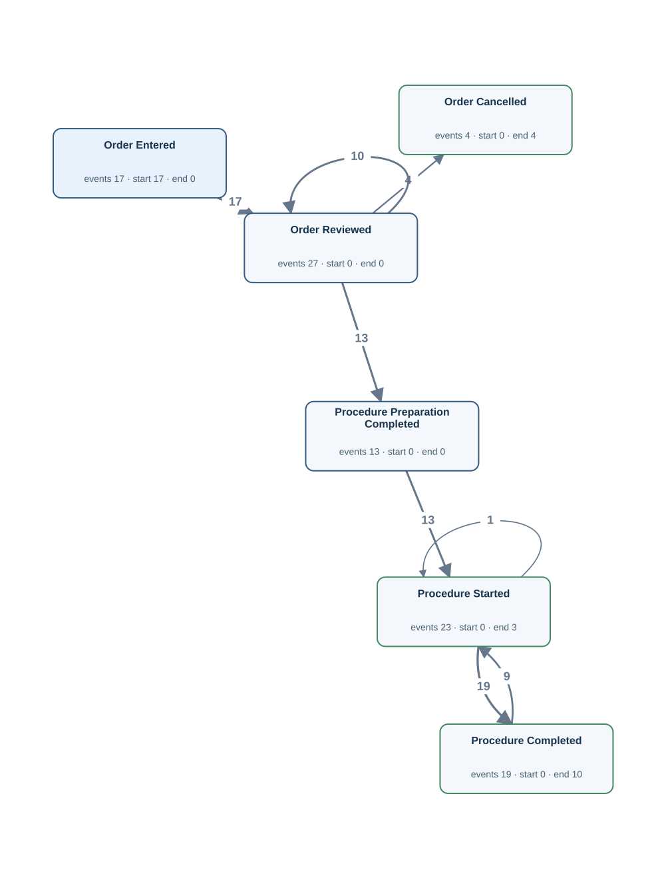</a></td><td width="58%" valign="top">
<a href="../../../datasets/hospitalflow/private/gold_sql/HF06.sql">Gold SQL</a> · <a href="../../../datasets/hospitalflow/private/gold_logs/HF06.csv">Gold CSV</a> · <a href="../../../datasets/hospitalflow/input/database.sqlite">Full source database (SQLite)</a>

<code>order_history</code> · 48 matched source rows
<table><tr><th>Column</th><th>Row 1</th><th>Row 2</th><th>Row 3</th></tr><tr><th>history_id</th><td>138</td><td>139</td><td>140</td></tr><tr><th>lab_order_id</th><td><em>NULL</em></td><td><em>NULL</em></td><td><em>NULL</em></td></tr><tr><th>medication_order_id</th><td><em>NULL</em></td><td><em>NULL</em></td><td><em>NULL</em></td></tr><tr><th>procedure_order_id</th><td>30000117</td><td>30000117</td><td>30000117</td></tr><tr><th>action</th><td>ENTERED</td><td>REVIEWED</td><td>CANCELLED</td></tr><tr><th>occurred_at</th><td>2026-04-27T19:47:00Z</td><td>2026-04-27T20:05:00Z</td><td>2026-04-27T20:17:00Z</td></tr></table>
<strong>Gold output for the same source rows</strong>
<ul><li>Row 1 → Order Entered · event OH:138 · case PROC:30000117 · time from <code>occurred_at</code></li><li>Row 2 → Order Reviewed · event OH:139 · case PROC:30000117 · time from <code>occurred_at</code></li><li>Row 3 → Order Cancelled · event OH:140 · case PROC:30000117 · time from <code>occurred_at</code></li></ul>

<code>procedure_episode</code> · 23 matched source rows
<table><tr><th>Column</th><th>Row 1</th><th>Row 2</th><th>Row 3</th></tr><tr><th>procedureevent_id</th><td>6</td><td>7</td><td>23</td></tr><tr><th>order_id</th><td>30000691</td><td>30000983</td><td>33023112</td></tr><tr><th>starttime</th><td>2026-03-08T21:46:00Z</td><td>2026-03-18T21:29:00Z</td><td>2026-07-03T16:40:00Z</td></tr><tr><th>endtime</th><td>2026-03-08T22:28:01Z</td><td>2026-03-18T21:58:00Z</td><td><em>NULL</em></td></tr><tr><th>storetime</th><td>2026-03-08T22:01:00Z</td><td>2026-03-18T21:58:00Z</td><td>2026-07-03T17:12:00Z</td></tr></table>
<strong>Gold output for the same source rows</strong>
<ul><li>Row 1 → Procedure Completed · event PROCEV:6:end · case PROC:30000691 · time from <code>endtime</code></li><li>Row 1 → Procedure Started · event PROCEV:6:start · case PROC:30000691 · time from <code>starttime</code></li><li>Row 2 → Procedure Completed · event PROCEV:7:end · case PROC:30000983 · time from <code>endtime</code></li><li>Row 2 → Procedure Started · event PROCEV:7:start · case PROC:30000983 · time from <code>starttime</code></li><li>Row 3 → Procedure Started · event PROCEV:23:start · case PROC:33023112 · time from <code>starttime</code></li></ul>

<code>procedure_order</code> · 13 matched source rows
<table><tr><th>Column</th><th>Row 1</th><th>Row 2</th><th>Row 3</th></tr><tr><th>order_id</th><td>30000691</td><td>30000983</td><td>33023112</td></tr><tr><th>hadm_id</th><td>20000007</td><td>20000008</td><td>20000015</td></tr><tr><th>procedure_name</th><td>Bronchoscopy</td><td>Endoscopy</td><td>Wound Debridement</td></tr><tr><th>preparation_completed_at</th><td>2026-03-08T20:31:00Z</td><td>2026-03-18T20:27:00Z</td><td>2026-07-03T15:31:00Z</td></tr></table>
<strong>Gold output for the same source rows</strong>
<ul><li>Row 1 → Procedure Preparation Completed · event PROC:30000691:prep · case PROC:30000691 · time from <code>preparation_completed_at</code></li><li>Row 2 → Procedure Preparation Completed · event PROC:30000983:prep · case PROC:30000983 · time from <code>preparation_completed_at</code></li><li>Row 3 → Procedure Preparation Completed · event PROC:33023112:prep · case PROC:33023112 · time from <code>preparation_completed_at</code></li></ul>

FK-linked case and join evidence
<ul><li><code>procedure_order</code> → <code>admissions</code> · hadm_id → hadm_id · hadm_id = 20000007</li><li><code>order_history</code> → <code>procedure_order</code> · procedure_order_id → order_id · order_id = 30000117</li></ul>
</td></tr></table>

## HF06P — Q4

Trace the whole recorded lifecycle of every procedure order.

Events: **103** · Cases with events: **17** · Activities: **6** · Edges: **8** · Source tables: **3** · SQL tables: **11**

<table><tr><td width="42%" valign="top"></td><td width="58%" valign="top">
<a href="../../../datasets/hospitalflow/private/gold_sql/HF06P.sql">Gold SQL</a> · <a href="../../../datasets/hospitalflow/private/gold_logs/HF06P.csv">Gold CSV</a> · <a href="../../../datasets/hospitalflow/input/database.sqlite">Full source database (SQLite)</a>

<code>order_history</code> · 48 matched source rows
<table><tr><th>Column</th><th>Row 1</th><th>Row 2</th><th>Row 3</th></tr><tr><th>history_id</th><td>138</td><td>139</td><td>140</td></tr><tr><th>lab_order_id</th><td><em>NULL</em></td><td><em>NULL</em></td><td><em>NULL</em></td></tr><tr><th>medication_order_id</th><td><em>NULL</em></td><td><em>NULL</em></td><td><em>NULL</em></td></tr><tr><th>procedure_order_id</th><td>30000117</td><td>30000117</td><td>30000117</td></tr><tr><th>action</th><td>ENTERED</td><td>REVIEWED</td><td>CANCELLED</td></tr><tr><th>occurred_at</th><td>2026-04-27T19:47:00Z</td><td>2026-04-27T20:05:00Z</td><td>2026-04-27T20:17:00Z</td></tr></table>
<strong>Gold output for the same source rows</strong>
<ul><li>Row 1 → Order Entered · event OH:138 · case PROC:30000117 · time from <code>occurred_at</code></li><li>Row 2 → Order Reviewed · event OH:139 · case PROC:30000117 · time from <code>occurred_at</code></li><li>Row 3 → Order Cancelled · event OH:140 · case PROC:30000117 · time from <code>occurred_at</code></li></ul>

<code>procedure_episode</code> · 23 matched source rows
<table><tr><th>Column</th><th>Row 1</th><th>Row 2</th><th>Row 3</th></tr><tr><th>procedureevent_id</th><td>6</td><td>7</td><td>23</td></tr><tr><th>order_id</th><td>30000691</td><td>30000983</td><td>33023112</td></tr><tr><th>starttime</th><td>2026-03-08T21:46:00Z</td><td>2026-03-18T21:29:00Z</td><td>2026-07-03T16:40:00Z</td></tr><tr><th>endtime</th><td>2026-03-08T22:28:01Z</td><td>2026-03-18T21:58:00Z</td><td><em>NULL</em></td></tr><tr><th>storetime</th><td>2026-03-08T22:01:00Z</td><td>2026-03-18T21:58:00Z</td><td>2026-07-03T17:12:00Z</td></tr></table>
<strong>Gold output for the same source rows</strong>
<ul><li>Row 1 → Procedure Completed · event PROCEV:6:end · case PROC:30000691 · time from <code>endtime</code></li><li>Row 1 → Procedure Started · event PROCEV:6:start · case PROC:30000691 · time from <code>starttime</code></li><li>Row 2 → Procedure Completed · event PROCEV:7:end · case PROC:30000983 · time from <code>endtime</code></li><li>Row 2 → Procedure Started · event PROCEV:7:start · case PROC:30000983 · time from <code>starttime</code></li><li>Row 3 → Procedure Started · event PROCEV:23:start · case PROC:33023112 · time from <code>starttime</code></li></ul>

<code>procedure_order</code> · 13 matched source rows
<table><tr><th>Column</th><th>Row 1</th><th>Row 2</th><th>Row 3</th></tr><tr><th>order_id</th><td>30000691</td><td>30000983</td><td>33023112</td></tr><tr><th>hadm_id</th><td>20000007</td><td>20000008</td><td>20000015</td></tr><tr><th>procedure_name</th><td>Bronchoscopy</td><td>Endoscopy</td><td>Wound Debridement</td></tr><tr><th>preparation_completed_at</th><td>2026-03-08T20:31:00Z</td><td>2026-03-18T20:27:00Z</td><td>2026-07-03T15:31:00Z</td></tr></table>
<strong>Gold output for the same source rows</strong>
<ul><li>Row 1 → Procedure Preparation Completed · event PROC:30000691:prep · case PROC:30000691 · time from <code>preparation_completed_at</code></li><li>Row 2 → Procedure Preparation Completed · event PROC:30000983:prep · case PROC:30000983 · time from <code>preparation_completed_at</code></li><li>Row 3 → Procedure Preparation Completed · event PROC:33023112:prep · case PROC:33023112 · time from <code>preparation_completed_at</code></li></ul>

FK-linked case and join evidence
<ul><li><code>procedure_order</code> → <code>admissions</code> · hadm_id → hadm_id · hadm_id = 20000007</li><li><code>order_history</code> → <code>procedure_order</code> · procedure_order_id → order_id · order_id = 30000117</li></ul>
</td></tr></table>

## H09 — Q1

For each patient, extract Patient Profile Verified events.

Events: **6** · Cases with events: **6** · Activities: **1** · Edges: **0** · Source tables: **1** · SQL tables: **11**

<table><tr><td width="42%" valign="top"><a href="graphs/H09.svg">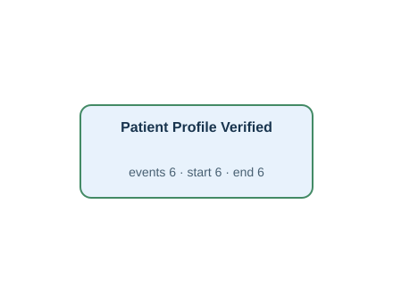</a></td><td width="58%" valign="top">
<a href="../../../datasets/hospitalflow/private/gold_sql/H09.sql">Gold SQL</a> · <a href="../../../datasets/hospitalflow/private/gold_logs/H09.csv">Gold CSV</a> · <a href="../../../datasets/hospitalflow/input/database.sqlite">Full source database (SQLite)</a>

<code>patient_profile</code> · 6 matched source rows
<table><tr><th>Column</th><th>Row 1</th><th>Row 2</th><th>Row 3</th></tr><tr><th>subject_id</th><td>10000001</td><td>10000003</td><td>10000005</td></tr><tr><th>profile_verified_at</th><td>2026-01-17T12:54:00Z</td><td>2026-02-19T07:52:00Z</td><td>2026-03-24T20:26:00Z</td></tr><tr><th>preferred_language</th><td>English</td><td>English</td><td>English</td></tr></table>
<strong>Gold output for the same source rows</strong>
<ul><li>Row 1 → Patient Profile Verified · event PAT:10000001:profile · case P:10000001 · time from <code>profile_verified_at</code></li><li>Row 2 → Patient Profile Verified · event PAT:10000003:profile · case P:10000003 · time from <code>profile_verified_at</code></li><li>Row 3 → Patient Profile Verified · event PAT:10000005:profile · case P:10000005 · time from <code>profile_verified_at</code></li></ul>
</td></tr></table>

## H09P — Q2

For each patient, show when their supplementary personal information was verified.

Events: **6** · Cases with events: **6** · Activities: **1** · Edges: **0** · Source tables: **1** · SQL tables: **11**

<table><tr><td width="42%" valign="top"></td><td width="58%" valign="top">
<a href="../../../datasets/hospitalflow/private/gold_sql/H09P.sql">Gold SQL</a> · <a href="../../../datasets/hospitalflow/private/gold_logs/H09P.csv">Gold CSV</a> · <a href="../../../datasets/hospitalflow/input/database.sqlite">Full source database (SQLite)</a>

<code>patient_profile</code> · 6 matched source rows
<table><tr><th>Column</th><th>Row 1</th><th>Row 2</th><th>Row 3</th></tr><tr><th>subject_id</th><td>10000001</td><td>10000003</td><td>10000005</td></tr><tr><th>profile_verified_at</th><td>2026-01-17T12:54:00Z</td><td>2026-02-19T07:52:00Z</td><td>2026-03-24T20:26:00Z</td></tr><tr><th>preferred_language</th><td>English</td><td>English</td><td>English</td></tr></table>
<strong>Gold output for the same source rows</strong>
<ul><li>Row 1 → Patient Profile Verified · event PAT:10000001:profile · case P:10000001 · time from <code>profile_verified_at</code></li><li>Row 2 → Patient Profile Verified · event PAT:10000003:profile · case P:10000003 · time from <code>profile_verified_at</code></li><li>Row 3 → Patient Profile Verified · event PAT:10000005:profile · case P:10000005 · time from <code>profile_verified_at</code></li></ul>
</td></tr></table>

## H10 — Q1

For each hospital admission, extract Discharge Summary Signed events.

Events: **5** · Cases with events: **5** · Activities: **1** · Edges: **0** · Source tables: **1** · SQL tables: **11**

<table><tr><td width="42%" valign="top"><a href="graphs/H10.svg">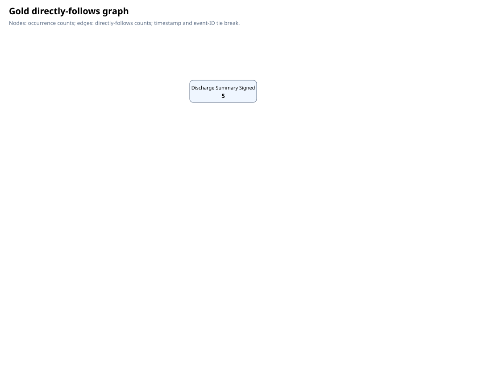</a></td><td width="58%" valign="top">
<a href="../../../datasets/hospitalflow/private/gold_sql/H10.sql">Gold SQL</a> · <a href="../../../datasets/hospitalflow/private/gold_logs/H10.csv">Gold CSV</a> · <a href="../../../datasets/hospitalflow/input/database.sqlite">Full source database (SQLite)</a>

<code>admission_detail</code> · 5 matched source rows
<table><tr><th>Column</th><th>Row 1</th><th>Row 2</th><th>Row 3</th></tr><tr><th>hadm_id</th><td>20000001</td><td>20000004</td><td>20000007</td></tr><tr><th>discharge_summary_signed_at</th><td>2026-01-19T18:13:00Z</td><td>2026-02-19T17:04:00Z</td><td>2026-03-11T15:45:00Z</td></tr></table>
<strong>Gold output for the same source rows</strong>
<ul><li>Row 1 → Discharge Summary Signed · event ADM:20000001:summary · case A:20000001 · time from <code>discharge_summary_signed_at</code></li><li>Row 2 → Discharge Summary Signed · event ADM:20000004:summary · case A:20000004 · time from <code>discharge_summary_signed_at</code></li><li>Row 3 → Discharge Summary Signed · event ADM:20000007:summary · case A:20000007 · time from <code>discharge_summary_signed_at</code></li></ul>

FK-linked case and join evidence
<ul><li><code>admission_detail</code> → <code>admissions</code> · hadm_id → hadm_id · hadm_id = 20000001</li></ul>
</td></tr></table>

## H10P — Q2

For each hospital stay, show when its discharge summary was signed.

Events: **5** · Cases with events: **5** · Activities: **1** · Edges: **0** · Source tables: **1** · SQL tables: **11**

<table><tr><td width="42%" valign="top"></td><td width="58%" valign="top">
<a href="../../../datasets/hospitalflow/private/gold_sql/H10P.sql">Gold SQL</a> · <a href="../../../datasets/hospitalflow/private/gold_logs/H10P.csv">Gold CSV</a> · <a href="../../../datasets/hospitalflow/input/database.sqlite">Full source database (SQLite)</a>

<code>admission_detail</code> · 5 matched source rows
<table><tr><th>Column</th><th>Row 1</th><th>Row 2</th><th>Row 3</th></tr><tr><th>hadm_id</th><td>20000001</td><td>20000004</td><td>20000007</td></tr><tr><th>discharge_summary_signed_at</th><td>2026-01-19T18:13:00Z</td><td>2026-02-19T17:04:00Z</td><td>2026-03-11T15:45:00Z</td></tr></table>
<strong>Gold output for the same source rows</strong>
<ul><li>Row 1 → Discharge Summary Signed · event ADM:20000001:summary · case A:20000001 · time from <code>discharge_summary_signed_at</code></li><li>Row 2 → Discharge Summary Signed · event ADM:20000004:summary · case A:20000004 · time from <code>discharge_summary_signed_at</code></li><li>Row 3 → Discharge Summary Signed · event ADM:20000007:summary · case A:20000007 · time from <code>discharge_summary_signed_at</code></li></ul>

FK-linked case and join evidence
<ul><li><code>admission_detail</code> → <code>admissions</code> · hadm_id → hadm_id · hadm_id = 20000001</li></ul>
</td></tr></table>

## H11 — Q1

For each patient, extract Patient Profile Verified and Hospital Admitted events.

Events: **21** · Cases with events: **11** · Activities: **2** · Edges: **2** · Source tables: **2** · SQL tables: **11**

<table><tr><td width="42%" valign="top"><a href="graphs/H11.svg">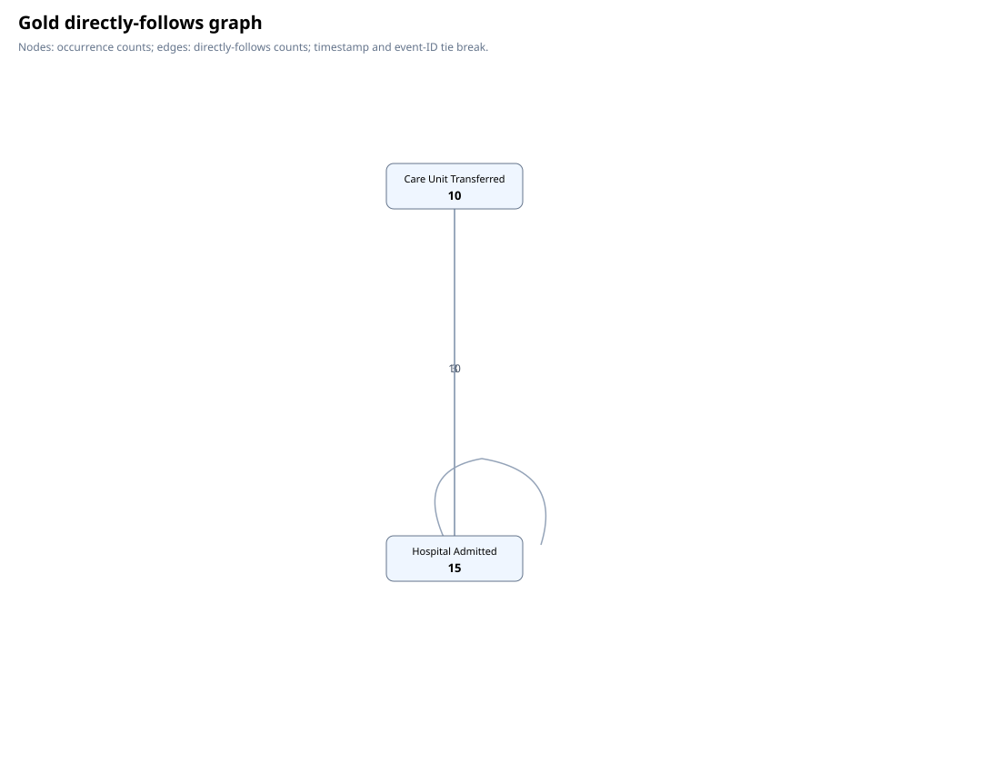</a></td><td width="58%" valign="top">
<a href="../../../datasets/hospitalflow/private/gold_sql/H11.sql">Gold SQL</a> · <a href="../../../datasets/hospitalflow/private/gold_logs/H11.csv">Gold CSV</a> · <a href="../../../datasets/hospitalflow/input/database.sqlite">Full source database (SQLite)</a>

<code>admissions</code> · 15 matched source rows
<table><tr><th>Column</th><th>Row 1</th><th>Row 2</th><th>Row 3</th></tr><tr><th>hadm_id</th><td>20000001</td><td>20000002</td><td>20000003</td></tr><tr><th>subject_id</th><td>10000001</td><td>10000001</td><td>10000002</td></tr><tr><th>edregtime</th><td>2026-01-17T13:42:00Z</td><td><em>NULL</em></td><td>2026-02-03T09:01:00Z</td></tr><tr><th>admittime</th><td>2026-01-17T16:12:00Z</td><td>2026-01-27T13:19:00Z</td><td>2026-02-03T09:23:00Z</td></tr><tr><th>discharge_authorized_at</th><td>2026-01-19T13:33:00Z</td><td>2026-01-29T16:16:00Z</td><td>2026-02-08T17:49:00Z</td></tr><tr><th>dischtime</th><td>2026-01-19T15:01:00Z</td><td>2026-01-29T18:54:00Z</td><td>2026-02-08T20:38:00Z</td></tr></table>
<strong>Gold output for the same source rows</strong>
<ul><li>Row 1 → Hospital Admitted · event ADM:20000001:in · case P:10000001 · time from <code>admittime</code></li><li>Row 2 → Hospital Admitted · event ADM:20000002:in · case P:10000001 · time from <code>admittime</code></li><li>Row 3 → Hospital Admitted · event ADM:20000003:in · case P:10000002 · time from <code>admittime</code></li></ul>

<code>patient_profile</code> · 6 matched source rows
<table><tr><th>Column</th><th>Row 1</th><th>Row 2</th><th>Row 3</th></tr><tr><th>subject_id</th><td>10000001</td><td>10000003</td><td>10000005</td></tr><tr><th>profile_verified_at</th><td>2026-01-17T12:54:00Z</td><td>2026-02-19T07:52:00Z</td><td>2026-03-24T20:26:00Z</td></tr><tr><th>preferred_language</th><td>English</td><td>English</td><td>English</td></tr></table>
<strong>Gold output for the same source rows</strong>
<ul><li>Row 1 → Patient Profile Verified · event PAT:10000001:profile · case P:10000001 · time from <code>profile_verified_at</code></li><li>Row 2 → Patient Profile Verified · event PAT:10000003:profile · case P:10000003 · time from <code>profile_verified_at</code></li><li>Row 3 → Patient Profile Verified · event PAT:10000005:profile · case P:10000005 · time from <code>profile_verified_at</code></li></ul>
</td></tr></table>

## H11P — Q2

Build a timeline for every patient showing verification of their supplementary personal information and their entries into hospital.

Events: **21** · Cases with events: **11** · Activities: **2** · Edges: **2** · Source tables: **2** · SQL tables: **11**

<table><tr><td width="42%" valign="top"></td><td width="58%" valign="top">
<a href="../../../datasets/hospitalflow/private/gold_sql/H11P.sql">Gold SQL</a> · <a href="../../../datasets/hospitalflow/private/gold_logs/H11P.csv">Gold CSV</a> · <a href="../../../datasets/hospitalflow/input/database.sqlite">Full source database (SQLite)</a>

<code>admissions</code> · 15 matched source rows
<table><tr><th>Column</th><th>Row 1</th><th>Row 2</th><th>Row 3</th></tr><tr><th>hadm_id</th><td>20000001</td><td>20000002</td><td>20000003</td></tr><tr><th>subject_id</th><td>10000001</td><td>10000001</td><td>10000002</td></tr><tr><th>edregtime</th><td>2026-01-17T13:42:00Z</td><td><em>NULL</em></td><td>2026-02-03T09:01:00Z</td></tr><tr><th>admittime</th><td>2026-01-17T16:12:00Z</td><td>2026-01-27T13:19:00Z</td><td>2026-02-03T09:23:00Z</td></tr><tr><th>discharge_authorized_at</th><td>2026-01-19T13:33:00Z</td><td>2026-01-29T16:16:00Z</td><td>2026-02-08T17:49:00Z</td></tr><tr><th>dischtime</th><td>2026-01-19T15:01:00Z</td><td>2026-01-29T18:54:00Z</td><td>2026-02-08T20:38:00Z</td></tr></table>
<strong>Gold output for the same source rows</strong>
<ul><li>Row 1 → Hospital Admitted · event ADM:20000001:in · case P:10000001 · time from <code>admittime</code></li><li>Row 2 → Hospital Admitted · event ADM:20000002:in · case P:10000001 · time from <code>admittime</code></li><li>Row 3 → Hospital Admitted · event ADM:20000003:in · case P:10000002 · time from <code>admittime</code></li></ul>

<code>patient_profile</code> · 6 matched source rows
<table><tr><th>Column</th><th>Row 1</th><th>Row 2</th><th>Row 3</th></tr><tr><th>subject_id</th><td>10000001</td><td>10000003</td><td>10000005</td></tr><tr><th>profile_verified_at</th><td>2026-01-17T12:54:00Z</td><td>2026-02-19T07:52:00Z</td><td>2026-03-24T20:26:00Z</td></tr><tr><th>preferred_language</th><td>English</td><td>English</td><td>English</td></tr></table>
<strong>Gold output for the same source rows</strong>
<ul><li>Row 1 → Patient Profile Verified · event PAT:10000001:profile · case P:10000001 · time from <code>profile_verified_at</code></li><li>Row 2 → Patient Profile Verified · event PAT:10000003:profile · case P:10000003 · time from <code>profile_verified_at</code></li><li>Row 3 → Patient Profile Verified · event PAT:10000005:profile · case P:10000005 · time from <code>profile_verified_at</code></li></ul>
</td></tr></table>

## HF07 — Q3

Extract the full recorded lifecycle for each lab measurement.

Events: **124** · Cases with events: **62** · Activities: **2** · Edges: **1** · Source tables: **1** · SQL tables: **11**

<table><tr><td width="42%" valign="top"><a href="graphs/HF07.svg">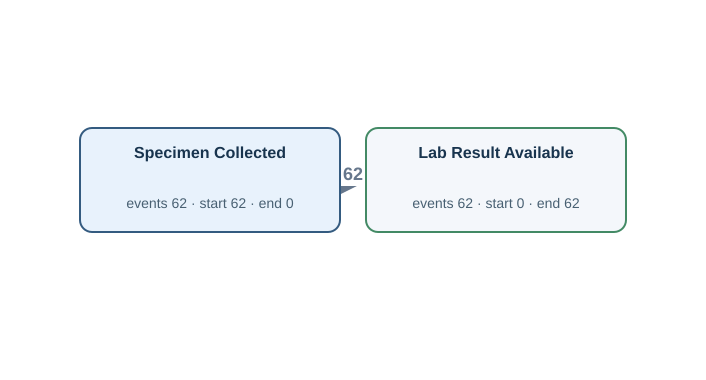</a></td><td width="58%" valign="top">
<a href="../../../datasets/hospitalflow/private/gold_sql/HF07.sql">Gold SQL</a> · <a href="../../../datasets/hospitalflow/private/gold_logs/HF07.csv">Gold CSV</a> · <a href="../../../datasets/hospitalflow/input/database.sqlite">Full source database (SQLite)</a>

<code>labevents</code> · 62 matched source rows
<table><tr><th>Column</th><th>Row 1</th><th>Row 2</th><th>Row 3</th></tr><tr><th>labevent_id</th><td>1</td><td>10</td><td>11</td></tr><tr><th>order_id</th><td>31070762</td><td>30000691</td><td>31023611</td></tr><tr><th>itemid</th><td>1003</td><td>1003</td><td>1001</td></tr><tr><th>charttime</th><td>2026-01-27T19:38:00Z</td><td>2026-03-06T08:37:00Z</td><td>2026-03-06T12:23:00Z</td></tr><tr><th>storetime</th><td>2026-01-27T23:09:00Z</td><td>2026-03-06T11:15:00Z</td><td>2026-03-06T14:41:00Z</td></tr><tr><th>valuenum</th><td>14.6</td><td>12.5</td><td>0.69</td></tr><tr><th>valueuom</th><td>g/dL</td><td>g/dL</td><td>mg/dL</td></tr></table>
<strong>Gold output for the same source rows</strong>
<ul><li>Row 1 → Specimen Collected · event LABEV:1:chart · case LM:1 · time from <code>charttime</code></li><li>Row 1 → Lab Result Available · event LABEV:1:result · case LM:1 · time from <code>storetime</code></li><li>Row 2 → Specimen Collected · event LABEV:10:chart · case LM:10 · time from <code>charttime</code></li><li>Row 2 → Lab Result Available · event LABEV:10:result · case LM:10 · time from <code>storetime</code></li><li>Row 3 → Specimen Collected · event LABEV:11:chart · case LM:11 · time from <code>charttime</code></li><li>Row 3 → Lab Result Available · event LABEV:11:result · case LM:11 · time from <code>storetime</code></li></ul>

FK-linked case and join evidence
<ul><li><code>lab_order</code> → <code>admissions</code> · hadm_id → hadm_id · hadm_id = 20000002</li><li><code>labevents</code> → <code>lab_order</code> · order_id → order_id · order_id = 31070762</li></ul>
</td></tr></table>

## HF07P — Q4

Show the entire recorded history of each individual laboratory measurement.

Events: **124** · Cases with events: **62** · Activities: **2** · Edges: **1** · Source tables: **1** · SQL tables: **11**

<table><tr><td width="42%" valign="top"></td><td width="58%" valign="top">
<a href="../../../datasets/hospitalflow/private/gold_sql/HF07P.sql">Gold SQL</a> · <a href="../../../datasets/hospitalflow/private/gold_logs/HF07P.csv">Gold CSV</a> · <a href="../../../datasets/hospitalflow/input/database.sqlite">Full source database (SQLite)</a>

<code>labevents</code> · 62 matched source rows
<table><tr><th>Column</th><th>Row 1</th><th>Row 2</th><th>Row 3</th></tr><tr><th>labevent_id</th><td>1</td><td>10</td><td>11</td></tr><tr><th>order_id</th><td>31070762</td><td>30000691</td><td>31023611</td></tr><tr><th>itemid</th><td>1003</td><td>1003</td><td>1001</td></tr><tr><th>charttime</th><td>2026-01-27T19:38:00Z</td><td>2026-03-06T08:37:00Z</td><td>2026-03-06T12:23:00Z</td></tr><tr><th>storetime</th><td>2026-01-27T23:09:00Z</td><td>2026-03-06T11:15:00Z</td><td>2026-03-06T14:41:00Z</td></tr><tr><th>valuenum</th><td>14.6</td><td>12.5</td><td>0.69</td></tr><tr><th>valueuom</th><td>g/dL</td><td>g/dL</td><td>mg/dL</td></tr></table>
<strong>Gold output for the same source rows</strong>
<ul><li>Row 1 → Specimen Collected · event LABEV:1:chart · case LM:1 · time from <code>charttime</code></li><li>Row 1 → Lab Result Available · event LABEV:1:result · case LM:1 · time from <code>storetime</code></li><li>Row 2 → Specimen Collected · event LABEV:10:chart · case LM:10 · time from <code>charttime</code></li><li>Row 2 → Lab Result Available · event LABEV:10:result · case LM:10 · time from <code>storetime</code></li><li>Row 3 → Specimen Collected · event LABEV:11:chart · case LM:11 · time from <code>charttime</code></li><li>Row 3 → Lab Result Available · event LABEV:11:result · case LM:11 · time from <code>storetime</code></li></ul>

FK-linked case and join evidence
<ul><li><code>lab_order</code> → <code>admissions</code> · hadm_id → hadm_id · hadm_id = 20000002</li><li><code>labevents</code> → <code>lab_order</code> · order_id → order_id · order_id = 31070762</li></ul>
</td></tr></table>

## HF08 — Q3

Extract the full recorded lifecycle for each medication administration.

Events: **67** · Cases with events: **67** · Activities: **2** · Edges: **0** · Source tables: **1** · SQL tables: **11**

<table><tr><td width="42%" valign="top"><a href="graphs/HF08.svg">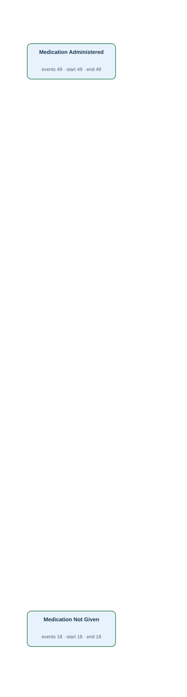</a></td><td width="58%" valign="top">
<a href="../../../datasets/hospitalflow/private/gold_sql/HF08.sql">Gold SQL</a> · <a href="../../../datasets/hospitalflow/private/gold_logs/HF08.csv">Gold CSV</a> · <a href="../../../datasets/hospitalflow/input/database.sqlite">Full source database (SQLite)</a>

<code>emar</code> · 67 matched source rows
<table><tr><th>Column</th><th>Row 1</th><th>Row 2</th><th>Row 3</th></tr><tr><th>emar_id</th><td>1</td><td>10</td><td>11</td></tr><tr><th>pharmacy_id</th><td>40000001</td><td>40000004</td><td>40000004</td></tr><tr><th>charttime</th><td>2026-01-17T19:31:00Z</td><td>2026-02-15T04:31:00Z</td><td>2026-02-15T06:43:00Z</td></tr><tr><th>event_txt</th><td>Administered</td><td>Not Given</td><td>Administered</td></tr><tr><th>storetime</th><td>2026-01-17T20:12:00Z</td><td>2026-02-15T04:39:00Z</td><td>2026-02-15T07:38:00Z</td></tr></table>
<strong>Gold output for the same source rows</strong>
<ul><li>Row 1 → Medication Administered · event EMAR:1 · case DOSE:1 · time from <code>charttime</code></li><li>Row 2 → Medication Not Given · event EMAR:10 · case DOSE:10 · time from <code>charttime</code></li><li>Row 3 → Medication Administered · event EMAR:11 · case DOSE:11 · time from <code>charttime</code></li></ul>

FK-linked case and join evidence
<ul><li><code>medication_order</code> → <code>admissions</code> · hadm_id → hadm_id · hadm_id = 20000001</li><li><code>pharmacy</code> → <code>medication_order</code> · order_id → order_id · order_id = 32064975</li><li><code>emar</code> → <code>pharmacy</code> · pharmacy_id → pharmacy_id · pharmacy_id = 40000001</li></ul>
</td></tr></table>

## HF08P — Q4

Build the complete recorded history of every individual medication administration record.

Events: **67** · Cases with events: **67** · Activities: **2** · Edges: **0** · Source tables: **1** · SQL tables: **11**

<table><tr><td width="42%" valign="top"></td><td width="58%" valign="top">
<a href="../../../datasets/hospitalflow/private/gold_sql/HF08P.sql">Gold SQL</a> · <a href="../../../datasets/hospitalflow/private/gold_logs/HF08P.csv">Gold CSV</a> · <a href="../../../datasets/hospitalflow/input/database.sqlite">Full source database (SQLite)</a>

<code>emar</code> · 67 matched source rows
<table><tr><th>Column</th><th>Row 1</th><th>Row 2</th><th>Row 3</th></tr><tr><th>emar_id</th><td>1</td><td>10</td><td>11</td></tr><tr><th>pharmacy_id</th><td>40000001</td><td>40000004</td><td>40000004</td></tr><tr><th>charttime</th><td>2026-01-17T19:31:00Z</td><td>2026-02-15T04:31:00Z</td><td>2026-02-15T06:43:00Z</td></tr><tr><th>event_txt</th><td>Administered</td><td>Not Given</td><td>Administered</td></tr><tr><th>storetime</th><td>2026-01-17T20:12:00Z</td><td>2026-02-15T04:39:00Z</td><td>2026-02-15T07:38:00Z</td></tr></table>
<strong>Gold output for the same source rows</strong>
<ul><li>Row 1 → Medication Administered · event EMAR:1 · case DOSE:1 · time from <code>charttime</code></li><li>Row 2 → Medication Not Given · event EMAR:10 · case DOSE:10 · time from <code>charttime</code></li><li>Row 3 → Medication Administered · event EMAR:11 · case DOSE:11 · time from <code>charttime</code></li></ul>

FK-linked case and join evidence
<ul><li><code>medication_order</code> → <code>admissions</code> · hadm_id → hadm_id · hadm_id = 20000001</li><li><code>pharmacy</code> → <code>medication_order</code> · order_id → order_id · order_id = 32064975</li><li><code>emar</code> → <code>pharmacy</code> · pharmacy_id → pharmacy_id · pharmacy_id = 40000001</li></ul>
</td></tr></table>

## HF09 — Q3

Extract the full recorded lifecycle for each procedure episode.

Events: **42** · Cases with events: **23** · Activities: **2** · Edges: **1** · Source tables: **1** · SQL tables: **11**

<table><tr><td width="42%" valign="top"><a href="graphs/HF09.svg">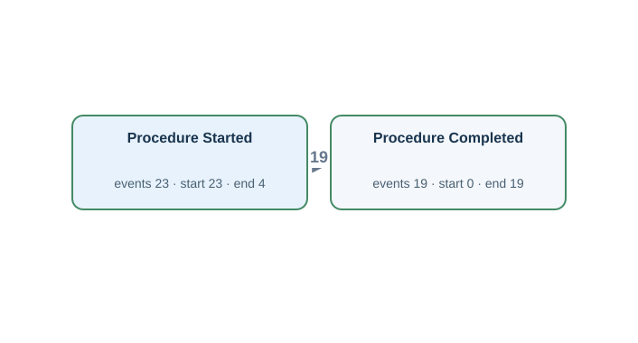</a></td><td width="58%" valign="top">
<a href="../../../datasets/hospitalflow/private/gold_sql/HF09.sql">Gold SQL</a> · <a href="../../../datasets/hospitalflow/private/gold_logs/HF09.csv">Gold CSV</a> · <a href="../../../datasets/hospitalflow/input/database.sqlite">Full source database (SQLite)</a>

<code>procedure_episode</code> · 23 matched source rows
<table><tr><th>Column</th><th>Row 1</th><th>Row 2</th><th>Row 3</th></tr><tr><th>procedureevent_id</th><td>1</td><td>10</td><td>11</td></tr><tr><th>order_id</th><td>33032683</td><td>33043088</td><td>33043088</td></tr><tr><th>starttime</th><td>2026-01-27T18:22:00Z</td><td>2026-04-11T06:57:00Z</td><td>2026-04-11T11:30:00Z</td></tr><tr><th>endtime</th><td>2026-01-27T19:24:00Z</td><td>2026-04-11T09:07:00Z</td><td>2026-04-11T13:22:00Z</td></tr><tr><th>storetime</th><td>2026-01-27T18:40:00Z</td><td>2026-04-11T07:25:00Z</td><td>2026-04-11T11:48:00Z</td></tr></table>
<strong>Gold output for the same source rows</strong>
<ul><li>Row 1 → Procedure Completed · event PROCEV:1:end · case EP:1 · time from <code>endtime</code></li><li>Row 1 → Procedure Started · event PROCEV:1:start · case EP:1 · time from <code>starttime</code></li><li>Row 2 → Procedure Completed · event PROCEV:10:end · case EP:10 · time from <code>endtime</code></li><li>Row 2 → Procedure Started · event PROCEV:10:start · case EP:10 · time from <code>starttime</code></li><li>Row 3 → Procedure Completed · event PROCEV:11:end · case EP:11 · time from <code>endtime</code></li><li>Row 3 → Procedure Started · event PROCEV:11:start · case EP:11 · time from <code>starttime</code></li></ul>

FK-linked case and join evidence
<ul><li><code>procedure_order</code> → <code>admissions</code> · hadm_id → hadm_id · hadm_id = 20000002</li><li><code>procedure_episode</code> → <code>procedure_order</code> · order_id → order_id · order_id = 33032683</li></ul>
</td></tr></table>

## HF09P — Q4

Trace each individual procedure episode through its whole recorded lifecycle.

Events: **42** · Cases with events: **23** · Activities: **2** · Edges: **1** · Source tables: **1** · SQL tables: **11**

<table><tr><td width="42%" valign="top"></td><td width="58%" valign="top">
<a href="../../../datasets/hospitalflow/private/gold_sql/HF09P.sql">Gold SQL</a> · <a href="../../../datasets/hospitalflow/private/gold_logs/HF09P.csv">Gold CSV</a> · <a href="../../../datasets/hospitalflow/input/database.sqlite">Full source database (SQLite)</a>

<code>procedure_episode</code> · 23 matched source rows
<table><tr><th>Column</th><th>Row 1</th><th>Row 2</th><th>Row 3</th></tr><tr><th>procedureevent_id</th><td>1</td><td>10</td><td>11</td></tr><tr><th>order_id</th><td>33032683</td><td>33043088</td><td>33043088</td></tr><tr><th>starttime</th><td>2026-01-27T18:22:00Z</td><td>2026-04-11T06:57:00Z</td><td>2026-04-11T11:30:00Z</td></tr><tr><th>endtime</th><td>2026-01-27T19:24:00Z</td><td>2026-04-11T09:07:00Z</td><td>2026-04-11T13:22:00Z</td></tr><tr><th>storetime</th><td>2026-01-27T18:40:00Z</td><td>2026-04-11T07:25:00Z</td><td>2026-04-11T11:48:00Z</td></tr></table>
<strong>Gold output for the same source rows</strong>
<ul><li>Row 1 → Procedure Completed · event PROCEV:1:end · case EP:1 · time from <code>endtime</code></li><li>Row 1 → Procedure Started · event PROCEV:1:start · case EP:1 · time from <code>starttime</code></li><li>Row 2 → Procedure Completed · event PROCEV:10:end · case EP:10 · time from <code>endtime</code></li><li>Row 2 → Procedure Started · event PROCEV:10:start · case EP:10 · time from <code>starttime</code></li><li>Row 3 → Procedure Completed · event PROCEV:11:end · case EP:11 · time from <code>endtime</code></li><li>Row 3 → Procedure Started · event PROCEV:11:start · case EP:11 · time from <code>starttime</code></li></ul>

FK-linked case and join evidence
<ul><li><code>procedure_order</code> → <code>admissions</code> · hadm_id → hadm_id · hadm_id = 20000002</li><li><code>procedure_episode</code> → <code>procedure_order</code> · order_id → order_id · order_id = 33032683</li></ul>
</td></tr></table>

## HF10 — Q3

Extract the full recorded lifecycle for each pharmacy dispensing record.

Events: **101** · Cases with events: **34** · Activities: **3** · Edges: **5** · Source tables: **2** · SQL tables: **11**

<table><tr><td width="42%" valign="top"><a href="graphs/HF10.svg">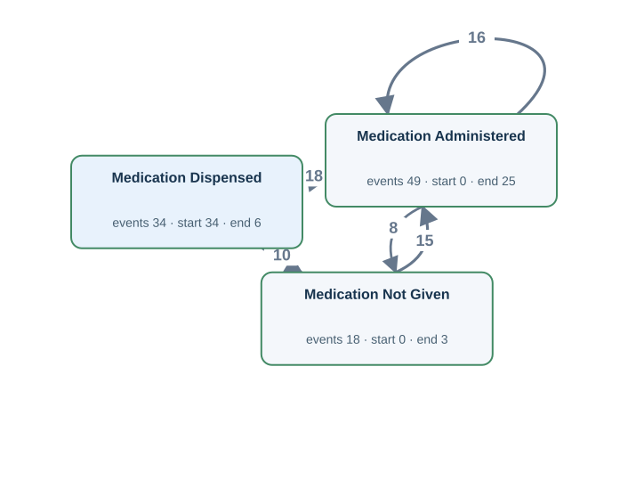</a></td><td width="58%" valign="top">
<a href="../../../datasets/hospitalflow/private/gold_sql/HF10.sql">Gold SQL</a> · <a href="../../../datasets/hospitalflow/private/gold_logs/HF10.csv">Gold CSV</a> · <a href="../../../datasets/hospitalflow/input/database.sqlite">Full source database (SQLite)</a>

<code>emar</code> · 67 matched source rows
<table><tr><th>Column</th><th>Row 1</th><th>Row 2</th><th>Row 3</th></tr><tr><th>emar_id</th><td>1</td><td>2</td><td>3</td></tr><tr><th>pharmacy_id</th><td>40000001</td><td>40000001</td><td>40000001</td></tr><tr><th>charttime</th><td>2026-01-17T19:31:00Z</td><td>2026-01-17T21:22:00Z</td><td>2026-01-17T23:09:00Z</td></tr><tr><th>event_txt</th><td>Administered</td><td>Not Given</td><td>Administered</td></tr><tr><th>storetime</th><td>2026-01-17T20:12:00Z</td><td>2026-01-17T21:44:00Z</td><td>2026-01-17T23:56:00Z</td></tr></table>
<strong>Gold output for the same source rows</strong>
<ul><li>Row 1 → Medication Administered · event EMAR:1 · case PHARM:40000001 · time from <code>charttime</code></li><li>Row 2 → Medication Not Given · event EMAR:2 · case PHARM:40000001 · time from <code>charttime</code></li><li>Row 3 → Medication Administered · event EMAR:3 · case PHARM:40000001 · time from <code>charttime</code></li></ul>

<code>pharmacy</code> · 34 matched source rows
<table><tr><th>Column</th><th>Row 1</th><th>Row 2</th><th>Row 3</th></tr><tr><th>pharmacy_id</th><td>40000001</td><td>40000002</td><td>40000003</td></tr><tr><th>order_id</th><td>32064975</td><td>32064975</td><td>32028896</td></tr><tr><th>dispensed_at</th><td>2026-01-17T18:40:00Z</td><td>2026-01-17T22:07:00Z</td><td>2026-01-17T19:12:00Z</td></tr></table>
<strong>Gold output for the same source rows</strong>
<ul><li>Row 1 → Medication Dispensed · event PHARM:40000001:dispense · case PHARM:40000001 · time from <code>dispensed_at</code></li><li>Row 2 → Medication Dispensed · event PHARM:40000002:dispense · case PHARM:40000002 · time from <code>dispensed_at</code></li><li>Row 3 → Medication Dispensed · event PHARM:40000003:dispense · case PHARM:40000003 · time from <code>dispensed_at</code></li></ul>

FK-linked case and join evidence
<ul><li><code>medication_order</code> → <code>admissions</code> · hadm_id → hadm_id · hadm_id = 20000001</li><li><code>pharmacy</code> → <code>medication_order</code> · order_id → order_id · order_id = 32064975</li></ul>
</td></tr></table>

## HF10P — Q4

Show the complete recorded course associated with each individual pharmacy dispensing record.

Events: **101** · Cases with events: **34** · Activities: **3** · Edges: **5** · Source tables: **2** · SQL tables: **11**

<table><tr><td width="42%" valign="top"></td><td width="58%" valign="top">
<a href="../../../datasets/hospitalflow/private/gold_sql/HF10P.sql">Gold SQL</a> · <a href="../../../datasets/hospitalflow/private/gold_logs/HF10P.csv">Gold CSV</a> · <a href="../../../datasets/hospitalflow/input/database.sqlite">Full source database (SQLite)</a>

<code>emar</code> · 67 matched source rows
<table><tr><th>Column</th><th>Row 1</th><th>Row 2</th><th>Row 3</th></tr><tr><th>emar_id</th><td>1</td><td>2</td><td>3</td></tr><tr><th>pharmacy_id</th><td>40000001</td><td>40000001</td><td>40000001</td></tr><tr><th>charttime</th><td>2026-01-17T19:31:00Z</td><td>2026-01-17T21:22:00Z</td><td>2026-01-17T23:09:00Z</td></tr><tr><th>event_txt</th><td>Administered</td><td>Not Given</td><td>Administered</td></tr><tr><th>storetime</th><td>2026-01-17T20:12:00Z</td><td>2026-01-17T21:44:00Z</td><td>2026-01-17T23:56:00Z</td></tr></table>
<strong>Gold output for the same source rows</strong>
<ul><li>Row 1 → Medication Administered · event EMAR:1 · case PHARM:40000001 · time from <code>charttime</code></li><li>Row 2 → Medication Not Given · event EMAR:2 · case PHARM:40000001 · time from <code>charttime</code></li><li>Row 3 → Medication Administered · event EMAR:3 · case PHARM:40000001 · time from <code>charttime</code></li></ul>

<code>pharmacy</code> · 34 matched source rows
<table><tr><th>Column</th><th>Row 1</th><th>Row 2</th><th>Row 3</th></tr><tr><th>pharmacy_id</th><td>40000001</td><td>40000002</td><td>40000003</td></tr><tr><th>order_id</th><td>32064975</td><td>32064975</td><td>32028896</td></tr><tr><th>dispensed_at</th><td>2026-01-17T18:40:00Z</td><td>2026-01-17T22:07:00Z</td><td>2026-01-17T19:12:00Z</td></tr></table>
<strong>Gold output for the same source rows</strong>
<ul><li>Row 1 → Medication Dispensed · event PHARM:40000001:dispense · case PHARM:40000001 · time from <code>dispensed_at</code></li><li>Row 2 → Medication Dispensed · event PHARM:40000002:dispense · case PHARM:40000002 · time from <code>dispensed_at</code></li><li>Row 3 → Medication Dispensed · event PHARM:40000003:dispense · case PHARM:40000003 · time from <code>dispensed_at</code></li></ul>

FK-linked case and join evidence
<ul><li><code>medication_order</code> → <code>admissions</code> · hadm_id → hadm_id · hadm_id = 20000001</li><li><code>pharmacy</code> → <code>medication_order</code> · order_id → order_id · order_id = 32064975</li></ul>
</td></tr></table>

## H12 — Q1

For each pharmacy dispensing record, extract Medication Dispensed, Medication Administered and Medication Not Given events.

Events: **101** · Cases with events: **34** · Activities: **3** · Edges: **5** · Source tables: **2** · SQL tables: **11**

<table><tr><td width="42%" valign="top"></td><td width="58%" valign="top">
<a href="../../../datasets/hospitalflow/private/gold_sql/H12.sql">Gold SQL</a> · <a href="../../../datasets/hospitalflow/private/gold_logs/H12.csv">Gold CSV</a> · <a href="../../../datasets/hospitalflow/input/database.sqlite">Full source database (SQLite)</a>

<code>emar</code> · 67 matched source rows
<table><tr><th>Column</th><th>Row 1</th><th>Row 2</th><th>Row 3</th></tr><tr><th>emar_id</th><td>1</td><td>2</td><td>3</td></tr><tr><th>pharmacy_id</th><td>40000001</td><td>40000001</td><td>40000001</td></tr><tr><th>charttime</th><td>2026-01-17T19:31:00Z</td><td>2026-01-17T21:22:00Z</td><td>2026-01-17T23:09:00Z</td></tr><tr><th>event_txt</th><td>Administered</td><td>Not Given</td><td>Administered</td></tr><tr><th>storetime</th><td>2026-01-17T20:12:00Z</td><td>2026-01-17T21:44:00Z</td><td>2026-01-17T23:56:00Z</td></tr></table>
<strong>Gold output for the same source rows</strong>
<ul><li>Row 1 → Medication Administered · event EMAR:1 · case PHARM:40000001 · time from <code>charttime</code></li><li>Row 2 → Medication Not Given · event EMAR:2 · case PHARM:40000001 · time from <code>charttime</code></li><li>Row 3 → Medication Administered · event EMAR:3 · case PHARM:40000001 · time from <code>charttime</code></li></ul>

<code>pharmacy</code> · 34 matched source rows
<table><tr><th>Column</th><th>Row 1</th><th>Row 2</th><th>Row 3</th></tr><tr><th>pharmacy_id</th><td>40000001</td><td>40000002</td><td>40000003</td></tr><tr><th>order_id</th><td>32064975</td><td>32064975</td><td>32028896</td></tr><tr><th>dispensed_at</th><td>2026-01-17T18:40:00Z</td><td>2026-01-17T22:07:00Z</td><td>2026-01-17T19:12:00Z</td></tr></table>
<strong>Gold output for the same source rows</strong>
<ul><li>Row 1 → Medication Dispensed · event PHARM:40000001:dispense · case PHARM:40000001 · time from <code>dispensed_at</code></li><li>Row 2 → Medication Dispensed · event PHARM:40000002:dispense · case PHARM:40000002 · time from <code>dispensed_at</code></li><li>Row 3 → Medication Dispensed · event PHARM:40000003:dispense · case PHARM:40000003 · time from <code>dispensed_at</code></li></ul>

FK-linked case and join evidence
<ul><li><code>medication_order</code> → <code>admissions</code> · hadm_id → hadm_id · hadm_id = 20000001</li><li><code>pharmacy</code> → <code>medication_order</code> · order_id → order_id · order_id = 32064975</li></ul>
</td></tr></table>

## H12P — Q2

Group the medication dispensing, subsequent doses given and doses not given by the pharmacy dispensing record they refer to.

Events: **101** · Cases with events: **34** · Activities: **3** · Edges: **5** · Source tables: **2** · SQL tables: **11**

<table><tr><td width="42%" valign="top"></td><td width="58%" valign="top">
<a href="../../../datasets/hospitalflow/private/gold_sql/H12P.sql">Gold SQL</a> · <a href="../../../datasets/hospitalflow/private/gold_logs/H12P.csv">Gold CSV</a> · <a href="../../../datasets/hospitalflow/input/database.sqlite">Full source database (SQLite)</a>

<code>emar</code> · 67 matched source rows
<table><tr><th>Column</th><th>Row 1</th><th>Row 2</th><th>Row 3</th></tr><tr><th>emar_id</th><td>1</td><td>2</td><td>3</td></tr><tr><th>pharmacy_id</th><td>40000001</td><td>40000001</td><td>40000001</td></tr><tr><th>charttime</th><td>2026-01-17T19:31:00Z</td><td>2026-01-17T21:22:00Z</td><td>2026-01-17T23:09:00Z</td></tr><tr><th>event_txt</th><td>Administered</td><td>Not Given</td><td>Administered</td></tr><tr><th>storetime</th><td>2026-01-17T20:12:00Z</td><td>2026-01-17T21:44:00Z</td><td>2026-01-17T23:56:00Z</td></tr></table>
<strong>Gold output for the same source rows</strong>
<ul><li>Row 1 → Medication Administered · event EMAR:1 · case PHARM:40000001 · time from <code>charttime</code></li><li>Row 2 → Medication Not Given · event EMAR:2 · case PHARM:40000001 · time from <code>charttime</code></li><li>Row 3 → Medication Administered · event EMAR:3 · case PHARM:40000001 · time from <code>charttime</code></li></ul>

<code>pharmacy</code> · 34 matched source rows
<table><tr><th>Column</th><th>Row 1</th><th>Row 2</th><th>Row 3</th></tr><tr><th>pharmacy_id</th><td>40000001</td><td>40000002</td><td>40000003</td></tr><tr><th>order_id</th><td>32064975</td><td>32064975</td><td>32028896</td></tr><tr><th>dispensed_at</th><td>2026-01-17T18:40:00Z</td><td>2026-01-17T22:07:00Z</td><td>2026-01-17T19:12:00Z</td></tr></table>
<strong>Gold output for the same source rows</strong>
<ul><li>Row 1 → Medication Dispensed · event PHARM:40000001:dispense · case PHARM:40000001 · time from <code>dispensed_at</code></li><li>Row 2 → Medication Dispensed · event PHARM:40000002:dispense · case PHARM:40000002 · time from <code>dispensed_at</code></li><li>Row 3 → Medication Dispensed · event PHARM:40000003:dispense · case PHARM:40000003 · time from <code>dispensed_at</code></li></ul>

FK-linked case and join evidence
<ul><li><code>medication_order</code> → <code>admissions</code> · hadm_id → hadm_id · hadm_id = 20000001</li><li><code>pharmacy</code> → <code>medication_order</code> · order_id → order_id · order_id = 32064975</li></ul>
</td></tr></table>
