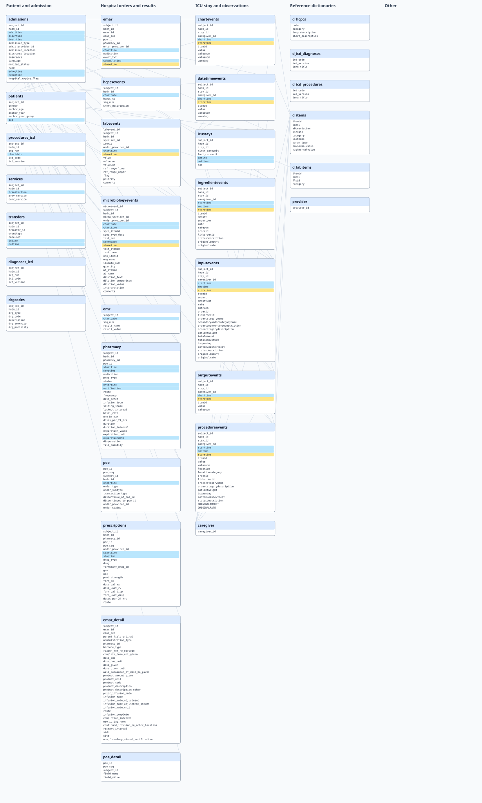

# MIMIC-IV Demo — database inspection

[Scrollable ERD](../../docs/schema.html) · [Dictionary](../../docs/data_dictionary.md) · [draw.io](../../docs/schema.drawio)

| Table | Rows | Preview |
|---|---:|---|
| admissions | 275 | [First ten rows](tables/admissions.md) |
| caregiver | 15468 | [First ten rows](tables/caregiver.md) |
| chartevents | 668862 | [First ten rows](tables/chartevents.md) |
| d_hcpcs | 89200 | [First ten rows](tables/d_hcpcs.md) |
| d_icd_diagnoses | 109775 | [First ten rows](tables/d_icd_diagnoses.md) |
| d_icd_procedures | 85257 | [First ten rows](tables/d_icd_procedures.md) |
| d_items | 4014 | [First ten rows](tables/d_items.md) |
| d_labitems | 1622 | [First ten rows](tables/d_labitems.md) |
| datetimeevents | 15280 | [First ten rows](tables/datetimeevents.md) |
| diagnoses_icd | 4506 | [First ten rows](tables/diagnoses_icd.md) |
| drgcodes | 454 | [First ten rows](tables/drgcodes.md) |
| emar | 35835 | [First ten rows](tables/emar.md) |
| emar_detail | 72018 | [First ten rows](tables/emar_detail.md) |
| hcpcsevents | 61 | [First ten rows](tables/hcpcsevents.md) |
| icustays | 140 | [First ten rows](tables/icustays.md) |
| ingredientevents | 25728 | [First ten rows](tables/ingredientevents.md) |
| inputevents | 20404 | [First ten rows](tables/inputevents.md) |
| labevents | 107727 | [First ten rows](tables/labevents.md) |
| microbiologyevents | 2899 | [First ten rows](tables/microbiologyevents.md) |
| omr | 2964 | [First ten rows](tables/omr.md) |
| outputevents | 9362 | [First ten rows](tables/outputevents.md) |
| patients | 100 | [First ten rows](tables/patients.md) |
| pharmacy | 15306 | [First ten rows](tables/pharmacy.md) |
| poe | 45154 | [First ten rows](tables/poe.md) |
| poe_detail | 3795 | [First ten rows](tables/poe_detail.md) |
| prescriptions | 18087 | [First ten rows](tables/prescriptions.md) |
| procedureevents | 1468 | [First ten rows](tables/procedureevents.md) |
| procedures_icd | 722 | [First ten rows](tables/procedures_icd.md) |
| provider | 40508 | [First ten rows](tables/provider.md) |
| services | 319 | [First ten rows](tables/services.md) |
| transfers | 1190 | [First ten rows](tables/transfers.md) |
