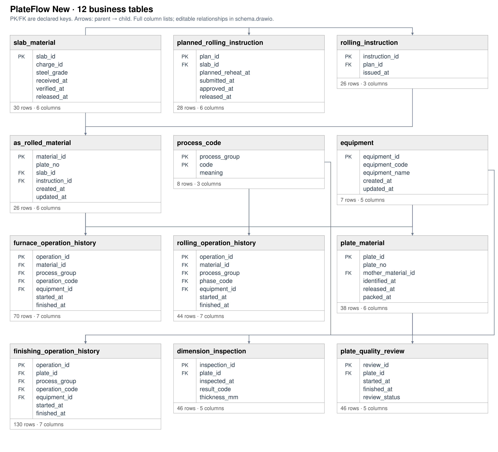

# PlateFlow New dataset

- **Purpose:** test event-source discovery and activity-carrier-based row/column classification from the database and an ordinary business dictionary.
- **Domain:** synthetic plate production informed by the existing Korean manufacturing-company metadata adaptation. This is an independent authored variant, not observed production data or a lossless copy of the original schema.
- **Build:** `python datasets/plateflow_new/build.py` from the repository root. **Validate:** `python datasets/plateflow_new/validate.py`.
- Simulation uses the standard library; PNG rendering additionally uses PyMuPDF. No external LLM API is needed to rebuild frozen question pairs.

| Dataset | Tables | Object / case types | Activity types | Timestamp columns | Event timestamp columns | Distinct events | Questions | Gold CSVs |
| --- | --- | --- | --- | --- | --- | --- | --- | --- |
| PlateFlow New | 12 | 11 | 20 | 24 | 15 | 620 | 54 | 50 |

## Event storage answers — author reference only

- Candidate discovery considers timestamp presence, then distinguishes actual business times from plans and database maintenance.
- Row encoding means activity kind is selected by a carrier value. Having both start and finish times does not change that classification.
- Column encoding means no activity-kind carrier exists; the table or timestamp-column business meaning determines the activity. Repeated records or a single timestamp do not make a table row encoded.
- Timestamp count alone does not establish a mixed representation. The table below classifies base activity identity and states the emitted phase profile separately. This variant contains 3 row tables, 6 column tables and 3 tables with no direct business events.
- Only this README explicitly lists table classification and activity carriers. Dictionary JSON, Markdown and CSV have no such annotations or table-to-activity extraction answers.

| Table | Base activity identity | Activity carrier | Stored time columns | Gold time columns | Emitted phase profile |
| --- | --- | --- | --- | --- | --- |
| slab_material | Column | — | received_at, verified_at, released_at | received_at, released_at, verified_at | point milestones |
| planned_rolling_instruction | Column | — | planned_reheat_at, submitted_at, approved_at, released_at | approved_at, released_at, submitted_at | point milestones |
| rolling_instruction | Column | — | issued_at | issued_at | point milestones |
| as_rolled_material | No business events | — | created_at, updated_at | — | none |
| process_code | No business events | — | — | — | none |
| equipment | No business events | — | created_at, updated_at | — | none |
| furnace_operation_history | Row | operation_code | started_at, finished_at | finished_at | completion only |
| rolling_operation_history | Row | phase_code | started_at, finished_at | finished_at | completion only |
| plate_material | Column | — | identified_at, released_at, packed_at | identified_at, packed_at, released_at | point milestones |
| finishing_operation_history | Row | operation_code | started_at, finished_at | finished_at | completion only |
| dimension_inspection | Column | — | inspected_at | inspected_at | point milestones |
| plate_quality_review | Column | — | started_at, finished_at | finished_at | completion only |

- `operation_code=HT` means furnace heating in FURNACE and heat treatment in FINISHING. Process context resolves the meaning; it is not a globally unique activity code.
- `equipment_code` identifies a machine, and `steel_grade` identifies a grade. Neither selects an activity kind.
- PASS and FAIL are outcomes of the same dimensional-inspection activity. APPROVED and REWORK are outcomes of the same quality-review activity. They are not activity carriers.
- `dimension_inspection` has one actual timestamp and a fixed activity meaning; reinspections remain column encoded. `plate_quality_review` has start/finish times and outcome codes but no activity carrier; it is also column encoded.
- Instruction issue has a single timestamp and no carrier. All three work histories have coded activity kinds plus start/finish times and are row encoded.

## Completion policy and scenarios

- Gold logs emit actual point milestones and completed work only. Work/review `started_at` values do not create additional start activity labels; NULL finish produces no completion.
- Scenarios include received-only slabs, draft plans, issued instructions awaiting work, unfinished heating/rolling, multiple pieces per mother, failed inspections, completed rework reviews, repeat heat treatment, reinspections, pending reviews and unpacked pieces.
- Every repeat work or inspection/review round keeps its own occurrence ID. No completed work is inferred from plans, equipment maintenance or mother-record timestamps.
- Main material and instruction logs require joins across business tables. Mother/slab views include descendant-piece work. Record cases preserve their own identities, and equipment cases use the actual equipment FK.

## Objects, activities and situations

| Object / case type | Cases | Activity types | Cases without events | Recorded activity scope |
| --- | --- | --- | --- | --- |
| Slab | 30 | 20 | 0 | Dimensional Inspection Completed, Finish Rolling Completed, Furnace Charged, Furnace Discharged, Heat Treatment Completed, Heating Completed, Leveling Completed, Plate Identified, Plate Packed, Plate Quality Review Completed, Plate Released, Rolling Instruction Issued, Rolling Plan Approved, Rolling Plan Released, Rolling Plan Submitted, Rough Rolling Completed, Slab Received, Slab Released, Slab Verified, Surface Finishing Completed |
| Rolling Plan | 28 | 4 | 0 | Rolling Instruction Issued, Rolling Plan Approved, Rolling Plan Released, Rolling Plan Submitted |
| Rolling Instruction | 26 | 14 | 0 | Dimensional Inspection Completed, Finish Rolling Completed, Furnace Charged, Furnace Discharged, Heat Treatment Completed, Heating Completed, Leveling Completed, Plate Identified, Plate Packed, Plate Quality Review Completed, Plate Released, Rolling Instruction Issued, Rough Rolling Completed, Surface Finishing Completed |
| Mother Material | 26 | 13 | 2 | Dimensional Inspection Completed, Finish Rolling Completed, Furnace Charged, Furnace Discharged, Heat Treatment Completed, Heating Completed, Leveling Completed, Plate Identified, Plate Packed, Plate Quality Review Completed, Plate Released, Rough Rolling Completed, Surface Finishing Completed |
| Plate Piece | 38 | 8 | 0 | Dimensional Inspection Completed, Heat Treatment Completed, Leveling Completed, Plate Identified, Plate Packed, Plate Quality Review Completed, Plate Released, Surface Finishing Completed |
| Dimension Inspection | 46 | 1 | 0 | Dimensional Inspection Completed |
| Quality Review | 46 | 1 | 3 | Plate Quality Review Completed |
| Equipment | 7 | 8 | 1 | Finish Rolling Completed, Furnace Charged, Furnace Discharged, Heat Treatment Completed, Heating Completed, Leveling Completed, Rough Rolling Completed, Surface Finishing Completed |
| Furnace Operation Record | 70 | 3 | 2 | Furnace Charged, Furnace Discharged, Heating Completed |
| Rolling Operation Record | 44 | 2 | 2 | Finish Rolling Completed, Rough Rolling Completed |
| Finishing Operation Record | 130 | 3 | 0 | Heat Treatment Completed, Leveling Completed, Surface Finishing Completed |

- Case scopes are fixed before query construction; a full-lifecycle request means all recorded business events in that declared scope, not inferred upstream casting or downstream dispatch.
- The 11 case types include independent work/inspection/review occurrence records and equipment. process_code is reference data and has no case log. A directly non-event table may still define a case with logs from related work tables.
- [Full lifecycle Gold files](docs/object_event_logs.md)

## Question types and pairs

| Type | Questions | Answerable | Non-answerable | Avg. requested activity types |
|---|---:|---:|---:|---:|
| Q1 | 16 | 14 | 2 | 2.44 |
| Q2 | 16 | 14 | 2 | 2.44 |
| Q3 | 11 | 11 | 0 | 7.00 |
| Q4 | 11 | 11 | 0 | 7.00 |

- Avg. requested activity types = sum of requested activity-type counts / all questions in that row, including non-answerable questions. WarehouseFlow New counts phase-specific requested labels here and reports base activity counts separately. Q3/Q4 counts use the Gold catalog scope. This counts distinct activity types, not event occurrences.

- Q1 seeds are paraphrased by the assistant LLM into Q2; Q3 seeds are paraphrased into Q4. Prompts, outputs and author review notes are saved in source/llm_paraphrases.json; no separate model/API call is claimed.
- Pairs share exactly the same Process View, ES, case population and Gold CSV content. Q3/Q4 mention only their case concept and use its fixed default recorded scope.
- Requested-activity averages include the two unsupported semantic requests and their paraphrases. Casting and truck dispatch cannot be reconstructed from this database.
- [Questions and requested/extractable activity counts](docs/questions.md)

## Model input boundary

- `input/model_input_manifest.json` is an allowlist of model inputs. Feed only the files listed there.
- Inputs contain the SQLite database, SQL schema, business dictionary and question text. input/task_context.md supplies a source-agnostic recorded-lifecycle scope convention, not table bindings or enumerated activities.
- README, source, design, docs, private, build code and validation reports are author/evaluation material. Exclude these from model context; in particular, the ordinary dictionary excludes both classification and extraction-selection answers.
- private/questions.jsonl has question types, answerability and activity-count annotations. private/gold.jsonl, persistence_mapping.json, case_paths.json and canonical_history.jsonl contain extraction answers. None are model inputs.
- **Gold CSV columns:** event_id, case_id, activity, timestamp. Event IDs and physical-source provenance are maintained separately; the same case/event pair is emitted once.

## Schema and documentation

- [Editable draw.io](docs/schema.drawio)
- [Table inventory and FK relationships](docs/schema_overview.md)
- [Three-part English data dictionary](docs/data_dictionary.md)
- [Dictionary CSV](docs/data_dictionary.csv) · [Table definitions CSV](docs/table_definitions.csv)
- [Author timestamp inventory](docs/timestamp_columns.md)
- [Source adaptation](design/source_mapping.json)
- [Validation report](validation_report.json)

## Validation scope

- Independent generation-time histories are compared with all SQL results and Gold CSVs. Checks cover completion-only times, group-qualified codes, outcome/machine-code distractors, genealogy, repetition, unfinished/empty cases, PK/FK integrity, dictionary leakage and exact question pairs.
- Tests establish dataset consistency. They do not measure an LLM's event-table discovery or classification accuracy. The separate NL2EventLog classifier must still be evaluated using the allowlisted inputs.

## Activity identity × timestamp phase audit

- Classification has two axes: how base activity identity is represented, and which occurrence phases are stored/emitted. A code is an activity carrier only when it selects the work kind; outcome, grade and machine codes are not carriers.
- This dataset retains the previously agreed completion-only Gold policy. It is not an all-four-cases phase benchmark.

| Requested case | Physical representation in PlateFlow New | Current Gold coverage |
|---|---|---|
| A: no carrier, one timestamp | rolling_instruction and dimension_inspection | Covered: one fixed milestone/completion |
| B: no carrier, multiple timestamps | slab/plan/plate milestones; plate_quality_review start/finish | Multiple point milestones are covered, but quality-review start is not emitted; paired-phase coverage is partial |
| C: activity carrier, one timestamp | None: each coded work history stores both start and finish | Not physically covered; selecting finish alone does not make a one-timestamp table |
| D: activity carrier, multiple timestamps | All three coded work-history tables | Base activity is row-carried, but only completion is emitted; paired-phase coverage is partial |

- The history tables are **Row activity identity × stored start/complete phases × completion-only extraction**. Their two timestamps do not imply two different base activities. A mixed representation label is acceptable only when these two axes remain explicit.
- WarehouseFlow New provides all four cases with phased Gold. PlateFlow New retains its DB, occurrence IDs and completion logs.
