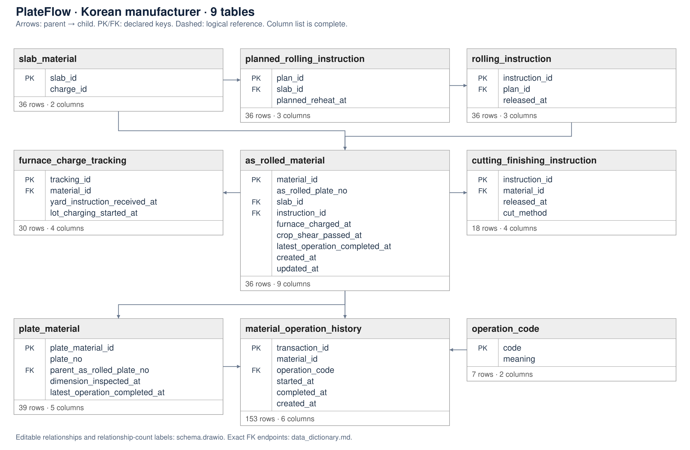

# PlateFlow — plate manufacturing

- This independent synthetic dataset reflects selected table and column definitions from a Korean manufacturing company.
- Requirements, data definitions and questions are authored in English.
- Original table and column identifiers are retained only as source references.
- Real production records and the full enterprise metadata CSV are excluded.

## Tables and source references

| English table | Original table reference | What it records |
|---|---|---|
| slab_material | TB_M2EA08_C_MTL060 | Slab material and furnace-charge information |
| planned_rolling_instruction | TB_M2LB01_D_PLANINST010 | Planned rolling instructions |
| rolling_instruction | TB_M2LM01_D_INST010 | Released rolling instructions |
| furnace_charge_tracking | TB_M2EA05_E_RF_IN060 | Actual furnace charging |
| as_rolled_material | TB_M2LM01_E_MTRL010 | Mother material and its latest recorded state |
| cutting_finishing_instruction | TB_M2LM01_D_INST020 | Cutting and finishing instructions |
| plate_material | TB_M2LM01_E_MTRL020 | Individual cut plate pieces |
| material_operation_history | TB_M2LM01_T_OPERHIST | Each recorded operation, including repeats |
| operation_code | Newly added | Meanings of the simulated process codes |

- The database contains 9 tables, 36 mother materials, 39 cut pieces and 324 business events.
- The supplied metadata has 20 table names and 6,616 definition rows, including repeated table-column definitions.
- It provides table and column names and descriptions.
- It does not provide SQL types, declared keys or process-code meanings.
- This dataset uses eight source table roles and adds one process-code table.
- Source mappings identify the original column for each retained definition; newly added columns have no source column.

## How manufacturing records are separated

- Planned instructions and released work instructions are stored separately.
- Furnace tracking is separate from material records.
- A mother material is the plate before cutting; individual plate materials are its cut pieces.
- In the simulated process, a completed mother material produces one to three pieces.
- Cutting and finishing instructions have their own table.
- Operation history stores event IDs, material IDs, process codes, start times and completion times.
- Repeated inspections and heat treatments remain separate history rows.
- Rolling completion comes from the RL operation in history.
- The material's latest-operation-completed time continues to update after rolling, so it cannot be used as a general rolling-completion time.
- This distinction follows the source description of `PLT_AC_OP_END_OP_DT` as the final actual process work time.
- Lot charging and individual material charging have separate times; the default material timeline excludes lot-level events.

## Assumptions added for simulation

- Process codes RL/CO/LE/SC/HT/IF/IP and their meanings are specified for this dataset.
- Mother-to-piece relationships, declared keys, link columns, durations and operation order are simulation assumptions.
- These assumptions are not presented as verified rules of the source company.
- The data dictionary uses a custom practical format; ISO/IEC 11179 compliance is not claimed.
- SchemaAgent's design stages informed the documentation, but PlateFlow does not reuse an RSchema requirement record.

## Questions and expected results

- Sixteen English questions are supplied: eight original questions and eight added object/record-view questions.
- V01/V02, V03/V04 and V05/V06 pair direct requests with paraphrases.
- V07 selects cutting and subsequent piece-inspection events.
- V08 is unsupported because upstream casting times are absent.
- Actual event logs exclude planned schedules and technical database timestamps.
- Each mother-material timeline includes its own events and its cut pieces' events, each exactly once.
- Joining all mother events directly to all pieces would duplicate upstream events.
- An operation-history material ID can identify either a mother material or a piece.
- An insert trigger and a separate missing-reference check validate those two ID sets; there is no misleading single-table foreign key.
- Expected logs are selected from simulated business history.
- Expected extraction specifications generate SQL using `UNION ALL`; the seven original and eight added answerable questions match their expected logs exactly.
- Logs are ordinary CSV timelines, not OCEL files.
- Cases with no selected events are listed by the separate case-population query and have no event row in the CSV.

## Additional case choices

- Added questions OPV01–OPV08 cover slabs, rolling plans, rolling instructions, mother materials, furnace tracking records, cutting instructions, cut pieces and operation records.
- Slab timelines include recorded events of their derived mother material and pieces; this does not create missing casting events.
- Piece timelines include operations recorded on that piece and dimensional inspection; upstream mother events are not copied to every piece.
- Instruction timelines include actual release events, and plan timelines include their linked instruction releases; planned reheating times remain schedules.
- The operation-code table defines activity meanings and is not a population of business objects.

## Rebuild and evaluation

- Run `python build.py` using Python 3.10 or later; no external package is needed.
- Rebuilding replaces generated DB and expected-result files.
- Provide only `input/` to the model.
- The task scope catalog defines mother-material cases, activity names and the default timeline scope.
- Keep generation code, design files, expected answers in `private/`, and validation reports outside the model's context.
- No real production rows or distributions fitted to production data are included.
- The dataset is a selected synthetic example, not a replica of the complete enterprise database.
- The extraction specification uses a dataset-specific format; compatibility with the existing NL2EventLog implementation has not been tested.
- Consistency checks do not measure model accuracy.

## Schema and documentation

- [Table inventory and relationships](docs/schema_overview.md)
- [English column dictionary](docs/data_dictionary.md)
- [CSV dictionary](docs/data_dictionary.csv)
- [Editable draw.io diagram](docs/schema.drawio)
- [Object-based Gold logs and coverage](docs/object_event_logs.md)
