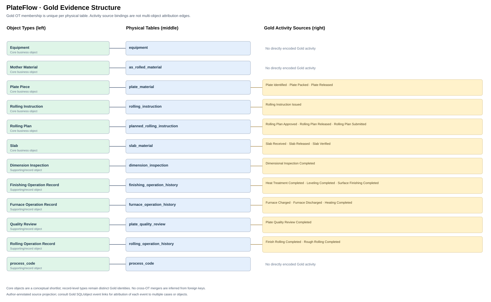
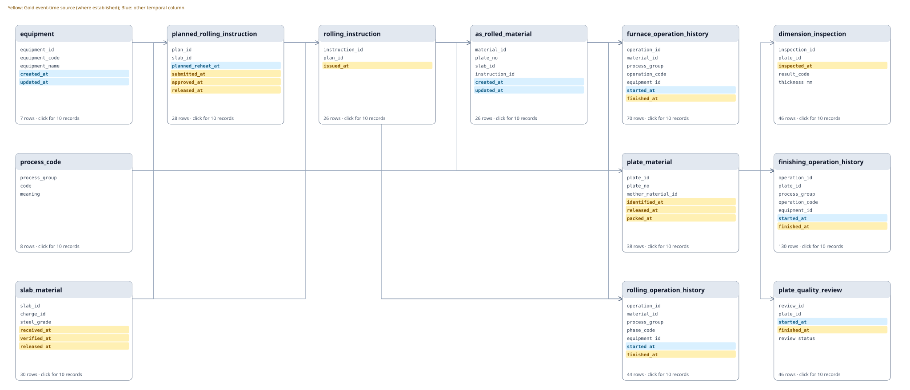

# PlateFlow — Database and Gold Evidence Review

PlateFlow is a synthetic steel-plate production database with slab receiving, rolling preparation, furnace and rolling operations, finishing, inspection and quality review. It reflects industrial process concepts, not observed production records.

## Gold EEG Source Projection

The diagram distinguishes core entity concepts from supporting representations and occurrence records. 
A physical table is one **Entity Representation (ER)**. Its displayed **Entity Type (ET) candidate** comes from legacy Gold annotations. ET semantic grouping and cross-ER instance identity resolution must be validated independently. FK reachability alone does not establish Case Attribution or Lifecycle Membership. An event may be attributed to several Entity Instances without implying that its source ER belongs to multiple ETs.

The diagram is an **author-annotated EEG source projection**, not a model-inferred EEG or a validated namespace-aware Entity Type Gold. The ET candidates reflect legacy identity labels.
Gold SQL and record-level evidence are available in the linked inspection materials; their internal consistency does not validate the target namespace model.

**Entity-model status:** A physical table is one **Entity Representation (ER)**. Its displayed **Entity Type (ET) candidate** comes from legacy Gold annotations. ET semantic grouping and cross-ER instance identity resolution must be validated independently. FK reachability alone does not establish Case Attribution or Lifecycle Membership. [Terminology and namespace contract](../../../../docs/system/EEG_ENTITY_MODEL.md).

## Relational Schema (SQL foreign keys)

## Table inspector

| Physical table | Rows | Columns | legacy ET candidate | First ten records |
|---|---:|---:|---|---|
| as_rolled_material | 26 | 6 | Mother Material | [Preview](tables/as_rolled_material.md) |
| dimension_inspection | 46 | 5 | Dimension Inspection | [Preview](tables/dimension_inspection.md) |
| equipment | 7 | 5 | Equipment | [Preview](tables/equipment.md) |
| finishing_operation_history | 130 | 7 | Finishing Operation Record | [Preview](tables/finishing_operation_history.md) |
| furnace_operation_history | 70 | 7 | Furnace Operation Record | [Preview](tables/furnace_operation_history.md) |
| planned_rolling_instruction | 28 | 6 | Rolling Plan | [Preview](tables/planned_rolling_instruction.md) |
| plate_material | 38 | 6 | Plate Piece | [Preview](tables/plate_material.md) |
| plate_quality_review | 46 | 5 | Quality Review | [Preview](tables/plate_quality_review.md) |
| process_code | 8 | 3 | process_code | [Preview](tables/process_code.md) |
| rolling_instruction | 26 | 3 | Rolling Instruction | [Preview](tables/rolling_instruction.md) |
| rolling_operation_history | 44 | 7 | Rolling Operation Record | [Preview](tables/rolling_operation_history.md) |
| slab_material | 30 | 6 | Slab | [Preview](tables/slab_material.md) |

## legacy Entity Type candidates vs. core business objects

Legacy ET candidate groups: **12**; principal business object concepts in this domain: **6**. 
The core set is a conceptual shortlist, not evidence for merging separate Entity Instances or Identity Namespaces.

**Core business concepts:** Equipment, Mother Material, Plate Piece, Rolling Instruction, Rolling Plan, Slab.

Supporting Gold types: Dimension Inspection, Finishing Operation Record, Furnace Operation Record, Quality Review, Rolling Operation Record, process_code.

## Evaluation evidence

- Gold SQL/CSV pairs executable and consistent: 50; compared event rows across questions: 7384.
- [Gold source inventory](../gold_dfg/event_graph.md)
- [Question-level Gold DFGs](../gold_dfg/README.md)
- [Editable Draw.io schema](../../docs/schema.drawio)

