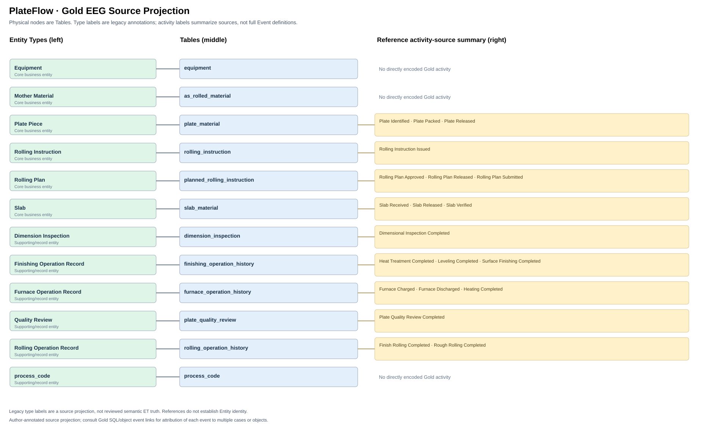
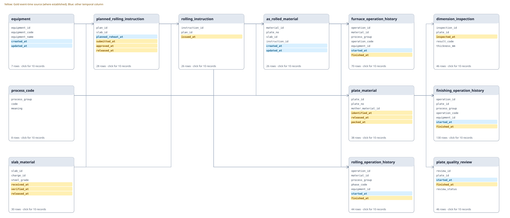

# PlateFlow — Database and Gold Evidence Review

PlateFlow is a synthetic steel-plate production database with slab receiving, rolling preparation, furnace and rolling operations, finishing, inspection and quality review. It reflects industrial process concepts, not observed production records.

## Gold Event Extraction Graph (EEG) Source Projection

The diagram distinguishes core business entity concepts from supporting entity and event-record types. 
A table may identify or reference several ETs through different keys. These legacy source labels do not enumerate or validate those interpretations.

**This is a source-level author-annotated projection, not an inferred EEG or a validated semantic ET Gold.**
Gold SQL and record-level evidence are available in the linked inspection materials. The current membership labels originate from the legacy Gold; an independently validated ET/Entity identification context Gold is a separate evaluation task.

## Relational Schema (SQL foreign keys)

## Table inspector

| Physical table | Rows | Columns | ET candidate | First ten records |
|---|---:|---:|---|---|
| as_rolled_material | 26 | 6 | Mother Material | [Preview](tables/as_rolled_material.md) |
| dimension_inspection | 46 | 5 | Dimension Inspection | [Preview](tables/dimension_inspection.md) |
| equipment | 7 | 5 | Equipment | [Preview](tables/equipment.md) |
| finishing_operation_history | 130 | 7 | Finishing Operation Record | [Preview](tables/finishing_operation_history.md) |
| furnace_operation_history | 70 | 7 | Furnace Operation Record | [Preview](tables/furnace_operation_history.md) |
| planned_rolling_instruction | 28 | 6 | Rolling Plan | [Preview](tables/planned_rolling_instruction.md) |
| plate_material | 38 | 6 | Plate Piece | [Preview](tables/plate_material.md) |
| plate_quality_review | 46 | 5 | Quality Review | [Preview](tables/plate_quality_review.md) |
| process_code | 8 | 3 | process_code | [Preview](tables/process_code.md) |
| rolling_instruction | 26 | 3 | Rolling Instruction | [Preview](tables/rolling_instruction.md) |
| rolling_operation_history | 44 | 7 | Rolling Operation Record | [Preview](tables/rolling_operation_history.md) |
| slab_material | 30 | 6 | Slab | [Preview](tables/slab_material.md) |

## Entity Type candidates vs. core business objects

Legacy identity groups (ET candidates): **12**; principal business object concepts in this domain: **6**. 
The core set is a candidate semantic grouping, not a rule for merging unrelated instances or Entity identities.

**Core business concepts:** Equipment, Mother Material, Plate Piece, Rolling Instruction, Rolling Plan, Slab.

Supporting Gold types: Dimension Inspection, Finishing Operation Record, Furnace Operation Record, Quality Review, Rolling Operation Record, process_code.

## Evaluation evidence

- Gold SQL/CSV pairs executable and consistent: 50; compared event rows across questions: 7384.
- [Gold source inventory](../gold_dfg/event_graph.md)
- [Question-level Gold DFGs](../gold_dfg/README.md)
- [Editable Draw.io schema](../../docs/schema.drawio)

