# plateflow_new: questions and Gold DFGs

**EVALUATION ONLY — NEVER PROVIDE TO A MODEL.**

Source commit: `a0ba4c9631d12730d60bf7720d783a3a827b88dc`. Open index.html for search, review notes and complete case traces.

Node counts = event occurrences. Edge counts = adjacent selected events within a case. Dashed amber edges touch timestamp ties and depend on the tie-break rule. DFGs are projections of the selected log, not causal models.

[Event graph inventory · tables, objects, OTs and activities](event_graph.md)

**Source tables** produced matched Gold events. **SQL tables** are all physical tables read by the Gold SQL, including join tables and shared CTE branches.

## Dataset overview

[Full DB schema](../../../datasets/plateflow_new/docs/schema_overview.md) · [Full-size ER diagram](../../../datasets/plateflow_new/docs/schema.png) · [SQL DDL](../../../datasets/plateflow_new/input/schema.sql)

Show all 54 questions and the schema preview

<table><tr><td width="50%" valign="top"><h3>All questions (54)</h3><table><thead><tr><th>ID</th><th>Type</th><th>Question</th></tr></thead><tbody><tr><td><a href="#n01--q1">N01</a></td><td>Q1</td><td>For each slab, extract Slab Received, Slab Verified and Slab Released events.</td></tr><tr><td><a href="#n01p--q2">N01P</a></td><td>Q2</td><td>Build a timeline for each slab showing its receipt, verification and release.</td></tr><tr><td><a href="#n02--q1">N02</a></td><td>Q1</td><td>For each rolling plan, extract Rolling Plan Submitted, Rolling Plan Approved and Rolling Plan Released events.</td></tr><tr><td><a href="#n02p--q2">N02P</a></td><td>Q2</td><td>For every rolling plan, show when it was submitted, approved and released.</td></tr><tr><td><a href="#n03--q1">N03</a></td><td>Q1</td><td>For each rolling instruction, extract Rolling Instruction Issued, Heating Completed and Finish Rolling Completed events.</td></tr><tr><td><a href="#n03p--q2">N03P</a></td><td>Q2</td><td>For every rolling instruction, show its issue, the completion of heating and the completion of finish rolling.</td></tr><tr><td><a href="#n04--q1">N04</a></td><td>Q1</td><td>For each mother material, extract Furnace Charged, Heating Completed, Furnace Discharged, Rough Rolling Completed and Finish Rolling Completed events.</td></tr><tr><td><a href="#n04p--q2">N04P</a></td><td>Q2</td><td>For each mother material, show the completion of charging into the furnace, heating, discharge from the furnace, rough rolling and finish rolling.</td></tr><tr><td><a href="#n05--q1">N05</a></td><td>Q1</td><td>For each mother material, extract Heat Treatment Completed, Surface Finishing Completed and Dimensional Inspection Completed events, including those of its descendant plate pieces.</td></tr><tr><td><a href="#n05p--q2">N05P</a></td><td>Q2</td><td>For every mother material, show when heat treatment, surface finishing and dimensional inspection were completed, including work on all plate pieces derived from it.</td></tr><tr><td><a href="#n06--q1">N06</a></td><td>Q1</td><td>For each plate piece, extract Leveling Completed, Heat Treatment Completed and Surface Finishing Completed events, retaining repeated occurrences.</td></tr><tr><td><a href="#n06p--q2">N06P</a></td><td>Q2</td><td>For each plate piece, show every completed leveling, heat-treatment and surface-finishing operation, including repeat work.</td></tr><tr><td><a href="#n07--q1">N07</a></td><td>Q1</td><td>For each plate piece, extract Dimensional Inspection Completed and Plate Quality Review Completed events.</td></tr><tr><td><a href="#n07p--q2">N07P</a></td><td>Q2</td><td>For every plate piece, show when its dimensional inspections and quality reviews finished.</td></tr><tr><td><a href="#n08--q1">N08</a></td><td>Q1</td><td>For each plate piece, extract Plate Identified, Plate Released and Plate Packed events.</td></tr><tr><td><a href="#n08p--q2">N08P</a></td><td>Q2</td><td>For each plate piece, show when it was identified, released and packed.</td></tr><tr><td><a href="#n09--q1">N09</a></td><td>Q1</td><td>For each dimension inspection record, extract Dimensional Inspection Completed events.</td></tr><tr><td><a href="#n09p--q2">N09P</a></td><td>Q2</td><td>For each individual dimensional inspection record, show when the inspection finished.</td></tr><tr><td><a href="#n10--q1">N10</a></td><td>Q1</td><td>For each quality review record, extract Plate Quality Review Completed events.</td></tr><tr><td><a href="#n10p--q2">N10P</a></td><td>Q2</td><td>For each individual quality review record, show when the review finished.</td></tr><tr><td><a href="#n11--q1">N11</a></td><td>Q1</td><td>For each equipment unit, extract Heating Completed and Heat Treatment Completed events.</td></tr><tr><td><a href="#n11p--q2">N11P</a></td><td>Q2</td><td>For each equipment unit, show the completion of heating and of heat treatment.</td></tr><tr><td><a href="#n12--q1">N12</a></td><td>Q1</td><td>For each furnace operation record, extract Furnace Charged, Heating Completed and Furnace Discharged events.</td></tr><tr><td><a href="#n12p--q2">N12P</a></td><td>Q2</td><td>For every furnace operation record, show the recorded completion of furnace charging, heating or furnace discharge, as applicable.</td></tr><tr><td><a href="#n13--q1">N13</a></td><td>Q1</td><td>For each rolling operation record, extract Rough Rolling Completed and Finish Rolling Completed events.</td></tr><tr><td><a href="#n13p--q2">N13P</a></td><td>Q2</td><td>For every rolling operation record, show the recorded completion of rough rolling or finish rolling, as applicable.</td></tr><tr><td><a href="#n14--q1">N14</a></td><td>Q1</td><td>For each finishing operation record, extract Leveling Completed, Heat Treatment Completed and Surface Finishing Completed events.</td></tr><tr><td><a href="#n14p--q2">N14P</a></td><td>Q2</td><td>For every finishing operation record, show the recorded completion of leveling, heat treatment or surface finishing, as applicable.</td></tr><tr><td><a href="#n15--q1">N15</a></td><td>Q1</td><td>For each slab, extract Steel Cast events.</td></tr><tr><td><a href="#n15p--q2">N15P</a></td><td>Q2</td><td>For each slab, show when the steel was cast.</td></tr><tr><td><a href="#n16--q1">N16</a></td><td>Q1</td><td>For each plate piece, extract Truck Dispatched events.</td></tr><tr><td><a href="#n16p--q2">N16P</a></td><td>Q2</td><td>For each plate piece, show when its truck was dispatched.</td></tr><tr><td><a href="#nf01--q3">NF01</a></td><td>Q3</td><td>Extract the full recorded lifecycle for each slab.</td></tr><tr><td><a href="#nf01p--q4">NF01P</a></td><td>Q4</td><td>Show the complete recorded history of each slab.</td></tr><tr><td><a href="#nf02--q3">NF02</a></td><td>Q3</td><td>Extract the full recorded lifecycle for each rolling plan.</td></tr><tr><td><a href="#nf02p--q4">NF02P</a></td><td>Q4</td><td>Build the entire recorded timeline for every rolling plan.</td></tr><tr><td><a href="#nf03--q3">NF03</a></td><td>Q3</td><td>Extract the full recorded lifecycle for each rolling instruction.</td></tr><tr><td><a href="#nf03p--q4">NF03P</a></td><td>Q4</td><td>Trace each rolling instruction through its full recorded history.</td></tr><tr><td><a href="#nf04--q3">NF04</a></td><td>Q3</td><td>Extract the full recorded lifecycle for each mother material.</td></tr><tr><td><a href="#nf04p--q4">NF04P</a></td><td>Q4</td><td>Show the whole recorded lifecycle of every mother material.</td></tr><tr><td><a href="#nf05--q3">NF05</a></td><td>Q3</td><td>Extract the full recorded lifecycle for each plate piece.</td></tr><tr><td><a href="#nf05p--q4">NF05P</a></td><td>Q4</td><td>Build a complete timeline of the recorded history of each plate piece.</td></tr><tr><td><a href="#nf06--q3">NF06</a></td><td>Q3</td><td>Extract the full recorded lifecycle for each dimension inspection record.</td></tr><tr><td><a href="#nf06p--q4">NF06P</a></td><td>Q4</td><td>Show the entire recorded history of every individual dimensional inspection record.</td></tr><tr><td><a href="#nf07--q3">NF07</a></td><td>Q3</td><td>Extract the full recorded lifecycle for each quality review record.</td></tr><tr><td><a href="#nf07p--q4">NF07P</a></td><td>Q4</td><td>Trace each individual quality review record through its complete recorded history.</td></tr><tr><td><a href="#nf08--q3">NF08</a></td><td>Q3</td><td>Extract the full recorded lifecycle for each equipment unit.</td></tr><tr><td><a href="#nf08p--q4">NF08P</a></td><td>Q4</td><td>Show the full recorded history associated with every equipment unit.</td></tr><tr><td><a href="#nf09--q3">NF09</a></td><td>Q3</td><td>Extract the full recorded lifecycle for each furnace operation record.</td></tr><tr><td><a href="#nf09p--q4">NF09P</a></td><td>Q4</td><td>Build the complete recorded timeline of each individual furnace operation record.</td></tr><tr><td><a href="#nf10--q3">NF10</a></td><td>Q3</td><td>Extract the full recorded lifecycle for each rolling operation record.</td></tr><tr><td><a href="#nf10p--q4">NF10P</a></td><td>Q4</td><td>Show the whole recorded history of each individual rolling operation record.</td></tr><tr><td><a href="#nf11--q3">NF11</a></td><td>Q3</td><td>Extract the full recorded lifecycle for each finishing operation record.</td></tr><tr><td><a href="#nf11p--q4">NF11P</a></td><td>Q4</td><td>Trace the entire recorded history of every individual finishing operation record.</td></tr></tbody></table></td><td width="50%" valign="top"><h3>Database schema</h3>

<a href="../../../datasets/plateflow_new/docs/schema.png">Full-size diagram</a> · <a href="../../../datasets/plateflow_new/input/schema.sql">Full SQL schema</a>
</td></tr></table>

## N01 — Q1

For each slab, extract Slab Received, Slab Verified and Slab Released events.

Events: **86** · Cases with events: **30** · Activities: **3** · Edges: **2** · Source tables: **1** · SQL tables: **1**

<table><tr><td width="42%" valign="top"><a href="graphs/N01.svg">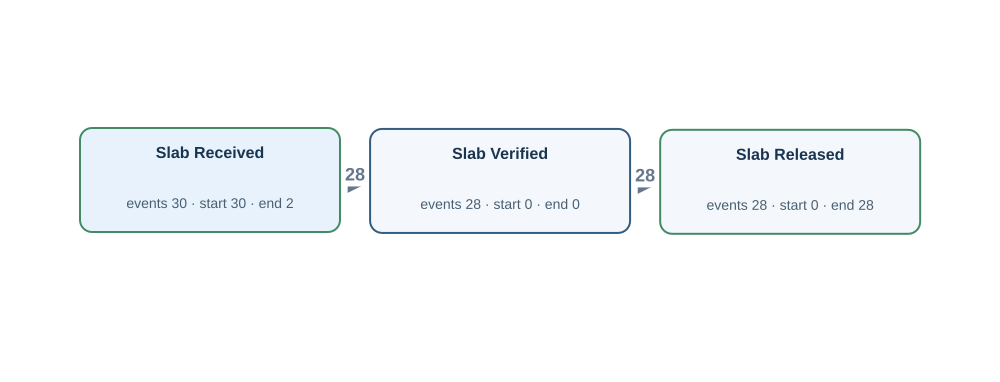</a></td><td width="58%" valign="top">
<a href="../../../datasets/plateflow_new/private/gold_sql/N01.sql">Gold SQL</a> · <a href="../../../datasets/plateflow_new/private/gold_logs/N01.csv">Gold CSV</a> · <a href="../../../datasets/plateflow_new/input/database.sqlite">Full source database (SQLite)</a>

<code>slab_material</code> · 30 matched source rows
<table><tr><th>Column</th><th>Row 1</th><th>Row 2</th><th>Row 3</th></tr><tr><th>slab_id</th><td>S001</td><td>S003</td><td>S002</td></tr><tr><th>charge_id</th><td>C001</td><td>C001</td><td>C001</td></tr><tr><th>steel_grade</th><td>G1</td><td>G1</td><td>G2</td></tr><tr><th>received_at</th><td>2026-01-04T11:20:00Z</td><td>2026-01-11T10:00:00Z</td><td>2026-01-07T22:40:00Z</td></tr><tr><th>verified_at</th><td><em>NULL</em></td><td>2026-01-11T10:10:00Z</td><td><em>NULL</em></td></tr><tr><th>released_at</th><td><em>NULL</em></td><td>2026-01-11T10:20:00Z</td><td><em>NULL</em></td></tr></table>
<strong>Gold output for the same source rows</strong>
<ul><li>Row 1 → Slab Received · event SLAB:S001:received_at · case S:S001 · time from <code>received_at</code></li><li>Row 2 → Slab Received · event SLAB:S003:received_at · case S:S003 · time from <code>received_at</code></li><li>Row 2 → Slab Released · event SLAB:S003:released_at · case S:S003 · time from <code>released_at</code></li><li>Row 2 → Slab Verified · event SLAB:S003:verified_at · case S:S003 · time from <code>verified_at</code></li><li>Row 3 → Slab Received · event SLAB:S002:received_at · case S:S002 · time from <code>received_at</code></li></ul>
</td></tr></table>

## N01P — Q2

Build a timeline for each slab showing its receipt, verification and release.

Events: **86** · Cases with events: **30** · Activities: **3** · Edges: **2** · Source tables: **1** · SQL tables: **1**

<table><tr><td width="42%" valign="top"></td><td width="58%" valign="top">
<a href="../../../datasets/plateflow_new/private/gold_sql/N01P.sql">Gold SQL</a> · <a href="../../../datasets/plateflow_new/private/gold_logs/N01P.csv">Gold CSV</a> · <a href="../../../datasets/plateflow_new/input/database.sqlite">Full source database (SQLite)</a>

<code>slab_material</code> · 30 matched source rows
<table><tr><th>Column</th><th>Row 1</th><th>Row 2</th><th>Row 3</th></tr><tr><th>slab_id</th><td>S001</td><td>S003</td><td>S002</td></tr><tr><th>charge_id</th><td>C001</td><td>C001</td><td>C001</td></tr><tr><th>steel_grade</th><td>G1</td><td>G1</td><td>G2</td></tr><tr><th>received_at</th><td>2026-01-04T11:20:00Z</td><td>2026-01-11T10:00:00Z</td><td>2026-01-07T22:40:00Z</td></tr><tr><th>verified_at</th><td><em>NULL</em></td><td>2026-01-11T10:10:00Z</td><td><em>NULL</em></td></tr><tr><th>released_at</th><td><em>NULL</em></td><td>2026-01-11T10:20:00Z</td><td><em>NULL</em></td></tr></table>
<strong>Gold output for the same source rows</strong>
<ul><li>Row 1 → Slab Received · event SLAB:S001:received_at · case S:S001 · time from <code>received_at</code></li><li>Row 2 → Slab Received · event SLAB:S003:received_at · case S:S003 · time from <code>received_at</code></li><li>Row 2 → Slab Released · event SLAB:S003:released_at · case S:S003 · time from <code>released_at</code></li><li>Row 2 → Slab Verified · event SLAB:S003:verified_at · case S:S003 · time from <code>verified_at</code></li><li>Row 3 → Slab Received · event SLAB:S002:received_at · case S:S002 · time from <code>received_at</code></li></ul>
</td></tr></table>

## N02 — Q1

For each rolling plan, extract Rolling Plan Submitted, Rolling Plan Approved and Rolling Plan Released events.

Events: **80** · Cases with events: **28** · Activities: **3** · Edges: **2** · Source tables: **1** · SQL tables: **1**

<table><tr><td width="42%" valign="top"><a href="graphs/N02.svg">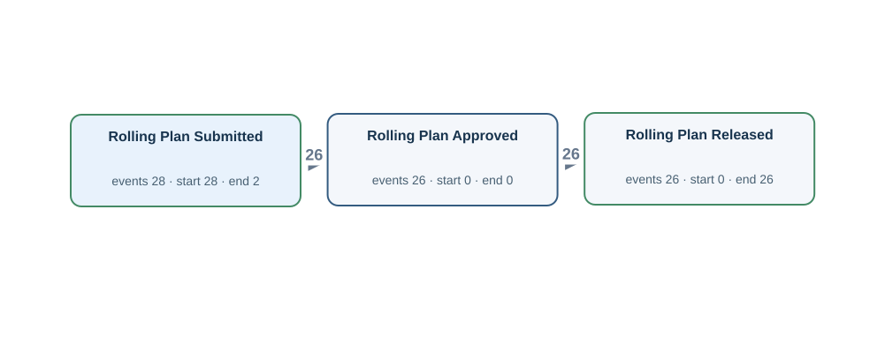</a></td><td width="58%" valign="top">
<a href="../../../datasets/plateflow_new/private/gold_sql/N02.sql">Gold SQL</a> · <a href="../../../datasets/plateflow_new/private/gold_logs/N02.csv">Gold CSV</a> · <a href="../../../datasets/plateflow_new/input/database.sqlite">Full source database (SQLite)</a>

<code>planned_rolling_instruction</code> · 28 matched source rows
<table><tr><th>Column</th><th>Row 1</th><th>Row 2</th><th>Row 3</th></tr><tr><th>plan_id</th><td>L003</td><td>L005</td><td>L004</td></tr><tr><th>slab_id</th><td>S003</td><td>S005</td><td>S004</td></tr><tr><th>planned_reheat_at</th><td>2026-01-11T18:20:00Z</td><td>2026-01-18T17:00:00Z</td><td>2026-01-15T05:40:00Z</td></tr><tr><th>submitted_at</th><td>2026-01-11T10:30:00Z</td><td>2026-01-18T09:10:00Z</td><td>2026-01-14T21:50:00Z</td></tr><tr><th>approved_at</th><td><em>NULL</em></td><td>2026-01-18T09:20:00Z</td><td><em>NULL</em></td></tr><tr><th>released_at</th><td><em>NULL</em></td><td>2026-01-18T09:30:00Z</td><td><em>NULL</em></td></tr></table>
<strong>Gold output for the same source rows</strong>
<ul><li>Row 1 → Rolling Plan Submitted · event PLAN:L003:submitted_at · case PLAN:L003 · time from <code>submitted_at</code></li><li>Row 2 → Rolling Plan Approved · event PLAN:L005:approved_at · case PLAN:L005 · time from <code>approved_at</code></li><li>Row 2 → Rolling Plan Released · event PLAN:L005:released_at · case PLAN:L005 · time from <code>released_at</code></li><li>Row 2 → Rolling Plan Submitted · event PLAN:L005:submitted_at · case PLAN:L005 · time from <code>submitted_at</code></li><li>Row 3 → Rolling Plan Submitted · event PLAN:L004:submitted_at · case PLAN:L004 · time from <code>submitted_at</code></li></ul>
</td></tr></table>

## N02P — Q2

For every rolling plan, show when it was submitted, approved and released.

Events: **80** · Cases with events: **28** · Activities: **3** · Edges: **2** · Source tables: **1** · SQL tables: **1**

<table><tr><td width="42%" valign="top"></td><td width="58%" valign="top">
<a href="../../../datasets/plateflow_new/private/gold_sql/N02P.sql">Gold SQL</a> · <a href="../../../datasets/plateflow_new/private/gold_logs/N02P.csv">Gold CSV</a> · <a href="../../../datasets/plateflow_new/input/database.sqlite">Full source database (SQLite)</a>

<code>planned_rolling_instruction</code> · 28 matched source rows
<table><tr><th>Column</th><th>Row 1</th><th>Row 2</th><th>Row 3</th></tr><tr><th>plan_id</th><td>L003</td><td>L005</td><td>L004</td></tr><tr><th>slab_id</th><td>S003</td><td>S005</td><td>S004</td></tr><tr><th>planned_reheat_at</th><td>2026-01-11T18:20:00Z</td><td>2026-01-18T17:00:00Z</td><td>2026-01-15T05:40:00Z</td></tr><tr><th>submitted_at</th><td>2026-01-11T10:30:00Z</td><td>2026-01-18T09:10:00Z</td><td>2026-01-14T21:50:00Z</td></tr><tr><th>approved_at</th><td><em>NULL</em></td><td>2026-01-18T09:20:00Z</td><td><em>NULL</em></td></tr><tr><th>released_at</th><td><em>NULL</em></td><td>2026-01-18T09:30:00Z</td><td><em>NULL</em></td></tr></table>
<strong>Gold output for the same source rows</strong>
<ul><li>Row 1 → Rolling Plan Submitted · event PLAN:L003:submitted_at · case PLAN:L003 · time from <code>submitted_at</code></li><li>Row 2 → Rolling Plan Approved · event PLAN:L005:approved_at · case PLAN:L005 · time from <code>approved_at</code></li><li>Row 2 → Rolling Plan Released · event PLAN:L005:released_at · case PLAN:L005 · time from <code>released_at</code></li><li>Row 2 → Rolling Plan Submitted · event PLAN:L005:submitted_at · case PLAN:L005 · time from <code>submitted_at</code></li><li>Row 3 → Rolling Plan Submitted · event PLAN:L004:submitted_at · case PLAN:L004 · time from <code>submitted_at</code></li></ul>
</td></tr></table>

## N03 — Q1

For each rolling instruction, extract Rolling Instruction Issued, Heating Completed and Finish Rolling Completed events.

Events: **68** · Cases with events: **26** · Activities: **3** · Edges: **2** · Source tables: **3** · SQL tables: **4**

<table><tr><td width="42%" valign="top"><a href="graphs/N03.svg">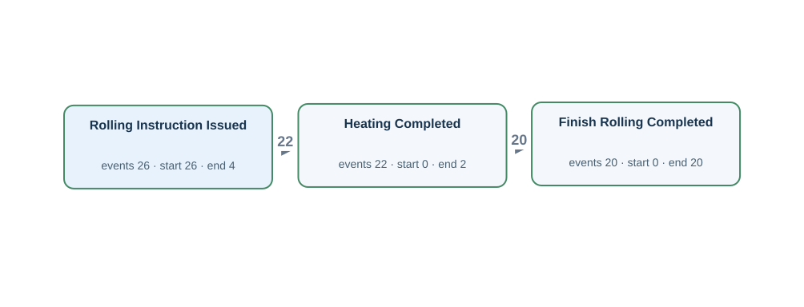</a></td><td width="58%" valign="top">
<a href="../../../datasets/plateflow_new/private/gold_sql/N03.sql">Gold SQL</a> · <a href="../../../datasets/plateflow_new/private/gold_logs/N03.csv">Gold CSV</a> · <a href="../../../datasets/plateflow_new/input/database.sqlite">Full source database (SQLite)</a>

<code>furnace_operation_history</code> · 22 matched source rows
<table><tr><th>Column</th><th>Row 1</th><th>Row 2</th><th>Row 3</th></tr><tr><th>operation_id</th><td>0002</td><td>0005</td><td>0008</td></tr><tr><th>material_id</th><td>M007</td><td>M008</td><td>M009</td></tr><tr><th>process_group</th><td>FURNACE</td><td>FURNACE</td><td>FURNACE</td></tr><tr><th>operation_code</th><td>HT</td><td>HT</td><td>HT</td></tr><tr><th>equipment_id</th><td>FU2</td><td>FU1</td><td>FU2</td></tr><tr><th>started_at</th><td>2026-01-25T08:45:00Z</td><td>2026-01-28T20:05:00Z</td><td>2026-02-01T07:25:00Z</td></tr><tr><th>finished_at</th><td>2026-01-25T09:20:00Z</td><td>2026-01-28T20:40:00Z</td><td>2026-02-01T08:00:00Z</td></tr></table>
<strong>Gold output for the same source rows</strong>
<ul><li>Row 1 → Heating Completed · event FOP:0002 · case INST:I007 · time from <code>finished_at</code></li><li>Row 2 → Heating Completed · event FOP:0005 · case INST:I008 · time from <code>finished_at</code></li><li>Row 3 → Heating Completed · event FOP:0008 · case INST:I009 · time from <code>finished_at</code></li></ul>

<code>rolling_instruction</code> · 26 matched source rows
<table><tr><th>Column</th><th>Row 1</th><th>Row 2</th><th>Row 3</th></tr><tr><th>instruction_id</th><td>I005</td><td>I006</td><td>I007</td></tr><tr><th>plan_id</th><td>L005</td><td>L006</td><td>L007</td></tr><tr><th>issued_at</th><td>2026-01-18T09:40:00Z</td><td>2026-01-21T21:00:00Z</td><td>2026-01-25T08:20:00Z</td></tr></table>
<strong>Gold output for the same source rows</strong>
<ul><li>Row 1 → Rolling Instruction Issued · event INST:I005 · case INST:I005 · time from <code>issued_at</code></li><li>Row 2 → Rolling Instruction Issued · event INST:I006 · case INST:I006 · time from <code>issued_at</code></li><li>Row 3 → Rolling Instruction Issued · event INST:I007 · case INST:I007 · time from <code>issued_at</code></li></ul>

<code>rolling_operation_history</code> · 20 matched source rows
<table><tr><th>Column</th><th>Row 1</th><th>Row 2</th><th>Row 3</th></tr><tr><th>operation_id</th><td>0002</td><td>0004</td><td>0006</td></tr><tr><th>material_id</th><td>M007</td><td>M008</td><td>M009</td></tr><tr><th>process_group</th><td>ROLLING</td><td>ROLLING</td><td>ROLLING</td></tr><tr><th>phase_code</th><td>FR</td><td>FR</td><td>FR</td></tr><tr><th>equipment_id</th><td>RO2</td><td>RO1</td><td>RO2</td></tr><tr><th>started_at</th><td>2026-01-25T10:10:00Z</td><td>2026-01-28T21:30:00Z</td><td>2026-02-01T08:50:00Z</td></tr><tr><th>finished_at</th><td>2026-01-25T10:35:00Z</td><td>2026-01-28T21:55:00Z</td><td>2026-02-01T09:15:00Z</td></tr></table>
<strong>Gold output for the same source rows</strong>
<ul><li>Row 1 → Finish Rolling Completed · event ROP:0002 · case INST:I007 · time from <code>finished_at</code></li><li>Row 2 → Finish Rolling Completed · event ROP:0004 · case INST:I008 · time from <code>finished_at</code></li><li>Row 3 → Finish Rolling Completed · event ROP:0006 · case INST:I009 · time from <code>finished_at</code></li></ul>

FK-linked case and join evidence
<ul><li><code>furnace_operation_history</code> → <code>as_rolled_material</code> · material_id → material_id · material_id = M007</li></ul>
</td></tr></table>

## N03P — Q2

For every rolling instruction, show its issue, the completion of heating and the completion of finish rolling.

Events: **68** · Cases with events: **26** · Activities: **3** · Edges: **2** · Source tables: **3** · SQL tables: **4**

<table><tr><td width="42%" valign="top"></td><td width="58%" valign="top">
<a href="../../../datasets/plateflow_new/private/gold_sql/N03P.sql">Gold SQL</a> · <a href="../../../datasets/plateflow_new/private/gold_logs/N03P.csv">Gold CSV</a> · <a href="../../../datasets/plateflow_new/input/database.sqlite">Full source database (SQLite)</a>

<code>furnace_operation_history</code> · 22 matched source rows
<table><tr><th>Column</th><th>Row 1</th><th>Row 2</th><th>Row 3</th></tr><tr><th>operation_id</th><td>0002</td><td>0005</td><td>0008</td></tr><tr><th>material_id</th><td>M007</td><td>M008</td><td>M009</td></tr><tr><th>process_group</th><td>FURNACE</td><td>FURNACE</td><td>FURNACE</td></tr><tr><th>operation_code</th><td>HT</td><td>HT</td><td>HT</td></tr><tr><th>equipment_id</th><td>FU2</td><td>FU1</td><td>FU2</td></tr><tr><th>started_at</th><td>2026-01-25T08:45:00Z</td><td>2026-01-28T20:05:00Z</td><td>2026-02-01T07:25:00Z</td></tr><tr><th>finished_at</th><td>2026-01-25T09:20:00Z</td><td>2026-01-28T20:40:00Z</td><td>2026-02-01T08:00:00Z</td></tr></table>
<strong>Gold output for the same source rows</strong>
<ul><li>Row 1 → Heating Completed · event FOP:0002 · case INST:I007 · time from <code>finished_at</code></li><li>Row 2 → Heating Completed · event FOP:0005 · case INST:I008 · time from <code>finished_at</code></li><li>Row 3 → Heating Completed · event FOP:0008 · case INST:I009 · time from <code>finished_at</code></li></ul>

<code>rolling_instruction</code> · 26 matched source rows
<table><tr><th>Column</th><th>Row 1</th><th>Row 2</th><th>Row 3</th></tr><tr><th>instruction_id</th><td>I005</td><td>I006</td><td>I007</td></tr><tr><th>plan_id</th><td>L005</td><td>L006</td><td>L007</td></tr><tr><th>issued_at</th><td>2026-01-18T09:40:00Z</td><td>2026-01-21T21:00:00Z</td><td>2026-01-25T08:20:00Z</td></tr></table>
<strong>Gold output for the same source rows</strong>
<ul><li>Row 1 → Rolling Instruction Issued · event INST:I005 · case INST:I005 · time from <code>issued_at</code></li><li>Row 2 → Rolling Instruction Issued · event INST:I006 · case INST:I006 · time from <code>issued_at</code></li><li>Row 3 → Rolling Instruction Issued · event INST:I007 · case INST:I007 · time from <code>issued_at</code></li></ul>

<code>rolling_operation_history</code> · 20 matched source rows
<table><tr><th>Column</th><th>Row 1</th><th>Row 2</th><th>Row 3</th></tr><tr><th>operation_id</th><td>0002</td><td>0004</td><td>0006</td></tr><tr><th>material_id</th><td>M007</td><td>M008</td><td>M009</td></tr><tr><th>process_group</th><td>ROLLING</td><td>ROLLING</td><td>ROLLING</td></tr><tr><th>phase_code</th><td>FR</td><td>FR</td><td>FR</td></tr><tr><th>equipment_id</th><td>RO2</td><td>RO1</td><td>RO2</td></tr><tr><th>started_at</th><td>2026-01-25T10:10:00Z</td><td>2026-01-28T21:30:00Z</td><td>2026-02-01T08:50:00Z</td></tr><tr><th>finished_at</th><td>2026-01-25T10:35:00Z</td><td>2026-01-28T21:55:00Z</td><td>2026-02-01T09:15:00Z</td></tr></table>
<strong>Gold output for the same source rows</strong>
<ul><li>Row 1 → Finish Rolling Completed · event ROP:0002 · case INST:I007 · time from <code>finished_at</code></li><li>Row 2 → Finish Rolling Completed · event ROP:0004 · case INST:I008 · time from <code>finished_at</code></li><li>Row 3 → Finish Rolling Completed · event ROP:0006 · case INST:I009 · time from <code>finished_at</code></li></ul>

FK-linked case and join evidence
<ul><li><code>furnace_operation_history</code> → <code>as_rolled_material</code> · material_id → material_id · material_id = M007</li></ul>
</td></tr></table>

## N04 — Q1

For each mother material, extract Furnace Charged, Heating Completed, Furnace Discharged, Rough Rolling Completed and Finish Rolling Completed events.

Events: **110** · Cases with events: **24** · Activities: **5** · Edges: **4** · Source tables: **2** · SQL tables: **3**

<table><tr><td width="42%" valign="top"><a href="graphs/N04.svg">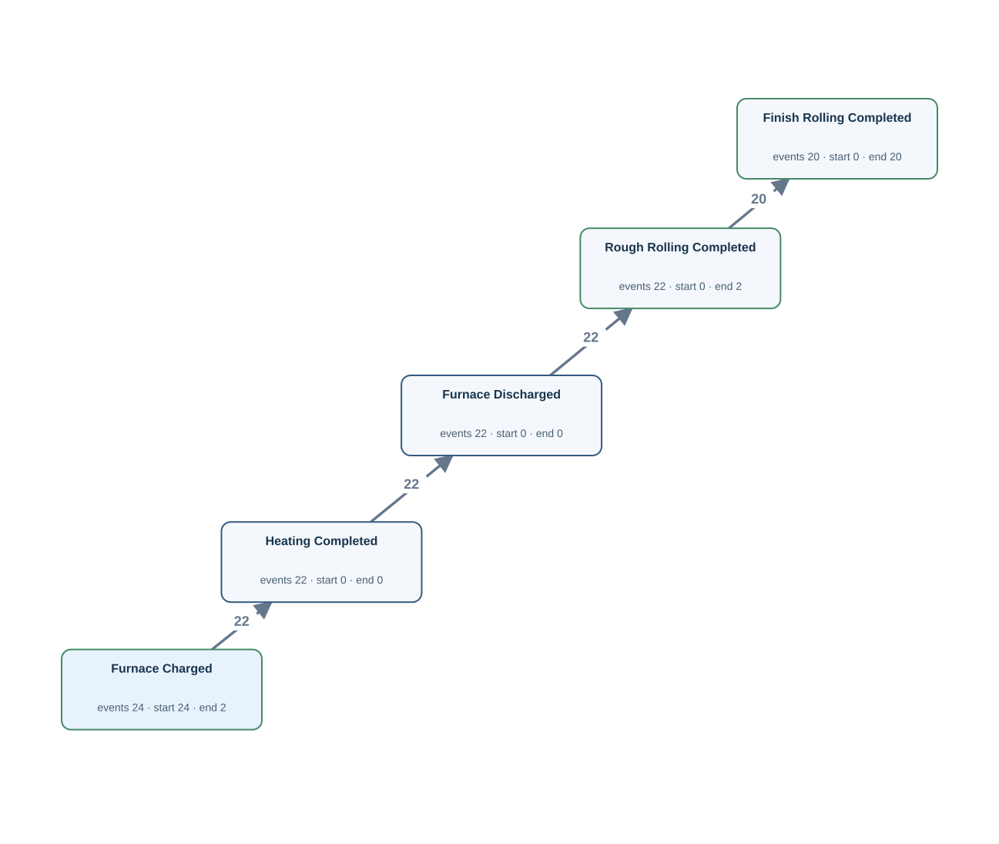</a></td><td width="58%" valign="top">
<a href="../../../datasets/plateflow_new/private/gold_sql/N04.sql">Gold SQL</a> · <a href="../../../datasets/plateflow_new/private/gold_logs/N04.csv">Gold CSV</a> · <a href="../../../datasets/plateflow_new/input/database.sqlite">Full source database (SQLite)</a>

<code>furnace_operation_history</code> · 68 matched source rows
<table><tr><th>Column</th><th>Row 1</th><th>Row 2</th><th>Row 3</th></tr><tr><th>operation_id</th><td>0001</td><td>0002</td><td>0003</td></tr><tr><th>material_id</th><td>M007</td><td>M007</td><td>M007</td></tr><tr><th>process_group</th><td>FURNACE</td><td>FURNACE</td><td>FURNACE</td></tr><tr><th>operation_code</th><td>CH</td><td>HT</td><td>DS</td></tr><tr><th>equipment_id</th><td>FU2</td><td>FU2</td><td>FU2</td></tr><tr><th>started_at</th><td>2026-01-25T08:30:00Z</td><td>2026-01-25T08:45:00Z</td><td>2026-01-25T09:25:00Z</td></tr><tr><th>finished_at</th><td>2026-01-25T08:40:00Z</td><td>2026-01-25T09:20:00Z</td><td>2026-01-25T09:30:00Z</td></tr></table>
<strong>Gold output for the same source rows</strong>
<ul><li>Row 1 → Furnace Charged · event FOP:0001 · case M:M007 · time from <code>finished_at</code></li><li>Row 2 → Heating Completed · event FOP:0002 · case M:M007 · time from <code>finished_at</code></li><li>Row 3 → Furnace Discharged · event FOP:0003 · case M:M007 · time from <code>finished_at</code></li></ul>

<code>rolling_operation_history</code> · 42 matched source rows
<table><tr><th>Column</th><th>Row 1</th><th>Row 2</th><th>Row 3</th></tr><tr><th>operation_id</th><td>0001</td><td>0002</td><td>0003</td></tr><tr><th>material_id</th><td>M007</td><td>M007</td><td>M008</td></tr><tr><th>process_group</th><td>ROLLING</td><td>ROLLING</td><td>ROLLING</td></tr><tr><th>phase_code</th><td>RR</td><td>FR</td><td>RR</td></tr><tr><th>equipment_id</th><td>RO2</td><td>RO2</td><td>RO1</td></tr><tr><th>started_at</th><td>2026-01-25T09:40:00Z</td><td>2026-01-25T10:10:00Z</td><td>2026-01-28T21:00:00Z</td></tr><tr><th>finished_at</th><td>2026-01-25T10:00:00Z</td><td>2026-01-25T10:35:00Z</td><td>2026-01-28T21:20:00Z</td></tr></table>
<strong>Gold output for the same source rows</strong>
<ul><li>Row 1 → Rough Rolling Completed · event ROP:0001 · case M:M007 · time from <code>finished_at</code></li><li>Row 2 → Finish Rolling Completed · event ROP:0002 · case M:M007 · time from <code>finished_at</code></li><li>Row 3 → Rough Rolling Completed · event ROP:0003 · case M:M008 · time from <code>finished_at</code></li></ul>

FK-linked case and join evidence
<ul><li><code>furnace_operation_history</code> → <code>as_rolled_material</code> · material_id → material_id · material_id = M007</li></ul>
</td></tr></table>

## N04P — Q2

For each mother material, show the completion of charging into the furnace, heating, discharge from the furnace, rough rolling and finish rolling.

Events: **110** · Cases with events: **24** · Activities: **5** · Edges: **4** · Source tables: **2** · SQL tables: **3**

<table><tr><td width="42%" valign="top"></td><td width="58%" valign="top">
<a href="../../../datasets/plateflow_new/private/gold_sql/N04P.sql">Gold SQL</a> · <a href="../../../datasets/plateflow_new/private/gold_logs/N04P.csv">Gold CSV</a> · <a href="../../../datasets/plateflow_new/input/database.sqlite">Full source database (SQLite)</a>

<code>furnace_operation_history</code> · 68 matched source rows
<table><tr><th>Column</th><th>Row 1</th><th>Row 2</th><th>Row 3</th></tr><tr><th>operation_id</th><td>0001</td><td>0002</td><td>0003</td></tr><tr><th>material_id</th><td>M007</td><td>M007</td><td>M007</td></tr><tr><th>process_group</th><td>FURNACE</td><td>FURNACE</td><td>FURNACE</td></tr><tr><th>operation_code</th><td>CH</td><td>HT</td><td>DS</td></tr><tr><th>equipment_id</th><td>FU2</td><td>FU2</td><td>FU2</td></tr><tr><th>started_at</th><td>2026-01-25T08:30:00Z</td><td>2026-01-25T08:45:00Z</td><td>2026-01-25T09:25:00Z</td></tr><tr><th>finished_at</th><td>2026-01-25T08:40:00Z</td><td>2026-01-25T09:20:00Z</td><td>2026-01-25T09:30:00Z</td></tr></table>
<strong>Gold output for the same source rows</strong>
<ul><li>Row 1 → Furnace Charged · event FOP:0001 · case M:M007 · time from <code>finished_at</code></li><li>Row 2 → Heating Completed · event FOP:0002 · case M:M007 · time from <code>finished_at</code></li><li>Row 3 → Furnace Discharged · event FOP:0003 · case M:M007 · time from <code>finished_at</code></li></ul>

<code>rolling_operation_history</code> · 42 matched source rows
<table><tr><th>Column</th><th>Row 1</th><th>Row 2</th><th>Row 3</th></tr><tr><th>operation_id</th><td>0001</td><td>0002</td><td>0003</td></tr><tr><th>material_id</th><td>M007</td><td>M007</td><td>M008</td></tr><tr><th>process_group</th><td>ROLLING</td><td>ROLLING</td><td>ROLLING</td></tr><tr><th>phase_code</th><td>RR</td><td>FR</td><td>RR</td></tr><tr><th>equipment_id</th><td>RO2</td><td>RO2</td><td>RO1</td></tr><tr><th>started_at</th><td>2026-01-25T09:40:00Z</td><td>2026-01-25T10:10:00Z</td><td>2026-01-28T21:00:00Z</td></tr><tr><th>finished_at</th><td>2026-01-25T10:00:00Z</td><td>2026-01-25T10:35:00Z</td><td>2026-01-28T21:20:00Z</td></tr></table>
<strong>Gold output for the same source rows</strong>
<ul><li>Row 1 → Rough Rolling Completed · event ROP:0001 · case M:M007 · time from <code>finished_at</code></li><li>Row 2 → Finish Rolling Completed · event ROP:0002 · case M:M007 · time from <code>finished_at</code></li><li>Row 3 → Rough Rolling Completed · event ROP:0003 · case M:M008 · time from <code>finished_at</code></li></ul>

FK-linked case and join evidence
<ul><li><code>furnace_operation_history</code> → <code>as_rolled_material</code> · material_id → material_id · material_id = M007</li></ul>
</td></tr></table>

## N05 — Q1

For each mother material, extract Heat Treatment Completed, Surface Finishing Completed and Dimensional Inspection Completed events, including those of its descendant plate pieces.

Events: **138** · Cases with events: **20** · Activities: **3** · Edges: **3** · Source tables: **2** · SQL tables: **4**

<table><tr><td width="42%" valign="top"><a href="graphs/N05.svg">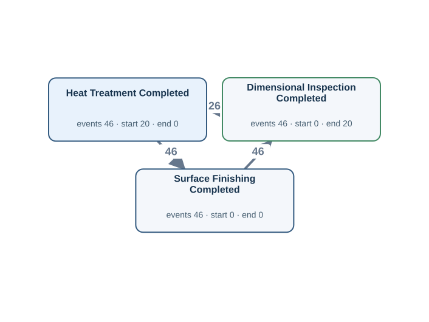</a></td><td width="58%" valign="top">
<a href="../../../datasets/plateflow_new/private/gold_sql/N05.sql">Gold SQL</a> · <a href="../../../datasets/plateflow_new/private/gold_logs/N05.csv">Gold CSV</a> · <a href="../../../datasets/plateflow_new/input/database.sqlite">Full source database (SQLite)</a>

<code>dimension_inspection</code> · 46 matched source rows
<table><tr><th>Column</th><th>Row 1</th><th>Row 2</th><th>Row 3</th></tr><tr><th>inspection_id</th><td>P007-1-1</td><td>P007-1-2</td><td>P007-2-1</td></tr><tr><th>plate_id</th><td>P007-1</td><td>P007-1</td><td>P007-2</td></tr><tr><th>inspected_at</th><td>2026-01-25T20:35:00Z</td><td>2026-01-25T21:55:00Z</td><td>2026-01-26T04:55:00Z</td></tr><tr><th>result_code</th><td>FAIL</td><td>PASS</td><td>PASS</td></tr><tr><th>thickness_mm</th><td>22.5</td><td>20.1</td><td>20.1</td></tr></table>
<strong>Gold output for the same source rows</strong>
<ul><li>Row 1 → Dimensional Inspection Completed · event DIM:P007-1-1 · case M:M007 · time from <code>inspected_at</code></li><li>Row 2 → Dimensional Inspection Completed · event DIM:P007-1-2 · case M:M007 · time from <code>inspected_at</code></li><li>Row 3 → Dimensional Inspection Completed · event DIM:P007-2-1 · case M:M007 · time from <code>inspected_at</code></li></ul>

<code>finishing_operation_history</code> · 92 matched source rows
<table><tr><th>Column</th><th>Row 1</th><th>Row 2</th><th>Row 3</th></tr><tr><th>operation_id</th><td>0002</td><td>0003</td><td>0004</td></tr><tr><th>plate_id</th><td>P007-1</td><td>P007-1</td><td>P007-1</td></tr><tr><th>process_group</th><td>FINISHING</td><td>FINISHING</td><td>FINISHING</td></tr><tr><th>operation_code</th><td>HT</td><td>SF</td><td>HT</td></tr><tr><th>equipment_id</th><td>FI1</td><td>FI1</td><td>FI1</td></tr><tr><th>started_at</th><td>2026-01-25T19:50:00Z</td><td>2026-01-25T20:15:00Z</td><td>2026-01-25T21:00:00Z</td></tr><tr><th>finished_at</th><td>2026-01-25T20:10:00Z</td><td>2026-01-25T20:25:00Z</td><td>2026-01-25T21:30:00Z</td></tr></table>
<strong>Gold output for the same source rows</strong>
<ul><li>Row 1 → Heat Treatment Completed · event TOP:0002 · case M:M007 · time from <code>finished_at</code></li><li>Row 2 → Surface Finishing Completed · event TOP:0003 · case M:M007 · time from <code>finished_at</code></li><li>Row 3 → Heat Treatment Completed · event TOP:0004 · case M:M007 · time from <code>finished_at</code></li></ul>

FK-linked case and join evidence
<ul><li><code>plate_material</code> → <code>as_rolled_material</code> · mother_material_id → material_id · material_id = M007</li><li><code>finishing_operation_history</code> → <code>plate_material</code> · plate_id → plate_id · plate_id = P007-1</li></ul>
</td></tr></table>

## N05P — Q2

For every mother material, show when heat treatment, surface finishing and dimensional inspection were completed, including work on all plate pieces derived from it.

Events: **138** · Cases with events: **20** · Activities: **3** · Edges: **3** · Source tables: **2** · SQL tables: **4**

<table><tr><td width="42%" valign="top"></td><td width="58%" valign="top">
<a href="../../../datasets/plateflow_new/private/gold_sql/N05P.sql">Gold SQL</a> · <a href="../../../datasets/plateflow_new/private/gold_logs/N05P.csv">Gold CSV</a> · <a href="../../../datasets/plateflow_new/input/database.sqlite">Full source database (SQLite)</a>

<code>dimension_inspection</code> · 46 matched source rows
<table><tr><th>Column</th><th>Row 1</th><th>Row 2</th><th>Row 3</th></tr><tr><th>inspection_id</th><td>P007-1-1</td><td>P007-1-2</td><td>P007-2-1</td></tr><tr><th>plate_id</th><td>P007-1</td><td>P007-1</td><td>P007-2</td></tr><tr><th>inspected_at</th><td>2026-01-25T20:35:00Z</td><td>2026-01-25T21:55:00Z</td><td>2026-01-26T04:55:00Z</td></tr><tr><th>result_code</th><td>FAIL</td><td>PASS</td><td>PASS</td></tr><tr><th>thickness_mm</th><td>22.5</td><td>20.1</td><td>20.1</td></tr></table>
<strong>Gold output for the same source rows</strong>
<ul><li>Row 1 → Dimensional Inspection Completed · event DIM:P007-1-1 · case M:M007 · time from <code>inspected_at</code></li><li>Row 2 → Dimensional Inspection Completed · event DIM:P007-1-2 · case M:M007 · time from <code>inspected_at</code></li><li>Row 3 → Dimensional Inspection Completed · event DIM:P007-2-1 · case M:M007 · time from <code>inspected_at</code></li></ul>

<code>finishing_operation_history</code> · 92 matched source rows
<table><tr><th>Column</th><th>Row 1</th><th>Row 2</th><th>Row 3</th></tr><tr><th>operation_id</th><td>0002</td><td>0003</td><td>0004</td></tr><tr><th>plate_id</th><td>P007-1</td><td>P007-1</td><td>P007-1</td></tr><tr><th>process_group</th><td>FINISHING</td><td>FINISHING</td><td>FINISHING</td></tr><tr><th>operation_code</th><td>HT</td><td>SF</td><td>HT</td></tr><tr><th>equipment_id</th><td>FI1</td><td>FI1</td><td>FI1</td></tr><tr><th>started_at</th><td>2026-01-25T19:50:00Z</td><td>2026-01-25T20:15:00Z</td><td>2026-01-25T21:00:00Z</td></tr><tr><th>finished_at</th><td>2026-01-25T20:10:00Z</td><td>2026-01-25T20:25:00Z</td><td>2026-01-25T21:30:00Z</td></tr></table>
<strong>Gold output for the same source rows</strong>
<ul><li>Row 1 → Heat Treatment Completed · event TOP:0002 · case M:M007 · time from <code>finished_at</code></li><li>Row 2 → Surface Finishing Completed · event TOP:0003 · case M:M007 · time from <code>finished_at</code></li><li>Row 3 → Heat Treatment Completed · event TOP:0004 · case M:M007 · time from <code>finished_at</code></li></ul>

FK-linked case and join evidence
<ul><li><code>plate_material</code> → <code>as_rolled_material</code> · mother_material_id → material_id · material_id = M007</li><li><code>finishing_operation_history</code> → <code>plate_material</code> · plate_id → plate_id · plate_id = P007-1</li></ul>
</td></tr></table>

## N06 — Q1

For each plate piece, extract Leveling Completed, Heat Treatment Completed and Surface Finishing Completed events, retaining repeated occurrences.

Events: **130** · Cases with events: **38** · Activities: **3** · Edges: **3** · Source tables: **1** · SQL tables: **3**

<table><tr><td width="42%" valign="top"><a href="graphs/N06.svg">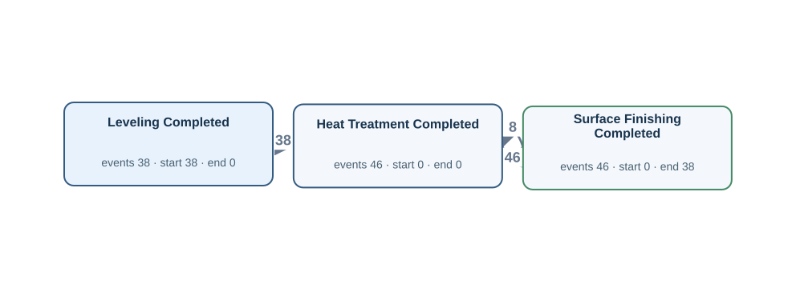</a></td><td width="58%" valign="top">
<a href="../../../datasets/plateflow_new/private/gold_sql/N06.sql">Gold SQL</a> · <a href="../../../datasets/plateflow_new/private/gold_logs/N06.csv">Gold CSV</a> · <a href="../../../datasets/plateflow_new/input/database.sqlite">Full source database (SQLite)</a>

<code>finishing_operation_history</code> · 130 matched source rows
<table><tr><th>Column</th><th>Row 1</th><th>Row 2</th><th>Row 3</th></tr><tr><th>operation_id</th><td>0001</td><td>0002</td><td>0003</td></tr><tr><th>plate_id</th><td>P007-1</td><td>P007-1</td><td>P007-1</td></tr><tr><th>process_group</th><td>FINISHING</td><td>FINISHING</td><td>FINISHING</td></tr><tr><th>operation_code</th><td>LEV</td><td>HT</td><td>SF</td></tr><tr><th>equipment_id</th><td>FI1</td><td>FI1</td><td>FI1</td></tr><tr><th>started_at</th><td>2026-01-25T19:35:00Z</td><td>2026-01-25T19:50:00Z</td><td>2026-01-25T20:15:00Z</td></tr><tr><th>finished_at</th><td>2026-01-25T19:45:00Z</td><td>2026-01-25T20:10:00Z</td><td>2026-01-25T20:25:00Z</td></tr></table>
<strong>Gold output for the same source rows</strong>
<ul><li>Row 1 → Leveling Completed · event TOP:0001 · case P:P007-1 · time from <code>finished_at</code></li><li>Row 2 → Heat Treatment Completed · event TOP:0002 · case P:P007-1 · time from <code>finished_at</code></li><li>Row 3 → Surface Finishing Completed · event TOP:0003 · case P:P007-1 · time from <code>finished_at</code></li></ul>

FK-linked case and join evidence
<ul><li><code>plate_material</code> → <code>as_rolled_material</code> · mother_material_id → material_id · material_id = M007</li><li><code>finishing_operation_history</code> → <code>plate_material</code> · plate_id → plate_id · plate_id = P007-1</li></ul>
</td></tr></table>

## N06P — Q2

For each plate piece, show every completed leveling, heat-treatment and surface-finishing operation, including repeat work.

Events: **130** · Cases with events: **38** · Activities: **3** · Edges: **3** · Source tables: **1** · SQL tables: **3**

<table><tr><td width="42%" valign="top"></td><td width="58%" valign="top">
<a href="../../../datasets/plateflow_new/private/gold_sql/N06P.sql">Gold SQL</a> · <a href="../../../datasets/plateflow_new/private/gold_logs/N06P.csv">Gold CSV</a> · <a href="../../../datasets/plateflow_new/input/database.sqlite">Full source database (SQLite)</a>

<code>finishing_operation_history</code> · 130 matched source rows
<table><tr><th>Column</th><th>Row 1</th><th>Row 2</th><th>Row 3</th></tr><tr><th>operation_id</th><td>0001</td><td>0002</td><td>0003</td></tr><tr><th>plate_id</th><td>P007-1</td><td>P007-1</td><td>P007-1</td></tr><tr><th>process_group</th><td>FINISHING</td><td>FINISHING</td><td>FINISHING</td></tr><tr><th>operation_code</th><td>LEV</td><td>HT</td><td>SF</td></tr><tr><th>equipment_id</th><td>FI1</td><td>FI1</td><td>FI1</td></tr><tr><th>started_at</th><td>2026-01-25T19:35:00Z</td><td>2026-01-25T19:50:00Z</td><td>2026-01-25T20:15:00Z</td></tr><tr><th>finished_at</th><td>2026-01-25T19:45:00Z</td><td>2026-01-25T20:10:00Z</td><td>2026-01-25T20:25:00Z</td></tr></table>
<strong>Gold output for the same source rows</strong>
<ul><li>Row 1 → Leveling Completed · event TOP:0001 · case P:P007-1 · time from <code>finished_at</code></li><li>Row 2 → Heat Treatment Completed · event TOP:0002 · case P:P007-1 · time from <code>finished_at</code></li><li>Row 3 → Surface Finishing Completed · event TOP:0003 · case P:P007-1 · time from <code>finished_at</code></li></ul>

FK-linked case and join evidence
<ul><li><code>plate_material</code> → <code>as_rolled_material</code> · mother_material_id → material_id · material_id = M007</li><li><code>finishing_operation_history</code> → <code>plate_material</code> · plate_id → plate_id · plate_id = P007-1</li></ul>
</td></tr></table>

## N07 — Q1

For each plate piece, extract Dimensional Inspection Completed and Plate Quality Review Completed events.

Events: **89** · Cases with events: **38** · Activities: **2** · Edges: **2** · Source tables: **2** · SQL tables: **4**

<table><tr><td width="42%" valign="top"><a href="graphs/N07.svg">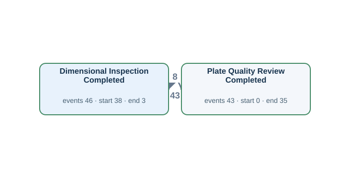</a></td><td width="58%" valign="top">
<a href="../../../datasets/plateflow_new/private/gold_sql/N07.sql">Gold SQL</a> · <a href="../../../datasets/plateflow_new/private/gold_logs/N07.csv">Gold CSV</a> · <a href="../../../datasets/plateflow_new/input/database.sqlite">Full source database (SQLite)</a>

<code>dimension_inspection</code> · 46 matched source rows
<table><tr><th>Column</th><th>Row 1</th><th>Row 2</th><th>Row 3</th></tr><tr><th>inspection_id</th><td>P007-1-1</td><td>P007-1-2</td><td>P007-2-1</td></tr><tr><th>plate_id</th><td>P007-1</td><td>P007-1</td><td>P007-2</td></tr><tr><th>inspected_at</th><td>2026-01-25T20:35:00Z</td><td>2026-01-25T21:55:00Z</td><td>2026-01-26T04:55:00Z</td></tr><tr><th>result_code</th><td>FAIL</td><td>PASS</td><td>PASS</td></tr><tr><th>thickness_mm</th><td>22.5</td><td>20.1</td><td>20.1</td></tr></table>
<strong>Gold output for the same source rows</strong>
<ul><li>Row 1 → Dimensional Inspection Completed · event DIM:P007-1-1 · case P:P007-1 · time from <code>inspected_at</code></li><li>Row 2 → Dimensional Inspection Completed · event DIM:P007-1-2 · case P:P007-1 · time from <code>inspected_at</code></li><li>Row 3 → Dimensional Inspection Completed · event DIM:P007-2-1 · case P:P007-2 · time from <code>inspected_at</code></li></ul>

<code>plate_quality_review</code> · 43 matched source rows
<table><tr><th>Column</th><th>Row 1</th><th>Row 2</th><th>Row 3</th></tr><tr><th>review_id</th><td>P007-1-1</td><td>P007-1-2</td><td>P007-2-1</td></tr><tr><th>plate_id</th><td>P007-1</td><td>P007-1</td><td>P007-2</td></tr><tr><th>started_at</th><td>2026-01-25T20:40:00Z</td><td>2026-01-25T22:00:00Z</td><td>2026-01-26T05:00:00Z</td></tr><tr><th>finished_at</th><td>2026-01-25T20:50:00Z</td><td>2026-01-25T22:15:00Z</td><td>2026-01-26T05:10:00Z</td></tr><tr><th>review_status</th><td>REWORK</td><td>APPROVED</td><td>APPROVED</td></tr></table>
<strong>Gold output for the same source rows</strong>
<ul><li>Row 1 → Plate Quality Review Completed · event REV:P007-1-1 · case P:P007-1 · time from <code>finished_at</code></li><li>Row 2 → Plate Quality Review Completed · event REV:P007-1-2 · case P:P007-1 · time from <code>finished_at</code></li><li>Row 3 → Plate Quality Review Completed · event REV:P007-2-1 · case P:P007-2 · time from <code>finished_at</code></li></ul>

FK-linked case and join evidence
<ul><li><code>plate_material</code> → <code>as_rolled_material</code> · mother_material_id → material_id · material_id = M007</li><li><code>dimension_inspection</code> → <code>plate_material</code> · plate_id → plate_id · plate_id = P007-1</li></ul>
</td></tr></table>

## N07P — Q2

For every plate piece, show when its dimensional inspections and quality reviews finished.

Events: **89** · Cases with events: **38** · Activities: **2** · Edges: **2** · Source tables: **2** · SQL tables: **4**

<table><tr><td width="42%" valign="top"></td><td width="58%" valign="top">
<a href="../../../datasets/plateflow_new/private/gold_sql/N07P.sql">Gold SQL</a> · <a href="../../../datasets/plateflow_new/private/gold_logs/N07P.csv">Gold CSV</a> · <a href="../../../datasets/plateflow_new/input/database.sqlite">Full source database (SQLite)</a>

<code>dimension_inspection</code> · 46 matched source rows
<table><tr><th>Column</th><th>Row 1</th><th>Row 2</th><th>Row 3</th></tr><tr><th>inspection_id</th><td>P007-1-1</td><td>P007-1-2</td><td>P007-2-1</td></tr><tr><th>plate_id</th><td>P007-1</td><td>P007-1</td><td>P007-2</td></tr><tr><th>inspected_at</th><td>2026-01-25T20:35:00Z</td><td>2026-01-25T21:55:00Z</td><td>2026-01-26T04:55:00Z</td></tr><tr><th>result_code</th><td>FAIL</td><td>PASS</td><td>PASS</td></tr><tr><th>thickness_mm</th><td>22.5</td><td>20.1</td><td>20.1</td></tr></table>
<strong>Gold output for the same source rows</strong>
<ul><li>Row 1 → Dimensional Inspection Completed · event DIM:P007-1-1 · case P:P007-1 · time from <code>inspected_at</code></li><li>Row 2 → Dimensional Inspection Completed · event DIM:P007-1-2 · case P:P007-1 · time from <code>inspected_at</code></li><li>Row 3 → Dimensional Inspection Completed · event DIM:P007-2-1 · case P:P007-2 · time from <code>inspected_at</code></li></ul>

<code>plate_quality_review</code> · 43 matched source rows
<table><tr><th>Column</th><th>Row 1</th><th>Row 2</th><th>Row 3</th></tr><tr><th>review_id</th><td>P007-1-1</td><td>P007-1-2</td><td>P007-2-1</td></tr><tr><th>plate_id</th><td>P007-1</td><td>P007-1</td><td>P007-2</td></tr><tr><th>started_at</th><td>2026-01-25T20:40:00Z</td><td>2026-01-25T22:00:00Z</td><td>2026-01-26T05:00:00Z</td></tr><tr><th>finished_at</th><td>2026-01-25T20:50:00Z</td><td>2026-01-25T22:15:00Z</td><td>2026-01-26T05:10:00Z</td></tr><tr><th>review_status</th><td>REWORK</td><td>APPROVED</td><td>APPROVED</td></tr></table>
<strong>Gold output for the same source rows</strong>
<ul><li>Row 1 → Plate Quality Review Completed · event REV:P007-1-1 · case P:P007-1 · time from <code>finished_at</code></li><li>Row 2 → Plate Quality Review Completed · event REV:P007-1-2 · case P:P007-1 · time from <code>finished_at</code></li><li>Row 3 → Plate Quality Review Completed · event REV:P007-2-1 · case P:P007-2 · time from <code>finished_at</code></li></ul>

FK-linked case and join evidence
<ul><li><code>plate_material</code> → <code>as_rolled_material</code> · mother_material_id → material_id · material_id = M007</li><li><code>dimension_inspection</code> → <code>plate_material</code> · plate_id → plate_id · plate_id = P007-1</li></ul>
</td></tr></table>

## N08 — Q1

For each plate piece, extract Plate Identified, Plate Released and Plate Packed events.

Events: **99** · Cases with events: **38** · Activities: **3** · Edges: **2** · Source tables: **1** · SQL tables: **2**

<table><tr><td width="42%" valign="top"><a href="graphs/N08.svg">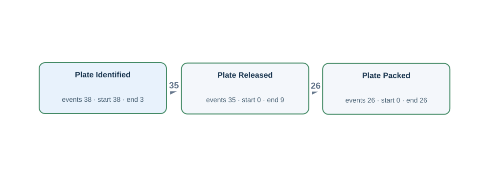</a></td><td width="58%" valign="top">
<a href="../../../datasets/plateflow_new/private/gold_sql/N08.sql">Gold SQL</a> · <a href="../../../datasets/plateflow_new/private/gold_logs/N08.csv">Gold CSV</a> · <a href="../../../datasets/plateflow_new/input/database.sqlite">Full source database (SQLite)</a>

<code>plate_material</code> · 38 matched source rows
<table><tr><th>Column</th><th>Row 1</th><th>Row 2</th><th>Row 3</th></tr><tr><th>plate_id</th><td>P007-1</td><td>P007-2</td><td>P008-1</td></tr><tr><th>plate_no</th><td>PIECE-7-1</td><td>PIECE-7-2</td><td>PIECE-8-1</td></tr><tr><th>mother_material_id</th><td>M007</td><td>M007</td><td>M008</td></tr><tr><th>identified_at</th><td>2026-01-25T19:30:00Z</td><td>2026-01-26T03:50:00Z</td><td>2026-01-29T06:50:00Z</td></tr><tr><th>released_at</th><td>2026-01-25T22:30:00Z</td><td>2026-01-26T05:30:00Z</td><td>2026-01-29T08:30:00Z</td></tr><tr><th>packed_at</th><td>2026-01-25T22:50:00Z</td><td>2026-01-26T05:50:00Z</td><td>2026-01-29T08:50:00Z</td></tr></table>
<strong>Gold output for the same source rows</strong>
<ul><li>Row 1 → Plate Identified · event PLATE:P007-1:identified · case P:P007-1 · time from <code>identified_at</code></li><li>Row 1 → Plate Packed · event PLATE:P007-1:packed · case P:P007-1 · time from <code>packed_at</code></li><li>Row 1 → Plate Released · event PLATE:P007-1:released · case P:P007-1 · time from <code>released_at</code></li><li>Row 2 → Plate Identified · event PLATE:P007-2:identified · case P:P007-2 · time from <code>identified_at</code></li><li>Row 2 → Plate Packed · event PLATE:P007-2:packed · case P:P007-2 · time from <code>packed_at</code></li><li>Row 2 → Plate Released · event PLATE:P007-2:released · case P:P007-2 · time from <code>released_at</code></li><li>Row 3 → Plate Identified · event PLATE:P008-1:identified · case P:P008-1 · time from <code>identified_at</code></li><li>Row 3 → Plate Packed · event PLATE:P008-1:packed · case P:P008-1 · time from <code>packed_at</code></li><li>Row 3 → Plate Released · event PLATE:P008-1:released · case P:P008-1 · time from <code>released_at</code></li></ul>

FK-linked case and join evidence
<ul><li><code>plate_material</code> → <code>as_rolled_material</code> · mother_material_id → material_id · material_id = M007</li></ul>
</td></tr></table>

## N08P — Q2

For each plate piece, show when it was identified, released and packed.

Events: **99** · Cases with events: **38** · Activities: **3** · Edges: **2** · Source tables: **1** · SQL tables: **2**

<table><tr><td width="42%" valign="top"></td><td width="58%" valign="top">
<a href="../../../datasets/plateflow_new/private/gold_sql/N08P.sql">Gold SQL</a> · <a href="../../../datasets/plateflow_new/private/gold_logs/N08P.csv">Gold CSV</a> · <a href="../../../datasets/plateflow_new/input/database.sqlite">Full source database (SQLite)</a>

<code>plate_material</code> · 38 matched source rows
<table><tr><th>Column</th><th>Row 1</th><th>Row 2</th><th>Row 3</th></tr><tr><th>plate_id</th><td>P007-1</td><td>P007-2</td><td>P008-1</td></tr><tr><th>plate_no</th><td>PIECE-7-1</td><td>PIECE-7-2</td><td>PIECE-8-1</td></tr><tr><th>mother_material_id</th><td>M007</td><td>M007</td><td>M008</td></tr><tr><th>identified_at</th><td>2026-01-25T19:30:00Z</td><td>2026-01-26T03:50:00Z</td><td>2026-01-29T06:50:00Z</td></tr><tr><th>released_at</th><td>2026-01-25T22:30:00Z</td><td>2026-01-26T05:30:00Z</td><td>2026-01-29T08:30:00Z</td></tr><tr><th>packed_at</th><td>2026-01-25T22:50:00Z</td><td>2026-01-26T05:50:00Z</td><td>2026-01-29T08:50:00Z</td></tr></table>
<strong>Gold output for the same source rows</strong>
<ul><li>Row 1 → Plate Identified · event PLATE:P007-1:identified · case P:P007-1 · time from <code>identified_at</code></li><li>Row 1 → Plate Packed · event PLATE:P007-1:packed · case P:P007-1 · time from <code>packed_at</code></li><li>Row 1 → Plate Released · event PLATE:P007-1:released · case P:P007-1 · time from <code>released_at</code></li><li>Row 2 → Plate Identified · event PLATE:P007-2:identified · case P:P007-2 · time from <code>identified_at</code></li><li>Row 2 → Plate Packed · event PLATE:P007-2:packed · case P:P007-2 · time from <code>packed_at</code></li><li>Row 2 → Plate Released · event PLATE:P007-2:released · case P:P007-2 · time from <code>released_at</code></li><li>Row 3 → Plate Identified · event PLATE:P008-1:identified · case P:P008-1 · time from <code>identified_at</code></li><li>Row 3 → Plate Packed · event PLATE:P008-1:packed · case P:P008-1 · time from <code>packed_at</code></li><li>Row 3 → Plate Released · event PLATE:P008-1:released · case P:P008-1 · time from <code>released_at</code></li></ul>

FK-linked case and join evidence
<ul><li><code>plate_material</code> → <code>as_rolled_material</code> · mother_material_id → material_id · material_id = M007</li></ul>
</td></tr></table>

## N09 — Q1

For each dimension inspection record, extract Dimensional Inspection Completed events.

Events: **46** · Cases with events: **46** · Activities: **1** · Edges: **0** · Source tables: **1** · SQL tables: **1**

<table><tr><td width="42%" valign="top"><a href="graphs/N09.svg">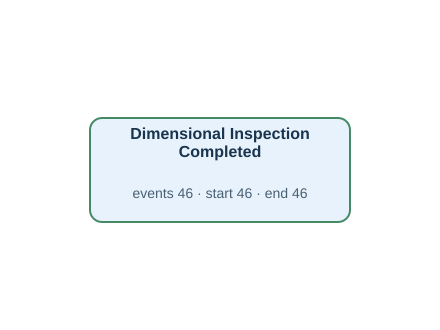</a></td><td width="58%" valign="top">
<a href="../../../datasets/plateflow_new/private/gold_sql/N09.sql">Gold SQL</a> · <a href="../../../datasets/plateflow_new/private/gold_logs/N09.csv">Gold CSV</a> · <a href="../../../datasets/plateflow_new/input/database.sqlite">Full source database (SQLite)</a>

<code>dimension_inspection</code> · 46 matched source rows
<table><tr><th>Column</th><th>Row 1</th><th>Row 2</th><th>Row 3</th></tr><tr><th>inspection_id</th><td>P007-1-1</td><td>P007-1-2</td><td>P007-2-1</td></tr><tr><th>plate_id</th><td>P007-1</td><td>P007-1</td><td>P007-2</td></tr><tr><th>inspected_at</th><td>2026-01-25T20:35:00Z</td><td>2026-01-25T21:55:00Z</td><td>2026-01-26T04:55:00Z</td></tr><tr><th>result_code</th><td>FAIL</td><td>PASS</td><td>PASS</td></tr><tr><th>thickness_mm</th><td>22.5</td><td>20.1</td><td>20.1</td></tr></table>
<strong>Gold output for the same source rows</strong>
<ul><li>Row 1 → Dimensional Inspection Completed · event DIM:P007-1-1 · case DIM:P007-1-1 · time from <code>inspected_at</code></li><li>Row 2 → Dimensional Inspection Completed · event DIM:P007-1-2 · case DIM:P007-1-2 · time from <code>inspected_at</code></li><li>Row 3 → Dimensional Inspection Completed · event DIM:P007-2-1 · case DIM:P007-2-1 · time from <code>inspected_at</code></li></ul>
</td></tr></table>

## N09P — Q2

For each individual dimensional inspection record, show when the inspection finished.

Events: **46** · Cases with events: **46** · Activities: **1** · Edges: **0** · Source tables: **1** · SQL tables: **1**

<table><tr><td width="42%" valign="top"></td><td width="58%" valign="top">
<a href="../../../datasets/plateflow_new/private/gold_sql/N09P.sql">Gold SQL</a> · <a href="../../../datasets/plateflow_new/private/gold_logs/N09P.csv">Gold CSV</a> · <a href="../../../datasets/plateflow_new/input/database.sqlite">Full source database (SQLite)</a>

<code>dimension_inspection</code> · 46 matched source rows
<table><tr><th>Column</th><th>Row 1</th><th>Row 2</th><th>Row 3</th></tr><tr><th>inspection_id</th><td>P007-1-1</td><td>P007-1-2</td><td>P007-2-1</td></tr><tr><th>plate_id</th><td>P007-1</td><td>P007-1</td><td>P007-2</td></tr><tr><th>inspected_at</th><td>2026-01-25T20:35:00Z</td><td>2026-01-25T21:55:00Z</td><td>2026-01-26T04:55:00Z</td></tr><tr><th>result_code</th><td>FAIL</td><td>PASS</td><td>PASS</td></tr><tr><th>thickness_mm</th><td>22.5</td><td>20.1</td><td>20.1</td></tr></table>
<strong>Gold output for the same source rows</strong>
<ul><li>Row 1 → Dimensional Inspection Completed · event DIM:P007-1-1 · case DIM:P007-1-1 · time from <code>inspected_at</code></li><li>Row 2 → Dimensional Inspection Completed · event DIM:P007-1-2 · case DIM:P007-1-2 · time from <code>inspected_at</code></li><li>Row 3 → Dimensional Inspection Completed · event DIM:P007-2-1 · case DIM:P007-2-1 · time from <code>inspected_at</code></li></ul>
</td></tr></table>

## N10 — Q1

For each quality review record, extract Plate Quality Review Completed events.

Events: **43** · Cases with events: **43** · Activities: **1** · Edges: **0** · Source tables: **1** · SQL tables: **1**

<table><tr><td width="42%" valign="top"><a href="graphs/N10.svg">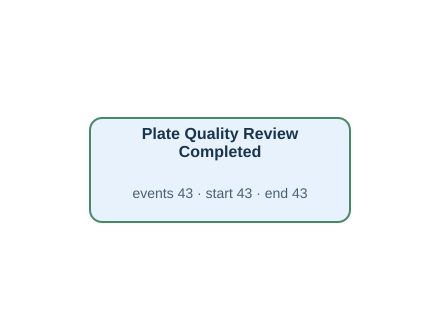</a></td><td width="58%" valign="top">
<a href="../../../datasets/plateflow_new/private/gold_sql/N10.sql">Gold SQL</a> · <a href="../../../datasets/plateflow_new/private/gold_logs/N10.csv">Gold CSV</a> · <a href="../../../datasets/plateflow_new/input/database.sqlite">Full source database (SQLite)</a>

<code>plate_quality_review</code> · 43 matched source rows
<table><tr><th>Column</th><th>Row 1</th><th>Row 2</th><th>Row 3</th></tr><tr><th>review_id</th><td>P007-1-1</td><td>P007-1-2</td><td>P007-2-1</td></tr><tr><th>plate_id</th><td>P007-1</td><td>P007-1</td><td>P007-2</td></tr><tr><th>started_at</th><td>2026-01-25T20:40:00Z</td><td>2026-01-25T22:00:00Z</td><td>2026-01-26T05:00:00Z</td></tr><tr><th>finished_at</th><td>2026-01-25T20:50:00Z</td><td>2026-01-25T22:15:00Z</td><td>2026-01-26T05:10:00Z</td></tr><tr><th>review_status</th><td>REWORK</td><td>APPROVED</td><td>APPROVED</td></tr></table>
<strong>Gold output for the same source rows</strong>
<ul><li>Row 1 → Plate Quality Review Completed · event REV:P007-1-1 · case REV:P007-1-1 · time from <code>finished_at</code></li><li>Row 2 → Plate Quality Review Completed · event REV:P007-1-2 · case REV:P007-1-2 · time from <code>finished_at</code></li><li>Row 3 → Plate Quality Review Completed · event REV:P007-2-1 · case REV:P007-2-1 · time from <code>finished_at</code></li></ul>
</td></tr></table>

## N10P — Q2

For each individual quality review record, show when the review finished.

Events: **43** · Cases with events: **43** · Activities: **1** · Edges: **0** · Source tables: **1** · SQL tables: **1**

<table><tr><td width="42%" valign="top"></td><td width="58%" valign="top">
<a href="../../../datasets/plateflow_new/private/gold_sql/N10P.sql">Gold SQL</a> · <a href="../../../datasets/plateflow_new/private/gold_logs/N10P.csv">Gold CSV</a> · <a href="../../../datasets/plateflow_new/input/database.sqlite">Full source database (SQLite)</a>

<code>plate_quality_review</code> · 43 matched source rows
<table><tr><th>Column</th><th>Row 1</th><th>Row 2</th><th>Row 3</th></tr><tr><th>review_id</th><td>P007-1-1</td><td>P007-1-2</td><td>P007-2-1</td></tr><tr><th>plate_id</th><td>P007-1</td><td>P007-1</td><td>P007-2</td></tr><tr><th>started_at</th><td>2026-01-25T20:40:00Z</td><td>2026-01-25T22:00:00Z</td><td>2026-01-26T05:00:00Z</td></tr><tr><th>finished_at</th><td>2026-01-25T20:50:00Z</td><td>2026-01-25T22:15:00Z</td><td>2026-01-26T05:10:00Z</td></tr><tr><th>review_status</th><td>REWORK</td><td>APPROVED</td><td>APPROVED</td></tr></table>
<strong>Gold output for the same source rows</strong>
<ul><li>Row 1 → Plate Quality Review Completed · event REV:P007-1-1 · case REV:P007-1-1 · time from <code>finished_at</code></li><li>Row 2 → Plate Quality Review Completed · event REV:P007-1-2 · case REV:P007-1-2 · time from <code>finished_at</code></li><li>Row 3 → Plate Quality Review Completed · event REV:P007-2-1 · case REV:P007-2-1 · time from <code>finished_at</code></li></ul>
</td></tr></table>

## N11 — Q1

For each equipment unit, extract Heating Completed and Heat Treatment Completed events.

Events: **68** · Cases with events: **4** · Activities: **2** · Edges: **2** · Source tables: **2** · SQL tables: **2**

<table><tr><td width="42%" valign="top"><a href="graphs/N11.svg">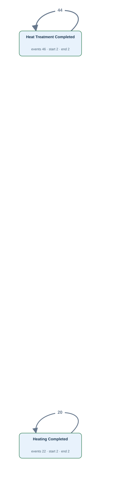</a></td><td width="58%" valign="top">
<a href="../../../datasets/plateflow_new/private/gold_sql/N11.sql">Gold SQL</a> · <a href="../../../datasets/plateflow_new/private/gold_logs/N11.csv">Gold CSV</a> · <a href="../../../datasets/plateflow_new/input/database.sqlite">Full source database (SQLite)</a>

<code>finishing_operation_history</code> · 46 matched source rows
<table><tr><th>Column</th><th>Row 1</th><th>Row 2</th><th>Row 3</th></tr><tr><th>operation_id</th><td>0002</td><td>0004</td><td>0013</td></tr><tr><th>plate_id</th><td>P007-1</td><td>P007-1</td><td>P008-2</td></tr><tr><th>process_group</th><td>FINISHING</td><td>FINISHING</td><td>FINISHING</td></tr><tr><th>operation_code</th><td>HT</td><td>HT</td><td>HT</td></tr><tr><th>equipment_id</th><td>FI1</td><td>FI1</td><td>FI1</td></tr><tr><th>started_at</th><td>2026-01-25T19:50:00Z</td><td>2026-01-25T21:00:00Z</td><td>2026-01-29T15:30:00Z</td></tr><tr><th>finished_at</th><td>2026-01-25T20:10:00Z</td><td>2026-01-25T21:30:00Z</td><td>2026-01-29T15:50:00Z</td></tr></table>
<strong>Gold output for the same source rows</strong>
<ul><li>Row 1 → Heat Treatment Completed · event TOP:0002 · case E:FI1 · time from <code>finished_at</code></li><li>Row 2 → Heat Treatment Completed · event TOP:0004 · case E:FI1 · time from <code>finished_at</code></li><li>Row 3 → Heat Treatment Completed · event TOP:0013 · case E:FI1 · time from <code>finished_at</code></li></ul>

<code>furnace_operation_history</code> · 22 matched source rows
<table><tr><th>Column</th><th>Row 1</th><th>Row 2</th><th>Row 3</th></tr><tr><th>operation_id</th><td>0005</td><td>0011</td><td>0016</td></tr><tr><th>material_id</th><td>M008</td><td>M010</td><td>M012</td></tr><tr><th>process_group</th><td>FURNACE</td><td>FURNACE</td><td>FURNACE</td></tr><tr><th>operation_code</th><td>HT</td><td>HT</td><td>HT</td></tr><tr><th>equipment_id</th><td>FU1</td><td>FU1</td><td>FU1</td></tr><tr><th>started_at</th><td>2026-01-28T20:05:00Z</td><td>2026-02-04T18:45:00Z</td><td>2026-02-11T17:25:00Z</td></tr><tr><th>finished_at</th><td>2026-01-28T20:40:00Z</td><td>2026-02-04T19:20:00Z</td><td>2026-02-11T18:00:00Z</td></tr></table>
<strong>Gold output for the same source rows</strong>
<ul><li>Row 1 → Heating Completed · event FOP:0005 · case E:FU1 · time from <code>finished_at</code></li><li>Row 2 → Heating Completed · event FOP:0011 · case E:FU1 · time from <code>finished_at</code></li><li>Row 3 → Heating Completed · event FOP:0016 · case E:FU1 · time from <code>finished_at</code></li></ul>
</td></tr></table>

## N11P — Q2

For each equipment unit, show the completion of heating and of heat treatment.

Events: **68** · Cases with events: **4** · Activities: **2** · Edges: **2** · Source tables: **2** · SQL tables: **2**

<table><tr><td width="42%" valign="top"></td><td width="58%" valign="top">
<a href="../../../datasets/plateflow_new/private/gold_sql/N11P.sql">Gold SQL</a> · <a href="../../../datasets/plateflow_new/private/gold_logs/N11P.csv">Gold CSV</a> · <a href="../../../datasets/plateflow_new/input/database.sqlite">Full source database (SQLite)</a>

<code>finishing_operation_history</code> · 46 matched source rows
<table><tr><th>Column</th><th>Row 1</th><th>Row 2</th><th>Row 3</th></tr><tr><th>operation_id</th><td>0002</td><td>0004</td><td>0013</td></tr><tr><th>plate_id</th><td>P007-1</td><td>P007-1</td><td>P008-2</td></tr><tr><th>process_group</th><td>FINISHING</td><td>FINISHING</td><td>FINISHING</td></tr><tr><th>operation_code</th><td>HT</td><td>HT</td><td>HT</td></tr><tr><th>equipment_id</th><td>FI1</td><td>FI1</td><td>FI1</td></tr><tr><th>started_at</th><td>2026-01-25T19:50:00Z</td><td>2026-01-25T21:00:00Z</td><td>2026-01-29T15:30:00Z</td></tr><tr><th>finished_at</th><td>2026-01-25T20:10:00Z</td><td>2026-01-25T21:30:00Z</td><td>2026-01-29T15:50:00Z</td></tr></table>
<strong>Gold output for the same source rows</strong>
<ul><li>Row 1 → Heat Treatment Completed · event TOP:0002 · case E:FI1 · time from <code>finished_at</code></li><li>Row 2 → Heat Treatment Completed · event TOP:0004 · case E:FI1 · time from <code>finished_at</code></li><li>Row 3 → Heat Treatment Completed · event TOP:0013 · case E:FI1 · time from <code>finished_at</code></li></ul>

<code>furnace_operation_history</code> · 22 matched source rows
<table><tr><th>Column</th><th>Row 1</th><th>Row 2</th><th>Row 3</th></tr><tr><th>operation_id</th><td>0005</td><td>0011</td><td>0016</td></tr><tr><th>material_id</th><td>M008</td><td>M010</td><td>M012</td></tr><tr><th>process_group</th><td>FURNACE</td><td>FURNACE</td><td>FURNACE</td></tr><tr><th>operation_code</th><td>HT</td><td>HT</td><td>HT</td></tr><tr><th>equipment_id</th><td>FU1</td><td>FU1</td><td>FU1</td></tr><tr><th>started_at</th><td>2026-01-28T20:05:00Z</td><td>2026-02-04T18:45:00Z</td><td>2026-02-11T17:25:00Z</td></tr><tr><th>finished_at</th><td>2026-01-28T20:40:00Z</td><td>2026-02-04T19:20:00Z</td><td>2026-02-11T18:00:00Z</td></tr></table>
<strong>Gold output for the same source rows</strong>
<ul><li>Row 1 → Heating Completed · event FOP:0005 · case E:FU1 · time from <code>finished_at</code></li><li>Row 2 → Heating Completed · event FOP:0011 · case E:FU1 · time from <code>finished_at</code></li><li>Row 3 → Heating Completed · event FOP:0016 · case E:FU1 · time from <code>finished_at</code></li></ul>
</td></tr></table>

## N12 — Q1

For each furnace operation record, extract Furnace Charged, Heating Completed and Furnace Discharged events.

Events: **68** · Cases with events: **68** · Activities: **3** · Edges: **0** · Source tables: **1** · SQL tables: **1**

<table><tr><td width="42%" valign="top"><a href="graphs/N12.svg">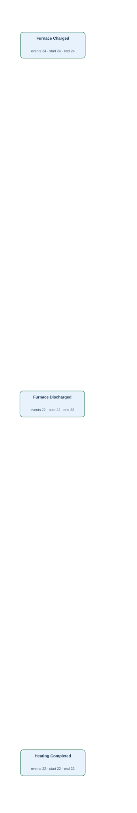</a></td><td width="58%" valign="top">
<a href="../../../datasets/plateflow_new/private/gold_sql/N12.sql">Gold SQL</a> · <a href="../../../datasets/plateflow_new/private/gold_logs/N12.csv">Gold CSV</a> · <a href="../../../datasets/plateflow_new/input/database.sqlite">Full source database (SQLite)</a>

<code>furnace_operation_history</code> · 68 matched source rows
<table><tr><th>Column</th><th>Row 1</th><th>Row 2</th><th>Row 3</th></tr><tr><th>operation_id</th><td>0001</td><td>0002</td><td>0003</td></tr><tr><th>material_id</th><td>M007</td><td>M007</td><td>M007</td></tr><tr><th>process_group</th><td>FURNACE</td><td>FURNACE</td><td>FURNACE</td></tr><tr><th>operation_code</th><td>CH</td><td>HT</td><td>DS</td></tr><tr><th>equipment_id</th><td>FU2</td><td>FU2</td><td>FU2</td></tr><tr><th>started_at</th><td>2026-01-25T08:30:00Z</td><td>2026-01-25T08:45:00Z</td><td>2026-01-25T09:25:00Z</td></tr><tr><th>finished_at</th><td>2026-01-25T08:40:00Z</td><td>2026-01-25T09:20:00Z</td><td>2026-01-25T09:30:00Z</td></tr></table>
<strong>Gold output for the same source rows</strong>
<ul><li>Row 1 → Furnace Charged · event FOP:0001 · case FOP:0001 · time from <code>finished_at</code></li><li>Row 2 → Heating Completed · event FOP:0002 · case FOP:0002 · time from <code>finished_at</code></li><li>Row 3 → Furnace Discharged · event FOP:0003 · case FOP:0003 · time from <code>finished_at</code></li></ul>
</td></tr></table>

## N12P — Q2

For every furnace operation record, show the recorded completion of furnace charging, heating or furnace discharge, as applicable.

Events: **68** · Cases with events: **68** · Activities: **3** · Edges: **0** · Source tables: **1** · SQL tables: **1**

<table><tr><td width="42%" valign="top"></td><td width="58%" valign="top">
<a href="../../../datasets/plateflow_new/private/gold_sql/N12P.sql">Gold SQL</a> · <a href="../../../datasets/plateflow_new/private/gold_logs/N12P.csv">Gold CSV</a> · <a href="../../../datasets/plateflow_new/input/database.sqlite">Full source database (SQLite)</a>

<code>furnace_operation_history</code> · 68 matched source rows
<table><tr><th>Column</th><th>Row 1</th><th>Row 2</th><th>Row 3</th></tr><tr><th>operation_id</th><td>0001</td><td>0002</td><td>0003</td></tr><tr><th>material_id</th><td>M007</td><td>M007</td><td>M007</td></tr><tr><th>process_group</th><td>FURNACE</td><td>FURNACE</td><td>FURNACE</td></tr><tr><th>operation_code</th><td>CH</td><td>HT</td><td>DS</td></tr><tr><th>equipment_id</th><td>FU2</td><td>FU2</td><td>FU2</td></tr><tr><th>started_at</th><td>2026-01-25T08:30:00Z</td><td>2026-01-25T08:45:00Z</td><td>2026-01-25T09:25:00Z</td></tr><tr><th>finished_at</th><td>2026-01-25T08:40:00Z</td><td>2026-01-25T09:20:00Z</td><td>2026-01-25T09:30:00Z</td></tr></table>
<strong>Gold output for the same source rows</strong>
<ul><li>Row 1 → Furnace Charged · event FOP:0001 · case FOP:0001 · time from <code>finished_at</code></li><li>Row 2 → Heating Completed · event FOP:0002 · case FOP:0002 · time from <code>finished_at</code></li><li>Row 3 → Furnace Discharged · event FOP:0003 · case FOP:0003 · time from <code>finished_at</code></li></ul>
</td></tr></table>

## N13 — Q1

For each rolling operation record, extract Rough Rolling Completed and Finish Rolling Completed events.

Events: **42** · Cases with events: **42** · Activities: **2** · Edges: **0** · Source tables: **1** · SQL tables: **1**

<table><tr><td width="42%" valign="top"><a href="graphs/N13.svg">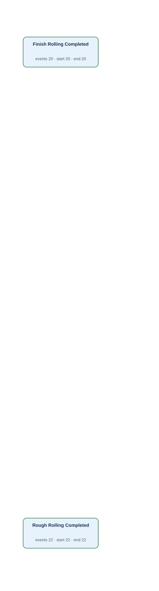</a></td><td width="58%" valign="top">
<a href="../../../datasets/plateflow_new/private/gold_sql/N13.sql">Gold SQL</a> · <a href="../../../datasets/plateflow_new/private/gold_logs/N13.csv">Gold CSV</a> · <a href="../../../datasets/plateflow_new/input/database.sqlite">Full source database (SQLite)</a>

<code>rolling_operation_history</code> · 42 matched source rows
<table><tr><th>Column</th><th>Row 1</th><th>Row 2</th><th>Row 3</th></tr><tr><th>operation_id</th><td>0001</td><td>0002</td><td>0003</td></tr><tr><th>material_id</th><td>M007</td><td>M007</td><td>M008</td></tr><tr><th>process_group</th><td>ROLLING</td><td>ROLLING</td><td>ROLLING</td></tr><tr><th>phase_code</th><td>RR</td><td>FR</td><td>RR</td></tr><tr><th>equipment_id</th><td>RO2</td><td>RO2</td><td>RO1</td></tr><tr><th>started_at</th><td>2026-01-25T09:40:00Z</td><td>2026-01-25T10:10:00Z</td><td>2026-01-28T21:00:00Z</td></tr><tr><th>finished_at</th><td>2026-01-25T10:00:00Z</td><td>2026-01-25T10:35:00Z</td><td>2026-01-28T21:20:00Z</td></tr></table>
<strong>Gold output for the same source rows</strong>
<ul><li>Row 1 → Rough Rolling Completed · event ROP:0001 · case ROP:0001 · time from <code>finished_at</code></li><li>Row 2 → Finish Rolling Completed · event ROP:0002 · case ROP:0002 · time from <code>finished_at</code></li><li>Row 3 → Rough Rolling Completed · event ROP:0003 · case ROP:0003 · time from <code>finished_at</code></li></ul>
</td></tr></table>

## N13P — Q2

For every rolling operation record, show the recorded completion of rough rolling or finish rolling, as applicable.

Events: **42** · Cases with events: **42** · Activities: **2** · Edges: **0** · Source tables: **1** · SQL tables: **1**

<table><tr><td width="42%" valign="top"></td><td width="58%" valign="top">
<a href="../../../datasets/plateflow_new/private/gold_sql/N13P.sql">Gold SQL</a> · <a href="../../../datasets/plateflow_new/private/gold_logs/N13P.csv">Gold CSV</a> · <a href="../../../datasets/plateflow_new/input/database.sqlite">Full source database (SQLite)</a>

<code>rolling_operation_history</code> · 42 matched source rows
<table><tr><th>Column</th><th>Row 1</th><th>Row 2</th><th>Row 3</th></tr><tr><th>operation_id</th><td>0001</td><td>0002</td><td>0003</td></tr><tr><th>material_id</th><td>M007</td><td>M007</td><td>M008</td></tr><tr><th>process_group</th><td>ROLLING</td><td>ROLLING</td><td>ROLLING</td></tr><tr><th>phase_code</th><td>RR</td><td>FR</td><td>RR</td></tr><tr><th>equipment_id</th><td>RO2</td><td>RO2</td><td>RO1</td></tr><tr><th>started_at</th><td>2026-01-25T09:40:00Z</td><td>2026-01-25T10:10:00Z</td><td>2026-01-28T21:00:00Z</td></tr><tr><th>finished_at</th><td>2026-01-25T10:00:00Z</td><td>2026-01-25T10:35:00Z</td><td>2026-01-28T21:20:00Z</td></tr></table>
<strong>Gold output for the same source rows</strong>
<ul><li>Row 1 → Rough Rolling Completed · event ROP:0001 · case ROP:0001 · time from <code>finished_at</code></li><li>Row 2 → Finish Rolling Completed · event ROP:0002 · case ROP:0002 · time from <code>finished_at</code></li><li>Row 3 → Rough Rolling Completed · event ROP:0003 · case ROP:0003 · time from <code>finished_at</code></li></ul>
</td></tr></table>

## N14 — Q1

For each finishing operation record, extract Leveling Completed, Heat Treatment Completed and Surface Finishing Completed events.

Events: **130** · Cases with events: **130** · Activities: **3** · Edges: **0** · Source tables: **1** · SQL tables: **1**

<table><tr><td width="42%" valign="top"><a href="graphs/N14.svg">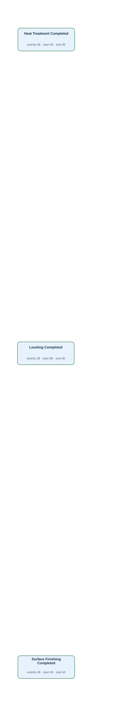</a></td><td width="58%" valign="top">
<a href="../../../datasets/plateflow_new/private/gold_sql/N14.sql">Gold SQL</a> · <a href="../../../datasets/plateflow_new/private/gold_logs/N14.csv">Gold CSV</a> · <a href="../../../datasets/plateflow_new/input/database.sqlite">Full source database (SQLite)</a>

<code>finishing_operation_history</code> · 130 matched source rows
<table><tr><th>Column</th><th>Row 1</th><th>Row 2</th><th>Row 3</th></tr><tr><th>operation_id</th><td>0001</td><td>0002</td><td>0003</td></tr><tr><th>plate_id</th><td>P007-1</td><td>P007-1</td><td>P007-1</td></tr><tr><th>process_group</th><td>FINISHING</td><td>FINISHING</td><td>FINISHING</td></tr><tr><th>operation_code</th><td>LEV</td><td>HT</td><td>SF</td></tr><tr><th>equipment_id</th><td>FI1</td><td>FI1</td><td>FI1</td></tr><tr><th>started_at</th><td>2026-01-25T19:35:00Z</td><td>2026-01-25T19:50:00Z</td><td>2026-01-25T20:15:00Z</td></tr><tr><th>finished_at</th><td>2026-01-25T19:45:00Z</td><td>2026-01-25T20:10:00Z</td><td>2026-01-25T20:25:00Z</td></tr></table>
<strong>Gold output for the same source rows</strong>
<ul><li>Row 1 → Leveling Completed · event TOP:0001 · case TOP:0001 · time from <code>finished_at</code></li><li>Row 2 → Heat Treatment Completed · event TOP:0002 · case TOP:0002 · time from <code>finished_at</code></li><li>Row 3 → Surface Finishing Completed · event TOP:0003 · case TOP:0003 · time from <code>finished_at</code></li></ul>
</td></tr></table>

## N14P — Q2

For every finishing operation record, show the recorded completion of leveling, heat treatment or surface finishing, as applicable.

Events: **130** · Cases with events: **130** · Activities: **3** · Edges: **0** · Source tables: **1** · SQL tables: **1**

<table><tr><td width="42%" valign="top"></td><td width="58%" valign="top">
<a href="../../../datasets/plateflow_new/private/gold_sql/N14P.sql">Gold SQL</a> · <a href="../../../datasets/plateflow_new/private/gold_logs/N14P.csv">Gold CSV</a> · <a href="../../../datasets/plateflow_new/input/database.sqlite">Full source database (SQLite)</a>

<code>finishing_operation_history</code> · 130 matched source rows
<table><tr><th>Column</th><th>Row 1</th><th>Row 2</th><th>Row 3</th></tr><tr><th>operation_id</th><td>0001</td><td>0002</td><td>0003</td></tr><tr><th>plate_id</th><td>P007-1</td><td>P007-1</td><td>P007-1</td></tr><tr><th>process_group</th><td>FINISHING</td><td>FINISHING</td><td>FINISHING</td></tr><tr><th>operation_code</th><td>LEV</td><td>HT</td><td>SF</td></tr><tr><th>equipment_id</th><td>FI1</td><td>FI1</td><td>FI1</td></tr><tr><th>started_at</th><td>2026-01-25T19:35:00Z</td><td>2026-01-25T19:50:00Z</td><td>2026-01-25T20:15:00Z</td></tr><tr><th>finished_at</th><td>2026-01-25T19:45:00Z</td><td>2026-01-25T20:10:00Z</td><td>2026-01-25T20:25:00Z</td></tr></table>
<strong>Gold output for the same source rows</strong>
<ul><li>Row 1 → Leveling Completed · event TOP:0001 · case TOP:0001 · time from <code>finished_at</code></li><li>Row 2 → Heat Treatment Completed · event TOP:0002 · case TOP:0002 · time from <code>finished_at</code></li><li>Row 3 → Surface Finishing Completed · event TOP:0003 · case TOP:0003 · time from <code>finished_at</code></li></ul>
</td></tr></table>

## N15 — Q1

For each slab, extract Steel Cast events.

**No Gold log:** No corresponding casting or dispatch records or actual times are stored.

## N15P — Q2

For each slab, show when the steel was cast.

**No Gold log:** No corresponding casting or dispatch records or actual times are stored.

## N16 — Q1

For each plate piece, extract Truck Dispatched events.

**No Gold log:** No corresponding casting or dispatch records or actual times are stored.

## N16P — Q2

For each plate piece, show when its truck was dispatched.

**No Gold log:** No corresponding casting or dispatch records or actual times are stored.

## NF01 — Q3

Extract the full recorded lifecycle for each slab.

Events: **620** · Cases with events: **30** · Activities: **20** · Edges: **23** · Source tables: **9** · SQL tables: **10**

<table><tr><td width="42%" valign="top"><a href="graphs/NF01.svg">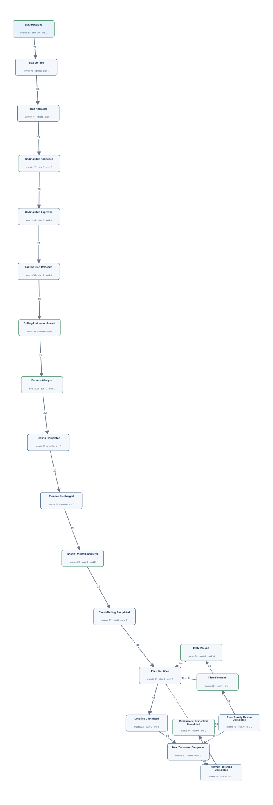</a></td><td width="58%" valign="top">
<a href="../../../datasets/plateflow_new/private/gold_sql/NF01.sql">Gold SQL</a> · <a href="../../../datasets/plateflow_new/private/gold_logs/NF01.csv">Gold CSV</a> · <a href="../../../datasets/plateflow_new/input/database.sqlite">Full source database (SQLite)</a>

<code>dimension_inspection</code> · 46 matched source rows
<table><tr><th>Column</th><th>Row 1</th><th>Row 2</th><th>Row 3</th></tr><tr><th>inspection_id</th><td>P007-1-1</td><td>P007-1-2</td><td>P007-2-1</td></tr><tr><th>plate_id</th><td>P007-1</td><td>P007-1</td><td>P007-2</td></tr><tr><th>inspected_at</th><td>2026-01-25T20:35:00Z</td><td>2026-01-25T21:55:00Z</td><td>2026-01-26T04:55:00Z</td></tr><tr><th>result_code</th><td>FAIL</td><td>PASS</td><td>PASS</td></tr><tr><th>thickness_mm</th><td>22.5</td><td>20.1</td><td>20.1</td></tr></table>
<strong>Gold output for the same source rows</strong>
<ul><li>Row 1 → Dimensional Inspection Completed · event DIM:P007-1-1 · case S:S007 · time from <code>inspected_at</code></li><li>Row 2 → Dimensional Inspection Completed · event DIM:P007-1-2 · case S:S007 · time from <code>inspected_at</code></li><li>Row 3 → Dimensional Inspection Completed · event DIM:P007-2-1 · case S:S007 · time from <code>inspected_at</code></li></ul>

<code>finishing_operation_history</code> · 130 matched source rows
<table><tr><th>Column</th><th>Row 1</th><th>Row 2</th><th>Row 3</th></tr><tr><th>operation_id</th><td>0001</td><td>0002</td><td>0003</td></tr><tr><th>plate_id</th><td>P007-1</td><td>P007-1</td><td>P007-1</td></tr><tr><th>process_group</th><td>FINISHING</td><td>FINISHING</td><td>FINISHING</td></tr><tr><th>operation_code</th><td>LEV</td><td>HT</td><td>SF</td></tr><tr><th>equipment_id</th><td>FI1</td><td>FI1</td><td>FI1</td></tr><tr><th>started_at</th><td>2026-01-25T19:35:00Z</td><td>2026-01-25T19:50:00Z</td><td>2026-01-25T20:15:00Z</td></tr><tr><th>finished_at</th><td>2026-01-25T19:45:00Z</td><td>2026-01-25T20:10:00Z</td><td>2026-01-25T20:25:00Z</td></tr></table>
<strong>Gold output for the same source rows</strong>
<ul><li>Row 1 → Leveling Completed · event TOP:0001 · case S:S007 · time from <code>finished_at</code></li><li>Row 2 → Heat Treatment Completed · event TOP:0002 · case S:S007 · time from <code>finished_at</code></li><li>Row 3 → Surface Finishing Completed · event TOP:0003 · case S:S007 · time from <code>finished_at</code></li></ul>

<code>furnace_operation_history</code> · 68 matched source rows
<table><tr><th>Column</th><th>Row 1</th><th>Row 2</th><th>Row 3</th></tr><tr><th>operation_id</th><td>0001</td><td>0002</td><td>0003</td></tr><tr><th>material_id</th><td>M007</td><td>M007</td><td>M007</td></tr><tr><th>process_group</th><td>FURNACE</td><td>FURNACE</td><td>FURNACE</td></tr><tr><th>operation_code</th><td>CH</td><td>HT</td><td>DS</td></tr><tr><th>equipment_id</th><td>FU2</td><td>FU2</td><td>FU2</td></tr><tr><th>started_at</th><td>2026-01-25T08:30:00Z</td><td>2026-01-25T08:45:00Z</td><td>2026-01-25T09:25:00Z</td></tr><tr><th>finished_at</th><td>2026-01-25T08:40:00Z</td><td>2026-01-25T09:20:00Z</td><td>2026-01-25T09:30:00Z</td></tr></table>
<strong>Gold output for the same source rows</strong>
<ul><li>Row 1 → Furnace Charged · event FOP:0001 · case S:S007 · time from <code>finished_at</code></li><li>Row 2 → Heating Completed · event FOP:0002 · case S:S007 · time from <code>finished_at</code></li><li>Row 3 → Furnace Discharged · event FOP:0003 · case S:S007 · time from <code>finished_at</code></li></ul>

<code>planned_rolling_instruction</code> · 28 matched source rows
<table><tr><th>Column</th><th>Row 1</th><th>Row 2</th><th>Row 3</th></tr><tr><th>plan_id</th><td>L003</td><td>L005</td><td>L004</td></tr><tr><th>slab_id</th><td>S003</td><td>S005</td><td>S004</td></tr><tr><th>planned_reheat_at</th><td>2026-01-11T18:20:00Z</td><td>2026-01-18T17:00:00Z</td><td>2026-01-15T05:40:00Z</td></tr><tr><th>submitted_at</th><td>2026-01-11T10:30:00Z</td><td>2026-01-18T09:10:00Z</td><td>2026-01-14T21:50:00Z</td></tr><tr><th>approved_at</th><td><em>NULL</em></td><td>2026-01-18T09:20:00Z</td><td><em>NULL</em></td></tr><tr><th>released_at</th><td><em>NULL</em></td><td>2026-01-18T09:30:00Z</td><td><em>NULL</em></td></tr></table>
<strong>Gold output for the same source rows</strong>
<ul><li>Row 1 → Rolling Plan Submitted · event PLAN:L003:submitted_at · case S:S003 · time from <code>submitted_at</code></li><li>Row 2 → Rolling Plan Approved · event PLAN:L005:approved_at · case S:S005 · time from <code>approved_at</code></li><li>Row 2 → Rolling Plan Released · event PLAN:L005:released_at · case S:S005 · time from <code>released_at</code></li><li>Row 2 → Rolling Plan Submitted · event PLAN:L005:submitted_at · case S:S005 · time from <code>submitted_at</code></li><li>Row 3 → Rolling Plan Submitted · event PLAN:L004:submitted_at · case S:S004 · time from <code>submitted_at</code></li></ul>

<code>plate_material</code> · 38 matched source rows
<table><tr><th>Column</th><th>Row 1</th><th>Row 2</th><th>Row 3</th></tr><tr><th>plate_id</th><td>P007-1</td><td>P007-2</td><td>P008-1</td></tr><tr><th>plate_no</th><td>PIECE-7-1</td><td>PIECE-7-2</td><td>PIECE-8-1</td></tr><tr><th>mother_material_id</th><td>M007</td><td>M007</td><td>M008</td></tr><tr><th>identified_at</th><td>2026-01-25T19:30:00Z</td><td>2026-01-26T03:50:00Z</td><td>2026-01-29T06:50:00Z</td></tr><tr><th>released_at</th><td>2026-01-25T22:30:00Z</td><td>2026-01-26T05:30:00Z</td><td>2026-01-29T08:30:00Z</td></tr><tr><th>packed_at</th><td>2026-01-25T22:50:00Z</td><td>2026-01-26T05:50:00Z</td><td>2026-01-29T08:50:00Z</td></tr></table>
<strong>Gold output for the same source rows</strong>
<ul><li>Row 1 → Plate Identified · event PLATE:P007-1:identified · case S:S007 · time from <code>identified_at</code></li><li>Row 1 → Plate Packed · event PLATE:P007-1:packed · case S:S007 · time from <code>packed_at</code></li><li>Row 1 → Plate Released · event PLATE:P007-1:released · case S:S007 · time from <code>released_at</code></li><li>Row 2 → Plate Identified · event PLATE:P007-2:identified · case S:S007 · time from <code>identified_at</code></li><li>Row 2 → Plate Packed · event PLATE:P007-2:packed · case S:S007 · time from <code>packed_at</code></li><li>Row 2 → Plate Released · event PLATE:P007-2:released · case S:S007 · time from <code>released_at</code></li><li>Row 3 → Plate Identified · event PLATE:P008-1:identified · case S:S008 · time from <code>identified_at</code></li><li>Row 3 → Plate Packed · event PLATE:P008-1:packed · case S:S008 · time from <code>packed_at</code></li><li>Row 3 → Plate Released · event PLATE:P008-1:released · case S:S008 · time from <code>released_at</code></li></ul>

<code>plate_quality_review</code> · 43 matched source rows
<table><tr><th>Column</th><th>Row 1</th><th>Row 2</th><th>Row 3</th></tr><tr><th>review_id</th><td>P007-1-1</td><td>P007-1-2</td><td>P007-2-1</td></tr><tr><th>plate_id</th><td>P007-1</td><td>P007-1</td><td>P007-2</td></tr><tr><th>started_at</th><td>2026-01-25T20:40:00Z</td><td>2026-01-25T22:00:00Z</td><td>2026-01-26T05:00:00Z</td></tr><tr><th>finished_at</th><td>2026-01-25T20:50:00Z</td><td>2026-01-25T22:15:00Z</td><td>2026-01-26T05:10:00Z</td></tr><tr><th>review_status</th><td>REWORK</td><td>APPROVED</td><td>APPROVED</td></tr></table>
<strong>Gold output for the same source rows</strong>
<ul><li>Row 1 → Plate Quality Review Completed · event REV:P007-1-1 · case S:S007 · time from <code>finished_at</code></li><li>Row 2 → Plate Quality Review Completed · event REV:P007-1-2 · case S:S007 · time from <code>finished_at</code></li><li>Row 3 → Plate Quality Review Completed · event REV:P007-2-1 · case S:S007 · time from <code>finished_at</code></li></ul>

<code>rolling_instruction</code> · 26 matched source rows
<table><tr><th>Column</th><th>Row 1</th><th>Row 2</th><th>Row 3</th></tr><tr><th>instruction_id</th><td>I005</td><td>I006</td><td>I007</td></tr><tr><th>plan_id</th><td>L005</td><td>L006</td><td>L007</td></tr><tr><th>issued_at</th><td>2026-01-18T09:40:00Z</td><td>2026-01-21T21:00:00Z</td><td>2026-01-25T08:20:00Z</td></tr></table>
<strong>Gold output for the same source rows</strong>
<ul><li>Row 1 → Rolling Instruction Issued · event INST:I005 · case S:S005 · time from <code>issued_at</code></li><li>Row 2 → Rolling Instruction Issued · event INST:I006 · case S:S006 · time from <code>issued_at</code></li><li>Row 3 → Rolling Instruction Issued · event INST:I007 · case S:S007 · time from <code>issued_at</code></li></ul>

<code>rolling_operation_history</code> · 42 matched source rows
<table><tr><th>Column</th><th>Row 1</th><th>Row 2</th><th>Row 3</th></tr><tr><th>operation_id</th><td>0001</td><td>0002</td><td>0003</td></tr><tr><th>material_id</th><td>M007</td><td>M007</td><td>M008</td></tr><tr><th>process_group</th><td>ROLLING</td><td>ROLLING</td><td>ROLLING</td></tr><tr><th>phase_code</th><td>RR</td><td>FR</td><td>RR</td></tr><tr><th>equipment_id</th><td>RO2</td><td>RO2</td><td>RO1</td></tr><tr><th>started_at</th><td>2026-01-25T09:40:00Z</td><td>2026-01-25T10:10:00Z</td><td>2026-01-28T21:00:00Z</td></tr><tr><th>finished_at</th><td>2026-01-25T10:00:00Z</td><td>2026-01-25T10:35:00Z</td><td>2026-01-28T21:20:00Z</td></tr></table>
<strong>Gold output for the same source rows</strong>
<ul><li>Row 1 → Rough Rolling Completed · event ROP:0001 · case S:S007 · time from <code>finished_at</code></li><li>Row 2 → Finish Rolling Completed · event ROP:0002 · case S:S007 · time from <code>finished_at</code></li><li>Row 3 → Rough Rolling Completed · event ROP:0003 · case S:S008 · time from <code>finished_at</code></li></ul>

<code>slab_material</code> · 30 matched source rows
<table><tr><th>Column</th><th>Row 1</th><th>Row 2</th><th>Row 3</th></tr><tr><th>slab_id</th><td>S001</td><td>S003</td><td>S002</td></tr><tr><th>charge_id</th><td>C001</td><td>C001</td><td>C001</td></tr><tr><th>steel_grade</th><td>G1</td><td>G1</td><td>G2</td></tr><tr><th>received_at</th><td>2026-01-04T11:20:00Z</td><td>2026-01-11T10:00:00Z</td><td>2026-01-07T22:40:00Z</td></tr><tr><th>verified_at</th><td><em>NULL</em></td><td>2026-01-11T10:10:00Z</td><td><em>NULL</em></td></tr><tr><th>released_at</th><td><em>NULL</em></td><td>2026-01-11T10:20:00Z</td><td><em>NULL</em></td></tr></table>
<strong>Gold output for the same source rows</strong>
<ul><li>Row 1 → Slab Received · event SLAB:S001:received_at · case S:S001 · time from <code>received_at</code></li><li>Row 2 → Slab Received · event SLAB:S003:received_at · case S:S003 · time from <code>received_at</code></li><li>Row 2 → Slab Released · event SLAB:S003:released_at · case S:S003 · time from <code>released_at</code></li><li>Row 2 → Slab Verified · event SLAB:S003:verified_at · case S:S003 · time from <code>verified_at</code></li><li>Row 3 → Slab Received · event SLAB:S002:received_at · case S:S002 · time from <code>received_at</code></li></ul>

FK-linked case and join evidence
<ul><li><code>furnace_operation_history</code> → <code>as_rolled_material</code> · material_id → material_id · material_id = M007</li></ul>
</td></tr></table>

## NF01P — Q4

Show the complete recorded history of each slab.

Events: **620** · Cases with events: **30** · Activities: **20** · Edges: **23** · Source tables: **9** · SQL tables: **10**

<table><tr><td width="42%" valign="top"></td><td width="58%" valign="top">
<a href="../../../datasets/plateflow_new/private/gold_sql/NF01P.sql">Gold SQL</a> · <a href="../../../datasets/plateflow_new/private/gold_logs/NF01P.csv">Gold CSV</a> · <a href="../../../datasets/plateflow_new/input/database.sqlite">Full source database (SQLite)</a>

<code>dimension_inspection</code> · 46 matched source rows
<table><tr><th>Column</th><th>Row 1</th><th>Row 2</th><th>Row 3</th></tr><tr><th>inspection_id</th><td>P007-1-1</td><td>P007-1-2</td><td>P007-2-1</td></tr><tr><th>plate_id</th><td>P007-1</td><td>P007-1</td><td>P007-2</td></tr><tr><th>inspected_at</th><td>2026-01-25T20:35:00Z</td><td>2026-01-25T21:55:00Z</td><td>2026-01-26T04:55:00Z</td></tr><tr><th>result_code</th><td>FAIL</td><td>PASS</td><td>PASS</td></tr><tr><th>thickness_mm</th><td>22.5</td><td>20.1</td><td>20.1</td></tr></table>
<strong>Gold output for the same source rows</strong>
<ul><li>Row 1 → Dimensional Inspection Completed · event DIM:P007-1-1 · case S:S007 · time from <code>inspected_at</code></li><li>Row 2 → Dimensional Inspection Completed · event DIM:P007-1-2 · case S:S007 · time from <code>inspected_at</code></li><li>Row 3 → Dimensional Inspection Completed · event DIM:P007-2-1 · case S:S007 · time from <code>inspected_at</code></li></ul>

<code>finishing_operation_history</code> · 130 matched source rows
<table><tr><th>Column</th><th>Row 1</th><th>Row 2</th><th>Row 3</th></tr><tr><th>operation_id</th><td>0001</td><td>0002</td><td>0003</td></tr><tr><th>plate_id</th><td>P007-1</td><td>P007-1</td><td>P007-1</td></tr><tr><th>process_group</th><td>FINISHING</td><td>FINISHING</td><td>FINISHING</td></tr><tr><th>operation_code</th><td>LEV</td><td>HT</td><td>SF</td></tr><tr><th>equipment_id</th><td>FI1</td><td>FI1</td><td>FI1</td></tr><tr><th>started_at</th><td>2026-01-25T19:35:00Z</td><td>2026-01-25T19:50:00Z</td><td>2026-01-25T20:15:00Z</td></tr><tr><th>finished_at</th><td>2026-01-25T19:45:00Z</td><td>2026-01-25T20:10:00Z</td><td>2026-01-25T20:25:00Z</td></tr></table>
<strong>Gold output for the same source rows</strong>
<ul><li>Row 1 → Leveling Completed · event TOP:0001 · case S:S007 · time from <code>finished_at</code></li><li>Row 2 → Heat Treatment Completed · event TOP:0002 · case S:S007 · time from <code>finished_at</code></li><li>Row 3 → Surface Finishing Completed · event TOP:0003 · case S:S007 · time from <code>finished_at</code></li></ul>

<code>furnace_operation_history</code> · 68 matched source rows
<table><tr><th>Column</th><th>Row 1</th><th>Row 2</th><th>Row 3</th></tr><tr><th>operation_id</th><td>0001</td><td>0002</td><td>0003</td></tr><tr><th>material_id</th><td>M007</td><td>M007</td><td>M007</td></tr><tr><th>process_group</th><td>FURNACE</td><td>FURNACE</td><td>FURNACE</td></tr><tr><th>operation_code</th><td>CH</td><td>HT</td><td>DS</td></tr><tr><th>equipment_id</th><td>FU2</td><td>FU2</td><td>FU2</td></tr><tr><th>started_at</th><td>2026-01-25T08:30:00Z</td><td>2026-01-25T08:45:00Z</td><td>2026-01-25T09:25:00Z</td></tr><tr><th>finished_at</th><td>2026-01-25T08:40:00Z</td><td>2026-01-25T09:20:00Z</td><td>2026-01-25T09:30:00Z</td></tr></table>
<strong>Gold output for the same source rows</strong>
<ul><li>Row 1 → Furnace Charged · event FOP:0001 · case S:S007 · time from <code>finished_at</code></li><li>Row 2 → Heating Completed · event FOP:0002 · case S:S007 · time from <code>finished_at</code></li><li>Row 3 → Furnace Discharged · event FOP:0003 · case S:S007 · time from <code>finished_at</code></li></ul>

<code>planned_rolling_instruction</code> · 28 matched source rows
<table><tr><th>Column</th><th>Row 1</th><th>Row 2</th><th>Row 3</th></tr><tr><th>plan_id</th><td>L003</td><td>L005</td><td>L004</td></tr><tr><th>slab_id</th><td>S003</td><td>S005</td><td>S004</td></tr><tr><th>planned_reheat_at</th><td>2026-01-11T18:20:00Z</td><td>2026-01-18T17:00:00Z</td><td>2026-01-15T05:40:00Z</td></tr><tr><th>submitted_at</th><td>2026-01-11T10:30:00Z</td><td>2026-01-18T09:10:00Z</td><td>2026-01-14T21:50:00Z</td></tr><tr><th>approved_at</th><td><em>NULL</em></td><td>2026-01-18T09:20:00Z</td><td><em>NULL</em></td></tr><tr><th>released_at</th><td><em>NULL</em></td><td>2026-01-18T09:30:00Z</td><td><em>NULL</em></td></tr></table>
<strong>Gold output for the same source rows</strong>
<ul><li>Row 1 → Rolling Plan Submitted · event PLAN:L003:submitted_at · case S:S003 · time from <code>submitted_at</code></li><li>Row 2 → Rolling Plan Approved · event PLAN:L005:approved_at · case S:S005 · time from <code>approved_at</code></li><li>Row 2 → Rolling Plan Released · event PLAN:L005:released_at · case S:S005 · time from <code>released_at</code></li><li>Row 2 → Rolling Plan Submitted · event PLAN:L005:submitted_at · case S:S005 · time from <code>submitted_at</code></li><li>Row 3 → Rolling Plan Submitted · event PLAN:L004:submitted_at · case S:S004 · time from <code>submitted_at</code></li></ul>

<code>plate_material</code> · 38 matched source rows
<table><tr><th>Column</th><th>Row 1</th><th>Row 2</th><th>Row 3</th></tr><tr><th>plate_id</th><td>P007-1</td><td>P007-2</td><td>P008-1</td></tr><tr><th>plate_no</th><td>PIECE-7-1</td><td>PIECE-7-2</td><td>PIECE-8-1</td></tr><tr><th>mother_material_id</th><td>M007</td><td>M007</td><td>M008</td></tr><tr><th>identified_at</th><td>2026-01-25T19:30:00Z</td><td>2026-01-26T03:50:00Z</td><td>2026-01-29T06:50:00Z</td></tr><tr><th>released_at</th><td>2026-01-25T22:30:00Z</td><td>2026-01-26T05:30:00Z</td><td>2026-01-29T08:30:00Z</td></tr><tr><th>packed_at</th><td>2026-01-25T22:50:00Z</td><td>2026-01-26T05:50:00Z</td><td>2026-01-29T08:50:00Z</td></tr></table>
<strong>Gold output for the same source rows</strong>
<ul><li>Row 1 → Plate Identified · event PLATE:P007-1:identified · case S:S007 · time from <code>identified_at</code></li><li>Row 1 → Plate Packed · event PLATE:P007-1:packed · case S:S007 · time from <code>packed_at</code></li><li>Row 1 → Plate Released · event PLATE:P007-1:released · case S:S007 · time from <code>released_at</code></li><li>Row 2 → Plate Identified · event PLATE:P007-2:identified · case S:S007 · time from <code>identified_at</code></li><li>Row 2 → Plate Packed · event PLATE:P007-2:packed · case S:S007 · time from <code>packed_at</code></li><li>Row 2 → Plate Released · event PLATE:P007-2:released · case S:S007 · time from <code>released_at</code></li><li>Row 3 → Plate Identified · event PLATE:P008-1:identified · case S:S008 · time from <code>identified_at</code></li><li>Row 3 → Plate Packed · event PLATE:P008-1:packed · case S:S008 · time from <code>packed_at</code></li><li>Row 3 → Plate Released · event PLATE:P008-1:released · case S:S008 · time from <code>released_at</code></li></ul>

<code>plate_quality_review</code> · 43 matched source rows
<table><tr><th>Column</th><th>Row 1</th><th>Row 2</th><th>Row 3</th></tr><tr><th>review_id</th><td>P007-1-1</td><td>P007-1-2</td><td>P007-2-1</td></tr><tr><th>plate_id</th><td>P007-1</td><td>P007-1</td><td>P007-2</td></tr><tr><th>started_at</th><td>2026-01-25T20:40:00Z</td><td>2026-01-25T22:00:00Z</td><td>2026-01-26T05:00:00Z</td></tr><tr><th>finished_at</th><td>2026-01-25T20:50:00Z</td><td>2026-01-25T22:15:00Z</td><td>2026-01-26T05:10:00Z</td></tr><tr><th>review_status</th><td>REWORK</td><td>APPROVED</td><td>APPROVED</td></tr></table>
<strong>Gold output for the same source rows</strong>
<ul><li>Row 1 → Plate Quality Review Completed · event REV:P007-1-1 · case S:S007 · time from <code>finished_at</code></li><li>Row 2 → Plate Quality Review Completed · event REV:P007-1-2 · case S:S007 · time from <code>finished_at</code></li><li>Row 3 → Plate Quality Review Completed · event REV:P007-2-1 · case S:S007 · time from <code>finished_at</code></li></ul>

<code>rolling_instruction</code> · 26 matched source rows
<table><tr><th>Column</th><th>Row 1</th><th>Row 2</th><th>Row 3</th></tr><tr><th>instruction_id</th><td>I005</td><td>I006</td><td>I007</td></tr><tr><th>plan_id</th><td>L005</td><td>L006</td><td>L007</td></tr><tr><th>issued_at</th><td>2026-01-18T09:40:00Z</td><td>2026-01-21T21:00:00Z</td><td>2026-01-25T08:20:00Z</td></tr></table>
<strong>Gold output for the same source rows</strong>
<ul><li>Row 1 → Rolling Instruction Issued · event INST:I005 · case S:S005 · time from <code>issued_at</code></li><li>Row 2 → Rolling Instruction Issued · event INST:I006 · case S:S006 · time from <code>issued_at</code></li><li>Row 3 → Rolling Instruction Issued · event INST:I007 · case S:S007 · time from <code>issued_at</code></li></ul>

<code>rolling_operation_history</code> · 42 matched source rows
<table><tr><th>Column</th><th>Row 1</th><th>Row 2</th><th>Row 3</th></tr><tr><th>operation_id</th><td>0001</td><td>0002</td><td>0003</td></tr><tr><th>material_id</th><td>M007</td><td>M007</td><td>M008</td></tr><tr><th>process_group</th><td>ROLLING</td><td>ROLLING</td><td>ROLLING</td></tr><tr><th>phase_code</th><td>RR</td><td>FR</td><td>RR</td></tr><tr><th>equipment_id</th><td>RO2</td><td>RO2</td><td>RO1</td></tr><tr><th>started_at</th><td>2026-01-25T09:40:00Z</td><td>2026-01-25T10:10:00Z</td><td>2026-01-28T21:00:00Z</td></tr><tr><th>finished_at</th><td>2026-01-25T10:00:00Z</td><td>2026-01-25T10:35:00Z</td><td>2026-01-28T21:20:00Z</td></tr></table>
<strong>Gold output for the same source rows</strong>
<ul><li>Row 1 → Rough Rolling Completed · event ROP:0001 · case S:S007 · time from <code>finished_at</code></li><li>Row 2 → Finish Rolling Completed · event ROP:0002 · case S:S007 · time from <code>finished_at</code></li><li>Row 3 → Rough Rolling Completed · event ROP:0003 · case S:S008 · time from <code>finished_at</code></li></ul>

<code>slab_material</code> · 30 matched source rows
<table><tr><th>Column</th><th>Row 1</th><th>Row 2</th><th>Row 3</th></tr><tr><th>slab_id</th><td>S001</td><td>S003</td><td>S002</td></tr><tr><th>charge_id</th><td>C001</td><td>C001</td><td>C001</td></tr><tr><th>steel_grade</th><td>G1</td><td>G1</td><td>G2</td></tr><tr><th>received_at</th><td>2026-01-04T11:20:00Z</td><td>2026-01-11T10:00:00Z</td><td>2026-01-07T22:40:00Z</td></tr><tr><th>verified_at</th><td><em>NULL</em></td><td>2026-01-11T10:10:00Z</td><td><em>NULL</em></td></tr><tr><th>released_at</th><td><em>NULL</em></td><td>2026-01-11T10:20:00Z</td><td><em>NULL</em></td></tr></table>
<strong>Gold output for the same source rows</strong>
<ul><li>Row 1 → Slab Received · event SLAB:S001:received_at · case S:S001 · time from <code>received_at</code></li><li>Row 2 → Slab Received · event SLAB:S003:received_at · case S:S003 · time from <code>received_at</code></li><li>Row 2 → Slab Released · event SLAB:S003:released_at · case S:S003 · time from <code>released_at</code></li><li>Row 2 → Slab Verified · event SLAB:S003:verified_at · case S:S003 · time from <code>verified_at</code></li><li>Row 3 → Slab Received · event SLAB:S002:received_at · case S:S002 · time from <code>received_at</code></li></ul>

FK-linked case and join evidence
<ul><li><code>furnace_operation_history</code> → <code>as_rolled_material</code> · material_id → material_id · material_id = M007</li></ul>
</td></tr></table>

## NF02 — Q3

Extract the full recorded lifecycle for each rolling plan.

Events: **106** · Cases with events: **28** · Activities: **4** · Edges: **3** · Source tables: **2** · SQL tables: **2**

<table><tr><td width="42%" valign="top"><a href="graphs/NF02.svg">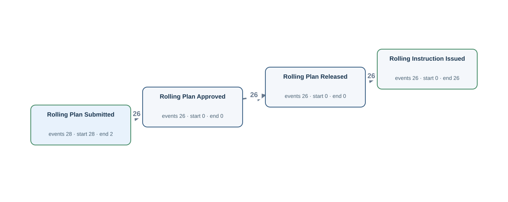</a></td><td width="58%" valign="top">
<a href="../../../datasets/plateflow_new/private/gold_sql/NF02.sql">Gold SQL</a> · <a href="../../../datasets/plateflow_new/private/gold_logs/NF02.csv">Gold CSV</a> · <a href="../../../datasets/plateflow_new/input/database.sqlite">Full source database (SQLite)</a>

<code>planned_rolling_instruction</code> · 28 matched source rows
<table><tr><th>Column</th><th>Row 1</th><th>Row 2</th><th>Row 3</th></tr><tr><th>plan_id</th><td>L003</td><td>L005</td><td>L004</td></tr><tr><th>slab_id</th><td>S003</td><td>S005</td><td>S004</td></tr><tr><th>planned_reheat_at</th><td>2026-01-11T18:20:00Z</td><td>2026-01-18T17:00:00Z</td><td>2026-01-15T05:40:00Z</td></tr><tr><th>submitted_at</th><td>2026-01-11T10:30:00Z</td><td>2026-01-18T09:10:00Z</td><td>2026-01-14T21:50:00Z</td></tr><tr><th>approved_at</th><td><em>NULL</em></td><td>2026-01-18T09:20:00Z</td><td><em>NULL</em></td></tr><tr><th>released_at</th><td><em>NULL</em></td><td>2026-01-18T09:30:00Z</td><td><em>NULL</em></td></tr></table>
<strong>Gold output for the same source rows</strong>
<ul><li>Row 1 → Rolling Plan Submitted · event PLAN:L003:submitted_at · case PLAN:L003 · time from <code>submitted_at</code></li><li>Row 2 → Rolling Plan Approved · event PLAN:L005:approved_at · case PLAN:L005 · time from <code>approved_at</code></li><li>Row 2 → Rolling Plan Released · event PLAN:L005:released_at · case PLAN:L005 · time from <code>released_at</code></li><li>Row 2 → Rolling Plan Submitted · event PLAN:L005:submitted_at · case PLAN:L005 · time from <code>submitted_at</code></li><li>Row 3 → Rolling Plan Submitted · event PLAN:L004:submitted_at · case PLAN:L004 · time from <code>submitted_at</code></li></ul>

<code>rolling_instruction</code> · 26 matched source rows
<table><tr><th>Column</th><th>Row 1</th><th>Row 2</th><th>Row 3</th></tr><tr><th>instruction_id</th><td>I005</td><td>I006</td><td>I007</td></tr><tr><th>plan_id</th><td>L005</td><td>L006</td><td>L007</td></tr><tr><th>issued_at</th><td>2026-01-18T09:40:00Z</td><td>2026-01-21T21:00:00Z</td><td>2026-01-25T08:20:00Z</td></tr></table>
<strong>Gold output for the same source rows</strong>
<ul><li>Row 1 → Rolling Instruction Issued · event INST:I005 · case PLAN:L005 · time from <code>issued_at</code></li><li>Row 2 → Rolling Instruction Issued · event INST:I006 · case PLAN:L006 · time from <code>issued_at</code></li><li>Row 3 → Rolling Instruction Issued · event INST:I007 · case PLAN:L007 · time from <code>issued_at</code></li></ul>
</td></tr></table>

## NF02P — Q4

Build the entire recorded timeline for every rolling plan.

Events: **106** · Cases with events: **28** · Activities: **4** · Edges: **3** · Source tables: **2** · SQL tables: **2**

<table><tr><td width="42%" valign="top"></td><td width="58%" valign="top">
<a href="../../../datasets/plateflow_new/private/gold_sql/NF02P.sql">Gold SQL</a> · <a href="../../../datasets/plateflow_new/private/gold_logs/NF02P.csv">Gold CSV</a> · <a href="../../../datasets/plateflow_new/input/database.sqlite">Full source database (SQLite)</a>

<code>planned_rolling_instruction</code> · 28 matched source rows
<table><tr><th>Column</th><th>Row 1</th><th>Row 2</th><th>Row 3</th></tr><tr><th>plan_id</th><td>L003</td><td>L005</td><td>L004</td></tr><tr><th>slab_id</th><td>S003</td><td>S005</td><td>S004</td></tr><tr><th>planned_reheat_at</th><td>2026-01-11T18:20:00Z</td><td>2026-01-18T17:00:00Z</td><td>2026-01-15T05:40:00Z</td></tr><tr><th>submitted_at</th><td>2026-01-11T10:30:00Z</td><td>2026-01-18T09:10:00Z</td><td>2026-01-14T21:50:00Z</td></tr><tr><th>approved_at</th><td><em>NULL</em></td><td>2026-01-18T09:20:00Z</td><td><em>NULL</em></td></tr><tr><th>released_at</th><td><em>NULL</em></td><td>2026-01-18T09:30:00Z</td><td><em>NULL</em></td></tr></table>
<strong>Gold output for the same source rows</strong>
<ul><li>Row 1 → Rolling Plan Submitted · event PLAN:L003:submitted_at · case PLAN:L003 · time from <code>submitted_at</code></li><li>Row 2 → Rolling Plan Approved · event PLAN:L005:approved_at · case PLAN:L005 · time from <code>approved_at</code></li><li>Row 2 → Rolling Plan Released · event PLAN:L005:released_at · case PLAN:L005 · time from <code>released_at</code></li><li>Row 2 → Rolling Plan Submitted · event PLAN:L005:submitted_at · case PLAN:L005 · time from <code>submitted_at</code></li><li>Row 3 → Rolling Plan Submitted · event PLAN:L004:submitted_at · case PLAN:L004 · time from <code>submitted_at</code></li></ul>

<code>rolling_instruction</code> · 26 matched source rows
<table><tr><th>Column</th><th>Row 1</th><th>Row 2</th><th>Row 3</th></tr><tr><th>instruction_id</th><td>I005</td><td>I006</td><td>I007</td></tr><tr><th>plan_id</th><td>L005</td><td>L006</td><td>L007</td></tr><tr><th>issued_at</th><td>2026-01-18T09:40:00Z</td><td>2026-01-21T21:00:00Z</td><td>2026-01-25T08:20:00Z</td></tr></table>
<strong>Gold output for the same source rows</strong>
<ul><li>Row 1 → Rolling Instruction Issued · event INST:I005 · case PLAN:L005 · time from <code>issued_at</code></li><li>Row 2 → Rolling Instruction Issued · event INST:I006 · case PLAN:L006 · time from <code>issued_at</code></li><li>Row 3 → Rolling Instruction Issued · event INST:I007 · case PLAN:L007 · time from <code>issued_at</code></li></ul>
</td></tr></table>

## NF03 — Q3

Extract the full recorded lifecycle for each rolling instruction.

Events: **454** · Cases with events: **26** · Activities: **14** · Edges: **17** · Source tables: **7** · SQL tables: **8**

<table><tr><td width="42%" valign="top"><a href="graphs/NF03.svg">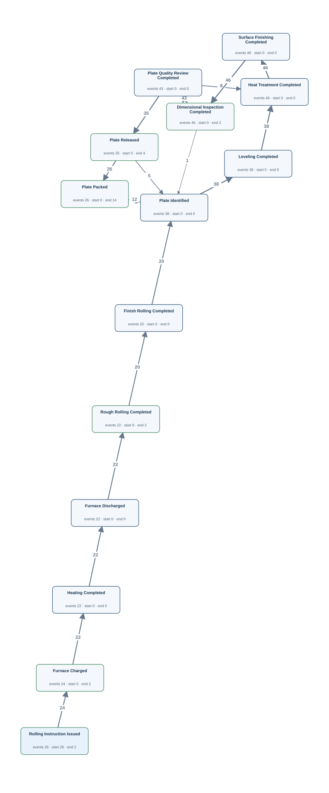</a></td><td width="58%" valign="top">
<a href="../../../datasets/plateflow_new/private/gold_sql/NF03.sql">Gold SQL</a> · <a href="../../../datasets/plateflow_new/private/gold_logs/NF03.csv">Gold CSV</a> · <a href="../../../datasets/plateflow_new/input/database.sqlite">Full source database (SQLite)</a>

<code>dimension_inspection</code> · 46 matched source rows
<table><tr><th>Column</th><th>Row 1</th><th>Row 2</th><th>Row 3</th></tr><tr><th>inspection_id</th><td>P007-1-1</td><td>P007-1-2</td><td>P007-2-1</td></tr><tr><th>plate_id</th><td>P007-1</td><td>P007-1</td><td>P007-2</td></tr><tr><th>inspected_at</th><td>2026-01-25T20:35:00Z</td><td>2026-01-25T21:55:00Z</td><td>2026-01-26T04:55:00Z</td></tr><tr><th>result_code</th><td>FAIL</td><td>PASS</td><td>PASS</td></tr><tr><th>thickness_mm</th><td>22.5</td><td>20.1</td><td>20.1</td></tr></table>
<strong>Gold output for the same source rows</strong>
<ul><li>Row 1 → Dimensional Inspection Completed · event DIM:P007-1-1 · case INST:I007 · time from <code>inspected_at</code></li><li>Row 2 → Dimensional Inspection Completed · event DIM:P007-1-2 · case INST:I007 · time from <code>inspected_at</code></li><li>Row 3 → Dimensional Inspection Completed · event DIM:P007-2-1 · case INST:I007 · time from <code>inspected_at</code></li></ul>

<code>finishing_operation_history</code> · 130 matched source rows
<table><tr><th>Column</th><th>Row 1</th><th>Row 2</th><th>Row 3</th></tr><tr><th>operation_id</th><td>0001</td><td>0002</td><td>0003</td></tr><tr><th>plate_id</th><td>P007-1</td><td>P007-1</td><td>P007-1</td></tr><tr><th>process_group</th><td>FINISHING</td><td>FINISHING</td><td>FINISHING</td></tr><tr><th>operation_code</th><td>LEV</td><td>HT</td><td>SF</td></tr><tr><th>equipment_id</th><td>FI1</td><td>FI1</td><td>FI1</td></tr><tr><th>started_at</th><td>2026-01-25T19:35:00Z</td><td>2026-01-25T19:50:00Z</td><td>2026-01-25T20:15:00Z</td></tr><tr><th>finished_at</th><td>2026-01-25T19:45:00Z</td><td>2026-01-25T20:10:00Z</td><td>2026-01-25T20:25:00Z</td></tr></table>
<strong>Gold output for the same source rows</strong>
<ul><li>Row 1 → Leveling Completed · event TOP:0001 · case INST:I007 · time from <code>finished_at</code></li><li>Row 2 → Heat Treatment Completed · event TOP:0002 · case INST:I007 · time from <code>finished_at</code></li><li>Row 3 → Surface Finishing Completed · event TOP:0003 · case INST:I007 · time from <code>finished_at</code></li></ul>

<code>furnace_operation_history</code> · 68 matched source rows
<table><tr><th>Column</th><th>Row 1</th><th>Row 2</th><th>Row 3</th></tr><tr><th>operation_id</th><td>0001</td><td>0002</td><td>0003</td></tr><tr><th>material_id</th><td>M007</td><td>M007</td><td>M007</td></tr><tr><th>process_group</th><td>FURNACE</td><td>FURNACE</td><td>FURNACE</td></tr><tr><th>operation_code</th><td>CH</td><td>HT</td><td>DS</td></tr><tr><th>equipment_id</th><td>FU2</td><td>FU2</td><td>FU2</td></tr><tr><th>started_at</th><td>2026-01-25T08:30:00Z</td><td>2026-01-25T08:45:00Z</td><td>2026-01-25T09:25:00Z</td></tr><tr><th>finished_at</th><td>2026-01-25T08:40:00Z</td><td>2026-01-25T09:20:00Z</td><td>2026-01-25T09:30:00Z</td></tr></table>
<strong>Gold output for the same source rows</strong>
<ul><li>Row 1 → Furnace Charged · event FOP:0001 · case INST:I007 · time from <code>finished_at</code></li><li>Row 2 → Heating Completed · event FOP:0002 · case INST:I007 · time from <code>finished_at</code></li><li>Row 3 → Furnace Discharged · event FOP:0003 · case INST:I007 · time from <code>finished_at</code></li></ul>

<code>plate_material</code> · 38 matched source rows
<table><tr><th>Column</th><th>Row 1</th><th>Row 2</th><th>Row 3</th></tr><tr><th>plate_id</th><td>P007-1</td><td>P007-2</td><td>P008-1</td></tr><tr><th>plate_no</th><td>PIECE-7-1</td><td>PIECE-7-2</td><td>PIECE-8-1</td></tr><tr><th>mother_material_id</th><td>M007</td><td>M007</td><td>M008</td></tr><tr><th>identified_at</th><td>2026-01-25T19:30:00Z</td><td>2026-01-26T03:50:00Z</td><td>2026-01-29T06:50:00Z</td></tr><tr><th>released_at</th><td>2026-01-25T22:30:00Z</td><td>2026-01-26T05:30:00Z</td><td>2026-01-29T08:30:00Z</td></tr><tr><th>packed_at</th><td>2026-01-25T22:50:00Z</td><td>2026-01-26T05:50:00Z</td><td>2026-01-29T08:50:00Z</td></tr></table>
<strong>Gold output for the same source rows</strong>
<ul><li>Row 1 → Plate Identified · event PLATE:P007-1:identified · case INST:I007 · time from <code>identified_at</code></li><li>Row 1 → Plate Packed · event PLATE:P007-1:packed · case INST:I007 · time from <code>packed_at</code></li><li>Row 1 → Plate Released · event PLATE:P007-1:released · case INST:I007 · time from <code>released_at</code></li><li>Row 2 → Plate Identified · event PLATE:P007-2:identified · case INST:I007 · time from <code>identified_at</code></li><li>Row 2 → Plate Packed · event PLATE:P007-2:packed · case INST:I007 · time from <code>packed_at</code></li><li>Row 2 → Plate Released · event PLATE:P007-2:released · case INST:I007 · time from <code>released_at</code></li><li>Row 3 → Plate Identified · event PLATE:P008-1:identified · case INST:I008 · time from <code>identified_at</code></li><li>Row 3 → Plate Packed · event PLATE:P008-1:packed · case INST:I008 · time from <code>packed_at</code></li><li>Row 3 → Plate Released · event PLATE:P008-1:released · case INST:I008 · time from <code>released_at</code></li></ul>

<code>plate_quality_review</code> · 43 matched source rows
<table><tr><th>Column</th><th>Row 1</th><th>Row 2</th><th>Row 3</th></tr><tr><th>review_id</th><td>P007-1-1</td><td>P007-1-2</td><td>P007-2-1</td></tr><tr><th>plate_id</th><td>P007-1</td><td>P007-1</td><td>P007-2</td></tr><tr><th>started_at</th><td>2026-01-25T20:40:00Z</td><td>2026-01-25T22:00:00Z</td><td>2026-01-26T05:00:00Z</td></tr><tr><th>finished_at</th><td>2026-01-25T20:50:00Z</td><td>2026-01-25T22:15:00Z</td><td>2026-01-26T05:10:00Z</td></tr><tr><th>review_status</th><td>REWORK</td><td>APPROVED</td><td>APPROVED</td></tr></table>
<strong>Gold output for the same source rows</strong>
<ul><li>Row 1 → Plate Quality Review Completed · event REV:P007-1-1 · case INST:I007 · time from <code>finished_at</code></li><li>Row 2 → Plate Quality Review Completed · event REV:P007-1-2 · case INST:I007 · time from <code>finished_at</code></li><li>Row 3 → Plate Quality Review Completed · event REV:P007-2-1 · case INST:I007 · time from <code>finished_at</code></li></ul>

<code>rolling_instruction</code> · 26 matched source rows
<table><tr><th>Column</th><th>Row 1</th><th>Row 2</th><th>Row 3</th></tr><tr><th>instruction_id</th><td>I005</td><td>I006</td><td>I007</td></tr><tr><th>plan_id</th><td>L005</td><td>L006</td><td>L007</td></tr><tr><th>issued_at</th><td>2026-01-18T09:40:00Z</td><td>2026-01-21T21:00:00Z</td><td>2026-01-25T08:20:00Z</td></tr></table>
<strong>Gold output for the same source rows</strong>
<ul><li>Row 1 → Rolling Instruction Issued · event INST:I005 · case INST:I005 · time from <code>issued_at</code></li><li>Row 2 → Rolling Instruction Issued · event INST:I006 · case INST:I006 · time from <code>issued_at</code></li><li>Row 3 → Rolling Instruction Issued · event INST:I007 · case INST:I007 · time from <code>issued_at</code></li></ul>

<code>rolling_operation_history</code> · 42 matched source rows
<table><tr><th>Column</th><th>Row 1</th><th>Row 2</th><th>Row 3</th></tr><tr><th>operation_id</th><td>0001</td><td>0002</td><td>0003</td></tr><tr><th>material_id</th><td>M007</td><td>M007</td><td>M008</td></tr><tr><th>process_group</th><td>ROLLING</td><td>ROLLING</td><td>ROLLING</td></tr><tr><th>phase_code</th><td>RR</td><td>FR</td><td>RR</td></tr><tr><th>equipment_id</th><td>RO2</td><td>RO2</td><td>RO1</td></tr><tr><th>started_at</th><td>2026-01-25T09:40:00Z</td><td>2026-01-25T10:10:00Z</td><td>2026-01-28T21:00:00Z</td></tr><tr><th>finished_at</th><td>2026-01-25T10:00:00Z</td><td>2026-01-25T10:35:00Z</td><td>2026-01-28T21:20:00Z</td></tr></table>
<strong>Gold output for the same source rows</strong>
<ul><li>Row 1 → Rough Rolling Completed · event ROP:0001 · case INST:I007 · time from <code>finished_at</code></li><li>Row 2 → Finish Rolling Completed · event ROP:0002 · case INST:I007 · time from <code>finished_at</code></li><li>Row 3 → Rough Rolling Completed · event ROP:0003 · case INST:I008 · time from <code>finished_at</code></li></ul>

FK-linked case and join evidence
<ul><li><code>furnace_operation_history</code> → <code>as_rolled_material</code> · material_id → material_id · material_id = M007</li></ul>
</td></tr></table>

## NF03P — Q4

Trace each rolling instruction through its full recorded history.

Events: **454** · Cases with events: **26** · Activities: **14** · Edges: **17** · Source tables: **7** · SQL tables: **8**

<table><tr><td width="42%" valign="top"></td><td width="58%" valign="top">
<a href="../../../datasets/plateflow_new/private/gold_sql/NF03P.sql">Gold SQL</a> · <a href="../../../datasets/plateflow_new/private/gold_logs/NF03P.csv">Gold CSV</a> · <a href="../../../datasets/plateflow_new/input/database.sqlite">Full source database (SQLite)</a>

<code>dimension_inspection</code> · 46 matched source rows
<table><tr><th>Column</th><th>Row 1</th><th>Row 2</th><th>Row 3</th></tr><tr><th>inspection_id</th><td>P007-1-1</td><td>P007-1-2</td><td>P007-2-1</td></tr><tr><th>plate_id</th><td>P007-1</td><td>P007-1</td><td>P007-2</td></tr><tr><th>inspected_at</th><td>2026-01-25T20:35:00Z</td><td>2026-01-25T21:55:00Z</td><td>2026-01-26T04:55:00Z</td></tr><tr><th>result_code</th><td>FAIL</td><td>PASS</td><td>PASS</td></tr><tr><th>thickness_mm</th><td>22.5</td><td>20.1</td><td>20.1</td></tr></table>
<strong>Gold output for the same source rows</strong>
<ul><li>Row 1 → Dimensional Inspection Completed · event DIM:P007-1-1 · case INST:I007 · time from <code>inspected_at</code></li><li>Row 2 → Dimensional Inspection Completed · event DIM:P007-1-2 · case INST:I007 · time from <code>inspected_at</code></li><li>Row 3 → Dimensional Inspection Completed · event DIM:P007-2-1 · case INST:I007 · time from <code>inspected_at</code></li></ul>

<code>finishing_operation_history</code> · 130 matched source rows
<table><tr><th>Column</th><th>Row 1</th><th>Row 2</th><th>Row 3</th></tr><tr><th>operation_id</th><td>0001</td><td>0002</td><td>0003</td></tr><tr><th>plate_id</th><td>P007-1</td><td>P007-1</td><td>P007-1</td></tr><tr><th>process_group</th><td>FINISHING</td><td>FINISHING</td><td>FINISHING</td></tr><tr><th>operation_code</th><td>LEV</td><td>HT</td><td>SF</td></tr><tr><th>equipment_id</th><td>FI1</td><td>FI1</td><td>FI1</td></tr><tr><th>started_at</th><td>2026-01-25T19:35:00Z</td><td>2026-01-25T19:50:00Z</td><td>2026-01-25T20:15:00Z</td></tr><tr><th>finished_at</th><td>2026-01-25T19:45:00Z</td><td>2026-01-25T20:10:00Z</td><td>2026-01-25T20:25:00Z</td></tr></table>
<strong>Gold output for the same source rows</strong>
<ul><li>Row 1 → Leveling Completed · event TOP:0001 · case INST:I007 · time from <code>finished_at</code></li><li>Row 2 → Heat Treatment Completed · event TOP:0002 · case INST:I007 · time from <code>finished_at</code></li><li>Row 3 → Surface Finishing Completed · event TOP:0003 · case INST:I007 · time from <code>finished_at</code></li></ul>

<code>furnace_operation_history</code> · 68 matched source rows
<table><tr><th>Column</th><th>Row 1</th><th>Row 2</th><th>Row 3</th></tr><tr><th>operation_id</th><td>0001</td><td>0002</td><td>0003</td></tr><tr><th>material_id</th><td>M007</td><td>M007</td><td>M007</td></tr><tr><th>process_group</th><td>FURNACE</td><td>FURNACE</td><td>FURNACE</td></tr><tr><th>operation_code</th><td>CH</td><td>HT</td><td>DS</td></tr><tr><th>equipment_id</th><td>FU2</td><td>FU2</td><td>FU2</td></tr><tr><th>started_at</th><td>2026-01-25T08:30:00Z</td><td>2026-01-25T08:45:00Z</td><td>2026-01-25T09:25:00Z</td></tr><tr><th>finished_at</th><td>2026-01-25T08:40:00Z</td><td>2026-01-25T09:20:00Z</td><td>2026-01-25T09:30:00Z</td></tr></table>
<strong>Gold output for the same source rows</strong>
<ul><li>Row 1 → Furnace Charged · event FOP:0001 · case INST:I007 · time from <code>finished_at</code></li><li>Row 2 → Heating Completed · event FOP:0002 · case INST:I007 · time from <code>finished_at</code></li><li>Row 3 → Furnace Discharged · event FOP:0003 · case INST:I007 · time from <code>finished_at</code></li></ul>

<code>plate_material</code> · 38 matched source rows
<table><tr><th>Column</th><th>Row 1</th><th>Row 2</th><th>Row 3</th></tr><tr><th>plate_id</th><td>P007-1</td><td>P007-2</td><td>P008-1</td></tr><tr><th>plate_no</th><td>PIECE-7-1</td><td>PIECE-7-2</td><td>PIECE-8-1</td></tr><tr><th>mother_material_id</th><td>M007</td><td>M007</td><td>M008</td></tr><tr><th>identified_at</th><td>2026-01-25T19:30:00Z</td><td>2026-01-26T03:50:00Z</td><td>2026-01-29T06:50:00Z</td></tr><tr><th>released_at</th><td>2026-01-25T22:30:00Z</td><td>2026-01-26T05:30:00Z</td><td>2026-01-29T08:30:00Z</td></tr><tr><th>packed_at</th><td>2026-01-25T22:50:00Z</td><td>2026-01-26T05:50:00Z</td><td>2026-01-29T08:50:00Z</td></tr></table>
<strong>Gold output for the same source rows</strong>
<ul><li>Row 1 → Plate Identified · event PLATE:P007-1:identified · case INST:I007 · time from <code>identified_at</code></li><li>Row 1 → Plate Packed · event PLATE:P007-1:packed · case INST:I007 · time from <code>packed_at</code></li><li>Row 1 → Plate Released · event PLATE:P007-1:released · case INST:I007 · time from <code>released_at</code></li><li>Row 2 → Plate Identified · event PLATE:P007-2:identified · case INST:I007 · time from <code>identified_at</code></li><li>Row 2 → Plate Packed · event PLATE:P007-2:packed · case INST:I007 · time from <code>packed_at</code></li><li>Row 2 → Plate Released · event PLATE:P007-2:released · case INST:I007 · time from <code>released_at</code></li><li>Row 3 → Plate Identified · event PLATE:P008-1:identified · case INST:I008 · time from <code>identified_at</code></li><li>Row 3 → Plate Packed · event PLATE:P008-1:packed · case INST:I008 · time from <code>packed_at</code></li><li>Row 3 → Plate Released · event PLATE:P008-1:released · case INST:I008 · time from <code>released_at</code></li></ul>

<code>plate_quality_review</code> · 43 matched source rows
<table><tr><th>Column</th><th>Row 1</th><th>Row 2</th><th>Row 3</th></tr><tr><th>review_id</th><td>P007-1-1</td><td>P007-1-2</td><td>P007-2-1</td></tr><tr><th>plate_id</th><td>P007-1</td><td>P007-1</td><td>P007-2</td></tr><tr><th>started_at</th><td>2026-01-25T20:40:00Z</td><td>2026-01-25T22:00:00Z</td><td>2026-01-26T05:00:00Z</td></tr><tr><th>finished_at</th><td>2026-01-25T20:50:00Z</td><td>2026-01-25T22:15:00Z</td><td>2026-01-26T05:10:00Z</td></tr><tr><th>review_status</th><td>REWORK</td><td>APPROVED</td><td>APPROVED</td></tr></table>
<strong>Gold output for the same source rows</strong>
<ul><li>Row 1 → Plate Quality Review Completed · event REV:P007-1-1 · case INST:I007 · time from <code>finished_at</code></li><li>Row 2 → Plate Quality Review Completed · event REV:P007-1-2 · case INST:I007 · time from <code>finished_at</code></li><li>Row 3 → Plate Quality Review Completed · event REV:P007-2-1 · case INST:I007 · time from <code>finished_at</code></li></ul>

<code>rolling_instruction</code> · 26 matched source rows
<table><tr><th>Column</th><th>Row 1</th><th>Row 2</th><th>Row 3</th></tr><tr><th>instruction_id</th><td>I005</td><td>I006</td><td>I007</td></tr><tr><th>plan_id</th><td>L005</td><td>L006</td><td>L007</td></tr><tr><th>issued_at</th><td>2026-01-18T09:40:00Z</td><td>2026-01-21T21:00:00Z</td><td>2026-01-25T08:20:00Z</td></tr></table>
<strong>Gold output for the same source rows</strong>
<ul><li>Row 1 → Rolling Instruction Issued · event INST:I005 · case INST:I005 · time from <code>issued_at</code></li><li>Row 2 → Rolling Instruction Issued · event INST:I006 · case INST:I006 · time from <code>issued_at</code></li><li>Row 3 → Rolling Instruction Issued · event INST:I007 · case INST:I007 · time from <code>issued_at</code></li></ul>

<code>rolling_operation_history</code> · 42 matched source rows
<table><tr><th>Column</th><th>Row 1</th><th>Row 2</th><th>Row 3</th></tr><tr><th>operation_id</th><td>0001</td><td>0002</td><td>0003</td></tr><tr><th>material_id</th><td>M007</td><td>M007</td><td>M008</td></tr><tr><th>process_group</th><td>ROLLING</td><td>ROLLING</td><td>ROLLING</td></tr><tr><th>phase_code</th><td>RR</td><td>FR</td><td>RR</td></tr><tr><th>equipment_id</th><td>RO2</td><td>RO2</td><td>RO1</td></tr><tr><th>started_at</th><td>2026-01-25T09:40:00Z</td><td>2026-01-25T10:10:00Z</td><td>2026-01-28T21:00:00Z</td></tr><tr><th>finished_at</th><td>2026-01-25T10:00:00Z</td><td>2026-01-25T10:35:00Z</td><td>2026-01-28T21:20:00Z</td></tr></table>
<strong>Gold output for the same source rows</strong>
<ul><li>Row 1 → Rough Rolling Completed · event ROP:0001 · case INST:I007 · time from <code>finished_at</code></li><li>Row 2 → Finish Rolling Completed · event ROP:0002 · case INST:I007 · time from <code>finished_at</code></li><li>Row 3 → Rough Rolling Completed · event ROP:0003 · case INST:I008 · time from <code>finished_at</code></li></ul>

FK-linked case and join evidence
<ul><li><code>furnace_operation_history</code> → <code>as_rolled_material</code> · material_id → material_id · material_id = M007</li></ul>
</td></tr></table>

## NF04 — Q3

Extract the full recorded lifecycle for each mother material.

Events: **428** · Cases with events: **24** · Activities: **13** · Edges: **16** · Source tables: **6** · SQL tables: **7**

<table><tr><td width="42%" valign="top"><a href="graphs/NF04.svg">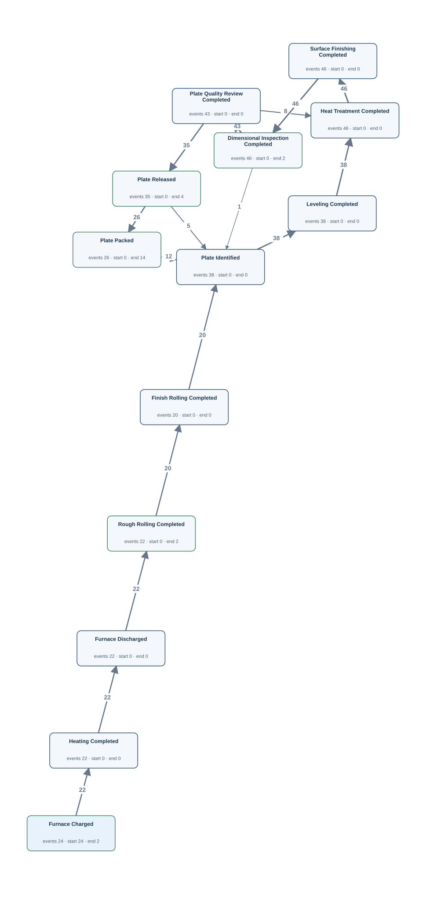</a></td><td width="58%" valign="top">
<a href="../../../datasets/plateflow_new/private/gold_sql/NF04.sql">Gold SQL</a> · <a href="../../../datasets/plateflow_new/private/gold_logs/NF04.csv">Gold CSV</a> · <a href="../../../datasets/plateflow_new/input/database.sqlite">Full source database (SQLite)</a>

<code>dimension_inspection</code> · 46 matched source rows
<table><tr><th>Column</th><th>Row 1</th><th>Row 2</th><th>Row 3</th></tr><tr><th>inspection_id</th><td>P007-1-1</td><td>P007-1-2</td><td>P007-2-1</td></tr><tr><th>plate_id</th><td>P007-1</td><td>P007-1</td><td>P007-2</td></tr><tr><th>inspected_at</th><td>2026-01-25T20:35:00Z</td><td>2026-01-25T21:55:00Z</td><td>2026-01-26T04:55:00Z</td></tr><tr><th>result_code</th><td>FAIL</td><td>PASS</td><td>PASS</td></tr><tr><th>thickness_mm</th><td>22.5</td><td>20.1</td><td>20.1</td></tr></table>
<strong>Gold output for the same source rows</strong>
<ul><li>Row 1 → Dimensional Inspection Completed · event DIM:P007-1-1 · case M:M007 · time from <code>inspected_at</code></li><li>Row 2 → Dimensional Inspection Completed · event DIM:P007-1-2 · case M:M007 · time from <code>inspected_at</code></li><li>Row 3 → Dimensional Inspection Completed · event DIM:P007-2-1 · case M:M007 · time from <code>inspected_at</code></li></ul>

<code>finishing_operation_history</code> · 130 matched source rows
<table><tr><th>Column</th><th>Row 1</th><th>Row 2</th><th>Row 3</th></tr><tr><th>operation_id</th><td>0001</td><td>0002</td><td>0003</td></tr><tr><th>plate_id</th><td>P007-1</td><td>P007-1</td><td>P007-1</td></tr><tr><th>process_group</th><td>FINISHING</td><td>FINISHING</td><td>FINISHING</td></tr><tr><th>operation_code</th><td>LEV</td><td>HT</td><td>SF</td></tr><tr><th>equipment_id</th><td>FI1</td><td>FI1</td><td>FI1</td></tr><tr><th>started_at</th><td>2026-01-25T19:35:00Z</td><td>2026-01-25T19:50:00Z</td><td>2026-01-25T20:15:00Z</td></tr><tr><th>finished_at</th><td>2026-01-25T19:45:00Z</td><td>2026-01-25T20:10:00Z</td><td>2026-01-25T20:25:00Z</td></tr></table>
<strong>Gold output for the same source rows</strong>
<ul><li>Row 1 → Leveling Completed · event TOP:0001 · case M:M007 · time from <code>finished_at</code></li><li>Row 2 → Heat Treatment Completed · event TOP:0002 · case M:M007 · time from <code>finished_at</code></li><li>Row 3 → Surface Finishing Completed · event TOP:0003 · case M:M007 · time from <code>finished_at</code></li></ul>

<code>furnace_operation_history</code> · 68 matched source rows
<table><tr><th>Column</th><th>Row 1</th><th>Row 2</th><th>Row 3</th></tr><tr><th>operation_id</th><td>0001</td><td>0002</td><td>0003</td></tr><tr><th>material_id</th><td>M007</td><td>M007</td><td>M007</td></tr><tr><th>process_group</th><td>FURNACE</td><td>FURNACE</td><td>FURNACE</td></tr><tr><th>operation_code</th><td>CH</td><td>HT</td><td>DS</td></tr><tr><th>equipment_id</th><td>FU2</td><td>FU2</td><td>FU2</td></tr><tr><th>started_at</th><td>2026-01-25T08:30:00Z</td><td>2026-01-25T08:45:00Z</td><td>2026-01-25T09:25:00Z</td></tr><tr><th>finished_at</th><td>2026-01-25T08:40:00Z</td><td>2026-01-25T09:20:00Z</td><td>2026-01-25T09:30:00Z</td></tr></table>
<strong>Gold output for the same source rows</strong>
<ul><li>Row 1 → Furnace Charged · event FOP:0001 · case M:M007 · time from <code>finished_at</code></li><li>Row 2 → Heating Completed · event FOP:0002 · case M:M007 · time from <code>finished_at</code></li><li>Row 3 → Furnace Discharged · event FOP:0003 · case M:M007 · time from <code>finished_at</code></li></ul>

<code>plate_material</code> · 38 matched source rows
<table><tr><th>Column</th><th>Row 1</th><th>Row 2</th><th>Row 3</th></tr><tr><th>plate_id</th><td>P007-1</td><td>P007-2</td><td>P008-1</td></tr><tr><th>plate_no</th><td>PIECE-7-1</td><td>PIECE-7-2</td><td>PIECE-8-1</td></tr><tr><th>mother_material_id</th><td>M007</td><td>M007</td><td>M008</td></tr><tr><th>identified_at</th><td>2026-01-25T19:30:00Z</td><td>2026-01-26T03:50:00Z</td><td>2026-01-29T06:50:00Z</td></tr><tr><th>released_at</th><td>2026-01-25T22:30:00Z</td><td>2026-01-26T05:30:00Z</td><td>2026-01-29T08:30:00Z</td></tr><tr><th>packed_at</th><td>2026-01-25T22:50:00Z</td><td>2026-01-26T05:50:00Z</td><td>2026-01-29T08:50:00Z</td></tr></table>
<strong>Gold output for the same source rows</strong>
<ul><li>Row 1 → Plate Identified · event PLATE:P007-1:identified · case M:M007 · time from <code>identified_at</code></li><li>Row 1 → Plate Packed · event PLATE:P007-1:packed · case M:M007 · time from <code>packed_at</code></li><li>Row 1 → Plate Released · event PLATE:P007-1:released · case M:M007 · time from <code>released_at</code></li><li>Row 2 → Plate Identified · event PLATE:P007-2:identified · case M:M007 · time from <code>identified_at</code></li><li>Row 2 → Plate Packed · event PLATE:P007-2:packed · case M:M007 · time from <code>packed_at</code></li><li>Row 2 → Plate Released · event PLATE:P007-2:released · case M:M007 · time from <code>released_at</code></li><li>Row 3 → Plate Identified · event PLATE:P008-1:identified · case M:M008 · time from <code>identified_at</code></li><li>Row 3 → Plate Packed · event PLATE:P008-1:packed · case M:M008 · time from <code>packed_at</code></li><li>Row 3 → Plate Released · event PLATE:P008-1:released · case M:M008 · time from <code>released_at</code></li></ul>

<code>plate_quality_review</code> · 43 matched source rows
<table><tr><th>Column</th><th>Row 1</th><th>Row 2</th><th>Row 3</th></tr><tr><th>review_id</th><td>P007-1-1</td><td>P007-1-2</td><td>P007-2-1</td></tr><tr><th>plate_id</th><td>P007-1</td><td>P007-1</td><td>P007-2</td></tr><tr><th>started_at</th><td>2026-01-25T20:40:00Z</td><td>2026-01-25T22:00:00Z</td><td>2026-01-26T05:00:00Z</td></tr><tr><th>finished_at</th><td>2026-01-25T20:50:00Z</td><td>2026-01-25T22:15:00Z</td><td>2026-01-26T05:10:00Z</td></tr><tr><th>review_status</th><td>REWORK</td><td>APPROVED</td><td>APPROVED</td></tr></table>
<strong>Gold output for the same source rows</strong>
<ul><li>Row 1 → Plate Quality Review Completed · event REV:P007-1-1 · case M:M007 · time from <code>finished_at</code></li><li>Row 2 → Plate Quality Review Completed · event REV:P007-1-2 · case M:M007 · time from <code>finished_at</code></li><li>Row 3 → Plate Quality Review Completed · event REV:P007-2-1 · case M:M007 · time from <code>finished_at</code></li></ul>

<code>rolling_operation_history</code> · 42 matched source rows
<table><tr><th>Column</th><th>Row 1</th><th>Row 2</th><th>Row 3</th></tr><tr><th>operation_id</th><td>0001</td><td>0002</td><td>0003</td></tr><tr><th>material_id</th><td>M007</td><td>M007</td><td>M008</td></tr><tr><th>process_group</th><td>ROLLING</td><td>ROLLING</td><td>ROLLING</td></tr><tr><th>phase_code</th><td>RR</td><td>FR</td><td>RR</td></tr><tr><th>equipment_id</th><td>RO2</td><td>RO2</td><td>RO1</td></tr><tr><th>started_at</th><td>2026-01-25T09:40:00Z</td><td>2026-01-25T10:10:00Z</td><td>2026-01-28T21:00:00Z</td></tr><tr><th>finished_at</th><td>2026-01-25T10:00:00Z</td><td>2026-01-25T10:35:00Z</td><td>2026-01-28T21:20:00Z</td></tr></table>
<strong>Gold output for the same source rows</strong>
<ul><li>Row 1 → Rough Rolling Completed · event ROP:0001 · case M:M007 · time from <code>finished_at</code></li><li>Row 2 → Finish Rolling Completed · event ROP:0002 · case M:M007 · time from <code>finished_at</code></li><li>Row 3 → Rough Rolling Completed · event ROP:0003 · case M:M008 · time from <code>finished_at</code></li></ul>

FK-linked case and join evidence
<ul><li><code>furnace_operation_history</code> → <code>as_rolled_material</code> · material_id → material_id · material_id = M007</li></ul>
</td></tr></table>

## NF04P — Q4

Show the whole recorded lifecycle of every mother material.

Events: **428** · Cases with events: **24** · Activities: **13** · Edges: **16** · Source tables: **6** · SQL tables: **7**

<table><tr><td width="42%" valign="top"></td><td width="58%" valign="top">
<a href="../../../datasets/plateflow_new/private/gold_sql/NF04P.sql">Gold SQL</a> · <a href="../../../datasets/plateflow_new/private/gold_logs/NF04P.csv">Gold CSV</a> · <a href="../../../datasets/plateflow_new/input/database.sqlite">Full source database (SQLite)</a>

<code>dimension_inspection</code> · 46 matched source rows
<table><tr><th>Column</th><th>Row 1</th><th>Row 2</th><th>Row 3</th></tr><tr><th>inspection_id</th><td>P007-1-1</td><td>P007-1-2</td><td>P007-2-1</td></tr><tr><th>plate_id</th><td>P007-1</td><td>P007-1</td><td>P007-2</td></tr><tr><th>inspected_at</th><td>2026-01-25T20:35:00Z</td><td>2026-01-25T21:55:00Z</td><td>2026-01-26T04:55:00Z</td></tr><tr><th>result_code</th><td>FAIL</td><td>PASS</td><td>PASS</td></tr><tr><th>thickness_mm</th><td>22.5</td><td>20.1</td><td>20.1</td></tr></table>
<strong>Gold output for the same source rows</strong>
<ul><li>Row 1 → Dimensional Inspection Completed · event DIM:P007-1-1 · case M:M007 · time from <code>inspected_at</code></li><li>Row 2 → Dimensional Inspection Completed · event DIM:P007-1-2 · case M:M007 · time from <code>inspected_at</code></li><li>Row 3 → Dimensional Inspection Completed · event DIM:P007-2-1 · case M:M007 · time from <code>inspected_at</code></li></ul>

<code>finishing_operation_history</code> · 130 matched source rows
<table><tr><th>Column</th><th>Row 1</th><th>Row 2</th><th>Row 3</th></tr><tr><th>operation_id</th><td>0001</td><td>0002</td><td>0003</td></tr><tr><th>plate_id</th><td>P007-1</td><td>P007-1</td><td>P007-1</td></tr><tr><th>process_group</th><td>FINISHING</td><td>FINISHING</td><td>FINISHING</td></tr><tr><th>operation_code</th><td>LEV</td><td>HT</td><td>SF</td></tr><tr><th>equipment_id</th><td>FI1</td><td>FI1</td><td>FI1</td></tr><tr><th>started_at</th><td>2026-01-25T19:35:00Z</td><td>2026-01-25T19:50:00Z</td><td>2026-01-25T20:15:00Z</td></tr><tr><th>finished_at</th><td>2026-01-25T19:45:00Z</td><td>2026-01-25T20:10:00Z</td><td>2026-01-25T20:25:00Z</td></tr></table>
<strong>Gold output for the same source rows</strong>
<ul><li>Row 1 → Leveling Completed · event TOP:0001 · case M:M007 · time from <code>finished_at</code></li><li>Row 2 → Heat Treatment Completed · event TOP:0002 · case M:M007 · time from <code>finished_at</code></li><li>Row 3 → Surface Finishing Completed · event TOP:0003 · case M:M007 · time from <code>finished_at</code></li></ul>

<code>furnace_operation_history</code> · 68 matched source rows
<table><tr><th>Column</th><th>Row 1</th><th>Row 2</th><th>Row 3</th></tr><tr><th>operation_id</th><td>0001</td><td>0002</td><td>0003</td></tr><tr><th>material_id</th><td>M007</td><td>M007</td><td>M007</td></tr><tr><th>process_group</th><td>FURNACE</td><td>FURNACE</td><td>FURNACE</td></tr><tr><th>operation_code</th><td>CH</td><td>HT</td><td>DS</td></tr><tr><th>equipment_id</th><td>FU2</td><td>FU2</td><td>FU2</td></tr><tr><th>started_at</th><td>2026-01-25T08:30:00Z</td><td>2026-01-25T08:45:00Z</td><td>2026-01-25T09:25:00Z</td></tr><tr><th>finished_at</th><td>2026-01-25T08:40:00Z</td><td>2026-01-25T09:20:00Z</td><td>2026-01-25T09:30:00Z</td></tr></table>
<strong>Gold output for the same source rows</strong>
<ul><li>Row 1 → Furnace Charged · event FOP:0001 · case M:M007 · time from <code>finished_at</code></li><li>Row 2 → Heating Completed · event FOP:0002 · case M:M007 · time from <code>finished_at</code></li><li>Row 3 → Furnace Discharged · event FOP:0003 · case M:M007 · time from <code>finished_at</code></li></ul>

<code>plate_material</code> · 38 matched source rows
<table><tr><th>Column</th><th>Row 1</th><th>Row 2</th><th>Row 3</th></tr><tr><th>plate_id</th><td>P007-1</td><td>P007-2</td><td>P008-1</td></tr><tr><th>plate_no</th><td>PIECE-7-1</td><td>PIECE-7-2</td><td>PIECE-8-1</td></tr><tr><th>mother_material_id</th><td>M007</td><td>M007</td><td>M008</td></tr><tr><th>identified_at</th><td>2026-01-25T19:30:00Z</td><td>2026-01-26T03:50:00Z</td><td>2026-01-29T06:50:00Z</td></tr><tr><th>released_at</th><td>2026-01-25T22:30:00Z</td><td>2026-01-26T05:30:00Z</td><td>2026-01-29T08:30:00Z</td></tr><tr><th>packed_at</th><td>2026-01-25T22:50:00Z</td><td>2026-01-26T05:50:00Z</td><td>2026-01-29T08:50:00Z</td></tr></table>
<strong>Gold output for the same source rows</strong>
<ul><li>Row 1 → Plate Identified · event PLATE:P007-1:identified · case M:M007 · time from <code>identified_at</code></li><li>Row 1 → Plate Packed · event PLATE:P007-1:packed · case M:M007 · time from <code>packed_at</code></li><li>Row 1 → Plate Released · event PLATE:P007-1:released · case M:M007 · time from <code>released_at</code></li><li>Row 2 → Plate Identified · event PLATE:P007-2:identified · case M:M007 · time from <code>identified_at</code></li><li>Row 2 → Plate Packed · event PLATE:P007-2:packed · case M:M007 · time from <code>packed_at</code></li><li>Row 2 → Plate Released · event PLATE:P007-2:released · case M:M007 · time from <code>released_at</code></li><li>Row 3 → Plate Identified · event PLATE:P008-1:identified · case M:M008 · time from <code>identified_at</code></li><li>Row 3 → Plate Packed · event PLATE:P008-1:packed · case M:M008 · time from <code>packed_at</code></li><li>Row 3 → Plate Released · event PLATE:P008-1:released · case M:M008 · time from <code>released_at</code></li></ul>

<code>plate_quality_review</code> · 43 matched source rows
<table><tr><th>Column</th><th>Row 1</th><th>Row 2</th><th>Row 3</th></tr><tr><th>review_id</th><td>P007-1-1</td><td>P007-1-2</td><td>P007-2-1</td></tr><tr><th>plate_id</th><td>P007-1</td><td>P007-1</td><td>P007-2</td></tr><tr><th>started_at</th><td>2026-01-25T20:40:00Z</td><td>2026-01-25T22:00:00Z</td><td>2026-01-26T05:00:00Z</td></tr><tr><th>finished_at</th><td>2026-01-25T20:50:00Z</td><td>2026-01-25T22:15:00Z</td><td>2026-01-26T05:10:00Z</td></tr><tr><th>review_status</th><td>REWORK</td><td>APPROVED</td><td>APPROVED</td></tr></table>
<strong>Gold output for the same source rows</strong>
<ul><li>Row 1 → Plate Quality Review Completed · event REV:P007-1-1 · case M:M007 · time from <code>finished_at</code></li><li>Row 2 → Plate Quality Review Completed · event REV:P007-1-2 · case M:M007 · time from <code>finished_at</code></li><li>Row 3 → Plate Quality Review Completed · event REV:P007-2-1 · case M:M007 · time from <code>finished_at</code></li></ul>

<code>rolling_operation_history</code> · 42 matched source rows
<table><tr><th>Column</th><th>Row 1</th><th>Row 2</th><th>Row 3</th></tr><tr><th>operation_id</th><td>0001</td><td>0002</td><td>0003</td></tr><tr><th>material_id</th><td>M007</td><td>M007</td><td>M008</td></tr><tr><th>process_group</th><td>ROLLING</td><td>ROLLING</td><td>ROLLING</td></tr><tr><th>phase_code</th><td>RR</td><td>FR</td><td>RR</td></tr><tr><th>equipment_id</th><td>RO2</td><td>RO2</td><td>RO1</td></tr><tr><th>started_at</th><td>2026-01-25T09:40:00Z</td><td>2026-01-25T10:10:00Z</td><td>2026-01-28T21:00:00Z</td></tr><tr><th>finished_at</th><td>2026-01-25T10:00:00Z</td><td>2026-01-25T10:35:00Z</td><td>2026-01-28T21:20:00Z</td></tr></table>
<strong>Gold output for the same source rows</strong>
<ul><li>Row 1 → Rough Rolling Completed · event ROP:0001 · case M:M007 · time from <code>finished_at</code></li><li>Row 2 → Finish Rolling Completed · event ROP:0002 · case M:M007 · time from <code>finished_at</code></li><li>Row 3 → Rough Rolling Completed · event ROP:0003 · case M:M008 · time from <code>finished_at</code></li></ul>

FK-linked case and join evidence
<ul><li><code>furnace_operation_history</code> → <code>as_rolled_material</code> · material_id → material_id · material_id = M007</li></ul>
</td></tr></table>

## NF05 — Q3

Extract the full recorded lifecycle for each plate piece.

Events: **318** · Cases with events: **38** · Activities: **8** · Edges: **8** · Source tables: **4** · SQL tables: **5**

<table><tr><td width="42%" valign="top"><a href="graphs/NF05.svg">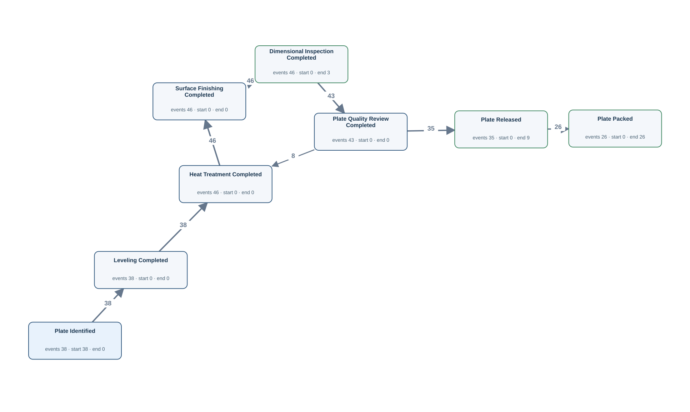</a></td><td width="58%" valign="top">
<a href="../../../datasets/plateflow_new/private/gold_sql/NF05.sql">Gold SQL</a> · <a href="../../../datasets/plateflow_new/private/gold_logs/NF05.csv">Gold CSV</a> · <a href="../../../datasets/plateflow_new/input/database.sqlite">Full source database (SQLite)</a>

<code>dimension_inspection</code> · 46 matched source rows
<table><tr><th>Column</th><th>Row 1</th><th>Row 2</th><th>Row 3</th></tr><tr><th>inspection_id</th><td>P007-1-1</td><td>P007-1-2</td><td>P007-2-1</td></tr><tr><th>plate_id</th><td>P007-1</td><td>P007-1</td><td>P007-2</td></tr><tr><th>inspected_at</th><td>2026-01-25T20:35:00Z</td><td>2026-01-25T21:55:00Z</td><td>2026-01-26T04:55:00Z</td></tr><tr><th>result_code</th><td>FAIL</td><td>PASS</td><td>PASS</td></tr><tr><th>thickness_mm</th><td>22.5</td><td>20.1</td><td>20.1</td></tr></table>
<strong>Gold output for the same source rows</strong>
<ul><li>Row 1 → Dimensional Inspection Completed · event DIM:P007-1-1 · case P:P007-1 · time from <code>inspected_at</code></li><li>Row 2 → Dimensional Inspection Completed · event DIM:P007-1-2 · case P:P007-1 · time from <code>inspected_at</code></li><li>Row 3 → Dimensional Inspection Completed · event DIM:P007-2-1 · case P:P007-2 · time from <code>inspected_at</code></li></ul>

<code>finishing_operation_history</code> · 130 matched source rows
<table><tr><th>Column</th><th>Row 1</th><th>Row 2</th><th>Row 3</th></tr><tr><th>operation_id</th><td>0001</td><td>0002</td><td>0003</td></tr><tr><th>plate_id</th><td>P007-1</td><td>P007-1</td><td>P007-1</td></tr><tr><th>process_group</th><td>FINISHING</td><td>FINISHING</td><td>FINISHING</td></tr><tr><th>operation_code</th><td>LEV</td><td>HT</td><td>SF</td></tr><tr><th>equipment_id</th><td>FI1</td><td>FI1</td><td>FI1</td></tr><tr><th>started_at</th><td>2026-01-25T19:35:00Z</td><td>2026-01-25T19:50:00Z</td><td>2026-01-25T20:15:00Z</td></tr><tr><th>finished_at</th><td>2026-01-25T19:45:00Z</td><td>2026-01-25T20:10:00Z</td><td>2026-01-25T20:25:00Z</td></tr></table>
<strong>Gold output for the same source rows</strong>
<ul><li>Row 1 → Leveling Completed · event TOP:0001 · case P:P007-1 · time from <code>finished_at</code></li><li>Row 2 → Heat Treatment Completed · event TOP:0002 · case P:P007-1 · time from <code>finished_at</code></li><li>Row 3 → Surface Finishing Completed · event TOP:0003 · case P:P007-1 · time from <code>finished_at</code></li></ul>

<code>plate_material</code> · 38 matched source rows
<table><tr><th>Column</th><th>Row 1</th><th>Row 2</th><th>Row 3</th></tr><tr><th>plate_id</th><td>P007-1</td><td>P007-2</td><td>P008-1</td></tr><tr><th>plate_no</th><td>PIECE-7-1</td><td>PIECE-7-2</td><td>PIECE-8-1</td></tr><tr><th>mother_material_id</th><td>M007</td><td>M007</td><td>M008</td></tr><tr><th>identified_at</th><td>2026-01-25T19:30:00Z</td><td>2026-01-26T03:50:00Z</td><td>2026-01-29T06:50:00Z</td></tr><tr><th>released_at</th><td>2026-01-25T22:30:00Z</td><td>2026-01-26T05:30:00Z</td><td>2026-01-29T08:30:00Z</td></tr><tr><th>packed_at</th><td>2026-01-25T22:50:00Z</td><td>2026-01-26T05:50:00Z</td><td>2026-01-29T08:50:00Z</td></tr></table>
<strong>Gold output for the same source rows</strong>
<ul><li>Row 1 → Plate Identified · event PLATE:P007-1:identified · case P:P007-1 · time from <code>identified_at</code></li><li>Row 1 → Plate Packed · event PLATE:P007-1:packed · case P:P007-1 · time from <code>packed_at</code></li><li>Row 1 → Plate Released · event PLATE:P007-1:released · case P:P007-1 · time from <code>released_at</code></li><li>Row 2 → Plate Identified · event PLATE:P007-2:identified · case P:P007-2 · time from <code>identified_at</code></li><li>Row 2 → Plate Packed · event PLATE:P007-2:packed · case P:P007-2 · time from <code>packed_at</code></li><li>Row 2 → Plate Released · event PLATE:P007-2:released · case P:P007-2 · time from <code>released_at</code></li><li>Row 3 → Plate Identified · event PLATE:P008-1:identified · case P:P008-1 · time from <code>identified_at</code></li><li>Row 3 → Plate Packed · event PLATE:P008-1:packed · case P:P008-1 · time from <code>packed_at</code></li><li>Row 3 → Plate Released · event PLATE:P008-1:released · case P:P008-1 · time from <code>released_at</code></li></ul>

<code>plate_quality_review</code> · 43 matched source rows
<table><tr><th>Column</th><th>Row 1</th><th>Row 2</th><th>Row 3</th></tr><tr><th>review_id</th><td>P007-1-1</td><td>P007-1-2</td><td>P007-2-1</td></tr><tr><th>plate_id</th><td>P007-1</td><td>P007-1</td><td>P007-2</td></tr><tr><th>started_at</th><td>2026-01-25T20:40:00Z</td><td>2026-01-25T22:00:00Z</td><td>2026-01-26T05:00:00Z</td></tr><tr><th>finished_at</th><td>2026-01-25T20:50:00Z</td><td>2026-01-25T22:15:00Z</td><td>2026-01-26T05:10:00Z</td></tr><tr><th>review_status</th><td>REWORK</td><td>APPROVED</td><td>APPROVED</td></tr></table>
<strong>Gold output for the same source rows</strong>
<ul><li>Row 1 → Plate Quality Review Completed · event REV:P007-1-1 · case P:P007-1 · time from <code>finished_at</code></li><li>Row 2 → Plate Quality Review Completed · event REV:P007-1-2 · case P:P007-1 · time from <code>finished_at</code></li><li>Row 3 → Plate Quality Review Completed · event REV:P007-2-1 · case P:P007-2 · time from <code>finished_at</code></li></ul>

FK-linked case and join evidence
<ul><li><code>plate_material</code> → <code>as_rolled_material</code> · mother_material_id → material_id · material_id = M007</li></ul>
</td></tr></table>

## NF05P — Q4

Build a complete timeline of the recorded history of each plate piece.

Events: **318** · Cases with events: **38** · Activities: **8** · Edges: **8** · Source tables: **4** · SQL tables: **5**

<table><tr><td width="42%" valign="top"></td><td width="58%" valign="top">
<a href="../../../datasets/plateflow_new/private/gold_sql/NF05P.sql">Gold SQL</a> · <a href="../../../datasets/plateflow_new/private/gold_logs/NF05P.csv">Gold CSV</a> · <a href="../../../datasets/plateflow_new/input/database.sqlite">Full source database (SQLite)</a>

<code>dimension_inspection</code> · 46 matched source rows
<table><tr><th>Column</th><th>Row 1</th><th>Row 2</th><th>Row 3</th></tr><tr><th>inspection_id</th><td>P007-1-1</td><td>P007-1-2</td><td>P007-2-1</td></tr><tr><th>plate_id</th><td>P007-1</td><td>P007-1</td><td>P007-2</td></tr><tr><th>inspected_at</th><td>2026-01-25T20:35:00Z</td><td>2026-01-25T21:55:00Z</td><td>2026-01-26T04:55:00Z</td></tr><tr><th>result_code</th><td>FAIL</td><td>PASS</td><td>PASS</td></tr><tr><th>thickness_mm</th><td>22.5</td><td>20.1</td><td>20.1</td></tr></table>
<strong>Gold output for the same source rows</strong>
<ul><li>Row 1 → Dimensional Inspection Completed · event DIM:P007-1-1 · case P:P007-1 · time from <code>inspected_at</code></li><li>Row 2 → Dimensional Inspection Completed · event DIM:P007-1-2 · case P:P007-1 · time from <code>inspected_at</code></li><li>Row 3 → Dimensional Inspection Completed · event DIM:P007-2-1 · case P:P007-2 · time from <code>inspected_at</code></li></ul>

<code>finishing_operation_history</code> · 130 matched source rows
<table><tr><th>Column</th><th>Row 1</th><th>Row 2</th><th>Row 3</th></tr><tr><th>operation_id</th><td>0001</td><td>0002</td><td>0003</td></tr><tr><th>plate_id</th><td>P007-1</td><td>P007-1</td><td>P007-1</td></tr><tr><th>process_group</th><td>FINISHING</td><td>FINISHING</td><td>FINISHING</td></tr><tr><th>operation_code</th><td>LEV</td><td>HT</td><td>SF</td></tr><tr><th>equipment_id</th><td>FI1</td><td>FI1</td><td>FI1</td></tr><tr><th>started_at</th><td>2026-01-25T19:35:00Z</td><td>2026-01-25T19:50:00Z</td><td>2026-01-25T20:15:00Z</td></tr><tr><th>finished_at</th><td>2026-01-25T19:45:00Z</td><td>2026-01-25T20:10:00Z</td><td>2026-01-25T20:25:00Z</td></tr></table>
<strong>Gold output for the same source rows</strong>
<ul><li>Row 1 → Leveling Completed · event TOP:0001 · case P:P007-1 · time from <code>finished_at</code></li><li>Row 2 → Heat Treatment Completed · event TOP:0002 · case P:P007-1 · time from <code>finished_at</code></li><li>Row 3 → Surface Finishing Completed · event TOP:0003 · case P:P007-1 · time from <code>finished_at</code></li></ul>

<code>plate_material</code> · 38 matched source rows
<table><tr><th>Column</th><th>Row 1</th><th>Row 2</th><th>Row 3</th></tr><tr><th>plate_id</th><td>P007-1</td><td>P007-2</td><td>P008-1</td></tr><tr><th>plate_no</th><td>PIECE-7-1</td><td>PIECE-7-2</td><td>PIECE-8-1</td></tr><tr><th>mother_material_id</th><td>M007</td><td>M007</td><td>M008</td></tr><tr><th>identified_at</th><td>2026-01-25T19:30:00Z</td><td>2026-01-26T03:50:00Z</td><td>2026-01-29T06:50:00Z</td></tr><tr><th>released_at</th><td>2026-01-25T22:30:00Z</td><td>2026-01-26T05:30:00Z</td><td>2026-01-29T08:30:00Z</td></tr><tr><th>packed_at</th><td>2026-01-25T22:50:00Z</td><td>2026-01-26T05:50:00Z</td><td>2026-01-29T08:50:00Z</td></tr></table>
<strong>Gold output for the same source rows</strong>
<ul><li>Row 1 → Plate Identified · event PLATE:P007-1:identified · case P:P007-1 · time from <code>identified_at</code></li><li>Row 1 → Plate Packed · event PLATE:P007-1:packed · case P:P007-1 · time from <code>packed_at</code></li><li>Row 1 → Plate Released · event PLATE:P007-1:released · case P:P007-1 · time from <code>released_at</code></li><li>Row 2 → Plate Identified · event PLATE:P007-2:identified · case P:P007-2 · time from <code>identified_at</code></li><li>Row 2 → Plate Packed · event PLATE:P007-2:packed · case P:P007-2 · time from <code>packed_at</code></li><li>Row 2 → Plate Released · event PLATE:P007-2:released · case P:P007-2 · time from <code>released_at</code></li><li>Row 3 → Plate Identified · event PLATE:P008-1:identified · case P:P008-1 · time from <code>identified_at</code></li><li>Row 3 → Plate Packed · event PLATE:P008-1:packed · case P:P008-1 · time from <code>packed_at</code></li><li>Row 3 → Plate Released · event PLATE:P008-1:released · case P:P008-1 · time from <code>released_at</code></li></ul>

<code>plate_quality_review</code> · 43 matched source rows
<table><tr><th>Column</th><th>Row 1</th><th>Row 2</th><th>Row 3</th></tr><tr><th>review_id</th><td>P007-1-1</td><td>P007-1-2</td><td>P007-2-1</td></tr><tr><th>plate_id</th><td>P007-1</td><td>P007-1</td><td>P007-2</td></tr><tr><th>started_at</th><td>2026-01-25T20:40:00Z</td><td>2026-01-25T22:00:00Z</td><td>2026-01-26T05:00:00Z</td></tr><tr><th>finished_at</th><td>2026-01-25T20:50:00Z</td><td>2026-01-25T22:15:00Z</td><td>2026-01-26T05:10:00Z</td></tr><tr><th>review_status</th><td>REWORK</td><td>APPROVED</td><td>APPROVED</td></tr></table>
<strong>Gold output for the same source rows</strong>
<ul><li>Row 1 → Plate Quality Review Completed · event REV:P007-1-1 · case P:P007-1 · time from <code>finished_at</code></li><li>Row 2 → Plate Quality Review Completed · event REV:P007-1-2 · case P:P007-1 · time from <code>finished_at</code></li><li>Row 3 → Plate Quality Review Completed · event REV:P007-2-1 · case P:P007-2 · time from <code>finished_at</code></li></ul>

FK-linked case and join evidence
<ul><li><code>plate_material</code> → <code>as_rolled_material</code> · mother_material_id → material_id · material_id = M007</li></ul>
</td></tr></table>

## NF06 — Q3

Extract the full recorded lifecycle for each dimension inspection record.

Events: **46** · Cases with events: **46** · Activities: **1** · Edges: **0** · Source tables: **1** · SQL tables: **1**

<table><tr><td width="42%" valign="top"></td><td width="58%" valign="top">
<a href="../../../datasets/plateflow_new/private/gold_sql/NF06.sql">Gold SQL</a> · <a href="../../../datasets/plateflow_new/private/gold_logs/NF06.csv">Gold CSV</a> · <a href="../../../datasets/plateflow_new/input/database.sqlite">Full source database (SQLite)</a>

<code>dimension_inspection</code> · 46 matched source rows
<table><tr><th>Column</th><th>Row 1</th><th>Row 2</th><th>Row 3</th></tr><tr><th>inspection_id</th><td>P007-1-1</td><td>P007-1-2</td><td>P007-2-1</td></tr><tr><th>plate_id</th><td>P007-1</td><td>P007-1</td><td>P007-2</td></tr><tr><th>inspected_at</th><td>2026-01-25T20:35:00Z</td><td>2026-01-25T21:55:00Z</td><td>2026-01-26T04:55:00Z</td></tr><tr><th>result_code</th><td>FAIL</td><td>PASS</td><td>PASS</td></tr><tr><th>thickness_mm</th><td>22.5</td><td>20.1</td><td>20.1</td></tr></table>
<strong>Gold output for the same source rows</strong>
<ul><li>Row 1 → Dimensional Inspection Completed · event DIM:P007-1-1 · case DIM:P007-1-1 · time from <code>inspected_at</code></li><li>Row 2 → Dimensional Inspection Completed · event DIM:P007-1-2 · case DIM:P007-1-2 · time from <code>inspected_at</code></li><li>Row 3 → Dimensional Inspection Completed · event DIM:P007-2-1 · case DIM:P007-2-1 · time from <code>inspected_at</code></li></ul>
</td></tr></table>

## NF06P — Q4

Show the entire recorded history of every individual dimensional inspection record.

Events: **46** · Cases with events: **46** · Activities: **1** · Edges: **0** · Source tables: **1** · SQL tables: **1**

<table><tr><td width="42%" valign="top"></td><td width="58%" valign="top">
<a href="../../../datasets/plateflow_new/private/gold_sql/NF06P.sql">Gold SQL</a> · <a href="../../../datasets/plateflow_new/private/gold_logs/NF06P.csv">Gold CSV</a> · <a href="../../../datasets/plateflow_new/input/database.sqlite">Full source database (SQLite)</a>

<code>dimension_inspection</code> · 46 matched source rows
<table><tr><th>Column</th><th>Row 1</th><th>Row 2</th><th>Row 3</th></tr><tr><th>inspection_id</th><td>P007-1-1</td><td>P007-1-2</td><td>P007-2-1</td></tr><tr><th>plate_id</th><td>P007-1</td><td>P007-1</td><td>P007-2</td></tr><tr><th>inspected_at</th><td>2026-01-25T20:35:00Z</td><td>2026-01-25T21:55:00Z</td><td>2026-01-26T04:55:00Z</td></tr><tr><th>result_code</th><td>FAIL</td><td>PASS</td><td>PASS</td></tr><tr><th>thickness_mm</th><td>22.5</td><td>20.1</td><td>20.1</td></tr></table>
<strong>Gold output for the same source rows</strong>
<ul><li>Row 1 → Dimensional Inspection Completed · event DIM:P007-1-1 · case DIM:P007-1-1 · time from <code>inspected_at</code></li><li>Row 2 → Dimensional Inspection Completed · event DIM:P007-1-2 · case DIM:P007-1-2 · time from <code>inspected_at</code></li><li>Row 3 → Dimensional Inspection Completed · event DIM:P007-2-1 · case DIM:P007-2-1 · time from <code>inspected_at</code></li></ul>
</td></tr></table>

## NF07 — Q3

Extract the full recorded lifecycle for each quality review record.

Events: **43** · Cases with events: **43** · Activities: **1** · Edges: **0** · Source tables: **1** · SQL tables: **1**

<table><tr><td width="42%" valign="top"></td><td width="58%" valign="top">
<a href="../../../datasets/plateflow_new/private/gold_sql/NF07.sql">Gold SQL</a> · <a href="../../../datasets/plateflow_new/private/gold_logs/NF07.csv">Gold CSV</a> · <a href="../../../datasets/plateflow_new/input/database.sqlite">Full source database (SQLite)</a>

<code>plate_quality_review</code> · 43 matched source rows
<table><tr><th>Column</th><th>Row 1</th><th>Row 2</th><th>Row 3</th></tr><tr><th>review_id</th><td>P007-1-1</td><td>P007-1-2</td><td>P007-2-1</td></tr><tr><th>plate_id</th><td>P007-1</td><td>P007-1</td><td>P007-2</td></tr><tr><th>started_at</th><td>2026-01-25T20:40:00Z</td><td>2026-01-25T22:00:00Z</td><td>2026-01-26T05:00:00Z</td></tr><tr><th>finished_at</th><td>2026-01-25T20:50:00Z</td><td>2026-01-25T22:15:00Z</td><td>2026-01-26T05:10:00Z</td></tr><tr><th>review_status</th><td>REWORK</td><td>APPROVED</td><td>APPROVED</td></tr></table>
<strong>Gold output for the same source rows</strong>
<ul><li>Row 1 → Plate Quality Review Completed · event REV:P007-1-1 · case REV:P007-1-1 · time from <code>finished_at</code></li><li>Row 2 → Plate Quality Review Completed · event REV:P007-1-2 · case REV:P007-1-2 · time from <code>finished_at</code></li><li>Row 3 → Plate Quality Review Completed · event REV:P007-2-1 · case REV:P007-2-1 · time from <code>finished_at</code></li></ul>
</td></tr></table>

## NF07P — Q4

Trace each individual quality review record through its complete recorded history.

Events: **43** · Cases with events: **43** · Activities: **1** · Edges: **0** · Source tables: **1** · SQL tables: **1**

<table><tr><td width="42%" valign="top"></td><td width="58%" valign="top">
<a href="../../../datasets/plateflow_new/private/gold_sql/NF07P.sql">Gold SQL</a> · <a href="../../../datasets/plateflow_new/private/gold_logs/NF07P.csv">Gold CSV</a> · <a href="../../../datasets/plateflow_new/input/database.sqlite">Full source database (SQLite)</a>

<code>plate_quality_review</code> · 43 matched source rows
<table><tr><th>Column</th><th>Row 1</th><th>Row 2</th><th>Row 3</th></tr><tr><th>review_id</th><td>P007-1-1</td><td>P007-1-2</td><td>P007-2-1</td></tr><tr><th>plate_id</th><td>P007-1</td><td>P007-1</td><td>P007-2</td></tr><tr><th>started_at</th><td>2026-01-25T20:40:00Z</td><td>2026-01-25T22:00:00Z</td><td>2026-01-26T05:00:00Z</td></tr><tr><th>finished_at</th><td>2026-01-25T20:50:00Z</td><td>2026-01-25T22:15:00Z</td><td>2026-01-26T05:10:00Z</td></tr><tr><th>review_status</th><td>REWORK</td><td>APPROVED</td><td>APPROVED</td></tr></table>
<strong>Gold output for the same source rows</strong>
<ul><li>Row 1 → Plate Quality Review Completed · event REV:P007-1-1 · case REV:P007-1-1 · time from <code>finished_at</code></li><li>Row 2 → Plate Quality Review Completed · event REV:P007-1-2 · case REV:P007-1-2 · time from <code>finished_at</code></li><li>Row 3 → Plate Quality Review Completed · event REV:P007-2-1 · case REV:P007-2-1 · time from <code>finished_at</code></li></ul>
</td></tr></table>

## NF08 — Q3

Extract the full recorded lifecycle for each equipment unit.

Events: **240** · Cases with events: **6** · Activities: **8** · Edges: **11** · Source tables: **3** · SQL tables: **3**

<table><tr><td width="42%" valign="top"><a href="graphs/NF08.svg">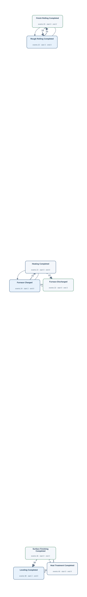</a></td><td width="58%" valign="top">
<a href="../../../datasets/plateflow_new/private/gold_sql/NF08.sql">Gold SQL</a> · <a href="../../../datasets/plateflow_new/private/gold_logs/NF08.csv">Gold CSV</a> · <a href="../../../datasets/plateflow_new/input/database.sqlite">Full source database (SQLite)</a>

<code>finishing_operation_history</code> · 130 matched source rows
<table><tr><th>Column</th><th>Row 1</th><th>Row 2</th><th>Row 3</th></tr><tr><th>operation_id</th><td>0001</td><td>0002</td><td>0003</td></tr><tr><th>plate_id</th><td>P007-1</td><td>P007-1</td><td>P007-1</td></tr><tr><th>process_group</th><td>FINISHING</td><td>FINISHING</td><td>FINISHING</td></tr><tr><th>operation_code</th><td>LEV</td><td>HT</td><td>SF</td></tr><tr><th>equipment_id</th><td>FI1</td><td>FI1</td><td>FI1</td></tr><tr><th>started_at</th><td>2026-01-25T19:35:00Z</td><td>2026-01-25T19:50:00Z</td><td>2026-01-25T20:15:00Z</td></tr><tr><th>finished_at</th><td>2026-01-25T19:45:00Z</td><td>2026-01-25T20:10:00Z</td><td>2026-01-25T20:25:00Z</td></tr></table>
<strong>Gold output for the same source rows</strong>
<ul><li>Row 1 → Leveling Completed · event TOP:0001 · case E:FI1 · time from <code>finished_at</code></li><li>Row 2 → Heat Treatment Completed · event TOP:0002 · case E:FI1 · time from <code>finished_at</code></li><li>Row 3 → Surface Finishing Completed · event TOP:0003 · case E:FI1 · time from <code>finished_at</code></li></ul>

<code>furnace_operation_history</code> · 68 matched source rows
<table><tr><th>Column</th><th>Row 1</th><th>Row 2</th><th>Row 3</th></tr><tr><th>operation_id</th><td>0004</td><td>0005</td><td>0006</td></tr><tr><th>material_id</th><td>M008</td><td>M008</td><td>M008</td></tr><tr><th>process_group</th><td>FURNACE</td><td>FURNACE</td><td>FURNACE</td></tr><tr><th>operation_code</th><td>CH</td><td>HT</td><td>DS</td></tr><tr><th>equipment_id</th><td>FU1</td><td>FU1</td><td>FU1</td></tr><tr><th>started_at</th><td>2026-01-28T19:50:00Z</td><td>2026-01-28T20:05:00Z</td><td>2026-01-28T20:45:00Z</td></tr><tr><th>finished_at</th><td>2026-01-28T20:00:00Z</td><td>2026-01-28T20:40:00Z</td><td>2026-01-28T20:50:00Z</td></tr></table>
<strong>Gold output for the same source rows</strong>
<ul><li>Row 1 → Furnace Charged · event FOP:0004 · case E:FU1 · time from <code>finished_at</code></li><li>Row 2 → Heating Completed · event FOP:0005 · case E:FU1 · time from <code>finished_at</code></li><li>Row 3 → Furnace Discharged · event FOP:0006 · case E:FU1 · time from <code>finished_at</code></li></ul>

<code>rolling_operation_history</code> · 42 matched source rows
<table><tr><th>Column</th><th>Row 1</th><th>Row 2</th><th>Row 3</th></tr><tr><th>operation_id</th><td>0003</td><td>0004</td><td>0007</td></tr><tr><th>material_id</th><td>M008</td><td>M008</td><td>M010</td></tr><tr><th>process_group</th><td>ROLLING</td><td>ROLLING</td><td>ROLLING</td></tr><tr><th>phase_code</th><td>RR</td><td>FR</td><td>RR</td></tr><tr><th>equipment_id</th><td>RO1</td><td>RO1</td><td>RO1</td></tr><tr><th>started_at</th><td>2026-01-28T21:00:00Z</td><td>2026-01-28T21:30:00Z</td><td>2026-02-04T19:40:00Z</td></tr><tr><th>finished_at</th><td>2026-01-28T21:20:00Z</td><td>2026-01-28T21:55:00Z</td><td>2026-02-04T20:00:00Z</td></tr></table>
<strong>Gold output for the same source rows</strong>
<ul><li>Row 1 → Rough Rolling Completed · event ROP:0003 · case E:RO1 · time from <code>finished_at</code></li><li>Row 2 → Finish Rolling Completed · event ROP:0004 · case E:RO1 · time from <code>finished_at</code></li><li>Row 3 → Rough Rolling Completed · event ROP:0007 · case E:RO1 · time from <code>finished_at</code></li></ul>
</td></tr></table>

## NF08P — Q4

Show the full recorded history associated with every equipment unit.

Events: **240** · Cases with events: **6** · Activities: **8** · Edges: **11** · Source tables: **3** · SQL tables: **3**

<table><tr><td width="42%" valign="top"></td><td width="58%" valign="top">
<a href="../../../datasets/plateflow_new/private/gold_sql/NF08P.sql">Gold SQL</a> · <a href="../../../datasets/plateflow_new/private/gold_logs/NF08P.csv">Gold CSV</a> · <a href="../../../datasets/plateflow_new/input/database.sqlite">Full source database (SQLite)</a>

<code>finishing_operation_history</code> · 130 matched source rows
<table><tr><th>Column</th><th>Row 1</th><th>Row 2</th><th>Row 3</th></tr><tr><th>operation_id</th><td>0001</td><td>0002</td><td>0003</td></tr><tr><th>plate_id</th><td>P007-1</td><td>P007-1</td><td>P007-1</td></tr><tr><th>process_group</th><td>FINISHING</td><td>FINISHING</td><td>FINISHING</td></tr><tr><th>operation_code</th><td>LEV</td><td>HT</td><td>SF</td></tr><tr><th>equipment_id</th><td>FI1</td><td>FI1</td><td>FI1</td></tr><tr><th>started_at</th><td>2026-01-25T19:35:00Z</td><td>2026-01-25T19:50:00Z</td><td>2026-01-25T20:15:00Z</td></tr><tr><th>finished_at</th><td>2026-01-25T19:45:00Z</td><td>2026-01-25T20:10:00Z</td><td>2026-01-25T20:25:00Z</td></tr></table>
<strong>Gold output for the same source rows</strong>
<ul><li>Row 1 → Leveling Completed · event TOP:0001 · case E:FI1 · time from <code>finished_at</code></li><li>Row 2 → Heat Treatment Completed · event TOP:0002 · case E:FI1 · time from <code>finished_at</code></li><li>Row 3 → Surface Finishing Completed · event TOP:0003 · case E:FI1 · time from <code>finished_at</code></li></ul>

<code>furnace_operation_history</code> · 68 matched source rows
<table><tr><th>Column</th><th>Row 1</th><th>Row 2</th><th>Row 3</th></tr><tr><th>operation_id</th><td>0004</td><td>0005</td><td>0006</td></tr><tr><th>material_id</th><td>M008</td><td>M008</td><td>M008</td></tr><tr><th>process_group</th><td>FURNACE</td><td>FURNACE</td><td>FURNACE</td></tr><tr><th>operation_code</th><td>CH</td><td>HT</td><td>DS</td></tr><tr><th>equipment_id</th><td>FU1</td><td>FU1</td><td>FU1</td></tr><tr><th>started_at</th><td>2026-01-28T19:50:00Z</td><td>2026-01-28T20:05:00Z</td><td>2026-01-28T20:45:00Z</td></tr><tr><th>finished_at</th><td>2026-01-28T20:00:00Z</td><td>2026-01-28T20:40:00Z</td><td>2026-01-28T20:50:00Z</td></tr></table>
<strong>Gold output for the same source rows</strong>
<ul><li>Row 1 → Furnace Charged · event FOP:0004 · case E:FU1 · time from <code>finished_at</code></li><li>Row 2 → Heating Completed · event FOP:0005 · case E:FU1 · time from <code>finished_at</code></li><li>Row 3 → Furnace Discharged · event FOP:0006 · case E:FU1 · time from <code>finished_at</code></li></ul>

<code>rolling_operation_history</code> · 42 matched source rows
<table><tr><th>Column</th><th>Row 1</th><th>Row 2</th><th>Row 3</th></tr><tr><th>operation_id</th><td>0003</td><td>0004</td><td>0007</td></tr><tr><th>material_id</th><td>M008</td><td>M008</td><td>M010</td></tr><tr><th>process_group</th><td>ROLLING</td><td>ROLLING</td><td>ROLLING</td></tr><tr><th>phase_code</th><td>RR</td><td>FR</td><td>RR</td></tr><tr><th>equipment_id</th><td>RO1</td><td>RO1</td><td>RO1</td></tr><tr><th>started_at</th><td>2026-01-28T21:00:00Z</td><td>2026-01-28T21:30:00Z</td><td>2026-02-04T19:40:00Z</td></tr><tr><th>finished_at</th><td>2026-01-28T21:20:00Z</td><td>2026-01-28T21:55:00Z</td><td>2026-02-04T20:00:00Z</td></tr></table>
<strong>Gold output for the same source rows</strong>
<ul><li>Row 1 → Rough Rolling Completed · event ROP:0003 · case E:RO1 · time from <code>finished_at</code></li><li>Row 2 → Finish Rolling Completed · event ROP:0004 · case E:RO1 · time from <code>finished_at</code></li><li>Row 3 → Rough Rolling Completed · event ROP:0007 · case E:RO1 · time from <code>finished_at</code></li></ul>
</td></tr></table>

## NF09 — Q3

Extract the full recorded lifecycle for each furnace operation record.

Events: **68** · Cases with events: **68** · Activities: **3** · Edges: **0** · Source tables: **1** · SQL tables: **1**

<table><tr><td width="42%" valign="top"></td><td width="58%" valign="top">
<a href="../../../datasets/plateflow_new/private/gold_sql/NF09.sql">Gold SQL</a> · <a href="../../../datasets/plateflow_new/private/gold_logs/NF09.csv">Gold CSV</a> · <a href="../../../datasets/plateflow_new/input/database.sqlite">Full source database (SQLite)</a>

<code>furnace_operation_history</code> · 68 matched source rows
<table><tr><th>Column</th><th>Row 1</th><th>Row 2</th><th>Row 3</th></tr><tr><th>operation_id</th><td>0001</td><td>0002</td><td>0003</td></tr><tr><th>material_id</th><td>M007</td><td>M007</td><td>M007</td></tr><tr><th>process_group</th><td>FURNACE</td><td>FURNACE</td><td>FURNACE</td></tr><tr><th>operation_code</th><td>CH</td><td>HT</td><td>DS</td></tr><tr><th>equipment_id</th><td>FU2</td><td>FU2</td><td>FU2</td></tr><tr><th>started_at</th><td>2026-01-25T08:30:00Z</td><td>2026-01-25T08:45:00Z</td><td>2026-01-25T09:25:00Z</td></tr><tr><th>finished_at</th><td>2026-01-25T08:40:00Z</td><td>2026-01-25T09:20:00Z</td><td>2026-01-25T09:30:00Z</td></tr></table>
<strong>Gold output for the same source rows</strong>
<ul><li>Row 1 → Furnace Charged · event FOP:0001 · case FOP:0001 · time from <code>finished_at</code></li><li>Row 2 → Heating Completed · event FOP:0002 · case FOP:0002 · time from <code>finished_at</code></li><li>Row 3 → Furnace Discharged · event FOP:0003 · case FOP:0003 · time from <code>finished_at</code></li></ul>
</td></tr></table>

## NF09P — Q4

Build the complete recorded timeline of each individual furnace operation record.

Events: **68** · Cases with events: **68** · Activities: **3** · Edges: **0** · Source tables: **1** · SQL tables: **1**

<table><tr><td width="42%" valign="top"></td><td width="58%" valign="top">
<a href="../../../datasets/plateflow_new/private/gold_sql/NF09P.sql">Gold SQL</a> · <a href="../../../datasets/plateflow_new/private/gold_logs/NF09P.csv">Gold CSV</a> · <a href="../../../datasets/plateflow_new/input/database.sqlite">Full source database (SQLite)</a>

<code>furnace_operation_history</code> · 68 matched source rows
<table><tr><th>Column</th><th>Row 1</th><th>Row 2</th><th>Row 3</th></tr><tr><th>operation_id</th><td>0001</td><td>0002</td><td>0003</td></tr><tr><th>material_id</th><td>M007</td><td>M007</td><td>M007</td></tr><tr><th>process_group</th><td>FURNACE</td><td>FURNACE</td><td>FURNACE</td></tr><tr><th>operation_code</th><td>CH</td><td>HT</td><td>DS</td></tr><tr><th>equipment_id</th><td>FU2</td><td>FU2</td><td>FU2</td></tr><tr><th>started_at</th><td>2026-01-25T08:30:00Z</td><td>2026-01-25T08:45:00Z</td><td>2026-01-25T09:25:00Z</td></tr><tr><th>finished_at</th><td>2026-01-25T08:40:00Z</td><td>2026-01-25T09:20:00Z</td><td>2026-01-25T09:30:00Z</td></tr></table>
<strong>Gold output for the same source rows</strong>
<ul><li>Row 1 → Furnace Charged · event FOP:0001 · case FOP:0001 · time from <code>finished_at</code></li><li>Row 2 → Heating Completed · event FOP:0002 · case FOP:0002 · time from <code>finished_at</code></li><li>Row 3 → Furnace Discharged · event FOP:0003 · case FOP:0003 · time from <code>finished_at</code></li></ul>
</td></tr></table>

## NF10 — Q3

Extract the full recorded lifecycle for each rolling operation record.

Events: **42** · Cases with events: **42** · Activities: **2** · Edges: **0** · Source tables: **1** · SQL tables: **1**

<table><tr><td width="42%" valign="top"></td><td width="58%" valign="top">
<a href="../../../datasets/plateflow_new/private/gold_sql/NF10.sql">Gold SQL</a> · <a href="../../../datasets/plateflow_new/private/gold_logs/NF10.csv">Gold CSV</a> · <a href="../../../datasets/plateflow_new/input/database.sqlite">Full source database (SQLite)</a>

<code>rolling_operation_history</code> · 42 matched source rows
<table><tr><th>Column</th><th>Row 1</th><th>Row 2</th><th>Row 3</th></tr><tr><th>operation_id</th><td>0001</td><td>0002</td><td>0003</td></tr><tr><th>material_id</th><td>M007</td><td>M007</td><td>M008</td></tr><tr><th>process_group</th><td>ROLLING</td><td>ROLLING</td><td>ROLLING</td></tr><tr><th>phase_code</th><td>RR</td><td>FR</td><td>RR</td></tr><tr><th>equipment_id</th><td>RO2</td><td>RO2</td><td>RO1</td></tr><tr><th>started_at</th><td>2026-01-25T09:40:00Z</td><td>2026-01-25T10:10:00Z</td><td>2026-01-28T21:00:00Z</td></tr><tr><th>finished_at</th><td>2026-01-25T10:00:00Z</td><td>2026-01-25T10:35:00Z</td><td>2026-01-28T21:20:00Z</td></tr></table>
<strong>Gold output for the same source rows</strong>
<ul><li>Row 1 → Rough Rolling Completed · event ROP:0001 · case ROP:0001 · time from <code>finished_at</code></li><li>Row 2 → Finish Rolling Completed · event ROP:0002 · case ROP:0002 · time from <code>finished_at</code></li><li>Row 3 → Rough Rolling Completed · event ROP:0003 · case ROP:0003 · time from <code>finished_at</code></li></ul>
</td></tr></table>

## NF10P — Q4

Show the whole recorded history of each individual rolling operation record.

Events: **42** · Cases with events: **42** · Activities: **2** · Edges: **0** · Source tables: **1** · SQL tables: **1**

<table><tr><td width="42%" valign="top"></td><td width="58%" valign="top">
<a href="../../../datasets/plateflow_new/private/gold_sql/NF10P.sql">Gold SQL</a> · <a href="../../../datasets/plateflow_new/private/gold_logs/NF10P.csv">Gold CSV</a> · <a href="../../../datasets/plateflow_new/input/database.sqlite">Full source database (SQLite)</a>

<code>rolling_operation_history</code> · 42 matched source rows
<table><tr><th>Column</th><th>Row 1</th><th>Row 2</th><th>Row 3</th></tr><tr><th>operation_id</th><td>0001</td><td>0002</td><td>0003</td></tr><tr><th>material_id</th><td>M007</td><td>M007</td><td>M008</td></tr><tr><th>process_group</th><td>ROLLING</td><td>ROLLING</td><td>ROLLING</td></tr><tr><th>phase_code</th><td>RR</td><td>FR</td><td>RR</td></tr><tr><th>equipment_id</th><td>RO2</td><td>RO2</td><td>RO1</td></tr><tr><th>started_at</th><td>2026-01-25T09:40:00Z</td><td>2026-01-25T10:10:00Z</td><td>2026-01-28T21:00:00Z</td></tr><tr><th>finished_at</th><td>2026-01-25T10:00:00Z</td><td>2026-01-25T10:35:00Z</td><td>2026-01-28T21:20:00Z</td></tr></table>
<strong>Gold output for the same source rows</strong>
<ul><li>Row 1 → Rough Rolling Completed · event ROP:0001 · case ROP:0001 · time from <code>finished_at</code></li><li>Row 2 → Finish Rolling Completed · event ROP:0002 · case ROP:0002 · time from <code>finished_at</code></li><li>Row 3 → Rough Rolling Completed · event ROP:0003 · case ROP:0003 · time from <code>finished_at</code></li></ul>
</td></tr></table>

## NF11 — Q3

Extract the full recorded lifecycle for each finishing operation record.

Events: **130** · Cases with events: **130** · Activities: **3** · Edges: **0** · Source tables: **1** · SQL tables: **1**

<table><tr><td width="42%" valign="top"></td><td width="58%" valign="top">
<a href="../../../datasets/plateflow_new/private/gold_sql/NF11.sql">Gold SQL</a> · <a href="../../../datasets/plateflow_new/private/gold_logs/NF11.csv">Gold CSV</a> · <a href="../../../datasets/plateflow_new/input/database.sqlite">Full source database (SQLite)</a>

<code>finishing_operation_history</code> · 130 matched source rows
<table><tr><th>Column</th><th>Row 1</th><th>Row 2</th><th>Row 3</th></tr><tr><th>operation_id</th><td>0001</td><td>0002</td><td>0003</td></tr><tr><th>plate_id</th><td>P007-1</td><td>P007-1</td><td>P007-1</td></tr><tr><th>process_group</th><td>FINISHING</td><td>FINISHING</td><td>FINISHING</td></tr><tr><th>operation_code</th><td>LEV</td><td>HT</td><td>SF</td></tr><tr><th>equipment_id</th><td>FI1</td><td>FI1</td><td>FI1</td></tr><tr><th>started_at</th><td>2026-01-25T19:35:00Z</td><td>2026-01-25T19:50:00Z</td><td>2026-01-25T20:15:00Z</td></tr><tr><th>finished_at</th><td>2026-01-25T19:45:00Z</td><td>2026-01-25T20:10:00Z</td><td>2026-01-25T20:25:00Z</td></tr></table>
<strong>Gold output for the same source rows</strong>
<ul><li>Row 1 → Leveling Completed · event TOP:0001 · case TOP:0001 · time from <code>finished_at</code></li><li>Row 2 → Heat Treatment Completed · event TOP:0002 · case TOP:0002 · time from <code>finished_at</code></li><li>Row 3 → Surface Finishing Completed · event TOP:0003 · case TOP:0003 · time from <code>finished_at</code></li></ul>
</td></tr></table>

## NF11P — Q4

Trace the entire recorded history of every individual finishing operation record.

Events: **130** · Cases with events: **130** · Activities: **3** · Edges: **0** · Source tables: **1** · SQL tables: **1**

<table><tr><td width="42%" valign="top"></td><td width="58%" valign="top">
<a href="../../../datasets/plateflow_new/private/gold_sql/NF11P.sql">Gold SQL</a> · <a href="../../../datasets/plateflow_new/private/gold_logs/NF11P.csv">Gold CSV</a> · <a href="../../../datasets/plateflow_new/input/database.sqlite">Full source database (SQLite)</a>

<code>finishing_operation_history</code> · 130 matched source rows
<table><tr><th>Column</th><th>Row 1</th><th>Row 2</th><th>Row 3</th></tr><tr><th>operation_id</th><td>0001</td><td>0002</td><td>0003</td></tr><tr><th>plate_id</th><td>P007-1</td><td>P007-1</td><td>P007-1</td></tr><tr><th>process_group</th><td>FINISHING</td><td>FINISHING</td><td>FINISHING</td></tr><tr><th>operation_code</th><td>LEV</td><td>HT</td><td>SF</td></tr><tr><th>equipment_id</th><td>FI1</td><td>FI1</td><td>FI1</td></tr><tr><th>started_at</th><td>2026-01-25T19:35:00Z</td><td>2026-01-25T19:50:00Z</td><td>2026-01-25T20:15:00Z</td></tr><tr><th>finished_at</th><td>2026-01-25T19:45:00Z</td><td>2026-01-25T20:10:00Z</td><td>2026-01-25T20:25:00Z</td></tr></table>
<strong>Gold output for the same source rows</strong>
<ul><li>Row 1 → Leveling Completed · event TOP:0001 · case TOP:0001 · time from <code>finished_at</code></li><li>Row 2 → Heat Treatment Completed · event TOP:0002 · case TOP:0002 · time from <code>finished_at</code></li><li>Row 3 → Surface Finishing Completed · event TOP:0003 · case TOP:0003 · time from <code>finished_at</code></li></ul>
</td></tr></table>
