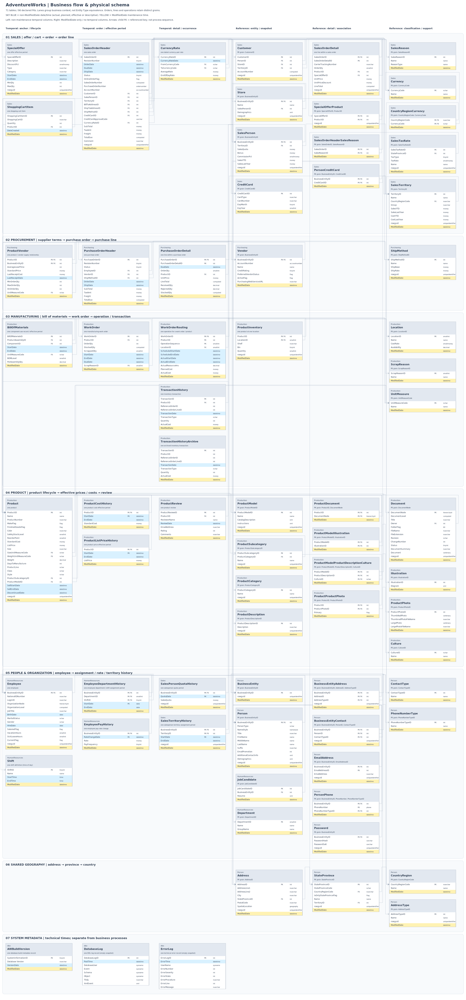

# Microsoft AdventureWorks OLTP

A SQLite snapshot of Microsoft's **AdventureWorks 2025 OLTP installation exports**, covering sales, purchasing, manufacturing, personnel and shared reference data. This is a publicly available Microsoft sample database, **not real enterprise transaction data**. It is separate from AdventureWorksDW and AdventureWorksLT.

## Explore the database

- [Model inputs: database and data dictionary](input/)
- [**Scrollable schema explorer**](docs/schema.html): horizontal/vertical scrolling, zoom, table search and direct-FK highlighting. Download the HTML and open it in a browser; GitHub itself displays HTML source.
- [Full-resolution PNG](docs/schema.png) · [Vector SVG](docs/schema.svg) · [Editable draw.io schema](docs/schema.drawio): all 71 tables and 90 declared foreign keys, plus separate draw.io pages for each SQL Server schema.
- [Database inspection and first 10 actual rows per table](review/database/README.md)
- [Readable data dictionary](docs/data_dictionary.md)
- [SQLite DDL](evaluation/schema.sql)
- [Original Microsoft SQL Server installation script](source/instawdb.sql)
- [Pinned source, file hashes, row counts and validation results](source/provenance.json)

| Tables | Exported records | Declared foreign-key constraints | Business schemas |
|---:|---:|---:|---:|
| 71 | 759,240 | 90 | 5 + dbo administration |

`DatabaseLog` and `ErrorLog` are retained as empty tables: the source exports contain no rows for them, and SQL Server setup-generated log records are not fabricated. `AWBuildVersion` uses the supplied export rather than the local build time. No tables or exported business rows are sampled or synthesized.

## Business-aligned schema



The same layout is used in PNG, SVG, draw.io and the scrollable explorer:

| Axis / color | Meaning |
|---|---|
| Vertical lanes | Sales → procurement → manufacturing → product → people/organization → geography → system metadata. These are business reading groups, not a single end-to-end chronology. |
| Left three levels | Tables with at least one date/time column other than `ModifiedDate`, grouped as lifecycle/anchor, order/effective-period, and detail/occurrence. |
| Right three levels | Tables with only `ModifiedDate`, or no date/time columns, grouped as entity/snapshot, detail/association, and classification/support. |
| Sky blue | Non-`ModifiedDate` date/time columns, including actual, planned, effective-period and descriptive times. Color alone does **not** identify an event timestamp. |
| Yellow | `ModifiedDate`: maintenance time, excluded when deciding left/right placement. |
| FK arrows | Declared physical child FK → referenced key, including composite keys. Arrows are **not** process transitions; optionality is not depicted. |

Order headers and order lines, work orders and operation-level routing, and products and product/location stock remain distinct instance grains. Current and archived inventory transactions sit together because they share a business meaning and grain; this visual proximity does not establish instance identity. A shared lane or level does not assert that tables belong to one Entity Type. The database and model-input dictionary are unchanged.

The viewer has a persistent bottom horizontal scrollbar, vertical scrolling, zoom, search and table focus. It is self-contained, so the downloaded HTML works offline. PNG and draw.io downloads beside it require the other files from `docs/`.

## Model input boundary

Supply exactly these two files:

1. [`input/database.sqlite`](input/database.sqlite)
2. [`input/data_dictionary.json`](input/data_dictionary.json)

The dictionary combines physical SQLite constraints with Microsoft's original `MS_Description` table/column descriptions and SQL Server column declarations. Descriptions include business code meanings where Microsoft supplied them. It does **not** add authored Entity Types, event candidates, case notions, join paths, event labels, or assumed row-grain explanations.

The upstream installation script omits descriptions for two tables (`WorkOrder`, `WorkOrderRouting`) and 25 columns. These descriptions remain empty in the JSON and explicitly absent in the readable DD; they are not silently inferred. The exact omissions are listed in the provenance manifest. In particular, a missing official description is not evidence that a column is irrelevant.

Questions, reference logs, Gold SQL and Gold DFGs have **not been authored or evaluated** for this addition. This is a source database for discovery and extraction experiments, rather than a fifth completed gold-labelled benchmark. Natural-language requests should be supplied separately.

## SQLite conversion

- Original unqualified table and column names are preserved. SQL Server schemas are recorded as `source_schema` in the DD; queries use e.g. `"SalesOrderHeader"`, not `Sales.SalesOrderHeader`. All original table names are unique across schemas.
- All 71 tables, primary keys, composite keys, and 90 declared foreign-key constraints are preserved. SQL Server triggers, views, procedures, indexes other than primary keys, default evaluation, and CHECK constraints are not implemented. This snapshot is intended for read-only extraction.
- Integer types and flags map to SQLite `INTEGER`. Decimal/money values remain exact source strings in `TEXT`; arithmetic queries must cast explicitly. Dates/times retain their source strings and precision. **No timezone is inferred** from these timezone-naive exports.
- XML, GUID and hierarchyid export representations remain text; geography and binary/image exports are decoded from hexadecimal into BLOBs. SQL Server type methods are unavailable.
- Computed columns are **materialized using their supplied export values**, preserving the snapshot; computed expressions are retained in `source_declaration`. They are not recomputed when rows are edited.
- Bulk export field/row terminators are interpreted per source table, including embedded newlines. CRLF becomes LF. A single NUL character represents an empty string; empty nullable fields become SQL NULL, matching SQL Server bulk export conventions.
- Keep planned, actual, valid-time and maintenance timestamps as supplied. A current status plus `ModifiedDate` does not establish a full status-transition history.

## Reproduce

Requires Python 3 with its standard library and network access to Microsoft's GitHub repository:

```bash
python datasets/source_relational/adventureworks/build.py --cache /tmp/adventureworks-source
python datasets/source_relational/adventureworks/validate.py
python tools/build_dataset_review.py --dataset adventureworks
python -m pip install cairosvg==2.8.2
python datasets/source_relational/adventureworks/diagram.py --png
```

The [dataset build workflow](../../../.github/workflows/adventureworks-dataset.yml) also performs these steps and commits the validated SQLite snapshot when the builder or pinned source manifest changes.

The builder verifies every downloaded file against the pinned Git blob hashes, builds the DB and DD, checks SQLite integrity and foreign keys, and writes the editable draw.io schema. The cache is an intermediate download directory, not model input.

## Source and license

- [Official Microsoft OLTP source](https://github.com/microsoft/sql-server-samples/tree/8fe3fd0c9a825fef3ae6d601e97537b612d7b214/samples/databases/adventure-works/oltp-install-script)
- [Microsoft installation instructions](https://learn.microsoft.com/en-us/sql/samples/adventureworks-install-configure)
- Upstream commit: `8fe3fd0c9a825fef3ae6d601e97537b612d7b214`.
- [Microsoft sample license (MIT)](source/LICENSE.txt). Original source descriptions and records retain Microsoft's copyright and license.

## Runtime EEG

The [local EEG reviewer](../../../tools/review_gui/) supports this dataset. Supply a genuine Step 1 export or configure the external runtime. No inferred graph is bundled.

[Upstream relational datasets](../) · [All datasets](../../)
