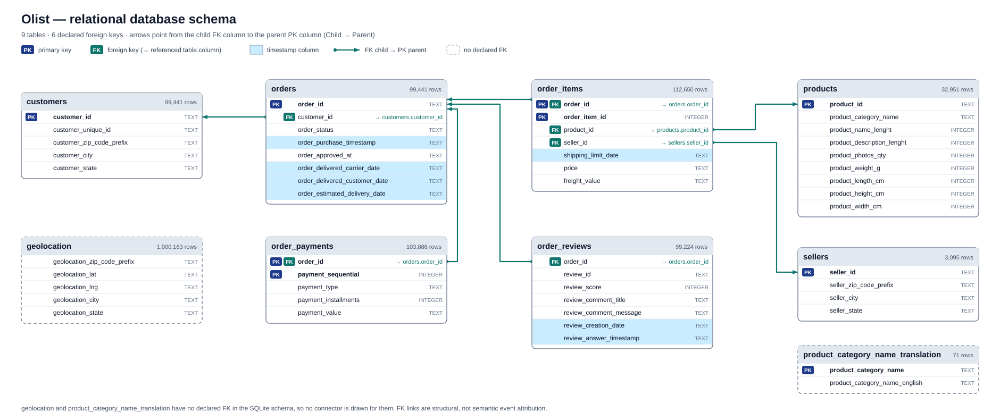

# Olist — Brazilian E-Commerce Public Dataset

A full-fidelity **nine-table SQLite snapshot** of the public Olist e-commerce dataset, used as a relational database source for NL2EventLog research. The source is anonymized real marketplace data from Brazil (2016–2018), not an event log or a synthetic process database.

## Model input

- `input/database.sqlite` — **uncompressed SQLite**, required by the extraction pipeline; regenerate using `build.py` or decompress `input/database.sqlite.gz`.
- `input/data_dictionary.json` — table names, original CSV columns, declared/imported keys, relations, and descriptions **without authored Event/ET labels**.

The Git repository publishes `database.sqlite.gz` rather than a large uncompressed SQLite file; the archive is not a direct SQLite input. It contains the entire dataset, not a sample. For example:

```bash
gzip -dk datasets/source_relational/olist/input/database.sqlite.gz
python datasets/source_relational/olist/validate.py
```

## Source and provenance

Official dataset: [Olist on Kaggle](https://www.kaggle.com/datasets/olistbr/brazilian-ecommerce). Reproducible pinned compressed mirror: [infobarbosa/dataset-olist](https://github.com/infobarbosa/dataset-olist), commit `6e7f3d9b614655007f94dda9063ac3d5fb14fed9`. Every gzip file is checked against its Git blob SHA before import. The mirror states that CSV content is unchanged and only gzip-compressed.

This is **CC BY-NC-SA 4.0**, for noncommercial research and education, with attribution and share-alike obligations. See upstream for terms. `source/upstream_files.json` pins exact file names, expected row counts, source column headers and hashes. `source/provenance.json` captures the validated full build.

| Table | Rows |
|---|---:|
| customers | 99,441 |
| orders | 99,441 |
| order_items | 112,650 |
| order_payments | 103,886 |
| order_reviews | 99,224 |
| sellers | 3,095 |
| products | 32,951 |
| geolocation | 1,000,163 |
| product_category_name_translation | 71 |
| **Total** | **1,550,922** |

## Schema Overview



The diagram shows all 9 tables and 6 declared FK relationships (arrows: child FK → parent PK). Timestamp columns are highlighted in blue. Geolocation and product-category translation have no declared FK.

- [Interactive Schema Explorer](docs/schema.html)
- [Editable ERD](docs/schema.drawio)
- [Data Dictionary](docs/data_dictionary.md)

## DB review

- [Database structure DDL](evaluation/schema.sql).
- [Provenance and validation](source/provenance.json).
- The table above reports source row counts. Use the schema explorer for columns and relationships.

## Important modeling choices

- Source CSV headers and records are preserved, including original spelling such as `product_name_lenght`. Financial values and date/time strings remain text to avoid precision and timezone assumptions. Numeric IDs/quantity and count fields are parsed as integers.
- Primary keys for orders, customers, sellers, products, order_items and order_payments are schema interpretations of source data; CSV files provide **no original SQL constraints**.
- Reviews have no declared PK because `review_id` is not assumed unique; geolocation ZIP prefixes are repeated. No geolocation FK is invented. Case mapping from reviews still follows `order_id` when valid.
- `order_estimated_delivery_date` and `shipping_limit_date` are planned times, not completed events.
- `order_payments` records payment data but lacks a payment occurrence timestamp; do not fabricate a Payment Completed event from this table.
- Review survey creation and answer times are different events; timestamps can be null.
- This source package contains no authored NL question set, reference event logs or runtime EEG.

## Rebuild and verify

Python 3.11+ and network access to the pinned mirror:

```bash
python datasets/source_relational/olist/build.py --cache /tmp/olist-source
python datasets/source_relational/olist/validate.py
```

The GitHub Actions workflow `.github/workflows/olist-dataset.yml` builds, verifies, and publishes the compressed full snapshot and generated documentation. Do not treat source metadata as validated Gold annotations.

[Upstream relational datasets](../) · [All datasets](../../)
