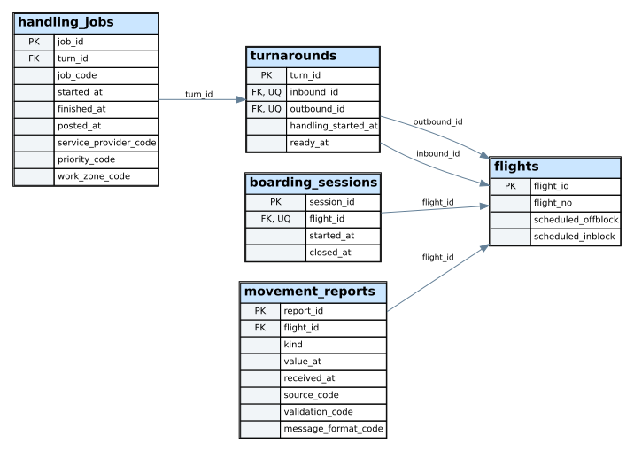

# AirlineFlow

AirlineFlow is an authored synthetic relational aviation dataset for NL2EventLog. It provides four nested database sizes (5, 10, 15 and 20 tables) and twelve pilot extraction requests. All records are synthetic; public aviation references inform the business model. All timestamps use KST.

## 1. Dataset at a glance

The scenario contains 48 inbound flights, 48 outbound flights and 48 aircraft turnarounds across 12 days. Each of the 96 operating legs has an origin boarding session and actual movement messages at departure and arrival. Ground-handling jobs, sampled passenger actions, baggage scans and airport-linked security observations are recorded at their own business granularity.

| Variant | Tables | Rows | Included domain | SQLite | Dictionary | ERD |
|---|---:|---:|---|---|---|---|
| L05 | 5 | 960 | Operating legs, turnaround, boarding, handling jobs, movements | [DB](variants/l05/input/database.sqlite) | [DD](variants/l05/input/data_dictionary.json) | [ERD](variants/l05/docs/schema.svg) |
| L10 | 10 | 2,232 | L05 + booking, passenger, ticket, passenger leg and action | [DB](variants/l10/input/database.sqlite) | [DD](variants/l10/input/data_dictionary.json) | [ERD](variants/l10/docs/schema.svg) |
| L15 | 15 | 3,818 | L10 + bag leg, bag scan, checkpoint, security visit and event | [DB](variants/l15/input/database.sqlite) | [DD](variants/l15/input/data_dictionary.json) | [ERD](variants/l15/docs/schema.svg) |
| L20 | 20 | 3,925 | L15 + airline, airport, aircraft, employee and dispatch | [DB](variants/l20/input/database.sqlite) | [DD](variants/l20/input/data_dictionary.json) | [ERD](variants/l20/docs/schema.svg) |

Shared tables contain identical records across all nested variants. Increasing size introduces both a larger catalog and semantically similar candidate activities; table count is not isolated as a single difficulty factor.

## 2. Business process and relational representation



Download and open the [interactive scenario viewer](docs/scenario.html) locally to inspect all four ERDs, dictionaries, raw tables (with CSV downloads), an example turnaround trace and the pilot requests. ERD arrows point from child foreign keys to parent keys. PK, FK and single-column UQ are marked; passenger legs additionally have a composite UNIQUE(ticket_id, flight_id) constraint.

### Representation choices

- flights identifies dated operating legs. Flight numbers repeat across dates.
- turnarounds connects an inbound_id and an outbound_id using UNIQUE foreign keys. The example assumes one aircraft and no swaps. At l20, the aircraft and connecting airport agree across the pair.
- movement_reports distinguishes LAND (landing), IN (in-block), OUT (off-block), AIR (take-off) and EST (estimated off-block). Use value_at for the represented time and received_at for message receipt.
- handling_jobs stores actual start/completion and posting time. Jobs can overlap. Its service_provider_code, priority_code and work_zone_code describe ground operations.
- Movement reports include source_code, validation_code and message_format_code. These operational attributes are synthetic. The kind and job_code values identify activities.
- passenger_id is an internal synthetic person key. passengers stores date_of_birth, a single recorded nationality and a locally coded gender. Date of birth is an attribute. Age is not calculated.
- tickets links to passengers by passenger_id. Copied passenger snapshots at issuance are not modeled.
- Security timestamps assume an airport feed linked to a passenger leg. Airline availability of such a feed is an explicit scenario assumption.
- Every operating leg has an origin boarding session and all four actual movement types. Taxi durations and message receipt delays vary. Flight, turnaround, boarding session, handling job and movement report identifiers are independent.
- Individual bag loading scans occur within the actual loading job interval. The latest sampled scan is distinct from operation-level completion. Passenger and baggage records represent samples, not complete flight manifests.

## 3. Reproduce the dataset

The canonical [synthetic records](source/records.json) define the complete L20 domain records and column names. The four schema definitions in [variants/](variants/) define the nested relational layouts. These fixed authored records preserve identifiers, timestamps and event multiplicities; they are not derived from evaluator event logs. This is a deterministic fixture-based constructor, not a random scenario simulator.

From the repository root, using Python 3.10 or later (standard library only):

```bash
python datasets/synthetic/airlineflow/generate.py --output /tmp/airlineflow
```

The constructor builds each database in an empty directory, executes its schema, inserts its subset of domain records with foreign-key enforcement, copies the dictionaries and evaluation assets, computes the manifest checksums, and validates the result. It does not read the published SQLite files to build the output or overwrite the published fixtures.

To rebuild and compare against the published inputs:

```bash
python datasets/synthetic/airlineflow/generate.py --check
```

The check compares logical schemas and every table record, validates dictionary checksums and nested records, and runs integrity, foreign-key, temporal and supplementary SQL/CSV reference checks and the current pilot Gold regression. SQLite binary hashes may differ across fresh builds because of physical page layout or SQLite versions; the manifest records actual file hashes.

## 4. Evaluation protocol

The same twelve requests Q01–Q12 apply to all four variants. They cover boarding sessions, individual handling jobs, outbound preparation and turnaround movements.

| Resource | Purpose |
|---|---|
| [Model questions](evaluation/model_questions.jsonl) | Exact English model-input requests |
| [Bilingual query registry](evaluation/query_registry.json) | English and Korean requests |
| [Variant manifest](evaluation/variant_manifest.json) | Table/row counts, hashes and question IDs |
| [Scenario viewer](docs/scenario.html#extraction-requests) | Requests and evaluator-side reference counts |

Supply the model only the selected SQLite database, data dictionary and English text of one request. Do not supply evaluator references, source records or reference counts. Preserve case IDs, timestamps and event multiplicities. Q01–Q12 wording is finalized (v7). The Q03 baggage-loading event refers to the confirmed closure of the operation. The [evaluator-only pilot Gold package](private/pilot/README.md) contains reference PI, ESpec, SQL, logs, DFG and scoring policy.

The supplementary T/D/P/S/B SQL and CSV references under [private/](private/) and their [request texts](evaluation/legacy_model_questions.jsonl) are used for regression checks (15 variant–reference combinations), not Q01–Q12 scoring. The directory name does not enforce access control.

To validate the published inputs without rebuilding:

```bash
python datasets/synthetic/airlineflow/verify.py
```

This checks the fixture, supplementary references, all 48 current DB–request Gold comparisons (12 unique requests), independent extraction, ESpec/SQL consistency, and scoring regressions. It does not measure LLM accuracy or replace human semantic review.

## 5. Repository layout

```text
airlineflow/
├── README.md
├── generate.py             # Fresh construction from authored records
├── verify.py               # Integrity and reference checks
├── source/records.json     # Canonical synthetic domain records
├── variants/
│   ├── l05/
│   ├── l10/
│   ├── l15/
│   └── l20/                # Each: input/{database.sqlite,schema.sql,data_dictionary.json}
│                           #       docs/schema.svg
├── docs/scenario.html      # Interactive dataset exploration
├── evaluation/             # Questions and variant metadata
└── private/                # Supplementary evaluator SQL/CSV + pilot Gold and scorer
```

## 6. Public design references

The physical schema and records are authored for this example. Sources inform the business entities and milestones.

- [Postgres Pro Airlines demo, 2017 schema family](https://postgrespro.com/docs/enterprise/13/demodb-schema-objects.html) provides bookings, tickets and ticket-flight relationships. Its passenger fields are in tickets, while this example uses a separate person table.
- [Amadeus official booking example](https://github.com/amadeus4dev/amadeus-flight-booking-django/blob/master/amadeus_demo_api/demo/views.py) shows birth date and gender on a traveler and nationality on a travel document. Here, nationality is simplified into passengers.
- [EUROCONTROL A-CDM](https://www.eurocontrol.int/publication/eurocontrol-specification-airport-collaborative-decision-making-cdm) informs inbound, turnaround and outbound milestones.
- [IATA Resolution 753 implementation guide](https://www.iata.org/contentassets/5c4aa8b8b3b1432697d2bf3301450684/reso753-implementation-guide---2023_issue-4.02.pdf) distinguishes baggage acceptance and loading.

[Domain-generated datasets](../) · [All datasets](../../)
