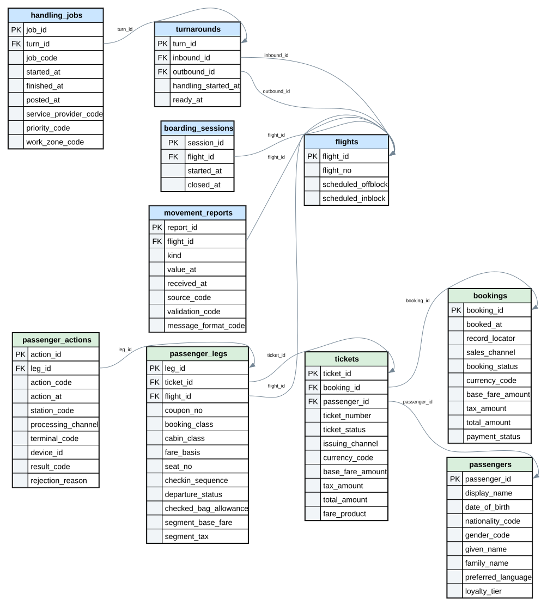

# AirlineFlow

**A synthetic relational benchmark for natural-language event-log extraction and process mining.**

AirlineFlow models aircraft turnarounds at a focal airport, connecting arriving and departing flight legs to ground services, boarding, passenger processing, baggage and security records. Given a natural-language analysis request, a system extracts an event log with `case_id`, `activity`, and `timestamp` from a relational database and its general data dictionary.

**72 requests · 108 DB–request conditions · 4 nested schemas · 28 reference activity types**

Current fixture: `Stochastic-v2-CompactIDs-20261127` · 100 turnarounds · 200 operating legs · 6,885 passenger legs.

[Download current integrated review HTML](https://raw.githubusercontent.com/jiwonpark7913/NL2EVENTLOG/main/datasets/synthetic/airlineflow/docs/scenario.html) · [Verification receipt](evaluation/verification.json)

[Database variants](#database-variants) · [Dataset analysis](#dataset-analysis) · [Queries and gold logs](#queries-and-gold-logs) · [Quick start](#quick-start) · [Validation and limitations](#validation-and-limitations)

## What can you use this dataset for?

| Use case | What AirlineFlow provides |
|---|---|
| Natural-language event-log extraction | English requests, SQLite inputs, and reference event triples |
| Process mining | Event logs at flight, turnaround, boarding session, passenger-leg and other case granularities |
| Schema scalability | Four nested schemas with unchanged shared records and 12 common pilot requests |
| Semantic and structural difficulty | Five matched-family test dimensions: depth, source diversity, activity count, explicitness, role attribution |
| Reproducible evaluation | Gold SQL, PI, ESpec, CSV, DFG and record-level inspection |

## Database variants

The four variants add five tables at each level. L15 is the main test database. L05–L20 form a nested schema-expansion series, not four independent datasets.

| Variant | Tables | Columns | Rows | Domain extension | Files |
|---|---:|---:|---:|---|---|
| [L05](variants/l05/README.md) | 5 | 30 | 2,100 | Core aircraft turnaround | [SQLite](variants/l05/input/database.sqlite) · [ERD](variants/l05/docs/schema.svg) · [Original DD](variants/l05/input/data_dictionary.json) · [Standard DD](variants/l05/input/data_dictionary_standard.json) · [DD (readable)](variants/l05/docs/data_dictionary.md) · [EEG example](docs/eeg_examples.md#l05) |
| [L10](variants/l10/README.md) | 10 | 47 | 34,563 | Passenger and booking | [SQLite](variants/l10/input/database.sqlite) · [ERD](variants/l10/docs/schema.svg) · [Original DD](variants/l10/input/data_dictionary.json) · [Standard DD](variants/l10/input/data_dictionary_standard.json) · [DD (readable)](variants/l10/docs/data_dictionary.md) · [EEG example](docs/eeg_examples.md#l10) |
| [L15](variants/l15/README.md) | 15 | 64 | 80,077 | Baggage and security | [SQLite](variants/l15/input/database.sqlite) · [ERD](variants/l15/docs/schema.svg) · [Original DD](variants/l15/input/data_dictionary.json) · [Standard DD](variants/l15/input/data_dictionary_standard.json) · [DD (readable)](variants/l15/docs/data_dictionary.md) · [EEG example](docs/eeg_examples.md#l15) |
| [L20](variants/l20/README.md) | 20 | 81 | 80,289 | Operating resources | [SQLite](variants/l20/input/database.sqlite) · [ERD](variants/l20/docs/schema.svg) · [Original DD](variants/l20/input/data_dictionary.json) · [Standard DD](variants/l20/input/data_dictionary_standard.json) · [DD (readable)](variants/l20/docs/data_dictionary.md) · [EEG example](docs/eeg_examples.md#l20) |

### Entity–relationship diagram (L20)


**Header colors:** blue = L05 core operations; green = L10 passenger/booking; amber = L15 baggage/security; purple = L20 resources/dispatch. The same colors are retained in all smaller diagrams.

<details>
<summary>L05 ERD — Core aircraft turnaround</summary>


</details>

<details>
<summary>L10 ERD — Passenger and booking</summary>



</details>

<details>
<summary>L15 ERD — Baggage and security</summary>


</details>

The readable dictionaries describe the original business meaning, keys and timestamp columns. Two model-facing JSON editions are available: the original dictionary for frozen-run reproduction, and the standard dictionary for newly configured evaluations. The standard edition removes extraction-specific guidance and fixture-only wording while retaining code definitions, physical declarations, timestamp semantics and operational roles. See the [dictionary review and usage policy](evaluation/dictionary_review/README.md). [Reference EEG examples](docs/eeg_examples.md) demonstrate how selected event definitions can be connected to case entities; these are explanatory, not generated EEG outputs or inputs.

## Dataset analysis


The test set contains **60 requests / 49 distinct reference logs / 18 families**. Each of the five axes has 12 requests.

| Split / dimension | Requests | Evaluation conditions |
|---|---:|---:|
| Pilot / schema expansion | 12 | 48 |
| A · Attribution depth | 12 | 12 |
| B · Source diversity | 12 | 12 |
| C · Activity count | 12 | 12 |
| D · Semantic complexity | 12 | 12 |
| E · Attribution role | 12 | 12 |
| Total | 72 | 108 |

[Full dataset analysis and distribution tables](docs/dataset_analysis.md) · [Statistics JSON](docs/dataset_statistics.json) · [Reproduction script](docs/analyze_dataset.py).

## Queries and gold logs

The following request illustrates how a case and event scope are expressed.

> Where is time lost during aircraft turnarounds? For each turnaround, reconstruct the actual process from inbound landing to outbound take-off, including arrival movements, the overall start of ground handling, the actual start and completion of every ground service, boarding start and close, aircraft readiness, and departure movements.

Q04 has 100 turnaround cases, 20 activity types and 2,000 event rows. The same business event may be attributed to different cases in other requests.


[Q04 Canonical Event Log](gold/Q04/events.csv) · [Enriched Event Log](gold/Q04/events_enriched.csv) · [Gold SQL](gold/Q04/gold.sql) · [PI](gold/Q04/pi.json) · [ESpec](gold/Q04/espec.json)

[Browse all 72 requests and references](docs/queries.md) · [Pilot model questions](evaluation/model_questions.jsonl) · [Test model questions](evaluation/model_questions_test.jsonl) · [Full query registry](evaluation/query_registry.csv) · [Test registry](evaluation/test_registry.csv) · [Gold summary](evaluation/gold_summary.csv).

[Integrated reference review (download HTML)](https://raw.githubusercontent.com/jiwonpark7913/NL2EVENTLOG/main/datasets/synthetic/airlineflow/docs/scenario.html) — save the linked file and open it locally to inspect each reference log, DFG, source row and extraction path. It is evaluator-only.

## Data generation and identifiers

The stochastic fixture uses a fixed seed, variable passenger/booking/baggage cardinalities, repeated security visits, rejected scans and incomplete journeys. Compact internal management numbers (`F001`, `J001`, etc.) are separate from operational flight numbers. See [generation design](docs/stochastic_fixture_v2.md), [realized population](source/stochastic_v2_generator_preview.json), and [compact ID policy](docs/compact_identifier_revision.md).

Each Qxx has `events.csv` (canonical three-column scoring log) and `events_enriched.csv` (inspection/analysis only, with separate flight number/date fields where applicable). The HTML provides both modes, source-cell highlighting and the original data dictionary.

## Quick start

Clone the repository or download the selected SQLite and JSON dictionary from the variant table.

```bash
cd datasets/synthetic/airlineflow
python verify.py
python generate.py /tmp/airlineflow-new
python docs/analyze_dataset.py
```

Regenerate the population from its fixed seed with `node source/generate_records_v2.mjs EMPTY_OUTPUT_DIRECTORY`. The full release builder `regenerate_v2.py` requires Node, Python and Graphviz and is intended for an isolated checkout. Refresh documentation independently with `python docs/render_readme.py`.

`verify.py` checks the published fixture against its references; `generate.py` reconstructs the current logical database from the canonical synthetic records in `source/records.json` and the schema DDLs. Use an empty output directory. The regenerated SQLite binary hashes may differ while logical records remain identical.

For model evaluation, provide only the appropriate `variants/lXX/input/database.sqlite`, one selected dictionary (`data_dictionary.json` for original frozen runs or `data_dictionary_standard.json` for newly configured evaluations), and the request text. Record the exact dictionary edition and checksum; use the same edition for all compared methods. The existing variant manifest and reproduction commands retain the original dictionary. Do not include reference EEG examples, Gold, evaluator registries, review pages, source records or diagnostic answers in the model input.

## Repository guide

| Path | Purpose |
|---|---|
| [variants/](variants/) | Four SQLite databases, DDL, diagrams and dictionaries |
| [evaluation/](evaluation/README.md) | Requests, registry, manifest, technical receipts and scoring-policy references |
| [gold/](gold/README.md) | Per-request reference logs, SQL, PI, ESpec and DFG |
| [docs/](docs/README.md) | User-facing analysis, examples and inspection tools |
| [source/](source/README.md) | Canonical synthetic records for reproducibility |
| [semantic_check/](semantic_check/README.md) | Separate semantic-evidence diagnostics (not part of the 108 conditions) |
| [private/](private/) | Legacy evaluator-only references retained for compatibility |

## Validation and limitations

Current release verification: **108/108 SQLite comparisons · 72/72 independent occurrence reconstructions**. The compact-ID migration preserves source rows and Gold multisets modulo bijective remapping. Enriched logs project exactly onto canonical triples. Human review and production-scorer integration remain pending. These checks are not model results.

[Semantic review](evaluation/semantic_gold_review_20261127.md) · [Verification receipt](evaluation/verification.json) · [Case policy](evaluation/case_key_policy.json) · [Release history](docs/archive/release_history_20261127.md).

The data is synthetic, with variable populations and simplified operational assumptions. Design probabilities are not empirical airline statistics. Shared records and repeated reference logs imply dependence across requests. Test results should be reported separately from pilot; A–C are sensitivity analyses, not fully isolated causal experiments. The standalone scorer is an evaluator reference, not confirmation of production-runner integration. The release preserves timestamp multiplicity and treats equal-time events without inventing order.

Data fixture: `Stochastic-v2-CompactIDs-20261127` · [Compact ID revision](docs/compact_identifier_revision.md).
