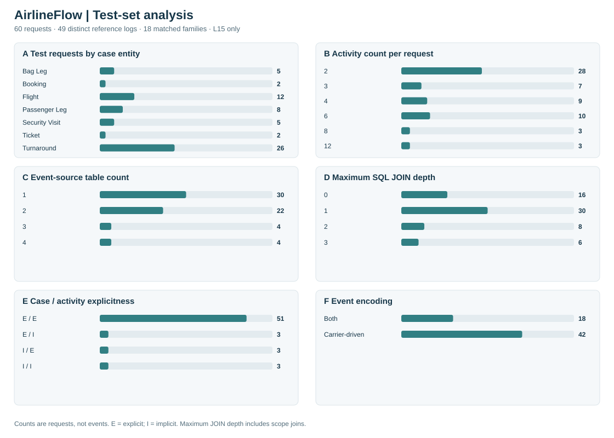

# AirlineFlow — dataset analysis

[Dataset home](../README.md) · [Statistics JSON](dataset_statistics.json) · [Realized generator distributions](../source/stochastic_v2_generator_preview.json)

## Schema size

| Variant | Tables | Columns | Rows |
|---|---:|---:|---:|
| L05 | 5 | 30 | 2,100 |
| L10 | 10 | 47 | 34,563 |
| L15 | 15 | 64 | 80,077 |
| L20 | 20 | 81 | 80,289 |

## Population and behavior

| Table | Rows |
|---|---:|
| flights | 200 |
| turnarounds | 100 |
| boarding_sessions | 200 |
| handling_jobs | 600 |
| movement_reports | 1,000 |
| bookings | 2,537 |
| passengers | 4,505 |
| tickets | 4,505 |
| passenger_legs | 6,885 |
| passenger_actions | 14,031 |
| bag_legs | 5,887 |
| bag_scans | 11,595 |
| checkpoints | 3 |
| security_visits | 7,030 |
| security_events | 20,999 |
| airlines | 2 |
| airports | 3 |
| aircraft | 5 |
| employees | 2 |
| flight_dispatch | 200 |

## Passenger states

| State | Passenger legs |
|---|---:|
| normal | 6,196 |
| incomplete | 207 |
| retry | 344 |
| no_show | 138 |

72 requests; 108 evaluation conditions; 60 test requests / 49 distinct Gold logs / 18 families; 514,324 reference rows across all queries (not unique physical events).

Source-diversity event counts are not forced equal. Fixed six jobs and one boarding session per flight preserve the ground-service experiment structure. Human approval and production scorer integration remain pending.
