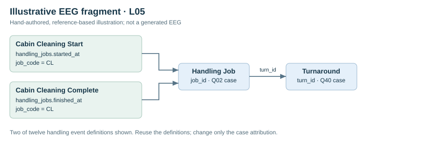
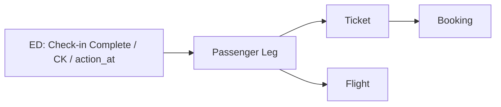
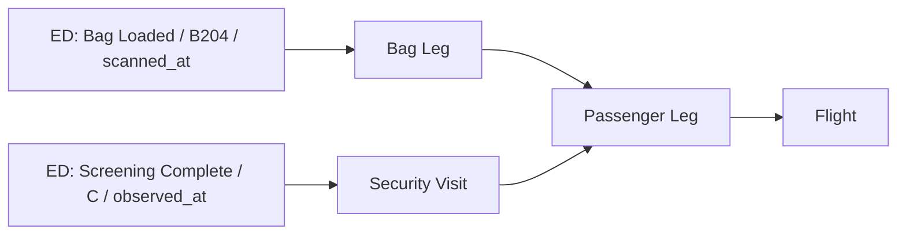
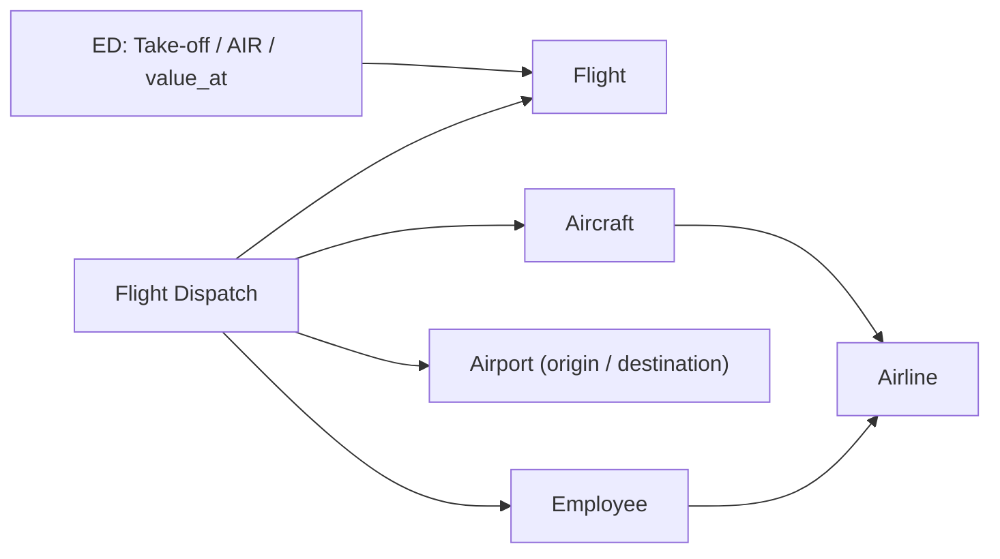

# Illustrative event extraction graph (EEG) examples

[Dataset home](../README.md)

These small, hand-authored examples use the released dictionary and schema to illustrate the intended graph semantics. They are **not** method-generated EEGs, completeness claims, or permitted benchmark inputs. In a real evaluation, construct EEGs independently from each variant's model-facing database and dictionary.

An event definition identifies a source, occurrence clock and (when applicable) a carrier predicate. Entity links encode case attribution, not additional event types. The same definition can be reused for different cases.

## L05

Q02 and Q40 reuse the same twelve handling-job definitions. Q02 groups by `job_id`, while Q40 groups by `turn_id`. For example, Cabin Cleaning Start = `handling_jobs.started_at` where `job_code='CL'`; Cabin Cleaning Complete uses `finished_at` for the same code. Movement reports distinguish actual events from estimates and reception clocks. Inbound and outbound roles are distinct.

[Q02 reference](../gold/Q02/espec.json) · [Q40 reference](../gold/Q40/espec.json) · [Q69 reference](../gold/Q69/espec.json).

## L10

The passenger-action record references a leg, which links to a ticket, booking or flight. [Q19](../gold/Q19/espec.json), [Q20](../gold/Q20/espec.json), [Q21](../gold/Q21/espec.json) illustrate the same check-in and confirmed-boarding occurrences at different case granularities. This is an illustration of the schema, not a claim that these test requests are executed at L10 in the manifest.

## L15

[Q13–Q15](queries.md#a--attribution-depth-012-physical-attribution-joins) illustrate baggage attribution. Q16–Q18 illustrate security attribution. Baggage Loading Close (ground-service operation) and Bag Loaded (individual bag) are not interchangeable.

## L20

The additional resource tables provide context and potential attribution routes. Dispatch assignment time has its own administrative semantics; it must not be confused with actual aircraft movement. None of the twelve schema-expansion pilot questions requires these five extra tables. The 28 activity types used by the 72 reference requests are not an exhaustive inventory of possible EDs.
