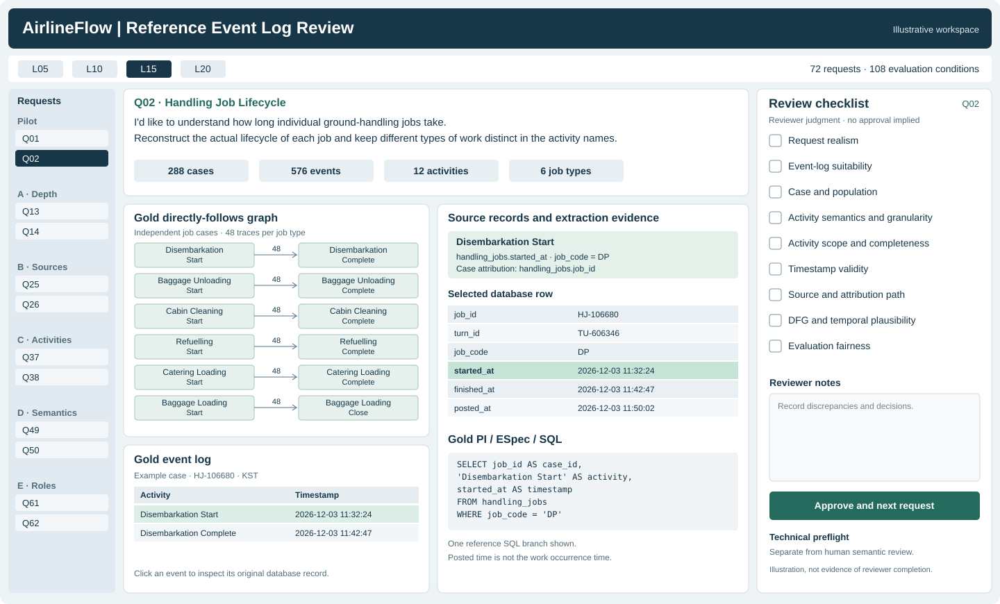

# Human reference-log review

[Dataset home](../README.md) · [Integrated review HTML](https://raw.githubusercontent.com/jiwonpark7913/NL2EVENTLOG/main/datasets/synthetic/airlineflow/docs/scenario.html)

The English figure is a schematic of the review workflow using actual Q02 reference values. It is not a screenshot of a completed review and does not assert the number of reviewers or their approval status.

Review each request against its business purpose, suitability for event-log analysis, case/population, activity semantics/granularity, activity completeness, occurrence timestamp, source and attribution path, DFG/temporal plausibility, and evaluation fairness. Reviewers should document disagreements and their resolution against the pinned dataset version. Technical SQL replay and production-scorer preflight are separate from human semantic review.

For publication, record reviewer expertise, coverage, independent or joint review procedure, adjudication, and actual completed decisions before reporting human validation results. 
