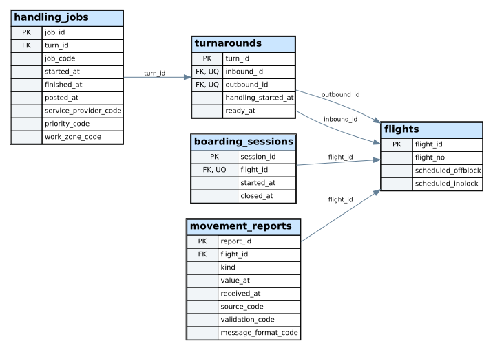

# AirlineFlow L05 — Core aircraft turnaround

[Dataset home](../../README.md) · [Analysis](../../docs/dataset_analysis.md)

**5 tables · 30 columns · 2,100 rows**. Base schema.

[SQLite database](input/database.sqlite) · [Data dictionary (readable)](docs/data_dictionary.md) · [Original dictionary (JSON)](input/data_dictionary.json) · [Standard dictionary (JSON)](input/data_dictionary_standard.json) · [SQL DDL](input/schema.sql) · [Reference EEG example](../../docs/eeg_examples.md#l05) · [ERD SVG](docs/schema.svg)

Header colors identify the schema layer: L05 blue, L10 green, L15 amber, L20 purple. Arrows show declared foreign keys; inbound and outbound flight references are distinct.

## Tables introduced at this level

| Table | Rows | Purpose |
|---|---:|---|
| `flights` | 200 | Dated operating legs, including both inbound and outbound flights. Flight numbers repeat across dates. |
| `turnarounds` | 100 | Ground stay at the focal airport linking an arriving operating leg to the next departing operating leg of the same aircraft. The overall handling start is the start of coordination, which can precede individual jobs. |
| `boarding_sessions` | 200 | Flight-level boarding sessions at the origin of every dated operating leg. One session per flight in this example; inbound legs also have origin boarding records. |
| `handling_jobs` | 600 | Ground handling work orders associated with aircraft turnarounds. |
| `movement_reports` | 1,000 | Estimated and actual movement messages for operating legs. Actual OUT and AIR refer to the origin; LAND and IN refer to the destination. Both inbound and outbound legs have all four actual movements; EST estimates origin off-block. |

## Evaluation

12 applicable requests. Only SQLite, one selected JSON dictionary and the request text are model inputs. Use the original dictionary for frozen-run reproduction and the standard dictionary for newly configured evaluations; record the selected file and checksum. Do not pass both dictionaries. Reference examples, Gold and review materials are evaluator-only.

Fixture: Stochastic-v2-CompactIDs-20261127.
