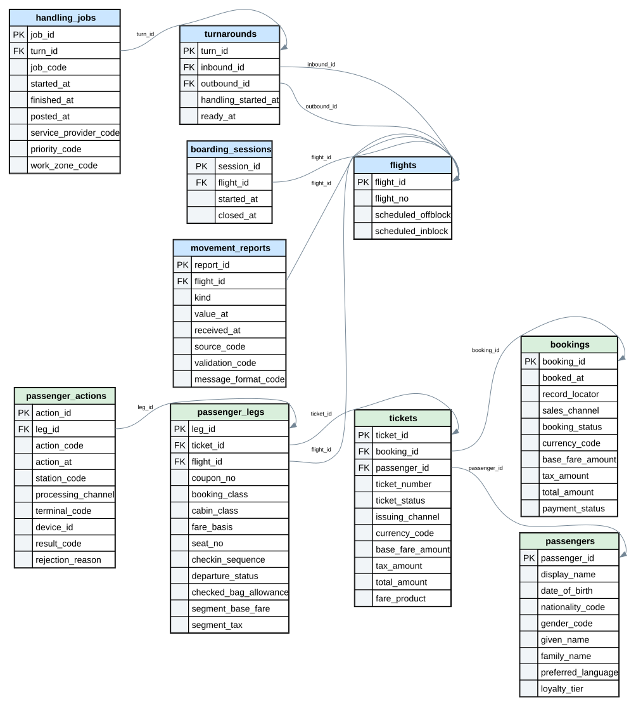

# AirlineFlow L10 — Passenger and booking

[Dataset home](../../README.md) · [Analysis](../../docs/dataset_analysis.md)

**10 tables · 47 columns · 2,232 rows**. Extends L05 by five tables; shared rows are unchanged.

[SQLite database](input/database.sqlite) · [Data dictionary (readable)](docs/data_dictionary.md) · [Data dictionary (JSON)](input/data_dictionary.json) · [SQL DDL](input/schema.sql) · [Reference EEG example](../../docs/eeg_examples.md#l10) · [ERD SVG](docs/schema.svg)

The header colors identify the schema level where each table first appears: L05 blue, L10 green, L15 amber, L20 purple. Arrows show declared foreign keys; both inbound and outbound flight references are distinct.

## Tables introduced at this level

| Table | Rows | Purpose |
|---|---:|---|
| `bookings` | 72 | Reservations for groups of travellers. |
| `passenger_actions` | 624 | Departure processing records for passenger flight legs. |
| `passenger_legs` | 288 | Ticketed segments linking a passenger ticket to a particular operating leg. |
| `passengers` | 144 | Synthetic passenger register. The dataset records a single nationality, distinct from country of birth, residence or passport issuance. Date of birth is a passenger attribute. |
| `tickets` | 144 | Tickets issued to passengers. |

## Evaluation

12 shared pilot requests; the 60 held-out test requests are evaluated only at L15 under the release manifest.

Use the database and JSON dictionary as method inputs. The reference examples, Gold SQL/PI/ESpec, review workspace and statistics are evaluator-only; do not expose them to a model.
