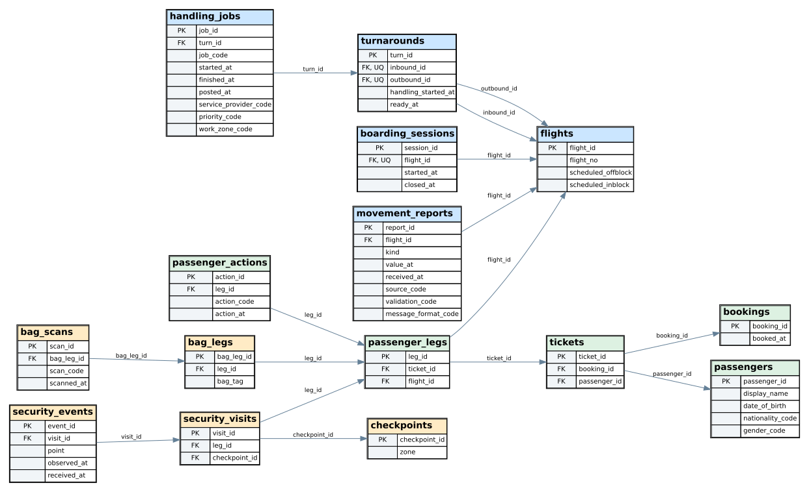

# AirlineFlow L15 — Baggage and security

[Dataset home](../../README.md) · [Analysis](../../docs/dataset_analysis.md)

**15 tables · 64 columns · 3,818 rows**. Extends L10 by five tables; shared rows are unchanged.

[SQLite database](input/database.sqlite) · [Data dictionary (readable)](docs/data_dictionary.md) · [Data dictionary (JSON)](input/data_dictionary.json) · [SQL DDL](input/schema.sql) · [Reference EEG example](../../docs/eeg_examples.md#l15) · [ERD SVG](docs/schema.svg)

The header colors identify the schema level where each table first appears: L05 blue, L10 green, L15 amber, L20 purple. Arrows show declared foreign keys; both inbound and outbound flight references are distinct.

## Tables introduced at this level

| Table | Rows | Purpose |
|---|---:|---|
| `bag_legs` | 144 | Transport records for a sample of checked bags associated with passenger flight legs. |
| `bag_scans` | 288 | Individual baggage tracking records for the checked bags represented in the dataset. |
| `checkpoints` | 2 | Airport security screening checkpoints. |
| `security_events` | 864 | Observations recorded during security checkpoint visits. |
| `security_visits` | 288 | Airport-provided records of individual passenger visits to security checkpoints. |

## Evaluation

12 pilot requests plus 60 held-out requests (72 applicable requests).

Use the database and JSON dictionary as method inputs. The reference examples, Gold SQL/PI/ESpec, review workspace and statistics are evaluator-only; do not expose them to a model.
