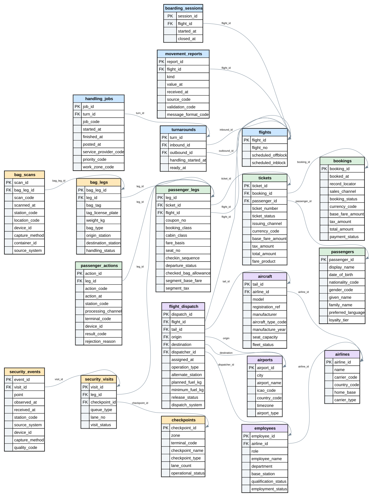

# AirlineFlow L20 — Operating resources

[Dataset home](../../README.md) · [Analysis](../../docs/dataset_analysis.md)

**20 tables · 81 columns · 3,925 rows**. Extends L15 by five tables; shared rows are unchanged.

[SQLite database](input/database.sqlite) · [Data dictionary (readable)](docs/data_dictionary.md) · [Data dictionary (JSON)](input/data_dictionary.json) · [SQL DDL](input/schema.sql) · [Reference EEG example](../../docs/eeg_examples.md#l20) · [ERD SVG](docs/schema.svg)

The header colors identify the schema level where each table first appears: L05 blue, L10 green, L15 amber, L20 purple. Arrows show declared foreign keys; both inbound and outbound flight references are distinct.

## Tables introduced at this level

| Table | Rows | Purpose |
|---|---:|---|
| `aircraft` | 4 | Register of individual aircraft. |
| `airlines` | 2 | Register of operating airlines. |
| `airports` | 3 | Airport register. |
| `employees` | 2 | Register of airline employees. |
| `flight_dispatch` | 96 | Assignments of operating resources to individual dated legs. |

## Evaluation

12 shared pilot requests; the 60 held-out test requests are evaluated only at L15 under the release manifest.

Use the database and JSON dictionary as method inputs. The reference examples, Gold SQL/PI/ESpec, review workspace and statistics are evaluator-only; do not expose them to a model.
