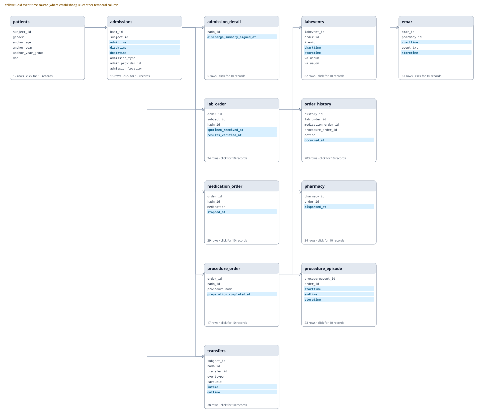

# HospitalFlow

Track patient, admission and clinical order histories across medication, laboratory, procedure and transfer records. Use this benchmark to compare a requested case history with its independently stored SQL and event log.

| Tables | Source rows | Requests | Gold event logs |
|---:|---:|---:|---:|
| 12 | 539 | 40 | 40 |

## Origin and construction

The simulator generates all patient and encounter records. Public MIMIC-IV documentation supplies conventions for patient identifiers, admission timestamps and transfer intervals. Research-authored order and episode tables extend this design. [MIMIC-IV source notes](source/references.md) · [Clinical simulator](simulation.py)

## Relational schema and inputs

[Editable ERD](docs/schema.drawio) · [Table sizes, columns and sample rows](review/database/README.md#table-inspector) · [Data dictionary](input/data_dictionary.json) · [SQLite database](input/database.sqlite)

## Questions and evaluation

Start with **H01** to inspect each admission’s order entry, review and cancellation.

| Task | Open |
|---|---|
| Choose a request and check its scope | [Question list, types and answerability](docs/questions.md) · [Question texts](evaluation/model_questions.jsonl) |
| Inspect the expected result for H01 | [Extraction SQL](private/gold_sql/H01.sql) · [Event log CSV](private/gold_logs/H01.csv) |
| Review a trace and its evidence | [Gold review page](review/gold_dfg/README.md) with per-request DFGs and original table rows. Download the linked HTML and open it locally. |
| Inspect how the authors attributed activities | [Source projection diagram](review/database/gold_evidence_graph.svg) · [Source inventory](review/gold_dfg/event_graph.md) |
| Understand the inferred EEG | [EEG specification](../../../docs/system/EEG_ENTITY_MODEL.md). This dataset has no checked-in runtime EEG. The source projection above uses author annotations. |

## Files by role

| Folder | Contents |
|---|---|
| [input/](input/) | SQLite database and business dictionary for the model |
| [evaluation/](evaluation/) | Requests and evaluation metadata |
| [private/](private/) | Reference SQL, event logs and construction evidence for scoring |
| [review/](review/) | Human-readable database and Gold inspection pages |
| [source/](source/) · [design/](design/) · [docs/](docs/) | Source material, modeling decisions and schema or question documentation |

[Domain-generated datasets](../) · [All datasets](../../)
