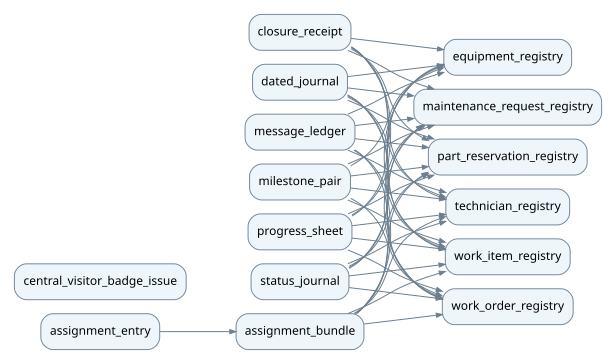

# MaintenanceFlow

MaintenanceFlow models equipment maintenance from request intake through planning, parts allocation, field work and acceptance. This synthetic NL2EventLog benchmark contains 40 English requests derived from 20 paired specifications. The same requests and underlying events apply to all 13 physical layouts.

## Construction and base schema

The benchmark encodes the same cases and events in several relational layouts. Individual variants change table count, FK distance, identifier naming and dictionary detail, or additional time fields. The stress layout combines the four changes.

Arrows point from child to parent. The [base dictionary](input/data_dictionary.json) gives column meanings and key fields. Variant-specific databases and dictionaries are in [variants/](variants/).

## Questions and evaluation

The [question file](evaluation/model_questions.jsonl) contains one request per line with fields `question_id` and `text`. A trailing `P` identifies the second wording of a pair. The first ten pairs select named activities. The remaining ten pairs request a complete case history or a complete business phase.

For each request, provide its text and the selected layout’s SQLite database and data dictionary to the extraction method. The [variant manifest](evaluation/variant_manifest.json) lists paths and SHA-256 checksums.

The checkout contains the requests and inputs. Gold SQL, reference event logs, a Gold review page and a runtime EEG are not published for this dataset.

## Physical layouts

| Layout | Tables | Maximum forward FK hops | Names and dictionary | Additional time fields per event table |
|---|---:|---:|---|---:|
| [base](input/) | 15 | 1 | N0 | 0 |
| [x1_30](variants/x1_30/input/) | 30 | 1 | N0 | 0 |
| [x1_60](variants/x1_60/input/) | 60 | 1 | N0 | 0 |
| [x1_max](variants/x1_max/input/) | 120 | 1 | N0 | 0 |
| [x2_2](variants/x2_2/input/) | 15 | 2 | N0 | 0 |
| [x2_max](variants/x2_max/input/) | 15 | 3 | N0 | 0 |
| [x3_n1](variants/x3_n1/input/) | 15 | 1 | N1 | 0 |
| [x3_n2](variants/x3_n2/input/) | 15 | 1 | N2 | 0 |
| [x3_max](variants/x3_max/input/) | 15 | 1 | N3 | 0 |
| [x4_1](variants/x4_1/input/) | 15 | 1 | N0 | 1 |
| [x4_2](variants/x4_2/input/) | 15 | 1 | N0 | 2 |
| [x4_max](variants/x4_max/input/) | 15 | 1 | N0 | 4 |
| [stress](variants/stress/input/) | 120 | 3 | N3 | 4 |

N0 uses descriptive identifiers, N1 abbreviates them, N2 uses codes with the full dictionary, and N3 uses codes with a shorter dictionary. The stress layout combines the highest level of all four factors.

[Domain-generated datasets](../) · [All datasets](../../)
