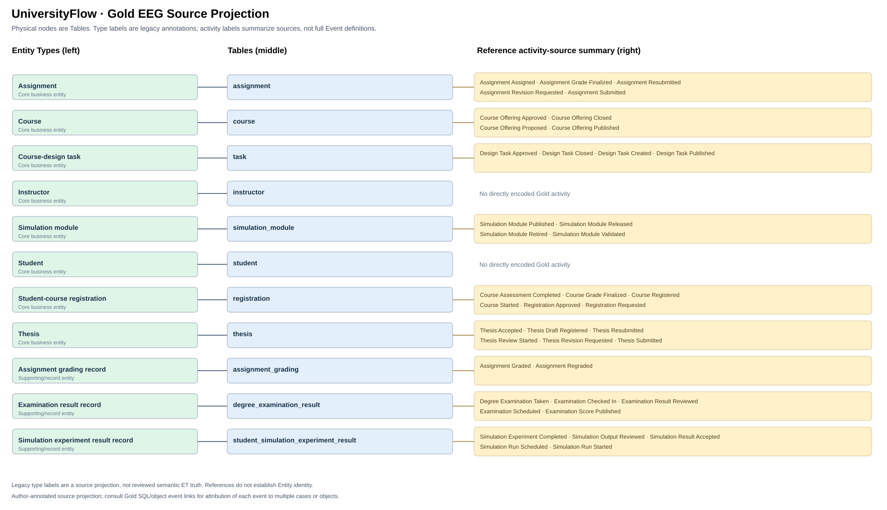
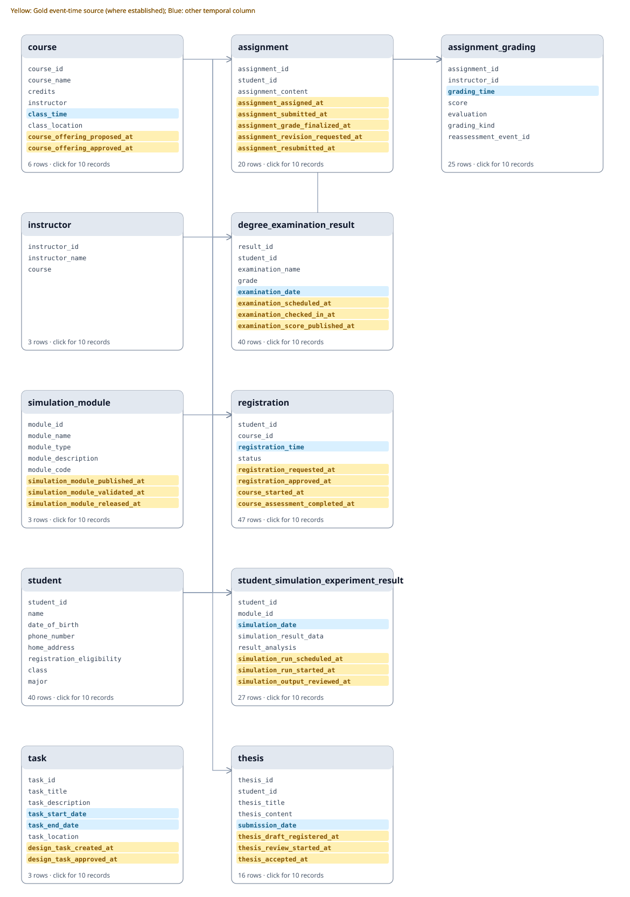

# UniversityFlow — Database and Gold Evidence Review

UniversityFlow is a synthetic university operations database representing students, courses, registration, assignments, examinations, theses, and simulation experiments. Its domain design draws on RSchema university requirements and uses authored synthetic records.

## Gold Event Extraction Graph (EEG) Source Projection

The diagram distinguishes core business entity concepts from supporting entity and event-record types. 
A table may identify or reference several ETs through different keys. These legacy source labels do not enumerate or validate those interpretations.

**This is a source-level author-annotated projection, not an inferred EEG or a validated semantic ET Gold.**
Gold SQL and record-level evidence are available in the linked inspection materials. The current membership labels originate from the legacy Gold; an independently validated ET/Entity identification context Gold is a separate evaluation task.

## Relational Schema (SQL foreign keys)

## Table inspector

| Physical table | Rows | Columns | ET candidate | First ten records |
|---|---:|---:|---|---|
| assignment | 20 | 8 | Assignment | [Preview](tables/assignment.md) |
| assignment_grading | 25 | 7 | Assignment grading record | [Preview](tables/assignment_grading.md) |
| course | 6 | 10 | Course | [Preview](tables/course.md) |
| degree_examination_result | 40 | 9 | Examination result record | [Preview](tables/degree_examination_result.md) |
| instructor | 3 | 3 | Instructor | [Preview](tables/instructor.md) |
| registration | 47 | 9 | Student-course registration | [Preview](tables/registration.md) |
| simulation_module | 3 | 9 | Simulation module | [Preview](tables/simulation_module.md) |
| student | 40 | 8 | Student | [Preview](tables/student.md) |
| student_simulation_experiment_result | 27 | 9 | Simulation experiment result record | [Preview](tables/student_simulation_experiment_result.md) |
| task | 3 | 10 | Course-design task | [Preview](tables/task.md) |
| thesis | 16 | 10 | Thesis | [Preview](tables/thesis.md) |

## Entity Type candidates vs. core business objects

Legacy identity groups (ET candidates): **11**; principal business object concepts in this domain: **8**. 
The core set is a candidate semantic grouping, not a rule for merging unrelated instances or Entity identities.

**Core business concepts:** Assignment, Course, Course-design task, Instructor, Simulation module, Student, Student-course registration, Thesis.

Supporting Gold types: Assignment grading record, Examination result record, Simulation experiment result record.

## Evaluation evidence

- Gold SQL/CSV pairs executable and consistent: 66; compared event rows across questions: 8528.
- [Gold source inventory](../gold_dfg/event_graph.md)
- [Question-level Gold DFGs](../gold_dfg/README.md)
- [Editable Draw.io schema](../../docs/schema.drawio)

