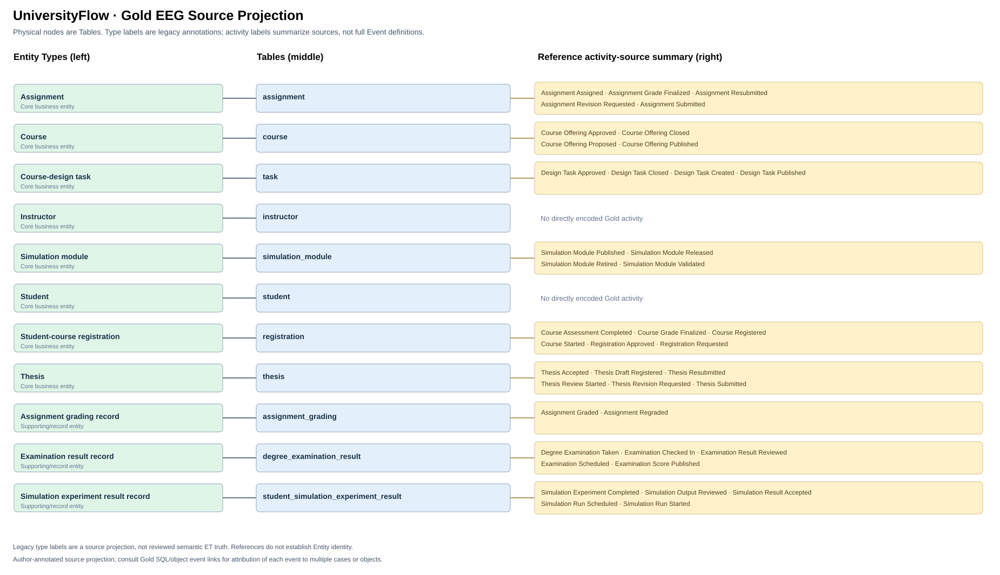
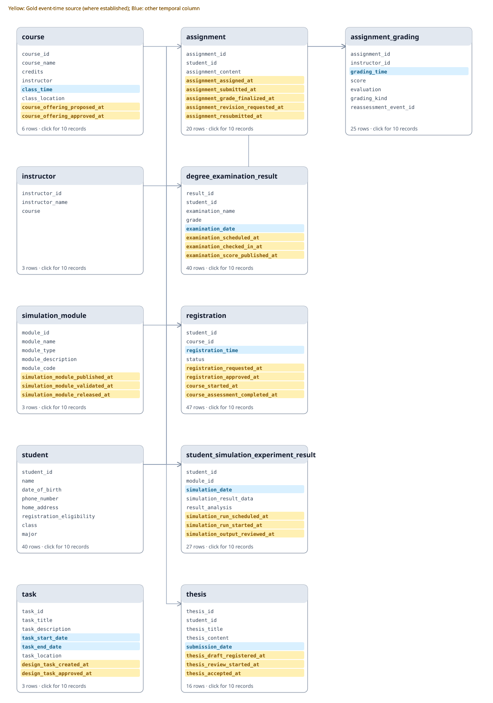

# UniversityFlow

UniversityFlow is a synthetic university operations database representing students, courses, registration, assignments, examinations, theses, and simulation experiments. Its domain design draws on RSchema university requirements and uses authored synthetic records.

## Dataset overview

| Tables | Entity Type candidates | Core business concepts | Gold SQL/CSV pairs verified |
|---:|---:|---:|---:|
| 11 | 11 | 8 | 66 |

## Explore the dataset

- [Gold Event Extraction Graph (EEG) Source Projection and real table records](review/database/README.md)
- [Editable Draw.io relational diagram](docs/schema.drawio)
- [Per-question Gold DFGs](review/gold_dfg/README.md)
- [Business Data Dictionary](input/data_dictionary.json)
- [Gold object membership and source bindings](review/gold_dfg/event_graph.md)

## Schema and process semantics

Entity Types classify business targets by meaning and instance granularity; Tables preserve physical storage. Semantic ET grouping and instance identity resolution are separate tasks.
Event timestamps and activity codes are interpreted using the Data Dictionary and their source-table context. The Gold event-log oracle is stored separately from normal model inputs.

## Evidence and relational schema

## Questions

[**Full question list, types and answerability**](docs/questions.md) · [Question texts (JSONL)](evaluation/questions.jsonl) · [Question-level Gold DFGs and source records](review/gold_dfg/README.md)

The checked-in question file contains **70 requests**. Explicit requests enumerate activities; implicit requests ask for a recorded lifecycle. Paired paraphrases, where present, are listed in the question documentation.

Browse all 70 question texts

| ID | Request |
|---|---|
| U01 | Extract Degree Examination Taken events for each student. |
| U02 | For each student, build a timeline of the student sitting the degree examination. |
| U03 | Extract Course Registered events for each student. |
| U04 | For each student, build a timeline of a successful course sign-up. |
| U05 | Extract the full recorded lifecycle event log for each student. |
| U06 | Show the complete recorded history associated with each student. |
| U07 | Extract Registration Success Notification Sent events for each student. |
| U08 | Extract Course Withdrawn events for each student. |
| U09 | Extract Assignment Graded events for each student. |
| U10 | For each student, build a timeline of an instructor assessing the assignment. |
| U11 | Extract Simulation Experiment Completed events for each student. |
| U12 | For each student, build a timeline of a simulation run finishing. |
| U13 | Extract Thesis Submitted events for each student. |
| U14 | For each student, build a timeline of the student handing in a thesis. |
| U15 | Extract Assignment Submitted events for each student. |
| OU01 | Extract the full recorded lifecycle event log for each student. |
| OU02 | Extract the full recorded lifecycle event log for each course. |
| OU03 | Extract the full recorded lifecycle event log for each student-course registration. |
| OU04 | Extract the full recorded lifecycle event log for each examination result record. |
| OU05 | Extract the full recorded lifecycle event log for each simulation module. |
| OU06 | Extract the full recorded lifecycle event log for each thesis. |
| OU07 | Extract the full recorded lifecycle event log for each simulation experiment result record. |
| OU08 | Extract the full recorded lifecycle event log for each assignment. |
| OU09 | Extract the full recorded lifecycle event log for each instructor. |
| OU10 | Extract the full recorded lifecycle event log for each assignment grading record. |
| OU11 | Extract the full recorded lifecycle event log for each course-design task. |
| TS01 | Extract Examination Scheduled, Examination Checked In, Examination Score Published, Examination Result Reviewed events for each student. |
| TS02 | Extract Registration Requested, Registration Approved, Course Started, Course Assessment Completed, Course Grade Finalized events for each student-course registration. |
| TS03 | Extract Assignment Assigned, Assignment Submitted, Assignment Grade Finalized events for each assignment. |
| TS04 | Extract Thesis Draft Registered, Thesis Review Started, Thesis Accepted events for each thesis. |
| U07P | For each student, build a timeline of confirmation messages being sent after a course sign-up. |
| U08P | For each student, build a timeline of the student leaving a course after signing up. |
| U15P | For each student, build a timeline of the student handing in coursework. |
| TS01P | For each student, build a timeline of an examination sitting being arranged, the candidate checking in for the examination, the examination mark being released, the examination result being reviewed. |
| TS02P | For each student-course registration, build a timeline of the student requesting a place on a course, the request for a course place being accepted, teaching beginning for the enrolled course, the course assessment finishing, the course mark being made final. |
| TS03P | For each assignment, build a timeline of coursework being set for the student, the student handing in coursework, the coursework mark being made final. |
| TS04P | For each thesis, build a timeline of a thesis draft being registered for review, the review of a thesis beginning, a thesis receiving final approval. |
| OU01P | Show the complete recorded history associated with each student. |
| OU01E | Extract Assignment Assigned, Assignment Submitted, Assignment Graded events for each student. |
| OU01EP | For each student, build a timeline of coursework being set for the student, the student handing in coursework, an instructor assessing the assignment. |
| OU02P | Show the complete recorded history associated with each course. |
| OU02E | Extract Registration Requested, Course Registered, Course Grade Finalized events for each course. |
| OU02EP | For each course, build a timeline of the student requesting a place on a course, a successful course sign-up, the course mark being made final. |
| OU03P | Show the complete recorded history associated with each student-course registration. |
| OU03E | Extract Registration Requested, Course Registered, Course Grade Finalized events for each student-course registration. |
| OU03EP | For each student-course registration, build a timeline of the student requesting a place on a course, a successful course sign-up, the course mark being made final. |
| OU04P | Show the complete recorded history associated with each examination result record. |
| OU04E | Extract Examination Scheduled, Degree Examination Taken, Examination Score Published events for each examination result record. |
| OU04EP | For each examination result record, build a timeline of an examination sitting being arranged, the student sitting the degree examination, the examination mark being released. |
| OU05P | Show the complete recorded history associated with each simulation module. |
| OU05E | Extract Simulation Run Started, Simulation Experiment Completed, Simulation Result Accepted events for each simulation module. |
| OU05EP | For each simulation module, build a timeline of a simulation run beginning, a simulation run finishing, the simulation results receiving approval. |
| OU06P | Show the complete recorded history associated with each thesis. |
| OU06E | Extract Thesis Submitted, Thesis Review Started, Thesis Accepted events for each thesis. |
| OU06EP | For each thesis, build a timeline of the student handing in a thesis, the review of a thesis beginning, a thesis receiving final approval. |
| OU07P | Show the complete recorded history associated with each simulation experiment result record. |
| OU07E | Extract Simulation Run Started, Simulation Experiment Completed, Simulation Result Accepted events for each simulation experiment result record. |
| OU07EP | For each simulation experiment result record, build a timeline of a simulation run beginning, a simulation run finishing, the simulation results receiving approval. |
| OU08P | Show the complete recorded history associated with each assignment. |
| OU08E | Extract Assignment Assigned, Assignment Submitted, Assignment Graded events for each assignment. |
| OU08EP | For each assignment, build a timeline of coursework being set for the student, the student handing in coursework, an instructor assessing the assignment. |
| OU09P | Show the complete recorded history associated with each instructor. |
| OU09E | Extract Assignment Assigned, Assignment Submitted, Assignment Graded events for each instructor. |
| OU09EP | For each instructor, build a timeline of coursework being set for the student, the student handing in coursework, an instructor assessing the assignment. |
| OU10P | Show the complete recorded history associated with each assignment grading record. |
| OU10E | Extract Assignment Graded events for each assignment grading record. |
| OU10EP | For each assignment grading record, build a timeline of an instructor assessing the assignment. |
| OU11P | Show the complete recorded history associated with each course-design task. |
| OU11E | Extract Design Task Approved, Design Task Closed, Design Task Created events for each course-design task. |
| OU11EP | For each course-design task, build a timeline of a design exercise receiving approval, a design exercise being closed, a design exercise being prepared. |

## Model input boundary

This README, diagrams, table previews and Gold evidence are reader/reviewer material. Do not supply Gold annotations or review materials to the model.

## Entity terminology

Physical storage is described as Tables and Keys. A table may identify or reference several Entity Types through different keys; a single Entity can appear in several tables. The displayed type labels are legacy author annotations, not validated semantic ET truth. Type classification, Entity identity resolution, and event attribution are separate decisions.

[Canonical terminology and stage contracts](../../docs/system/EEG_ENTITY_MODEL.md). Step 2 uses explicit activities or implicit recorded history with optional process focus; legacy reference logs retain their original scopes.
