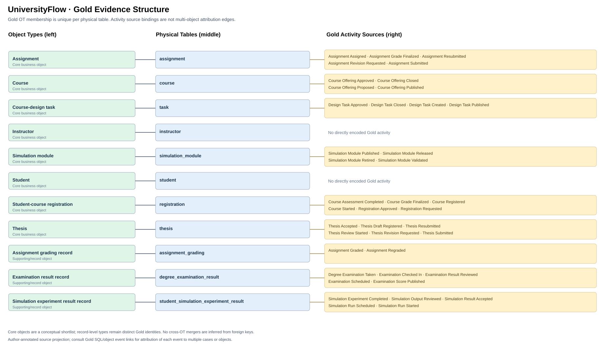
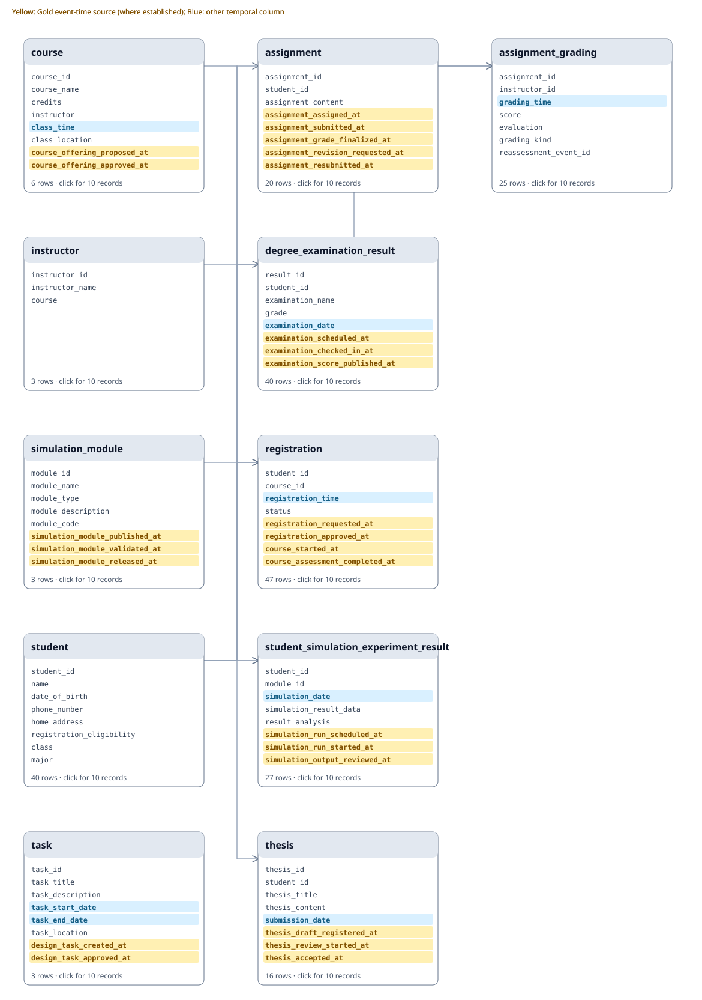

# UniversityFlow

UniversityFlow is a synthetic university operations database representing students, courses, registration, assignments, examinations, theses, and simulation experiments. Its domain design draws on RSchema university requirements and uses authored synthetic records.

[Relational schema](#relational-schema-sql-foreign-keys) · [Table previews](#table-inspector) · [Questions](#questions)

## Entity types and identifiers

[Concepts and formal definitions](../../docs/system/ENTITY_IDENTITY_AND_STORAGE.md) · [Storage cases across datasets](../ENTITY_STORAGE_CASES.md) · [Actual PK, UNIQUE and FK inventory](docs/entity_identifiers.md)

The source projection below assigns a principal type for display. It does not mean a table can identify or reference only one ET. Entity identity is resolved from table/column/condition rules, separately from table membership.

## Dataset overview

| Physical ERs | Entity Type candidates | Core business concepts | Gold SQL/CSV pairs verified |
|---:|---:|---:|---:|
| 11 | 11 | 8 | 66 |

[SQLite database](input/database.sqlite) · [Business Data Dictionary](input/data_dictionary.json) · [Readable dictionary](docs/data_dictionary.md)

## Gold Event Extraction Graph (EEG) Source Projection

The diagram distinguishes core business entity concepts from supporting entity and event-record types. 
Each physical ER has exactly one currently annotated Entity Type candidate. Event-to-entity case attribution is separate from the source ER's provisional ET annotation; FK paths alone do not establish lifecycle membership.

**This is a source-level author-annotated projection, not an inferred EEG or a validated namespace-aware ET Gold.**
Gold SQL and record-level evidence are available in the linked inspection materials; their internal consistency does not validate the target namespace model. The current membership labels originate from the pre-namespace Gold; an independently validated ET/Identity Namespace Gold is a separate evaluation task.

**Entity-model status:** A physical table is one **Entity Representation (ER)**. Its displayed **Entity Type (ET) candidate** comes from legacy Gold annotations. ET semantic grouping and cross-ER instance identity resolution must be validated independently. FK reachability alone does not establish Case Attribution or Lifecycle Membership. [Terminology and namespace contract](../../docs/system/EEG_ENTITY_MODEL.md).

## Relational Schema (SQL foreign keys)

**Yellow:** Gold event-time source, where established. **Blue:** other temporal columns. A temporal column is not automatically an event timestamp.

[Open full-size ERD](review/database/schema.svg) · [Editable Draw.io diagram](docs/schema.drawio) · [Timestamp inventory and roles](docs/timestamp_columns.md)

## Table inspector

| Physical table | Rows | Columns | ET candidate | First ten records |
|---|---:|---:|---|---|
| assignment | 20 | 8 | Assignment | [Preview](review/database/tables/assignment.md) |
| assignment_grading | 25 | 7 | Assignment grading record | [Preview](review/database/tables/assignment_grading.md) |
| course | 6 | 10 | Course | [Preview](review/database/tables/course.md) |
| degree_examination_result | 40 | 9 | Examination result record | [Preview](review/database/tables/degree_examination_result.md) |
| instructor | 3 | 3 | Instructor | [Preview](review/database/tables/instructor.md) |
| registration | 47 | 9 | Student-course registration | [Preview](review/database/tables/registration.md) |
| simulation_module | 3 | 9 | Simulation module | [Preview](review/database/tables/simulation_module.md) |
| student | 40 | 8 | Student | [Preview](review/database/tables/student.md) |
| student_simulation_experiment_result | 27 | 9 | Simulation experiment result record | [Preview](review/database/tables/student_simulation_experiment_result.md) |
| task | 3 | 10 | Course-design task | [Preview](review/database/tables/task.md) |
| thesis | 16 | 10 | Thesis | [Preview](review/database/tables/thesis.md) |

## Entity Type candidates vs. core business objects

Legacy identity groups (ET candidates): **11**; principal business object concepts in this domain: **8**. 
The core set is a candidate semantic grouping, not a rule for merging unrelated instances or Identity Namespaces.

**Core business concepts:** Assignment, Course, Course-design task, Instructor, Simulation module, Student, Student-course registration, Thesis.

Supporting Gold types: Assignment grading record, Examination result record, Simulation experiment result record.

## Evaluation evidence

- Gold SQL/CSV pairs executable and consistent: 66; compared event rows across questions: 8528.
- [Gold source inventory](review/gold_dfg/event_graph.md)
- [Question-level Gold DFGs](review/gold_dfg/README.md)
- [Editable Draw.io schema](docs/schema.drawio)

## Questions

[**Full question list, types and answerability**](docs/questions.md) · [Question texts (JSONL)](evaluation/questions.jsonl) · [Question-level Gold DFGs and source records](review/gold_dfg/README.md)

The checked-in question file contains **70 requests**. Explicit requests enumerate activities; implicit requests ask for a recorded lifecycle. Paired paraphrases, where present, are listed in the question documentation.

Browse all 70 question texts

| ID | Request |
|---|---|
| U01 | Extract Degree Examination Taken events for each student. |
| U02 | For each student, build a timeline of the student sitting the degree examination. |
| U03 | Extract Course Registered events for each student. |
| U04 | For each student, build a timeline of a successful course sign-up. |
| U05 | Extract the full recorded lifecycle event log for each student. |
| U06 | Show the complete recorded history associated with each student. |
| U07 | Extract Registration Success Notification Sent events for each student. |
| U08 | Extract Course Withdrawn events for each student. |
| U09 | Extract Assignment Graded events for each student. |
| U10 | For each student, build a timeline of an instructor assessing the assignment. |
| U11 | Extract Simulation Experiment Completed events for each student. |
| U12 | For each student, build a timeline of a simulation run finishing. |
| U13 | Extract Thesis Submitted events for each student. |
| U14 | For each student, build a timeline of the student handing in a thesis. |
| U15 | Extract Assignment Submitted events for each student. |
| OU01 | Extract the full recorded lifecycle event log for each student. |
| OU02 | Extract the full recorded lifecycle event log for each course. |
| OU03 | Extract the full recorded lifecycle event log for each student-course registration. |
| OU04 | Extract the full recorded lifecycle event log for each examination result record. |
| OU05 | Extract the full recorded lifecycle event log for each simulation module. |
| OU06 | Extract the full recorded lifecycle event log for each thesis. |
| OU07 | Extract the full recorded lifecycle event log for each simulation experiment result record. |
| OU08 | Extract the full recorded lifecycle event log for each assignment. |
| OU09 | Extract the full recorded lifecycle event log for each instructor. |
| OU10 | Extract the full recorded lifecycle event log for each assignment grading record. |
| OU11 | Extract the full recorded lifecycle event log for each course-design task. |
| TS01 | Extract Examination Scheduled, Examination Checked In, Examination Score Published, Examination Result Reviewed events for each student. |
| TS02 | Extract Registration Requested, Registration Approved, Course Started, Course Assessment Completed, Course Grade Finalized events for each student-course registration. |
| TS03 | Extract Assignment Assigned, Assignment Submitted, Assignment Grade Finalized events for each assignment. |
| TS04 | Extract Thesis Draft Registered, Thesis Review Started, Thesis Accepted events for each thesis. |
| U07P | For each student, build a timeline of confirmation messages being sent after a course sign-up. |
| U08P | For each student, build a timeline of the student leaving a course after signing up. |
| U15P | For each student, build a timeline of the student handing in coursework. |
| TS01P | For each student, build a timeline of an examination sitting being arranged, the candidate checking in for the examination, the examination mark being released, the examination result being reviewed. |
| TS02P | For each student-course registration, build a timeline of the student requesting a place on a course, the request for a course place being accepted, teaching beginning for the enrolled course, the course assessment finishing, the course mark being made final. |
| TS03P | For each assignment, build a timeline of coursework being set for the student, the student handing in coursework, the coursework mark being made final. |
| TS04P | For each thesis, build a timeline of a thesis draft being registered for review, the review of a thesis beginning, a thesis receiving final approval. |
| OU01P | Show the complete recorded history associated with each student. |
| OU01E | Extract Assignment Assigned, Assignment Submitted, Assignment Graded events for each student. |
| OU01EP | For each student, build a timeline of coursework being set for the student, the student handing in coursework, an instructor assessing the assignment. |
| OU02P | Show the complete recorded history associated with each course. |
| OU02E | Extract Registration Requested, Course Registered, Course Grade Finalized events for each course. |
| OU02EP | For each course, build a timeline of the student requesting a place on a course, a successful course sign-up, the course mark being made final. |
| OU03P | Show the complete recorded history associated with each student-course registration. |
| OU03E | Extract Registration Requested, Course Registered, Course Grade Finalized events for each student-course registration. |
| OU03EP | For each student-course registration, build a timeline of the student requesting a place on a course, a successful course sign-up, the course mark being made final. |
| OU04P | Show the complete recorded history associated with each examination result record. |
| OU04E | Extract Examination Scheduled, Degree Examination Taken, Examination Score Published events for each examination result record. |
| OU04EP | For each examination result record, build a timeline of an examination sitting being arranged, the student sitting the degree examination, the examination mark being released. |
| OU05P | Show the complete recorded history associated with each simulation module. |
| OU05E | Extract Simulation Run Started, Simulation Experiment Completed, Simulation Result Accepted events for each simulation module. |
| OU05EP | For each simulation module, build a timeline of a simulation run beginning, a simulation run finishing, the simulation results receiving approval. |
| OU06P | Show the complete recorded history associated with each thesis. |
| OU06E | Extract Thesis Submitted, Thesis Review Started, Thesis Accepted events for each thesis. |
| OU06EP | For each thesis, build a timeline of the student handing in a thesis, the review of a thesis beginning, a thesis receiving final approval. |
| OU07P | Show the complete recorded history associated with each simulation experiment result record. |
| OU07E | Extract Simulation Run Started, Simulation Experiment Completed, Simulation Result Accepted events for each simulation experiment result record. |
| OU07EP | For each simulation experiment result record, build a timeline of a simulation run beginning, a simulation run finishing, the simulation results receiving approval. |
| OU08P | Show the complete recorded history associated with each assignment. |
| OU08E | Extract Assignment Assigned, Assignment Submitted, Assignment Graded events for each assignment. |
| OU08EP | For each assignment, build a timeline of coursework being set for the student, the student handing in coursework, an instructor assessing the assignment. |
| OU09P | Show the complete recorded history associated with each instructor. |
| OU09E | Extract Assignment Assigned, Assignment Submitted, Assignment Graded events for each instructor. |
| OU09EP | For each instructor, build a timeline of coursework being set for the student, the student handing in coursework, an instructor assessing the assignment. |
| OU10P | Show the complete recorded history associated with each assignment grading record. |
| OU10E | Extract Assignment Graded events for each assignment grading record. |
| OU10EP | For each assignment grading record, build a timeline of an instructor assessing the assignment. |
| OU11P | Show the complete recorded history associated with each course-design task. |
| OU11E | Extract Design Task Approved, Design Task Closed, Design Task Created events for each course-design task. |
| OU11EP | For each course-design task, build a timeline of a design exercise receiving approval, a design exercise being closed, a design exercise being prepared. |

## Model input boundary

This README, diagrams, table previews and Gold evidence are reader/reviewer material. Do not supply Gold annotations or review materials to the model.
