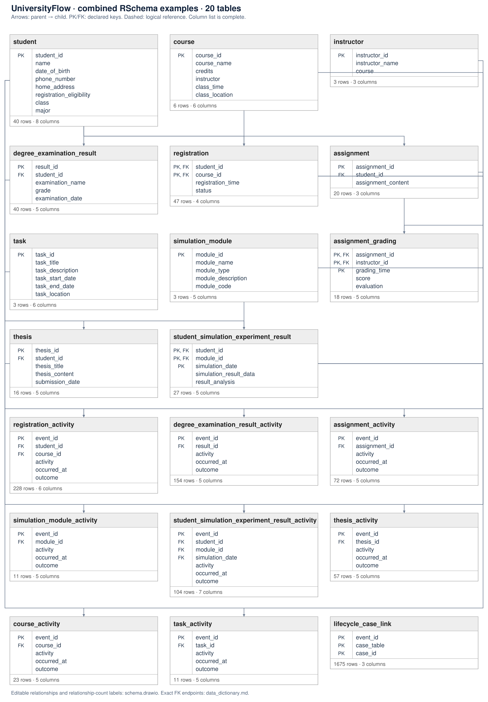

# UniversityFlow · combined RSchema examples — Schema overview

- [Editable draw.io diagram](schema.drawio) · [Column dictionary](data_dictionary.md) · [CSV dictionary](data_dictionary.csv)

| Table | Rows | Columns | Primary key | Role |
|---|---:|---:|---|---|
| student | 40 | 8 | student_id | Unified student information from the three university examples |
| course | 6 | 6 | course_id | Course offerings and planned teaching schedules |
| registration | 47 | 4 | student_id, course_id | Successful registrations; one retained row per student and course |
| degree_examination_result | 40 | 5 | result_id | Examination results including retakes |
| task | 3 | 6 | task_id | Course-design task descriptions and scheduled task periods |
| simulation_module | 3 | 5 | module_id | Simulation module descriptions and example code |
| thesis | 16 | 5 | thesis_id | Student theses with actual submission times |
| student_simulation_experiment_result | 27 | 5 | student_id, module_id, simulation_date | Student simulation results with actual experiment-completion times |
| assignment | 20 | 3 | assignment_id | Student assignment content; submission time is not recorded |
| instructor | 3 | 3 | instructor_id | Instructor information from the assignment-management example |
| assignment_grading | 18 | 5 | assignment_id, instructor_id, grading_time | Every recorded grading action, including regrading |
| registration_activity | 228 | 6 | event_id | Authored actual-action history for registration |
| degree_examination_result_activity | 154 | 5 | event_id | Authored actual-action history for degree_examination_result |
| assignment_activity | 72 | 5 | event_id | Authored actual-action history for assignment |
| simulation_module_activity | 11 | 5 | event_id | Authored actual-action history for simulation_module |
| student_simulation_experiment_result_activity | 104 | 7 | event_id | Authored actual-action history for student_simulation_experiment_result |
| thesis_activity | 57 | 5 | event_id | Authored actual-action history for thesis |
| course_activity | 23 | 5 | event_id | Authored actual-action history for course |
| task_activity | 11 | 5 | event_id | Authored actual-action history for task |
| lifecycle_case_link | 1675 | 3 | event_id, case_table, case_id | Explicit case attribution across typed action histories; auxiliary extraction index, not a business case |

## Relationships

| Parent | Child | Child FK | Parent key | Parent-to-child count | Kind |
|---|---|---|---|---|---|
| course | registration | course_id | course_id | 1 : 0..N | declared |
| student | registration | student_id | student_id | 1 : 0..N | declared |
| student | degree_examination_result | student_id | student_id | 1 : 0..N | declared |
| student | thesis | student_id | student_id | 1 : 0..N | declared |
| simulation_module | student_simulation_experiment_result | module_id | module_id | 1 : 0..N | declared |
| student | student_simulation_experiment_result | student_id | student_id | 1 : 0..N | declared |
| student | assignment | student_id | student_id | 1 : 0..N | declared |
| instructor | assignment_grading | instructor_id | instructor_id | 1 : 0..N | declared |
| assignment | assignment_grading | assignment_id | assignment_id | 1 : 0..N | declared |
| registration | registration_activity | student_id | student_id | 1 : 0..N | declared |
| registration | registration_activity | course_id | course_id | 1 : 0..N | declared |
| degree_examination_result | degree_examination_result_activity | result_id | result_id | 1 : 0..N | declared |
| assignment | assignment_activity | assignment_id | assignment_id | 1 : 0..N | declared |
| simulation_module | simulation_module_activity | module_id | module_id | 1 : 0..N | declared |
| student_simulation_experiment_result | student_simulation_experiment_result_activity | student_id | student_id | 1 : 0..N | declared |
| student_simulation_experiment_result | student_simulation_experiment_result_activity | module_id | module_id | 1 : 0..N | declared |
| student_simulation_experiment_result | student_simulation_experiment_result_activity | simulation_date | simulation_date | 1 : 0..N | declared |
| thesis | thesis_activity | thesis_id | thesis_id | 1 : 0..N | declared |
| course | course_activity | course_id | course_id | 1 : 0..N | declared |
| task | task_activity | task_id | task_id | 1 : 0..N | declared |
