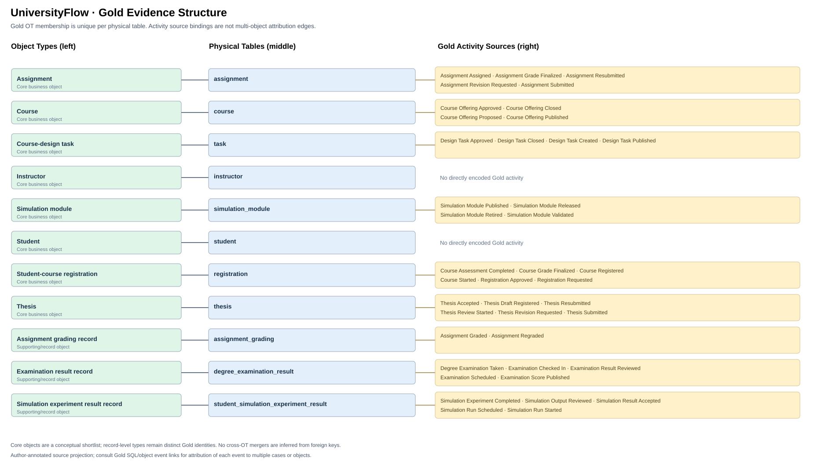
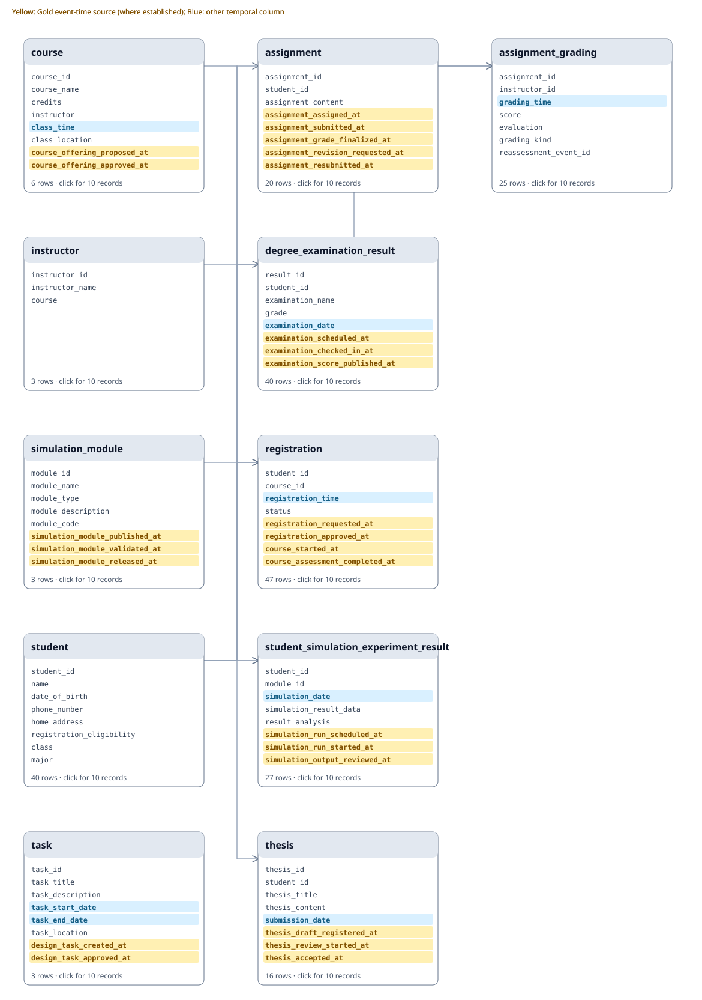

# UniversityFlow — Database and Gold Evidence Review

UniversityFlow is a synthetic university operations database representing students, courses, registration, assignments, examinations, theses, and simulation experiments. Its domain design draws on RSchema university requirements and uses authored synthetic records.

## Gold EEG Source Projection

The diagram distinguishes core entity concepts from supporting representations and occurrence records. 
A physical table is one **Entity Representation (ER)**. Its displayed **Entity Type (ET) candidate** comes from legacy Gold annotations. ET semantic grouping and cross-ER instance identity resolution must be validated independently. FK reachability alone does not establish Case Attribution or Lifecycle Membership. An event may be attributed to several Entity Instances without implying that its source ER belongs to multiple ETs.

The diagram is an **author-annotated EEG source projection**, not a model-inferred EEG or a validated namespace-aware Entity Type Gold. The ET candidates reflect legacy identity labels.
Gold SQL and record-level evidence are available in the linked inspection materials; their internal consistency does not validate the target namespace model.

**Entity-model status:** A physical table is one **Entity Representation (ER)**. Its displayed **Entity Type (ET) candidate** comes from legacy Gold annotations. ET semantic grouping and cross-ER instance identity resolution must be validated independently. FK reachability alone does not establish Case Attribution or Lifecycle Membership. [Terminology and namespace contract](../../../../docs/system/EEG_ENTITY_MODEL.md).

## Relational Schema (SQL foreign keys)

## Table inspector

| Physical table | Rows | Columns | legacy ET candidate | First ten records |
|---|---:|---:|---|---|
| assignment | 20 | 8 | Assignment | [Preview](tables/assignment.md) |
| assignment_grading | 25 | 7 | Assignment grading record | [Preview](tables/assignment_grading.md) |
| course | 6 | 10 | Course | [Preview](tables/course.md) |
| degree_examination_result | 40 | 9 | Examination result record | [Preview](tables/degree_examination_result.md) |
| instructor | 3 | 3 | Instructor | [Preview](tables/instructor.md) |
| registration | 47 | 9 | Student-course registration | [Preview](tables/registration.md) |
| simulation_module | 3 | 9 | Simulation module | [Preview](tables/simulation_module.md) |
| student | 40 | 8 | Student | [Preview](tables/student.md) |
| student_simulation_experiment_result | 27 | 9 | Simulation experiment result record | [Preview](tables/student_simulation_experiment_result.md) |
| task | 3 | 10 | Course-design task | [Preview](tables/task.md) |
| thesis | 16 | 10 | Thesis | [Preview](tables/thesis.md) |

## legacy Entity Type candidates vs. core business objects

Legacy ET candidate groups: **11**; principal business object concepts in this domain: **8**. 
The core set is a conceptual shortlist, not evidence for merging separate Entity Instances or Identity Namespaces.

**Core business concepts:** Assignment, Course, Course-design task, Instructor, Simulation module, Student, Student-course registration, Thesis.

Supporting Gold types: Assignment grading record, Examination result record, Simulation experiment result record.

## Evaluation evidence

- Gold SQL/CSV pairs executable and consistent: 66; compared event rows across questions: 8528.
- [Gold source inventory](../gold_dfg/event_graph.md)
- [Question-level Gold DFGs](../gold_dfg/README.md)
- [Editable Draw.io schema](../../docs/schema.drawio)

