# Universityflow — Question-level Gold DFG inspection

**Gold reference only. These files are not model input.**

[Gold OT → Table → Activities diagram](../database/gold_evidence_graph.svg)

Node counts = event occurrences. Edge counts = adjacent selected events within a case. Dashed amber edges touch timestamp ties and depend on the tie-break rule. DFGs are projections of the selected log, not causal models.

[Event graph inventory · tables, objects, OTs and activities](event_graph.md)

**Source tables** produced matched Gold events. **SQL tables** are all physical tables read by the Gold SQL, including join tables and shared CTE branches.

## Dataset overview

[Full DB schema](../../../datasets/universityflow/docs/schema_overview.md) · [Full-size ER diagram](../../../datasets/universityflow/docs/schema.png) · [SQL DDL](../../../datasets/universityflow/input/schema.sql)

Row examples in this review come from the [synthetic dataset generator](../../../datasets/universityflow/build.py).

Show all 70 questions and the schema preview

<table><tr><td width="50%" valign="top"><h3>All questions (70)</h3><table><thead><tr><th>ID</th><th>Type</th><th>Question</th></tr></thead><tbody><tr><td><a href="#u01--q1">U01</a></td><td>Q1</td><td>Extract Degree Examination Taken events for each student.</td></tr><tr><td><a href="#u02--q2">U02</a></td><td>Q2</td><td>For each student, build a timeline of the student sitting the degree examination.</td></tr><tr><td><a href="#u03--q1">U03</a></td><td>Q1</td><td>Extract Course Registered events for each student.</td></tr><tr><td><a href="#u04--q2">U04</a></td><td>Q2</td><td>For each student, build a timeline of a successful course sign-up.</td></tr><tr><td><a href="#u05--q3">U05</a></td><td>Q3</td><td>Extract the full recorded lifecycle event log for each student.</td></tr><tr><td><a href="#u06--q4">U06</a></td><td>Q4</td><td>Show the complete recorded history associated with each student.</td></tr><tr><td><a href="#u07--q1">U07</a></td><td>Q1</td><td>Extract Registration Success Notification Sent events for each student.</td></tr><tr><td><a href="#u08--q1">U08</a></td><td>Q1</td><td>Extract Course Withdrawn events for each student.</td></tr><tr><td><a href="#u09--q1">U09</a></td><td>Q1</td><td>Extract Assignment Graded events for each student.</td></tr><tr><td><a href="#u10--q2">U10</a></td><td>Q2</td><td>For each student, build a timeline of an instructor assessing the assignment.</td></tr><tr><td><a href="#u11--q1">U11</a></td><td>Q1</td><td>Extract Simulation Experiment Completed events for each student.</td></tr><tr><td><a href="#u12--q2">U12</a></td><td>Q2</td><td>For each student, build a timeline of a simulation run finishing.</td></tr><tr><td><a href="#u13--q1">U13</a></td><td>Q1</td><td>Extract Thesis Submitted events for each student.</td></tr><tr><td><a href="#u14--q2">U14</a></td><td>Q2</td><td>For each student, build a timeline of the student handing in a thesis.</td></tr><tr><td><a href="#u15--q1">U15</a></td><td>Q1</td><td>Extract Assignment Submitted events for each student.</td></tr><tr><td><a href="#ou01--q3">OU01</a></td><td>Q3</td><td>Extract the full recorded lifecycle event log for each student.</td></tr><tr><td><a href="#ou02--q3">OU02</a></td><td>Q3</td><td>Extract the full recorded lifecycle event log for each course.</td></tr><tr><td><a href="#ou03--q3">OU03</a></td><td>Q3</td><td>Extract the full recorded lifecycle event log for each student-course registration.</td></tr><tr><td><a href="#ou04--q3">OU04</a></td><td>Q3</td><td>Extract the full recorded lifecycle event log for each examination result record.</td></tr><tr><td><a href="#ou05--q3">OU05</a></td><td>Q3</td><td>Extract the full recorded lifecycle event log for each simulation module.</td></tr><tr><td><a href="#ou06--q3">OU06</a></td><td>Q3</td><td>Extract the full recorded lifecycle event log for each thesis.</td></tr><tr><td><a href="#ou07--q3">OU07</a></td><td>Q3</td><td>Extract the full recorded lifecycle event log for each simulation experiment result record.</td></tr><tr><td><a href="#ou08--q3">OU08</a></td><td>Q3</td><td>Extract the full recorded lifecycle event log for each assignment.</td></tr><tr><td><a href="#ou09--q3">OU09</a></td><td>Q3</td><td>Extract the full recorded lifecycle event log for each instructor.</td></tr><tr><td><a href="#ou10--q3">OU10</a></td><td>Q3</td><td>Extract the full recorded lifecycle event log for each assignment grading record.</td></tr><tr><td><a href="#ou11--q3">OU11</a></td><td>Q3</td><td>Extract the full recorded lifecycle event log for each course-design task.</td></tr><tr><td><a href="#ts01--q1">TS01</a></td><td>Q1</td><td>Extract Examination Scheduled, Examination Checked In, Examination Score Published, Examination Result Reviewed events for each student.</td></tr><tr><td><a href="#ts02--q1">TS02</a></td><td>Q1</td><td>Extract Registration Requested, Registration Approved, Course Started, Course Assessment Completed, Course Grade Finalized events for each student-course registration.</td></tr><tr><td><a href="#ts03--q1">TS03</a></td><td>Q1</td><td>Extract Assignment Assigned, Assignment Submitted, Assignment Grade Finalized events for each assignment.</td></tr><tr><td><a href="#ts04--q1">TS04</a></td><td>Q1</td><td>Extract Thesis Draft Registered, Thesis Review Started, Thesis Accepted events for each thesis.</td></tr><tr><td><a href="#u07p--q2">U07P</a></td><td>Q2</td><td>For each student, build a timeline of confirmation messages being sent after a course sign-up.</td></tr><tr><td><a href="#u08p--q2">U08P</a></td><td>Q2</td><td>For each student, build a timeline of the student leaving a course after signing up.</td></tr><tr><td><a href="#u15p--q2">U15P</a></td><td>Q2</td><td>For each student, build a timeline of the student handing in coursework.</td></tr><tr><td><a href="#ts01p--q2">TS01P</a></td><td>Q2</td><td>For each student, build a timeline of an examination sitting being arranged, the candidate checking in for the examination, the examination mark being released, the examination result being reviewed.</td></tr><tr><td><a href="#ts02p--q2">TS02P</a></td><td>Q2</td><td>For each student-course registration, build a timeline of the student requesting a place on a course, the request for a course place being accepted, teaching beginning for the enrolled course, the course assessment finishing, the course mark being made final.</td></tr><tr><td><a href="#ts03p--q2">TS03P</a></td><td>Q2</td><td>For each assignment, build a timeline of coursework being set for the student, the student handing in coursework, the coursework mark being made final.</td></tr><tr><td><a href="#ts04p--q2">TS04P</a></td><td>Q2</td><td>For each thesis, build a timeline of a thesis draft being registered for review, the review of a thesis beginning, a thesis receiving final approval.</td></tr><tr><td><a href="#ou01p--q4">OU01P</a></td><td>Q4</td><td>Show the complete recorded history associated with each student.</td></tr><tr><td><a href="#ou01e--q1">OU01E</a></td><td>Q1</td><td>Extract Assignment Assigned, Assignment Submitted, Assignment Graded events for each student.</td></tr><tr><td><a href="#ou01ep--q2">OU01EP</a></td><td>Q2</td><td>For each student, build a timeline of coursework being set for the student, the student handing in coursework, an instructor assessing the assignment.</td></tr><tr><td><a href="#ou02p--q4">OU02P</a></td><td>Q4</td><td>Show the complete recorded history associated with each course.</td></tr><tr><td><a href="#ou02e--q1">OU02E</a></td><td>Q1</td><td>Extract Registration Requested, Course Registered, Course Grade Finalized events for each course.</td></tr><tr><td><a href="#ou02ep--q2">OU02EP</a></td><td>Q2</td><td>For each course, build a timeline of the student requesting a place on a course, a successful course sign-up, the course mark being made final.</td></tr><tr><td><a href="#ou03p--q4">OU03P</a></td><td>Q4</td><td>Show the complete recorded history associated with each student-course registration.</td></tr><tr><td><a href="#ou03e--q1">OU03E</a></td><td>Q1</td><td>Extract Registration Requested, Course Registered, Course Grade Finalized events for each student-course registration.</td></tr><tr><td><a href="#ou03ep--q2">OU03EP</a></td><td>Q2</td><td>For each student-course registration, build a timeline of the student requesting a place on a course, a successful course sign-up, the course mark being made final.</td></tr><tr><td><a href="#ou04p--q4">OU04P</a></td><td>Q4</td><td>Show the complete recorded history associated with each examination result record.</td></tr><tr><td><a href="#ou04e--q1">OU04E</a></td><td>Q1</td><td>Extract Examination Scheduled, Degree Examination Taken, Examination Score Published events for each examination result record.</td></tr><tr><td><a href="#ou04ep--q2">OU04EP</a></td><td>Q2</td><td>For each examination result record, build a timeline of an examination sitting being arranged, the student sitting the degree examination, the examination mark being released.</td></tr><tr><td><a href="#ou05p--q4">OU05P</a></td><td>Q4</td><td>Show the complete recorded history associated with each simulation module.</td></tr><tr><td><a href="#ou05e--q1">OU05E</a></td><td>Q1</td><td>Extract Simulation Run Started, Simulation Experiment Completed, Simulation Result Accepted events for each simulation module.</td></tr><tr><td><a href="#ou05ep--q2">OU05EP</a></td><td>Q2</td><td>For each simulation module, build a timeline of a simulation run beginning, a simulation run finishing, the simulation results receiving approval.</td></tr><tr><td><a href="#ou06p--q4">OU06P</a></td><td>Q4</td><td>Show the complete recorded history associated with each thesis.</td></tr><tr><td><a href="#ou06e--q1">OU06E</a></td><td>Q1</td><td>Extract Thesis Submitted, Thesis Review Started, Thesis Accepted events for each thesis.</td></tr><tr><td><a href="#ou06ep--q2">OU06EP</a></td><td>Q2</td><td>For each thesis, build a timeline of the student handing in a thesis, the review of a thesis beginning, a thesis receiving final approval.</td></tr><tr><td><a href="#ou07p--q4">OU07P</a></td><td>Q4</td><td>Show the complete recorded history associated with each simulation experiment result record.</td></tr><tr><td><a href="#ou07e--q1">OU07E</a></td><td>Q1</td><td>Extract Simulation Run Started, Simulation Experiment Completed, Simulation Result Accepted events for each simulation experiment result record.</td></tr><tr><td><a href="#ou07ep--q2">OU07EP</a></td><td>Q2</td><td>For each simulation experiment result record, build a timeline of a simulation run beginning, a simulation run finishing, the simulation results receiving approval.</td></tr><tr><td><a href="#ou08p--q4">OU08P</a></td><td>Q4</td><td>Show the complete recorded history associated with each assignment.</td></tr><tr><td><a href="#ou08e--q1">OU08E</a></td><td>Q1</td><td>Extract Assignment Assigned, Assignment Submitted, Assignment Graded events for each assignment.</td></tr><tr><td><a href="#ou08ep--q2">OU08EP</a></td><td>Q2</td><td>For each assignment, build a timeline of coursework being set for the student, the student handing in coursework, an instructor assessing the assignment.</td></tr><tr><td><a href="#ou09p--q4">OU09P</a></td><td>Q4</td><td>Show the complete recorded history associated with each instructor.</td></tr><tr><td><a href="#ou09e--q1">OU09E</a></td><td>Q1</td><td>Extract Assignment Assigned, Assignment Submitted, Assignment Graded events for each instructor.</td></tr><tr><td><a href="#ou09ep--q2">OU09EP</a></td><td>Q2</td><td>For each instructor, build a timeline of coursework being set for the student, the student handing in coursework, an instructor assessing the assignment.</td></tr><tr><td><a href="#ou10p--q4">OU10P</a></td><td>Q4</td><td>Show the complete recorded history associated with each assignment grading record.</td></tr><tr><td><a href="#ou10e--q1">OU10E</a></td><td>Q1</td><td>Extract Assignment Graded events for each assignment grading record.</td></tr><tr><td><a href="#ou10ep--q2">OU10EP</a></td><td>Q2</td><td>For each assignment grading record, build a timeline of an instructor assessing the assignment.</td></tr><tr><td><a href="#ou11p--q4">OU11P</a></td><td>Q4</td><td>Show the complete recorded history associated with each course-design task.</td></tr><tr><td><a href="#ou11e--q1">OU11E</a></td><td>Q1</td><td>Extract Design Task Approved, Design Task Closed, Design Task Created events for each course-design task.</td></tr><tr><td><a href="#ou11ep--q2">OU11EP</a></td><td>Q2</td><td>For each course-design task, build a timeline of a design exercise receiving approval, a design exercise being closed, a design exercise being prepared.</td></tr></tbody></table></td><td width="50%" valign="top"><h3>Database schema</h3>

<a href="../../../datasets/universityflow/docs/schema.png">Full-size diagram</a> · <a href="../../../datasets/universityflow/input/schema.sql">Full SQL schema</a>
</td></tr></table>

## U01 — Q1

Extract Degree Examination Taken events for each student.

Events: **40** · Cases with events: **30** · Activities: **1** · Edges: **1** · Source tables: **1** · SQL tables: **1**

<table><tr><td width="42%" valign="top"><a href="graphs/U01.svg">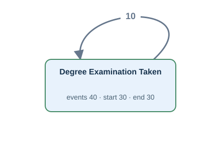</a></td><td width="58%" valign="top">
<a href="../../../datasets/universityflow/private/gold_sql/U01.sql">Gold SQL</a> · <a href="../../../datasets/universityflow/private/gold_logs/U01.csv">Gold CSV</a> · <a href="../../../datasets/universityflow/input/database.sqlite">Full source database (SQLite)</a>

<code>degree_examination_result</code> · 40 matched source rows
<table><tr><th>Column</th><th>Row 1</th><th>Row 2</th><th>Row 3</th></tr><tr><th>result_id</th><td>E001-1</td><td>E002-1</td><td>E002-2</td></tr><tr><th>student_id</th><td>S001</td><td>S002</td><td>S002</td></tr><tr><th>examination_name</th><td>Registration Eligibility Examination</td><td>Registration Eligibility Examination</td><td>Registration Eligibility Examination</td></tr><tr><th>grade</th><td>33</td><td>32</td><td>88</td></tr><tr><th>examination_date</th><td>2026-02-02T09:00:00Z</td><td>2026-02-03T09:00:00Z</td><td>2026-02-05T09:00:00Z</td></tr><tr><th>examination_scheduled_at</th><td>2026-02-02T07:00:00Z</td><td>2026-02-03T07:00:00Z</td><td>2026-02-05T07:00:00Z</td></tr><tr><th>examination_checked_in_at</th><td>2026-02-02T08:00:00Z</td><td>2026-02-03T08:00:00Z</td><td>2026-02-05T08:00:00Z</td></tr><tr><th>examination_score_published_at</th><td>2026-02-02T11:00:00Z</td><td>2026-02-03T11:00:00Z</td><td>2026-02-05T11:00:00Z</td></tr><tr><th>examination_result_reviewed_at</th><td><em>NULL</em></td><td>2026-02-03T12:00:00Z</td><td>2026-02-05T12:00:00Z</td></tr></table>
<strong>Gold output for the same source rows</strong>
<ul><li>Row 1 → Degree Examination Taken · event EX:E001-1 · case S001 · time from <code>examination_date</code></li><li>Row 2 → Degree Examination Taken · event EX:E002-1 · case S002 · time from <code>examination_date</code></li><li>Row 3 → Degree Examination Taken · event EX:E002-2 · case S002 · time from <code>examination_date</code></li></ul>
</td></tr></table>

## U02 — Q2

For each student, build a timeline of the student sitting the degree examination.

Events: **40** · Cases with events: **30** · Activities: **1** · Edges: **1** · Source tables: **1** · SQL tables: **1**

<table><tr><td width="42%" valign="top"></td><td width="58%" valign="top">
<a href="../../../datasets/universityflow/private/gold_sql/U02.sql">Gold SQL</a> · <a href="../../../datasets/universityflow/private/gold_logs/U02.csv">Gold CSV</a> · <a href="../../../datasets/universityflow/input/database.sqlite">Full source database (SQLite)</a>

<code>degree_examination_result</code> · 40 matched source rows
<table><tr><th>Column</th><th>Row 1</th><th>Row 2</th><th>Row 3</th></tr><tr><th>result_id</th><td>E001-1</td><td>E002-1</td><td>E002-2</td></tr><tr><th>student_id</th><td>S001</td><td>S002</td><td>S002</td></tr><tr><th>examination_name</th><td>Registration Eligibility Examination</td><td>Registration Eligibility Examination</td><td>Registration Eligibility Examination</td></tr><tr><th>grade</th><td>33</td><td>32</td><td>88</td></tr><tr><th>examination_date</th><td>2026-02-02T09:00:00Z</td><td>2026-02-03T09:00:00Z</td><td>2026-02-05T09:00:00Z</td></tr><tr><th>examination_scheduled_at</th><td>2026-02-02T07:00:00Z</td><td>2026-02-03T07:00:00Z</td><td>2026-02-05T07:00:00Z</td></tr><tr><th>examination_checked_in_at</th><td>2026-02-02T08:00:00Z</td><td>2026-02-03T08:00:00Z</td><td>2026-02-05T08:00:00Z</td></tr><tr><th>examination_score_published_at</th><td>2026-02-02T11:00:00Z</td><td>2026-02-03T11:00:00Z</td><td>2026-02-05T11:00:00Z</td></tr><tr><th>examination_result_reviewed_at</th><td><em>NULL</em></td><td>2026-02-03T12:00:00Z</td><td>2026-02-05T12:00:00Z</td></tr></table>
<strong>Gold output for the same source rows</strong>
<ul><li>Row 1 → Degree Examination Taken · event EX:E001-1 · case S001 · time from <code>examination_date</code></li><li>Row 2 → Degree Examination Taken · event EX:E002-1 · case S002 · time from <code>examination_date</code></li><li>Row 3 → Degree Examination Taken · event EX:E002-2 · case S002 · time from <code>examination_date</code></li></ul>
</td></tr></table>

## U03 — Q1

Extract Course Registered events for each student.

Events: **47** · Cases with events: **20** · Activities: **1** · Edges: **1** · Source tables: **1** · SQL tables: **1**

<table><tr><td width="42%" valign="top"><a href="graphs/U03.svg">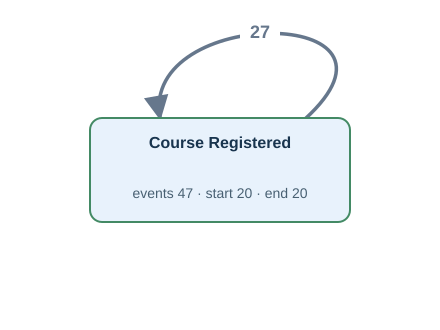</a></td><td width="58%" valign="top">
<a href="../../../datasets/universityflow/private/gold_sql/U03.sql">Gold SQL</a> · <a href="../../../datasets/universityflow/private/gold_logs/U03.csv">Gold CSV</a> · <a href="../../../datasets/universityflow/input/database.sqlite">Full source database (SQLite)</a>

<code>registration</code> · 47 matched source rows
<table><tr><th>Column</th><th>Row 1</th><th>Row 2</th><th>Row 3</th></tr><tr><th>student_id</th><td>S002</td><td>S002</td><td>S003</td></tr><tr><th>course_id</th><td>C01</td><td>C06</td><td>C02</td></tr><tr><th>registration_time</th><td>2026-02-07T11:00:00Z</td><td>2026-02-07T16:00:00Z</td><td>2026-02-08T12:00:00Z</td></tr><tr><th>status</th><td>REGISTERED</td><td>REGISTERED</td><td>REGISTERED</td></tr><tr><th>registration_requested_at</th><td>2026-02-07T07:00:00Z</td><td>2026-02-07T12:00:00Z</td><td>2026-02-08T08:00:00Z</td></tr><tr><th>registration_approved_at</th><td>2026-02-07T09:00:00Z</td><td>2026-02-07T14:00:00Z</td><td>2026-02-08T10:00:00Z</td></tr><tr><th>course_started_at</th><td>2026-02-09T11:00:00Z</td><td>2026-02-09T16:00:00Z</td><td>2026-02-10T12:00:00Z</td></tr><tr><th>course_assessment_completed_at</th><td>2026-02-27T11:00:00Z</td><td>2026-02-27T16:00:00Z</td><td>2026-02-28T12:00:00Z</td></tr><tr><th>course_grade_finalized_at</th><td><em>NULL</em></td><td>2026-03-01T16:00:00Z</td><td>2026-03-02T12:00:00Z</td></tr></table>
<strong>Gold output for the same source rows</strong>
<ul><li>Row 1 → Course Registered · event REG:S002:C01 · case S002 · time from <code>registration_time</code></li><li>Row 2 → Course Registered · event REG:S002:C06 · case S002 · time from <code>registration_time</code></li><li>Row 3 → Course Registered · event REG:S003:C02 · case S003 · time from <code>registration_time</code></li></ul>
</td></tr></table>

## U04 — Q2

For each student, build a timeline of a successful course sign-up.

Events: **47** · Cases with events: **20** · Activities: **1** · Edges: **1** · Source tables: **1** · SQL tables: **1**

<table><tr><td width="42%" valign="top"></td><td width="58%" valign="top">
<a href="../../../datasets/universityflow/private/gold_sql/U04.sql">Gold SQL</a> · <a href="../../../datasets/universityflow/private/gold_logs/U04.csv">Gold CSV</a> · <a href="../../../datasets/universityflow/input/database.sqlite">Full source database (SQLite)</a>

<code>registration</code> · 47 matched source rows
<table><tr><th>Column</th><th>Row 1</th><th>Row 2</th><th>Row 3</th></tr><tr><th>student_id</th><td>S002</td><td>S002</td><td>S003</td></tr><tr><th>course_id</th><td>C01</td><td>C06</td><td>C02</td></tr><tr><th>registration_time</th><td>2026-02-07T11:00:00Z</td><td>2026-02-07T16:00:00Z</td><td>2026-02-08T12:00:00Z</td></tr><tr><th>status</th><td>REGISTERED</td><td>REGISTERED</td><td>REGISTERED</td></tr><tr><th>registration_requested_at</th><td>2026-02-07T07:00:00Z</td><td>2026-02-07T12:00:00Z</td><td>2026-02-08T08:00:00Z</td></tr><tr><th>registration_approved_at</th><td>2026-02-07T09:00:00Z</td><td>2026-02-07T14:00:00Z</td><td>2026-02-08T10:00:00Z</td></tr><tr><th>course_started_at</th><td>2026-02-09T11:00:00Z</td><td>2026-02-09T16:00:00Z</td><td>2026-02-10T12:00:00Z</td></tr><tr><th>course_assessment_completed_at</th><td>2026-02-27T11:00:00Z</td><td>2026-02-27T16:00:00Z</td><td>2026-02-28T12:00:00Z</td></tr><tr><th>course_grade_finalized_at</th><td><em>NULL</em></td><td>2026-03-01T16:00:00Z</td><td>2026-03-02T12:00:00Z</td></tr></table>
<strong>Gold output for the same source rows</strong>
<ul><li>Row 1 → Course Registered · event REG:S002:C01 · case S002 · time from <code>registration_time</code></li><li>Row 2 → Course Registered · event REG:S002:C06 · case S002 · time from <code>registration_time</code></li><li>Row 3 → Course Registered · event REG:S003:C02 · case S003 · time from <code>registration_time</code></li></ul>
</td></tr></table>

## U05 — Q3

Extract the full recorded lifecycle event log for each student.

Events: **763** · Cases with events: **30** · Activities: **29** · Edges: **62** · Source tables: **6** · SQL tables: **9**

<table><tr><td width="42%" valign="top"><a href="graphs/U05.svg">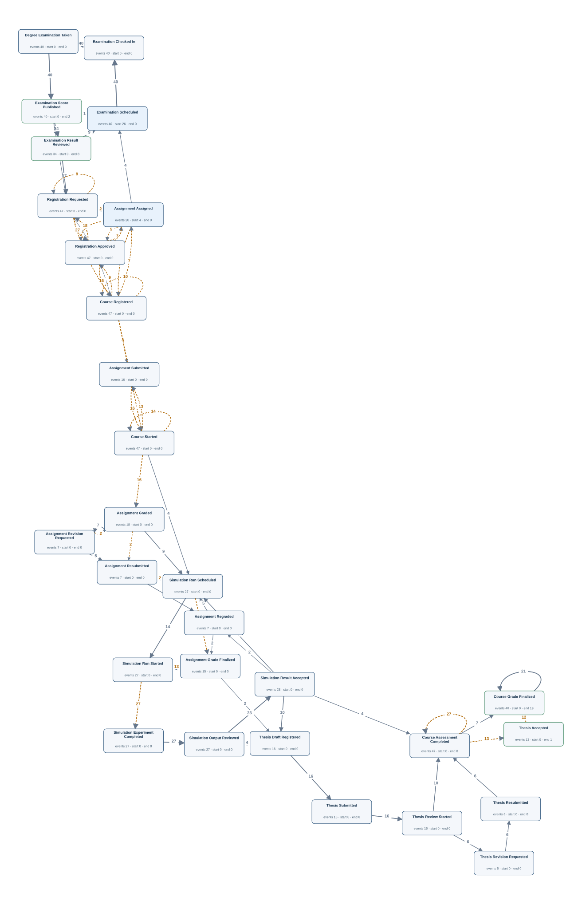</a></td><td width="58%" valign="top">
<a href="../../../datasets/universityflow/private/gold_sql/U05.sql">Gold SQL</a> · <a href="../../../datasets/universityflow/private/gold_logs/U05.csv">Gold CSV</a> · <a href="../../../datasets/universityflow/input/database.sqlite">Full source database (SQLite)</a>

<code>assignment</code> · 20 matched source rows
<table><tr><th>Column</th><th>Row 1</th><th>Row 2</th><th>Row 3</th></tr><tr><th>assignment_id</th><td>A002</td><td>A003</td><td>A006</td></tr><tr><th>student_id</th><td>S002</td><td>S003</td><td>S006</td></tr><tr><th>assignment_content</th><td>Synthetic assignment content</td><td>Synthetic assignment content</td><td>Synthetic assignment content</td></tr><tr><th>assignment_assigned_at</th><td>2026-02-07T14:00:00Z</td><td>2026-02-08T14:00:00Z</td><td>2026-02-11T14:00:00Z</td></tr><tr><th>assignment_submitted_at</th><td>2026-02-09T14:00:00Z</td><td>2026-02-10T14:00:00Z</td><td>2026-02-13T14:00:00Z</td></tr><tr><th>assignment_grade_finalized_at</th><td><em>NULL</em></td><td>2026-02-14T14:00:00Z</td><td>2026-02-17T14:00:00Z</td></tr><tr><th>assignment_revision_requested_at</th><td>2026-02-11T15:00:00Z</td><td><em>NULL</em></td><td><em>NULL</em></td></tr><tr><th>assignment_resubmitted_at</th><td>2026-02-12T14:00:00Z</td><td><em>NULL</em></td><td><em>NULL</em></td></tr></table>
<strong>Gold output for the same source rows</strong>
<ul><li>Row 1 → Assignment Assigned · event LC:assignment:A002:1 · case S002 · time from <code>assignment_assigned_at</code></li><li>Row 1 → Assignment Submitted · event LC:assignment:A002:2 · case S002 · time from <code>assignment_submitted_at</code></li><li>Row 1 → Assignment Revision Requested · event LC:assignment:A002:3 · case S002 · time from <code>assignment_revision_requested_at</code></li><li>Row 1 → Assignment Resubmitted · event LC:assignment:A002:4 · case S002 · time from <code>assignment_resubmitted_at</code></li><li>Row 2 → Assignment Assigned · event LC:assignment:A003:1 · case S003 · time from <code>assignment_assigned_at</code></li><li>Row 2 → Assignment Submitted · event LC:assignment:A003:2 · case S003 · time from <code>assignment_submitted_at</code></li><li>Row 2 → Assignment Grade Finalized · event LC:assignment:A003:3 · case S003 · time from <code>assignment_grade_finalized_at</code></li><li>Row 3 → Assignment Assigned · event LC:assignment:A006:1 · case S006 · time from <code>assignment_assigned_at</code></li><li>Row 3 → Assignment Submitted · event LC:assignment:A006:2 · case S006 · time from <code>assignment_submitted_at</code></li><li>Row 3 → Assignment Grade Finalized · event LC:assignment:A006:3 · case S006 · time from <code>assignment_grade_finalized_at</code></li></ul>

<code>assignment_grading</code> · 25 matched source rows
<table><tr><th>Column</th><th>Row 1</th><th>Row 2</th><th>Row 3</th></tr><tr><th>assignment_id</th><td>A002</td><td>A002</td><td>A003</td></tr><tr><th>instructor_id</th><td>I03</td><td>I03</td><td>I01</td></tr><tr><th>grading_time</th><td>2026-02-11T14:00:00Z</td><td>2026-02-13T02:00:00Z</td><td>2026-02-12T14:00:00Z</td></tr><tr><th>score</th><td>70</td><td>75</td><td>70</td></tr><tr><th>evaluation</th><td>Initial feedback</td><td>Authored synthetic reassessment score and feedback</td><td>Initial feedback</td></tr><tr><th>grading_kind</th><td>ORIGINAL</td><td>REASSESSMENT</td><td>ORIGINAL</td></tr><tr><th>reassessment_event_id</th><td><em>NULL</em></td><td>LC:assignment:A002:5</td><td><em>NULL</em></td></tr></table>
<strong>Gold output for the same source rows</strong>
<ul><li>Row 1 → Assignment Graded · event GRADE:A002:I03:2026-02-11T14:00:00Z · case S002 · time from <code>grading_time</code></li><li>Row 2 → Assignment Regraded · event LC:assignment:A002:5 · case S002 · time from <code>grading_time</code></li><li>Row 3 → Assignment Graded · event GRADE:A003:I01:2026-02-12T14:00:00Z · case S003 · time from <code>grading_time</code></li></ul>

<code>degree_examination_result</code> · 40 matched source rows
<table><tr><th>Column</th><th>Row 1</th><th>Row 2</th><th>Row 3</th></tr><tr><th>result_id</th><td>E001-1</td><td>E002-1</td><td>E002-2</td></tr><tr><th>student_id</th><td>S001</td><td>S002</td><td>S002</td></tr><tr><th>examination_name</th><td>Registration Eligibility Examination</td><td>Registration Eligibility Examination</td><td>Registration Eligibility Examination</td></tr><tr><th>grade</th><td>33</td><td>32</td><td>88</td></tr><tr><th>examination_date</th><td>2026-02-02T09:00:00Z</td><td>2026-02-03T09:00:00Z</td><td>2026-02-05T09:00:00Z</td></tr><tr><th>examination_scheduled_at</th><td>2026-02-02T07:00:00Z</td><td>2026-02-03T07:00:00Z</td><td>2026-02-05T07:00:00Z</td></tr><tr><th>examination_checked_in_at</th><td>2026-02-02T08:00:00Z</td><td>2026-02-03T08:00:00Z</td><td>2026-02-05T08:00:00Z</td></tr><tr><th>examination_score_published_at</th><td>2026-02-02T11:00:00Z</td><td>2026-02-03T11:00:00Z</td><td>2026-02-05T11:00:00Z</td></tr><tr><th>examination_result_reviewed_at</th><td><em>NULL</em></td><td>2026-02-03T12:00:00Z</td><td>2026-02-05T12:00:00Z</td></tr></table>
<strong>Gold output for the same source rows</strong>
<ul><li>Row 1 → Degree Examination Taken · event EX:E001-1 · case S001 · time from <code>examination_date</code></li><li>Row 1 → Examination Scheduled · event LC:degree_examination_result:E001-1:1 · case S001 · time from <code>examination_scheduled_at</code></li><li>Row 1 → Examination Checked In · event LC:degree_examination_result:E001-1:2 · case S001 · time from <code>examination_checked_in_at</code></li><li>Row 1 → Examination Score Published · event LC:degree_examination_result:E001-1:3 · case S001 · time from <code>examination_score_published_at</code></li><li>Row 2 → Degree Examination Taken · event EX:E002-1 · case S002 · time from <code>examination_date</code></li><li>Row 2 → Examination Scheduled · event LC:degree_examination_result:E002-1:1 · case S002 · time from <code>examination_scheduled_at</code></li><li>Row 2 → Examination Checked In · event LC:degree_examination_result:E002-1:2 · case S002 · time from <code>examination_checked_in_at</code></li><li>Row 2 → Examination Score Published · event LC:degree_examination_result:E002-1:3 · case S002 · time from <code>examination_score_published_at</code></li><li>Row 2 → Examination Result Reviewed · event LC:degree_examination_result:E002-1:4 · case S002 · time from <code>examination_result_reviewed_at</code></li><li>Row 3 → Degree Examination Taken · event EX:E002-2 · case S002 · time from <code>examination_date</code></li><li>Row 3 → Examination Scheduled · event LC:degree_examination_result:E002-2:1 · case S002 · time from <code>examination_scheduled_at</code></li><li>Row 3 → Examination Checked In · event LC:degree_examination_result:E002-2:2 · case S002 · time from <code>examination_checked_in_at</code></li><li>Row 3 → Examination Score Published · event LC:degree_examination_result:E002-2:3 · case S002 · time from <code>examination_score_published_at</code></li><li>Row 3 → Examination Result Reviewed · event LC:degree_examination_result:E002-2:4 · case S002 · time from <code>examination_result_reviewed_at</code></li></ul>

<code>registration</code> · 47 matched source rows
<table><tr><th>Column</th><th>Row 1</th><th>Row 2</th><th>Row 3</th></tr><tr><th>student_id</th><td>S002</td><td>S002</td><td>S003</td></tr><tr><th>course_id</th><td>C01</td><td>C06</td><td>C02</td></tr><tr><th>registration_time</th><td>2026-02-07T11:00:00Z</td><td>2026-02-07T16:00:00Z</td><td>2026-02-08T12:00:00Z</td></tr><tr><th>status</th><td>REGISTERED</td><td>REGISTERED</td><td>REGISTERED</td></tr><tr><th>registration_requested_at</th><td>2026-02-07T07:00:00Z</td><td>2026-02-07T12:00:00Z</td><td>2026-02-08T08:00:00Z</td></tr><tr><th>registration_approved_at</th><td>2026-02-07T09:00:00Z</td><td>2026-02-07T14:00:00Z</td><td>2026-02-08T10:00:00Z</td></tr><tr><th>course_started_at</th><td>2026-02-09T11:00:00Z</td><td>2026-02-09T16:00:00Z</td><td>2026-02-10T12:00:00Z</td></tr><tr><th>course_assessment_completed_at</th><td>2026-02-27T11:00:00Z</td><td>2026-02-27T16:00:00Z</td><td>2026-02-28T12:00:00Z</td></tr><tr><th>course_grade_finalized_at</th><td><em>NULL</em></td><td>2026-03-01T16:00:00Z</td><td>2026-03-02T12:00:00Z</td></tr></table>
<strong>Gold output for the same source rows</strong>
<ul><li>Row 1 → Registration Requested · event LC:registration:S002:C01:1 · case S002 · time from <code>registration_requested_at</code></li><li>Row 1 → Registration Approved · event LC:registration:S002:C01:2 · case S002 · time from <code>registration_approved_at</code></li><li>Row 1 → Course Started · event LC:registration:S002:C01:3 · case S002 · time from <code>course_started_at</code></li><li>Row 1 → Course Assessment Completed · event LC:registration:S002:C01:4 · case S002 · time from <code>course_assessment_completed_at</code></li><li>Row 1 → Course Registered · event REG:S002:C01 · case S002 · time from <code>registration_time</code></li><li>Row 2 → Registration Requested · event LC:registration:S002:C06:1 · case S002 · time from <code>registration_requested_at</code></li><li>Row 2 → Registration Approved · event LC:registration:S002:C06:2 · case S002 · time from <code>registration_approved_at</code></li><li>Row 2 → Course Started · event LC:registration:S002:C06:3 · case S002 · time from <code>course_started_at</code></li><li>Row 2 → Course Assessment Completed · event LC:registration:S002:C06:4 · case S002 · time from <code>course_assessment_completed_at</code></li><li>Row 2 → Course Grade Finalized · event LC:registration:S002:C06:5 · case S002 · time from <code>course_grade_finalized_at</code></li><li>Row 2 → Course Registered · event REG:S002:C06 · case S002 · time from <code>registration_time</code></li><li>Row 3 → Registration Requested · event LC:registration:S003:C02:1 · case S003 · time from <code>registration_requested_at</code></li><li>Row 3 → Registration Approved · event LC:registration:S003:C02:2 · case S003 · time from <code>registration_approved_at</code></li><li>Row 3 → Course Started · event LC:registration:S003:C02:3 · case S003 · time from <code>course_started_at</code></li><li>Row 3 → Course Assessment Completed · event LC:registration:S003:C02:4 · case S003 · time from <code>course_assessment_completed_at</code></li><li>Row 3 → Course Grade Finalized · event LC:registration:S003:C02:5 · case S003 · time from <code>course_grade_finalized_at</code></li><li>Row 3 → Course Registered · event REG:S003:C02 · case S003 · time from <code>registration_time</code></li></ul>

<code>student_simulation_experiment_result</code> · 27 matched source rows
<table><tr><th>Column</th><th>Row 1</th><th>Row 2</th><th>Row 3</th></tr><tr><th>student_id</th><td>S002</td><td>S003</td><td>S003</td></tr><tr><th>module_id</th><td>M03</td><td>M01</td><td>M01</td></tr><tr><th>simulation_date</th><td>2026-02-13T15:00:00Z</td><td>2026-02-14T15:00:00Z</td><td>2026-02-15T15:00:00Z</td></tr><tr><th>simulation_result_data</th><td>Synthetic output 1</td><td>Synthetic output 1</td><td>Synthetic output 2</td></tr><tr><th>result_analysis</th><td>Recorded experiment analysis</td><td>Recorded experiment analysis</td><td>Recorded experiment analysis</td></tr><tr><th>simulation_run_scheduled_at</th><td>2026-02-13T13:00:00Z</td><td>2026-02-14T13:00:00Z</td><td>2026-02-15T13:00:00Z</td></tr><tr><th>simulation_run_started_at</th><td>2026-02-13T14:00:00Z</td><td>2026-02-14T14:00:00Z</td><td>2026-02-15T14:00:00Z</td></tr><tr><th>simulation_output_reviewed_at</th><td>2026-02-13T17:00:00Z</td><td>2026-02-14T17:00:00Z</td><td>2026-02-15T17:00:00Z</td></tr><tr><th>simulation_result_accepted_at</th><td><em>NULL</em></td><td>2026-02-14T18:00:00Z</td><td>2026-02-15T18:00:00Z</td></tr></table>
<strong>Gold output for the same source rows</strong>
<ul><li>Row 1 → Simulation Run Scheduled · event LC:student_simulation_experiment_result:S002:M03:2026-02-13T15:00:00Z:1 · case S002 · time from <code>simulation_run_scheduled_at</code></li><li>Row 1 → Simulation Run Started · event LC:student_simulation_experiment_result:S002:M03:2026-02-13T15:00:00Z:2 · case S002 · time from <code>simulation_run_started_at</code></li><li>Row 1 → Simulation Output Reviewed · event LC:student_simulation_experiment_result:S002:M03:2026-02-13T15:00:00Z:3 · case S002 · time from <code>simulation_output_reviewed_at</code></li><li>Row 1 → Simulation Experiment Completed · event SIM:S002:M03:2026-02-13T15:00:00Z · case S002 · time from <code>simulation_date</code></li><li>Row 2 → Simulation Run Scheduled · event LC:student_simulation_experiment_result:S003:M01:2026-02-14T15:00:00Z:1 · case S003 · time from <code>simulation_run_scheduled_at</code></li><li>Row 2 → Simulation Run Started · event LC:student_simulation_experiment_result:S003:M01:2026-02-14T15:00:00Z:2 · case S003 · time from <code>simulation_run_started_at</code></li><li>Row 2 → Simulation Output Reviewed · event LC:student_simulation_experiment_result:S003:M01:2026-02-14T15:00:00Z:3 · case S003 · time from <code>simulation_output_reviewed_at</code></li><li>Row 2 → Simulation Result Accepted · event LC:student_simulation_experiment_result:S003:M01:2026-02-14T15:00:00Z:4 · case S003 · time from <code>simulation_result_accepted_at</code></li><li>Row 2 → Simulation Experiment Completed · event SIM:S003:M01:2026-02-14T15:00:00Z · case S003 · time from <code>simulation_date</code></li><li>Row 3 → Simulation Run Scheduled · event LC:student_simulation_experiment_result:S003:M01:2026-02-15T15:00:00Z:1 · case S003 · time from <code>simulation_run_scheduled_at</code></li><li>Row 3 → Simulation Run Started · event LC:student_simulation_experiment_result:S003:M01:2026-02-15T15:00:00Z:2 · case S003 · time from <code>simulation_run_started_at</code></li><li>Row 3 → Simulation Output Reviewed · event LC:student_simulation_experiment_result:S003:M01:2026-02-15T15:00:00Z:3 · case S003 · time from <code>simulation_output_reviewed_at</code></li><li>Row 3 → Simulation Result Accepted · event LC:student_simulation_experiment_result:S003:M01:2026-02-15T15:00:00Z:4 · case S003 · time from <code>simulation_result_accepted_at</code></li><li>Row 3 → Simulation Experiment Completed · event SIM:S003:M01:2026-02-15T15:00:00Z · case S003 · time from <code>simulation_date</code></li></ul>

<code>thesis</code> · 16 matched source rows
<table><tr><th>Column</th><th>Row 1</th><th>Row 2</th><th>Row 3</th></tr><tr><th>thesis_id</th><td>TH002</td><td>TH003</td><td>TH006</td></tr><tr><th>student_id</th><td>S002</td><td>S003</td><td>S006</td></tr><tr><th>thesis_title</th><td>Course Design Thesis</td><td>Course Design Thesis</td><td>Course Design Thesis</td></tr><tr><th>thesis_content</th><td>Synthetic thesis content</td><td>Synthetic thesis content</td><td>Synthetic thesis content</td></tr><tr><th>submission_date</th><td>2026-02-23T16:00:00Z</td><td>2026-02-24T16:00:00Z</td><td>2026-02-27T16:00:00Z</td></tr><tr><th>thesis_draft_registered_at</th><td>2026-02-19T16:00:00Z</td><td>2026-02-20T16:00:00Z</td><td>2026-02-23T16:00:00Z</td></tr><tr><th>thesis_review_started_at</th><td>2026-02-24T16:00:00Z</td><td>2026-02-25T16:00:00Z</td><td>2026-02-28T16:00:00Z</td></tr><tr><th>thesis_accepted_at</th><td><em>NULL</em></td><td>2026-02-28T16:00:00Z</td><td>2026-03-03T16:00:00Z</td></tr><tr><th>thesis_revision_requested_at</th><td>2026-02-25T16:00:00Z</td><td><em>NULL</em></td><td><em>NULL</em></td></tr><tr><th>thesis_resubmitted_at</th><td>2026-02-26T16:00:00Z</td><td><em>NULL</em></td><td><em>NULL</em></td></tr></table>
<strong>Gold output for the same source rows</strong>
<ul><li>Row 1 → Thesis Draft Registered · event LC:thesis:TH002:1 · case S002 · time from <code>thesis_draft_registered_at</code></li><li>Row 1 → Thesis Review Started · event LC:thesis:TH002:2 · case S002 · time from <code>thesis_review_started_at</code></li><li>Row 1 → Thesis Revision Requested · event LC:thesis:TH002:3 · case S002 · time from <code>thesis_revision_requested_at</code></li><li>Row 1 → Thesis Resubmitted · event LC:thesis:TH002:4 · case S002 · time from <code>thesis_resubmitted_at</code></li><li>Row 1 → Thesis Submitted · event THESIS:TH002 · case S002 · time from <code>submission_date</code></li><li>Row 2 → Thesis Draft Registered · event LC:thesis:TH003:1 · case S003 · time from <code>thesis_draft_registered_at</code></li><li>Row 2 → Thesis Review Started · event LC:thesis:TH003:2 · case S003 · time from <code>thesis_review_started_at</code></li><li>Row 2 → Thesis Accepted · event LC:thesis:TH003:3 · case S003 · time from <code>thesis_accepted_at</code></li><li>Row 2 → Thesis Submitted · event THESIS:TH003 · case S003 · time from <code>submission_date</code></li><li>Row 3 → Thesis Draft Registered · event LC:thesis:TH006:1 · case S006 · time from <code>thesis_draft_registered_at</code></li><li>Row 3 → Thesis Review Started · event LC:thesis:TH006:2 · case S006 · time from <code>thesis_review_started_at</code></li><li>Row 3 → Thesis Accepted · event LC:thesis:TH006:3 · case S006 · time from <code>thesis_accepted_at</code></li><li>Row 3 → Thesis Submitted · event THESIS:TH006 · case S006 · time from <code>submission_date</code></li></ul>

FK-linked case and join evidence
<ul><li><code>registration</code> → <code>course</code> · course_id → course_id · course_id = C01</li><li><code>student_simulation_experiment_result</code> → <code>simulation_module</code> · module_id → module_id · module_id = M03</li></ul>
</td></tr></table>

## U06 — Q4

Show the complete recorded history associated with each student.

Events: **763** · Cases with events: **30** · Activities: **29** · Edges: **62** · Source tables: **6** · SQL tables: **9**

<table><tr><td width="42%" valign="top"></td><td width="58%" valign="top">
<a href="../../../datasets/universityflow/private/gold_sql/U06.sql">Gold SQL</a> · <a href="../../../datasets/universityflow/private/gold_logs/U06.csv">Gold CSV</a> · <a href="../../../datasets/universityflow/input/database.sqlite">Full source database (SQLite)</a>

<code>assignment</code> · 20 matched source rows
<table><tr><th>Column</th><th>Row 1</th><th>Row 2</th><th>Row 3</th></tr><tr><th>assignment_id</th><td>A002</td><td>A003</td><td>A006</td></tr><tr><th>student_id</th><td>S002</td><td>S003</td><td>S006</td></tr><tr><th>assignment_content</th><td>Synthetic assignment content</td><td>Synthetic assignment content</td><td>Synthetic assignment content</td></tr><tr><th>assignment_assigned_at</th><td>2026-02-07T14:00:00Z</td><td>2026-02-08T14:00:00Z</td><td>2026-02-11T14:00:00Z</td></tr><tr><th>assignment_submitted_at</th><td>2026-02-09T14:00:00Z</td><td>2026-02-10T14:00:00Z</td><td>2026-02-13T14:00:00Z</td></tr><tr><th>assignment_grade_finalized_at</th><td><em>NULL</em></td><td>2026-02-14T14:00:00Z</td><td>2026-02-17T14:00:00Z</td></tr><tr><th>assignment_revision_requested_at</th><td>2026-02-11T15:00:00Z</td><td><em>NULL</em></td><td><em>NULL</em></td></tr><tr><th>assignment_resubmitted_at</th><td>2026-02-12T14:00:00Z</td><td><em>NULL</em></td><td><em>NULL</em></td></tr></table>
<strong>Gold output for the same source rows</strong>
<ul><li>Row 1 → Assignment Assigned · event LC:assignment:A002:1 · case S002 · time from <code>assignment_assigned_at</code></li><li>Row 1 → Assignment Submitted · event LC:assignment:A002:2 · case S002 · time from <code>assignment_submitted_at</code></li><li>Row 1 → Assignment Revision Requested · event LC:assignment:A002:3 · case S002 · time from <code>assignment_revision_requested_at</code></li><li>Row 1 → Assignment Resubmitted · event LC:assignment:A002:4 · case S002 · time from <code>assignment_resubmitted_at</code></li><li>Row 2 → Assignment Assigned · event LC:assignment:A003:1 · case S003 · time from <code>assignment_assigned_at</code></li><li>Row 2 → Assignment Submitted · event LC:assignment:A003:2 · case S003 · time from <code>assignment_submitted_at</code></li><li>Row 2 → Assignment Grade Finalized · event LC:assignment:A003:3 · case S003 · time from <code>assignment_grade_finalized_at</code></li><li>Row 3 → Assignment Assigned · event LC:assignment:A006:1 · case S006 · time from <code>assignment_assigned_at</code></li><li>Row 3 → Assignment Submitted · event LC:assignment:A006:2 · case S006 · time from <code>assignment_submitted_at</code></li><li>Row 3 → Assignment Grade Finalized · event LC:assignment:A006:3 · case S006 · time from <code>assignment_grade_finalized_at</code></li></ul>

<code>assignment_grading</code> · 25 matched source rows
<table><tr><th>Column</th><th>Row 1</th><th>Row 2</th><th>Row 3</th></tr><tr><th>assignment_id</th><td>A002</td><td>A002</td><td>A003</td></tr><tr><th>instructor_id</th><td>I03</td><td>I03</td><td>I01</td></tr><tr><th>grading_time</th><td>2026-02-11T14:00:00Z</td><td>2026-02-13T02:00:00Z</td><td>2026-02-12T14:00:00Z</td></tr><tr><th>score</th><td>70</td><td>75</td><td>70</td></tr><tr><th>evaluation</th><td>Initial feedback</td><td>Authored synthetic reassessment score and feedback</td><td>Initial feedback</td></tr><tr><th>grading_kind</th><td>ORIGINAL</td><td>REASSESSMENT</td><td>ORIGINAL</td></tr><tr><th>reassessment_event_id</th><td><em>NULL</em></td><td>LC:assignment:A002:5</td><td><em>NULL</em></td></tr></table>
<strong>Gold output for the same source rows</strong>
<ul><li>Row 1 → Assignment Graded · event GRADE:A002:I03:2026-02-11T14:00:00Z · case S002 · time from <code>grading_time</code></li><li>Row 2 → Assignment Regraded · event LC:assignment:A002:5 · case S002 · time from <code>grading_time</code></li><li>Row 3 → Assignment Graded · event GRADE:A003:I01:2026-02-12T14:00:00Z · case S003 · time from <code>grading_time</code></li></ul>

<code>degree_examination_result</code> · 40 matched source rows
<table><tr><th>Column</th><th>Row 1</th><th>Row 2</th><th>Row 3</th></tr><tr><th>result_id</th><td>E001-1</td><td>E002-1</td><td>E002-2</td></tr><tr><th>student_id</th><td>S001</td><td>S002</td><td>S002</td></tr><tr><th>examination_name</th><td>Registration Eligibility Examination</td><td>Registration Eligibility Examination</td><td>Registration Eligibility Examination</td></tr><tr><th>grade</th><td>33</td><td>32</td><td>88</td></tr><tr><th>examination_date</th><td>2026-02-02T09:00:00Z</td><td>2026-02-03T09:00:00Z</td><td>2026-02-05T09:00:00Z</td></tr><tr><th>examination_scheduled_at</th><td>2026-02-02T07:00:00Z</td><td>2026-02-03T07:00:00Z</td><td>2026-02-05T07:00:00Z</td></tr><tr><th>examination_checked_in_at</th><td>2026-02-02T08:00:00Z</td><td>2026-02-03T08:00:00Z</td><td>2026-02-05T08:00:00Z</td></tr><tr><th>examination_score_published_at</th><td>2026-02-02T11:00:00Z</td><td>2026-02-03T11:00:00Z</td><td>2026-02-05T11:00:00Z</td></tr><tr><th>examination_result_reviewed_at</th><td><em>NULL</em></td><td>2026-02-03T12:00:00Z</td><td>2026-02-05T12:00:00Z</td></tr></table>
<strong>Gold output for the same source rows</strong>
<ul><li>Row 1 → Degree Examination Taken · event EX:E001-1 · case S001 · time from <code>examination_date</code></li><li>Row 1 → Examination Scheduled · event LC:degree_examination_result:E001-1:1 · case S001 · time from <code>examination_scheduled_at</code></li><li>Row 1 → Examination Checked In · event LC:degree_examination_result:E001-1:2 · case S001 · time from <code>examination_checked_in_at</code></li><li>Row 1 → Examination Score Published · event LC:degree_examination_result:E001-1:3 · case S001 · time from <code>examination_score_published_at</code></li><li>Row 2 → Degree Examination Taken · event EX:E002-1 · case S002 · time from <code>examination_date</code></li><li>Row 2 → Examination Scheduled · event LC:degree_examination_result:E002-1:1 · case S002 · time from <code>examination_scheduled_at</code></li><li>Row 2 → Examination Checked In · event LC:degree_examination_result:E002-1:2 · case S002 · time from <code>examination_checked_in_at</code></li><li>Row 2 → Examination Score Published · event LC:degree_examination_result:E002-1:3 · case S002 · time from <code>examination_score_published_at</code></li><li>Row 2 → Examination Result Reviewed · event LC:degree_examination_result:E002-1:4 · case S002 · time from <code>examination_result_reviewed_at</code></li><li>Row 3 → Degree Examination Taken · event EX:E002-2 · case S002 · time from <code>examination_date</code></li><li>Row 3 → Examination Scheduled · event LC:degree_examination_result:E002-2:1 · case S002 · time from <code>examination_scheduled_at</code></li><li>Row 3 → Examination Checked In · event LC:degree_examination_result:E002-2:2 · case S002 · time from <code>examination_checked_in_at</code></li><li>Row 3 → Examination Score Published · event LC:degree_examination_result:E002-2:3 · case S002 · time from <code>examination_score_published_at</code></li><li>Row 3 → Examination Result Reviewed · event LC:degree_examination_result:E002-2:4 · case S002 · time from <code>examination_result_reviewed_at</code></li></ul>

<code>registration</code> · 47 matched source rows
<table><tr><th>Column</th><th>Row 1</th><th>Row 2</th><th>Row 3</th></tr><tr><th>student_id</th><td>S002</td><td>S002</td><td>S003</td></tr><tr><th>course_id</th><td>C01</td><td>C06</td><td>C02</td></tr><tr><th>registration_time</th><td>2026-02-07T11:00:00Z</td><td>2026-02-07T16:00:00Z</td><td>2026-02-08T12:00:00Z</td></tr><tr><th>status</th><td>REGISTERED</td><td>REGISTERED</td><td>REGISTERED</td></tr><tr><th>registration_requested_at</th><td>2026-02-07T07:00:00Z</td><td>2026-02-07T12:00:00Z</td><td>2026-02-08T08:00:00Z</td></tr><tr><th>registration_approved_at</th><td>2026-02-07T09:00:00Z</td><td>2026-02-07T14:00:00Z</td><td>2026-02-08T10:00:00Z</td></tr><tr><th>course_started_at</th><td>2026-02-09T11:00:00Z</td><td>2026-02-09T16:00:00Z</td><td>2026-02-10T12:00:00Z</td></tr><tr><th>course_assessment_completed_at</th><td>2026-02-27T11:00:00Z</td><td>2026-02-27T16:00:00Z</td><td>2026-02-28T12:00:00Z</td></tr><tr><th>course_grade_finalized_at</th><td><em>NULL</em></td><td>2026-03-01T16:00:00Z</td><td>2026-03-02T12:00:00Z</td></tr></table>
<strong>Gold output for the same source rows</strong>
<ul><li>Row 1 → Registration Requested · event LC:registration:S002:C01:1 · case S002 · time from <code>registration_requested_at</code></li><li>Row 1 → Registration Approved · event LC:registration:S002:C01:2 · case S002 · time from <code>registration_approved_at</code></li><li>Row 1 → Course Started · event LC:registration:S002:C01:3 · case S002 · time from <code>course_started_at</code></li><li>Row 1 → Course Assessment Completed · event LC:registration:S002:C01:4 · case S002 · time from <code>course_assessment_completed_at</code></li><li>Row 1 → Course Registered · event REG:S002:C01 · case S002 · time from <code>registration_time</code></li><li>Row 2 → Registration Requested · event LC:registration:S002:C06:1 · case S002 · time from <code>registration_requested_at</code></li><li>Row 2 → Registration Approved · event LC:registration:S002:C06:2 · case S002 · time from <code>registration_approved_at</code></li><li>Row 2 → Course Started · event LC:registration:S002:C06:3 · case S002 · time from <code>course_started_at</code></li><li>Row 2 → Course Assessment Completed · event LC:registration:S002:C06:4 · case S002 · time from <code>course_assessment_completed_at</code></li><li>Row 2 → Course Grade Finalized · event LC:registration:S002:C06:5 · case S002 · time from <code>course_grade_finalized_at</code></li><li>Row 2 → Course Registered · event REG:S002:C06 · case S002 · time from <code>registration_time</code></li><li>Row 3 → Registration Requested · event LC:registration:S003:C02:1 · case S003 · time from <code>registration_requested_at</code></li><li>Row 3 → Registration Approved · event LC:registration:S003:C02:2 · case S003 · time from <code>registration_approved_at</code></li><li>Row 3 → Course Started · event LC:registration:S003:C02:3 · case S003 · time from <code>course_started_at</code></li><li>Row 3 → Course Assessment Completed · event LC:registration:S003:C02:4 · case S003 · time from <code>course_assessment_completed_at</code></li><li>Row 3 → Course Grade Finalized · event LC:registration:S003:C02:5 · case S003 · time from <code>course_grade_finalized_at</code></li><li>Row 3 → Course Registered · event REG:S003:C02 · case S003 · time from <code>registration_time</code></li></ul>

<code>student_simulation_experiment_result</code> · 27 matched source rows
<table><tr><th>Column</th><th>Row 1</th><th>Row 2</th><th>Row 3</th></tr><tr><th>student_id</th><td>S002</td><td>S003</td><td>S003</td></tr><tr><th>module_id</th><td>M03</td><td>M01</td><td>M01</td></tr><tr><th>simulation_date</th><td>2026-02-13T15:00:00Z</td><td>2026-02-14T15:00:00Z</td><td>2026-02-15T15:00:00Z</td></tr><tr><th>simulation_result_data</th><td>Synthetic output 1</td><td>Synthetic output 1</td><td>Synthetic output 2</td></tr><tr><th>result_analysis</th><td>Recorded experiment analysis</td><td>Recorded experiment analysis</td><td>Recorded experiment analysis</td></tr><tr><th>simulation_run_scheduled_at</th><td>2026-02-13T13:00:00Z</td><td>2026-02-14T13:00:00Z</td><td>2026-02-15T13:00:00Z</td></tr><tr><th>simulation_run_started_at</th><td>2026-02-13T14:00:00Z</td><td>2026-02-14T14:00:00Z</td><td>2026-02-15T14:00:00Z</td></tr><tr><th>simulation_output_reviewed_at</th><td>2026-02-13T17:00:00Z</td><td>2026-02-14T17:00:00Z</td><td>2026-02-15T17:00:00Z</td></tr><tr><th>simulation_result_accepted_at</th><td><em>NULL</em></td><td>2026-02-14T18:00:00Z</td><td>2026-02-15T18:00:00Z</td></tr></table>
<strong>Gold output for the same source rows</strong>
<ul><li>Row 1 → Simulation Run Scheduled · event LC:student_simulation_experiment_result:S002:M03:2026-02-13T15:00:00Z:1 · case S002 · time from <code>simulation_run_scheduled_at</code></li><li>Row 1 → Simulation Run Started · event LC:student_simulation_experiment_result:S002:M03:2026-02-13T15:00:00Z:2 · case S002 · time from <code>simulation_run_started_at</code></li><li>Row 1 → Simulation Output Reviewed · event LC:student_simulation_experiment_result:S002:M03:2026-02-13T15:00:00Z:3 · case S002 · time from <code>simulation_output_reviewed_at</code></li><li>Row 1 → Simulation Experiment Completed · event SIM:S002:M03:2026-02-13T15:00:00Z · case S002 · time from <code>simulation_date</code></li><li>Row 2 → Simulation Run Scheduled · event LC:student_simulation_experiment_result:S003:M01:2026-02-14T15:00:00Z:1 · case S003 · time from <code>simulation_run_scheduled_at</code></li><li>Row 2 → Simulation Run Started · event LC:student_simulation_experiment_result:S003:M01:2026-02-14T15:00:00Z:2 · case S003 · time from <code>simulation_run_started_at</code></li><li>Row 2 → Simulation Output Reviewed · event LC:student_simulation_experiment_result:S003:M01:2026-02-14T15:00:00Z:3 · case S003 · time from <code>simulation_output_reviewed_at</code></li><li>Row 2 → Simulation Result Accepted · event LC:student_simulation_experiment_result:S003:M01:2026-02-14T15:00:00Z:4 · case S003 · time from <code>simulation_result_accepted_at</code></li><li>Row 2 → Simulation Experiment Completed · event SIM:S003:M01:2026-02-14T15:00:00Z · case S003 · time from <code>simulation_date</code></li><li>Row 3 → Simulation Run Scheduled · event LC:student_simulation_experiment_result:S003:M01:2026-02-15T15:00:00Z:1 · case S003 · time from <code>simulation_run_scheduled_at</code></li><li>Row 3 → Simulation Run Started · event LC:student_simulation_experiment_result:S003:M01:2026-02-15T15:00:00Z:2 · case S003 · time from <code>simulation_run_started_at</code></li><li>Row 3 → Simulation Output Reviewed · event LC:student_simulation_experiment_result:S003:M01:2026-02-15T15:00:00Z:3 · case S003 · time from <code>simulation_output_reviewed_at</code></li><li>Row 3 → Simulation Result Accepted · event LC:student_simulation_experiment_result:S003:M01:2026-02-15T15:00:00Z:4 · case S003 · time from <code>simulation_result_accepted_at</code></li><li>Row 3 → Simulation Experiment Completed · event SIM:S003:M01:2026-02-15T15:00:00Z · case S003 · time from <code>simulation_date</code></li></ul>

<code>thesis</code> · 16 matched source rows
<table><tr><th>Column</th><th>Row 1</th><th>Row 2</th><th>Row 3</th></tr><tr><th>thesis_id</th><td>TH002</td><td>TH003</td><td>TH006</td></tr><tr><th>student_id</th><td>S002</td><td>S003</td><td>S006</td></tr><tr><th>thesis_title</th><td>Course Design Thesis</td><td>Course Design Thesis</td><td>Course Design Thesis</td></tr><tr><th>thesis_content</th><td>Synthetic thesis content</td><td>Synthetic thesis content</td><td>Synthetic thesis content</td></tr><tr><th>submission_date</th><td>2026-02-23T16:00:00Z</td><td>2026-02-24T16:00:00Z</td><td>2026-02-27T16:00:00Z</td></tr><tr><th>thesis_draft_registered_at</th><td>2026-02-19T16:00:00Z</td><td>2026-02-20T16:00:00Z</td><td>2026-02-23T16:00:00Z</td></tr><tr><th>thesis_review_started_at</th><td>2026-02-24T16:00:00Z</td><td>2026-02-25T16:00:00Z</td><td>2026-02-28T16:00:00Z</td></tr><tr><th>thesis_accepted_at</th><td><em>NULL</em></td><td>2026-02-28T16:00:00Z</td><td>2026-03-03T16:00:00Z</td></tr><tr><th>thesis_revision_requested_at</th><td>2026-02-25T16:00:00Z</td><td><em>NULL</em></td><td><em>NULL</em></td></tr><tr><th>thesis_resubmitted_at</th><td>2026-02-26T16:00:00Z</td><td><em>NULL</em></td><td><em>NULL</em></td></tr></table>
<strong>Gold output for the same source rows</strong>
<ul><li>Row 1 → Thesis Draft Registered · event LC:thesis:TH002:1 · case S002 · time from <code>thesis_draft_registered_at</code></li><li>Row 1 → Thesis Review Started · event LC:thesis:TH002:2 · case S002 · time from <code>thesis_review_started_at</code></li><li>Row 1 → Thesis Revision Requested · event LC:thesis:TH002:3 · case S002 · time from <code>thesis_revision_requested_at</code></li><li>Row 1 → Thesis Resubmitted · event LC:thesis:TH002:4 · case S002 · time from <code>thesis_resubmitted_at</code></li><li>Row 1 → Thesis Submitted · event THESIS:TH002 · case S002 · time from <code>submission_date</code></li><li>Row 2 → Thesis Draft Registered · event LC:thesis:TH003:1 · case S003 · time from <code>thesis_draft_registered_at</code></li><li>Row 2 → Thesis Review Started · event LC:thesis:TH003:2 · case S003 · time from <code>thesis_review_started_at</code></li><li>Row 2 → Thesis Accepted · event LC:thesis:TH003:3 · case S003 · time from <code>thesis_accepted_at</code></li><li>Row 2 → Thesis Submitted · event THESIS:TH003 · case S003 · time from <code>submission_date</code></li><li>Row 3 → Thesis Draft Registered · event LC:thesis:TH006:1 · case S006 · time from <code>thesis_draft_registered_at</code></li><li>Row 3 → Thesis Review Started · event LC:thesis:TH006:2 · case S006 · time from <code>thesis_review_started_at</code></li><li>Row 3 → Thesis Accepted · event LC:thesis:TH006:3 · case S006 · time from <code>thesis_accepted_at</code></li><li>Row 3 → Thesis Submitted · event THESIS:TH006 · case S006 · time from <code>submission_date</code></li></ul>

FK-linked case and join evidence
<ul><li><code>registration</code> → <code>course</code> · course_id → course_id · course_id = C01</li><li><code>student_simulation_experiment_result</code> → <code>simulation_module</code> · module_id → module_id · module_id = M03</li></ul>
</td></tr></table>

## U07 — Q1

Extract Registration Success Notification Sent events for each student.

**No Gold log:** The requirements mention notifications, but no notification records or times are stored.

## U08 — Q1

Extract Course Withdrawn events for each student.

**No Gold log:** No withdrawal times or registration-status history are recorded.

## U09 — Q1

Extract Assignment Graded events for each student.

Events: **18** · Cases with events: **16** · Activities: **1** · Edges: **1** · Source tables: **1** · SQL tables: **2**

<table><tr><td width="42%" valign="top"><a href="graphs/U09.svg">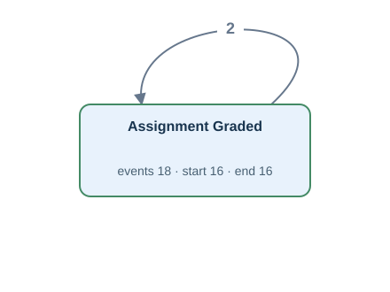</a></td><td width="58%" valign="top">
<a href="../../../datasets/universityflow/private/gold_sql/U09.sql">Gold SQL</a> · <a href="../../../datasets/universityflow/private/gold_logs/U09.csv">Gold CSV</a> · <a href="../../../datasets/universityflow/input/database.sqlite">Full source database (SQLite)</a>

<code>assignment_grading</code> · 18 matched source rows
<table><tr><th>Column</th><th>Row 1</th><th>Row 2</th><th>Row 3</th></tr><tr><th>assignment_id</th><td>A002</td><td>A003</td><td>A006</td></tr><tr><th>instructor_id</th><td>I03</td><td>I01</td><td>I01</td></tr><tr><th>grading_time</th><td>2026-02-11T14:00:00Z</td><td>2026-02-12T14:00:00Z</td><td>2026-02-15T14:00:00Z</td></tr><tr><th>score</th><td>70</td><td>70</td><td>70</td></tr><tr><th>evaluation</th><td>Initial feedback</td><td>Initial feedback</td><td>Initial feedback</td></tr><tr><th>grading_kind</th><td>ORIGINAL</td><td>ORIGINAL</td><td>ORIGINAL</td></tr><tr><th>reassessment_event_id</th><td><em>NULL</em></td><td><em>NULL</em></td><td><em>NULL</em></td></tr></table>
<strong>Gold output for the same source rows</strong>
<ul><li>Row 1 → Assignment Graded · event GRADE:A002:I03:2026-02-11T14:00:00Z · case S002 · time from <code>grading_time</code></li><li>Row 2 → Assignment Graded · event GRADE:A003:I01:2026-02-12T14:00:00Z · case S003 · time from <code>grading_time</code></li><li>Row 3 → Assignment Graded · event GRADE:A006:I01:2026-02-15T14:00:00Z · case S006 · time from <code>grading_time</code></li></ul>

FK-linked case and join evidence
<ul><li><code>assignment_grading</code> → <code>assignment</code> · assignment_id → assignment_id · assignment_id = A002</li></ul>
</td></tr></table>

## U10 — Q2

For each student, build a timeline of an instructor assessing the assignment.

Events: **18** · Cases with events: **16** · Activities: **1** · Edges: **1** · Source tables: **1** · SQL tables: **2**

<table><tr><td width="42%" valign="top"></td><td width="58%" valign="top">
<a href="../../../datasets/universityflow/private/gold_sql/U10.sql">Gold SQL</a> · <a href="../../../datasets/universityflow/private/gold_logs/U10.csv">Gold CSV</a> · <a href="../../../datasets/universityflow/input/database.sqlite">Full source database (SQLite)</a>

<code>assignment_grading</code> · 18 matched source rows
<table><tr><th>Column</th><th>Row 1</th><th>Row 2</th><th>Row 3</th></tr><tr><th>assignment_id</th><td>A002</td><td>A003</td><td>A006</td></tr><tr><th>instructor_id</th><td>I03</td><td>I01</td><td>I01</td></tr><tr><th>grading_time</th><td>2026-02-11T14:00:00Z</td><td>2026-02-12T14:00:00Z</td><td>2026-02-15T14:00:00Z</td></tr><tr><th>score</th><td>70</td><td>70</td><td>70</td></tr><tr><th>evaluation</th><td>Initial feedback</td><td>Initial feedback</td><td>Initial feedback</td></tr><tr><th>grading_kind</th><td>ORIGINAL</td><td>ORIGINAL</td><td>ORIGINAL</td></tr><tr><th>reassessment_event_id</th><td><em>NULL</em></td><td><em>NULL</em></td><td><em>NULL</em></td></tr></table>
<strong>Gold output for the same source rows</strong>
<ul><li>Row 1 → Assignment Graded · event GRADE:A002:I03:2026-02-11T14:00:00Z · case S002 · time from <code>grading_time</code></li><li>Row 2 → Assignment Graded · event GRADE:A003:I01:2026-02-12T14:00:00Z · case S003 · time from <code>grading_time</code></li><li>Row 3 → Assignment Graded · event GRADE:A006:I01:2026-02-15T14:00:00Z · case S006 · time from <code>grading_time</code></li></ul>

FK-linked case and join evidence
<ul><li><code>assignment_grading</code> → <code>assignment</code> · assignment_id → assignment_id · assignment_id = A002</li></ul>
</td></tr></table>

## U11 — Q1

Extract Simulation Experiment Completed events for each student.

Events: **27** · Cases with events: **20** · Activities: **1** · Edges: **1** · Source tables: **1** · SQL tables: **1**

<table><tr><td width="42%" valign="top"><a href="graphs/U11.svg">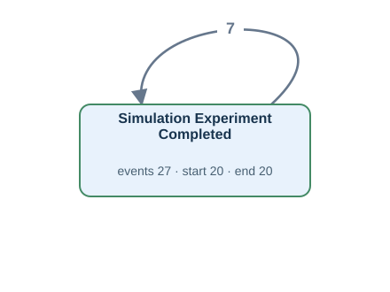</a></td><td width="58%" valign="top">
<a href="../../../datasets/universityflow/private/gold_sql/U11.sql">Gold SQL</a> · <a href="../../../datasets/universityflow/private/gold_logs/U11.csv">Gold CSV</a> · <a href="../../../datasets/universityflow/input/database.sqlite">Full source database (SQLite)</a>

<code>student_simulation_experiment_result</code> · 27 matched source rows
<table><tr><th>Column</th><th>Row 1</th><th>Row 2</th><th>Row 3</th></tr><tr><th>student_id</th><td>S002</td><td>S003</td><td>S003</td></tr><tr><th>module_id</th><td>M03</td><td>M01</td><td>M01</td></tr><tr><th>simulation_date</th><td>2026-02-13T15:00:00Z</td><td>2026-02-14T15:00:00Z</td><td>2026-02-15T15:00:00Z</td></tr><tr><th>simulation_result_data</th><td>Synthetic output 1</td><td>Synthetic output 1</td><td>Synthetic output 2</td></tr><tr><th>result_analysis</th><td>Recorded experiment analysis</td><td>Recorded experiment analysis</td><td>Recorded experiment analysis</td></tr><tr><th>simulation_run_scheduled_at</th><td>2026-02-13T13:00:00Z</td><td>2026-02-14T13:00:00Z</td><td>2026-02-15T13:00:00Z</td></tr><tr><th>simulation_run_started_at</th><td>2026-02-13T14:00:00Z</td><td>2026-02-14T14:00:00Z</td><td>2026-02-15T14:00:00Z</td></tr><tr><th>simulation_output_reviewed_at</th><td>2026-02-13T17:00:00Z</td><td>2026-02-14T17:00:00Z</td><td>2026-02-15T17:00:00Z</td></tr><tr><th>simulation_result_accepted_at</th><td><em>NULL</em></td><td>2026-02-14T18:00:00Z</td><td>2026-02-15T18:00:00Z</td></tr></table>
<strong>Gold output for the same source rows</strong>
<ul><li>Row 1 → Simulation Experiment Completed · event SIM:S002:M03:2026-02-13T15:00:00Z · case S002 · time from <code>simulation_date</code></li><li>Row 2 → Simulation Experiment Completed · event SIM:S003:M01:2026-02-14T15:00:00Z · case S003 · time from <code>simulation_date</code></li><li>Row 3 → Simulation Experiment Completed · event SIM:S003:M01:2026-02-15T15:00:00Z · case S003 · time from <code>simulation_date</code></li></ul>
</td></tr></table>

## U12 — Q2

For each student, build a timeline of a simulation run finishing.

Events: **27** · Cases with events: **20** · Activities: **1** · Edges: **1** · Source tables: **1** · SQL tables: **1**

<table><tr><td width="42%" valign="top"></td><td width="58%" valign="top">
<a href="../../../datasets/universityflow/private/gold_sql/U12.sql">Gold SQL</a> · <a href="../../../datasets/universityflow/private/gold_logs/U12.csv">Gold CSV</a> · <a href="../../../datasets/universityflow/input/database.sqlite">Full source database (SQLite)</a>

<code>student_simulation_experiment_result</code> · 27 matched source rows
<table><tr><th>Column</th><th>Row 1</th><th>Row 2</th><th>Row 3</th></tr><tr><th>student_id</th><td>S002</td><td>S003</td><td>S003</td></tr><tr><th>module_id</th><td>M03</td><td>M01</td><td>M01</td></tr><tr><th>simulation_date</th><td>2026-02-13T15:00:00Z</td><td>2026-02-14T15:00:00Z</td><td>2026-02-15T15:00:00Z</td></tr><tr><th>simulation_result_data</th><td>Synthetic output 1</td><td>Synthetic output 1</td><td>Synthetic output 2</td></tr><tr><th>result_analysis</th><td>Recorded experiment analysis</td><td>Recorded experiment analysis</td><td>Recorded experiment analysis</td></tr><tr><th>simulation_run_scheduled_at</th><td>2026-02-13T13:00:00Z</td><td>2026-02-14T13:00:00Z</td><td>2026-02-15T13:00:00Z</td></tr><tr><th>simulation_run_started_at</th><td>2026-02-13T14:00:00Z</td><td>2026-02-14T14:00:00Z</td><td>2026-02-15T14:00:00Z</td></tr><tr><th>simulation_output_reviewed_at</th><td>2026-02-13T17:00:00Z</td><td>2026-02-14T17:00:00Z</td><td>2026-02-15T17:00:00Z</td></tr><tr><th>simulation_result_accepted_at</th><td><em>NULL</em></td><td>2026-02-14T18:00:00Z</td><td>2026-02-15T18:00:00Z</td></tr></table>
<strong>Gold output for the same source rows</strong>
<ul><li>Row 1 → Simulation Experiment Completed · event SIM:S002:M03:2026-02-13T15:00:00Z · case S002 · time from <code>simulation_date</code></li><li>Row 2 → Simulation Experiment Completed · event SIM:S003:M01:2026-02-14T15:00:00Z · case S003 · time from <code>simulation_date</code></li><li>Row 3 → Simulation Experiment Completed · event SIM:S003:M01:2026-02-15T15:00:00Z · case S003 · time from <code>simulation_date</code></li></ul>
</td></tr></table>

## U13 — Q1

Extract Thesis Submitted events for each student.

Events: **16** · Cases with events: **16** · Activities: **1** · Edges: **0** · Source tables: **1** · SQL tables: **1**

<table><tr><td width="42%" valign="top"><a href="graphs/U13.svg">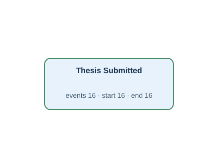</a></td><td width="58%" valign="top">
<a href="../../../datasets/universityflow/private/gold_sql/U13.sql">Gold SQL</a> · <a href="../../../datasets/universityflow/private/gold_logs/U13.csv">Gold CSV</a> · <a href="../../../datasets/universityflow/input/database.sqlite">Full source database (SQLite)</a>

<code>thesis</code> · 16 matched source rows
<table><tr><th>Column</th><th>Row 1</th><th>Row 2</th><th>Row 3</th></tr><tr><th>thesis_id</th><td>TH002</td><td>TH003</td><td>TH006</td></tr><tr><th>student_id</th><td>S002</td><td>S003</td><td>S006</td></tr><tr><th>thesis_title</th><td>Course Design Thesis</td><td>Course Design Thesis</td><td>Course Design Thesis</td></tr><tr><th>thesis_content</th><td>Synthetic thesis content</td><td>Synthetic thesis content</td><td>Synthetic thesis content</td></tr><tr><th>submission_date</th><td>2026-02-23T16:00:00Z</td><td>2026-02-24T16:00:00Z</td><td>2026-02-27T16:00:00Z</td></tr><tr><th>thesis_draft_registered_at</th><td>2026-02-19T16:00:00Z</td><td>2026-02-20T16:00:00Z</td><td>2026-02-23T16:00:00Z</td></tr><tr><th>thesis_review_started_at</th><td>2026-02-24T16:00:00Z</td><td>2026-02-25T16:00:00Z</td><td>2026-02-28T16:00:00Z</td></tr><tr><th>thesis_accepted_at</th><td><em>NULL</em></td><td>2026-02-28T16:00:00Z</td><td>2026-03-03T16:00:00Z</td></tr><tr><th>thesis_revision_requested_at</th><td>2026-02-25T16:00:00Z</td><td><em>NULL</em></td><td><em>NULL</em></td></tr><tr><th>thesis_resubmitted_at</th><td>2026-02-26T16:00:00Z</td><td><em>NULL</em></td><td><em>NULL</em></td></tr></table>
<strong>Gold output for the same source rows</strong>
<ul><li>Row 1 → Thesis Submitted · event THESIS:TH002 · case S002 · time from <code>submission_date</code></li><li>Row 2 → Thesis Submitted · event THESIS:TH003 · case S003 · time from <code>submission_date</code></li><li>Row 3 → Thesis Submitted · event THESIS:TH006 · case S006 · time from <code>submission_date</code></li></ul>
</td></tr></table>

## U14 — Q2

For each student, build a timeline of the student handing in a thesis.

Events: **16** · Cases with events: **16** · Activities: **1** · Edges: **0** · Source tables: **1** · SQL tables: **1**

<table><tr><td width="42%" valign="top"></td><td width="58%" valign="top">
<a href="../../../datasets/universityflow/private/gold_sql/U14.sql">Gold SQL</a> · <a href="../../../datasets/universityflow/private/gold_logs/U14.csv">Gold CSV</a> · <a href="../../../datasets/universityflow/input/database.sqlite">Full source database (SQLite)</a>

<code>thesis</code> · 16 matched source rows
<table><tr><th>Column</th><th>Row 1</th><th>Row 2</th><th>Row 3</th></tr><tr><th>thesis_id</th><td>TH002</td><td>TH003</td><td>TH006</td></tr><tr><th>student_id</th><td>S002</td><td>S003</td><td>S006</td></tr><tr><th>thesis_title</th><td>Course Design Thesis</td><td>Course Design Thesis</td><td>Course Design Thesis</td></tr><tr><th>thesis_content</th><td>Synthetic thesis content</td><td>Synthetic thesis content</td><td>Synthetic thesis content</td></tr><tr><th>submission_date</th><td>2026-02-23T16:00:00Z</td><td>2026-02-24T16:00:00Z</td><td>2026-02-27T16:00:00Z</td></tr><tr><th>thesis_draft_registered_at</th><td>2026-02-19T16:00:00Z</td><td>2026-02-20T16:00:00Z</td><td>2026-02-23T16:00:00Z</td></tr><tr><th>thesis_review_started_at</th><td>2026-02-24T16:00:00Z</td><td>2026-02-25T16:00:00Z</td><td>2026-02-28T16:00:00Z</td></tr><tr><th>thesis_accepted_at</th><td><em>NULL</em></td><td>2026-02-28T16:00:00Z</td><td>2026-03-03T16:00:00Z</td></tr><tr><th>thesis_revision_requested_at</th><td>2026-02-25T16:00:00Z</td><td><em>NULL</em></td><td><em>NULL</em></td></tr><tr><th>thesis_resubmitted_at</th><td>2026-02-26T16:00:00Z</td><td><em>NULL</em></td><td><em>NULL</em></td></tr></table>
<strong>Gold output for the same source rows</strong>
<ul><li>Row 1 → Thesis Submitted · event THESIS:TH002 · case S002 · time from <code>submission_date</code></li><li>Row 2 → Thesis Submitted · event THESIS:TH003 · case S003 · time from <code>submission_date</code></li><li>Row 3 → Thesis Submitted · event THESIS:TH006 · case S006 · time from <code>submission_date</code></li></ul>
</td></tr></table>

## U15 — Q1

Extract Assignment Submitted events for each student.

Events: **16** · Cases with events: **16** · Activities: **1** · Edges: **0** · Source tables: **1** · SQL tables: **1**

<table><tr><td width="42%" valign="top"><a href="graphs/U15.svg">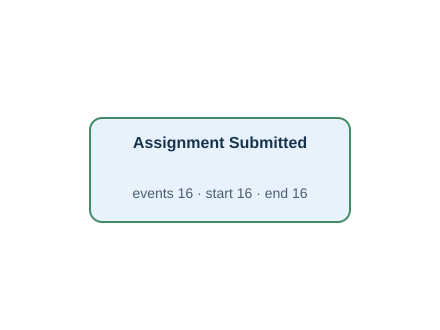</a></td><td width="58%" valign="top">
<a href="../../../datasets/universityflow/private/gold_sql/U15.sql">Gold SQL</a> · <a href="../../../datasets/universityflow/private/gold_logs/U15.csv">Gold CSV</a> · <a href="../../../datasets/universityflow/input/database.sqlite">Full source database (SQLite)</a>

<code>assignment</code> · 16 matched source rows
<table><tr><th>Column</th><th>Row 1</th><th>Row 2</th><th>Row 3</th></tr><tr><th>assignment_id</th><td>A002</td><td>A003</td><td>A006</td></tr><tr><th>student_id</th><td>S002</td><td>S003</td><td>S006</td></tr><tr><th>assignment_content</th><td>Synthetic assignment content</td><td>Synthetic assignment content</td><td>Synthetic assignment content</td></tr><tr><th>assignment_assigned_at</th><td>2026-02-07T14:00:00Z</td><td>2026-02-08T14:00:00Z</td><td>2026-02-11T14:00:00Z</td></tr><tr><th>assignment_submitted_at</th><td>2026-02-09T14:00:00Z</td><td>2026-02-10T14:00:00Z</td><td>2026-02-13T14:00:00Z</td></tr><tr><th>assignment_grade_finalized_at</th><td><em>NULL</em></td><td>2026-02-14T14:00:00Z</td><td>2026-02-17T14:00:00Z</td></tr><tr><th>assignment_revision_requested_at</th><td>2026-02-11T15:00:00Z</td><td><em>NULL</em></td><td><em>NULL</em></td></tr><tr><th>assignment_resubmitted_at</th><td>2026-02-12T14:00:00Z</td><td><em>NULL</em></td><td><em>NULL</em></td></tr></table>
<strong>Gold output for the same source rows</strong>
<ul><li>Row 1 → Assignment Submitted · event LC:assignment:A002:2 · case S002 · time from <code>assignment_submitted_at</code></li><li>Row 2 → Assignment Submitted · event LC:assignment:A003:2 · case S003 · time from <code>assignment_submitted_at</code></li><li>Row 3 → Assignment Submitted · event LC:assignment:A006:2 · case S006 · time from <code>assignment_submitted_at</code></li></ul>
</td></tr></table>

## OU01 — Q3

Extract the full recorded lifecycle event log for each student.

Events: **763** · Cases with events: **30** · Activities: **29** · Edges: **62** · Source tables: **6** · SQL tables: **9**

<table><tr><td width="42%" valign="top"></td><td width="58%" valign="top">
<a href="../../../datasets/universityflow/private/gold_sql/OU01.sql">Gold SQL</a> · <a href="../../../datasets/universityflow/private/gold_logs/OU01.csv">Gold CSV</a> · <a href="../../../datasets/universityflow/input/database.sqlite">Full source database (SQLite)</a>

<code>assignment</code> · 20 matched source rows
<table><tr><th>Column</th><th>Row 1</th><th>Row 2</th><th>Row 3</th></tr><tr><th>assignment_id</th><td>A002</td><td>A003</td><td>A006</td></tr><tr><th>student_id</th><td>S002</td><td>S003</td><td>S006</td></tr><tr><th>assignment_content</th><td>Synthetic assignment content</td><td>Synthetic assignment content</td><td>Synthetic assignment content</td></tr><tr><th>assignment_assigned_at</th><td>2026-02-07T14:00:00Z</td><td>2026-02-08T14:00:00Z</td><td>2026-02-11T14:00:00Z</td></tr><tr><th>assignment_submitted_at</th><td>2026-02-09T14:00:00Z</td><td>2026-02-10T14:00:00Z</td><td>2026-02-13T14:00:00Z</td></tr><tr><th>assignment_grade_finalized_at</th><td><em>NULL</em></td><td>2026-02-14T14:00:00Z</td><td>2026-02-17T14:00:00Z</td></tr><tr><th>assignment_revision_requested_at</th><td>2026-02-11T15:00:00Z</td><td><em>NULL</em></td><td><em>NULL</em></td></tr><tr><th>assignment_resubmitted_at</th><td>2026-02-12T14:00:00Z</td><td><em>NULL</em></td><td><em>NULL</em></td></tr></table>
<strong>Gold output for the same source rows</strong>
<ul><li>Row 1 → Assignment Assigned · event LC:assignment:A002:1 · case S002 · time from <code>assignment_assigned_at</code></li><li>Row 1 → Assignment Submitted · event LC:assignment:A002:2 · case S002 · time from <code>assignment_submitted_at</code></li><li>Row 1 → Assignment Revision Requested · event LC:assignment:A002:3 · case S002 · time from <code>assignment_revision_requested_at</code></li><li>Row 1 → Assignment Resubmitted · event LC:assignment:A002:4 · case S002 · time from <code>assignment_resubmitted_at</code></li><li>Row 2 → Assignment Assigned · event LC:assignment:A003:1 · case S003 · time from <code>assignment_assigned_at</code></li><li>Row 2 → Assignment Submitted · event LC:assignment:A003:2 · case S003 · time from <code>assignment_submitted_at</code></li><li>Row 2 → Assignment Grade Finalized · event LC:assignment:A003:3 · case S003 · time from <code>assignment_grade_finalized_at</code></li><li>Row 3 → Assignment Assigned · event LC:assignment:A006:1 · case S006 · time from <code>assignment_assigned_at</code></li><li>Row 3 → Assignment Submitted · event LC:assignment:A006:2 · case S006 · time from <code>assignment_submitted_at</code></li><li>Row 3 → Assignment Grade Finalized · event LC:assignment:A006:3 · case S006 · time from <code>assignment_grade_finalized_at</code></li></ul>

<code>assignment_grading</code> · 25 matched source rows
<table><tr><th>Column</th><th>Row 1</th><th>Row 2</th><th>Row 3</th></tr><tr><th>assignment_id</th><td>A002</td><td>A002</td><td>A003</td></tr><tr><th>instructor_id</th><td>I03</td><td>I03</td><td>I01</td></tr><tr><th>grading_time</th><td>2026-02-11T14:00:00Z</td><td>2026-02-13T02:00:00Z</td><td>2026-02-12T14:00:00Z</td></tr><tr><th>score</th><td>70</td><td>75</td><td>70</td></tr><tr><th>evaluation</th><td>Initial feedback</td><td>Authored synthetic reassessment score and feedback</td><td>Initial feedback</td></tr><tr><th>grading_kind</th><td>ORIGINAL</td><td>REASSESSMENT</td><td>ORIGINAL</td></tr><tr><th>reassessment_event_id</th><td><em>NULL</em></td><td>LC:assignment:A002:5</td><td><em>NULL</em></td></tr></table>
<strong>Gold output for the same source rows</strong>
<ul><li>Row 1 → Assignment Graded · event GRADE:A002:I03:2026-02-11T14:00:00Z · case S002 · time from <code>grading_time</code></li><li>Row 2 → Assignment Regraded · event LC:assignment:A002:5 · case S002 · time from <code>grading_time</code></li><li>Row 3 → Assignment Graded · event GRADE:A003:I01:2026-02-12T14:00:00Z · case S003 · time from <code>grading_time</code></li></ul>

<code>degree_examination_result</code> · 40 matched source rows
<table><tr><th>Column</th><th>Row 1</th><th>Row 2</th><th>Row 3</th></tr><tr><th>result_id</th><td>E001-1</td><td>E002-1</td><td>E002-2</td></tr><tr><th>student_id</th><td>S001</td><td>S002</td><td>S002</td></tr><tr><th>examination_name</th><td>Registration Eligibility Examination</td><td>Registration Eligibility Examination</td><td>Registration Eligibility Examination</td></tr><tr><th>grade</th><td>33</td><td>32</td><td>88</td></tr><tr><th>examination_date</th><td>2026-02-02T09:00:00Z</td><td>2026-02-03T09:00:00Z</td><td>2026-02-05T09:00:00Z</td></tr><tr><th>examination_scheduled_at</th><td>2026-02-02T07:00:00Z</td><td>2026-02-03T07:00:00Z</td><td>2026-02-05T07:00:00Z</td></tr><tr><th>examination_checked_in_at</th><td>2026-02-02T08:00:00Z</td><td>2026-02-03T08:00:00Z</td><td>2026-02-05T08:00:00Z</td></tr><tr><th>examination_score_published_at</th><td>2026-02-02T11:00:00Z</td><td>2026-02-03T11:00:00Z</td><td>2026-02-05T11:00:00Z</td></tr><tr><th>examination_result_reviewed_at</th><td><em>NULL</em></td><td>2026-02-03T12:00:00Z</td><td>2026-02-05T12:00:00Z</td></tr></table>
<strong>Gold output for the same source rows</strong>
<ul><li>Row 1 → Degree Examination Taken · event EX:E001-1 · case S001 · time from <code>examination_date</code></li><li>Row 1 → Examination Scheduled · event LC:degree_examination_result:E001-1:1 · case S001 · time from <code>examination_scheduled_at</code></li><li>Row 1 → Examination Checked In · event LC:degree_examination_result:E001-1:2 · case S001 · time from <code>examination_checked_in_at</code></li><li>Row 1 → Examination Score Published · event LC:degree_examination_result:E001-1:3 · case S001 · time from <code>examination_score_published_at</code></li><li>Row 2 → Degree Examination Taken · event EX:E002-1 · case S002 · time from <code>examination_date</code></li><li>Row 2 → Examination Scheduled · event LC:degree_examination_result:E002-1:1 · case S002 · time from <code>examination_scheduled_at</code></li><li>Row 2 → Examination Checked In · event LC:degree_examination_result:E002-1:2 · case S002 · time from <code>examination_checked_in_at</code></li><li>Row 2 → Examination Score Published · event LC:degree_examination_result:E002-1:3 · case S002 · time from <code>examination_score_published_at</code></li><li>Row 2 → Examination Result Reviewed · event LC:degree_examination_result:E002-1:4 · case S002 · time from <code>examination_result_reviewed_at</code></li><li>Row 3 → Degree Examination Taken · event EX:E002-2 · case S002 · time from <code>examination_date</code></li><li>Row 3 → Examination Scheduled · event LC:degree_examination_result:E002-2:1 · case S002 · time from <code>examination_scheduled_at</code></li><li>Row 3 → Examination Checked In · event LC:degree_examination_result:E002-2:2 · case S002 · time from <code>examination_checked_in_at</code></li><li>Row 3 → Examination Score Published · event LC:degree_examination_result:E002-2:3 · case S002 · time from <code>examination_score_published_at</code></li><li>Row 3 → Examination Result Reviewed · event LC:degree_examination_result:E002-2:4 · case S002 · time from <code>examination_result_reviewed_at</code></li></ul>

<code>registration</code> · 47 matched source rows
<table><tr><th>Column</th><th>Row 1</th><th>Row 2</th><th>Row 3</th></tr><tr><th>student_id</th><td>S002</td><td>S002</td><td>S003</td></tr><tr><th>course_id</th><td>C01</td><td>C06</td><td>C02</td></tr><tr><th>registration_time</th><td>2026-02-07T11:00:00Z</td><td>2026-02-07T16:00:00Z</td><td>2026-02-08T12:00:00Z</td></tr><tr><th>status</th><td>REGISTERED</td><td>REGISTERED</td><td>REGISTERED</td></tr><tr><th>registration_requested_at</th><td>2026-02-07T07:00:00Z</td><td>2026-02-07T12:00:00Z</td><td>2026-02-08T08:00:00Z</td></tr><tr><th>registration_approved_at</th><td>2026-02-07T09:00:00Z</td><td>2026-02-07T14:00:00Z</td><td>2026-02-08T10:00:00Z</td></tr><tr><th>course_started_at</th><td>2026-02-09T11:00:00Z</td><td>2026-02-09T16:00:00Z</td><td>2026-02-10T12:00:00Z</td></tr><tr><th>course_assessment_completed_at</th><td>2026-02-27T11:00:00Z</td><td>2026-02-27T16:00:00Z</td><td>2026-02-28T12:00:00Z</td></tr><tr><th>course_grade_finalized_at</th><td><em>NULL</em></td><td>2026-03-01T16:00:00Z</td><td>2026-03-02T12:00:00Z</td></tr></table>
<strong>Gold output for the same source rows</strong>
<ul><li>Row 1 → Registration Requested · event LC:registration:S002:C01:1 · case S002 · time from <code>registration_requested_at</code></li><li>Row 1 → Registration Approved · event LC:registration:S002:C01:2 · case S002 · time from <code>registration_approved_at</code></li><li>Row 1 → Course Started · event LC:registration:S002:C01:3 · case S002 · time from <code>course_started_at</code></li><li>Row 1 → Course Assessment Completed · event LC:registration:S002:C01:4 · case S002 · time from <code>course_assessment_completed_at</code></li><li>Row 1 → Course Registered · event REG:S002:C01 · case S002 · time from <code>registration_time</code></li><li>Row 2 → Registration Requested · event LC:registration:S002:C06:1 · case S002 · time from <code>registration_requested_at</code></li><li>Row 2 → Registration Approved · event LC:registration:S002:C06:2 · case S002 · time from <code>registration_approved_at</code></li><li>Row 2 → Course Started · event LC:registration:S002:C06:3 · case S002 · time from <code>course_started_at</code></li><li>Row 2 → Course Assessment Completed · event LC:registration:S002:C06:4 · case S002 · time from <code>course_assessment_completed_at</code></li><li>Row 2 → Course Grade Finalized · event LC:registration:S002:C06:5 · case S002 · time from <code>course_grade_finalized_at</code></li><li>Row 2 → Course Registered · event REG:S002:C06 · case S002 · time from <code>registration_time</code></li><li>Row 3 → Registration Requested · event LC:registration:S003:C02:1 · case S003 · time from <code>registration_requested_at</code></li><li>Row 3 → Registration Approved · event LC:registration:S003:C02:2 · case S003 · time from <code>registration_approved_at</code></li><li>Row 3 → Course Started · event LC:registration:S003:C02:3 · case S003 · time from <code>course_started_at</code></li><li>Row 3 → Course Assessment Completed · event LC:registration:S003:C02:4 · case S003 · time from <code>course_assessment_completed_at</code></li><li>Row 3 → Course Grade Finalized · event LC:registration:S003:C02:5 · case S003 · time from <code>course_grade_finalized_at</code></li><li>Row 3 → Course Registered · event REG:S003:C02 · case S003 · time from <code>registration_time</code></li></ul>

<code>student_simulation_experiment_result</code> · 27 matched source rows
<table><tr><th>Column</th><th>Row 1</th><th>Row 2</th><th>Row 3</th></tr><tr><th>student_id</th><td>S002</td><td>S003</td><td>S003</td></tr><tr><th>module_id</th><td>M03</td><td>M01</td><td>M01</td></tr><tr><th>simulation_date</th><td>2026-02-13T15:00:00Z</td><td>2026-02-14T15:00:00Z</td><td>2026-02-15T15:00:00Z</td></tr><tr><th>simulation_result_data</th><td>Synthetic output 1</td><td>Synthetic output 1</td><td>Synthetic output 2</td></tr><tr><th>result_analysis</th><td>Recorded experiment analysis</td><td>Recorded experiment analysis</td><td>Recorded experiment analysis</td></tr><tr><th>simulation_run_scheduled_at</th><td>2026-02-13T13:00:00Z</td><td>2026-02-14T13:00:00Z</td><td>2026-02-15T13:00:00Z</td></tr><tr><th>simulation_run_started_at</th><td>2026-02-13T14:00:00Z</td><td>2026-02-14T14:00:00Z</td><td>2026-02-15T14:00:00Z</td></tr><tr><th>simulation_output_reviewed_at</th><td>2026-02-13T17:00:00Z</td><td>2026-02-14T17:00:00Z</td><td>2026-02-15T17:00:00Z</td></tr><tr><th>simulation_result_accepted_at</th><td><em>NULL</em></td><td>2026-02-14T18:00:00Z</td><td>2026-02-15T18:00:00Z</td></tr></table>
<strong>Gold output for the same source rows</strong>
<ul><li>Row 1 → Simulation Run Scheduled · event LC:student_simulation_experiment_result:S002:M03:2026-02-13T15:00:00Z:1 · case S002 · time from <code>simulation_run_scheduled_at</code></li><li>Row 1 → Simulation Run Started · event LC:student_simulation_experiment_result:S002:M03:2026-02-13T15:00:00Z:2 · case S002 · time from <code>simulation_run_started_at</code></li><li>Row 1 → Simulation Output Reviewed · event LC:student_simulation_experiment_result:S002:M03:2026-02-13T15:00:00Z:3 · case S002 · time from <code>simulation_output_reviewed_at</code></li><li>Row 1 → Simulation Experiment Completed · event SIM:S002:M03:2026-02-13T15:00:00Z · case S002 · time from <code>simulation_date</code></li><li>Row 2 → Simulation Run Scheduled · event LC:student_simulation_experiment_result:S003:M01:2026-02-14T15:00:00Z:1 · case S003 · time from <code>simulation_run_scheduled_at</code></li><li>Row 2 → Simulation Run Started · event LC:student_simulation_experiment_result:S003:M01:2026-02-14T15:00:00Z:2 · case S003 · time from <code>simulation_run_started_at</code></li><li>Row 2 → Simulation Output Reviewed · event LC:student_simulation_experiment_result:S003:M01:2026-02-14T15:00:00Z:3 · case S003 · time from <code>simulation_output_reviewed_at</code></li><li>Row 2 → Simulation Result Accepted · event LC:student_simulation_experiment_result:S003:M01:2026-02-14T15:00:00Z:4 · case S003 · time from <code>simulation_result_accepted_at</code></li><li>Row 2 → Simulation Experiment Completed · event SIM:S003:M01:2026-02-14T15:00:00Z · case S003 · time from <code>simulation_date</code></li><li>Row 3 → Simulation Run Scheduled · event LC:student_simulation_experiment_result:S003:M01:2026-02-15T15:00:00Z:1 · case S003 · time from <code>simulation_run_scheduled_at</code></li><li>Row 3 → Simulation Run Started · event LC:student_simulation_experiment_result:S003:M01:2026-02-15T15:00:00Z:2 · case S003 · time from <code>simulation_run_started_at</code></li><li>Row 3 → Simulation Output Reviewed · event LC:student_simulation_experiment_result:S003:M01:2026-02-15T15:00:00Z:3 · case S003 · time from <code>simulation_output_reviewed_at</code></li><li>Row 3 → Simulation Result Accepted · event LC:student_simulation_experiment_result:S003:M01:2026-02-15T15:00:00Z:4 · case S003 · time from <code>simulation_result_accepted_at</code></li><li>Row 3 → Simulation Experiment Completed · event SIM:S003:M01:2026-02-15T15:00:00Z · case S003 · time from <code>simulation_date</code></li></ul>

<code>thesis</code> · 16 matched source rows
<table><tr><th>Column</th><th>Row 1</th><th>Row 2</th><th>Row 3</th></tr><tr><th>thesis_id</th><td>TH002</td><td>TH003</td><td>TH006</td></tr><tr><th>student_id</th><td>S002</td><td>S003</td><td>S006</td></tr><tr><th>thesis_title</th><td>Course Design Thesis</td><td>Course Design Thesis</td><td>Course Design Thesis</td></tr><tr><th>thesis_content</th><td>Synthetic thesis content</td><td>Synthetic thesis content</td><td>Synthetic thesis content</td></tr><tr><th>submission_date</th><td>2026-02-23T16:00:00Z</td><td>2026-02-24T16:00:00Z</td><td>2026-02-27T16:00:00Z</td></tr><tr><th>thesis_draft_registered_at</th><td>2026-02-19T16:00:00Z</td><td>2026-02-20T16:00:00Z</td><td>2026-02-23T16:00:00Z</td></tr><tr><th>thesis_review_started_at</th><td>2026-02-24T16:00:00Z</td><td>2026-02-25T16:00:00Z</td><td>2026-02-28T16:00:00Z</td></tr><tr><th>thesis_accepted_at</th><td><em>NULL</em></td><td>2026-02-28T16:00:00Z</td><td>2026-03-03T16:00:00Z</td></tr><tr><th>thesis_revision_requested_at</th><td>2026-02-25T16:00:00Z</td><td><em>NULL</em></td><td><em>NULL</em></td></tr><tr><th>thesis_resubmitted_at</th><td>2026-02-26T16:00:00Z</td><td><em>NULL</em></td><td><em>NULL</em></td></tr></table>
<strong>Gold output for the same source rows</strong>
<ul><li>Row 1 → Thesis Draft Registered · event LC:thesis:TH002:1 · case S002 · time from <code>thesis_draft_registered_at</code></li><li>Row 1 → Thesis Review Started · event LC:thesis:TH002:2 · case S002 · time from <code>thesis_review_started_at</code></li><li>Row 1 → Thesis Revision Requested · event LC:thesis:TH002:3 · case S002 · time from <code>thesis_revision_requested_at</code></li><li>Row 1 → Thesis Resubmitted · event LC:thesis:TH002:4 · case S002 · time from <code>thesis_resubmitted_at</code></li><li>Row 1 → Thesis Submitted · event THESIS:TH002 · case S002 · time from <code>submission_date</code></li><li>Row 2 → Thesis Draft Registered · event LC:thesis:TH003:1 · case S003 · time from <code>thesis_draft_registered_at</code></li><li>Row 2 → Thesis Review Started · event LC:thesis:TH003:2 · case S003 · time from <code>thesis_review_started_at</code></li><li>Row 2 → Thesis Accepted · event LC:thesis:TH003:3 · case S003 · time from <code>thesis_accepted_at</code></li><li>Row 2 → Thesis Submitted · event THESIS:TH003 · case S003 · time from <code>submission_date</code></li><li>Row 3 → Thesis Draft Registered · event LC:thesis:TH006:1 · case S006 · time from <code>thesis_draft_registered_at</code></li><li>Row 3 → Thesis Review Started · event LC:thesis:TH006:2 · case S006 · time from <code>thesis_review_started_at</code></li><li>Row 3 → Thesis Accepted · event LC:thesis:TH006:3 · case S006 · time from <code>thesis_accepted_at</code></li><li>Row 3 → Thesis Submitted · event THESIS:TH006 · case S006 · time from <code>submission_date</code></li></ul>

FK-linked case and join evidence
<ul><li><code>registration</code> → <code>course</code> · course_id → course_id · course_id = C01</li><li><code>student_simulation_experiment_result</code> → <code>simulation_module</code> · module_id → module_id · module_id = M03</li></ul>
</td></tr></table>

## OU02 — Q3

Extract the full recorded lifecycle event log for each course.

Events: **298** · Cases with events: **6** · Activities: **10** · Edges: **24** · Source tables: **2** · SQL tables: **9**

<table><tr><td width="42%" valign="top"><a href="graphs/OU02.svg">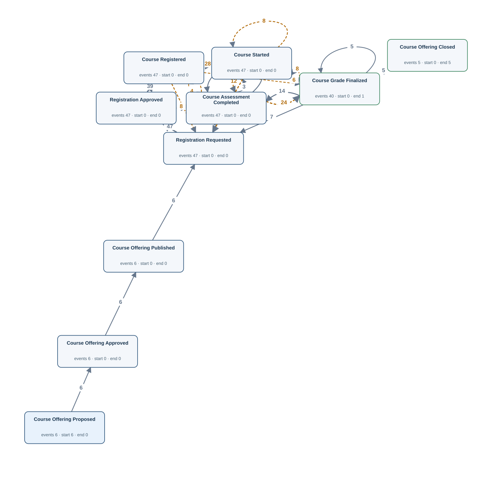</a></td><td width="58%" valign="top">
<a href="../../../datasets/universityflow/private/gold_sql/OU02.sql">Gold SQL</a> · <a href="../../../datasets/universityflow/private/gold_logs/OU02.csv">Gold CSV</a> · <a href="../../../datasets/universityflow/input/database.sqlite">Full source database (SQLite)</a>

<code>course</code> · 6 matched source rows
<table><tr><th>Column</th><th>Row 1</th><th>Row 2</th><th>Row 3</th></tr><tr><th>course_id</th><td>C01</td><td>C02</td><td>C03</td></tr><tr><th>course_name</th><td>Database Systems</td><td>Statistics</td><td>Operations Research</td></tr><tr><th>credits</th><td>3</td><td>3</td><td>3</td></tr><tr><th>instructor</th><td>Instructor 1</td><td>Instructor 2</td><td>Instructor 3</td></tr><tr><th>class_time</th><td>Monday 09:00</td><td>Monday 09:00</td><td>Monday 09:00</td></tr><tr><th>class_location</th><td>Room 001</td><td>Room 002</td><td>Room 003</td></tr><tr><th>course_offering_proposed_at</th><td>2026-02-04T11:00:00Z</td><td>2026-02-05T12:00:00Z</td><td>2026-02-24T13:00:00Z</td></tr><tr><th>course_offering_approved_at</th><td>2026-02-05T11:00:00Z</td><td>2026-02-06T12:00:00Z</td><td>2026-02-25T13:00:00Z</td></tr><tr><th>course_offering_published_at</th><td>2026-02-06T11:00:00Z</td><td>2026-02-07T12:00:00Z</td><td>2026-02-26T13:00:00Z</td></tr><tr><th>course_offering_closed_at</th><td><em>NULL</em></td><td>2026-04-07T12:00:00Z</td><td>2026-04-07T13:00:00Z</td></tr></table>
<strong>Gold output for the same source rows</strong>
<ul><li>Row 1 → Course Offering Proposed · event LC:course:C01:1 · case C01 · time from <code>course_offering_proposed_at</code></li><li>Row 1 → Course Offering Approved · event LC:course:C01:2 · case C01 · time from <code>course_offering_approved_at</code></li><li>Row 1 → Course Offering Published · event LC:course:C01:3 · case C01 · time from <code>course_offering_published_at</code></li><li>Row 2 → Course Offering Proposed · event LC:course:C02:1 · case C02 · time from <code>course_offering_proposed_at</code></li><li>Row 2 → Course Offering Approved · event LC:course:C02:2 · case C02 · time from <code>course_offering_approved_at</code></li><li>Row 2 → Course Offering Published · event LC:course:C02:3 · case C02 · time from <code>course_offering_published_at</code></li><li>Row 2 → Course Offering Closed · event LC:course:C02:4 · case C02 · time from <code>course_offering_closed_at</code></li><li>Row 3 → Course Offering Proposed · event LC:course:C03:1 · case C03 · time from <code>course_offering_proposed_at</code></li><li>Row 3 → Course Offering Approved · event LC:course:C03:2 · case C03 · time from <code>course_offering_approved_at</code></li><li>Row 3 → Course Offering Published · event LC:course:C03:3 · case C03 · time from <code>course_offering_published_at</code></li><li>Row 3 → Course Offering Closed · event LC:course:C03:4 · case C03 · time from <code>course_offering_closed_at</code></li></ul>

<code>registration</code> · 47 matched source rows
<table><tr><th>Column</th><th>Row 1</th><th>Row 2</th><th>Row 3</th></tr><tr><th>student_id</th><td>S002</td><td>S007</td><td>S011</td></tr><tr><th>course_id</th><td>C01</td><td>C01</td><td>C01</td></tr><tr><th>registration_time</th><td>2026-02-07T11:00:00Z</td><td>2026-02-12T11:00:00Z</td><td>2026-02-16T11:00:00Z</td></tr><tr><th>status</th><td>REGISTERED</td><td>REGISTERED</td><td>REGISTERED</td></tr><tr><th>registration_requested_at</th><td>2026-02-07T07:00:00Z</td><td>2026-02-12T07:00:00Z</td><td>2026-02-16T07:00:00Z</td></tr><tr><th>registration_approved_at</th><td>2026-02-07T09:00:00Z</td><td>2026-02-12T09:00:00Z</td><td>2026-02-16T09:00:00Z</td></tr><tr><th>course_started_at</th><td>2026-02-09T11:00:00Z</td><td>2026-02-14T11:00:00Z</td><td>2026-02-18T11:00:00Z</td></tr><tr><th>course_assessment_completed_at</th><td>2026-02-27T11:00:00Z</td><td>2026-03-04T11:00:00Z</td><td>2026-03-08T11:00:00Z</td></tr><tr><th>course_grade_finalized_at</th><td><em>NULL</em></td><td>2026-03-06T11:00:00Z</td><td>2026-03-10T11:00:00Z</td></tr></table>
<strong>Gold output for the same source rows</strong>
<ul><li>Row 1 → Registration Requested · event LC:registration:S002:C01:1 · case C01 · time from <code>registration_requested_at</code></li><li>Row 1 → Registration Approved · event LC:registration:S002:C01:2 · case C01 · time from <code>registration_approved_at</code></li><li>Row 1 → Course Started · event LC:registration:S002:C01:3 · case C01 · time from <code>course_started_at</code></li><li>Row 1 → Course Assessment Completed · event LC:registration:S002:C01:4 · case C01 · time from <code>course_assessment_completed_at</code></li><li>Row 1 → Course Registered · event REG:S002:C01 · case C01 · time from <code>registration_time</code></li><li>Row 2 → Registration Requested · event LC:registration:S007:C01:1 · case C01 · time from <code>registration_requested_at</code></li><li>Row 2 → Registration Approved · event LC:registration:S007:C01:2 · case C01 · time from <code>registration_approved_at</code></li><li>Row 2 → Course Started · event LC:registration:S007:C01:3 · case C01 · time from <code>course_started_at</code></li><li>Row 2 → Course Assessment Completed · event LC:registration:S007:C01:4 · case C01 · time from <code>course_assessment_completed_at</code></li><li>Row 2 → Course Grade Finalized · event LC:registration:S007:C01:5 · case C01 · time from <code>course_grade_finalized_at</code></li><li>Row 2 → Course Registered · event REG:S007:C01 · case C01 · time from <code>registration_time</code></li><li>Row 3 → Registration Requested · event LC:registration:S011:C01:1 · case C01 · time from <code>registration_requested_at</code></li><li>Row 3 → Registration Approved · event LC:registration:S011:C01:2 · case C01 · time from <code>registration_approved_at</code></li><li>Row 3 → Course Started · event LC:registration:S011:C01:3 · case C01 · time from <code>course_started_at</code></li><li>Row 3 → Course Assessment Completed · event LC:registration:S011:C01:4 · case C01 · time from <code>course_assessment_completed_at</code></li><li>Row 3 → Course Grade Finalized · event LC:registration:S011:C01:5 · case C01 · time from <code>course_grade_finalized_at</code></li><li>Row 3 → Course Registered · event REG:S011:C01 · case C01 · time from <code>registration_time</code></li></ul>
</td></tr></table>

## OU03 — Q3

Extract the full recorded lifecycle event log for each student-course registration.

Events: **275** · Cases with events: **47** · Activities: **6** · Edges: **5** · Source tables: **1** · SQL tables: **9**

<table><tr><td width="42%" valign="top"><a href="graphs/OU03.svg">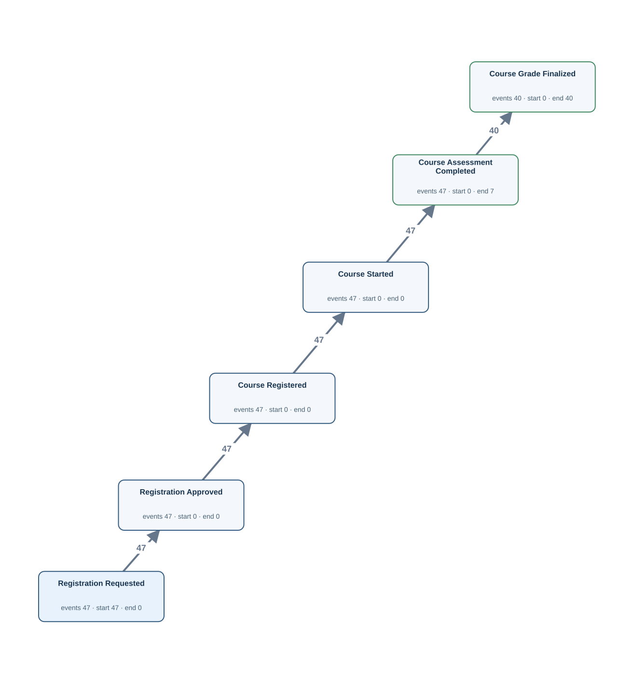</a></td><td width="58%" valign="top">
<a href="../../../datasets/universityflow/private/gold_sql/OU03.sql">Gold SQL</a> · <a href="../../../datasets/universityflow/private/gold_logs/OU03.csv">Gold CSV</a> · <a href="../../../datasets/universityflow/input/database.sqlite">Full source database (SQLite)</a>

<code>registration</code> · 47 matched source rows
<table><tr><th>Column</th><th>Row 1</th><th>Row 2</th><th>Row 3</th></tr><tr><th>student_id</th><td>S002</td><td>S002</td><td>S003</td></tr><tr><th>course_id</th><td>C01</td><td>C06</td><td>C02</td></tr><tr><th>registration_time</th><td>2026-02-07T11:00:00Z</td><td>2026-02-07T16:00:00Z</td><td>2026-02-08T12:00:00Z</td></tr><tr><th>status</th><td>REGISTERED</td><td>REGISTERED</td><td>REGISTERED</td></tr><tr><th>registration_requested_at</th><td>2026-02-07T07:00:00Z</td><td>2026-02-07T12:00:00Z</td><td>2026-02-08T08:00:00Z</td></tr><tr><th>registration_approved_at</th><td>2026-02-07T09:00:00Z</td><td>2026-02-07T14:00:00Z</td><td>2026-02-08T10:00:00Z</td></tr><tr><th>course_started_at</th><td>2026-02-09T11:00:00Z</td><td>2026-02-09T16:00:00Z</td><td>2026-02-10T12:00:00Z</td></tr><tr><th>course_assessment_completed_at</th><td>2026-02-27T11:00:00Z</td><td>2026-02-27T16:00:00Z</td><td>2026-02-28T12:00:00Z</td></tr><tr><th>course_grade_finalized_at</th><td><em>NULL</em></td><td>2026-03-01T16:00:00Z</td><td>2026-03-02T12:00:00Z</td></tr></table>
<strong>Gold output for the same source rows</strong>
<ul><li>Row 1 → Registration Requested · event LC:registration:S002:C01:1 · case S002:C01 · time from <code>registration_requested_at</code></li><li>Row 1 → Registration Approved · event LC:registration:S002:C01:2 · case S002:C01 · time from <code>registration_approved_at</code></li><li>Row 1 → Course Started · event LC:registration:S002:C01:3 · case S002:C01 · time from <code>course_started_at</code></li><li>Row 1 → Course Assessment Completed · event LC:registration:S002:C01:4 · case S002:C01 · time from <code>course_assessment_completed_at</code></li><li>Row 1 → Course Registered · event REG:S002:C01 · case S002:C01 · time from <code>registration_time</code></li><li>Row 2 → Registration Requested · event LC:registration:S002:C06:1 · case S002:C06 · time from <code>registration_requested_at</code></li><li>Row 2 → Registration Approved · event LC:registration:S002:C06:2 · case S002:C06 · time from <code>registration_approved_at</code></li><li>Row 2 → Course Started · event LC:registration:S002:C06:3 · case S002:C06 · time from <code>course_started_at</code></li><li>Row 2 → Course Assessment Completed · event LC:registration:S002:C06:4 · case S002:C06 · time from <code>course_assessment_completed_at</code></li><li>Row 2 → Course Grade Finalized · event LC:registration:S002:C06:5 · case S002:C06 · time from <code>course_grade_finalized_at</code></li><li>Row 2 → Course Registered · event REG:S002:C06 · case S002:C06 · time from <code>registration_time</code></li><li>Row 3 → Registration Requested · event LC:registration:S003:C02:1 · case S003:C02 · time from <code>registration_requested_at</code></li><li>Row 3 → Registration Approved · event LC:registration:S003:C02:2 · case S003:C02 · time from <code>registration_approved_at</code></li><li>Row 3 → Course Started · event LC:registration:S003:C02:3 · case S003:C02 · time from <code>course_started_at</code></li><li>Row 3 → Course Assessment Completed · event LC:registration:S003:C02:4 · case S003:C02 · time from <code>course_assessment_completed_at</code></li><li>Row 3 → Course Grade Finalized · event LC:registration:S003:C02:5 · case S003:C02 · time from <code>course_grade_finalized_at</code></li><li>Row 3 → Course Registered · event REG:S003:C02 · case S003:C02 · time from <code>registration_time</code></li></ul>

FK-linked case and join evidence
<ul><li><code>registration</code> → <code>course</code> · course_id → course_id · course_id = C01</li></ul>
</td></tr></table>

## OU04 — Q3

Extract the full recorded lifecycle event log for each examination result record.

Events: **194** · Cases with events: **40** · Activities: **5** · Edges: **4** · Source tables: **1** · SQL tables: **9**

<table><tr><td width="42%" valign="top"><a href="graphs/OU04.svg">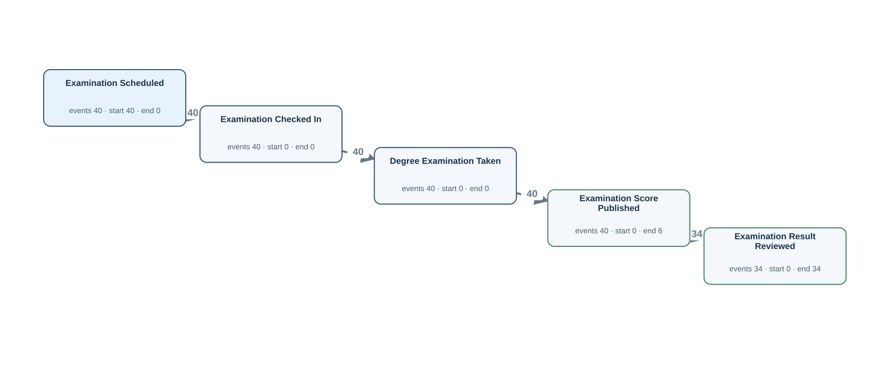</a></td><td width="58%" valign="top">
<a href="../../../datasets/universityflow/private/gold_sql/OU04.sql">Gold SQL</a> · <a href="../../../datasets/universityflow/private/gold_logs/OU04.csv">Gold CSV</a> · <a href="../../../datasets/universityflow/input/database.sqlite">Full source database (SQLite)</a>

<code>degree_examination_result</code> · 40 matched source rows
<table><tr><th>Column</th><th>Row 1</th><th>Row 2</th><th>Row 3</th></tr><tr><th>result_id</th><td>E001-1</td><td>E002-1</td><td>E002-2</td></tr><tr><th>student_id</th><td>S001</td><td>S002</td><td>S002</td></tr><tr><th>examination_name</th><td>Registration Eligibility Examination</td><td>Registration Eligibility Examination</td><td>Registration Eligibility Examination</td></tr><tr><th>grade</th><td>33</td><td>32</td><td>88</td></tr><tr><th>examination_date</th><td>2026-02-02T09:00:00Z</td><td>2026-02-03T09:00:00Z</td><td>2026-02-05T09:00:00Z</td></tr><tr><th>examination_scheduled_at</th><td>2026-02-02T07:00:00Z</td><td>2026-02-03T07:00:00Z</td><td>2026-02-05T07:00:00Z</td></tr><tr><th>examination_checked_in_at</th><td>2026-02-02T08:00:00Z</td><td>2026-02-03T08:00:00Z</td><td>2026-02-05T08:00:00Z</td></tr><tr><th>examination_score_published_at</th><td>2026-02-02T11:00:00Z</td><td>2026-02-03T11:00:00Z</td><td>2026-02-05T11:00:00Z</td></tr><tr><th>examination_result_reviewed_at</th><td><em>NULL</em></td><td>2026-02-03T12:00:00Z</td><td>2026-02-05T12:00:00Z</td></tr></table>
<strong>Gold output for the same source rows</strong>
<ul><li>Row 1 → Degree Examination Taken · event EX:E001-1 · case E001-1 · time from <code>examination_date</code></li><li>Row 1 → Examination Scheduled · event LC:degree_examination_result:E001-1:1 · case E001-1 · time from <code>examination_scheduled_at</code></li><li>Row 1 → Examination Checked In · event LC:degree_examination_result:E001-1:2 · case E001-1 · time from <code>examination_checked_in_at</code></li><li>Row 1 → Examination Score Published · event LC:degree_examination_result:E001-1:3 · case E001-1 · time from <code>examination_score_published_at</code></li><li>Row 2 → Degree Examination Taken · event EX:E002-1 · case E002-1 · time from <code>examination_date</code></li><li>Row 2 → Examination Scheduled · event LC:degree_examination_result:E002-1:1 · case E002-1 · time from <code>examination_scheduled_at</code></li><li>Row 2 → Examination Checked In · event LC:degree_examination_result:E002-1:2 · case E002-1 · time from <code>examination_checked_in_at</code></li><li>Row 2 → Examination Score Published · event LC:degree_examination_result:E002-1:3 · case E002-1 · time from <code>examination_score_published_at</code></li><li>Row 2 → Examination Result Reviewed · event LC:degree_examination_result:E002-1:4 · case E002-1 · time from <code>examination_result_reviewed_at</code></li><li>Row 3 → Degree Examination Taken · event EX:E002-2 · case E002-2 · time from <code>examination_date</code></li><li>Row 3 → Examination Scheduled · event LC:degree_examination_result:E002-2:1 · case E002-2 · time from <code>examination_scheduled_at</code></li><li>Row 3 → Examination Checked In · event LC:degree_examination_result:E002-2:2 · case E002-2 · time from <code>examination_checked_in_at</code></li><li>Row 3 → Examination Score Published · event LC:degree_examination_result:E002-2:3 · case E002-2 · time from <code>examination_score_published_at</code></li><li>Row 3 → Examination Result Reviewed · event LC:degree_examination_result:E002-2:4 · case E002-2 · time from <code>examination_result_reviewed_at</code></li></ul>
</td></tr></table>

## OU05 — Q3

Extract the full recorded lifecycle event log for each simulation module.

Events: **142** · Cases with events: **3** · Activities: **9** · Edges: **10** · Source tables: **2** · SQL tables: **9**

<table><tr><td width="42%" valign="top"><a href="graphs/OU05.svg">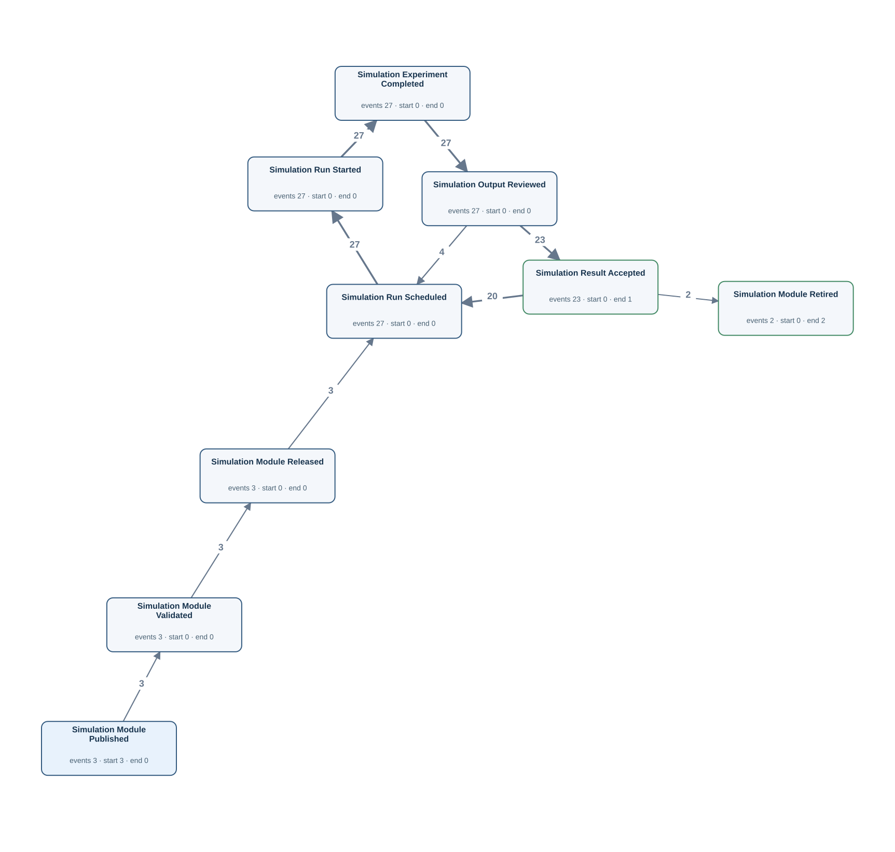</a></td><td width="58%" valign="top">
<a href="../../../datasets/universityflow/private/gold_sql/OU05.sql">Gold SQL</a> · <a href="../../../datasets/universityflow/private/gold_logs/OU05.csv">Gold CSV</a> · <a href="../../../datasets/universityflow/input/database.sqlite">Full source database (SQLite)</a>

<code>simulation_module</code> · 3 matched source rows
<table><tr><th>Column</th><th>Row 1</th><th>Row 2</th><th>Row 3</th></tr><tr><th>module_id</th><td>M01</td><td>M02</td><td>M03</td></tr><tr><th>module_name</th><td>PCM</td><td>DPCM</td><td>Delta Modulation</td></tr><tr><th>module_type</th><td>PCM</td><td>DPCM</td><td>DELTA</td></tr><tr><th>module_description</th><td>Synthetic teaching module</td><td>Synthetic teaching module</td><td>Synthetic teaching module</td></tr><tr><th>module_code</th><td>example_module_1()</td><td>example_module_2()</td><td>example_module_3()</td></tr><tr><th>simulation_module_published_at</th><td>2026-02-11T15:00:00Z</td><td>2026-02-15T15:00:00Z</td><td>2026-02-10T15:00:00Z</td></tr><tr><th>simulation_module_validated_at</th><td>2026-02-12T15:00:00Z</td><td>2026-02-16T15:00:00Z</td><td>2026-02-11T15:00:00Z</td></tr><tr><th>simulation_module_released_at</th><td>2026-02-13T15:00:00Z</td><td>2026-02-17T15:00:00Z</td><td>2026-02-12T15:00:00Z</td></tr><tr><th>simulation_module_retired_at</th><td><em>NULL</em></td><td>2026-04-16T15:00:00Z</td><td>2026-04-20T15:00:00Z</td></tr></table>
<strong>Gold output for the same source rows</strong>
<ul><li>Row 1 → Simulation Module Published · event LC:simulation_module:M01:1 · case M01 · time from <code>simulation_module_published_at</code></li><li>Row 1 → Simulation Module Validated · event LC:simulation_module:M01:2 · case M01 · time from <code>simulation_module_validated_at</code></li><li>Row 1 → Simulation Module Released · event LC:simulation_module:M01:3 · case M01 · time from <code>simulation_module_released_at</code></li><li>Row 2 → Simulation Module Published · event LC:simulation_module:M02:1 · case M02 · time from <code>simulation_module_published_at</code></li><li>Row 2 → Simulation Module Validated · event LC:simulation_module:M02:2 · case M02 · time from <code>simulation_module_validated_at</code></li><li>Row 2 → Simulation Module Released · event LC:simulation_module:M02:3 · case M02 · time from <code>simulation_module_released_at</code></li><li>Row 2 → Simulation Module Retired · event LC:simulation_module:M02:4 · case M02 · time from <code>simulation_module_retired_at</code></li><li>Row 3 → Simulation Module Published · event LC:simulation_module:M03:1 · case M03 · time from <code>simulation_module_published_at</code></li><li>Row 3 → Simulation Module Validated · event LC:simulation_module:M03:2 · case M03 · time from <code>simulation_module_validated_at</code></li><li>Row 3 → Simulation Module Released · event LC:simulation_module:M03:3 · case M03 · time from <code>simulation_module_released_at</code></li><li>Row 3 → Simulation Module Retired · event LC:simulation_module:M03:4 · case M03 · time from <code>simulation_module_retired_at</code></li></ul>

<code>student_simulation_experiment_result</code> · 27 matched source rows
<table><tr><th>Column</th><th>Row 1</th><th>Row 2</th><th>Row 3</th></tr><tr><th>student_id</th><td>S003</td><td>S003</td><td>S006</td></tr><tr><th>module_id</th><td>M01</td><td>M01</td><td>M01</td></tr><tr><th>simulation_date</th><td>2026-02-14T15:00:00Z</td><td>2026-02-15T15:00:00Z</td><td>2026-02-17T15:00:00Z</td></tr><tr><th>simulation_result_data</th><td>Synthetic output 1</td><td>Synthetic output 2</td><td>Synthetic output 1</td></tr><tr><th>result_analysis</th><td>Recorded experiment analysis</td><td>Recorded experiment analysis</td><td>Recorded experiment analysis</td></tr><tr><th>simulation_run_scheduled_at</th><td>2026-02-14T13:00:00Z</td><td>2026-02-15T13:00:00Z</td><td>2026-02-17T13:00:00Z</td></tr><tr><th>simulation_run_started_at</th><td>2026-02-14T14:00:00Z</td><td>2026-02-15T14:00:00Z</td><td>2026-02-17T14:00:00Z</td></tr><tr><th>simulation_output_reviewed_at</th><td>2026-02-14T17:00:00Z</td><td>2026-02-15T17:00:00Z</td><td>2026-02-17T17:00:00Z</td></tr><tr><th>simulation_result_accepted_at</th><td>2026-02-14T18:00:00Z</td><td>2026-02-15T18:00:00Z</td><td>2026-02-17T18:00:00Z</td></tr></table>
<strong>Gold output for the same source rows</strong>
<ul><li>Row 1 → Simulation Run Scheduled · event LC:student_simulation_experiment_result:S003:M01:2026-02-14T15:00:00Z:1 · case M01 · time from <code>simulation_run_scheduled_at</code></li><li>Row 1 → Simulation Run Started · event LC:student_simulation_experiment_result:S003:M01:2026-02-14T15:00:00Z:2 · case M01 · time from <code>simulation_run_started_at</code></li><li>Row 1 → Simulation Output Reviewed · event LC:student_simulation_experiment_result:S003:M01:2026-02-14T15:00:00Z:3 · case M01 · time from <code>simulation_output_reviewed_at</code></li><li>Row 1 → Simulation Result Accepted · event LC:student_simulation_experiment_result:S003:M01:2026-02-14T15:00:00Z:4 · case M01 · time from <code>simulation_result_accepted_at</code></li><li>Row 1 → Simulation Experiment Completed · event SIM:S003:M01:2026-02-14T15:00:00Z · case M01 · time from <code>simulation_date</code></li><li>Row 2 → Simulation Run Scheduled · event LC:student_simulation_experiment_result:S003:M01:2026-02-15T15:00:00Z:1 · case M01 · time from <code>simulation_run_scheduled_at</code></li><li>Row 2 → Simulation Run Started · event LC:student_simulation_experiment_result:S003:M01:2026-02-15T15:00:00Z:2 · case M01 · time from <code>simulation_run_started_at</code></li><li>Row 2 → Simulation Output Reviewed · event LC:student_simulation_experiment_result:S003:M01:2026-02-15T15:00:00Z:3 · case M01 · time from <code>simulation_output_reviewed_at</code></li><li>Row 2 → Simulation Result Accepted · event LC:student_simulation_experiment_result:S003:M01:2026-02-15T15:00:00Z:4 · case M01 · time from <code>simulation_result_accepted_at</code></li><li>Row 2 → Simulation Experiment Completed · event SIM:S003:M01:2026-02-15T15:00:00Z · case M01 · time from <code>simulation_date</code></li><li>Row 3 → Simulation Run Scheduled · event LC:student_simulation_experiment_result:S006:M01:2026-02-17T15:00:00Z:1 · case M01 · time from <code>simulation_run_scheduled_at</code></li><li>Row 3 → Simulation Run Started · event LC:student_simulation_experiment_result:S006:M01:2026-02-17T15:00:00Z:2 · case M01 · time from <code>simulation_run_started_at</code></li><li>Row 3 → Simulation Output Reviewed · event LC:student_simulation_experiment_result:S006:M01:2026-02-17T15:00:00Z:3 · case M01 · time from <code>simulation_output_reviewed_at</code></li><li>Row 3 → Simulation Result Accepted · event LC:student_simulation_experiment_result:S006:M01:2026-02-17T15:00:00Z:4 · case M01 · time from <code>simulation_result_accepted_at</code></li><li>Row 3 → Simulation Experiment Completed · event SIM:S006:M01:2026-02-17T15:00:00Z · case M01 · time from <code>simulation_date</code></li></ul>
</td></tr></table>

## OU06 — Q3

Extract the full recorded lifecycle event log for each thesis.

Events: **73** · Cases with events: **16** · Activities: **6** · Edges: **6** · Source tables: **1** · SQL tables: **9**

<table><tr><td width="42%" valign="top"><a href="graphs/OU06.svg">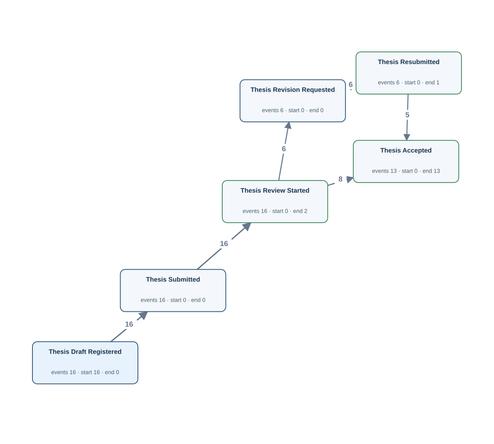</a></td><td width="58%" valign="top">
<a href="../../../datasets/universityflow/private/gold_sql/OU06.sql">Gold SQL</a> · <a href="../../../datasets/universityflow/private/gold_logs/OU06.csv">Gold CSV</a> · <a href="../../../datasets/universityflow/input/database.sqlite">Full source database (SQLite)</a>

<code>thesis</code> · 16 matched source rows
<table><tr><th>Column</th><th>Row 1</th><th>Row 2</th><th>Row 3</th></tr><tr><th>thesis_id</th><td>TH002</td><td>TH003</td><td>TH006</td></tr><tr><th>student_id</th><td>S002</td><td>S003</td><td>S006</td></tr><tr><th>thesis_title</th><td>Course Design Thesis</td><td>Course Design Thesis</td><td>Course Design Thesis</td></tr><tr><th>thesis_content</th><td>Synthetic thesis content</td><td>Synthetic thesis content</td><td>Synthetic thesis content</td></tr><tr><th>submission_date</th><td>2026-02-23T16:00:00Z</td><td>2026-02-24T16:00:00Z</td><td>2026-02-27T16:00:00Z</td></tr><tr><th>thesis_draft_registered_at</th><td>2026-02-19T16:00:00Z</td><td>2026-02-20T16:00:00Z</td><td>2026-02-23T16:00:00Z</td></tr><tr><th>thesis_review_started_at</th><td>2026-02-24T16:00:00Z</td><td>2026-02-25T16:00:00Z</td><td>2026-02-28T16:00:00Z</td></tr><tr><th>thesis_accepted_at</th><td><em>NULL</em></td><td>2026-02-28T16:00:00Z</td><td>2026-03-03T16:00:00Z</td></tr><tr><th>thesis_revision_requested_at</th><td>2026-02-25T16:00:00Z</td><td><em>NULL</em></td><td><em>NULL</em></td></tr><tr><th>thesis_resubmitted_at</th><td>2026-02-26T16:00:00Z</td><td><em>NULL</em></td><td><em>NULL</em></td></tr></table>
<strong>Gold output for the same source rows</strong>
<ul><li>Row 1 → Thesis Draft Registered · event LC:thesis:TH002:1 · case TH002 · time from <code>thesis_draft_registered_at</code></li><li>Row 1 → Thesis Review Started · event LC:thesis:TH002:2 · case TH002 · time from <code>thesis_review_started_at</code></li><li>Row 1 → Thesis Revision Requested · event LC:thesis:TH002:3 · case TH002 · time from <code>thesis_revision_requested_at</code></li><li>Row 1 → Thesis Resubmitted · event LC:thesis:TH002:4 · case TH002 · time from <code>thesis_resubmitted_at</code></li><li>Row 1 → Thesis Submitted · event THESIS:TH002 · case TH002 · time from <code>submission_date</code></li><li>Row 2 → Thesis Draft Registered · event LC:thesis:TH003:1 · case TH003 · time from <code>thesis_draft_registered_at</code></li><li>Row 2 → Thesis Review Started · event LC:thesis:TH003:2 · case TH003 · time from <code>thesis_review_started_at</code></li><li>Row 2 → Thesis Accepted · event LC:thesis:TH003:3 · case TH003 · time from <code>thesis_accepted_at</code></li><li>Row 2 → Thesis Submitted · event THESIS:TH003 · case TH003 · time from <code>submission_date</code></li><li>Row 3 → Thesis Draft Registered · event LC:thesis:TH006:1 · case TH006 · time from <code>thesis_draft_registered_at</code></li><li>Row 3 → Thesis Review Started · event LC:thesis:TH006:2 · case TH006 · time from <code>thesis_review_started_at</code></li><li>Row 3 → Thesis Accepted · event LC:thesis:TH006:3 · case TH006 · time from <code>thesis_accepted_at</code></li><li>Row 3 → Thesis Submitted · event THESIS:TH006 · case TH006 · time from <code>submission_date</code></li></ul>
</td></tr></table>

## OU07 — Q3

Extract the full recorded lifecycle event log for each simulation experiment result record.

Events: **131** · Cases with events: **27** · Activities: **5** · Edges: **4** · Source tables: **1** · SQL tables: **9**

<table><tr><td width="42%" valign="top"><a href="graphs/OU07.svg">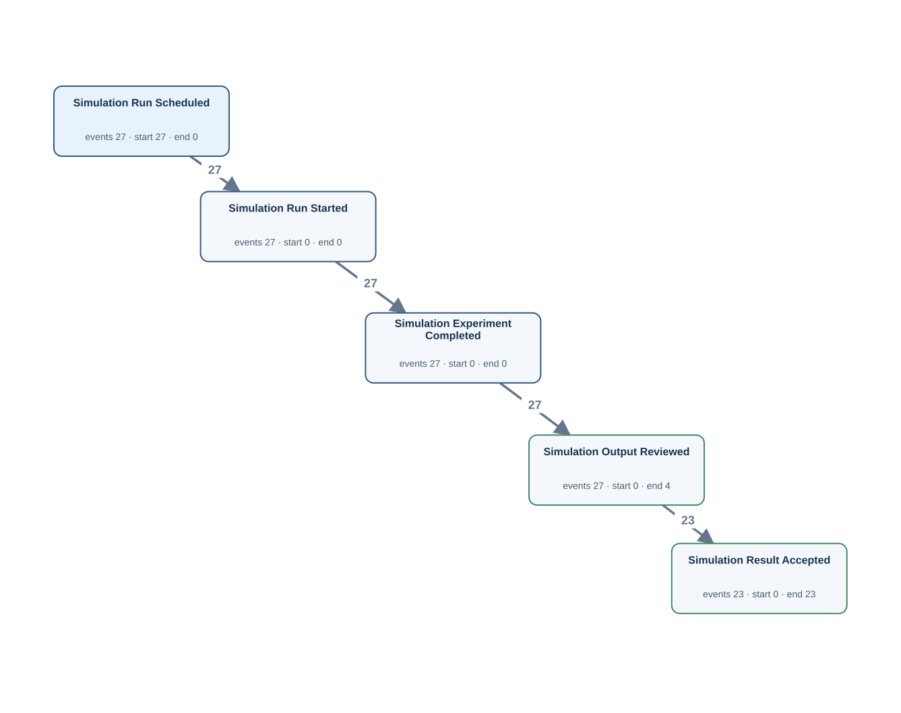</a></td><td width="58%" valign="top">
<a href="../../../datasets/universityflow/private/gold_sql/OU07.sql">Gold SQL</a> · <a href="../../../datasets/universityflow/private/gold_logs/OU07.csv">Gold CSV</a> · <a href="../../../datasets/universityflow/input/database.sqlite">Full source database (SQLite)</a>

<code>student_simulation_experiment_result</code> · 27 matched source rows
<table><tr><th>Column</th><th>Row 1</th><th>Row 2</th><th>Row 3</th></tr><tr><th>student_id</th><td>S002</td><td>S003</td><td>S003</td></tr><tr><th>module_id</th><td>M03</td><td>M01</td><td>M01</td></tr><tr><th>simulation_date</th><td>2026-02-13T15:00:00Z</td><td>2026-02-14T15:00:00Z</td><td>2026-02-15T15:00:00Z</td></tr><tr><th>simulation_result_data</th><td>Synthetic output 1</td><td>Synthetic output 1</td><td>Synthetic output 2</td></tr><tr><th>result_analysis</th><td>Recorded experiment analysis</td><td>Recorded experiment analysis</td><td>Recorded experiment analysis</td></tr><tr><th>simulation_run_scheduled_at</th><td>2026-02-13T13:00:00Z</td><td>2026-02-14T13:00:00Z</td><td>2026-02-15T13:00:00Z</td></tr><tr><th>simulation_run_started_at</th><td>2026-02-13T14:00:00Z</td><td>2026-02-14T14:00:00Z</td><td>2026-02-15T14:00:00Z</td></tr><tr><th>simulation_output_reviewed_at</th><td>2026-02-13T17:00:00Z</td><td>2026-02-14T17:00:00Z</td><td>2026-02-15T17:00:00Z</td></tr><tr><th>simulation_result_accepted_at</th><td><em>NULL</em></td><td>2026-02-14T18:00:00Z</td><td>2026-02-15T18:00:00Z</td></tr></table>
<strong>Gold output for the same source rows</strong>
<ul><li>Row 1 → Simulation Run Scheduled · event LC:student_simulation_experiment_result:S002:M03:2026-02-13T15:00:00Z:1 · case S002:M03:2026-02-13T15:00:00Z · time from <code>simulation_run_scheduled_at</code></li><li>Row 1 → Simulation Run Started · event LC:student_simulation_experiment_result:S002:M03:2026-02-13T15:00:00Z:2 · case S002:M03:2026-02-13T15:00:00Z · time from <code>simulation_run_started_at</code></li><li>Row 1 → Simulation Output Reviewed · event LC:student_simulation_experiment_result:S002:M03:2026-02-13T15:00:00Z:3 · case S002:M03:2026-02-13T15:00:00Z · time from <code>simulation_output_reviewed_at</code></li><li>Row 1 → Simulation Experiment Completed · event SIM:S002:M03:2026-02-13T15:00:00Z · case S002:M03:2026-02-13T15:00:00Z · time from <code>simulation_date</code></li><li>Row 2 → Simulation Run Scheduled · event LC:student_simulation_experiment_result:S003:M01:2026-02-14T15:00:00Z:1 · case S003:M01:2026-02-14T15:00:00Z · time from <code>simulation_run_scheduled_at</code></li><li>Row 2 → Simulation Run Started · event LC:student_simulation_experiment_result:S003:M01:2026-02-14T15:00:00Z:2 · case S003:M01:2026-02-14T15:00:00Z · time from <code>simulation_run_started_at</code></li><li>Row 2 → Simulation Output Reviewed · event LC:student_simulation_experiment_result:S003:M01:2026-02-14T15:00:00Z:3 · case S003:M01:2026-02-14T15:00:00Z · time from <code>simulation_output_reviewed_at</code></li><li>Row 2 → Simulation Result Accepted · event LC:student_simulation_experiment_result:S003:M01:2026-02-14T15:00:00Z:4 · case S003:M01:2026-02-14T15:00:00Z · time from <code>simulation_result_accepted_at</code></li><li>Row 2 → Simulation Experiment Completed · event SIM:S003:M01:2026-02-14T15:00:00Z · case S003:M01:2026-02-14T15:00:00Z · time from <code>simulation_date</code></li><li>Row 3 → Simulation Run Scheduled · event LC:student_simulation_experiment_result:S003:M01:2026-02-15T15:00:00Z:1 · case S003:M01:2026-02-15T15:00:00Z · time from <code>simulation_run_scheduled_at</code></li><li>Row 3 → Simulation Run Started · event LC:student_simulation_experiment_result:S003:M01:2026-02-15T15:00:00Z:2 · case S003:M01:2026-02-15T15:00:00Z · time from <code>simulation_run_started_at</code></li><li>Row 3 → Simulation Output Reviewed · event LC:student_simulation_experiment_result:S003:M01:2026-02-15T15:00:00Z:3 · case S003:M01:2026-02-15T15:00:00Z · time from <code>simulation_output_reviewed_at</code></li><li>Row 3 → Simulation Result Accepted · event LC:student_simulation_experiment_result:S003:M01:2026-02-15T15:00:00Z:4 · case S003:M01:2026-02-15T15:00:00Z · time from <code>simulation_result_accepted_at</code></li><li>Row 3 → Simulation Experiment Completed · event SIM:S003:M01:2026-02-15T15:00:00Z · case S003:M01:2026-02-15T15:00:00Z · time from <code>simulation_date</code></li></ul>

FK-linked case and join evidence
<ul><li><code>student_simulation_experiment_result</code> → <code>simulation_module</code> · module_id → module_id · module_id = M03</li></ul>
</td></tr></table>

## OU08 — Q3

Extract the full recorded lifecycle event log for each assignment.

Events: **90** · Cases with events: **20** · Activities: **7** · Edges: **9** · Source tables: **2** · SQL tables: **9**

<table><tr><td width="42%" valign="top"><a href="graphs/OU08.svg">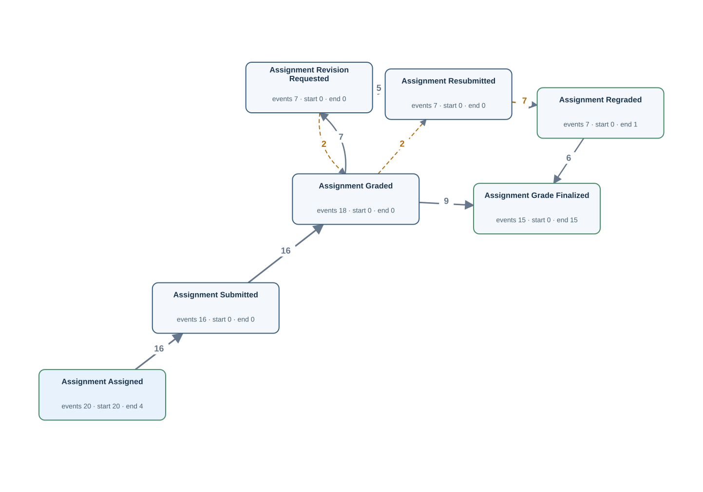</a></td><td width="58%" valign="top">
<a href="../../../datasets/universityflow/private/gold_sql/OU08.sql">Gold SQL</a> · <a href="../../../datasets/universityflow/private/gold_logs/OU08.csv">Gold CSV</a> · <a href="../../../datasets/universityflow/input/database.sqlite">Full source database (SQLite)</a>

<code>assignment</code> · 20 matched source rows
<table><tr><th>Column</th><th>Row 1</th><th>Row 2</th><th>Row 3</th></tr><tr><th>assignment_id</th><td>A002</td><td>A003</td><td>A006</td></tr><tr><th>student_id</th><td>S002</td><td>S003</td><td>S006</td></tr><tr><th>assignment_content</th><td>Synthetic assignment content</td><td>Synthetic assignment content</td><td>Synthetic assignment content</td></tr><tr><th>assignment_assigned_at</th><td>2026-02-07T14:00:00Z</td><td>2026-02-08T14:00:00Z</td><td>2026-02-11T14:00:00Z</td></tr><tr><th>assignment_submitted_at</th><td>2026-02-09T14:00:00Z</td><td>2026-02-10T14:00:00Z</td><td>2026-02-13T14:00:00Z</td></tr><tr><th>assignment_grade_finalized_at</th><td><em>NULL</em></td><td>2026-02-14T14:00:00Z</td><td>2026-02-17T14:00:00Z</td></tr><tr><th>assignment_revision_requested_at</th><td>2026-02-11T15:00:00Z</td><td><em>NULL</em></td><td><em>NULL</em></td></tr><tr><th>assignment_resubmitted_at</th><td>2026-02-12T14:00:00Z</td><td><em>NULL</em></td><td><em>NULL</em></td></tr></table>
<strong>Gold output for the same source rows</strong>
<ul><li>Row 1 → Assignment Assigned · event LC:assignment:A002:1 · case A002 · time from <code>assignment_assigned_at</code></li><li>Row 1 → Assignment Submitted · event LC:assignment:A002:2 · case A002 · time from <code>assignment_submitted_at</code></li><li>Row 1 → Assignment Revision Requested · event LC:assignment:A002:3 · case A002 · time from <code>assignment_revision_requested_at</code></li><li>Row 1 → Assignment Resubmitted · event LC:assignment:A002:4 · case A002 · time from <code>assignment_resubmitted_at</code></li><li>Row 2 → Assignment Assigned · event LC:assignment:A003:1 · case A003 · time from <code>assignment_assigned_at</code></li><li>Row 2 → Assignment Submitted · event LC:assignment:A003:2 · case A003 · time from <code>assignment_submitted_at</code></li><li>Row 2 → Assignment Grade Finalized · event LC:assignment:A003:3 · case A003 · time from <code>assignment_grade_finalized_at</code></li><li>Row 3 → Assignment Assigned · event LC:assignment:A006:1 · case A006 · time from <code>assignment_assigned_at</code></li><li>Row 3 → Assignment Submitted · event LC:assignment:A006:2 · case A006 · time from <code>assignment_submitted_at</code></li><li>Row 3 → Assignment Grade Finalized · event LC:assignment:A006:3 · case A006 · time from <code>assignment_grade_finalized_at</code></li></ul>

<code>assignment_grading</code> · 25 matched source rows
<table><tr><th>Column</th><th>Row 1</th><th>Row 2</th><th>Row 3</th></tr><tr><th>assignment_id</th><td>A002</td><td>A002</td><td>A003</td></tr><tr><th>instructor_id</th><td>I03</td><td>I03</td><td>I01</td></tr><tr><th>grading_time</th><td>2026-02-11T14:00:00Z</td><td>2026-02-13T02:00:00Z</td><td>2026-02-12T14:00:00Z</td></tr><tr><th>score</th><td>70</td><td>75</td><td>70</td></tr><tr><th>evaluation</th><td>Initial feedback</td><td>Authored synthetic reassessment score and feedback</td><td>Initial feedback</td></tr><tr><th>grading_kind</th><td>ORIGINAL</td><td>REASSESSMENT</td><td>ORIGINAL</td></tr><tr><th>reassessment_event_id</th><td><em>NULL</em></td><td>LC:assignment:A002:5</td><td><em>NULL</em></td></tr></table>
<strong>Gold output for the same source rows</strong>
<ul><li>Row 1 → Assignment Graded · event GRADE:A002:I03:2026-02-11T14:00:00Z · case A002 · time from <code>grading_time</code></li><li>Row 2 → Assignment Regraded · event LC:assignment:A002:5 · case A002 · time from <code>grading_time</code></li><li>Row 3 → Assignment Graded · event GRADE:A003:I01:2026-02-12T14:00:00Z · case A003 · time from <code>grading_time</code></li></ul>
</td></tr></table>

## OU09 — Q3

Extract the full recorded lifecycle event log for each instructor.

Events: **86** · Cases with events: **3** · Activities: **7** · Edges: **18** · Source tables: **2** · SQL tables: **9**

<table><tr><td width="42%" valign="top"><a href="graphs/OU09.svg">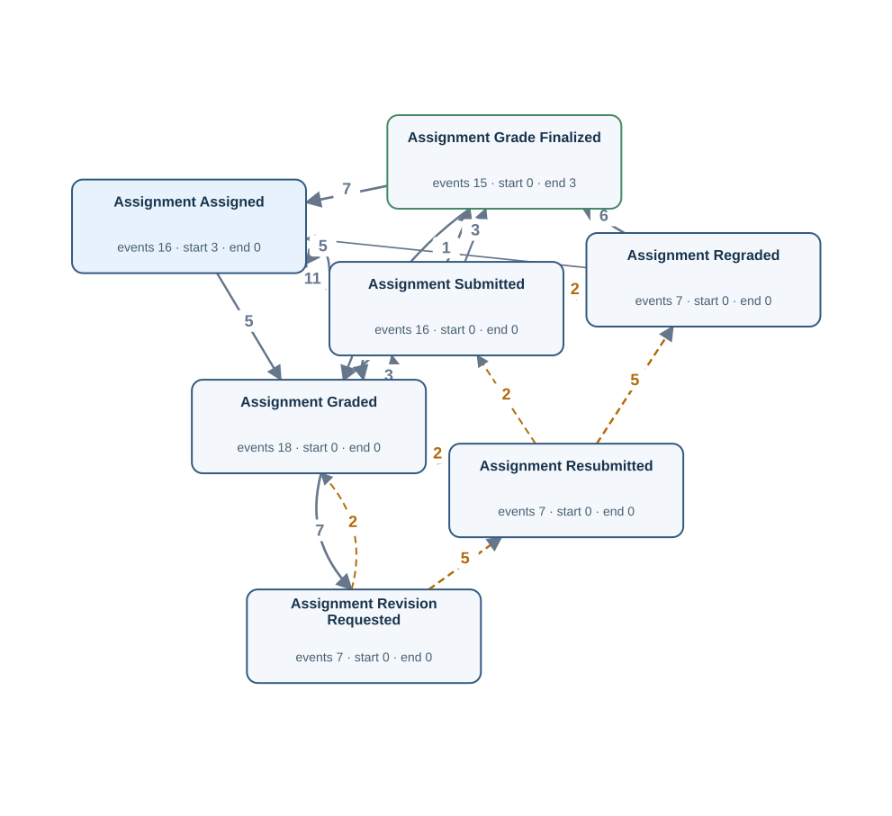</a></td><td width="58%" valign="top">
<a href="../../../datasets/universityflow/private/gold_sql/OU09.sql">Gold SQL</a> · <a href="../../../datasets/universityflow/private/gold_logs/OU09.csv">Gold CSV</a> · <a href="../../../datasets/universityflow/input/database.sqlite">Full source database (SQLite)</a>

<code>assignment</code> · 16 matched source rows
<table><tr><th>Column</th><th>Row 1</th><th>Row 2</th><th>Row 3</th></tr><tr><th>assignment_id</th><td>A003</td><td>A007</td><td>A006</td></tr><tr><th>student_id</th><td>S003</td><td>S007</td><td>S006</td></tr><tr><th>assignment_content</th><td>Synthetic assignment content</td><td>Synthetic assignment content</td><td>Synthetic assignment content</td></tr><tr><th>assignment_assigned_at</th><td>2026-02-08T14:00:00Z</td><td>2026-02-12T14:00:00Z</td><td>2026-02-11T14:00:00Z</td></tr><tr><th>assignment_submitted_at</th><td>2026-02-10T14:00:00Z</td><td>2026-02-14T14:00:00Z</td><td>2026-02-13T14:00:00Z</td></tr><tr><th>assignment_grade_finalized_at</th><td>2026-02-14T14:00:00Z</td><td>2026-02-19T14:00:00Z</td><td>2026-02-17T14:00:00Z</td></tr><tr><th>assignment_revision_requested_at</th><td><em>NULL</em></td><td>2026-02-16T15:00:00Z</td><td><em>NULL</em></td></tr><tr><th>assignment_resubmitted_at</th><td><em>NULL</em></td><td>2026-02-17T14:00:00Z</td><td><em>NULL</em></td></tr></table>
<strong>Gold output for the same source rows</strong>
<ul><li>Row 1 → Assignment Assigned · event LC:assignment:A003:1 · case I01 · time from <code>assignment_assigned_at</code></li><li>Row 1 → Assignment Submitted · event LC:assignment:A003:2 · case I01 · time from <code>assignment_submitted_at</code></li><li>Row 1 → Assignment Grade Finalized · event LC:assignment:A003:3 · case I01 · time from <code>assignment_grade_finalized_at</code></li><li>Row 2 → Assignment Assigned · event LC:assignment:A007:1 · case I02 · time from <code>assignment_assigned_at</code></li><li>Row 2 → Assignment Submitted · event LC:assignment:A007:2 · case I02 · time from <code>assignment_submitted_at</code></li><li>Row 2 → Assignment Revision Requested · event LC:assignment:A007:3 · case I02 · time from <code>assignment_revision_requested_at</code></li><li>Row 2 → Assignment Resubmitted · event LC:assignment:A007:4 · case I02 · time from <code>assignment_resubmitted_at</code></li><li>Row 2 → Assignment Grade Finalized · event LC:assignment:A007:6 · case I02 · time from <code>assignment_grade_finalized_at</code></li><li>Row 3 → Assignment Assigned · event LC:assignment:A006:1 · case I01 · time from <code>assignment_assigned_at</code></li><li>Row 3 → Assignment Submitted · event LC:assignment:A006:2 · case I01 · time from <code>assignment_submitted_at</code></li><li>Row 3 → Assignment Grade Finalized · event LC:assignment:A006:3 · case I01 · time from <code>assignment_grade_finalized_at</code></li></ul>

<code>assignment_grading</code> · 25 matched source rows
<table><tr><th>Column</th><th>Row 1</th><th>Row 2</th><th>Row 3</th></tr><tr><th>assignment_id</th><td>A003</td><td>A007</td><td>A006</td></tr><tr><th>instructor_id</th><td>I01</td><td>I02</td><td>I01</td></tr><tr><th>grading_time</th><td>2026-02-12T14:00:00Z</td><td>2026-02-19T02:00:00Z</td><td>2026-02-15T14:00:00Z</td></tr><tr><th>score</th><td>70</td><td>85</td><td>70</td></tr><tr><th>evaluation</th><td>Initial feedback</td><td>Authored synthetic reassessment score and feedback</td><td>Initial feedback</td></tr><tr><th>grading_kind</th><td>ORIGINAL</td><td>REASSESSMENT</td><td>ORIGINAL</td></tr><tr><th>reassessment_event_id</th><td><em>NULL</em></td><td>LC:assignment:A007:5</td><td><em>NULL</em></td></tr></table>
<strong>Gold output for the same source rows</strong>
<ul><li>Row 1 → Assignment Graded · event GRADE:A003:I01:2026-02-12T14:00:00Z · case I01 · time from <code>grading_time</code></li><li>Row 2 → Assignment Regraded · event LC:assignment:A007:5 · case I02 · time from <code>grading_time</code></li><li>Row 3 → Assignment Graded · event GRADE:A006:I01:2026-02-15T14:00:00Z · case I01 · time from <code>grading_time</code></li></ul>
</td></tr></table>

## OU10 — Q3

Extract the full recorded lifecycle event log for each assignment grading record.

Events: **25** · Cases with events: **25** · Activities: **2** · Edges: **0** · Source tables: **1** · SQL tables: **9**

<table><tr><td width="42%" valign="top"><a href="graphs/OU10.svg">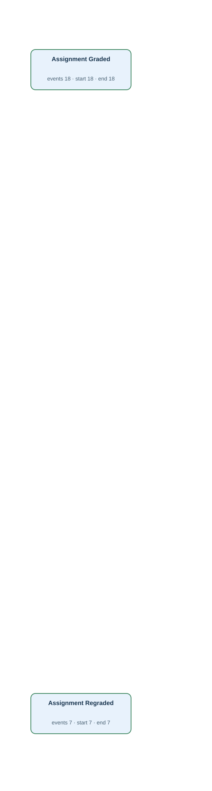</a></td><td width="58%" valign="top">
<a href="../../../datasets/universityflow/private/gold_sql/OU10.sql">Gold SQL</a> · <a href="../../../datasets/universityflow/private/gold_logs/OU10.csv">Gold CSV</a> · <a href="../../../datasets/universityflow/input/database.sqlite">Full source database (SQLite)</a>

<code>assignment_grading</code> · 25 matched source rows
<table><tr><th>Column</th><th>Row 1</th><th>Row 2</th><th>Row 3</th></tr><tr><th>assignment_id</th><td>A002</td><td>A002</td><td>A003</td></tr><tr><th>instructor_id</th><td>I03</td><td>I03</td><td>I01</td></tr><tr><th>grading_time</th><td>2026-02-11T14:00:00Z</td><td>2026-02-13T02:00:00Z</td><td>2026-02-12T14:00:00Z</td></tr><tr><th>score</th><td>70</td><td>75</td><td>70</td></tr><tr><th>evaluation</th><td>Initial feedback</td><td>Authored synthetic reassessment score and feedback</td><td>Initial feedback</td></tr><tr><th>grading_kind</th><td>ORIGINAL</td><td>REASSESSMENT</td><td>ORIGINAL</td></tr><tr><th>reassessment_event_id</th><td><em>NULL</em></td><td>LC:assignment:A002:5</td><td><em>NULL</em></td></tr></table>
<strong>Gold output for the same source rows</strong>
<ul><li>Row 1 → Assignment Graded · event GRADE:A002:I03:2026-02-11T14:00:00Z · case A002:I03:2026-02-11T14:00:00Z · time from <code>grading_time</code></li><li>Row 2 → Assignment Regraded · event LC:assignment:A002:5 · case A002:I03:2026-02-13T02:00:00Z · time from <code>grading_time</code></li><li>Row 3 → Assignment Graded · event GRADE:A003:I01:2026-02-12T14:00:00Z · case A003:I01:2026-02-12T14:00:00Z · time from <code>grading_time</code></li></ul>

FK-linked case and join evidence
<ul><li><code>assignment_grading</code> → <code>assignment</code> · assignment_id → assignment_id · assignment_id = A002</li></ul>
</td></tr></table>

## OU11 — Q3

Extract the full recorded lifecycle event log for each course-design task.

Events: **11** · Cases with events: **3** · Activities: **4** · Edges: **3** · Source tables: **1** · SQL tables: **9**

<table><tr><td width="42%" valign="top"><a href="graphs/OU11.svg">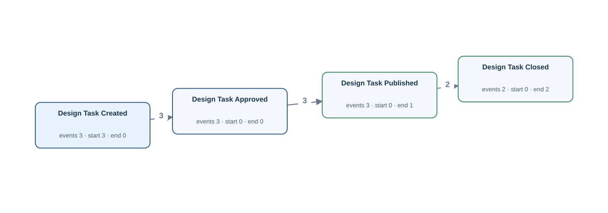</a></td><td width="58%" valign="top">
<a href="../../../datasets/universityflow/private/gold_sql/OU11.sql">Gold SQL</a> · <a href="../../../datasets/universityflow/private/gold_logs/OU11.csv">Gold CSV</a> · <a href="../../../datasets/universityflow/input/database.sqlite">Full source database (SQLite)</a>

<code>task</code> · 3 matched source rows
<table><tr><th>Column</th><th>Row 1</th><th>Row 2</th><th>Row 3</th></tr><tr><th>task_id</th><td>T01</td><td>T02</td><td>T03</td></tr><tr><th>task_title</th><td>Course Design Task 1</td><td>Course Design Task 2</td><td>Course Design Task 3</td></tr><tr><th>task_description</th><td>Analyze simulation output</td><td>Analyze simulation output</td><td>Analyze simulation output</td></tr><tr><th>task_start_date</th><td>2026-02-01</td><td>2026-02-01</td><td>2026-02-01</td></tr><tr><th>task_end_date</th><td>2026-05-31</td><td>2026-05-31</td><td>2026-05-31</td></tr><tr><th>task_location</th><td>Teaching Laboratory</td><td>Teaching Laboratory</td><td>Teaching Laboratory</td></tr><tr><th>design_task_created_at</th><td>2025-12-31T00:00:00Z</td><td>2026-01-01T00:00:00Z</td><td>2026-01-02T00:00:00Z</td></tr><tr><th>design_task_approved_at</th><td>2026-01-01T00:00:00Z</td><td>2026-01-02T00:00:00Z</td><td>2026-01-03T00:00:00Z</td></tr><tr><th>design_task_published_at</th><td>2026-01-02T00:00:00Z</td><td>2026-01-03T00:00:00Z</td><td>2026-01-04T00:00:00Z</td></tr><tr><th>design_task_closed_at</th><td><em>NULL</em></td><td>2026-02-03T00:00:00Z</td><td>2026-02-04T00:00:00Z</td></tr></table>
<strong>Gold output for the same source rows</strong>
<ul><li>Row 1 → Design Task Created · event LC:task:T01:1 · case T01 · time from <code>design_task_created_at</code></li><li>Row 1 → Design Task Approved · event LC:task:T01:2 · case T01 · time from <code>design_task_approved_at</code></li><li>Row 1 → Design Task Published · event LC:task:T01:3 · case T01 · time from <code>design_task_published_at</code></li><li>Row 2 → Design Task Created · event LC:task:T02:1 · case T02 · time from <code>design_task_created_at</code></li><li>Row 2 → Design Task Approved · event LC:task:T02:2 · case T02 · time from <code>design_task_approved_at</code></li><li>Row 2 → Design Task Published · event LC:task:T02:3 · case T02 · time from <code>design_task_published_at</code></li><li>Row 2 → Design Task Closed · event LC:task:T02:4 · case T02 · time from <code>design_task_closed_at</code></li><li>Row 3 → Design Task Created · event LC:task:T03:1 · case T03 · time from <code>design_task_created_at</code></li><li>Row 3 → Design Task Approved · event LC:task:T03:2 · case T03 · time from <code>design_task_approved_at</code></li><li>Row 3 → Design Task Published · event LC:task:T03:3 · case T03 · time from <code>design_task_published_at</code></li><li>Row 3 → Design Task Closed · event LC:task:T03:4 · case T03 · time from <code>design_task_closed_at</code></li></ul>
</td></tr></table>

## TS01 — Q1

Extract Examination Scheduled, Examination Checked In, Examination Score Published, Examination Result Reviewed events for each student.

Events: **154** · Cases with events: **30** · Activities: **4** · Edges: **5** · Source tables: **1** · SQL tables: **9**

<table><tr><td width="42%" valign="top"><a href="graphs/TS01.svg">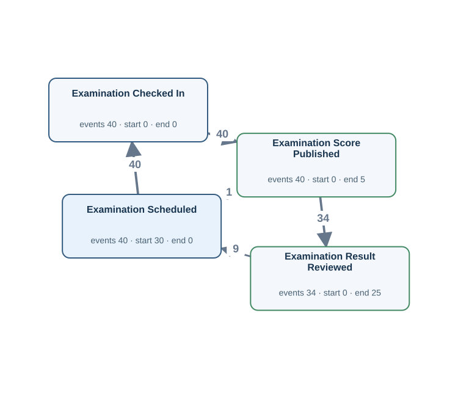</a></td><td width="58%" valign="top">
<a href="../../../datasets/universityflow/private/gold_sql/TS01.sql">Gold SQL</a> · <a href="../../../datasets/universityflow/private/gold_logs/TS01.csv">Gold CSV</a> · <a href="../../../datasets/universityflow/input/database.sqlite">Full source database (SQLite)</a>

<code>degree_examination_result</code> · 40 matched source rows
<table><tr><th>Column</th><th>Row 1</th><th>Row 2</th><th>Row 3</th></tr><tr><th>result_id</th><td>E001-1</td><td>E002-1</td><td>E002-2</td></tr><tr><th>student_id</th><td>S001</td><td>S002</td><td>S002</td></tr><tr><th>examination_name</th><td>Registration Eligibility Examination</td><td>Registration Eligibility Examination</td><td>Registration Eligibility Examination</td></tr><tr><th>grade</th><td>33</td><td>32</td><td>88</td></tr><tr><th>examination_date</th><td>2026-02-02T09:00:00Z</td><td>2026-02-03T09:00:00Z</td><td>2026-02-05T09:00:00Z</td></tr><tr><th>examination_scheduled_at</th><td>2026-02-02T07:00:00Z</td><td>2026-02-03T07:00:00Z</td><td>2026-02-05T07:00:00Z</td></tr><tr><th>examination_checked_in_at</th><td>2026-02-02T08:00:00Z</td><td>2026-02-03T08:00:00Z</td><td>2026-02-05T08:00:00Z</td></tr><tr><th>examination_score_published_at</th><td>2026-02-02T11:00:00Z</td><td>2026-02-03T11:00:00Z</td><td>2026-02-05T11:00:00Z</td></tr><tr><th>examination_result_reviewed_at</th><td><em>NULL</em></td><td>2026-02-03T12:00:00Z</td><td>2026-02-05T12:00:00Z</td></tr></table>
<strong>Gold output for the same source rows</strong>
<ul><li>Row 1 → Examination Scheduled · event LC:degree_examination_result:E001-1:1 · case S001 · time from <code>examination_scheduled_at</code></li><li>Row 1 → Examination Checked In · event LC:degree_examination_result:E001-1:2 · case S001 · time from <code>examination_checked_in_at</code></li><li>Row 1 → Examination Score Published · event LC:degree_examination_result:E001-1:3 · case S001 · time from <code>examination_score_published_at</code></li><li>Row 2 → Examination Scheduled · event LC:degree_examination_result:E002-1:1 · case S002 · time from <code>examination_scheduled_at</code></li><li>Row 2 → Examination Checked In · event LC:degree_examination_result:E002-1:2 · case S002 · time from <code>examination_checked_in_at</code></li><li>Row 2 → Examination Score Published · event LC:degree_examination_result:E002-1:3 · case S002 · time from <code>examination_score_published_at</code></li><li>Row 2 → Examination Result Reviewed · event LC:degree_examination_result:E002-1:4 · case S002 · time from <code>examination_result_reviewed_at</code></li><li>Row 3 → Examination Scheduled · event LC:degree_examination_result:E002-2:1 · case S002 · time from <code>examination_scheduled_at</code></li><li>Row 3 → Examination Checked In · event LC:degree_examination_result:E002-2:2 · case S002 · time from <code>examination_checked_in_at</code></li><li>Row 3 → Examination Score Published · event LC:degree_examination_result:E002-2:3 · case S002 · time from <code>examination_score_published_at</code></li><li>Row 3 → Examination Result Reviewed · event LC:degree_examination_result:E002-2:4 · case S002 · time from <code>examination_result_reviewed_at</code></li></ul>
</td></tr></table>

## TS02 — Q1

Extract Registration Requested, Registration Approved, Course Started, Course Assessment Completed, Course Grade Finalized events for each student-course registration.

Events: **228** · Cases with events: **47** · Activities: **5** · Edges: **4** · Source tables: **1** · SQL tables: **9**

<table><tr><td width="42%" valign="top"><a href="graphs/TS02.svg">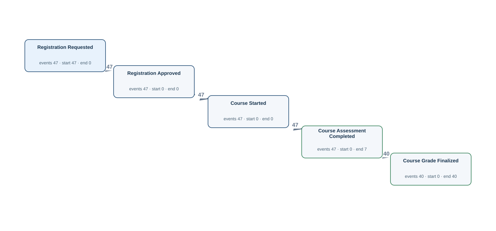</a></td><td width="58%" valign="top">
<a href="../../../datasets/universityflow/private/gold_sql/TS02.sql">Gold SQL</a> · <a href="../../../datasets/universityflow/private/gold_logs/TS02.csv">Gold CSV</a> · <a href="../../../datasets/universityflow/input/database.sqlite">Full source database (SQLite)</a>

<code>registration</code> · 47 matched source rows
<table><tr><th>Column</th><th>Row 1</th><th>Row 2</th><th>Row 3</th></tr><tr><th>student_id</th><td>S002</td><td>S002</td><td>S003</td></tr><tr><th>course_id</th><td>C01</td><td>C06</td><td>C02</td></tr><tr><th>registration_time</th><td>2026-02-07T11:00:00Z</td><td>2026-02-07T16:00:00Z</td><td>2026-02-08T12:00:00Z</td></tr><tr><th>status</th><td>REGISTERED</td><td>REGISTERED</td><td>REGISTERED</td></tr><tr><th>registration_requested_at</th><td>2026-02-07T07:00:00Z</td><td>2026-02-07T12:00:00Z</td><td>2026-02-08T08:00:00Z</td></tr><tr><th>registration_approved_at</th><td>2026-02-07T09:00:00Z</td><td>2026-02-07T14:00:00Z</td><td>2026-02-08T10:00:00Z</td></tr><tr><th>course_started_at</th><td>2026-02-09T11:00:00Z</td><td>2026-02-09T16:00:00Z</td><td>2026-02-10T12:00:00Z</td></tr><tr><th>course_assessment_completed_at</th><td>2026-02-27T11:00:00Z</td><td>2026-02-27T16:00:00Z</td><td>2026-02-28T12:00:00Z</td></tr><tr><th>course_grade_finalized_at</th><td><em>NULL</em></td><td>2026-03-01T16:00:00Z</td><td>2026-03-02T12:00:00Z</td></tr></table>
<strong>Gold output for the same source rows</strong>
<ul><li>Row 1 → Registration Requested · event LC:registration:S002:C01:1 · case S002:C01 · time from <code>registration_requested_at</code></li><li>Row 1 → Registration Approved · event LC:registration:S002:C01:2 · case S002:C01 · time from <code>registration_approved_at</code></li><li>Row 1 → Course Started · event LC:registration:S002:C01:3 · case S002:C01 · time from <code>course_started_at</code></li><li>Row 1 → Course Assessment Completed · event LC:registration:S002:C01:4 · case S002:C01 · time from <code>course_assessment_completed_at</code></li><li>Row 2 → Registration Requested · event LC:registration:S002:C06:1 · case S002:C06 · time from <code>registration_requested_at</code></li><li>Row 2 → Registration Approved · event LC:registration:S002:C06:2 · case S002:C06 · time from <code>registration_approved_at</code></li><li>Row 2 → Course Started · event LC:registration:S002:C06:3 · case S002:C06 · time from <code>course_started_at</code></li><li>Row 2 → Course Assessment Completed · event LC:registration:S002:C06:4 · case S002:C06 · time from <code>course_assessment_completed_at</code></li><li>Row 2 → Course Grade Finalized · event LC:registration:S002:C06:5 · case S002:C06 · time from <code>course_grade_finalized_at</code></li><li>Row 3 → Registration Requested · event LC:registration:S003:C02:1 · case S003:C02 · time from <code>registration_requested_at</code></li><li>Row 3 → Registration Approved · event LC:registration:S003:C02:2 · case S003:C02 · time from <code>registration_approved_at</code></li><li>Row 3 → Course Started · event LC:registration:S003:C02:3 · case S003:C02 · time from <code>course_started_at</code></li><li>Row 3 → Course Assessment Completed · event LC:registration:S003:C02:4 · case S003:C02 · time from <code>course_assessment_completed_at</code></li><li>Row 3 → Course Grade Finalized · event LC:registration:S003:C02:5 · case S003:C02 · time from <code>course_grade_finalized_at</code></li></ul>

FK-linked case and join evidence
<ul><li><code>registration</code> → <code>course</code> · course_id → course_id · course_id = C01</li></ul>
</td></tr></table>

## TS03 — Q1

Extract Assignment Assigned, Assignment Submitted, Assignment Grade Finalized events for each assignment.

Events: **51** · Cases with events: **20** · Activities: **3** · Edges: **2** · Source tables: **1** · SQL tables: **9**

<table><tr><td width="42%" valign="top"><a href="graphs/TS03.svg">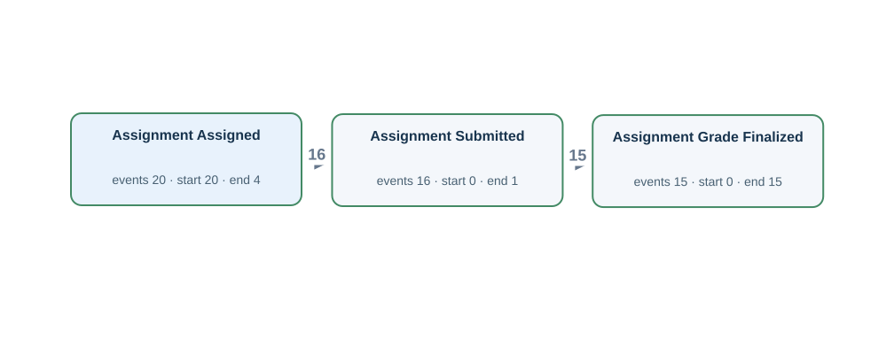</a></td><td width="58%" valign="top">
<a href="../../../datasets/universityflow/private/gold_sql/TS03.sql">Gold SQL</a> · <a href="../../../datasets/universityflow/private/gold_logs/TS03.csv">Gold CSV</a> · <a href="../../../datasets/universityflow/input/database.sqlite">Full source database (SQLite)</a>

<code>assignment</code> · 20 matched source rows
<table><tr><th>Column</th><th>Row 1</th><th>Row 2</th><th>Row 3</th></tr><tr><th>assignment_id</th><td>A002</td><td>A003</td><td>A006</td></tr><tr><th>student_id</th><td>S002</td><td>S003</td><td>S006</td></tr><tr><th>assignment_content</th><td>Synthetic assignment content</td><td>Synthetic assignment content</td><td>Synthetic assignment content</td></tr><tr><th>assignment_assigned_at</th><td>2026-02-07T14:00:00Z</td><td>2026-02-08T14:00:00Z</td><td>2026-02-11T14:00:00Z</td></tr><tr><th>assignment_submitted_at</th><td>2026-02-09T14:00:00Z</td><td>2026-02-10T14:00:00Z</td><td>2026-02-13T14:00:00Z</td></tr><tr><th>assignment_grade_finalized_at</th><td><em>NULL</em></td><td>2026-02-14T14:00:00Z</td><td>2026-02-17T14:00:00Z</td></tr><tr><th>assignment_revision_requested_at</th><td>2026-02-11T15:00:00Z</td><td><em>NULL</em></td><td><em>NULL</em></td></tr><tr><th>assignment_resubmitted_at</th><td>2026-02-12T14:00:00Z</td><td><em>NULL</em></td><td><em>NULL</em></td></tr></table>
<strong>Gold output for the same source rows</strong>
<ul><li>Row 1 → Assignment Assigned · event LC:assignment:A002:1 · case A002 · time from <code>assignment_assigned_at</code></li><li>Row 1 → Assignment Submitted · event LC:assignment:A002:2 · case A002 · time from <code>assignment_submitted_at</code></li><li>Row 2 → Assignment Assigned · event LC:assignment:A003:1 · case A003 · time from <code>assignment_assigned_at</code></li><li>Row 2 → Assignment Submitted · event LC:assignment:A003:2 · case A003 · time from <code>assignment_submitted_at</code></li><li>Row 2 → Assignment Grade Finalized · event LC:assignment:A003:3 · case A003 · time from <code>assignment_grade_finalized_at</code></li><li>Row 3 → Assignment Assigned · event LC:assignment:A006:1 · case A006 · time from <code>assignment_assigned_at</code></li><li>Row 3 → Assignment Submitted · event LC:assignment:A006:2 · case A006 · time from <code>assignment_submitted_at</code></li><li>Row 3 → Assignment Grade Finalized · event LC:assignment:A006:3 · case A006 · time from <code>assignment_grade_finalized_at</code></li></ul>
</td></tr></table>

## TS04 — Q1

Extract Thesis Draft Registered, Thesis Review Started, Thesis Accepted events for each thesis.

Events: **45** · Cases with events: **16** · Activities: **3** · Edges: **2** · Source tables: **1** · SQL tables: **9**

<table><tr><td width="42%" valign="top"><a href="graphs/TS04.svg">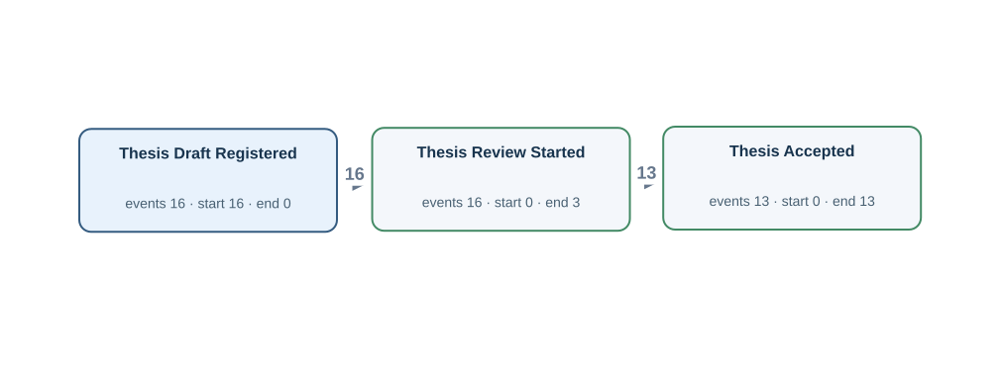</a></td><td width="58%" valign="top">
<a href="../../../datasets/universityflow/private/gold_sql/TS04.sql">Gold SQL</a> · <a href="../../../datasets/universityflow/private/gold_logs/TS04.csv">Gold CSV</a> · <a href="../../../datasets/universityflow/input/database.sqlite">Full source database (SQLite)</a>

<code>thesis</code> · 16 matched source rows
<table><tr><th>Column</th><th>Row 1</th><th>Row 2</th><th>Row 3</th></tr><tr><th>thesis_id</th><td>TH002</td><td>TH003</td><td>TH006</td></tr><tr><th>student_id</th><td>S002</td><td>S003</td><td>S006</td></tr><tr><th>thesis_title</th><td>Course Design Thesis</td><td>Course Design Thesis</td><td>Course Design Thesis</td></tr><tr><th>thesis_content</th><td>Synthetic thesis content</td><td>Synthetic thesis content</td><td>Synthetic thesis content</td></tr><tr><th>submission_date</th><td>2026-02-23T16:00:00Z</td><td>2026-02-24T16:00:00Z</td><td>2026-02-27T16:00:00Z</td></tr><tr><th>thesis_draft_registered_at</th><td>2026-02-19T16:00:00Z</td><td>2026-02-20T16:00:00Z</td><td>2026-02-23T16:00:00Z</td></tr><tr><th>thesis_review_started_at</th><td>2026-02-24T16:00:00Z</td><td>2026-02-25T16:00:00Z</td><td>2026-02-28T16:00:00Z</td></tr><tr><th>thesis_accepted_at</th><td><em>NULL</em></td><td>2026-02-28T16:00:00Z</td><td>2026-03-03T16:00:00Z</td></tr><tr><th>thesis_revision_requested_at</th><td>2026-02-25T16:00:00Z</td><td><em>NULL</em></td><td><em>NULL</em></td></tr><tr><th>thesis_resubmitted_at</th><td>2026-02-26T16:00:00Z</td><td><em>NULL</em></td><td><em>NULL</em></td></tr></table>
<strong>Gold output for the same source rows</strong>
<ul><li>Row 1 → Thesis Draft Registered · event LC:thesis:TH002:1 · case TH002 · time from <code>thesis_draft_registered_at</code></li><li>Row 1 → Thesis Review Started · event LC:thesis:TH002:2 · case TH002 · time from <code>thesis_review_started_at</code></li><li>Row 2 → Thesis Draft Registered · event LC:thesis:TH003:1 · case TH003 · time from <code>thesis_draft_registered_at</code></li><li>Row 2 → Thesis Review Started · event LC:thesis:TH003:2 · case TH003 · time from <code>thesis_review_started_at</code></li><li>Row 2 → Thesis Accepted · event LC:thesis:TH003:3 · case TH003 · time from <code>thesis_accepted_at</code></li><li>Row 3 → Thesis Draft Registered · event LC:thesis:TH006:1 · case TH006 · time from <code>thesis_draft_registered_at</code></li><li>Row 3 → Thesis Review Started · event LC:thesis:TH006:2 · case TH006 · time from <code>thesis_review_started_at</code></li><li>Row 3 → Thesis Accepted · event LC:thesis:TH006:3 · case TH006 · time from <code>thesis_accepted_at</code></li></ul>
</td></tr></table>

## U07P — Q2

For each student, build a timeline of confirmation messages being sent after a course sign-up.

**No Gold log:** The requirements mention notifications, but no notification records or times are stored.

## U08P — Q2

For each student, build a timeline of the student leaving a course after signing up.

**No Gold log:** No withdrawal times or registration-status history are recorded.

## U15P — Q2

For each student, build a timeline of the student handing in coursework.

Events: **16** · Cases with events: **16** · Activities: **1** · Edges: **0** · Source tables: **1** · SQL tables: **1**

<table><tr><td width="42%" valign="top"></td><td width="58%" valign="top">
<a href="../../../datasets/universityflow/private/gold_sql/U15P.sql">Gold SQL</a> · <a href="../../../datasets/universityflow/private/gold_logs/U15P.csv">Gold CSV</a> · <a href="../../../datasets/universityflow/input/database.sqlite">Full source database (SQLite)</a>

<code>assignment</code> · 16 matched source rows
<table><tr><th>Column</th><th>Row 1</th><th>Row 2</th><th>Row 3</th></tr><tr><th>assignment_id</th><td>A002</td><td>A003</td><td>A006</td></tr><tr><th>student_id</th><td>S002</td><td>S003</td><td>S006</td></tr><tr><th>assignment_content</th><td>Synthetic assignment content</td><td>Synthetic assignment content</td><td>Synthetic assignment content</td></tr><tr><th>assignment_assigned_at</th><td>2026-02-07T14:00:00Z</td><td>2026-02-08T14:00:00Z</td><td>2026-02-11T14:00:00Z</td></tr><tr><th>assignment_submitted_at</th><td>2026-02-09T14:00:00Z</td><td>2026-02-10T14:00:00Z</td><td>2026-02-13T14:00:00Z</td></tr><tr><th>assignment_grade_finalized_at</th><td><em>NULL</em></td><td>2026-02-14T14:00:00Z</td><td>2026-02-17T14:00:00Z</td></tr><tr><th>assignment_revision_requested_at</th><td>2026-02-11T15:00:00Z</td><td><em>NULL</em></td><td><em>NULL</em></td></tr><tr><th>assignment_resubmitted_at</th><td>2026-02-12T14:00:00Z</td><td><em>NULL</em></td><td><em>NULL</em></td></tr></table>
<strong>Gold output for the same source rows</strong>
<ul><li>Row 1 → Assignment Submitted · event LC:assignment:A002:2 · case S002 · time from <code>assignment_submitted_at</code></li><li>Row 2 → Assignment Submitted · event LC:assignment:A003:2 · case S003 · time from <code>assignment_submitted_at</code></li><li>Row 3 → Assignment Submitted · event LC:assignment:A006:2 · case S006 · time from <code>assignment_submitted_at</code></li></ul>
</td></tr></table>

## TS01P — Q2

For each student, build a timeline of an examination sitting being arranged, the candidate checking in for the examination, the examination mark being released, the examination result being reviewed.

Events: **154** · Cases with events: **30** · Activities: **4** · Edges: **5** · Source tables: **1** · SQL tables: **9**

<table><tr><td width="42%" valign="top"></td><td width="58%" valign="top">
<a href="../../../datasets/universityflow/private/gold_sql/TS01P.sql">Gold SQL</a> · <a href="../../../datasets/universityflow/private/gold_logs/TS01P.csv">Gold CSV</a> · <a href="../../../datasets/universityflow/input/database.sqlite">Full source database (SQLite)</a>

<code>degree_examination_result</code> · 40 matched source rows
<table><tr><th>Column</th><th>Row 1</th><th>Row 2</th><th>Row 3</th></tr><tr><th>result_id</th><td>E001-1</td><td>E002-1</td><td>E002-2</td></tr><tr><th>student_id</th><td>S001</td><td>S002</td><td>S002</td></tr><tr><th>examination_name</th><td>Registration Eligibility Examination</td><td>Registration Eligibility Examination</td><td>Registration Eligibility Examination</td></tr><tr><th>grade</th><td>33</td><td>32</td><td>88</td></tr><tr><th>examination_date</th><td>2026-02-02T09:00:00Z</td><td>2026-02-03T09:00:00Z</td><td>2026-02-05T09:00:00Z</td></tr><tr><th>examination_scheduled_at</th><td>2026-02-02T07:00:00Z</td><td>2026-02-03T07:00:00Z</td><td>2026-02-05T07:00:00Z</td></tr><tr><th>examination_checked_in_at</th><td>2026-02-02T08:00:00Z</td><td>2026-02-03T08:00:00Z</td><td>2026-02-05T08:00:00Z</td></tr><tr><th>examination_score_published_at</th><td>2026-02-02T11:00:00Z</td><td>2026-02-03T11:00:00Z</td><td>2026-02-05T11:00:00Z</td></tr><tr><th>examination_result_reviewed_at</th><td><em>NULL</em></td><td>2026-02-03T12:00:00Z</td><td>2026-02-05T12:00:00Z</td></tr></table>
<strong>Gold output for the same source rows</strong>
<ul><li>Row 1 → Examination Scheduled · event LC:degree_examination_result:E001-1:1 · case S001 · time from <code>examination_scheduled_at</code></li><li>Row 1 → Examination Checked In · event LC:degree_examination_result:E001-1:2 · case S001 · time from <code>examination_checked_in_at</code></li><li>Row 1 → Examination Score Published · event LC:degree_examination_result:E001-1:3 · case S001 · time from <code>examination_score_published_at</code></li><li>Row 2 → Examination Scheduled · event LC:degree_examination_result:E002-1:1 · case S002 · time from <code>examination_scheduled_at</code></li><li>Row 2 → Examination Checked In · event LC:degree_examination_result:E002-1:2 · case S002 · time from <code>examination_checked_in_at</code></li><li>Row 2 → Examination Score Published · event LC:degree_examination_result:E002-1:3 · case S002 · time from <code>examination_score_published_at</code></li><li>Row 2 → Examination Result Reviewed · event LC:degree_examination_result:E002-1:4 · case S002 · time from <code>examination_result_reviewed_at</code></li><li>Row 3 → Examination Scheduled · event LC:degree_examination_result:E002-2:1 · case S002 · time from <code>examination_scheduled_at</code></li><li>Row 3 → Examination Checked In · event LC:degree_examination_result:E002-2:2 · case S002 · time from <code>examination_checked_in_at</code></li><li>Row 3 → Examination Score Published · event LC:degree_examination_result:E002-2:3 · case S002 · time from <code>examination_score_published_at</code></li><li>Row 3 → Examination Result Reviewed · event LC:degree_examination_result:E002-2:4 · case S002 · time from <code>examination_result_reviewed_at</code></li></ul>
</td></tr></table>

## TS02P — Q2

For each student-course registration, build a timeline of the student requesting a place on a course, the request for a course place being accepted, teaching beginning for the enrolled course, the course assessment finishing, the course mark being made final.

Events: **228** · Cases with events: **47** · Activities: **5** · Edges: **4** · Source tables: **1** · SQL tables: **9**

<table><tr><td width="42%" valign="top"></td><td width="58%" valign="top">
<a href="../../../datasets/universityflow/private/gold_sql/TS02P.sql">Gold SQL</a> · <a href="../../../datasets/universityflow/private/gold_logs/TS02P.csv">Gold CSV</a> · <a href="../../../datasets/universityflow/input/database.sqlite">Full source database (SQLite)</a>

<code>registration</code> · 47 matched source rows
<table><tr><th>Column</th><th>Row 1</th><th>Row 2</th><th>Row 3</th></tr><tr><th>student_id</th><td>S002</td><td>S002</td><td>S003</td></tr><tr><th>course_id</th><td>C01</td><td>C06</td><td>C02</td></tr><tr><th>registration_time</th><td>2026-02-07T11:00:00Z</td><td>2026-02-07T16:00:00Z</td><td>2026-02-08T12:00:00Z</td></tr><tr><th>status</th><td>REGISTERED</td><td>REGISTERED</td><td>REGISTERED</td></tr><tr><th>registration_requested_at</th><td>2026-02-07T07:00:00Z</td><td>2026-02-07T12:00:00Z</td><td>2026-02-08T08:00:00Z</td></tr><tr><th>registration_approved_at</th><td>2026-02-07T09:00:00Z</td><td>2026-02-07T14:00:00Z</td><td>2026-02-08T10:00:00Z</td></tr><tr><th>course_started_at</th><td>2026-02-09T11:00:00Z</td><td>2026-02-09T16:00:00Z</td><td>2026-02-10T12:00:00Z</td></tr><tr><th>course_assessment_completed_at</th><td>2026-02-27T11:00:00Z</td><td>2026-02-27T16:00:00Z</td><td>2026-02-28T12:00:00Z</td></tr><tr><th>course_grade_finalized_at</th><td><em>NULL</em></td><td>2026-03-01T16:00:00Z</td><td>2026-03-02T12:00:00Z</td></tr></table>
<strong>Gold output for the same source rows</strong>
<ul><li>Row 1 → Registration Requested · event LC:registration:S002:C01:1 · case S002:C01 · time from <code>registration_requested_at</code></li><li>Row 1 → Registration Approved · event LC:registration:S002:C01:2 · case S002:C01 · time from <code>registration_approved_at</code></li><li>Row 1 → Course Started · event LC:registration:S002:C01:3 · case S002:C01 · time from <code>course_started_at</code></li><li>Row 1 → Course Assessment Completed · event LC:registration:S002:C01:4 · case S002:C01 · time from <code>course_assessment_completed_at</code></li><li>Row 2 → Registration Requested · event LC:registration:S002:C06:1 · case S002:C06 · time from <code>registration_requested_at</code></li><li>Row 2 → Registration Approved · event LC:registration:S002:C06:2 · case S002:C06 · time from <code>registration_approved_at</code></li><li>Row 2 → Course Started · event LC:registration:S002:C06:3 · case S002:C06 · time from <code>course_started_at</code></li><li>Row 2 → Course Assessment Completed · event LC:registration:S002:C06:4 · case S002:C06 · time from <code>course_assessment_completed_at</code></li><li>Row 2 → Course Grade Finalized · event LC:registration:S002:C06:5 · case S002:C06 · time from <code>course_grade_finalized_at</code></li><li>Row 3 → Registration Requested · event LC:registration:S003:C02:1 · case S003:C02 · time from <code>registration_requested_at</code></li><li>Row 3 → Registration Approved · event LC:registration:S003:C02:2 · case S003:C02 · time from <code>registration_approved_at</code></li><li>Row 3 → Course Started · event LC:registration:S003:C02:3 · case S003:C02 · time from <code>course_started_at</code></li><li>Row 3 → Course Assessment Completed · event LC:registration:S003:C02:4 · case S003:C02 · time from <code>course_assessment_completed_at</code></li><li>Row 3 → Course Grade Finalized · event LC:registration:S003:C02:5 · case S003:C02 · time from <code>course_grade_finalized_at</code></li></ul>

FK-linked case and join evidence
<ul><li><code>registration</code> → <code>course</code> · course_id → course_id · course_id = C01</li></ul>
</td></tr></table>

## TS03P — Q2

For each assignment, build a timeline of coursework being set for the student, the student handing in coursework, the coursework mark being made final.

Events: **51** · Cases with events: **20** · Activities: **3** · Edges: **2** · Source tables: **1** · SQL tables: **9**

<table><tr><td width="42%" valign="top"></td><td width="58%" valign="top">
<a href="../../../datasets/universityflow/private/gold_sql/TS03P.sql">Gold SQL</a> · <a href="../../../datasets/universityflow/private/gold_logs/TS03P.csv">Gold CSV</a> · <a href="../../../datasets/universityflow/input/database.sqlite">Full source database (SQLite)</a>

<code>assignment</code> · 20 matched source rows
<table><tr><th>Column</th><th>Row 1</th><th>Row 2</th><th>Row 3</th></tr><tr><th>assignment_id</th><td>A002</td><td>A003</td><td>A006</td></tr><tr><th>student_id</th><td>S002</td><td>S003</td><td>S006</td></tr><tr><th>assignment_content</th><td>Synthetic assignment content</td><td>Synthetic assignment content</td><td>Synthetic assignment content</td></tr><tr><th>assignment_assigned_at</th><td>2026-02-07T14:00:00Z</td><td>2026-02-08T14:00:00Z</td><td>2026-02-11T14:00:00Z</td></tr><tr><th>assignment_submitted_at</th><td>2026-02-09T14:00:00Z</td><td>2026-02-10T14:00:00Z</td><td>2026-02-13T14:00:00Z</td></tr><tr><th>assignment_grade_finalized_at</th><td><em>NULL</em></td><td>2026-02-14T14:00:00Z</td><td>2026-02-17T14:00:00Z</td></tr><tr><th>assignment_revision_requested_at</th><td>2026-02-11T15:00:00Z</td><td><em>NULL</em></td><td><em>NULL</em></td></tr><tr><th>assignment_resubmitted_at</th><td>2026-02-12T14:00:00Z</td><td><em>NULL</em></td><td><em>NULL</em></td></tr></table>
<strong>Gold output for the same source rows</strong>
<ul><li>Row 1 → Assignment Assigned · event LC:assignment:A002:1 · case A002 · time from <code>assignment_assigned_at</code></li><li>Row 1 → Assignment Submitted · event LC:assignment:A002:2 · case A002 · time from <code>assignment_submitted_at</code></li><li>Row 2 → Assignment Assigned · event LC:assignment:A003:1 · case A003 · time from <code>assignment_assigned_at</code></li><li>Row 2 → Assignment Submitted · event LC:assignment:A003:2 · case A003 · time from <code>assignment_submitted_at</code></li><li>Row 2 → Assignment Grade Finalized · event LC:assignment:A003:3 · case A003 · time from <code>assignment_grade_finalized_at</code></li><li>Row 3 → Assignment Assigned · event LC:assignment:A006:1 · case A006 · time from <code>assignment_assigned_at</code></li><li>Row 3 → Assignment Submitted · event LC:assignment:A006:2 · case A006 · time from <code>assignment_submitted_at</code></li><li>Row 3 → Assignment Grade Finalized · event LC:assignment:A006:3 · case A006 · time from <code>assignment_grade_finalized_at</code></li></ul>
</td></tr></table>

## TS04P — Q2

For each thesis, build a timeline of a thesis draft being registered for review, the review of a thesis beginning, a thesis receiving final approval.

Events: **45** · Cases with events: **16** · Activities: **3** · Edges: **2** · Source tables: **1** · SQL tables: **9**

<table><tr><td width="42%" valign="top"></td><td width="58%" valign="top">
<a href="../../../datasets/universityflow/private/gold_sql/TS04P.sql">Gold SQL</a> · <a href="../../../datasets/universityflow/private/gold_logs/TS04P.csv">Gold CSV</a> · <a href="../../../datasets/universityflow/input/database.sqlite">Full source database (SQLite)</a>

<code>thesis</code> · 16 matched source rows
<table><tr><th>Column</th><th>Row 1</th><th>Row 2</th><th>Row 3</th></tr><tr><th>thesis_id</th><td>TH002</td><td>TH003</td><td>TH006</td></tr><tr><th>student_id</th><td>S002</td><td>S003</td><td>S006</td></tr><tr><th>thesis_title</th><td>Course Design Thesis</td><td>Course Design Thesis</td><td>Course Design Thesis</td></tr><tr><th>thesis_content</th><td>Synthetic thesis content</td><td>Synthetic thesis content</td><td>Synthetic thesis content</td></tr><tr><th>submission_date</th><td>2026-02-23T16:00:00Z</td><td>2026-02-24T16:00:00Z</td><td>2026-02-27T16:00:00Z</td></tr><tr><th>thesis_draft_registered_at</th><td>2026-02-19T16:00:00Z</td><td>2026-02-20T16:00:00Z</td><td>2026-02-23T16:00:00Z</td></tr><tr><th>thesis_review_started_at</th><td>2026-02-24T16:00:00Z</td><td>2026-02-25T16:00:00Z</td><td>2026-02-28T16:00:00Z</td></tr><tr><th>thesis_accepted_at</th><td><em>NULL</em></td><td>2026-02-28T16:00:00Z</td><td>2026-03-03T16:00:00Z</td></tr><tr><th>thesis_revision_requested_at</th><td>2026-02-25T16:00:00Z</td><td><em>NULL</em></td><td><em>NULL</em></td></tr><tr><th>thesis_resubmitted_at</th><td>2026-02-26T16:00:00Z</td><td><em>NULL</em></td><td><em>NULL</em></td></tr></table>
<strong>Gold output for the same source rows</strong>
<ul><li>Row 1 → Thesis Draft Registered · event LC:thesis:TH002:1 · case TH002 · time from <code>thesis_draft_registered_at</code></li><li>Row 1 → Thesis Review Started · event LC:thesis:TH002:2 · case TH002 · time from <code>thesis_review_started_at</code></li><li>Row 2 → Thesis Draft Registered · event LC:thesis:TH003:1 · case TH003 · time from <code>thesis_draft_registered_at</code></li><li>Row 2 → Thesis Review Started · event LC:thesis:TH003:2 · case TH003 · time from <code>thesis_review_started_at</code></li><li>Row 2 → Thesis Accepted · event LC:thesis:TH003:3 · case TH003 · time from <code>thesis_accepted_at</code></li><li>Row 3 → Thesis Draft Registered · event LC:thesis:TH006:1 · case TH006 · time from <code>thesis_draft_registered_at</code></li><li>Row 3 → Thesis Review Started · event LC:thesis:TH006:2 · case TH006 · time from <code>thesis_review_started_at</code></li><li>Row 3 → Thesis Accepted · event LC:thesis:TH006:3 · case TH006 · time from <code>thesis_accepted_at</code></li></ul>
</td></tr></table>

## OU01P — Q4

Show the complete recorded history associated with each student.

Events: **763** · Cases with events: **30** · Activities: **29** · Edges: **62** · Source tables: **6** · SQL tables: **9**

<table><tr><td width="42%" valign="top"></td><td width="58%" valign="top">
<a href="../../../datasets/universityflow/private/gold_sql/OU01P.sql">Gold SQL</a> · <a href="../../../datasets/universityflow/private/gold_logs/OU01P.csv">Gold CSV</a> · <a href="../../../datasets/universityflow/input/database.sqlite">Full source database (SQLite)</a>

<code>assignment</code> · 20 matched source rows
<table><tr><th>Column</th><th>Row 1</th><th>Row 2</th><th>Row 3</th></tr><tr><th>assignment_id</th><td>A002</td><td>A003</td><td>A006</td></tr><tr><th>student_id</th><td>S002</td><td>S003</td><td>S006</td></tr><tr><th>assignment_content</th><td>Synthetic assignment content</td><td>Synthetic assignment content</td><td>Synthetic assignment content</td></tr><tr><th>assignment_assigned_at</th><td>2026-02-07T14:00:00Z</td><td>2026-02-08T14:00:00Z</td><td>2026-02-11T14:00:00Z</td></tr><tr><th>assignment_submitted_at</th><td>2026-02-09T14:00:00Z</td><td>2026-02-10T14:00:00Z</td><td>2026-02-13T14:00:00Z</td></tr><tr><th>assignment_grade_finalized_at</th><td><em>NULL</em></td><td>2026-02-14T14:00:00Z</td><td>2026-02-17T14:00:00Z</td></tr><tr><th>assignment_revision_requested_at</th><td>2026-02-11T15:00:00Z</td><td><em>NULL</em></td><td><em>NULL</em></td></tr><tr><th>assignment_resubmitted_at</th><td>2026-02-12T14:00:00Z</td><td><em>NULL</em></td><td><em>NULL</em></td></tr></table>
<strong>Gold output for the same source rows</strong>
<ul><li>Row 1 → Assignment Assigned · event LC:assignment:A002:1 · case S002 · time from <code>assignment_assigned_at</code></li><li>Row 1 → Assignment Submitted · event LC:assignment:A002:2 · case S002 · time from <code>assignment_submitted_at</code></li><li>Row 1 → Assignment Revision Requested · event LC:assignment:A002:3 · case S002 · time from <code>assignment_revision_requested_at</code></li><li>Row 1 → Assignment Resubmitted · event LC:assignment:A002:4 · case S002 · time from <code>assignment_resubmitted_at</code></li><li>Row 2 → Assignment Assigned · event LC:assignment:A003:1 · case S003 · time from <code>assignment_assigned_at</code></li><li>Row 2 → Assignment Submitted · event LC:assignment:A003:2 · case S003 · time from <code>assignment_submitted_at</code></li><li>Row 2 → Assignment Grade Finalized · event LC:assignment:A003:3 · case S003 · time from <code>assignment_grade_finalized_at</code></li><li>Row 3 → Assignment Assigned · event LC:assignment:A006:1 · case S006 · time from <code>assignment_assigned_at</code></li><li>Row 3 → Assignment Submitted · event LC:assignment:A006:2 · case S006 · time from <code>assignment_submitted_at</code></li><li>Row 3 → Assignment Grade Finalized · event LC:assignment:A006:3 · case S006 · time from <code>assignment_grade_finalized_at</code></li></ul>

<code>assignment_grading</code> · 25 matched source rows
<table><tr><th>Column</th><th>Row 1</th><th>Row 2</th><th>Row 3</th></tr><tr><th>assignment_id</th><td>A002</td><td>A002</td><td>A003</td></tr><tr><th>instructor_id</th><td>I03</td><td>I03</td><td>I01</td></tr><tr><th>grading_time</th><td>2026-02-11T14:00:00Z</td><td>2026-02-13T02:00:00Z</td><td>2026-02-12T14:00:00Z</td></tr><tr><th>score</th><td>70</td><td>75</td><td>70</td></tr><tr><th>evaluation</th><td>Initial feedback</td><td>Authored synthetic reassessment score and feedback</td><td>Initial feedback</td></tr><tr><th>grading_kind</th><td>ORIGINAL</td><td>REASSESSMENT</td><td>ORIGINAL</td></tr><tr><th>reassessment_event_id</th><td><em>NULL</em></td><td>LC:assignment:A002:5</td><td><em>NULL</em></td></tr></table>
<strong>Gold output for the same source rows</strong>
<ul><li>Row 1 → Assignment Graded · event GRADE:A002:I03:2026-02-11T14:00:00Z · case S002 · time from <code>grading_time</code></li><li>Row 2 → Assignment Regraded · event LC:assignment:A002:5 · case S002 · time from <code>grading_time</code></li><li>Row 3 → Assignment Graded · event GRADE:A003:I01:2026-02-12T14:00:00Z · case S003 · time from <code>grading_time</code></li></ul>

<code>degree_examination_result</code> · 40 matched source rows
<table><tr><th>Column</th><th>Row 1</th><th>Row 2</th><th>Row 3</th></tr><tr><th>result_id</th><td>E001-1</td><td>E002-1</td><td>E002-2</td></tr><tr><th>student_id</th><td>S001</td><td>S002</td><td>S002</td></tr><tr><th>examination_name</th><td>Registration Eligibility Examination</td><td>Registration Eligibility Examination</td><td>Registration Eligibility Examination</td></tr><tr><th>grade</th><td>33</td><td>32</td><td>88</td></tr><tr><th>examination_date</th><td>2026-02-02T09:00:00Z</td><td>2026-02-03T09:00:00Z</td><td>2026-02-05T09:00:00Z</td></tr><tr><th>examination_scheduled_at</th><td>2026-02-02T07:00:00Z</td><td>2026-02-03T07:00:00Z</td><td>2026-02-05T07:00:00Z</td></tr><tr><th>examination_checked_in_at</th><td>2026-02-02T08:00:00Z</td><td>2026-02-03T08:00:00Z</td><td>2026-02-05T08:00:00Z</td></tr><tr><th>examination_score_published_at</th><td>2026-02-02T11:00:00Z</td><td>2026-02-03T11:00:00Z</td><td>2026-02-05T11:00:00Z</td></tr><tr><th>examination_result_reviewed_at</th><td><em>NULL</em></td><td>2026-02-03T12:00:00Z</td><td>2026-02-05T12:00:00Z</td></tr></table>
<strong>Gold output for the same source rows</strong>
<ul><li>Row 1 → Degree Examination Taken · event EX:E001-1 · case S001 · time from <code>examination_date</code></li><li>Row 1 → Examination Scheduled · event LC:degree_examination_result:E001-1:1 · case S001 · time from <code>examination_scheduled_at</code></li><li>Row 1 → Examination Checked In · event LC:degree_examination_result:E001-1:2 · case S001 · time from <code>examination_checked_in_at</code></li><li>Row 1 → Examination Score Published · event LC:degree_examination_result:E001-1:3 · case S001 · time from <code>examination_score_published_at</code></li><li>Row 2 → Degree Examination Taken · event EX:E002-1 · case S002 · time from <code>examination_date</code></li><li>Row 2 → Examination Scheduled · event LC:degree_examination_result:E002-1:1 · case S002 · time from <code>examination_scheduled_at</code></li><li>Row 2 → Examination Checked In · event LC:degree_examination_result:E002-1:2 · case S002 · time from <code>examination_checked_in_at</code></li><li>Row 2 → Examination Score Published · event LC:degree_examination_result:E002-1:3 · case S002 · time from <code>examination_score_published_at</code></li><li>Row 2 → Examination Result Reviewed · event LC:degree_examination_result:E002-1:4 · case S002 · time from <code>examination_result_reviewed_at</code></li><li>Row 3 → Degree Examination Taken · event EX:E002-2 · case S002 · time from <code>examination_date</code></li><li>Row 3 → Examination Scheduled · event LC:degree_examination_result:E002-2:1 · case S002 · time from <code>examination_scheduled_at</code></li><li>Row 3 → Examination Checked In · event LC:degree_examination_result:E002-2:2 · case S002 · time from <code>examination_checked_in_at</code></li><li>Row 3 → Examination Score Published · event LC:degree_examination_result:E002-2:3 · case S002 · time from <code>examination_score_published_at</code></li><li>Row 3 → Examination Result Reviewed · event LC:degree_examination_result:E002-2:4 · case S002 · time from <code>examination_result_reviewed_at</code></li></ul>

<code>registration</code> · 47 matched source rows
<table><tr><th>Column</th><th>Row 1</th><th>Row 2</th><th>Row 3</th></tr><tr><th>student_id</th><td>S002</td><td>S002</td><td>S003</td></tr><tr><th>course_id</th><td>C01</td><td>C06</td><td>C02</td></tr><tr><th>registration_time</th><td>2026-02-07T11:00:00Z</td><td>2026-02-07T16:00:00Z</td><td>2026-02-08T12:00:00Z</td></tr><tr><th>status</th><td>REGISTERED</td><td>REGISTERED</td><td>REGISTERED</td></tr><tr><th>registration_requested_at</th><td>2026-02-07T07:00:00Z</td><td>2026-02-07T12:00:00Z</td><td>2026-02-08T08:00:00Z</td></tr><tr><th>registration_approved_at</th><td>2026-02-07T09:00:00Z</td><td>2026-02-07T14:00:00Z</td><td>2026-02-08T10:00:00Z</td></tr><tr><th>course_started_at</th><td>2026-02-09T11:00:00Z</td><td>2026-02-09T16:00:00Z</td><td>2026-02-10T12:00:00Z</td></tr><tr><th>course_assessment_completed_at</th><td>2026-02-27T11:00:00Z</td><td>2026-02-27T16:00:00Z</td><td>2026-02-28T12:00:00Z</td></tr><tr><th>course_grade_finalized_at</th><td><em>NULL</em></td><td>2026-03-01T16:00:00Z</td><td>2026-03-02T12:00:00Z</td></tr></table>
<strong>Gold output for the same source rows</strong>
<ul><li>Row 1 → Registration Requested · event LC:registration:S002:C01:1 · case S002 · time from <code>registration_requested_at</code></li><li>Row 1 → Registration Approved · event LC:registration:S002:C01:2 · case S002 · time from <code>registration_approved_at</code></li><li>Row 1 → Course Started · event LC:registration:S002:C01:3 · case S002 · time from <code>course_started_at</code></li><li>Row 1 → Course Assessment Completed · event LC:registration:S002:C01:4 · case S002 · time from <code>course_assessment_completed_at</code></li><li>Row 1 → Course Registered · event REG:S002:C01 · case S002 · time from <code>registration_time</code></li><li>Row 2 → Registration Requested · event LC:registration:S002:C06:1 · case S002 · time from <code>registration_requested_at</code></li><li>Row 2 → Registration Approved · event LC:registration:S002:C06:2 · case S002 · time from <code>registration_approved_at</code></li><li>Row 2 → Course Started · event LC:registration:S002:C06:3 · case S002 · time from <code>course_started_at</code></li><li>Row 2 → Course Assessment Completed · event LC:registration:S002:C06:4 · case S002 · time from <code>course_assessment_completed_at</code></li><li>Row 2 → Course Grade Finalized · event LC:registration:S002:C06:5 · case S002 · time from <code>course_grade_finalized_at</code></li><li>Row 2 → Course Registered · event REG:S002:C06 · case S002 · time from <code>registration_time</code></li><li>Row 3 → Registration Requested · event LC:registration:S003:C02:1 · case S003 · time from <code>registration_requested_at</code></li><li>Row 3 → Registration Approved · event LC:registration:S003:C02:2 · case S003 · time from <code>registration_approved_at</code></li><li>Row 3 → Course Started · event LC:registration:S003:C02:3 · case S003 · time from <code>course_started_at</code></li><li>Row 3 → Course Assessment Completed · event LC:registration:S003:C02:4 · case S003 · time from <code>course_assessment_completed_at</code></li><li>Row 3 → Course Grade Finalized · event LC:registration:S003:C02:5 · case S003 · time from <code>course_grade_finalized_at</code></li><li>Row 3 → Course Registered · event REG:S003:C02 · case S003 · time from <code>registration_time</code></li></ul>

<code>student_simulation_experiment_result</code> · 27 matched source rows
<table><tr><th>Column</th><th>Row 1</th><th>Row 2</th><th>Row 3</th></tr><tr><th>student_id</th><td>S002</td><td>S003</td><td>S003</td></tr><tr><th>module_id</th><td>M03</td><td>M01</td><td>M01</td></tr><tr><th>simulation_date</th><td>2026-02-13T15:00:00Z</td><td>2026-02-14T15:00:00Z</td><td>2026-02-15T15:00:00Z</td></tr><tr><th>simulation_result_data</th><td>Synthetic output 1</td><td>Synthetic output 1</td><td>Synthetic output 2</td></tr><tr><th>result_analysis</th><td>Recorded experiment analysis</td><td>Recorded experiment analysis</td><td>Recorded experiment analysis</td></tr><tr><th>simulation_run_scheduled_at</th><td>2026-02-13T13:00:00Z</td><td>2026-02-14T13:00:00Z</td><td>2026-02-15T13:00:00Z</td></tr><tr><th>simulation_run_started_at</th><td>2026-02-13T14:00:00Z</td><td>2026-02-14T14:00:00Z</td><td>2026-02-15T14:00:00Z</td></tr><tr><th>simulation_output_reviewed_at</th><td>2026-02-13T17:00:00Z</td><td>2026-02-14T17:00:00Z</td><td>2026-02-15T17:00:00Z</td></tr><tr><th>simulation_result_accepted_at</th><td><em>NULL</em></td><td>2026-02-14T18:00:00Z</td><td>2026-02-15T18:00:00Z</td></tr></table>
<strong>Gold output for the same source rows</strong>
<ul><li>Row 1 → Simulation Run Scheduled · event LC:student_simulation_experiment_result:S002:M03:2026-02-13T15:00:00Z:1 · case S002 · time from <code>simulation_run_scheduled_at</code></li><li>Row 1 → Simulation Run Started · event LC:student_simulation_experiment_result:S002:M03:2026-02-13T15:00:00Z:2 · case S002 · time from <code>simulation_run_started_at</code></li><li>Row 1 → Simulation Output Reviewed · event LC:student_simulation_experiment_result:S002:M03:2026-02-13T15:00:00Z:3 · case S002 · time from <code>simulation_output_reviewed_at</code></li><li>Row 1 → Simulation Experiment Completed · event SIM:S002:M03:2026-02-13T15:00:00Z · case S002 · time from <code>simulation_date</code></li><li>Row 2 → Simulation Run Scheduled · event LC:student_simulation_experiment_result:S003:M01:2026-02-14T15:00:00Z:1 · case S003 · time from <code>simulation_run_scheduled_at</code></li><li>Row 2 → Simulation Run Started · event LC:student_simulation_experiment_result:S003:M01:2026-02-14T15:00:00Z:2 · case S003 · time from <code>simulation_run_started_at</code></li><li>Row 2 → Simulation Output Reviewed · event LC:student_simulation_experiment_result:S003:M01:2026-02-14T15:00:00Z:3 · case S003 · time from <code>simulation_output_reviewed_at</code></li><li>Row 2 → Simulation Result Accepted · event LC:student_simulation_experiment_result:S003:M01:2026-02-14T15:00:00Z:4 · case S003 · time from <code>simulation_result_accepted_at</code></li><li>Row 2 → Simulation Experiment Completed · event SIM:S003:M01:2026-02-14T15:00:00Z · case S003 · time from <code>simulation_date</code></li><li>Row 3 → Simulation Run Scheduled · event LC:student_simulation_experiment_result:S003:M01:2026-02-15T15:00:00Z:1 · case S003 · time from <code>simulation_run_scheduled_at</code></li><li>Row 3 → Simulation Run Started · event LC:student_simulation_experiment_result:S003:M01:2026-02-15T15:00:00Z:2 · case S003 · time from <code>simulation_run_started_at</code></li><li>Row 3 → Simulation Output Reviewed · event LC:student_simulation_experiment_result:S003:M01:2026-02-15T15:00:00Z:3 · case S003 · time from <code>simulation_output_reviewed_at</code></li><li>Row 3 → Simulation Result Accepted · event LC:student_simulation_experiment_result:S003:M01:2026-02-15T15:00:00Z:4 · case S003 · time from <code>simulation_result_accepted_at</code></li><li>Row 3 → Simulation Experiment Completed · event SIM:S003:M01:2026-02-15T15:00:00Z · case S003 · time from <code>simulation_date</code></li></ul>

<code>thesis</code> · 16 matched source rows
<table><tr><th>Column</th><th>Row 1</th><th>Row 2</th><th>Row 3</th></tr><tr><th>thesis_id</th><td>TH002</td><td>TH003</td><td>TH006</td></tr><tr><th>student_id</th><td>S002</td><td>S003</td><td>S006</td></tr><tr><th>thesis_title</th><td>Course Design Thesis</td><td>Course Design Thesis</td><td>Course Design Thesis</td></tr><tr><th>thesis_content</th><td>Synthetic thesis content</td><td>Synthetic thesis content</td><td>Synthetic thesis content</td></tr><tr><th>submission_date</th><td>2026-02-23T16:00:00Z</td><td>2026-02-24T16:00:00Z</td><td>2026-02-27T16:00:00Z</td></tr><tr><th>thesis_draft_registered_at</th><td>2026-02-19T16:00:00Z</td><td>2026-02-20T16:00:00Z</td><td>2026-02-23T16:00:00Z</td></tr><tr><th>thesis_review_started_at</th><td>2026-02-24T16:00:00Z</td><td>2026-02-25T16:00:00Z</td><td>2026-02-28T16:00:00Z</td></tr><tr><th>thesis_accepted_at</th><td><em>NULL</em></td><td>2026-02-28T16:00:00Z</td><td>2026-03-03T16:00:00Z</td></tr><tr><th>thesis_revision_requested_at</th><td>2026-02-25T16:00:00Z</td><td><em>NULL</em></td><td><em>NULL</em></td></tr><tr><th>thesis_resubmitted_at</th><td>2026-02-26T16:00:00Z</td><td><em>NULL</em></td><td><em>NULL</em></td></tr></table>
<strong>Gold output for the same source rows</strong>
<ul><li>Row 1 → Thesis Draft Registered · event LC:thesis:TH002:1 · case S002 · time from <code>thesis_draft_registered_at</code></li><li>Row 1 → Thesis Review Started · event LC:thesis:TH002:2 · case S002 · time from <code>thesis_review_started_at</code></li><li>Row 1 → Thesis Revision Requested · event LC:thesis:TH002:3 · case S002 · time from <code>thesis_revision_requested_at</code></li><li>Row 1 → Thesis Resubmitted · event LC:thesis:TH002:4 · case S002 · time from <code>thesis_resubmitted_at</code></li><li>Row 1 → Thesis Submitted · event THESIS:TH002 · case S002 · time from <code>submission_date</code></li><li>Row 2 → Thesis Draft Registered · event LC:thesis:TH003:1 · case S003 · time from <code>thesis_draft_registered_at</code></li><li>Row 2 → Thesis Review Started · event LC:thesis:TH003:2 · case S003 · time from <code>thesis_review_started_at</code></li><li>Row 2 → Thesis Accepted · event LC:thesis:TH003:3 · case S003 · time from <code>thesis_accepted_at</code></li><li>Row 2 → Thesis Submitted · event THESIS:TH003 · case S003 · time from <code>submission_date</code></li><li>Row 3 → Thesis Draft Registered · event LC:thesis:TH006:1 · case S006 · time from <code>thesis_draft_registered_at</code></li><li>Row 3 → Thesis Review Started · event LC:thesis:TH006:2 · case S006 · time from <code>thesis_review_started_at</code></li><li>Row 3 → Thesis Accepted · event LC:thesis:TH006:3 · case S006 · time from <code>thesis_accepted_at</code></li><li>Row 3 → Thesis Submitted · event THESIS:TH006 · case S006 · time from <code>submission_date</code></li></ul>

FK-linked case and join evidence
<ul><li><code>registration</code> → <code>course</code> · course_id → course_id · course_id = C01</li><li><code>student_simulation_experiment_result</code> → <code>simulation_module</code> · module_id → module_id · module_id = M03</li></ul>
</td></tr></table>

## OU01E — Q1

Extract Assignment Assigned, Assignment Submitted, Assignment Graded events for each student.

Events: **54** · Cases with events: **20** · Activities: **3** · Edges: **3** · Source tables: **2** · SQL tables: **9**

<table><tr><td width="42%" valign="top"><a href="graphs/OU01E.svg">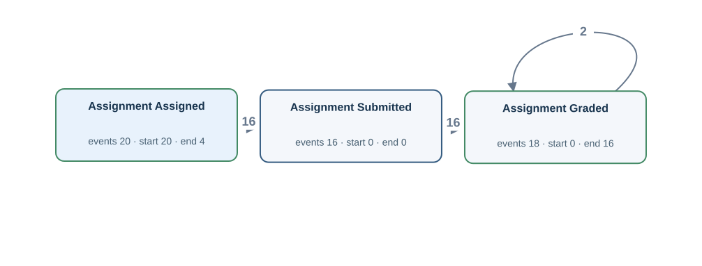</a></td><td width="58%" valign="top">
<a href="../../../datasets/universityflow/private/gold_sql/OU01E.sql">Gold SQL</a> · <a href="../../../datasets/universityflow/private/gold_logs/OU01E.csv">Gold CSV</a> · <a href="../../../datasets/universityflow/input/database.sqlite">Full source database (SQLite)</a>

<code>assignment</code> · 20 matched source rows
<table><tr><th>Column</th><th>Row 1</th><th>Row 2</th><th>Row 3</th></tr><tr><th>assignment_id</th><td>A002</td><td>A003</td><td>A006</td></tr><tr><th>student_id</th><td>S002</td><td>S003</td><td>S006</td></tr><tr><th>assignment_content</th><td>Synthetic assignment content</td><td>Synthetic assignment content</td><td>Synthetic assignment content</td></tr><tr><th>assignment_assigned_at</th><td>2026-02-07T14:00:00Z</td><td>2026-02-08T14:00:00Z</td><td>2026-02-11T14:00:00Z</td></tr><tr><th>assignment_submitted_at</th><td>2026-02-09T14:00:00Z</td><td>2026-02-10T14:00:00Z</td><td>2026-02-13T14:00:00Z</td></tr><tr><th>assignment_grade_finalized_at</th><td><em>NULL</em></td><td>2026-02-14T14:00:00Z</td><td>2026-02-17T14:00:00Z</td></tr><tr><th>assignment_revision_requested_at</th><td>2026-02-11T15:00:00Z</td><td><em>NULL</em></td><td><em>NULL</em></td></tr><tr><th>assignment_resubmitted_at</th><td>2026-02-12T14:00:00Z</td><td><em>NULL</em></td><td><em>NULL</em></td></tr></table>
<strong>Gold output for the same source rows</strong>
<ul><li>Row 1 → Assignment Assigned · event LC:assignment:A002:1 · case S002 · time from <code>assignment_assigned_at</code></li><li>Row 1 → Assignment Submitted · event LC:assignment:A002:2 · case S002 · time from <code>assignment_submitted_at</code></li><li>Row 2 → Assignment Assigned · event LC:assignment:A003:1 · case S003 · time from <code>assignment_assigned_at</code></li><li>Row 2 → Assignment Submitted · event LC:assignment:A003:2 · case S003 · time from <code>assignment_submitted_at</code></li><li>Row 3 → Assignment Assigned · event LC:assignment:A006:1 · case S006 · time from <code>assignment_assigned_at</code></li><li>Row 3 → Assignment Submitted · event LC:assignment:A006:2 · case S006 · time from <code>assignment_submitted_at</code></li></ul>

<code>assignment_grading</code> · 18 matched source rows
<table><tr><th>Column</th><th>Row 1</th><th>Row 2</th><th>Row 3</th></tr><tr><th>assignment_id</th><td>A002</td><td>A003</td><td>A006</td></tr><tr><th>instructor_id</th><td>I03</td><td>I01</td><td>I01</td></tr><tr><th>grading_time</th><td>2026-02-11T14:00:00Z</td><td>2026-02-12T14:00:00Z</td><td>2026-02-15T14:00:00Z</td></tr><tr><th>score</th><td>70</td><td>70</td><td>70</td></tr><tr><th>evaluation</th><td>Initial feedback</td><td>Initial feedback</td><td>Initial feedback</td></tr><tr><th>grading_kind</th><td>ORIGINAL</td><td>ORIGINAL</td><td>ORIGINAL</td></tr><tr><th>reassessment_event_id</th><td><em>NULL</em></td><td><em>NULL</em></td><td><em>NULL</em></td></tr></table>
<strong>Gold output for the same source rows</strong>
<ul><li>Row 1 → Assignment Graded · event GRADE:A002:I03:2026-02-11T14:00:00Z · case S002 · time from <code>grading_time</code></li><li>Row 2 → Assignment Graded · event GRADE:A003:I01:2026-02-12T14:00:00Z · case S003 · time from <code>grading_time</code></li><li>Row 3 → Assignment Graded · event GRADE:A006:I01:2026-02-15T14:00:00Z · case S006 · time from <code>grading_time</code></li></ul>
</td></tr></table>

## OU01EP — Q2

For each student, build a timeline of coursework being set for the student, the student handing in coursework, an instructor assessing the assignment.

Events: **54** · Cases with events: **20** · Activities: **3** · Edges: **3** · Source tables: **2** · SQL tables: **9**

<table><tr><td width="42%" valign="top"></td><td width="58%" valign="top">
<a href="../../../datasets/universityflow/private/gold_sql/OU01EP.sql">Gold SQL</a> · <a href="../../../datasets/universityflow/private/gold_logs/OU01EP.csv">Gold CSV</a> · <a href="../../../datasets/universityflow/input/database.sqlite">Full source database (SQLite)</a>

<code>assignment</code> · 20 matched source rows
<table><tr><th>Column</th><th>Row 1</th><th>Row 2</th><th>Row 3</th></tr><tr><th>assignment_id</th><td>A002</td><td>A003</td><td>A006</td></tr><tr><th>student_id</th><td>S002</td><td>S003</td><td>S006</td></tr><tr><th>assignment_content</th><td>Synthetic assignment content</td><td>Synthetic assignment content</td><td>Synthetic assignment content</td></tr><tr><th>assignment_assigned_at</th><td>2026-02-07T14:00:00Z</td><td>2026-02-08T14:00:00Z</td><td>2026-02-11T14:00:00Z</td></tr><tr><th>assignment_submitted_at</th><td>2026-02-09T14:00:00Z</td><td>2026-02-10T14:00:00Z</td><td>2026-02-13T14:00:00Z</td></tr><tr><th>assignment_grade_finalized_at</th><td><em>NULL</em></td><td>2026-02-14T14:00:00Z</td><td>2026-02-17T14:00:00Z</td></tr><tr><th>assignment_revision_requested_at</th><td>2026-02-11T15:00:00Z</td><td><em>NULL</em></td><td><em>NULL</em></td></tr><tr><th>assignment_resubmitted_at</th><td>2026-02-12T14:00:00Z</td><td><em>NULL</em></td><td><em>NULL</em></td></tr></table>
<strong>Gold output for the same source rows</strong>
<ul><li>Row 1 → Assignment Assigned · event LC:assignment:A002:1 · case S002 · time from <code>assignment_assigned_at</code></li><li>Row 1 → Assignment Submitted · event LC:assignment:A002:2 · case S002 · time from <code>assignment_submitted_at</code></li><li>Row 2 → Assignment Assigned · event LC:assignment:A003:1 · case S003 · time from <code>assignment_assigned_at</code></li><li>Row 2 → Assignment Submitted · event LC:assignment:A003:2 · case S003 · time from <code>assignment_submitted_at</code></li><li>Row 3 → Assignment Assigned · event LC:assignment:A006:1 · case S006 · time from <code>assignment_assigned_at</code></li><li>Row 3 → Assignment Submitted · event LC:assignment:A006:2 · case S006 · time from <code>assignment_submitted_at</code></li></ul>

<code>assignment_grading</code> · 18 matched source rows
<table><tr><th>Column</th><th>Row 1</th><th>Row 2</th><th>Row 3</th></tr><tr><th>assignment_id</th><td>A002</td><td>A003</td><td>A006</td></tr><tr><th>instructor_id</th><td>I03</td><td>I01</td><td>I01</td></tr><tr><th>grading_time</th><td>2026-02-11T14:00:00Z</td><td>2026-02-12T14:00:00Z</td><td>2026-02-15T14:00:00Z</td></tr><tr><th>score</th><td>70</td><td>70</td><td>70</td></tr><tr><th>evaluation</th><td>Initial feedback</td><td>Initial feedback</td><td>Initial feedback</td></tr><tr><th>grading_kind</th><td>ORIGINAL</td><td>ORIGINAL</td><td>ORIGINAL</td></tr><tr><th>reassessment_event_id</th><td><em>NULL</em></td><td><em>NULL</em></td><td><em>NULL</em></td></tr></table>
<strong>Gold output for the same source rows</strong>
<ul><li>Row 1 → Assignment Graded · event GRADE:A002:I03:2026-02-11T14:00:00Z · case S002 · time from <code>grading_time</code></li><li>Row 2 → Assignment Graded · event GRADE:A003:I01:2026-02-12T14:00:00Z · case S003 · time from <code>grading_time</code></li><li>Row 3 → Assignment Graded · event GRADE:A006:I01:2026-02-15T14:00:00Z · case S006 · time from <code>grading_time</code></li></ul>
</td></tr></table>

## OU02P — Q4

Show the complete recorded history associated with each course.

Events: **298** · Cases with events: **6** · Activities: **10** · Edges: **24** · Source tables: **2** · SQL tables: **9**

<table><tr><td width="42%" valign="top"></td><td width="58%" valign="top">
<a href="../../../datasets/universityflow/private/gold_sql/OU02P.sql">Gold SQL</a> · <a href="../../../datasets/universityflow/private/gold_logs/OU02P.csv">Gold CSV</a> · <a href="../../../datasets/universityflow/input/database.sqlite">Full source database (SQLite)</a>

<code>course</code> · 6 matched source rows
<table><tr><th>Column</th><th>Row 1</th><th>Row 2</th><th>Row 3</th></tr><tr><th>course_id</th><td>C01</td><td>C02</td><td>C03</td></tr><tr><th>course_name</th><td>Database Systems</td><td>Statistics</td><td>Operations Research</td></tr><tr><th>credits</th><td>3</td><td>3</td><td>3</td></tr><tr><th>instructor</th><td>Instructor 1</td><td>Instructor 2</td><td>Instructor 3</td></tr><tr><th>class_time</th><td>Monday 09:00</td><td>Monday 09:00</td><td>Monday 09:00</td></tr><tr><th>class_location</th><td>Room 001</td><td>Room 002</td><td>Room 003</td></tr><tr><th>course_offering_proposed_at</th><td>2026-02-04T11:00:00Z</td><td>2026-02-05T12:00:00Z</td><td>2026-02-24T13:00:00Z</td></tr><tr><th>course_offering_approved_at</th><td>2026-02-05T11:00:00Z</td><td>2026-02-06T12:00:00Z</td><td>2026-02-25T13:00:00Z</td></tr><tr><th>course_offering_published_at</th><td>2026-02-06T11:00:00Z</td><td>2026-02-07T12:00:00Z</td><td>2026-02-26T13:00:00Z</td></tr><tr><th>course_offering_closed_at</th><td><em>NULL</em></td><td>2026-04-07T12:00:00Z</td><td>2026-04-07T13:00:00Z</td></tr></table>
<strong>Gold output for the same source rows</strong>
<ul><li>Row 1 → Course Offering Proposed · event LC:course:C01:1 · case C01 · time from <code>course_offering_proposed_at</code></li><li>Row 1 → Course Offering Approved · event LC:course:C01:2 · case C01 · time from <code>course_offering_approved_at</code></li><li>Row 1 → Course Offering Published · event LC:course:C01:3 · case C01 · time from <code>course_offering_published_at</code></li><li>Row 2 → Course Offering Proposed · event LC:course:C02:1 · case C02 · time from <code>course_offering_proposed_at</code></li><li>Row 2 → Course Offering Approved · event LC:course:C02:2 · case C02 · time from <code>course_offering_approved_at</code></li><li>Row 2 → Course Offering Published · event LC:course:C02:3 · case C02 · time from <code>course_offering_published_at</code></li><li>Row 2 → Course Offering Closed · event LC:course:C02:4 · case C02 · time from <code>course_offering_closed_at</code></li><li>Row 3 → Course Offering Proposed · event LC:course:C03:1 · case C03 · time from <code>course_offering_proposed_at</code></li><li>Row 3 → Course Offering Approved · event LC:course:C03:2 · case C03 · time from <code>course_offering_approved_at</code></li><li>Row 3 → Course Offering Published · event LC:course:C03:3 · case C03 · time from <code>course_offering_published_at</code></li><li>Row 3 → Course Offering Closed · event LC:course:C03:4 · case C03 · time from <code>course_offering_closed_at</code></li></ul>

<code>registration</code> · 47 matched source rows
<table><tr><th>Column</th><th>Row 1</th><th>Row 2</th><th>Row 3</th></tr><tr><th>student_id</th><td>S002</td><td>S007</td><td>S011</td></tr><tr><th>course_id</th><td>C01</td><td>C01</td><td>C01</td></tr><tr><th>registration_time</th><td>2026-02-07T11:00:00Z</td><td>2026-02-12T11:00:00Z</td><td>2026-02-16T11:00:00Z</td></tr><tr><th>status</th><td>REGISTERED</td><td>REGISTERED</td><td>REGISTERED</td></tr><tr><th>registration_requested_at</th><td>2026-02-07T07:00:00Z</td><td>2026-02-12T07:00:00Z</td><td>2026-02-16T07:00:00Z</td></tr><tr><th>registration_approved_at</th><td>2026-02-07T09:00:00Z</td><td>2026-02-12T09:00:00Z</td><td>2026-02-16T09:00:00Z</td></tr><tr><th>course_started_at</th><td>2026-02-09T11:00:00Z</td><td>2026-02-14T11:00:00Z</td><td>2026-02-18T11:00:00Z</td></tr><tr><th>course_assessment_completed_at</th><td>2026-02-27T11:00:00Z</td><td>2026-03-04T11:00:00Z</td><td>2026-03-08T11:00:00Z</td></tr><tr><th>course_grade_finalized_at</th><td><em>NULL</em></td><td>2026-03-06T11:00:00Z</td><td>2026-03-10T11:00:00Z</td></tr></table>
<strong>Gold output for the same source rows</strong>
<ul><li>Row 1 → Registration Requested · event LC:registration:S002:C01:1 · case C01 · time from <code>registration_requested_at</code></li><li>Row 1 → Registration Approved · event LC:registration:S002:C01:2 · case C01 · time from <code>registration_approved_at</code></li><li>Row 1 → Course Started · event LC:registration:S002:C01:3 · case C01 · time from <code>course_started_at</code></li><li>Row 1 → Course Assessment Completed · event LC:registration:S002:C01:4 · case C01 · time from <code>course_assessment_completed_at</code></li><li>Row 1 → Course Registered · event REG:S002:C01 · case C01 · time from <code>registration_time</code></li><li>Row 2 → Registration Requested · event LC:registration:S007:C01:1 · case C01 · time from <code>registration_requested_at</code></li><li>Row 2 → Registration Approved · event LC:registration:S007:C01:2 · case C01 · time from <code>registration_approved_at</code></li><li>Row 2 → Course Started · event LC:registration:S007:C01:3 · case C01 · time from <code>course_started_at</code></li><li>Row 2 → Course Assessment Completed · event LC:registration:S007:C01:4 · case C01 · time from <code>course_assessment_completed_at</code></li><li>Row 2 → Course Grade Finalized · event LC:registration:S007:C01:5 · case C01 · time from <code>course_grade_finalized_at</code></li><li>Row 2 → Course Registered · event REG:S007:C01 · case C01 · time from <code>registration_time</code></li><li>Row 3 → Registration Requested · event LC:registration:S011:C01:1 · case C01 · time from <code>registration_requested_at</code></li><li>Row 3 → Registration Approved · event LC:registration:S011:C01:2 · case C01 · time from <code>registration_approved_at</code></li><li>Row 3 → Course Started · event LC:registration:S011:C01:3 · case C01 · time from <code>course_started_at</code></li><li>Row 3 → Course Assessment Completed · event LC:registration:S011:C01:4 · case C01 · time from <code>course_assessment_completed_at</code></li><li>Row 3 → Course Grade Finalized · event LC:registration:S011:C01:5 · case C01 · time from <code>course_grade_finalized_at</code></li><li>Row 3 → Course Registered · event REG:S011:C01 · case C01 · time from <code>registration_time</code></li></ul>
</td></tr></table>

## OU02E — Q1

Extract Registration Requested, Course Registered, Course Grade Finalized events for each course.

Events: **134** · Cases with events: **6** · Activities: **3** · Edges: **5** · Source tables: **1** · SQL tables: **9**

<table><tr><td width="42%" valign="top"><a href="graphs/OU02E.svg">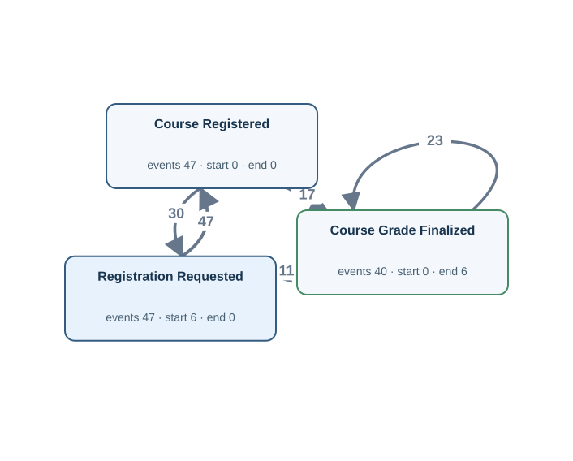</a></td><td width="58%" valign="top">
<a href="../../../datasets/universityflow/private/gold_sql/OU02E.sql">Gold SQL</a> · <a href="../../../datasets/universityflow/private/gold_logs/OU02E.csv">Gold CSV</a> · <a href="../../../datasets/universityflow/input/database.sqlite">Full source database (SQLite)</a>

<code>registration</code> · 47 matched source rows
<table><tr><th>Column</th><th>Row 1</th><th>Row 2</th><th>Row 3</th></tr><tr><th>student_id</th><td>S002</td><td>S007</td><td>S011</td></tr><tr><th>course_id</th><td>C01</td><td>C01</td><td>C01</td></tr><tr><th>registration_time</th><td>2026-02-07T11:00:00Z</td><td>2026-02-12T11:00:00Z</td><td>2026-02-16T11:00:00Z</td></tr><tr><th>status</th><td>REGISTERED</td><td>REGISTERED</td><td>REGISTERED</td></tr><tr><th>registration_requested_at</th><td>2026-02-07T07:00:00Z</td><td>2026-02-12T07:00:00Z</td><td>2026-02-16T07:00:00Z</td></tr><tr><th>registration_approved_at</th><td>2026-02-07T09:00:00Z</td><td>2026-02-12T09:00:00Z</td><td>2026-02-16T09:00:00Z</td></tr><tr><th>course_started_at</th><td>2026-02-09T11:00:00Z</td><td>2026-02-14T11:00:00Z</td><td>2026-02-18T11:00:00Z</td></tr><tr><th>course_assessment_completed_at</th><td>2026-02-27T11:00:00Z</td><td>2026-03-04T11:00:00Z</td><td>2026-03-08T11:00:00Z</td></tr><tr><th>course_grade_finalized_at</th><td><em>NULL</em></td><td>2026-03-06T11:00:00Z</td><td>2026-03-10T11:00:00Z</td></tr></table>
<strong>Gold output for the same source rows</strong>
<ul><li>Row 1 → Registration Requested · event LC:registration:S002:C01:1 · case C01 · time from <code>registration_requested_at</code></li><li>Row 1 → Course Registered · event REG:S002:C01 · case C01 · time from <code>registration_time</code></li><li>Row 2 → Registration Requested · event LC:registration:S007:C01:1 · case C01 · time from <code>registration_requested_at</code></li><li>Row 2 → Course Grade Finalized · event LC:registration:S007:C01:5 · case C01 · time from <code>course_grade_finalized_at</code></li><li>Row 2 → Course Registered · event REG:S007:C01 · case C01 · time from <code>registration_time</code></li><li>Row 3 → Registration Requested · event LC:registration:S011:C01:1 · case C01 · time from <code>registration_requested_at</code></li><li>Row 3 → Course Grade Finalized · event LC:registration:S011:C01:5 · case C01 · time from <code>course_grade_finalized_at</code></li><li>Row 3 → Course Registered · event REG:S011:C01 · case C01 · time from <code>registration_time</code></li></ul>

FK-linked case and join evidence
<ul><li><code>registration</code> → <code>course</code> · course_id → course_id · course_id = C01</li></ul>
</td></tr></table>

## OU02EP — Q2

For each course, build a timeline of the student requesting a place on a course, a successful course sign-up, the course mark being made final.

Events: **134** · Cases with events: **6** · Activities: **3** · Edges: **5** · Source tables: **1** · SQL tables: **9**

<table><tr><td width="42%" valign="top"></td><td width="58%" valign="top">
<a href="../../../datasets/universityflow/private/gold_sql/OU02EP.sql">Gold SQL</a> · <a href="../../../datasets/universityflow/private/gold_logs/OU02EP.csv">Gold CSV</a> · <a href="../../../datasets/universityflow/input/database.sqlite">Full source database (SQLite)</a>

<code>registration</code> · 47 matched source rows
<table><tr><th>Column</th><th>Row 1</th><th>Row 2</th><th>Row 3</th></tr><tr><th>student_id</th><td>S002</td><td>S007</td><td>S011</td></tr><tr><th>course_id</th><td>C01</td><td>C01</td><td>C01</td></tr><tr><th>registration_time</th><td>2026-02-07T11:00:00Z</td><td>2026-02-12T11:00:00Z</td><td>2026-02-16T11:00:00Z</td></tr><tr><th>status</th><td>REGISTERED</td><td>REGISTERED</td><td>REGISTERED</td></tr><tr><th>registration_requested_at</th><td>2026-02-07T07:00:00Z</td><td>2026-02-12T07:00:00Z</td><td>2026-02-16T07:00:00Z</td></tr><tr><th>registration_approved_at</th><td>2026-02-07T09:00:00Z</td><td>2026-02-12T09:00:00Z</td><td>2026-02-16T09:00:00Z</td></tr><tr><th>course_started_at</th><td>2026-02-09T11:00:00Z</td><td>2026-02-14T11:00:00Z</td><td>2026-02-18T11:00:00Z</td></tr><tr><th>course_assessment_completed_at</th><td>2026-02-27T11:00:00Z</td><td>2026-03-04T11:00:00Z</td><td>2026-03-08T11:00:00Z</td></tr><tr><th>course_grade_finalized_at</th><td><em>NULL</em></td><td>2026-03-06T11:00:00Z</td><td>2026-03-10T11:00:00Z</td></tr></table>
<strong>Gold output for the same source rows</strong>
<ul><li>Row 1 → Registration Requested · event LC:registration:S002:C01:1 · case C01 · time from <code>registration_requested_at</code></li><li>Row 1 → Course Registered · event REG:S002:C01 · case C01 · time from <code>registration_time</code></li><li>Row 2 → Registration Requested · event LC:registration:S007:C01:1 · case C01 · time from <code>registration_requested_at</code></li><li>Row 2 → Course Grade Finalized · event LC:registration:S007:C01:5 · case C01 · time from <code>course_grade_finalized_at</code></li><li>Row 2 → Course Registered · event REG:S007:C01 · case C01 · time from <code>registration_time</code></li><li>Row 3 → Registration Requested · event LC:registration:S011:C01:1 · case C01 · time from <code>registration_requested_at</code></li><li>Row 3 → Course Grade Finalized · event LC:registration:S011:C01:5 · case C01 · time from <code>course_grade_finalized_at</code></li><li>Row 3 → Course Registered · event REG:S011:C01 · case C01 · time from <code>registration_time</code></li></ul>

FK-linked case and join evidence
<ul><li><code>registration</code> → <code>course</code> · course_id → course_id · course_id = C01</li></ul>
</td></tr></table>

## OU03P — Q4

Show the complete recorded history associated with each student-course registration.

Events: **275** · Cases with events: **47** · Activities: **6** · Edges: **5** · Source tables: **1** · SQL tables: **9**

<table><tr><td width="42%" valign="top"></td><td width="58%" valign="top">
<a href="../../../datasets/universityflow/private/gold_sql/OU03P.sql">Gold SQL</a> · <a href="../../../datasets/universityflow/private/gold_logs/OU03P.csv">Gold CSV</a> · <a href="../../../datasets/universityflow/input/database.sqlite">Full source database (SQLite)</a>

<code>registration</code> · 47 matched source rows
<table><tr><th>Column</th><th>Row 1</th><th>Row 2</th><th>Row 3</th></tr><tr><th>student_id</th><td>S002</td><td>S002</td><td>S003</td></tr><tr><th>course_id</th><td>C01</td><td>C06</td><td>C02</td></tr><tr><th>registration_time</th><td>2026-02-07T11:00:00Z</td><td>2026-02-07T16:00:00Z</td><td>2026-02-08T12:00:00Z</td></tr><tr><th>status</th><td>REGISTERED</td><td>REGISTERED</td><td>REGISTERED</td></tr><tr><th>registration_requested_at</th><td>2026-02-07T07:00:00Z</td><td>2026-02-07T12:00:00Z</td><td>2026-02-08T08:00:00Z</td></tr><tr><th>registration_approved_at</th><td>2026-02-07T09:00:00Z</td><td>2026-02-07T14:00:00Z</td><td>2026-02-08T10:00:00Z</td></tr><tr><th>course_started_at</th><td>2026-02-09T11:00:00Z</td><td>2026-02-09T16:00:00Z</td><td>2026-02-10T12:00:00Z</td></tr><tr><th>course_assessment_completed_at</th><td>2026-02-27T11:00:00Z</td><td>2026-02-27T16:00:00Z</td><td>2026-02-28T12:00:00Z</td></tr><tr><th>course_grade_finalized_at</th><td><em>NULL</em></td><td>2026-03-01T16:00:00Z</td><td>2026-03-02T12:00:00Z</td></tr></table>
<strong>Gold output for the same source rows</strong>
<ul><li>Row 1 → Registration Requested · event LC:registration:S002:C01:1 · case S002:C01 · time from <code>registration_requested_at</code></li><li>Row 1 → Registration Approved · event LC:registration:S002:C01:2 · case S002:C01 · time from <code>registration_approved_at</code></li><li>Row 1 → Course Started · event LC:registration:S002:C01:3 · case S002:C01 · time from <code>course_started_at</code></li><li>Row 1 → Course Assessment Completed · event LC:registration:S002:C01:4 · case S002:C01 · time from <code>course_assessment_completed_at</code></li><li>Row 1 → Course Registered · event REG:S002:C01 · case S002:C01 · time from <code>registration_time</code></li><li>Row 2 → Registration Requested · event LC:registration:S002:C06:1 · case S002:C06 · time from <code>registration_requested_at</code></li><li>Row 2 → Registration Approved · event LC:registration:S002:C06:2 · case S002:C06 · time from <code>registration_approved_at</code></li><li>Row 2 → Course Started · event LC:registration:S002:C06:3 · case S002:C06 · time from <code>course_started_at</code></li><li>Row 2 → Course Assessment Completed · event LC:registration:S002:C06:4 · case S002:C06 · time from <code>course_assessment_completed_at</code></li><li>Row 2 → Course Grade Finalized · event LC:registration:S002:C06:5 · case S002:C06 · time from <code>course_grade_finalized_at</code></li><li>Row 2 → Course Registered · event REG:S002:C06 · case S002:C06 · time from <code>registration_time</code></li><li>Row 3 → Registration Requested · event LC:registration:S003:C02:1 · case S003:C02 · time from <code>registration_requested_at</code></li><li>Row 3 → Registration Approved · event LC:registration:S003:C02:2 · case S003:C02 · time from <code>registration_approved_at</code></li><li>Row 3 → Course Started · event LC:registration:S003:C02:3 · case S003:C02 · time from <code>course_started_at</code></li><li>Row 3 → Course Assessment Completed · event LC:registration:S003:C02:4 · case S003:C02 · time from <code>course_assessment_completed_at</code></li><li>Row 3 → Course Grade Finalized · event LC:registration:S003:C02:5 · case S003:C02 · time from <code>course_grade_finalized_at</code></li><li>Row 3 → Course Registered · event REG:S003:C02 · case S003:C02 · time from <code>registration_time</code></li></ul>

FK-linked case and join evidence
<ul><li><code>registration</code> → <code>course</code> · course_id → course_id · course_id = C01</li></ul>
</td></tr></table>

## OU03E — Q1

Extract Registration Requested, Course Registered, Course Grade Finalized events for each student-course registration.

Events: **134** · Cases with events: **47** · Activities: **3** · Edges: **2** · Source tables: **1** · SQL tables: **9**

<table><tr><td width="42%" valign="top"><a href="graphs/OU03E.svg">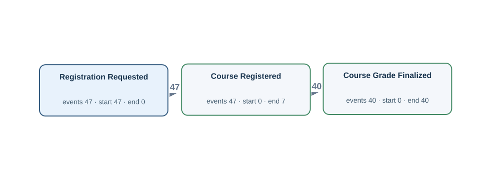</a></td><td width="58%" valign="top">
<a href="../../../datasets/universityflow/private/gold_sql/OU03E.sql">Gold SQL</a> · <a href="../../../datasets/universityflow/private/gold_logs/OU03E.csv">Gold CSV</a> · <a href="../../../datasets/universityflow/input/database.sqlite">Full source database (SQLite)</a>

<code>registration</code> · 47 matched source rows
<table><tr><th>Column</th><th>Row 1</th><th>Row 2</th><th>Row 3</th></tr><tr><th>student_id</th><td>S002</td><td>S002</td><td>S003</td></tr><tr><th>course_id</th><td>C01</td><td>C06</td><td>C02</td></tr><tr><th>registration_time</th><td>2026-02-07T11:00:00Z</td><td>2026-02-07T16:00:00Z</td><td>2026-02-08T12:00:00Z</td></tr><tr><th>status</th><td>REGISTERED</td><td>REGISTERED</td><td>REGISTERED</td></tr><tr><th>registration_requested_at</th><td>2026-02-07T07:00:00Z</td><td>2026-02-07T12:00:00Z</td><td>2026-02-08T08:00:00Z</td></tr><tr><th>registration_approved_at</th><td>2026-02-07T09:00:00Z</td><td>2026-02-07T14:00:00Z</td><td>2026-02-08T10:00:00Z</td></tr><tr><th>course_started_at</th><td>2026-02-09T11:00:00Z</td><td>2026-02-09T16:00:00Z</td><td>2026-02-10T12:00:00Z</td></tr><tr><th>course_assessment_completed_at</th><td>2026-02-27T11:00:00Z</td><td>2026-02-27T16:00:00Z</td><td>2026-02-28T12:00:00Z</td></tr><tr><th>course_grade_finalized_at</th><td><em>NULL</em></td><td>2026-03-01T16:00:00Z</td><td>2026-03-02T12:00:00Z</td></tr></table>
<strong>Gold output for the same source rows</strong>
<ul><li>Row 1 → Registration Requested · event LC:registration:S002:C01:1 · case S002:C01 · time from <code>registration_requested_at</code></li><li>Row 1 → Course Registered · event REG:S002:C01 · case S002:C01 · time from <code>registration_time</code></li><li>Row 2 → Registration Requested · event LC:registration:S002:C06:1 · case S002:C06 · time from <code>registration_requested_at</code></li><li>Row 2 → Course Grade Finalized · event LC:registration:S002:C06:5 · case S002:C06 · time from <code>course_grade_finalized_at</code></li><li>Row 2 → Course Registered · event REG:S002:C06 · case S002:C06 · time from <code>registration_time</code></li><li>Row 3 → Registration Requested · event LC:registration:S003:C02:1 · case S003:C02 · time from <code>registration_requested_at</code></li><li>Row 3 → Course Grade Finalized · event LC:registration:S003:C02:5 · case S003:C02 · time from <code>course_grade_finalized_at</code></li><li>Row 3 → Course Registered · event REG:S003:C02 · case S003:C02 · time from <code>registration_time</code></li></ul>

FK-linked case and join evidence
<ul><li><code>registration</code> → <code>course</code> · course_id → course_id · course_id = C01</li></ul>
</td></tr></table>

## OU03EP — Q2

For each student-course registration, build a timeline of the student requesting a place on a course, a successful course sign-up, the course mark being made final.

Events: **134** · Cases with events: **47** · Activities: **3** · Edges: **2** · Source tables: **1** · SQL tables: **9**

<table><tr><td width="42%" valign="top"></td><td width="58%" valign="top">
<a href="../../../datasets/universityflow/private/gold_sql/OU03EP.sql">Gold SQL</a> · <a href="../../../datasets/universityflow/private/gold_logs/OU03EP.csv">Gold CSV</a> · <a href="../../../datasets/universityflow/input/database.sqlite">Full source database (SQLite)</a>

<code>registration</code> · 47 matched source rows
<table><tr><th>Column</th><th>Row 1</th><th>Row 2</th><th>Row 3</th></tr><tr><th>student_id</th><td>S002</td><td>S002</td><td>S003</td></tr><tr><th>course_id</th><td>C01</td><td>C06</td><td>C02</td></tr><tr><th>registration_time</th><td>2026-02-07T11:00:00Z</td><td>2026-02-07T16:00:00Z</td><td>2026-02-08T12:00:00Z</td></tr><tr><th>status</th><td>REGISTERED</td><td>REGISTERED</td><td>REGISTERED</td></tr><tr><th>registration_requested_at</th><td>2026-02-07T07:00:00Z</td><td>2026-02-07T12:00:00Z</td><td>2026-02-08T08:00:00Z</td></tr><tr><th>registration_approved_at</th><td>2026-02-07T09:00:00Z</td><td>2026-02-07T14:00:00Z</td><td>2026-02-08T10:00:00Z</td></tr><tr><th>course_started_at</th><td>2026-02-09T11:00:00Z</td><td>2026-02-09T16:00:00Z</td><td>2026-02-10T12:00:00Z</td></tr><tr><th>course_assessment_completed_at</th><td>2026-02-27T11:00:00Z</td><td>2026-02-27T16:00:00Z</td><td>2026-02-28T12:00:00Z</td></tr><tr><th>course_grade_finalized_at</th><td><em>NULL</em></td><td>2026-03-01T16:00:00Z</td><td>2026-03-02T12:00:00Z</td></tr></table>
<strong>Gold output for the same source rows</strong>
<ul><li>Row 1 → Registration Requested · event LC:registration:S002:C01:1 · case S002:C01 · time from <code>registration_requested_at</code></li><li>Row 1 → Course Registered · event REG:S002:C01 · case S002:C01 · time from <code>registration_time</code></li><li>Row 2 → Registration Requested · event LC:registration:S002:C06:1 · case S002:C06 · time from <code>registration_requested_at</code></li><li>Row 2 → Course Grade Finalized · event LC:registration:S002:C06:5 · case S002:C06 · time from <code>course_grade_finalized_at</code></li><li>Row 2 → Course Registered · event REG:S002:C06 · case S002:C06 · time from <code>registration_time</code></li><li>Row 3 → Registration Requested · event LC:registration:S003:C02:1 · case S003:C02 · time from <code>registration_requested_at</code></li><li>Row 3 → Course Grade Finalized · event LC:registration:S003:C02:5 · case S003:C02 · time from <code>course_grade_finalized_at</code></li><li>Row 3 → Course Registered · event REG:S003:C02 · case S003:C02 · time from <code>registration_time</code></li></ul>

FK-linked case and join evidence
<ul><li><code>registration</code> → <code>course</code> · course_id → course_id · course_id = C01</li></ul>
</td></tr></table>

## OU04P — Q4

Show the complete recorded history associated with each examination result record.

Events: **194** · Cases with events: **40** · Activities: **5** · Edges: **4** · Source tables: **1** · SQL tables: **9**

<table><tr><td width="42%" valign="top"></td><td width="58%" valign="top">
<a href="../../../datasets/universityflow/private/gold_sql/OU04P.sql">Gold SQL</a> · <a href="../../../datasets/universityflow/private/gold_logs/OU04P.csv">Gold CSV</a> · <a href="../../../datasets/universityflow/input/database.sqlite">Full source database (SQLite)</a>

<code>degree_examination_result</code> · 40 matched source rows
<table><tr><th>Column</th><th>Row 1</th><th>Row 2</th><th>Row 3</th></tr><tr><th>result_id</th><td>E001-1</td><td>E002-1</td><td>E002-2</td></tr><tr><th>student_id</th><td>S001</td><td>S002</td><td>S002</td></tr><tr><th>examination_name</th><td>Registration Eligibility Examination</td><td>Registration Eligibility Examination</td><td>Registration Eligibility Examination</td></tr><tr><th>grade</th><td>33</td><td>32</td><td>88</td></tr><tr><th>examination_date</th><td>2026-02-02T09:00:00Z</td><td>2026-02-03T09:00:00Z</td><td>2026-02-05T09:00:00Z</td></tr><tr><th>examination_scheduled_at</th><td>2026-02-02T07:00:00Z</td><td>2026-02-03T07:00:00Z</td><td>2026-02-05T07:00:00Z</td></tr><tr><th>examination_checked_in_at</th><td>2026-02-02T08:00:00Z</td><td>2026-02-03T08:00:00Z</td><td>2026-02-05T08:00:00Z</td></tr><tr><th>examination_score_published_at</th><td>2026-02-02T11:00:00Z</td><td>2026-02-03T11:00:00Z</td><td>2026-02-05T11:00:00Z</td></tr><tr><th>examination_result_reviewed_at</th><td><em>NULL</em></td><td>2026-02-03T12:00:00Z</td><td>2026-02-05T12:00:00Z</td></tr></table>
<strong>Gold output for the same source rows</strong>
<ul><li>Row 1 → Degree Examination Taken · event EX:E001-1 · case E001-1 · time from <code>examination_date</code></li><li>Row 1 → Examination Scheduled · event LC:degree_examination_result:E001-1:1 · case E001-1 · time from <code>examination_scheduled_at</code></li><li>Row 1 → Examination Checked In · event LC:degree_examination_result:E001-1:2 · case E001-1 · time from <code>examination_checked_in_at</code></li><li>Row 1 → Examination Score Published · event LC:degree_examination_result:E001-1:3 · case E001-1 · time from <code>examination_score_published_at</code></li><li>Row 2 → Degree Examination Taken · event EX:E002-1 · case E002-1 · time from <code>examination_date</code></li><li>Row 2 → Examination Scheduled · event LC:degree_examination_result:E002-1:1 · case E002-1 · time from <code>examination_scheduled_at</code></li><li>Row 2 → Examination Checked In · event LC:degree_examination_result:E002-1:2 · case E002-1 · time from <code>examination_checked_in_at</code></li><li>Row 2 → Examination Score Published · event LC:degree_examination_result:E002-1:3 · case E002-1 · time from <code>examination_score_published_at</code></li><li>Row 2 → Examination Result Reviewed · event LC:degree_examination_result:E002-1:4 · case E002-1 · time from <code>examination_result_reviewed_at</code></li><li>Row 3 → Degree Examination Taken · event EX:E002-2 · case E002-2 · time from <code>examination_date</code></li><li>Row 3 → Examination Scheduled · event LC:degree_examination_result:E002-2:1 · case E002-2 · time from <code>examination_scheduled_at</code></li><li>Row 3 → Examination Checked In · event LC:degree_examination_result:E002-2:2 · case E002-2 · time from <code>examination_checked_in_at</code></li><li>Row 3 → Examination Score Published · event LC:degree_examination_result:E002-2:3 · case E002-2 · time from <code>examination_score_published_at</code></li><li>Row 3 → Examination Result Reviewed · event LC:degree_examination_result:E002-2:4 · case E002-2 · time from <code>examination_result_reviewed_at</code></li></ul>
</td></tr></table>

## OU04E — Q1

Extract Examination Scheduled, Degree Examination Taken, Examination Score Published events for each examination result record.

Events: **120** · Cases with events: **40** · Activities: **3** · Edges: **2** · Source tables: **1** · SQL tables: **9**

<table><tr><td width="42%" valign="top"><a href="graphs/OU04E.svg">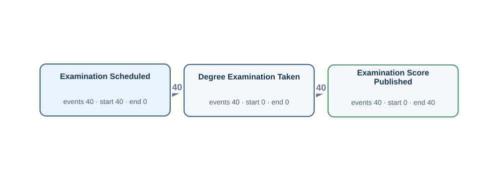</a></td><td width="58%" valign="top">
<a href="../../../datasets/universityflow/private/gold_sql/OU04E.sql">Gold SQL</a> · <a href="../../../datasets/universityflow/private/gold_logs/OU04E.csv">Gold CSV</a> · <a href="../../../datasets/universityflow/input/database.sqlite">Full source database (SQLite)</a>

<code>degree_examination_result</code> · 40 matched source rows
<table><tr><th>Column</th><th>Row 1</th><th>Row 2</th><th>Row 3</th></tr><tr><th>result_id</th><td>E001-1</td><td>E002-1</td><td>E002-2</td></tr><tr><th>student_id</th><td>S001</td><td>S002</td><td>S002</td></tr><tr><th>examination_name</th><td>Registration Eligibility Examination</td><td>Registration Eligibility Examination</td><td>Registration Eligibility Examination</td></tr><tr><th>grade</th><td>33</td><td>32</td><td>88</td></tr><tr><th>examination_date</th><td>2026-02-02T09:00:00Z</td><td>2026-02-03T09:00:00Z</td><td>2026-02-05T09:00:00Z</td></tr><tr><th>examination_scheduled_at</th><td>2026-02-02T07:00:00Z</td><td>2026-02-03T07:00:00Z</td><td>2026-02-05T07:00:00Z</td></tr><tr><th>examination_checked_in_at</th><td>2026-02-02T08:00:00Z</td><td>2026-02-03T08:00:00Z</td><td>2026-02-05T08:00:00Z</td></tr><tr><th>examination_score_published_at</th><td>2026-02-02T11:00:00Z</td><td>2026-02-03T11:00:00Z</td><td>2026-02-05T11:00:00Z</td></tr><tr><th>examination_result_reviewed_at</th><td><em>NULL</em></td><td>2026-02-03T12:00:00Z</td><td>2026-02-05T12:00:00Z</td></tr></table>
<strong>Gold output for the same source rows</strong>
<ul><li>Row 1 → Degree Examination Taken · event EX:E001-1 · case E001-1 · time from <code>examination_date</code></li><li>Row 1 → Examination Scheduled · event LC:degree_examination_result:E001-1:1 · case E001-1 · time from <code>examination_scheduled_at</code></li><li>Row 1 → Examination Score Published · event LC:degree_examination_result:E001-1:3 · case E001-1 · time from <code>examination_score_published_at</code></li><li>Row 2 → Degree Examination Taken · event EX:E002-1 · case E002-1 · time from <code>examination_date</code></li><li>Row 2 → Examination Scheduled · event LC:degree_examination_result:E002-1:1 · case E002-1 · time from <code>examination_scheduled_at</code></li><li>Row 2 → Examination Score Published · event LC:degree_examination_result:E002-1:3 · case E002-1 · time from <code>examination_score_published_at</code></li><li>Row 3 → Degree Examination Taken · event EX:E002-2 · case E002-2 · time from <code>examination_date</code></li><li>Row 3 → Examination Scheduled · event LC:degree_examination_result:E002-2:1 · case E002-2 · time from <code>examination_scheduled_at</code></li><li>Row 3 → Examination Score Published · event LC:degree_examination_result:E002-2:3 · case E002-2 · time from <code>examination_score_published_at</code></li></ul>
</td></tr></table>

## OU04EP — Q2

For each examination result record, build a timeline of an examination sitting being arranged, the student sitting the degree examination, the examination mark being released.

Events: **120** · Cases with events: **40** · Activities: **3** · Edges: **2** · Source tables: **1** · SQL tables: **9**

<table><tr><td width="42%" valign="top"></td><td width="58%" valign="top">
<a href="../../../datasets/universityflow/private/gold_sql/OU04EP.sql">Gold SQL</a> · <a href="../../../datasets/universityflow/private/gold_logs/OU04EP.csv">Gold CSV</a> · <a href="../../../datasets/universityflow/input/database.sqlite">Full source database (SQLite)</a>

<code>degree_examination_result</code> · 40 matched source rows
<table><tr><th>Column</th><th>Row 1</th><th>Row 2</th><th>Row 3</th></tr><tr><th>result_id</th><td>E001-1</td><td>E002-1</td><td>E002-2</td></tr><tr><th>student_id</th><td>S001</td><td>S002</td><td>S002</td></tr><tr><th>examination_name</th><td>Registration Eligibility Examination</td><td>Registration Eligibility Examination</td><td>Registration Eligibility Examination</td></tr><tr><th>grade</th><td>33</td><td>32</td><td>88</td></tr><tr><th>examination_date</th><td>2026-02-02T09:00:00Z</td><td>2026-02-03T09:00:00Z</td><td>2026-02-05T09:00:00Z</td></tr><tr><th>examination_scheduled_at</th><td>2026-02-02T07:00:00Z</td><td>2026-02-03T07:00:00Z</td><td>2026-02-05T07:00:00Z</td></tr><tr><th>examination_checked_in_at</th><td>2026-02-02T08:00:00Z</td><td>2026-02-03T08:00:00Z</td><td>2026-02-05T08:00:00Z</td></tr><tr><th>examination_score_published_at</th><td>2026-02-02T11:00:00Z</td><td>2026-02-03T11:00:00Z</td><td>2026-02-05T11:00:00Z</td></tr><tr><th>examination_result_reviewed_at</th><td><em>NULL</em></td><td>2026-02-03T12:00:00Z</td><td>2026-02-05T12:00:00Z</td></tr></table>
<strong>Gold output for the same source rows</strong>
<ul><li>Row 1 → Degree Examination Taken · event EX:E001-1 · case E001-1 · time from <code>examination_date</code></li><li>Row 1 → Examination Scheduled · event LC:degree_examination_result:E001-1:1 · case E001-1 · time from <code>examination_scheduled_at</code></li><li>Row 1 → Examination Score Published · event LC:degree_examination_result:E001-1:3 · case E001-1 · time from <code>examination_score_published_at</code></li><li>Row 2 → Degree Examination Taken · event EX:E002-1 · case E002-1 · time from <code>examination_date</code></li><li>Row 2 → Examination Scheduled · event LC:degree_examination_result:E002-1:1 · case E002-1 · time from <code>examination_scheduled_at</code></li><li>Row 2 → Examination Score Published · event LC:degree_examination_result:E002-1:3 · case E002-1 · time from <code>examination_score_published_at</code></li><li>Row 3 → Degree Examination Taken · event EX:E002-2 · case E002-2 · time from <code>examination_date</code></li><li>Row 3 → Examination Scheduled · event LC:degree_examination_result:E002-2:1 · case E002-2 · time from <code>examination_scheduled_at</code></li><li>Row 3 → Examination Score Published · event LC:degree_examination_result:E002-2:3 · case E002-2 · time from <code>examination_score_published_at</code></li></ul>
</td></tr></table>

## OU05P — Q4

Show the complete recorded history associated with each simulation module.

Events: **142** · Cases with events: **3** · Activities: **9** · Edges: **10** · Source tables: **2** · SQL tables: **9**

<table><tr><td width="42%" valign="top"></td><td width="58%" valign="top">
<a href="../../../datasets/universityflow/private/gold_sql/OU05P.sql">Gold SQL</a> · <a href="../../../datasets/universityflow/private/gold_logs/OU05P.csv">Gold CSV</a> · <a href="../../../datasets/universityflow/input/database.sqlite">Full source database (SQLite)</a>

<code>simulation_module</code> · 3 matched source rows
<table><tr><th>Column</th><th>Row 1</th><th>Row 2</th><th>Row 3</th></tr><tr><th>module_id</th><td>M01</td><td>M02</td><td>M03</td></tr><tr><th>module_name</th><td>PCM</td><td>DPCM</td><td>Delta Modulation</td></tr><tr><th>module_type</th><td>PCM</td><td>DPCM</td><td>DELTA</td></tr><tr><th>module_description</th><td>Synthetic teaching module</td><td>Synthetic teaching module</td><td>Synthetic teaching module</td></tr><tr><th>module_code</th><td>example_module_1()</td><td>example_module_2()</td><td>example_module_3()</td></tr><tr><th>simulation_module_published_at</th><td>2026-02-11T15:00:00Z</td><td>2026-02-15T15:00:00Z</td><td>2026-02-10T15:00:00Z</td></tr><tr><th>simulation_module_validated_at</th><td>2026-02-12T15:00:00Z</td><td>2026-02-16T15:00:00Z</td><td>2026-02-11T15:00:00Z</td></tr><tr><th>simulation_module_released_at</th><td>2026-02-13T15:00:00Z</td><td>2026-02-17T15:00:00Z</td><td>2026-02-12T15:00:00Z</td></tr><tr><th>simulation_module_retired_at</th><td><em>NULL</em></td><td>2026-04-16T15:00:00Z</td><td>2026-04-20T15:00:00Z</td></tr></table>
<strong>Gold output for the same source rows</strong>
<ul><li>Row 1 → Simulation Module Published · event LC:simulation_module:M01:1 · case M01 · time from <code>simulation_module_published_at</code></li><li>Row 1 → Simulation Module Validated · event LC:simulation_module:M01:2 · case M01 · time from <code>simulation_module_validated_at</code></li><li>Row 1 → Simulation Module Released · event LC:simulation_module:M01:3 · case M01 · time from <code>simulation_module_released_at</code></li><li>Row 2 → Simulation Module Published · event LC:simulation_module:M02:1 · case M02 · time from <code>simulation_module_published_at</code></li><li>Row 2 → Simulation Module Validated · event LC:simulation_module:M02:2 · case M02 · time from <code>simulation_module_validated_at</code></li><li>Row 2 → Simulation Module Released · event LC:simulation_module:M02:3 · case M02 · time from <code>simulation_module_released_at</code></li><li>Row 2 → Simulation Module Retired · event LC:simulation_module:M02:4 · case M02 · time from <code>simulation_module_retired_at</code></li><li>Row 3 → Simulation Module Published · event LC:simulation_module:M03:1 · case M03 · time from <code>simulation_module_published_at</code></li><li>Row 3 → Simulation Module Validated · event LC:simulation_module:M03:2 · case M03 · time from <code>simulation_module_validated_at</code></li><li>Row 3 → Simulation Module Released · event LC:simulation_module:M03:3 · case M03 · time from <code>simulation_module_released_at</code></li><li>Row 3 → Simulation Module Retired · event LC:simulation_module:M03:4 · case M03 · time from <code>simulation_module_retired_at</code></li></ul>

<code>student_simulation_experiment_result</code> · 27 matched source rows
<table><tr><th>Column</th><th>Row 1</th><th>Row 2</th><th>Row 3</th></tr><tr><th>student_id</th><td>S003</td><td>S003</td><td>S006</td></tr><tr><th>module_id</th><td>M01</td><td>M01</td><td>M01</td></tr><tr><th>simulation_date</th><td>2026-02-14T15:00:00Z</td><td>2026-02-15T15:00:00Z</td><td>2026-02-17T15:00:00Z</td></tr><tr><th>simulation_result_data</th><td>Synthetic output 1</td><td>Synthetic output 2</td><td>Synthetic output 1</td></tr><tr><th>result_analysis</th><td>Recorded experiment analysis</td><td>Recorded experiment analysis</td><td>Recorded experiment analysis</td></tr><tr><th>simulation_run_scheduled_at</th><td>2026-02-14T13:00:00Z</td><td>2026-02-15T13:00:00Z</td><td>2026-02-17T13:00:00Z</td></tr><tr><th>simulation_run_started_at</th><td>2026-02-14T14:00:00Z</td><td>2026-02-15T14:00:00Z</td><td>2026-02-17T14:00:00Z</td></tr><tr><th>simulation_output_reviewed_at</th><td>2026-02-14T17:00:00Z</td><td>2026-02-15T17:00:00Z</td><td>2026-02-17T17:00:00Z</td></tr><tr><th>simulation_result_accepted_at</th><td>2026-02-14T18:00:00Z</td><td>2026-02-15T18:00:00Z</td><td>2026-02-17T18:00:00Z</td></tr></table>
<strong>Gold output for the same source rows</strong>
<ul><li>Row 1 → Simulation Run Scheduled · event LC:student_simulation_experiment_result:S003:M01:2026-02-14T15:00:00Z:1 · case M01 · time from <code>simulation_run_scheduled_at</code></li><li>Row 1 → Simulation Run Started · event LC:student_simulation_experiment_result:S003:M01:2026-02-14T15:00:00Z:2 · case M01 · time from <code>simulation_run_started_at</code></li><li>Row 1 → Simulation Output Reviewed · event LC:student_simulation_experiment_result:S003:M01:2026-02-14T15:00:00Z:3 · case M01 · time from <code>simulation_output_reviewed_at</code></li><li>Row 1 → Simulation Result Accepted · event LC:student_simulation_experiment_result:S003:M01:2026-02-14T15:00:00Z:4 · case M01 · time from <code>simulation_result_accepted_at</code></li><li>Row 1 → Simulation Experiment Completed · event SIM:S003:M01:2026-02-14T15:00:00Z · case M01 · time from <code>simulation_date</code></li><li>Row 2 → Simulation Run Scheduled · event LC:student_simulation_experiment_result:S003:M01:2026-02-15T15:00:00Z:1 · case M01 · time from <code>simulation_run_scheduled_at</code></li><li>Row 2 → Simulation Run Started · event LC:student_simulation_experiment_result:S003:M01:2026-02-15T15:00:00Z:2 · case M01 · time from <code>simulation_run_started_at</code></li><li>Row 2 → Simulation Output Reviewed · event LC:student_simulation_experiment_result:S003:M01:2026-02-15T15:00:00Z:3 · case M01 · time from <code>simulation_output_reviewed_at</code></li><li>Row 2 → Simulation Result Accepted · event LC:student_simulation_experiment_result:S003:M01:2026-02-15T15:00:00Z:4 · case M01 · time from <code>simulation_result_accepted_at</code></li><li>Row 2 → Simulation Experiment Completed · event SIM:S003:M01:2026-02-15T15:00:00Z · case M01 · time from <code>simulation_date</code></li><li>Row 3 → Simulation Run Scheduled · event LC:student_simulation_experiment_result:S006:M01:2026-02-17T15:00:00Z:1 · case M01 · time from <code>simulation_run_scheduled_at</code></li><li>Row 3 → Simulation Run Started · event LC:student_simulation_experiment_result:S006:M01:2026-02-17T15:00:00Z:2 · case M01 · time from <code>simulation_run_started_at</code></li><li>Row 3 → Simulation Output Reviewed · event LC:student_simulation_experiment_result:S006:M01:2026-02-17T15:00:00Z:3 · case M01 · time from <code>simulation_output_reviewed_at</code></li><li>Row 3 → Simulation Result Accepted · event LC:student_simulation_experiment_result:S006:M01:2026-02-17T15:00:00Z:4 · case M01 · time from <code>simulation_result_accepted_at</code></li><li>Row 3 → Simulation Experiment Completed · event SIM:S006:M01:2026-02-17T15:00:00Z · case M01 · time from <code>simulation_date</code></li></ul>
</td></tr></table>

## OU05E — Q1

Extract Simulation Run Started, Simulation Experiment Completed, Simulation Result Accepted events for each simulation module.

Events: **77** · Cases with events: **3** · Activities: **3** · Edges: **4** · Source tables: **1** · SQL tables: **9**

<table><tr><td width="42%" valign="top"><a href="graphs/OU05E.svg">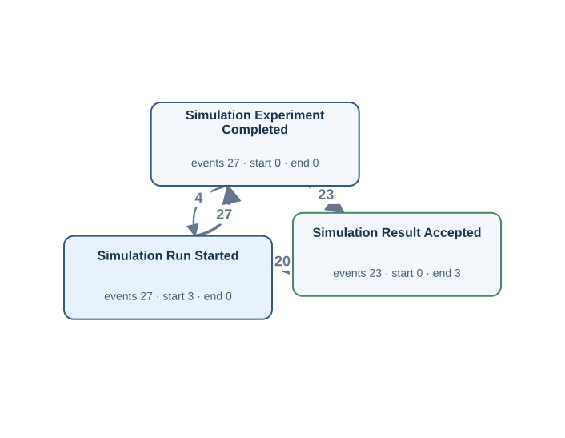</a></td><td width="58%" valign="top">
<a href="../../../datasets/universityflow/private/gold_sql/OU05E.sql">Gold SQL</a> · <a href="../../../datasets/universityflow/private/gold_logs/OU05E.csv">Gold CSV</a> · <a href="../../../datasets/universityflow/input/database.sqlite">Full source database (SQLite)</a>

<code>student_simulation_experiment_result</code> · 27 matched source rows
<table><tr><th>Column</th><th>Row 1</th><th>Row 2</th><th>Row 3</th></tr><tr><th>student_id</th><td>S003</td><td>S003</td><td>S006</td></tr><tr><th>module_id</th><td>M01</td><td>M01</td><td>M01</td></tr><tr><th>simulation_date</th><td>2026-02-14T15:00:00Z</td><td>2026-02-15T15:00:00Z</td><td>2026-02-17T15:00:00Z</td></tr><tr><th>simulation_result_data</th><td>Synthetic output 1</td><td>Synthetic output 2</td><td>Synthetic output 1</td></tr><tr><th>result_analysis</th><td>Recorded experiment analysis</td><td>Recorded experiment analysis</td><td>Recorded experiment analysis</td></tr><tr><th>simulation_run_scheduled_at</th><td>2026-02-14T13:00:00Z</td><td>2026-02-15T13:00:00Z</td><td>2026-02-17T13:00:00Z</td></tr><tr><th>simulation_run_started_at</th><td>2026-02-14T14:00:00Z</td><td>2026-02-15T14:00:00Z</td><td>2026-02-17T14:00:00Z</td></tr><tr><th>simulation_output_reviewed_at</th><td>2026-02-14T17:00:00Z</td><td>2026-02-15T17:00:00Z</td><td>2026-02-17T17:00:00Z</td></tr><tr><th>simulation_result_accepted_at</th><td>2026-02-14T18:00:00Z</td><td>2026-02-15T18:00:00Z</td><td>2026-02-17T18:00:00Z</td></tr></table>
<strong>Gold output for the same source rows</strong>
<ul><li>Row 1 → Simulation Run Started · event LC:student_simulation_experiment_result:S003:M01:2026-02-14T15:00:00Z:2 · case M01 · time from <code>simulation_run_started_at</code></li><li>Row 1 → Simulation Result Accepted · event LC:student_simulation_experiment_result:S003:M01:2026-02-14T15:00:00Z:4 · case M01 · time from <code>simulation_result_accepted_at</code></li><li>Row 1 → Simulation Experiment Completed · event SIM:S003:M01:2026-02-14T15:00:00Z · case M01 · time from <code>simulation_date</code></li><li>Row 2 → Simulation Run Started · event LC:student_simulation_experiment_result:S003:M01:2026-02-15T15:00:00Z:2 · case M01 · time from <code>simulation_run_started_at</code></li><li>Row 2 → Simulation Result Accepted · event LC:student_simulation_experiment_result:S003:M01:2026-02-15T15:00:00Z:4 · case M01 · time from <code>simulation_result_accepted_at</code></li><li>Row 2 → Simulation Experiment Completed · event SIM:S003:M01:2026-02-15T15:00:00Z · case M01 · time from <code>simulation_date</code></li><li>Row 3 → Simulation Run Started · event LC:student_simulation_experiment_result:S006:M01:2026-02-17T15:00:00Z:2 · case M01 · time from <code>simulation_run_started_at</code></li><li>Row 3 → Simulation Result Accepted · event LC:student_simulation_experiment_result:S006:M01:2026-02-17T15:00:00Z:4 · case M01 · time from <code>simulation_result_accepted_at</code></li><li>Row 3 → Simulation Experiment Completed · event SIM:S006:M01:2026-02-17T15:00:00Z · case M01 · time from <code>simulation_date</code></li></ul>

FK-linked case and join evidence
<ul><li><code>student_simulation_experiment_result</code> → <code>simulation_module</code> · module_id → module_id · module_id = M01</li></ul>
</td></tr></table>

## OU05EP — Q2

For each simulation module, build a timeline of a simulation run beginning, a simulation run finishing, the simulation results receiving approval.

Events: **77** · Cases with events: **3** · Activities: **3** · Edges: **4** · Source tables: **1** · SQL tables: **9**

<table><tr><td width="42%" valign="top"></td><td width="58%" valign="top">
<a href="../../../datasets/universityflow/private/gold_sql/OU05EP.sql">Gold SQL</a> · <a href="../../../datasets/universityflow/private/gold_logs/OU05EP.csv">Gold CSV</a> · <a href="../../../datasets/universityflow/input/database.sqlite">Full source database (SQLite)</a>

<code>student_simulation_experiment_result</code> · 27 matched source rows
<table><tr><th>Column</th><th>Row 1</th><th>Row 2</th><th>Row 3</th></tr><tr><th>student_id</th><td>S003</td><td>S003</td><td>S006</td></tr><tr><th>module_id</th><td>M01</td><td>M01</td><td>M01</td></tr><tr><th>simulation_date</th><td>2026-02-14T15:00:00Z</td><td>2026-02-15T15:00:00Z</td><td>2026-02-17T15:00:00Z</td></tr><tr><th>simulation_result_data</th><td>Synthetic output 1</td><td>Synthetic output 2</td><td>Synthetic output 1</td></tr><tr><th>result_analysis</th><td>Recorded experiment analysis</td><td>Recorded experiment analysis</td><td>Recorded experiment analysis</td></tr><tr><th>simulation_run_scheduled_at</th><td>2026-02-14T13:00:00Z</td><td>2026-02-15T13:00:00Z</td><td>2026-02-17T13:00:00Z</td></tr><tr><th>simulation_run_started_at</th><td>2026-02-14T14:00:00Z</td><td>2026-02-15T14:00:00Z</td><td>2026-02-17T14:00:00Z</td></tr><tr><th>simulation_output_reviewed_at</th><td>2026-02-14T17:00:00Z</td><td>2026-02-15T17:00:00Z</td><td>2026-02-17T17:00:00Z</td></tr><tr><th>simulation_result_accepted_at</th><td>2026-02-14T18:00:00Z</td><td>2026-02-15T18:00:00Z</td><td>2026-02-17T18:00:00Z</td></tr></table>
<strong>Gold output for the same source rows</strong>
<ul><li>Row 1 → Simulation Run Started · event LC:student_simulation_experiment_result:S003:M01:2026-02-14T15:00:00Z:2 · case M01 · time from <code>simulation_run_started_at</code></li><li>Row 1 → Simulation Result Accepted · event LC:student_simulation_experiment_result:S003:M01:2026-02-14T15:00:00Z:4 · case M01 · time from <code>simulation_result_accepted_at</code></li><li>Row 1 → Simulation Experiment Completed · event SIM:S003:M01:2026-02-14T15:00:00Z · case M01 · time from <code>simulation_date</code></li><li>Row 2 → Simulation Run Started · event LC:student_simulation_experiment_result:S003:M01:2026-02-15T15:00:00Z:2 · case M01 · time from <code>simulation_run_started_at</code></li><li>Row 2 → Simulation Result Accepted · event LC:student_simulation_experiment_result:S003:M01:2026-02-15T15:00:00Z:4 · case M01 · time from <code>simulation_result_accepted_at</code></li><li>Row 2 → Simulation Experiment Completed · event SIM:S003:M01:2026-02-15T15:00:00Z · case M01 · time from <code>simulation_date</code></li><li>Row 3 → Simulation Run Started · event LC:student_simulation_experiment_result:S006:M01:2026-02-17T15:00:00Z:2 · case M01 · time from <code>simulation_run_started_at</code></li><li>Row 3 → Simulation Result Accepted · event LC:student_simulation_experiment_result:S006:M01:2026-02-17T15:00:00Z:4 · case M01 · time from <code>simulation_result_accepted_at</code></li><li>Row 3 → Simulation Experiment Completed · event SIM:S006:M01:2026-02-17T15:00:00Z · case M01 · time from <code>simulation_date</code></li></ul>

FK-linked case and join evidence
<ul><li><code>student_simulation_experiment_result</code> → <code>simulation_module</code> · module_id → module_id · module_id = M01</li></ul>
</td></tr></table>

## OU06P — Q4

Show the complete recorded history associated with each thesis.

Events: **73** · Cases with events: **16** · Activities: **6** · Edges: **6** · Source tables: **1** · SQL tables: **9**

<table><tr><td width="42%" valign="top"></td><td width="58%" valign="top">
<a href="../../../datasets/universityflow/private/gold_sql/OU06P.sql">Gold SQL</a> · <a href="../../../datasets/universityflow/private/gold_logs/OU06P.csv">Gold CSV</a> · <a href="../../../datasets/universityflow/input/database.sqlite">Full source database (SQLite)</a>

<code>thesis</code> · 16 matched source rows
<table><tr><th>Column</th><th>Row 1</th><th>Row 2</th><th>Row 3</th></tr><tr><th>thesis_id</th><td>TH002</td><td>TH003</td><td>TH006</td></tr><tr><th>student_id</th><td>S002</td><td>S003</td><td>S006</td></tr><tr><th>thesis_title</th><td>Course Design Thesis</td><td>Course Design Thesis</td><td>Course Design Thesis</td></tr><tr><th>thesis_content</th><td>Synthetic thesis content</td><td>Synthetic thesis content</td><td>Synthetic thesis content</td></tr><tr><th>submission_date</th><td>2026-02-23T16:00:00Z</td><td>2026-02-24T16:00:00Z</td><td>2026-02-27T16:00:00Z</td></tr><tr><th>thesis_draft_registered_at</th><td>2026-02-19T16:00:00Z</td><td>2026-02-20T16:00:00Z</td><td>2026-02-23T16:00:00Z</td></tr><tr><th>thesis_review_started_at</th><td>2026-02-24T16:00:00Z</td><td>2026-02-25T16:00:00Z</td><td>2026-02-28T16:00:00Z</td></tr><tr><th>thesis_accepted_at</th><td><em>NULL</em></td><td>2026-02-28T16:00:00Z</td><td>2026-03-03T16:00:00Z</td></tr><tr><th>thesis_revision_requested_at</th><td>2026-02-25T16:00:00Z</td><td><em>NULL</em></td><td><em>NULL</em></td></tr><tr><th>thesis_resubmitted_at</th><td>2026-02-26T16:00:00Z</td><td><em>NULL</em></td><td><em>NULL</em></td></tr></table>
<strong>Gold output for the same source rows</strong>
<ul><li>Row 1 → Thesis Draft Registered · event LC:thesis:TH002:1 · case TH002 · time from <code>thesis_draft_registered_at</code></li><li>Row 1 → Thesis Review Started · event LC:thesis:TH002:2 · case TH002 · time from <code>thesis_review_started_at</code></li><li>Row 1 → Thesis Revision Requested · event LC:thesis:TH002:3 · case TH002 · time from <code>thesis_revision_requested_at</code></li><li>Row 1 → Thesis Resubmitted · event LC:thesis:TH002:4 · case TH002 · time from <code>thesis_resubmitted_at</code></li><li>Row 1 → Thesis Submitted · event THESIS:TH002 · case TH002 · time from <code>submission_date</code></li><li>Row 2 → Thesis Draft Registered · event LC:thesis:TH003:1 · case TH003 · time from <code>thesis_draft_registered_at</code></li><li>Row 2 → Thesis Review Started · event LC:thesis:TH003:2 · case TH003 · time from <code>thesis_review_started_at</code></li><li>Row 2 → Thesis Accepted · event LC:thesis:TH003:3 · case TH003 · time from <code>thesis_accepted_at</code></li><li>Row 2 → Thesis Submitted · event THESIS:TH003 · case TH003 · time from <code>submission_date</code></li><li>Row 3 → Thesis Draft Registered · event LC:thesis:TH006:1 · case TH006 · time from <code>thesis_draft_registered_at</code></li><li>Row 3 → Thesis Review Started · event LC:thesis:TH006:2 · case TH006 · time from <code>thesis_review_started_at</code></li><li>Row 3 → Thesis Accepted · event LC:thesis:TH006:3 · case TH006 · time from <code>thesis_accepted_at</code></li><li>Row 3 → Thesis Submitted · event THESIS:TH006 · case TH006 · time from <code>submission_date</code></li></ul>
</td></tr></table>

## OU06E — Q1

Extract Thesis Submitted, Thesis Review Started, Thesis Accepted events for each thesis.

Events: **45** · Cases with events: **16** · Activities: **3** · Edges: **2** · Source tables: **1** · SQL tables: **9**

<table><tr><td width="42%" valign="top"><a href="graphs/OU06E.svg">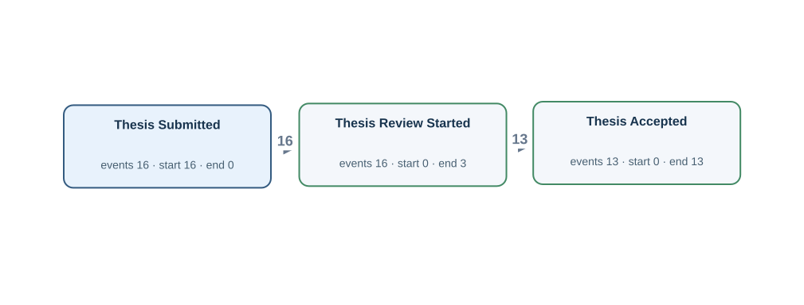</a></td><td width="58%" valign="top">
<a href="../../../datasets/universityflow/private/gold_sql/OU06E.sql">Gold SQL</a> · <a href="../../../datasets/universityflow/private/gold_logs/OU06E.csv">Gold CSV</a> · <a href="../../../datasets/universityflow/input/database.sqlite">Full source database (SQLite)</a>

<code>thesis</code> · 16 matched source rows
<table><tr><th>Column</th><th>Row 1</th><th>Row 2</th><th>Row 3</th></tr><tr><th>thesis_id</th><td>TH002</td><td>TH003</td><td>TH006</td></tr><tr><th>student_id</th><td>S002</td><td>S003</td><td>S006</td></tr><tr><th>thesis_title</th><td>Course Design Thesis</td><td>Course Design Thesis</td><td>Course Design Thesis</td></tr><tr><th>thesis_content</th><td>Synthetic thesis content</td><td>Synthetic thesis content</td><td>Synthetic thesis content</td></tr><tr><th>submission_date</th><td>2026-02-23T16:00:00Z</td><td>2026-02-24T16:00:00Z</td><td>2026-02-27T16:00:00Z</td></tr><tr><th>thesis_draft_registered_at</th><td>2026-02-19T16:00:00Z</td><td>2026-02-20T16:00:00Z</td><td>2026-02-23T16:00:00Z</td></tr><tr><th>thesis_review_started_at</th><td>2026-02-24T16:00:00Z</td><td>2026-02-25T16:00:00Z</td><td>2026-02-28T16:00:00Z</td></tr><tr><th>thesis_accepted_at</th><td><em>NULL</em></td><td>2026-02-28T16:00:00Z</td><td>2026-03-03T16:00:00Z</td></tr><tr><th>thesis_revision_requested_at</th><td>2026-02-25T16:00:00Z</td><td><em>NULL</em></td><td><em>NULL</em></td></tr><tr><th>thesis_resubmitted_at</th><td>2026-02-26T16:00:00Z</td><td><em>NULL</em></td><td><em>NULL</em></td></tr></table>
<strong>Gold output for the same source rows</strong>
<ul><li>Row 1 → Thesis Review Started · event LC:thesis:TH002:2 · case TH002 · time from <code>thesis_review_started_at</code></li><li>Row 1 → Thesis Submitted · event THESIS:TH002 · case TH002 · time from <code>submission_date</code></li><li>Row 2 → Thesis Review Started · event LC:thesis:TH003:2 · case TH003 · time from <code>thesis_review_started_at</code></li><li>Row 2 → Thesis Accepted · event LC:thesis:TH003:3 · case TH003 · time from <code>thesis_accepted_at</code></li><li>Row 2 → Thesis Submitted · event THESIS:TH003 · case TH003 · time from <code>submission_date</code></li><li>Row 3 → Thesis Review Started · event LC:thesis:TH006:2 · case TH006 · time from <code>thesis_review_started_at</code></li><li>Row 3 → Thesis Accepted · event LC:thesis:TH006:3 · case TH006 · time from <code>thesis_accepted_at</code></li><li>Row 3 → Thesis Submitted · event THESIS:TH006 · case TH006 · time from <code>submission_date</code></li></ul>
</td></tr></table>

## OU06EP — Q2

For each thesis, build a timeline of the student handing in a thesis, the review of a thesis beginning, a thesis receiving final approval.

Events: **45** · Cases with events: **16** · Activities: **3** · Edges: **2** · Source tables: **1** · SQL tables: **9**

<table><tr><td width="42%" valign="top"></td><td width="58%" valign="top">
<a href="../../../datasets/universityflow/private/gold_sql/OU06EP.sql">Gold SQL</a> · <a href="../../../datasets/universityflow/private/gold_logs/OU06EP.csv">Gold CSV</a> · <a href="../../../datasets/universityflow/input/database.sqlite">Full source database (SQLite)</a>

<code>thesis</code> · 16 matched source rows
<table><tr><th>Column</th><th>Row 1</th><th>Row 2</th><th>Row 3</th></tr><tr><th>thesis_id</th><td>TH002</td><td>TH003</td><td>TH006</td></tr><tr><th>student_id</th><td>S002</td><td>S003</td><td>S006</td></tr><tr><th>thesis_title</th><td>Course Design Thesis</td><td>Course Design Thesis</td><td>Course Design Thesis</td></tr><tr><th>thesis_content</th><td>Synthetic thesis content</td><td>Synthetic thesis content</td><td>Synthetic thesis content</td></tr><tr><th>submission_date</th><td>2026-02-23T16:00:00Z</td><td>2026-02-24T16:00:00Z</td><td>2026-02-27T16:00:00Z</td></tr><tr><th>thesis_draft_registered_at</th><td>2026-02-19T16:00:00Z</td><td>2026-02-20T16:00:00Z</td><td>2026-02-23T16:00:00Z</td></tr><tr><th>thesis_review_started_at</th><td>2026-02-24T16:00:00Z</td><td>2026-02-25T16:00:00Z</td><td>2026-02-28T16:00:00Z</td></tr><tr><th>thesis_accepted_at</th><td><em>NULL</em></td><td>2026-02-28T16:00:00Z</td><td>2026-03-03T16:00:00Z</td></tr><tr><th>thesis_revision_requested_at</th><td>2026-02-25T16:00:00Z</td><td><em>NULL</em></td><td><em>NULL</em></td></tr><tr><th>thesis_resubmitted_at</th><td>2026-02-26T16:00:00Z</td><td><em>NULL</em></td><td><em>NULL</em></td></tr></table>
<strong>Gold output for the same source rows</strong>
<ul><li>Row 1 → Thesis Review Started · event LC:thesis:TH002:2 · case TH002 · time from <code>thesis_review_started_at</code></li><li>Row 1 → Thesis Submitted · event THESIS:TH002 · case TH002 · time from <code>submission_date</code></li><li>Row 2 → Thesis Review Started · event LC:thesis:TH003:2 · case TH003 · time from <code>thesis_review_started_at</code></li><li>Row 2 → Thesis Accepted · event LC:thesis:TH003:3 · case TH003 · time from <code>thesis_accepted_at</code></li><li>Row 2 → Thesis Submitted · event THESIS:TH003 · case TH003 · time from <code>submission_date</code></li><li>Row 3 → Thesis Review Started · event LC:thesis:TH006:2 · case TH006 · time from <code>thesis_review_started_at</code></li><li>Row 3 → Thesis Accepted · event LC:thesis:TH006:3 · case TH006 · time from <code>thesis_accepted_at</code></li><li>Row 3 → Thesis Submitted · event THESIS:TH006 · case TH006 · time from <code>submission_date</code></li></ul>
</td></tr></table>

## OU07P — Q4

Show the complete recorded history associated with each simulation experiment result record.

Events: **131** · Cases with events: **27** · Activities: **5** · Edges: **4** · Source tables: **1** · SQL tables: **9**

<table><tr><td width="42%" valign="top"></td><td width="58%" valign="top">
<a href="../../../datasets/universityflow/private/gold_sql/OU07P.sql">Gold SQL</a> · <a href="../../../datasets/universityflow/private/gold_logs/OU07P.csv">Gold CSV</a> · <a href="../../../datasets/universityflow/input/database.sqlite">Full source database (SQLite)</a>

<code>student_simulation_experiment_result</code> · 27 matched source rows
<table><tr><th>Column</th><th>Row 1</th><th>Row 2</th><th>Row 3</th></tr><tr><th>student_id</th><td>S002</td><td>S003</td><td>S003</td></tr><tr><th>module_id</th><td>M03</td><td>M01</td><td>M01</td></tr><tr><th>simulation_date</th><td>2026-02-13T15:00:00Z</td><td>2026-02-14T15:00:00Z</td><td>2026-02-15T15:00:00Z</td></tr><tr><th>simulation_result_data</th><td>Synthetic output 1</td><td>Synthetic output 1</td><td>Synthetic output 2</td></tr><tr><th>result_analysis</th><td>Recorded experiment analysis</td><td>Recorded experiment analysis</td><td>Recorded experiment analysis</td></tr><tr><th>simulation_run_scheduled_at</th><td>2026-02-13T13:00:00Z</td><td>2026-02-14T13:00:00Z</td><td>2026-02-15T13:00:00Z</td></tr><tr><th>simulation_run_started_at</th><td>2026-02-13T14:00:00Z</td><td>2026-02-14T14:00:00Z</td><td>2026-02-15T14:00:00Z</td></tr><tr><th>simulation_output_reviewed_at</th><td>2026-02-13T17:00:00Z</td><td>2026-02-14T17:00:00Z</td><td>2026-02-15T17:00:00Z</td></tr><tr><th>simulation_result_accepted_at</th><td><em>NULL</em></td><td>2026-02-14T18:00:00Z</td><td>2026-02-15T18:00:00Z</td></tr></table>
<strong>Gold output for the same source rows</strong>
<ul><li>Row 1 → Simulation Run Scheduled · event LC:student_simulation_experiment_result:S002:M03:2026-02-13T15:00:00Z:1 · case S002:M03:2026-02-13T15:00:00Z · time from <code>simulation_run_scheduled_at</code></li><li>Row 1 → Simulation Run Started · event LC:student_simulation_experiment_result:S002:M03:2026-02-13T15:00:00Z:2 · case S002:M03:2026-02-13T15:00:00Z · time from <code>simulation_run_started_at</code></li><li>Row 1 → Simulation Output Reviewed · event LC:student_simulation_experiment_result:S002:M03:2026-02-13T15:00:00Z:3 · case S002:M03:2026-02-13T15:00:00Z · time from <code>simulation_output_reviewed_at</code></li><li>Row 1 → Simulation Experiment Completed · event SIM:S002:M03:2026-02-13T15:00:00Z · case S002:M03:2026-02-13T15:00:00Z · time from <code>simulation_date</code></li><li>Row 2 → Simulation Run Scheduled · event LC:student_simulation_experiment_result:S003:M01:2026-02-14T15:00:00Z:1 · case S003:M01:2026-02-14T15:00:00Z · time from <code>simulation_run_scheduled_at</code></li><li>Row 2 → Simulation Run Started · event LC:student_simulation_experiment_result:S003:M01:2026-02-14T15:00:00Z:2 · case S003:M01:2026-02-14T15:00:00Z · time from <code>simulation_run_started_at</code></li><li>Row 2 → Simulation Output Reviewed · event LC:student_simulation_experiment_result:S003:M01:2026-02-14T15:00:00Z:3 · case S003:M01:2026-02-14T15:00:00Z · time from <code>simulation_output_reviewed_at</code></li><li>Row 2 → Simulation Result Accepted · event LC:student_simulation_experiment_result:S003:M01:2026-02-14T15:00:00Z:4 · case S003:M01:2026-02-14T15:00:00Z · time from <code>simulation_result_accepted_at</code></li><li>Row 2 → Simulation Experiment Completed · event SIM:S003:M01:2026-02-14T15:00:00Z · case S003:M01:2026-02-14T15:00:00Z · time from <code>simulation_date</code></li><li>Row 3 → Simulation Run Scheduled · event LC:student_simulation_experiment_result:S003:M01:2026-02-15T15:00:00Z:1 · case S003:M01:2026-02-15T15:00:00Z · time from <code>simulation_run_scheduled_at</code></li><li>Row 3 → Simulation Run Started · event LC:student_simulation_experiment_result:S003:M01:2026-02-15T15:00:00Z:2 · case S003:M01:2026-02-15T15:00:00Z · time from <code>simulation_run_started_at</code></li><li>Row 3 → Simulation Output Reviewed · event LC:student_simulation_experiment_result:S003:M01:2026-02-15T15:00:00Z:3 · case S003:M01:2026-02-15T15:00:00Z · time from <code>simulation_output_reviewed_at</code></li><li>Row 3 → Simulation Result Accepted · event LC:student_simulation_experiment_result:S003:M01:2026-02-15T15:00:00Z:4 · case S003:M01:2026-02-15T15:00:00Z · time from <code>simulation_result_accepted_at</code></li><li>Row 3 → Simulation Experiment Completed · event SIM:S003:M01:2026-02-15T15:00:00Z · case S003:M01:2026-02-15T15:00:00Z · time from <code>simulation_date</code></li></ul>

FK-linked case and join evidence
<ul><li><code>student_simulation_experiment_result</code> → <code>simulation_module</code> · module_id → module_id · module_id = M03</li></ul>
</td></tr></table>

## OU07E — Q1

Extract Simulation Run Started, Simulation Experiment Completed, Simulation Result Accepted events for each simulation experiment result record.

Events: **77** · Cases with events: **27** · Activities: **3** · Edges: **2** · Source tables: **1** · SQL tables: **9**

<table><tr><td width="42%" valign="top"><a href="graphs/OU07E.svg">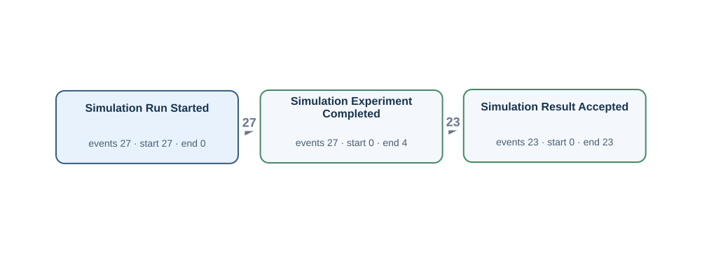</a></td><td width="58%" valign="top">
<a href="../../../datasets/universityflow/private/gold_sql/OU07E.sql">Gold SQL</a> · <a href="../../../datasets/universityflow/private/gold_logs/OU07E.csv">Gold CSV</a> · <a href="../../../datasets/universityflow/input/database.sqlite">Full source database (SQLite)</a>

<code>student_simulation_experiment_result</code> · 27 matched source rows
<table><tr><th>Column</th><th>Row 1</th><th>Row 2</th><th>Row 3</th></tr><tr><th>student_id</th><td>S002</td><td>S003</td><td>S003</td></tr><tr><th>module_id</th><td>M03</td><td>M01</td><td>M01</td></tr><tr><th>simulation_date</th><td>2026-02-13T15:00:00Z</td><td>2026-02-14T15:00:00Z</td><td>2026-02-15T15:00:00Z</td></tr><tr><th>simulation_result_data</th><td>Synthetic output 1</td><td>Synthetic output 1</td><td>Synthetic output 2</td></tr><tr><th>result_analysis</th><td>Recorded experiment analysis</td><td>Recorded experiment analysis</td><td>Recorded experiment analysis</td></tr><tr><th>simulation_run_scheduled_at</th><td>2026-02-13T13:00:00Z</td><td>2026-02-14T13:00:00Z</td><td>2026-02-15T13:00:00Z</td></tr><tr><th>simulation_run_started_at</th><td>2026-02-13T14:00:00Z</td><td>2026-02-14T14:00:00Z</td><td>2026-02-15T14:00:00Z</td></tr><tr><th>simulation_output_reviewed_at</th><td>2026-02-13T17:00:00Z</td><td>2026-02-14T17:00:00Z</td><td>2026-02-15T17:00:00Z</td></tr><tr><th>simulation_result_accepted_at</th><td><em>NULL</em></td><td>2026-02-14T18:00:00Z</td><td>2026-02-15T18:00:00Z</td></tr></table>
<strong>Gold output for the same source rows</strong>
<ul><li>Row 1 → Simulation Run Started · event LC:student_simulation_experiment_result:S002:M03:2026-02-13T15:00:00Z:2 · case S002:M03:2026-02-13T15:00:00Z · time from <code>simulation_run_started_at</code></li><li>Row 1 → Simulation Experiment Completed · event SIM:S002:M03:2026-02-13T15:00:00Z · case S002:M03:2026-02-13T15:00:00Z · time from <code>simulation_date</code></li><li>Row 2 → Simulation Run Started · event LC:student_simulation_experiment_result:S003:M01:2026-02-14T15:00:00Z:2 · case S003:M01:2026-02-14T15:00:00Z · time from <code>simulation_run_started_at</code></li><li>Row 2 → Simulation Result Accepted · event LC:student_simulation_experiment_result:S003:M01:2026-02-14T15:00:00Z:4 · case S003:M01:2026-02-14T15:00:00Z · time from <code>simulation_result_accepted_at</code></li><li>Row 2 → Simulation Experiment Completed · event SIM:S003:M01:2026-02-14T15:00:00Z · case S003:M01:2026-02-14T15:00:00Z · time from <code>simulation_date</code></li><li>Row 3 → Simulation Run Started · event LC:student_simulation_experiment_result:S003:M01:2026-02-15T15:00:00Z:2 · case S003:M01:2026-02-15T15:00:00Z · time from <code>simulation_run_started_at</code></li><li>Row 3 → Simulation Result Accepted · event LC:student_simulation_experiment_result:S003:M01:2026-02-15T15:00:00Z:4 · case S003:M01:2026-02-15T15:00:00Z · time from <code>simulation_result_accepted_at</code></li><li>Row 3 → Simulation Experiment Completed · event SIM:S003:M01:2026-02-15T15:00:00Z · case S003:M01:2026-02-15T15:00:00Z · time from <code>simulation_date</code></li></ul>

FK-linked case and join evidence
<ul><li><code>student_simulation_experiment_result</code> → <code>simulation_module</code> · module_id → module_id · module_id = M03</li></ul>
</td></tr></table>

## OU07EP — Q2

For each simulation experiment result record, build a timeline of a simulation run beginning, a simulation run finishing, the simulation results receiving approval.

Events: **77** · Cases with events: **27** · Activities: **3** · Edges: **2** · Source tables: **1** · SQL tables: **9**

<table><tr><td width="42%" valign="top"></td><td width="58%" valign="top">
<a href="../../../datasets/universityflow/private/gold_sql/OU07EP.sql">Gold SQL</a> · <a href="../../../datasets/universityflow/private/gold_logs/OU07EP.csv">Gold CSV</a> · <a href="../../../datasets/universityflow/input/database.sqlite">Full source database (SQLite)</a>

<code>student_simulation_experiment_result</code> · 27 matched source rows
<table><tr><th>Column</th><th>Row 1</th><th>Row 2</th><th>Row 3</th></tr><tr><th>student_id</th><td>S002</td><td>S003</td><td>S003</td></tr><tr><th>module_id</th><td>M03</td><td>M01</td><td>M01</td></tr><tr><th>simulation_date</th><td>2026-02-13T15:00:00Z</td><td>2026-02-14T15:00:00Z</td><td>2026-02-15T15:00:00Z</td></tr><tr><th>simulation_result_data</th><td>Synthetic output 1</td><td>Synthetic output 1</td><td>Synthetic output 2</td></tr><tr><th>result_analysis</th><td>Recorded experiment analysis</td><td>Recorded experiment analysis</td><td>Recorded experiment analysis</td></tr><tr><th>simulation_run_scheduled_at</th><td>2026-02-13T13:00:00Z</td><td>2026-02-14T13:00:00Z</td><td>2026-02-15T13:00:00Z</td></tr><tr><th>simulation_run_started_at</th><td>2026-02-13T14:00:00Z</td><td>2026-02-14T14:00:00Z</td><td>2026-02-15T14:00:00Z</td></tr><tr><th>simulation_output_reviewed_at</th><td>2026-02-13T17:00:00Z</td><td>2026-02-14T17:00:00Z</td><td>2026-02-15T17:00:00Z</td></tr><tr><th>simulation_result_accepted_at</th><td><em>NULL</em></td><td>2026-02-14T18:00:00Z</td><td>2026-02-15T18:00:00Z</td></tr></table>
<strong>Gold output for the same source rows</strong>
<ul><li>Row 1 → Simulation Run Started · event LC:student_simulation_experiment_result:S002:M03:2026-02-13T15:00:00Z:2 · case S002:M03:2026-02-13T15:00:00Z · time from <code>simulation_run_started_at</code></li><li>Row 1 → Simulation Experiment Completed · event SIM:S002:M03:2026-02-13T15:00:00Z · case S002:M03:2026-02-13T15:00:00Z · time from <code>simulation_date</code></li><li>Row 2 → Simulation Run Started · event LC:student_simulation_experiment_result:S003:M01:2026-02-14T15:00:00Z:2 · case S003:M01:2026-02-14T15:00:00Z · time from <code>simulation_run_started_at</code></li><li>Row 2 → Simulation Result Accepted · event LC:student_simulation_experiment_result:S003:M01:2026-02-14T15:00:00Z:4 · case S003:M01:2026-02-14T15:00:00Z · time from <code>simulation_result_accepted_at</code></li><li>Row 2 → Simulation Experiment Completed · event SIM:S003:M01:2026-02-14T15:00:00Z · case S003:M01:2026-02-14T15:00:00Z · time from <code>simulation_date</code></li><li>Row 3 → Simulation Run Started · event LC:student_simulation_experiment_result:S003:M01:2026-02-15T15:00:00Z:2 · case S003:M01:2026-02-15T15:00:00Z · time from <code>simulation_run_started_at</code></li><li>Row 3 → Simulation Result Accepted · event LC:student_simulation_experiment_result:S003:M01:2026-02-15T15:00:00Z:4 · case S003:M01:2026-02-15T15:00:00Z · time from <code>simulation_result_accepted_at</code></li><li>Row 3 → Simulation Experiment Completed · event SIM:S003:M01:2026-02-15T15:00:00Z · case S003:M01:2026-02-15T15:00:00Z · time from <code>simulation_date</code></li></ul>

FK-linked case and join evidence
<ul><li><code>student_simulation_experiment_result</code> → <code>simulation_module</code> · module_id → module_id · module_id = M03</li></ul>
</td></tr></table>

## OU08P — Q4

Show the complete recorded history associated with each assignment.

Events: **90** · Cases with events: **20** · Activities: **7** · Edges: **9** · Source tables: **2** · SQL tables: **9**

<table><tr><td width="42%" valign="top"></td><td width="58%" valign="top">
<a href="../../../datasets/universityflow/private/gold_sql/OU08P.sql">Gold SQL</a> · <a href="../../../datasets/universityflow/private/gold_logs/OU08P.csv">Gold CSV</a> · <a href="../../../datasets/universityflow/input/database.sqlite">Full source database (SQLite)</a>

<code>assignment</code> · 20 matched source rows
<table><tr><th>Column</th><th>Row 1</th><th>Row 2</th><th>Row 3</th></tr><tr><th>assignment_id</th><td>A002</td><td>A003</td><td>A006</td></tr><tr><th>student_id</th><td>S002</td><td>S003</td><td>S006</td></tr><tr><th>assignment_content</th><td>Synthetic assignment content</td><td>Synthetic assignment content</td><td>Synthetic assignment content</td></tr><tr><th>assignment_assigned_at</th><td>2026-02-07T14:00:00Z</td><td>2026-02-08T14:00:00Z</td><td>2026-02-11T14:00:00Z</td></tr><tr><th>assignment_submitted_at</th><td>2026-02-09T14:00:00Z</td><td>2026-02-10T14:00:00Z</td><td>2026-02-13T14:00:00Z</td></tr><tr><th>assignment_grade_finalized_at</th><td><em>NULL</em></td><td>2026-02-14T14:00:00Z</td><td>2026-02-17T14:00:00Z</td></tr><tr><th>assignment_revision_requested_at</th><td>2026-02-11T15:00:00Z</td><td><em>NULL</em></td><td><em>NULL</em></td></tr><tr><th>assignment_resubmitted_at</th><td>2026-02-12T14:00:00Z</td><td><em>NULL</em></td><td><em>NULL</em></td></tr></table>
<strong>Gold output for the same source rows</strong>
<ul><li>Row 1 → Assignment Assigned · event LC:assignment:A002:1 · case A002 · time from <code>assignment_assigned_at</code></li><li>Row 1 → Assignment Submitted · event LC:assignment:A002:2 · case A002 · time from <code>assignment_submitted_at</code></li><li>Row 1 → Assignment Revision Requested · event LC:assignment:A002:3 · case A002 · time from <code>assignment_revision_requested_at</code></li><li>Row 1 → Assignment Resubmitted · event LC:assignment:A002:4 · case A002 · time from <code>assignment_resubmitted_at</code></li><li>Row 2 → Assignment Assigned · event LC:assignment:A003:1 · case A003 · time from <code>assignment_assigned_at</code></li><li>Row 2 → Assignment Submitted · event LC:assignment:A003:2 · case A003 · time from <code>assignment_submitted_at</code></li><li>Row 2 → Assignment Grade Finalized · event LC:assignment:A003:3 · case A003 · time from <code>assignment_grade_finalized_at</code></li><li>Row 3 → Assignment Assigned · event LC:assignment:A006:1 · case A006 · time from <code>assignment_assigned_at</code></li><li>Row 3 → Assignment Submitted · event LC:assignment:A006:2 · case A006 · time from <code>assignment_submitted_at</code></li><li>Row 3 → Assignment Grade Finalized · event LC:assignment:A006:3 · case A006 · time from <code>assignment_grade_finalized_at</code></li></ul>

<code>assignment_grading</code> · 25 matched source rows
<table><tr><th>Column</th><th>Row 1</th><th>Row 2</th><th>Row 3</th></tr><tr><th>assignment_id</th><td>A002</td><td>A002</td><td>A003</td></tr><tr><th>instructor_id</th><td>I03</td><td>I03</td><td>I01</td></tr><tr><th>grading_time</th><td>2026-02-11T14:00:00Z</td><td>2026-02-13T02:00:00Z</td><td>2026-02-12T14:00:00Z</td></tr><tr><th>score</th><td>70</td><td>75</td><td>70</td></tr><tr><th>evaluation</th><td>Initial feedback</td><td>Authored synthetic reassessment score and feedback</td><td>Initial feedback</td></tr><tr><th>grading_kind</th><td>ORIGINAL</td><td>REASSESSMENT</td><td>ORIGINAL</td></tr><tr><th>reassessment_event_id</th><td><em>NULL</em></td><td>LC:assignment:A002:5</td><td><em>NULL</em></td></tr></table>
<strong>Gold output for the same source rows</strong>
<ul><li>Row 1 → Assignment Graded · event GRADE:A002:I03:2026-02-11T14:00:00Z · case A002 · time from <code>grading_time</code></li><li>Row 2 → Assignment Regraded · event LC:assignment:A002:5 · case A002 · time from <code>grading_time</code></li><li>Row 3 → Assignment Graded · event GRADE:A003:I01:2026-02-12T14:00:00Z · case A003 · time from <code>grading_time</code></li></ul>
</td></tr></table>

## OU08E — Q1

Extract Assignment Assigned, Assignment Submitted, Assignment Graded events for each assignment.

Events: **54** · Cases with events: **20** · Activities: **3** · Edges: **3** · Source tables: **2** · SQL tables: **9**

<table><tr><td width="42%" valign="top"></td><td width="58%" valign="top">
<a href="../../../datasets/universityflow/private/gold_sql/OU08E.sql">Gold SQL</a> · <a href="../../../datasets/universityflow/private/gold_logs/OU08E.csv">Gold CSV</a> · <a href="../../../datasets/universityflow/input/database.sqlite">Full source database (SQLite)</a>

<code>assignment</code> · 20 matched source rows
<table><tr><th>Column</th><th>Row 1</th><th>Row 2</th><th>Row 3</th></tr><tr><th>assignment_id</th><td>A002</td><td>A003</td><td>A006</td></tr><tr><th>student_id</th><td>S002</td><td>S003</td><td>S006</td></tr><tr><th>assignment_content</th><td>Synthetic assignment content</td><td>Synthetic assignment content</td><td>Synthetic assignment content</td></tr><tr><th>assignment_assigned_at</th><td>2026-02-07T14:00:00Z</td><td>2026-02-08T14:00:00Z</td><td>2026-02-11T14:00:00Z</td></tr><tr><th>assignment_submitted_at</th><td>2026-02-09T14:00:00Z</td><td>2026-02-10T14:00:00Z</td><td>2026-02-13T14:00:00Z</td></tr><tr><th>assignment_grade_finalized_at</th><td><em>NULL</em></td><td>2026-02-14T14:00:00Z</td><td>2026-02-17T14:00:00Z</td></tr><tr><th>assignment_revision_requested_at</th><td>2026-02-11T15:00:00Z</td><td><em>NULL</em></td><td><em>NULL</em></td></tr><tr><th>assignment_resubmitted_at</th><td>2026-02-12T14:00:00Z</td><td><em>NULL</em></td><td><em>NULL</em></td></tr></table>
<strong>Gold output for the same source rows</strong>
<ul><li>Row 1 → Assignment Assigned · event LC:assignment:A002:1 · case A002 · time from <code>assignment_assigned_at</code></li><li>Row 1 → Assignment Submitted · event LC:assignment:A002:2 · case A002 · time from <code>assignment_submitted_at</code></li><li>Row 2 → Assignment Assigned · event LC:assignment:A003:1 · case A003 · time from <code>assignment_assigned_at</code></li><li>Row 2 → Assignment Submitted · event LC:assignment:A003:2 · case A003 · time from <code>assignment_submitted_at</code></li><li>Row 3 → Assignment Assigned · event LC:assignment:A006:1 · case A006 · time from <code>assignment_assigned_at</code></li><li>Row 3 → Assignment Submitted · event LC:assignment:A006:2 · case A006 · time from <code>assignment_submitted_at</code></li></ul>

<code>assignment_grading</code> · 18 matched source rows
<table><tr><th>Column</th><th>Row 1</th><th>Row 2</th><th>Row 3</th></tr><tr><th>assignment_id</th><td>A002</td><td>A003</td><td>A006</td></tr><tr><th>instructor_id</th><td>I03</td><td>I01</td><td>I01</td></tr><tr><th>grading_time</th><td>2026-02-11T14:00:00Z</td><td>2026-02-12T14:00:00Z</td><td>2026-02-15T14:00:00Z</td></tr><tr><th>score</th><td>70</td><td>70</td><td>70</td></tr><tr><th>evaluation</th><td>Initial feedback</td><td>Initial feedback</td><td>Initial feedback</td></tr><tr><th>grading_kind</th><td>ORIGINAL</td><td>ORIGINAL</td><td>ORIGINAL</td></tr><tr><th>reassessment_event_id</th><td><em>NULL</em></td><td><em>NULL</em></td><td><em>NULL</em></td></tr></table>
<strong>Gold output for the same source rows</strong>
<ul><li>Row 1 → Assignment Graded · event GRADE:A002:I03:2026-02-11T14:00:00Z · case A002 · time from <code>grading_time</code></li><li>Row 2 → Assignment Graded · event GRADE:A003:I01:2026-02-12T14:00:00Z · case A003 · time from <code>grading_time</code></li><li>Row 3 → Assignment Graded · event GRADE:A006:I01:2026-02-15T14:00:00Z · case A006 · time from <code>grading_time</code></li></ul>
</td></tr></table>

## OU08EP — Q2

For each assignment, build a timeline of coursework being set for the student, the student handing in coursework, an instructor assessing the assignment.

Events: **54** · Cases with events: **20** · Activities: **3** · Edges: **3** · Source tables: **2** · SQL tables: **9**

<table><tr><td width="42%" valign="top"></td><td width="58%" valign="top">
<a href="../../../datasets/universityflow/private/gold_sql/OU08EP.sql">Gold SQL</a> · <a href="../../../datasets/universityflow/private/gold_logs/OU08EP.csv">Gold CSV</a> · <a href="../../../datasets/universityflow/input/database.sqlite">Full source database (SQLite)</a>

<code>assignment</code> · 20 matched source rows
<table><tr><th>Column</th><th>Row 1</th><th>Row 2</th><th>Row 3</th></tr><tr><th>assignment_id</th><td>A002</td><td>A003</td><td>A006</td></tr><tr><th>student_id</th><td>S002</td><td>S003</td><td>S006</td></tr><tr><th>assignment_content</th><td>Synthetic assignment content</td><td>Synthetic assignment content</td><td>Synthetic assignment content</td></tr><tr><th>assignment_assigned_at</th><td>2026-02-07T14:00:00Z</td><td>2026-02-08T14:00:00Z</td><td>2026-02-11T14:00:00Z</td></tr><tr><th>assignment_submitted_at</th><td>2026-02-09T14:00:00Z</td><td>2026-02-10T14:00:00Z</td><td>2026-02-13T14:00:00Z</td></tr><tr><th>assignment_grade_finalized_at</th><td><em>NULL</em></td><td>2026-02-14T14:00:00Z</td><td>2026-02-17T14:00:00Z</td></tr><tr><th>assignment_revision_requested_at</th><td>2026-02-11T15:00:00Z</td><td><em>NULL</em></td><td><em>NULL</em></td></tr><tr><th>assignment_resubmitted_at</th><td>2026-02-12T14:00:00Z</td><td><em>NULL</em></td><td><em>NULL</em></td></tr></table>
<strong>Gold output for the same source rows</strong>
<ul><li>Row 1 → Assignment Assigned · event LC:assignment:A002:1 · case A002 · time from <code>assignment_assigned_at</code></li><li>Row 1 → Assignment Submitted · event LC:assignment:A002:2 · case A002 · time from <code>assignment_submitted_at</code></li><li>Row 2 → Assignment Assigned · event LC:assignment:A003:1 · case A003 · time from <code>assignment_assigned_at</code></li><li>Row 2 → Assignment Submitted · event LC:assignment:A003:2 · case A003 · time from <code>assignment_submitted_at</code></li><li>Row 3 → Assignment Assigned · event LC:assignment:A006:1 · case A006 · time from <code>assignment_assigned_at</code></li><li>Row 3 → Assignment Submitted · event LC:assignment:A006:2 · case A006 · time from <code>assignment_submitted_at</code></li></ul>

<code>assignment_grading</code> · 18 matched source rows
<table><tr><th>Column</th><th>Row 1</th><th>Row 2</th><th>Row 3</th></tr><tr><th>assignment_id</th><td>A002</td><td>A003</td><td>A006</td></tr><tr><th>instructor_id</th><td>I03</td><td>I01</td><td>I01</td></tr><tr><th>grading_time</th><td>2026-02-11T14:00:00Z</td><td>2026-02-12T14:00:00Z</td><td>2026-02-15T14:00:00Z</td></tr><tr><th>score</th><td>70</td><td>70</td><td>70</td></tr><tr><th>evaluation</th><td>Initial feedback</td><td>Initial feedback</td><td>Initial feedback</td></tr><tr><th>grading_kind</th><td>ORIGINAL</td><td>ORIGINAL</td><td>ORIGINAL</td></tr><tr><th>reassessment_event_id</th><td><em>NULL</em></td><td><em>NULL</em></td><td><em>NULL</em></td></tr></table>
<strong>Gold output for the same source rows</strong>
<ul><li>Row 1 → Assignment Graded · event GRADE:A002:I03:2026-02-11T14:00:00Z · case A002 · time from <code>grading_time</code></li><li>Row 2 → Assignment Graded · event GRADE:A003:I01:2026-02-12T14:00:00Z · case A003 · time from <code>grading_time</code></li><li>Row 3 → Assignment Graded · event GRADE:A006:I01:2026-02-15T14:00:00Z · case A006 · time from <code>grading_time</code></li></ul>
</td></tr></table>

## OU09P — Q4

Show the complete recorded history associated with each instructor.

Events: **86** · Cases with events: **3** · Activities: **7** · Edges: **18** · Source tables: **2** · SQL tables: **9**

<table><tr><td width="42%" valign="top"></td><td width="58%" valign="top">
<a href="../../../datasets/universityflow/private/gold_sql/OU09P.sql">Gold SQL</a> · <a href="../../../datasets/universityflow/private/gold_logs/OU09P.csv">Gold CSV</a> · <a href="../../../datasets/universityflow/input/database.sqlite">Full source database (SQLite)</a>

<code>assignment</code> · 16 matched source rows
<table><tr><th>Column</th><th>Row 1</th><th>Row 2</th><th>Row 3</th></tr><tr><th>assignment_id</th><td>A003</td><td>A007</td><td>A006</td></tr><tr><th>student_id</th><td>S003</td><td>S007</td><td>S006</td></tr><tr><th>assignment_content</th><td>Synthetic assignment content</td><td>Synthetic assignment content</td><td>Synthetic assignment content</td></tr><tr><th>assignment_assigned_at</th><td>2026-02-08T14:00:00Z</td><td>2026-02-12T14:00:00Z</td><td>2026-02-11T14:00:00Z</td></tr><tr><th>assignment_submitted_at</th><td>2026-02-10T14:00:00Z</td><td>2026-02-14T14:00:00Z</td><td>2026-02-13T14:00:00Z</td></tr><tr><th>assignment_grade_finalized_at</th><td>2026-02-14T14:00:00Z</td><td>2026-02-19T14:00:00Z</td><td>2026-02-17T14:00:00Z</td></tr><tr><th>assignment_revision_requested_at</th><td><em>NULL</em></td><td>2026-02-16T15:00:00Z</td><td><em>NULL</em></td></tr><tr><th>assignment_resubmitted_at</th><td><em>NULL</em></td><td>2026-02-17T14:00:00Z</td><td><em>NULL</em></td></tr></table>
<strong>Gold output for the same source rows</strong>
<ul><li>Row 1 → Assignment Assigned · event LC:assignment:A003:1 · case I01 · time from <code>assignment_assigned_at</code></li><li>Row 1 → Assignment Submitted · event LC:assignment:A003:2 · case I01 · time from <code>assignment_submitted_at</code></li><li>Row 1 → Assignment Grade Finalized · event LC:assignment:A003:3 · case I01 · time from <code>assignment_grade_finalized_at</code></li><li>Row 2 → Assignment Assigned · event LC:assignment:A007:1 · case I02 · time from <code>assignment_assigned_at</code></li><li>Row 2 → Assignment Submitted · event LC:assignment:A007:2 · case I02 · time from <code>assignment_submitted_at</code></li><li>Row 2 → Assignment Revision Requested · event LC:assignment:A007:3 · case I02 · time from <code>assignment_revision_requested_at</code></li><li>Row 2 → Assignment Resubmitted · event LC:assignment:A007:4 · case I02 · time from <code>assignment_resubmitted_at</code></li><li>Row 2 → Assignment Grade Finalized · event LC:assignment:A007:6 · case I02 · time from <code>assignment_grade_finalized_at</code></li><li>Row 3 → Assignment Assigned · event LC:assignment:A006:1 · case I01 · time from <code>assignment_assigned_at</code></li><li>Row 3 → Assignment Submitted · event LC:assignment:A006:2 · case I01 · time from <code>assignment_submitted_at</code></li><li>Row 3 → Assignment Grade Finalized · event LC:assignment:A006:3 · case I01 · time from <code>assignment_grade_finalized_at</code></li></ul>

<code>assignment_grading</code> · 25 matched source rows
<table><tr><th>Column</th><th>Row 1</th><th>Row 2</th><th>Row 3</th></tr><tr><th>assignment_id</th><td>A003</td><td>A007</td><td>A006</td></tr><tr><th>instructor_id</th><td>I01</td><td>I02</td><td>I01</td></tr><tr><th>grading_time</th><td>2026-02-12T14:00:00Z</td><td>2026-02-19T02:00:00Z</td><td>2026-02-15T14:00:00Z</td></tr><tr><th>score</th><td>70</td><td>85</td><td>70</td></tr><tr><th>evaluation</th><td>Initial feedback</td><td>Authored synthetic reassessment score and feedback</td><td>Initial feedback</td></tr><tr><th>grading_kind</th><td>ORIGINAL</td><td>REASSESSMENT</td><td>ORIGINAL</td></tr><tr><th>reassessment_event_id</th><td><em>NULL</em></td><td>LC:assignment:A007:5</td><td><em>NULL</em></td></tr></table>
<strong>Gold output for the same source rows</strong>
<ul><li>Row 1 → Assignment Graded · event GRADE:A003:I01:2026-02-12T14:00:00Z · case I01 · time from <code>grading_time</code></li><li>Row 2 → Assignment Regraded · event LC:assignment:A007:5 · case I02 · time from <code>grading_time</code></li><li>Row 3 → Assignment Graded · event GRADE:A006:I01:2026-02-15T14:00:00Z · case I01 · time from <code>grading_time</code></li></ul>
</td></tr></table>

## OU09E — Q1

Extract Assignment Assigned, Assignment Submitted, Assignment Graded events for each instructor.

Events: **50** · Cases with events: **3** · Activities: **3** · Edges: **7** · Source tables: **2** · SQL tables: **9**

<table><tr><td width="42%" valign="top"><a href="graphs/OU09E.svg">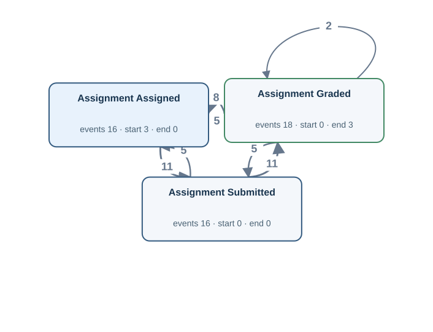</a></td><td width="58%" valign="top">
<a href="../../../datasets/universityflow/private/gold_sql/OU09E.sql">Gold SQL</a> · <a href="../../../datasets/universityflow/private/gold_logs/OU09E.csv">Gold CSV</a> · <a href="../../../datasets/universityflow/input/database.sqlite">Full source database (SQLite)</a>

<code>assignment</code> · 16 matched source rows
<table><tr><th>Column</th><th>Row 1</th><th>Row 2</th><th>Row 3</th></tr><tr><th>assignment_id</th><td>A003</td><td>A006</td><td>A018</td></tr><tr><th>student_id</th><td>S003</td><td>S006</td><td>S018</td></tr><tr><th>assignment_content</th><td>Synthetic assignment content</td><td>Synthetic assignment content</td><td>Synthetic assignment content</td></tr><tr><th>assignment_assigned_at</th><td>2026-02-08T14:00:00Z</td><td>2026-02-11T14:00:00Z</td><td>2026-02-23T14:00:00Z</td></tr><tr><th>assignment_submitted_at</th><td>2026-02-10T14:00:00Z</td><td>2026-02-13T14:00:00Z</td><td>2026-02-25T14:00:00Z</td></tr><tr><th>assignment_grade_finalized_at</th><td>2026-02-14T14:00:00Z</td><td>2026-02-17T14:00:00Z</td><td>2026-03-01T14:00:00Z</td></tr><tr><th>assignment_revision_requested_at</th><td><em>NULL</em></td><td><em>NULL</em></td><td><em>NULL</em></td></tr><tr><th>assignment_resubmitted_at</th><td><em>NULL</em></td><td><em>NULL</em></td><td><em>NULL</em></td></tr></table>
<strong>Gold output for the same source rows</strong>
<ul><li>Row 1 → Assignment Assigned · event LC:assignment:A003:1 · case I01 · time from <code>assignment_assigned_at</code></li><li>Row 1 → Assignment Submitted · event LC:assignment:A003:2 · case I01 · time from <code>assignment_submitted_at</code></li><li>Row 2 → Assignment Assigned · event LC:assignment:A006:1 · case I01 · time from <code>assignment_assigned_at</code></li><li>Row 2 → Assignment Submitted · event LC:assignment:A006:2 · case I01 · time from <code>assignment_submitted_at</code></li><li>Row 3 → Assignment Assigned · event LC:assignment:A018:1 · case I01 · time from <code>assignment_assigned_at</code></li><li>Row 3 → Assignment Submitted · event LC:assignment:A018:2 · case I01 · time from <code>assignment_submitted_at</code></li></ul>

<code>assignment_grading</code> · 18 matched source rows
<table><tr><th>Column</th><th>Row 1</th><th>Row 2</th><th>Row 3</th></tr><tr><th>assignment_id</th><td>A003</td><td>A006</td><td>A018</td></tr><tr><th>instructor_id</th><td>I01</td><td>I01</td><td>I01</td></tr><tr><th>grading_time</th><td>2026-02-12T14:00:00Z</td><td>2026-02-15T14:00:00Z</td><td>2026-02-27T14:00:00Z</td></tr><tr><th>score</th><td>70</td><td>70</td><td>70</td></tr><tr><th>evaluation</th><td>Initial feedback</td><td>Initial feedback</td><td>Initial feedback</td></tr><tr><th>grading_kind</th><td>ORIGINAL</td><td>ORIGINAL</td><td>ORIGINAL</td></tr><tr><th>reassessment_event_id</th><td><em>NULL</em></td><td><em>NULL</em></td><td><em>NULL</em></td></tr></table>
<strong>Gold output for the same source rows</strong>
<ul><li>Row 1 → Assignment Graded · event GRADE:A003:I01:2026-02-12T14:00:00Z · case I01 · time from <code>grading_time</code></li><li>Row 2 → Assignment Graded · event GRADE:A006:I01:2026-02-15T14:00:00Z · case I01 · time from <code>grading_time</code></li><li>Row 3 → Assignment Graded · event GRADE:A018:I01:2026-02-27T14:00:00Z · case I01 · time from <code>grading_time</code></li></ul>
</td></tr></table>

## OU09EP — Q2

For each instructor, build a timeline of coursework being set for the student, the student handing in coursework, an instructor assessing the assignment.

Events: **50** · Cases with events: **3** · Activities: **3** · Edges: **7** · Source tables: **2** · SQL tables: **9**

<table><tr><td width="42%" valign="top"></td><td width="58%" valign="top">
<a href="../../../datasets/universityflow/private/gold_sql/OU09EP.sql">Gold SQL</a> · <a href="../../../datasets/universityflow/private/gold_logs/OU09EP.csv">Gold CSV</a> · <a href="../../../datasets/universityflow/input/database.sqlite">Full source database (SQLite)</a>

<code>assignment</code> · 16 matched source rows
<table><tr><th>Column</th><th>Row 1</th><th>Row 2</th><th>Row 3</th></tr><tr><th>assignment_id</th><td>A003</td><td>A006</td><td>A018</td></tr><tr><th>student_id</th><td>S003</td><td>S006</td><td>S018</td></tr><tr><th>assignment_content</th><td>Synthetic assignment content</td><td>Synthetic assignment content</td><td>Synthetic assignment content</td></tr><tr><th>assignment_assigned_at</th><td>2026-02-08T14:00:00Z</td><td>2026-02-11T14:00:00Z</td><td>2026-02-23T14:00:00Z</td></tr><tr><th>assignment_submitted_at</th><td>2026-02-10T14:00:00Z</td><td>2026-02-13T14:00:00Z</td><td>2026-02-25T14:00:00Z</td></tr><tr><th>assignment_grade_finalized_at</th><td>2026-02-14T14:00:00Z</td><td>2026-02-17T14:00:00Z</td><td>2026-03-01T14:00:00Z</td></tr><tr><th>assignment_revision_requested_at</th><td><em>NULL</em></td><td><em>NULL</em></td><td><em>NULL</em></td></tr><tr><th>assignment_resubmitted_at</th><td><em>NULL</em></td><td><em>NULL</em></td><td><em>NULL</em></td></tr></table>
<strong>Gold output for the same source rows</strong>
<ul><li>Row 1 → Assignment Assigned · event LC:assignment:A003:1 · case I01 · time from <code>assignment_assigned_at</code></li><li>Row 1 → Assignment Submitted · event LC:assignment:A003:2 · case I01 · time from <code>assignment_submitted_at</code></li><li>Row 2 → Assignment Assigned · event LC:assignment:A006:1 · case I01 · time from <code>assignment_assigned_at</code></li><li>Row 2 → Assignment Submitted · event LC:assignment:A006:2 · case I01 · time from <code>assignment_submitted_at</code></li><li>Row 3 → Assignment Assigned · event LC:assignment:A018:1 · case I01 · time from <code>assignment_assigned_at</code></li><li>Row 3 → Assignment Submitted · event LC:assignment:A018:2 · case I01 · time from <code>assignment_submitted_at</code></li></ul>

<code>assignment_grading</code> · 18 matched source rows
<table><tr><th>Column</th><th>Row 1</th><th>Row 2</th><th>Row 3</th></tr><tr><th>assignment_id</th><td>A003</td><td>A006</td><td>A018</td></tr><tr><th>instructor_id</th><td>I01</td><td>I01</td><td>I01</td></tr><tr><th>grading_time</th><td>2026-02-12T14:00:00Z</td><td>2026-02-15T14:00:00Z</td><td>2026-02-27T14:00:00Z</td></tr><tr><th>score</th><td>70</td><td>70</td><td>70</td></tr><tr><th>evaluation</th><td>Initial feedback</td><td>Initial feedback</td><td>Initial feedback</td></tr><tr><th>grading_kind</th><td>ORIGINAL</td><td>ORIGINAL</td><td>ORIGINAL</td></tr><tr><th>reassessment_event_id</th><td><em>NULL</em></td><td><em>NULL</em></td><td><em>NULL</em></td></tr></table>
<strong>Gold output for the same source rows</strong>
<ul><li>Row 1 → Assignment Graded · event GRADE:A003:I01:2026-02-12T14:00:00Z · case I01 · time from <code>grading_time</code></li><li>Row 2 → Assignment Graded · event GRADE:A006:I01:2026-02-15T14:00:00Z · case I01 · time from <code>grading_time</code></li><li>Row 3 → Assignment Graded · event GRADE:A018:I01:2026-02-27T14:00:00Z · case I01 · time from <code>grading_time</code></li></ul>
</td></tr></table>

## OU10P — Q4

Show the complete recorded history associated with each assignment grading record.

Events: **25** · Cases with events: **25** · Activities: **2** · Edges: **0** · Source tables: **1** · SQL tables: **9**

<table><tr><td width="42%" valign="top"></td><td width="58%" valign="top">
<a href="../../../datasets/universityflow/private/gold_sql/OU10P.sql">Gold SQL</a> · <a href="../../../datasets/universityflow/private/gold_logs/OU10P.csv">Gold CSV</a> · <a href="../../../datasets/universityflow/input/database.sqlite">Full source database (SQLite)</a>

<code>assignment_grading</code> · 25 matched source rows
<table><tr><th>Column</th><th>Row 1</th><th>Row 2</th><th>Row 3</th></tr><tr><th>assignment_id</th><td>A002</td><td>A002</td><td>A003</td></tr><tr><th>instructor_id</th><td>I03</td><td>I03</td><td>I01</td></tr><tr><th>grading_time</th><td>2026-02-11T14:00:00Z</td><td>2026-02-13T02:00:00Z</td><td>2026-02-12T14:00:00Z</td></tr><tr><th>score</th><td>70</td><td>75</td><td>70</td></tr><tr><th>evaluation</th><td>Initial feedback</td><td>Authored synthetic reassessment score and feedback</td><td>Initial feedback</td></tr><tr><th>grading_kind</th><td>ORIGINAL</td><td>REASSESSMENT</td><td>ORIGINAL</td></tr><tr><th>reassessment_event_id</th><td><em>NULL</em></td><td>LC:assignment:A002:5</td><td><em>NULL</em></td></tr></table>
<strong>Gold output for the same source rows</strong>
<ul><li>Row 1 → Assignment Graded · event GRADE:A002:I03:2026-02-11T14:00:00Z · case A002:I03:2026-02-11T14:00:00Z · time from <code>grading_time</code></li><li>Row 2 → Assignment Regraded · event LC:assignment:A002:5 · case A002:I03:2026-02-13T02:00:00Z · time from <code>grading_time</code></li><li>Row 3 → Assignment Graded · event GRADE:A003:I01:2026-02-12T14:00:00Z · case A003:I01:2026-02-12T14:00:00Z · time from <code>grading_time</code></li></ul>

FK-linked case and join evidence
<ul><li><code>assignment_grading</code> → <code>assignment</code> · assignment_id → assignment_id · assignment_id = A002</li></ul>
</td></tr></table>

## OU10E — Q1

Extract Assignment Graded events for each assignment grading record.

Events: **18** · Cases with events: **18** · Activities: **1** · Edges: **0** · Source tables: **1** · SQL tables: **9**

<table><tr><td width="42%" valign="top"><a href="graphs/OU10E.svg">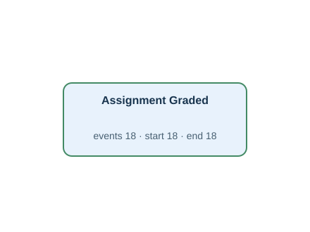</a></td><td width="58%" valign="top">
<a href="../../../datasets/universityflow/private/gold_sql/OU10E.sql">Gold SQL</a> · <a href="../../../datasets/universityflow/private/gold_logs/OU10E.csv">Gold CSV</a> · <a href="../../../datasets/universityflow/input/database.sqlite">Full source database (SQLite)</a>

<code>assignment_grading</code> · 18 matched source rows
<table><tr><th>Column</th><th>Row 1</th><th>Row 2</th><th>Row 3</th></tr><tr><th>assignment_id</th><td>A002</td><td>A003</td><td>A006</td></tr><tr><th>instructor_id</th><td>I03</td><td>I01</td><td>I01</td></tr><tr><th>grading_time</th><td>2026-02-11T14:00:00Z</td><td>2026-02-12T14:00:00Z</td><td>2026-02-15T14:00:00Z</td></tr><tr><th>score</th><td>70</td><td>70</td><td>70</td></tr><tr><th>evaluation</th><td>Initial feedback</td><td>Initial feedback</td><td>Initial feedback</td></tr><tr><th>grading_kind</th><td>ORIGINAL</td><td>ORIGINAL</td><td>ORIGINAL</td></tr><tr><th>reassessment_event_id</th><td><em>NULL</em></td><td><em>NULL</em></td><td><em>NULL</em></td></tr></table>
<strong>Gold output for the same source rows</strong>
<ul><li>Row 1 → Assignment Graded · event GRADE:A002:I03:2026-02-11T14:00:00Z · case A002:I03:2026-02-11T14:00:00Z · time from <code>grading_time</code></li><li>Row 2 → Assignment Graded · event GRADE:A003:I01:2026-02-12T14:00:00Z · case A003:I01:2026-02-12T14:00:00Z · time from <code>grading_time</code></li><li>Row 3 → Assignment Graded · event GRADE:A006:I01:2026-02-15T14:00:00Z · case A006:I01:2026-02-15T14:00:00Z · time from <code>grading_time</code></li></ul>

FK-linked case and join evidence
<ul><li><code>assignment_grading</code> → <code>assignment</code> · assignment_id → assignment_id · assignment_id = A002</li></ul>
</td></tr></table>

## OU10EP — Q2

For each assignment grading record, build a timeline of an instructor assessing the assignment.

Events: **18** · Cases with events: **18** · Activities: **1** · Edges: **0** · Source tables: **1** · SQL tables: **9**

<table><tr><td width="42%" valign="top"></td><td width="58%" valign="top">
<a href="../../../datasets/universityflow/private/gold_sql/OU10EP.sql">Gold SQL</a> · <a href="../../../datasets/universityflow/private/gold_logs/OU10EP.csv">Gold CSV</a> · <a href="../../../datasets/universityflow/input/database.sqlite">Full source database (SQLite)</a>

<code>assignment_grading</code> · 18 matched source rows
<table><tr><th>Column</th><th>Row 1</th><th>Row 2</th><th>Row 3</th></tr><tr><th>assignment_id</th><td>A002</td><td>A003</td><td>A006</td></tr><tr><th>instructor_id</th><td>I03</td><td>I01</td><td>I01</td></tr><tr><th>grading_time</th><td>2026-02-11T14:00:00Z</td><td>2026-02-12T14:00:00Z</td><td>2026-02-15T14:00:00Z</td></tr><tr><th>score</th><td>70</td><td>70</td><td>70</td></tr><tr><th>evaluation</th><td>Initial feedback</td><td>Initial feedback</td><td>Initial feedback</td></tr><tr><th>grading_kind</th><td>ORIGINAL</td><td>ORIGINAL</td><td>ORIGINAL</td></tr><tr><th>reassessment_event_id</th><td><em>NULL</em></td><td><em>NULL</em></td><td><em>NULL</em></td></tr></table>
<strong>Gold output for the same source rows</strong>
<ul><li>Row 1 → Assignment Graded · event GRADE:A002:I03:2026-02-11T14:00:00Z · case A002:I03:2026-02-11T14:00:00Z · time from <code>grading_time</code></li><li>Row 2 → Assignment Graded · event GRADE:A003:I01:2026-02-12T14:00:00Z · case A003:I01:2026-02-12T14:00:00Z · time from <code>grading_time</code></li><li>Row 3 → Assignment Graded · event GRADE:A006:I01:2026-02-15T14:00:00Z · case A006:I01:2026-02-15T14:00:00Z · time from <code>grading_time</code></li></ul>

FK-linked case and join evidence
<ul><li><code>assignment_grading</code> → <code>assignment</code> · assignment_id → assignment_id · assignment_id = A002</li></ul>
</td></tr></table>

## OU11P — Q4

Show the complete recorded history associated with each course-design task.

Events: **11** · Cases with events: **3** · Activities: **4** · Edges: **3** · Source tables: **1** · SQL tables: **9**

<table><tr><td width="42%" valign="top"></td><td width="58%" valign="top">
<a href="../../../datasets/universityflow/private/gold_sql/OU11P.sql">Gold SQL</a> · <a href="../../../datasets/universityflow/private/gold_logs/OU11P.csv">Gold CSV</a> · <a href="../../../datasets/universityflow/input/database.sqlite">Full source database (SQLite)</a>

<code>task</code> · 3 matched source rows
<table><tr><th>Column</th><th>Row 1</th><th>Row 2</th><th>Row 3</th></tr><tr><th>task_id</th><td>T01</td><td>T02</td><td>T03</td></tr><tr><th>task_title</th><td>Course Design Task 1</td><td>Course Design Task 2</td><td>Course Design Task 3</td></tr><tr><th>task_description</th><td>Analyze simulation output</td><td>Analyze simulation output</td><td>Analyze simulation output</td></tr><tr><th>task_start_date</th><td>2026-02-01</td><td>2026-02-01</td><td>2026-02-01</td></tr><tr><th>task_end_date</th><td>2026-05-31</td><td>2026-05-31</td><td>2026-05-31</td></tr><tr><th>task_location</th><td>Teaching Laboratory</td><td>Teaching Laboratory</td><td>Teaching Laboratory</td></tr><tr><th>design_task_created_at</th><td>2025-12-31T00:00:00Z</td><td>2026-01-01T00:00:00Z</td><td>2026-01-02T00:00:00Z</td></tr><tr><th>design_task_approved_at</th><td>2026-01-01T00:00:00Z</td><td>2026-01-02T00:00:00Z</td><td>2026-01-03T00:00:00Z</td></tr><tr><th>design_task_published_at</th><td>2026-01-02T00:00:00Z</td><td>2026-01-03T00:00:00Z</td><td>2026-01-04T00:00:00Z</td></tr><tr><th>design_task_closed_at</th><td><em>NULL</em></td><td>2026-02-03T00:00:00Z</td><td>2026-02-04T00:00:00Z</td></tr></table>
<strong>Gold output for the same source rows</strong>
<ul><li>Row 1 → Design Task Created · event LC:task:T01:1 · case T01 · time from <code>design_task_created_at</code></li><li>Row 1 → Design Task Approved · event LC:task:T01:2 · case T01 · time from <code>design_task_approved_at</code></li><li>Row 1 → Design Task Published · event LC:task:T01:3 · case T01 · time from <code>design_task_published_at</code></li><li>Row 2 → Design Task Created · event LC:task:T02:1 · case T02 · time from <code>design_task_created_at</code></li><li>Row 2 → Design Task Approved · event LC:task:T02:2 · case T02 · time from <code>design_task_approved_at</code></li><li>Row 2 → Design Task Published · event LC:task:T02:3 · case T02 · time from <code>design_task_published_at</code></li><li>Row 2 → Design Task Closed · event LC:task:T02:4 · case T02 · time from <code>design_task_closed_at</code></li><li>Row 3 → Design Task Created · event LC:task:T03:1 · case T03 · time from <code>design_task_created_at</code></li><li>Row 3 → Design Task Approved · event LC:task:T03:2 · case T03 · time from <code>design_task_approved_at</code></li><li>Row 3 → Design Task Published · event LC:task:T03:3 · case T03 · time from <code>design_task_published_at</code></li><li>Row 3 → Design Task Closed · event LC:task:T03:4 · case T03 · time from <code>design_task_closed_at</code></li></ul>
</td></tr></table>

## OU11E — Q1

Extract Design Task Approved, Design Task Closed, Design Task Created events for each course-design task.

Events: **8** · Cases with events: **3** · Activities: **3** · Edges: **2** · Source tables: **1** · SQL tables: **9**

<table><tr><td width="42%" valign="top"><a href="graphs/OU11E.svg">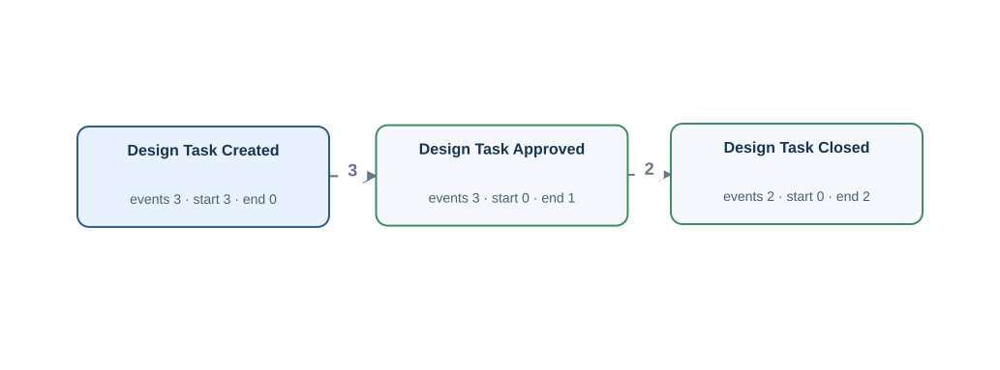</a></td><td width="58%" valign="top">
<a href="../../../datasets/universityflow/private/gold_sql/OU11E.sql">Gold SQL</a> · <a href="../../../datasets/universityflow/private/gold_logs/OU11E.csv">Gold CSV</a> · <a href="../../../datasets/universityflow/input/database.sqlite">Full source database (SQLite)</a>

<code>task</code> · 3 matched source rows
<table><tr><th>Column</th><th>Row 1</th><th>Row 2</th><th>Row 3</th></tr><tr><th>task_id</th><td>T01</td><td>T02</td><td>T03</td></tr><tr><th>task_title</th><td>Course Design Task 1</td><td>Course Design Task 2</td><td>Course Design Task 3</td></tr><tr><th>task_description</th><td>Analyze simulation output</td><td>Analyze simulation output</td><td>Analyze simulation output</td></tr><tr><th>task_start_date</th><td>2026-02-01</td><td>2026-02-01</td><td>2026-02-01</td></tr><tr><th>task_end_date</th><td>2026-05-31</td><td>2026-05-31</td><td>2026-05-31</td></tr><tr><th>task_location</th><td>Teaching Laboratory</td><td>Teaching Laboratory</td><td>Teaching Laboratory</td></tr><tr><th>design_task_created_at</th><td>2025-12-31T00:00:00Z</td><td>2026-01-01T00:00:00Z</td><td>2026-01-02T00:00:00Z</td></tr><tr><th>design_task_approved_at</th><td>2026-01-01T00:00:00Z</td><td>2026-01-02T00:00:00Z</td><td>2026-01-03T00:00:00Z</td></tr><tr><th>design_task_published_at</th><td>2026-01-02T00:00:00Z</td><td>2026-01-03T00:00:00Z</td><td>2026-01-04T00:00:00Z</td></tr><tr><th>design_task_closed_at</th><td><em>NULL</em></td><td>2026-02-03T00:00:00Z</td><td>2026-02-04T00:00:00Z</td></tr></table>
<strong>Gold output for the same source rows</strong>
<ul><li>Row 1 → Design Task Created · event LC:task:T01:1 · case T01 · time from <code>design_task_created_at</code></li><li>Row 1 → Design Task Approved · event LC:task:T01:2 · case T01 · time from <code>design_task_approved_at</code></li><li>Row 2 → Design Task Created · event LC:task:T02:1 · case T02 · time from <code>design_task_created_at</code></li><li>Row 2 → Design Task Approved · event LC:task:T02:2 · case T02 · time from <code>design_task_approved_at</code></li><li>Row 2 → Design Task Closed · event LC:task:T02:4 · case T02 · time from <code>design_task_closed_at</code></li><li>Row 3 → Design Task Created · event LC:task:T03:1 · case T03 · time from <code>design_task_created_at</code></li><li>Row 3 → Design Task Approved · event LC:task:T03:2 · case T03 · time from <code>design_task_approved_at</code></li><li>Row 3 → Design Task Closed · event LC:task:T03:4 · case T03 · time from <code>design_task_closed_at</code></li></ul>
</td></tr></table>

## OU11EP — Q2

For each course-design task, build a timeline of a design exercise receiving approval, a design exercise being closed, a design exercise being prepared.

Events: **8** · Cases with events: **3** · Activities: **3** · Edges: **2** · Source tables: **1** · SQL tables: **9**

<table><tr><td width="42%" valign="top"></td><td width="58%" valign="top">
<a href="../../../datasets/universityflow/private/gold_sql/OU11EP.sql">Gold SQL</a> · <a href="../../../datasets/universityflow/private/gold_logs/OU11EP.csv">Gold CSV</a> · <a href="../../../datasets/universityflow/input/database.sqlite">Full source database (SQLite)</a>

<code>task</code> · 3 matched source rows
<table><tr><th>Column</th><th>Row 1</th><th>Row 2</th><th>Row 3</th></tr><tr><th>task_id</th><td>T01</td><td>T02</td><td>T03</td></tr><tr><th>task_title</th><td>Course Design Task 1</td><td>Course Design Task 2</td><td>Course Design Task 3</td></tr><tr><th>task_description</th><td>Analyze simulation output</td><td>Analyze simulation output</td><td>Analyze simulation output</td></tr><tr><th>task_start_date</th><td>2026-02-01</td><td>2026-02-01</td><td>2026-02-01</td></tr><tr><th>task_end_date</th><td>2026-05-31</td><td>2026-05-31</td><td>2026-05-31</td></tr><tr><th>task_location</th><td>Teaching Laboratory</td><td>Teaching Laboratory</td><td>Teaching Laboratory</td></tr><tr><th>design_task_created_at</th><td>2025-12-31T00:00:00Z</td><td>2026-01-01T00:00:00Z</td><td>2026-01-02T00:00:00Z</td></tr><tr><th>design_task_approved_at</th><td>2026-01-01T00:00:00Z</td><td>2026-01-02T00:00:00Z</td><td>2026-01-03T00:00:00Z</td></tr><tr><th>design_task_published_at</th><td>2026-01-02T00:00:00Z</td><td>2026-01-03T00:00:00Z</td><td>2026-01-04T00:00:00Z</td></tr><tr><th>design_task_closed_at</th><td><em>NULL</em></td><td>2026-02-03T00:00:00Z</td><td>2026-02-04T00:00:00Z</td></tr></table>
<strong>Gold output for the same source rows</strong>
<ul><li>Row 1 → Design Task Created · event LC:task:T01:1 · case T01 · time from <code>design_task_created_at</code></li><li>Row 1 → Design Task Approved · event LC:task:T01:2 · case T01 · time from <code>design_task_approved_at</code></li><li>Row 2 → Design Task Created · event LC:task:T02:1 · case T02 · time from <code>design_task_created_at</code></li><li>Row 2 → Design Task Approved · event LC:task:T02:2 · case T02 · time from <code>design_task_approved_at</code></li><li>Row 2 → Design Task Closed · event LC:task:T02:4 · case T02 · time from <code>design_task_closed_at</code></li><li>Row 3 → Design Task Created · event LC:task:T03:1 · case T03 · time from <code>design_task_created_at</code></li><li>Row 3 → Design Task Approved · event LC:task:T03:2 · case T03 · time from <code>design_task_approved_at</code></li><li>Row 3 → Design Task Closed · event LC:task:T03:4 · case T03 · time from <code>design_task_closed_at</code></li></ul>
</td></tr></table>
