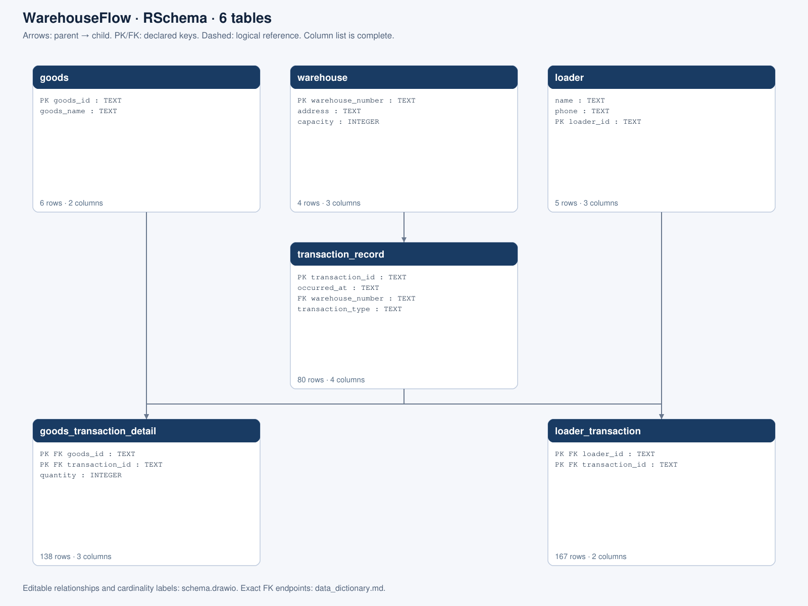

# WarehouseFlow RSchema v1

An English source-preserving synthetic benchmark built from an actual
RSchema requirement/schema pair, rather than only adopting SchemaAgent stages.
It is independent of ProcureFlow and PlateFlow.

## Source and adaptation

Repository: https://github.com/hnuGraph/LLM4DBdesign

Record: 67552f0a13602ec03b41a78e, line 3 of
datasets/RSchema/annotation.jsonl. The pinned commit and original record hash
are in source/provenance.json. source/rschema_original.json preserves the
selected requirement and logical schema. source/requirements_original.md
preserves the requirement text. No SchemaAgent agents were executed.

All six source tables, all 17 attributes, all primary keys (including two
composite keys), and all five foreign-key relationships are retained.
No table or column is added. English identifiers are normalized to snake_case.
The source has casing mismatches between attribute names, PK labels and FK
references. These are resolved case-insensitively; see design/adaptation_report.json.
These local defects do not prevent reuse of the selected record.

The logical annotation lacks physical data types and a transaction-type code
domain. SQLite types, constraints, IN/OUT meanings, UTC completion-time
convention and simulation stock/capacity rules are authored adaptations.
The conceptual model is derived from the logical annotation, not an original
conceptual-model artifact supplied by the benchmark.

## Structure

Warehouse, Goods and Loader are masters. Transaction record is an inbound or
outbound task header. Goods transaction details and loader transaction records
are composite-key bridges. Many goods and workers can participate in one task.
All information required by the original warehouse scenario is materialized.

The source does not model purchase requests, approvals, orders or receipts as
a single purchase lifecycle. This warehouse scenario replaces ProcureFlow as
the source-grounded first example; do not relabel old ProcureFlow as RSchema-derived.
Warehouse cases group recorded tasks, not paired shipment lifecycles.

## Reproduce

Python 3.10+, standard library only:

    python build.py

Run in a writable copy. Generated artifacts are overwritten.
The frozen source record is sufficient; no network or entire RSchema download
is needed to rebuild.

## Gold and model separation

Provide only input/ to the evaluated model. Withhold source/, design/, private/,
build.py and validation_report.json; the logical source answer and code can
reveal oracle extraction choices.

The task catalog fixes warehouse cases and IN/OUT business activity labels,
without physical SQL mappings: this is a catalog-assisted setting.
R01/R02, R03/R04 and R05/R06 form semantic/paraphrase pairs. R07 is unsupported
because task start times are absent.

Gold logs come from canonical task histories, independently of SQL extraction.
Gold ES comes from persistence mappings and compiles to UNION ALL SQL.
Six answerable questions are checked for exact event-log equality.
Each task is one event even when it has multiple goods and workers. A naive
join of both detail bridges yields 289 rows from 80 transactions in this instance;
that expansion must not be interpreted as 289 business events.

The fixture-local ES contract has not been adapted to the existing NL2EventLog
schema. Logs are classic case-centric CSVs, not OCEL. Gold and generator share
authored semantics: this is a development fixture, not a held-out test.

## Scope and limits

Data types and value-domain meanings are new physical-design choices, not
original annotations. Code values do not establish code meanings for other
RSchema samples. Exact SQL/gold equality is a consistency result, not model
accuracy. The dictionary uses a practical custom metadata profile, without
an ISO/IEC 11179 conformity claim. No task-start, duration, approval or
purchase-order history is invented to make the original scenario richer.

## Schema and documentation

- [Table inventory and relationships](docs/schema_overview.md)
- [English column dictionary](docs/data_dictionary.md)
- [CSV dictionary](docs/data_dictionary.csv)
- [Editable draw.io diagram](docs/schema.drawio)
- [SVG diagram](docs/schema.svg)
