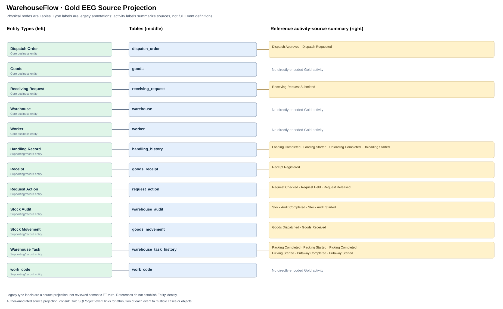
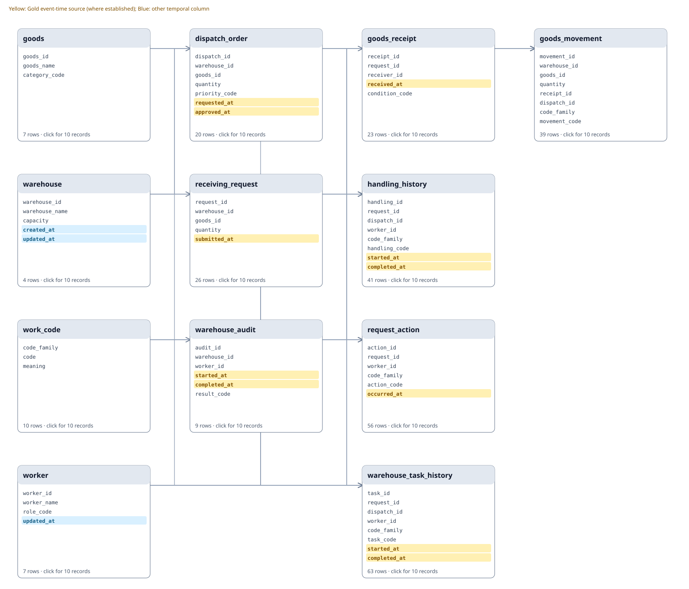

# WarehouseFlow

WarehouseFlow is a synthetic warehouse operations database covering goods, receiving requests, dispatch, stock movement, handling, worker tasks and audits. It uses authored business records rather than observed warehouse transactions.

## Dataset overview

| Tables | Entity Type candidates | Core business concepts | Gold SQL/CSV pairs verified |
|---:|---:|---:|---:|
| 12 | 12 | 5 | 40 |

## Explore the dataset

- [Gold Event Extraction Graph (EEG) Source Projection and real table records](review/database/README.md)
- [Editable Draw.io relational diagram](docs/schema.drawio)
- [Per-question Gold DFGs](review/gold_dfg/README.md)
- [Business Data Dictionary](input/data_dictionary.json)
- [Gold object membership and source bindings](review/gold_dfg/event_graph.md)

## Schema and process semantics

Entity Types classify business targets by meaning and instance granularity; Tables preserve physical storage. Semantic ET grouping and instance identity resolution are separate tasks.
Event timestamps and activity codes are interpreted using the Data Dictionary and their source-table context. The Gold event-log oracle is stored separately from normal model inputs.

## Evidence and relational schema

## Questions

[**Full question list, types and answerability**](docs/questions.md) · [Question texts (JSONL)](evaluation/model_questions.jsonl) · [Question-level Gold DFGs and source records](review/gold_dfg/README.md)

The checked-in question file contains **40 requests**. Explicit requests enumerate activities; implicit requests ask for a recorded lifecycle. Paired paraphrases, where present, are listed in the question documentation.

Browse all 40 question texts

| ID | Request |
|---|---|
| W03 | For each dispatch order, extract Dispatch Requested and Dispatch Approved events. |
| W03P | For every dispatch order, show when dispatch was requested and when it was approved. |
| W06 | For each request action record, extract Request Checked, Request Held and Request Released events. |
| W06P | For each individual request action record, show the checking, holding or releasing action that was recorded. |
| W07 | For each warehouse task, extract Putaway Started, Putaway Completed, Picking Started, Picking Completed, Packing Started and Packing Completed events. |
| W07P | For every warehouse task, show the recorded beginnings and completions of putaway, picking or packing, as applicable. |
| W08 | For each handling record, extract Unloading Started, Unloading Completed, Loading Started and Loading Completed events. |
| W08P | For each handling record, show when unloading or loading began and finished, as applicable. |
| W09 | For each warehouse, extract Stock Audit Started, Stock Audit Completed, Putaway Started, Putaway Completed, Loading Started and Loading Completed events. |
| W09P | For each warehouse, show the beginnings and completions of its stock audits, putaway work and loading work. |
| W10 | For each receiving request, extract Unloading Started, Unloading Completed, Receipt Registered, Goods Received, Putaway Started and Putaway Completed events. |
| W10P | For every receiving request, show the start and completion of unloading, registration of the receipt, receipt into warehouse stock, and the start and completion of putaway. |
| W11 | For each dispatch order, extract Picking Started, Picking Completed, Packing Started, Packing Completed, Loading Started, Loading Completed and Goods Dispatched events. |
| W11P | For each dispatch order, show when picking, packing and loading began and finished, together with the dispatch of goods from stock. |
| W12 | For each worker, extract Stock Audit Started, Stock Audit Completed, Picking Started and Picking Completed events. |
| W12P | For every worker, show when their stock audits and picking work began and finished. |
| W13 | For each goods type, extract Goods Received and Goods Dispatched events. |
| W13P | For each goods type, show its recorded receipts into warehouse stock and dispatches from stock. |
| W14 | For each receipt record, extract Receipt Registered and Goods Received events. |
| W14P | For every individual receipt record, show its registration and the corresponding receipt of goods into stock. |
| WF01 | Extract the full recorded lifecycle for each warehouse. |
| WF01P | Show the complete recorded history of each warehouse. |
| WF02 | Extract the full recorded lifecycle for each goods type. |
| WF02P | Build the entire recorded timeline associated with every goods type. |
| WF03 | Extract the full recorded lifecycle for each worker. |
| WF03P | Show every worker's full recorded history. |
| WF04 | Extract the full recorded lifecycle for each receiving request. |
| WF04P | Trace each receiving request through its complete recorded lifecycle. |
| WF05 | Extract the full recorded lifecycle for each receipt record. |
| WF05P | Show the entire recorded history associated with each individual receipt record. |
| WF06 | Extract the full recorded lifecycle for each dispatch order. |
| WF06P | Build a complete recorded timeline for every dispatch order. |
| WF08 | Extract the full recorded lifecycle for each stock movement record. |
| WF08P | Trace each individual stock movement record through its entire recorded history. |
| WF09 | Extract the full recorded lifecycle for each request action record. |
| WF09P | Show the complete recorded history of every individual request action record. |
| WF10 | Extract the full recorded lifecycle for each warehouse task. |
| WF10P | Build the full recorded lifecycle of each warehouse task. |
| WF11 | Extract the full recorded lifecycle for each handling record. |
| WF11P | Trace every individual handling record through its complete recorded history. |

## Model input boundary

This README, diagrams, table previews and Gold evidence are reader/reviewer material. Do not supply Gold annotations or review materials to the model.

## Entity terminology

Physical storage is described as Tables and Keys. A table may identify or reference several Entity Types through different keys; a single Entity can appear in several tables. The displayed type labels are legacy author annotations, not validated semantic ET truth. Type classification, Entity identity resolution, and event attribution are separate decisions.

[Canonical terminology and stage contracts](../../docs/system/EEG_ENTITY_MODEL.md). Step 2 uses explicit activities or implicit recorded history with optional process focus; legacy reference logs retain their original scopes.
