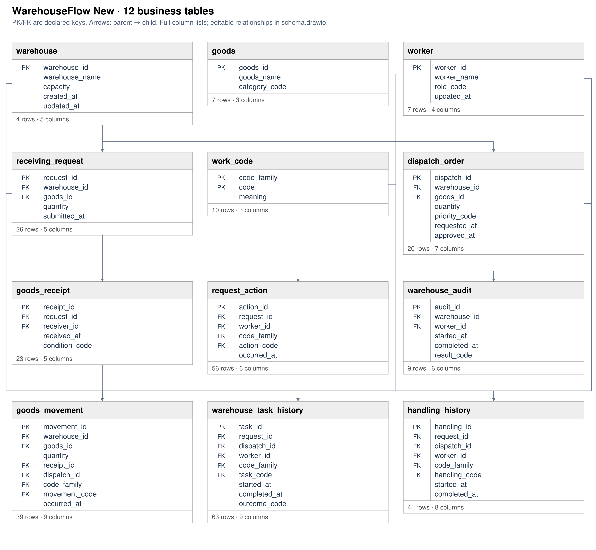

# WarehouseFlow New dataset

- **Purpose:** evaluate timestamp-bearing event candidates using two separate axes: physical identification of base activity, and occurrence timestamp phase.
- **Domain:** synthetic warehouse receiving, dispatch, stock movement, handling and audits. Original WarehouseFlow/RSchema warehouse, goods and worker roles informed the domain; new table structures and all rows are authored.
- **Build:** `python datasets/warehouseflow_new/build.py`. **Validate:** `python datasets/warehouseflow_new/validate.py` from the repository root. Standard-library simulation; PyMuPDF for PNG rendering.

| Dataset | Tables | Object / case types | Activity types | Timestamp columns | Event timestamp columns | Distinct events | Questions | Gold CSVs |
| --- | --- | --- | --- | --- | --- | --- | --- | --- |
| WarehouseFlow New | 12 | 11 | 15 | 15 | 12 | 402 | 54 | 50 |

- **Base activity identities:** 15. **Phase-specific display labels:** 21. These are different counts; they must not be conflated.

## Table classification and activity carriers — author reference only

- Timestamp presence proposes a candidate; technical warehouse/worker maintenance times are not business occurrences.
- A code is an activity carrier only if its values select different kinds of action. Goods category, worker role, dispatch urgency, goods condition, audit result and task outcome are not carriers.
- Base activity identity and occurrence phase remain separate. Case D uses Row identity with start/complete timestamp bindings; it may be described as a mixed representation only if both axes are retained.
- This dataset deliberately has 2 tables for each case A–D plus 4 context/reference tables. There is no classification or carrier answer in the model-facing dictionary.

| Table | Case A–D | Base activity identity | Activity carrier | Stored and emitted phase |
| --- | --- | --- | --- | --- |
| warehouse | Context | No direct business events | None | technical or absent |
| goods | Context | No direct business events | None | technical or absent |
| worker | Context | No direct business events | None | technical or absent |
| work_code | Context | No direct business events | None | technical or absent |
| receiving_request | A | Column | None | one point |
| goods_receipt | A | Column | None | one point |
| dispatch_order | B | Column | None | separate milestones |
| warehouse_audit | B | Column | None | start + complete |
| goods_movement | C | Row | movement_code | one completion |
| request_action | C | Row | action_code | one completion |
| warehouse_task_history | D | Row | task_code | start + complete |
| handling_history | D | Row | handling_code | start + complete |

- **A:** receiving_request and goods_receipt each have one actual timestamp and no activity carrier. A receipt condition code does not change the fixed receipt-registration activity.
- **B:** dispatch_order stores separate request/approval milestones without an activity carrier. warehouse_audit stores the start and completion of one Stock Audit occurrence; PASS/RECOUNT are outcomes, not extra activity kinds.
- **C:** goods_movement.movement_code selects inbound/outbound work using one occurred_at. request_action.action_code selects checking/holding/releasing using one occurred_at.
- **D:** warehouse_task_history.task_code selects Putaway/Picking/Packing and handling_history.handling_code selects Unloading/Loading; each occurrence has started_at and optional completed_at. Both actual phases are emitted.
- Fixed code_family values provide namespace context, not a second varying activity selector.
- A context table may still define a case population: warehouse, goods and worker timelines obtain actual occurrences through business-key paths from other tables.

## Phase and occurrence contract

- `base_activity` identifies the work kind, e.g. Picking. `lifecycle_phase` is start, complete or point. `occurrence_id` identifies the original work/audit occurrence. These evaluator fields are in private/canonical_history.jsonl and Gold bindings.
- Display labels such as Picking Started and Picking Completed share the same base_activity and occurrence_id but have different event_id values. They are not duplicate events or two unrelated work kinds.
- Exported CSV columns remain event_id, case_id, activity, timestamp. Phase identity is never reconstructed by stripping label suffixes during validation; it comes from independent simulation and source bindings.
- An unfinished occurrence produces its recorded start, not a fabricated completion. A repeated picking attempt has a new task_id and occurrence_id, even if its base activity and parent order are the same.
- Start/end handling is intentional in this variant. The existing PlateFlow New variant retains its earlier completion-only extraction contract; its README explains the resulting A–D coverage gaps.

## Objects, activities and situations

| Case type | Cases | Base activity types | Phase-specific labels | Empty cases | Default recorded scope |
| --- | --- | --- | --- | --- | --- |
| Warehouse | 4 | 15 | 21 | 1 | Dispatch Approved, Dispatch Requested, Goods Dispatched, Goods Received, Loading Completed, Loading Started, Packing Completed, Packing Started, Picking Completed, Picking Started, Putaway Completed, Putaway Started, Receipt Registered, Receiving Request Submitted, Request Checked, Request Held, Request Released, Stock Audit Completed, Stock Audit Started, Unloading Completed, Unloading Started |
| Goods | 7 | 14 | 19 | 1 | Dispatch Approved, Dispatch Requested, Goods Dispatched, Goods Received, Loading Completed, Loading Started, Packing Completed, Packing Started, Picking Completed, Picking Started, Putaway Completed, Putaway Started, Receipt Registered, Receiving Request Submitted, Request Checked, Request Held, Request Released, Unloading Completed, Unloading Started |
| Worker | 7 | 10 | 16 | 1 | Loading Completed, Loading Started, Packing Completed, Packing Started, Picking Completed, Picking Started, Putaway Completed, Putaway Started, Receipt Registered, Request Checked, Request Held, Request Released, Stock Audit Completed, Stock Audit Started, Unloading Completed, Unloading Started |
| Receiving Request | 26 | 8 | 10 | 0 | Goods Received, Putaway Completed, Putaway Started, Receipt Registered, Receiving Request Submitted, Request Checked, Request Held, Request Released, Unloading Completed, Unloading Started |
| Receipt | 23 | 2 | 2 | 0 | Goods Received, Receipt Registered |
| Dispatch Order | 20 | 6 | 9 | 0 | Dispatch Approved, Dispatch Requested, Goods Dispatched, Loading Completed, Loading Started, Packing Completed, Packing Started, Picking Completed, Picking Started |
| Stock Audit | 9 | 1 | 2 | 0 | Stock Audit Completed, Stock Audit Started |
| Stock Movement | 39 | 2 | 2 | 0 | Goods Dispatched, Goods Received |
| Request Action | 56 | 3 | 3 | 0 | Request Checked, Request Held, Request Released |
| Warehouse Task | 63 | 3 | 6 | 0 | Packing Completed, Packing Started, Picking Completed, Picking Started, Putaway Completed, Putaway Started |
| Handling Record | 41 | 2 | 4 | 0 | Loading Completed, Loading Started, Unloading Completed, Unloading Started |

- Scenarios include held receiving requests, repeat checks, unfinished unloading and putaway, unapproved dispatches, repeat picking, unfinished packing/loading, completed/recount/pending audits and idle warehouses/goods/workers.
- Each request/order concerns one goods type. This controlled sample excludes line-item splitting, invoicing and carrier delivery.
- Stock receipts and dispatches are separate from receipt registration. They are distinct recorded business actions with distinct occurrence IDs. Stock never becomes negative or exceeds warehouse capacity.
- Full lifecycle means the declared scope in input/task_context.md. A request/order connects to work through real FK paths; workers connect only through recorded participation. Case scopes do not automatically include all actions of a shared warehouse or worker.
- [Object-specific Gold logs](docs/object_event_logs.md)

## Question types and pairs

| Type | Questions | Answerable | Non-answerable | Avg. requested activity types |
|---|---:|---:|---:|---:|
| Q1 | 16 | 14 | 2 | 3.12 |
| Q2 | 16 | 14 | 2 | 3.12 |
| Q3 | 11 | 11 | 0 | 8.55 |
| Q4 | 11 | 11 | 0 | 8.55 |

- Avg. requested activity types = sum of requested activity-type counts / all questions in that row, including non-answerable questions. WarehouseFlow New counts phase-specific requested labels here and reports base activity counts separately. Q3/Q4 counts use the Gold catalog scope. This counts distinct activity types, not event occurrences.

- Q1/Q2 explicitly name or paraphrase requested activity labels and phases. Q3/Q4 ask for the full recorded lifecycle without listing activities.
- Pairs preserve base-work and phase scope, case population, answerability, ES and exact CSV contents. Average requested labels include unsupported requests.
- [Questions and counts](docs/questions.md) · [Frozen LLM prompts and outputs](source/llm_paraphrases.json)

## Model input boundary

- Supply only input/model_input_manifest.json's allowlist: database, SQL schema, ordinary business dictionary, source-agnostic task context and question text.
- No event-table classification, row/column labels, carrier annotations, phase-selection answers, case bindings or Gold scope catalog are exported in dictionary JSON/Markdown/CSV.
- The dictionary legitimately describes what codes, business times and outcomes mean. The model must infer which codes select activity and which times represent occurrence phases from that evidence.
- README, source, design, docs, private, build code and validation reports are author/evaluation material. private/questions.jsonl carries question-type/answerability/count annotations; private/gold.jsonl and mappings are extraction answers. Exclude them from model context.

## Schema and documentation

- [Editable draw.io diagram](docs/schema.drawio)
- [Table inventory and FK relationships](docs/schema_overview.md)
- [Three-part business dictionary](docs/data_dictionary.md) · [Dictionary CSV](docs/data_dictionary.csv) · [Table definitions CSV](docs/table_definitions.csv)
- [Author timestamp inventory](docs/timestamp_columns.md)
- [Source adaptation](design/source_mapping.json) · [Validation report](validation_report.json)

## Validation scope

- Compare every SQL/CSV against independently emitted simulation history. Check source PK, code meaning, phase time, own/FK attribution, same-occurrence phase pairs, repeat attempts, unfinished starts, stock balance, key constraints, input leakage and frozen question pairs.
- This validates dataset consistency and the A–D test cases. No learned or LLM classifier has been executed, and no discovery/classification accuracy is claimed.
