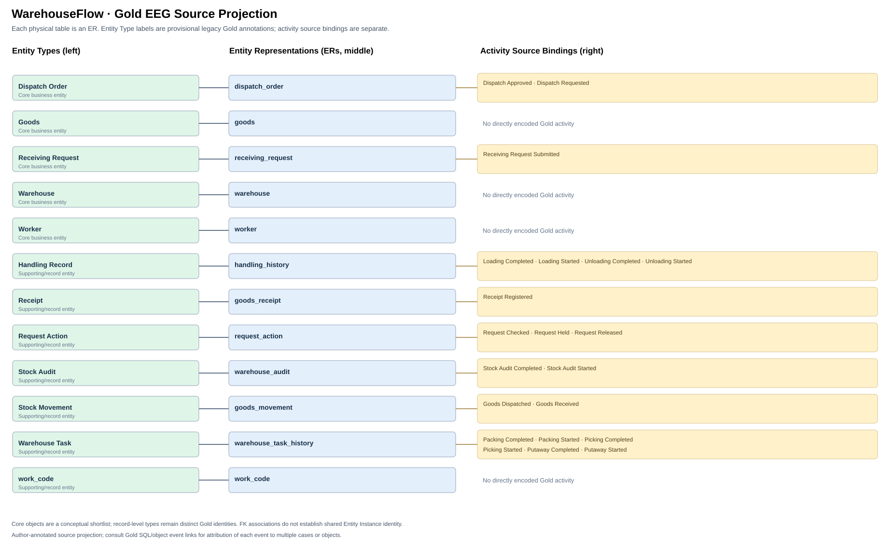
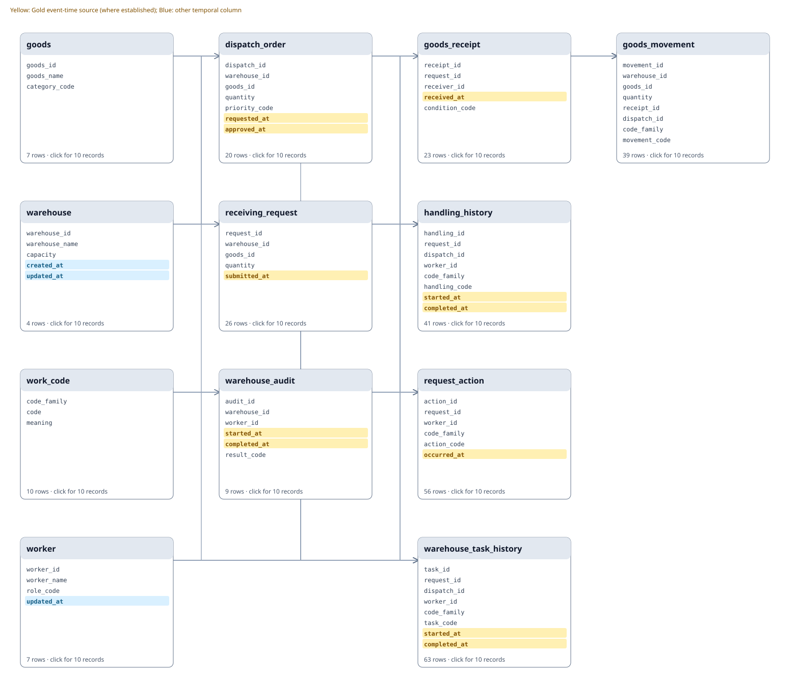

# Warehouseflow — Database and Gold Evidence Review

WarehouseFlow is a synthetic warehouse operations database covering goods, receiving requests, dispatch, stock movement, handling, worker tasks and audits. It uses authored business records rather than observed warehouse transactions.

## Gold Evidence Graph

The diagram separates **core business object concepts** from supporting entities and activity-record types, without changing the Gold identity assignments. 
Each physical table belongs to exactly one Gold Object Type. An event can be associated with several business objects through foreign keys without its source table belonging to multiple OTs.

**This is an author-annotated Gold source projection, not an inferred Evidence Graph or a full provenance graph.**
Gold SQL and record-level references remain in the evaluation-only files.

## Relational Schema (SQL foreign keys)

## Table inspector

| Physical table | Rows | Columns | Gold OT | First ten records |
|---|---:|---:|---|---|
| dispatch_order | 20 | 7 | Dispatch Order | [Preview](tables/dispatch_order.md) |
| goods | 7 | 3 | Goods | [Preview](tables/goods.md) |
| goods_movement | 39 | 9 | Stock Movement | [Preview](tables/goods_movement.md) |
| goods_receipt | 23 | 5 | Receipt | [Preview](tables/goods_receipt.md) |
| handling_history | 41 | 8 | Handling Record | [Preview](tables/handling_history.md) |
| receiving_request | 26 | 5 | Receiving Request | [Preview](tables/receiving_request.md) |
| request_action | 56 | 6 | Request Action | [Preview](tables/request_action.md) |
| warehouse | 4 | 5 | Warehouse | [Preview](tables/warehouse.md) |
| warehouse_audit | 9 | 6 | Stock Audit | [Preview](tables/warehouse_audit.md) |
| warehouse_task_history | 63 | 9 | Warehouse Task | [Preview](tables/warehouse_task_history.md) |
| work_code | 10 | 3 | work_code | [Preview](tables/work_code.md) |
| worker | 7 | 4 | Worker | [Preview](tables/worker.md) |

## Gold object types vs. core business objects

Gold identity types: **12**; principal business object concepts in this domain: **5**. 
The core set is a conceptual layer for interpreting process scope, not a rule that forces unrelated PK domains to merge.

**Core business concepts:** Dispatch Order, Goods, Receiving Request, Warehouse, Worker.

Supporting Gold types: Handling Record, Receipt, Request Action, Stock Audit, Stock Movement, Warehouse Task, work_code.

## Evaluation evidence

- Gold SQL/CSV pairs executable and consistent: 50; compared event rows across questions: 5478.
- [Gold source inventory](../gold_dfg/event_graph.md)
- [Question-level Gold DFGs](../gold_dfg/README.md)
- [Editable Draw.io schema](../../docs/schema.drawio)

*SQLite, dictionary and Gold outputs are unchanged by this review-page regeneration.*
