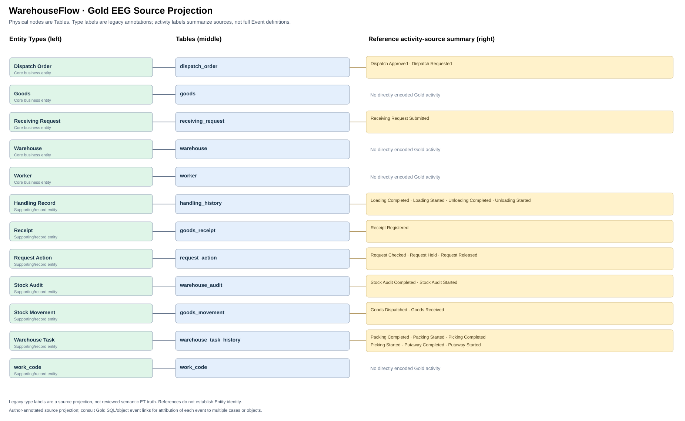
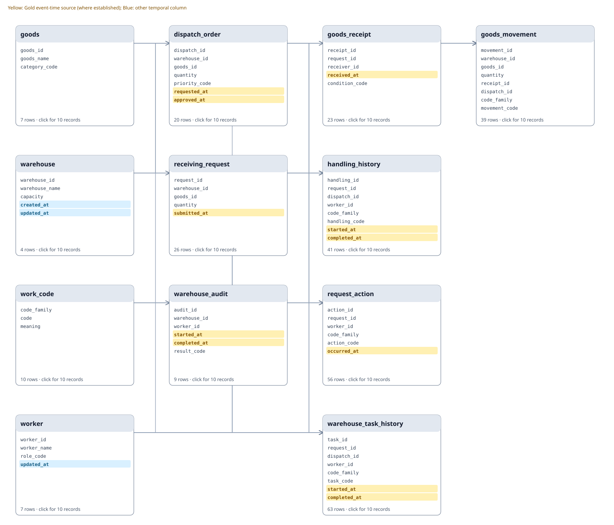

# WarehouseFlow — Database and Gold Evidence Review

WarehouseFlow is a synthetic warehouse operations database covering goods, receiving requests, dispatch, stock movement, handling, worker tasks and audits. It uses authored business records rather than observed warehouse transactions.

## Gold Event Extraction Graph (EEG) Source Projection

The diagram distinguishes core business entity concepts from supporting entity and event-record types. 
A table may identify or reference several ETs through different keys. These legacy source labels do not enumerate or validate those interpretations.

**This is a source-level author-annotated projection, not an inferred EEG or a validated semantic ET Gold.**
Gold SQL and record-level evidence are available in the linked inspection materials. The current membership labels originate from the legacy Gold; an independently validated ET/Entity identification context Gold is a separate evaluation task.

## Relational Schema (SQL foreign keys)

## Table inspector

| Physical table | Rows | Columns | ET candidate | First ten records |
|---|---:|---:|---|---|
| dispatch_order | 20 | 7 | Dispatch Order | [Preview](tables/dispatch_order.md) |
| goods | 7 | 3 | Goods | [Preview](tables/goods.md) |
| goods_movement | 39 | 9 | Stock Movement | [Preview](tables/goods_movement.md) |
| goods_receipt | 23 | 5 | Receipt | [Preview](tables/goods_receipt.md) |
| handling_history | 41 | 8 | Handling Record | [Preview](tables/handling_history.md) |
| receiving_request | 26 | 5 | Receiving Request | [Preview](tables/receiving_request.md) |
| request_action | 56 | 6 | Request Action | [Preview](tables/request_action.md) |
| warehouse | 4 | 5 | Warehouse | [Preview](tables/warehouse.md) |
| warehouse_audit | 9 | 6 | Stock Audit | [Preview](tables/warehouse_audit.md) |
| warehouse_task_history | 63 | 9 | Warehouse Task | [Preview](tables/warehouse_task_history.md) |
| work_code | 10 | 3 | work_code | [Preview](tables/work_code.md) |
| worker | 7 | 4 | Worker | [Preview](tables/worker.md) |

## Entity Type candidates vs. core business objects

Legacy identity groups (ET candidates): **12**; principal business object concepts in this domain: **5**. 
The core set is a candidate semantic grouping, not a rule for merging unrelated instances or Entity identities.

**Core business concepts:** Dispatch Order, Goods, Receiving Request, Warehouse, Worker.

Supporting Gold types: Handling Record, Receipt, Request Action, Stock Audit, Stock Movement, Warehouse Task, work_code.

## Evaluation evidence

- Gold SQL/CSV pairs executable and consistent: 50; compared event rows across questions: 5478.
- [Gold source inventory](../gold_dfg/event_graph.md)
- [Question-level Gold DFGs](../gold_dfg/README.md)
- [Editable Draw.io schema](../../docs/schema.drawio)

