# warehouseflow_new: questions and Gold DFGs

**EVALUATION ONLY — NEVER PROVIDE TO A MODEL.**

Source commit: `a0ba4c9631d12730d60bf7720d783a3a827b88dc`. Open index.html for search, review notes and complete case traces.

Node counts = event occurrences. Edge counts = adjacent selected events within a case. Dashed amber edges touch timestamp ties and depend on the tie-break rule. DFGs are projections of the selected log, not causal models.

[Event graph inventory · tables, objects, OTs and activities](event_graph.md)

**Source tables** produced matched Gold events. **SQL tables** are all physical tables read by the Gold SQL, including join tables and shared CTE branches.

## Dataset overview

[Full DB schema](../../../datasets/warehouseflow_new/docs/schema_overview.md) · [Full-size ER diagram](../../../datasets/warehouseflow_new/docs/schema.png) · [SQL DDL](../../../datasets/warehouseflow_new/input/schema.sql)

Show all 54 questions and the schema preview

<table><tr><td width="50%" valign="top"><h3>All questions (54)</h3><table><thead><tr><th>ID</th><th>Type</th><th>Question</th></tr></thead><tbody><tr><td><a href="#w01--q1">W01</a></td><td>Q1</td><td>For each receiving request, extract Receiving Request Submitted events.</td></tr><tr><td><a href="#w01p--q2">W01P</a></td><td>Q2</td><td>For every receiving request, show when it was submitted.</td></tr><tr><td><a href="#w02--q1">W02</a></td><td>Q1</td><td>For each receipt record, extract Receipt Registered events.</td></tr><tr><td><a href="#w02p--q2">W02P</a></td><td>Q2</td><td>For each individual receipt record, show when the receipt was registered.</td></tr><tr><td><a href="#w03--q1">W03</a></td><td>Q1</td><td>For each dispatch order, extract Dispatch Requested and Dispatch Approved events.</td></tr><tr><td><a href="#w03p--q2">W03P</a></td><td>Q2</td><td>For every dispatch order, show when dispatch was requested and when it was approved.</td></tr><tr><td><a href="#w04--q1">W04</a></td><td>Q1</td><td>For each stock audit, extract Stock Audit Started and Stock Audit Completed events.</td></tr><tr><td><a href="#w04p--q2">W04P</a></td><td>Q2</td><td>Show when each stock audit began and when it finished.</td></tr><tr><td><a href="#w05--q1">W05</a></td><td>Q1</td><td>For each stock movement record, extract Goods Received and Goods Dispatched events.</td></tr><tr><td><a href="#w05p--q2">W05P</a></td><td>Q2</td><td>For every stock movement record, show the recorded receipt into stock or dispatch from stock, as applicable.</td></tr><tr><td><a href="#w06--q1">W06</a></td><td>Q1</td><td>For each request action record, extract Request Checked, Request Held and Request Released events.</td></tr><tr><td><a href="#w06p--q2">W06P</a></td><td>Q2</td><td>For each individual request action record, show the checking, holding or releasing action that was recorded.</td></tr><tr><td><a href="#w07--q1">W07</a></td><td>Q1</td><td>For each warehouse task, extract Putaway Started, Putaway Completed, Picking Started, Picking Completed, Packing Started and Packing Completed events.</td></tr><tr><td><a href="#w07p--q2">W07P</a></td><td>Q2</td><td>For every warehouse task, show the recorded beginnings and completions of putaway, picking or packing, as applicable.</td></tr><tr><td><a href="#w08--q1">W08</a></td><td>Q1</td><td>For each handling record, extract Unloading Started, Unloading Completed, Loading Started and Loading Completed events.</td></tr><tr><td><a href="#w08p--q2">W08P</a></td><td>Q2</td><td>For each handling record, show when unloading or loading began and finished, as applicable.</td></tr><tr><td><a href="#w09--q1">W09</a></td><td>Q1</td><td>For each warehouse, extract Stock Audit Started, Stock Audit Completed, Putaway Started, Putaway Completed, Loading Started and Loading Completed events.</td></tr><tr><td><a href="#w09p--q2">W09P</a></td><td>Q2</td><td>For each warehouse, show the beginnings and completions of its stock audits, putaway work and loading work.</td></tr><tr><td><a href="#w10--q1">W10</a></td><td>Q1</td><td>For each receiving request, extract Unloading Started, Unloading Completed, Receipt Registered, Goods Received, Putaway Started and Putaway Completed events.</td></tr><tr><td><a href="#w10p--q2">W10P</a></td><td>Q2</td><td>For every receiving request, show the start and completion of unloading, registration of the receipt, receipt into warehouse stock, and the start and completion of putaway.</td></tr><tr><td><a href="#w11--q1">W11</a></td><td>Q1</td><td>For each dispatch order, extract Picking Started, Picking Completed, Packing Started, Packing Completed, Loading Started, Loading Completed and Goods Dispatched events.</td></tr><tr><td><a href="#w11p--q2">W11P</a></td><td>Q2</td><td>For each dispatch order, show when picking, packing and loading began and finished, together with the dispatch of goods from stock.</td></tr><tr><td><a href="#w12--q1">W12</a></td><td>Q1</td><td>For each worker, extract Stock Audit Started, Stock Audit Completed, Picking Started and Picking Completed events.</td></tr><tr><td><a href="#w12p--q2">W12P</a></td><td>Q2</td><td>For every worker, show when their stock audits and picking work began and finished.</td></tr><tr><td><a href="#w13--q1">W13</a></td><td>Q1</td><td>For each goods type, extract Goods Received and Goods Dispatched events.</td></tr><tr><td><a href="#w13p--q2">W13P</a></td><td>Q2</td><td>For each goods type, show its recorded receipts into warehouse stock and dispatches from stock.</td></tr><tr><td><a href="#w14--q1">W14</a></td><td>Q1</td><td>For each receipt record, extract Receipt Registered and Goods Received events.</td></tr><tr><td><a href="#w14p--q2">W14P</a></td><td>Q2</td><td>For every individual receipt record, show its registration and the corresponding receipt of goods into stock.</td></tr><tr><td><a href="#w15--q1">W15</a></td><td>Q1</td><td>For each warehouse, extract Invoice Paid events.</td></tr><tr><td><a href="#w15p--q2">W15P</a></td><td>Q2</td><td>For every warehouse, show when its invoices were paid.</td></tr><tr><td><a href="#w16--q1">W16</a></td><td>Q1</td><td>For each dispatch order, extract Customer Delivery Completed events.</td></tr><tr><td><a href="#w16p--q2">W16P</a></td><td>Q2</td><td>For each dispatch order, show when delivery to the customer was completed.</td></tr><tr><td><a href="#wf01--q3">WF01</a></td><td>Q3</td><td>Extract the full recorded lifecycle for each warehouse.</td></tr><tr><td><a href="#wf01p--q4">WF01P</a></td><td>Q4</td><td>Show the complete recorded history of each warehouse.</td></tr><tr><td><a href="#wf02--q3">WF02</a></td><td>Q3</td><td>Extract the full recorded lifecycle for each goods type.</td></tr><tr><td><a href="#wf02p--q4">WF02P</a></td><td>Q4</td><td>Build the entire recorded timeline associated with every goods type.</td></tr><tr><td><a href="#wf03--q3">WF03</a></td><td>Q3</td><td>Extract the full recorded lifecycle for each worker.</td></tr><tr><td><a href="#wf03p--q4">WF03P</a></td><td>Q4</td><td>Show every worker&#x27;s full recorded history.</td></tr><tr><td><a href="#wf04--q3">WF04</a></td><td>Q3</td><td>Extract the full recorded lifecycle for each receiving request.</td></tr><tr><td><a href="#wf04p--q4">WF04P</a></td><td>Q4</td><td>Trace each receiving request through its complete recorded lifecycle.</td></tr><tr><td><a href="#wf05--q3">WF05</a></td><td>Q3</td><td>Extract the full recorded lifecycle for each receipt record.</td></tr><tr><td><a href="#wf05p--q4">WF05P</a></td><td>Q4</td><td>Show the entire recorded history associated with each individual receipt record.</td></tr><tr><td><a href="#wf06--q3">WF06</a></td><td>Q3</td><td>Extract the full recorded lifecycle for each dispatch order.</td></tr><tr><td><a href="#wf06p--q4">WF06P</a></td><td>Q4</td><td>Build a complete recorded timeline for every dispatch order.</td></tr><tr><td><a href="#wf07--q3">WF07</a></td><td>Q3</td><td>Extract the full recorded lifecycle for each stock audit.</td></tr><tr><td><a href="#wf07p--q4">WF07P</a></td><td>Q4</td><td>Show the full recorded history of each stock audit.</td></tr><tr><td><a href="#wf08--q3">WF08</a></td><td>Q3</td><td>Extract the full recorded lifecycle for each stock movement record.</td></tr><tr><td><a href="#wf08p--q4">WF08P</a></td><td>Q4</td><td>Trace each individual stock movement record through its entire recorded history.</td></tr><tr><td><a href="#wf09--q3">WF09</a></td><td>Q3</td><td>Extract the full recorded lifecycle for each request action record.</td></tr><tr><td><a href="#wf09p--q4">WF09P</a></td><td>Q4</td><td>Show the complete recorded history of every individual request action record.</td></tr><tr><td><a href="#wf10--q3">WF10</a></td><td>Q3</td><td>Extract the full recorded lifecycle for each warehouse task.</td></tr><tr><td><a href="#wf10p--q4">WF10P</a></td><td>Q4</td><td>Build the full recorded lifecycle of each warehouse task.</td></tr><tr><td><a href="#wf11--q3">WF11</a></td><td>Q3</td><td>Extract the full recorded lifecycle for each handling record.</td></tr><tr><td><a href="#wf11p--q4">WF11P</a></td><td>Q4</td><td>Trace every individual handling record through its complete recorded history.</td></tr></tbody></table></td><td width="50%" valign="top"><h3>Database schema</h3>

<a href="../../../datasets/warehouseflow_new/docs/schema.png">Full-size diagram</a> · <a href="../../../datasets/warehouseflow_new/input/schema.sql">Full SQL schema</a>
</td></tr></table>

## W01 — Q1

For each receiving request, extract Receiving Request Submitted events.

Events: **26** · Cases with events: **26** · Activities: **1** · Edges: **0** · Source tables: **1** · SQL tables: **1**

<table><tr><td width="42%" valign="top"><a href="graphs/W01.svg">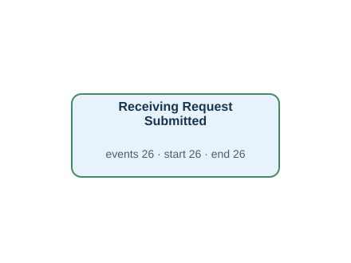</a></td><td width="58%" valign="top">
<a href="../../../datasets/warehouseflow_new/private/gold_sql/W01.sql">Gold SQL</a> · <a href="../../../datasets/warehouseflow_new/private/gold_logs/W01.csv">Gold CSV</a> · <a href="../../../datasets/warehouseflow_new/input/database.sqlite">Full source database (SQLite)</a>

<code>receiving_request</code> · 26 matched source rows
<table><tr><th>Column</th><th>Row 1</th><th>Row 2</th><th>Row 3</th></tr><tr><th>request_id</th><td>001</td><td>002</td><td>003</td></tr><tr><th>warehouse_id</th><td>1</td><td>2</td><td>3</td></tr><tr><th>goods_id</th><td>1</td><td>2</td><td>3</td></tr><tr><th>quantity</th><td>10</td><td>10</td><td>10</td></tr><tr><th>submitted_at</th><td>2026-02-01T05:00:00Z</td><td>2026-02-01T10:00:00Z</td><td>2026-02-01T15:00:00Z</td></tr></table>
<strong>Gold output for the same source rows</strong>
<ul><li>Row 1 → Receiving Request Submitted · event Q:001 · case Q:001 · time from <code>submitted_at</code></li><li>Row 2 → Receiving Request Submitted · event Q:002 · case Q:002 · time from <code>submitted_at</code></li><li>Row 3 → Receiving Request Submitted · event Q:003 · case Q:003 · time from <code>submitted_at</code></li></ul>
</td></tr></table>

## W01P — Q2

For every receiving request, show when it was submitted.

Events: **26** · Cases with events: **26** · Activities: **1** · Edges: **0** · Source tables: **1** · SQL tables: **1**

<table><tr><td width="42%" valign="top"></td><td width="58%" valign="top">
<a href="../../../datasets/warehouseflow_new/private/gold_sql/W01P.sql">Gold SQL</a> · <a href="../../../datasets/warehouseflow_new/private/gold_logs/W01P.csv">Gold CSV</a> · <a href="../../../datasets/warehouseflow_new/input/database.sqlite">Full source database (SQLite)</a>

<code>receiving_request</code> · 26 matched source rows
<table><tr><th>Column</th><th>Row 1</th><th>Row 2</th><th>Row 3</th></tr><tr><th>request_id</th><td>001</td><td>002</td><td>003</td></tr><tr><th>warehouse_id</th><td>1</td><td>2</td><td>3</td></tr><tr><th>goods_id</th><td>1</td><td>2</td><td>3</td></tr><tr><th>quantity</th><td>10</td><td>10</td><td>10</td></tr><tr><th>submitted_at</th><td>2026-02-01T05:00:00Z</td><td>2026-02-01T10:00:00Z</td><td>2026-02-01T15:00:00Z</td></tr></table>
<strong>Gold output for the same source rows</strong>
<ul><li>Row 1 → Receiving Request Submitted · event Q:001 · case Q:001 · time from <code>submitted_at</code></li><li>Row 2 → Receiving Request Submitted · event Q:002 · case Q:002 · time from <code>submitted_at</code></li><li>Row 3 → Receiving Request Submitted · event Q:003 · case Q:003 · time from <code>submitted_at</code></li></ul>
</td></tr></table>

## W02 — Q1

For each receipt record, extract Receipt Registered events.

Events: **23** · Cases with events: **23** · Activities: **1** · Edges: **0** · Source tables: **1** · SQL tables: **1**

<table><tr><td width="42%" valign="top"><a href="graphs/W02.svg">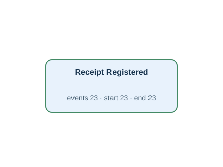</a></td><td width="58%" valign="top">
<a href="../../../datasets/warehouseflow_new/private/gold_sql/W02.sql">Gold SQL</a> · <a href="../../../datasets/warehouseflow_new/private/gold_logs/W02.csv">Gold CSV</a> · <a href="../../../datasets/warehouseflow_new/input/database.sqlite">Full source database (SQLite)</a>

<code>goods_receipt</code> · 23 matched source rows
<table><tr><th>Column</th><th>Row 1</th><th>Row 2</th><th>Row 3</th></tr><tr><th>receipt_id</th><td>001</td><td>002</td><td>003</td></tr><tr><th>request_id</th><td>001</td><td>002</td><td>003</td></tr><tr><th>receiver_id</th><td>1</td><td>2</td><td>3</td></tr><tr><th>received_at</th><td>2026-02-01T05:32:00Z</td><td>2026-02-01T10:32:00Z</td><td>2026-02-01T15:32:00Z</td></tr><tr><th>condition_code</th><td>GOOD</td><td>GOOD</td><td>GOOD</td></tr></table>
<strong>Gold output for the same source rows</strong>
<ul><li>Row 1 → Receipt Registered · event R:001 · case R:001 · time from <code>received_at</code></li><li>Row 2 → Receipt Registered · event R:002 · case R:002 · time from <code>received_at</code></li><li>Row 3 → Receipt Registered · event R:003 · case R:003 · time from <code>received_at</code></li></ul>
</td></tr></table>

## W02P — Q2

For each individual receipt record, show when the receipt was registered.

Events: **23** · Cases with events: **23** · Activities: **1** · Edges: **0** · Source tables: **1** · SQL tables: **1**

<table><tr><td width="42%" valign="top"></td><td width="58%" valign="top">
<a href="../../../datasets/warehouseflow_new/private/gold_sql/W02P.sql">Gold SQL</a> · <a href="../../../datasets/warehouseflow_new/private/gold_logs/W02P.csv">Gold CSV</a> · <a href="../../../datasets/warehouseflow_new/input/database.sqlite">Full source database (SQLite)</a>

<code>goods_receipt</code> · 23 matched source rows
<table><tr><th>Column</th><th>Row 1</th><th>Row 2</th><th>Row 3</th></tr><tr><th>receipt_id</th><td>001</td><td>002</td><td>003</td></tr><tr><th>request_id</th><td>001</td><td>002</td><td>003</td></tr><tr><th>receiver_id</th><td>1</td><td>2</td><td>3</td></tr><tr><th>received_at</th><td>2026-02-01T05:32:00Z</td><td>2026-02-01T10:32:00Z</td><td>2026-02-01T15:32:00Z</td></tr><tr><th>condition_code</th><td>GOOD</td><td>GOOD</td><td>GOOD</td></tr></table>
<strong>Gold output for the same source rows</strong>
<ul><li>Row 1 → Receipt Registered · event R:001 · case R:001 · time from <code>received_at</code></li><li>Row 2 → Receipt Registered · event R:002 · case R:002 · time from <code>received_at</code></li><li>Row 3 → Receipt Registered · event R:003 · case R:003 · time from <code>received_at</code></li></ul>
</td></tr></table>

## W03 — Q1

For each dispatch order, extract Dispatch Requested and Dispatch Approved events.

Events: **38** · Cases with events: **20** · Activities: **2** · Edges: **1** · Source tables: **1** · SQL tables: **1**

<table><tr><td width="42%" valign="top"><a href="graphs/W03.svg">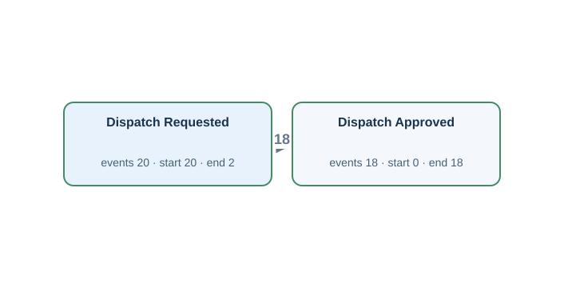</a></td><td width="58%" valign="top">
<a href="../../../datasets/warehouseflow_new/private/gold_sql/W03.sql">Gold SQL</a> · <a href="../../../datasets/warehouseflow_new/private/gold_logs/W03.csv">Gold CSV</a> · <a href="../../../datasets/warehouseflow_new/input/database.sqlite">Full source database (SQLite)</a>

<code>dispatch_order</code> · 20 matched source rows
<table><tr><th>Column</th><th>Row 1</th><th>Row 2</th><th>Row 3</th></tr><tr><th>dispatch_id</th><td>001</td><td>002</td><td>003</td></tr><tr><th>warehouse_id</th><td>1</td><td>2</td><td>3</td></tr><tr><th>goods_id</th><td>1</td><td>2</td><td>3</td></tr><tr><th>quantity</th><td>4</td><td>4</td><td>4</td></tr><tr><th>priority_code</th><td>NORMAL</td><td>NORMAL</td><td>URGENT</td></tr><tr><th>requested_at</th><td>2026-04-11T15:40:00Z</td><td>2026-04-11T20:40:00Z</td><td>2026-04-12T01:40:00Z</td></tr><tr><th>approved_at</th><td>2026-04-11T15:50:00Z</td><td>2026-04-11T20:50:00Z</td><td>2026-04-12T01:50:00Z</td></tr></table>
<strong>Gold output for the same source rows</strong>
<ul><li>Row 1 → Dispatch Approved · event D:001:approved · case D:001 · time from <code>approved_at</code></li><li>Row 1 → Dispatch Requested · event D:001:requested · case D:001 · time from <code>requested_at</code></li><li>Row 2 → Dispatch Approved · event D:002:approved · case D:002 · time from <code>approved_at</code></li><li>Row 2 → Dispatch Requested · event D:002:requested · case D:002 · time from <code>requested_at</code></li><li>Row 3 → Dispatch Approved · event D:003:approved · case D:003 · time from <code>approved_at</code></li><li>Row 3 → Dispatch Requested · event D:003:requested · case D:003 · time from <code>requested_at</code></li></ul>
</td></tr></table>

## W03P — Q2

For every dispatch order, show when dispatch was requested and when it was approved.

Events: **38** · Cases with events: **20** · Activities: **2** · Edges: **1** · Source tables: **1** · SQL tables: **1**

<table><tr><td width="42%" valign="top"></td><td width="58%" valign="top">
<a href="../../../datasets/warehouseflow_new/private/gold_sql/W03P.sql">Gold SQL</a> · <a href="../../../datasets/warehouseflow_new/private/gold_logs/W03P.csv">Gold CSV</a> · <a href="../../../datasets/warehouseflow_new/input/database.sqlite">Full source database (SQLite)</a>

<code>dispatch_order</code> · 20 matched source rows
<table><tr><th>Column</th><th>Row 1</th><th>Row 2</th><th>Row 3</th></tr><tr><th>dispatch_id</th><td>001</td><td>002</td><td>003</td></tr><tr><th>warehouse_id</th><td>1</td><td>2</td><td>3</td></tr><tr><th>goods_id</th><td>1</td><td>2</td><td>3</td></tr><tr><th>quantity</th><td>4</td><td>4</td><td>4</td></tr><tr><th>priority_code</th><td>NORMAL</td><td>NORMAL</td><td>URGENT</td></tr><tr><th>requested_at</th><td>2026-04-11T15:40:00Z</td><td>2026-04-11T20:40:00Z</td><td>2026-04-12T01:40:00Z</td></tr><tr><th>approved_at</th><td>2026-04-11T15:50:00Z</td><td>2026-04-11T20:50:00Z</td><td>2026-04-12T01:50:00Z</td></tr></table>
<strong>Gold output for the same source rows</strong>
<ul><li>Row 1 → Dispatch Approved · event D:001:approved · case D:001 · time from <code>approved_at</code></li><li>Row 1 → Dispatch Requested · event D:001:requested · case D:001 · time from <code>requested_at</code></li><li>Row 2 → Dispatch Approved · event D:002:approved · case D:002 · time from <code>approved_at</code></li><li>Row 2 → Dispatch Requested · event D:002:requested · case D:002 · time from <code>requested_at</code></li><li>Row 3 → Dispatch Approved · event D:003:approved · case D:003 · time from <code>approved_at</code></li><li>Row 3 → Dispatch Requested · event D:003:requested · case D:003 · time from <code>requested_at</code></li></ul>
</td></tr></table>

## W04 — Q1

For each stock audit, extract Stock Audit Started and Stock Audit Completed events.

Events: **17** · Cases with events: **9** · Activities: **2** · Edges: **1** · Source tables: **1** · SQL tables: **1**

<table><tr><td width="42%" valign="top"><a href="graphs/W04.svg">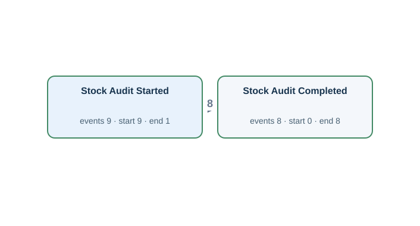</a></td><td width="58%" valign="top">
<a href="../../../datasets/warehouseflow_new/private/gold_sql/W04.sql">Gold SQL</a> · <a href="../../../datasets/warehouseflow_new/private/gold_logs/W04.csv">Gold CSV</a> · <a href="../../../datasets/warehouseflow_new/input/database.sqlite">Full source database (SQLite)</a>

<code>warehouse_audit</code> · 9 matched source rows
<table><tr><th>Column</th><th>Row 1</th><th>Row 2</th><th>Row 3</th></tr><tr><th>audit_id</th><td>001</td><td>002</td><td>003</td></tr><tr><th>warehouse_id</th><td>1</td><td>2</td><td>3</td></tr><tr><th>worker_id</th><td>1</td><td>2</td><td>3</td></tr><tr><th>started_at</th><td>2026-05-16T05:40:00Z</td><td>2026-05-16T07:20:00Z</td><td>2026-05-16T09:00:00Z</td></tr><tr><th>completed_at</th><td>2026-05-16T06:20:00Z</td><td>2026-05-16T08:00:00Z</td><td>2026-05-16T09:40:00Z</td></tr><tr><th>result_code</th><td>PASS</td><td>PASS</td><td>RECOUNT</td></tr></table>
<strong>Gold output for the same source rows</strong>
<ul><li>Row 1 → Stock Audit Completed · event A:001:complete · case A:001 · time from <code>completed_at</code></li><li>Row 1 → Stock Audit Started · event A:001:start · case A:001 · time from <code>started_at</code></li><li>Row 2 → Stock Audit Completed · event A:002:complete · case A:002 · time from <code>completed_at</code></li><li>Row 2 → Stock Audit Started · event A:002:start · case A:002 · time from <code>started_at</code></li><li>Row 3 → Stock Audit Completed · event A:003:complete · case A:003 · time from <code>completed_at</code></li><li>Row 3 → Stock Audit Started · event A:003:start · case A:003 · time from <code>started_at</code></li></ul>
</td></tr></table>

## W04P — Q2

Show when each stock audit began and when it finished.

Events: **17** · Cases with events: **9** · Activities: **2** · Edges: **1** · Source tables: **1** · SQL tables: **1**

<table><tr><td width="42%" valign="top"></td><td width="58%" valign="top">
<a href="../../../datasets/warehouseflow_new/private/gold_sql/W04P.sql">Gold SQL</a> · <a href="../../../datasets/warehouseflow_new/private/gold_logs/W04P.csv">Gold CSV</a> · <a href="../../../datasets/warehouseflow_new/input/database.sqlite">Full source database (SQLite)</a>

<code>warehouse_audit</code> · 9 matched source rows
<table><tr><th>Column</th><th>Row 1</th><th>Row 2</th><th>Row 3</th></tr><tr><th>audit_id</th><td>001</td><td>002</td><td>003</td></tr><tr><th>warehouse_id</th><td>1</td><td>2</td><td>3</td></tr><tr><th>worker_id</th><td>1</td><td>2</td><td>3</td></tr><tr><th>started_at</th><td>2026-05-16T05:40:00Z</td><td>2026-05-16T07:20:00Z</td><td>2026-05-16T09:00:00Z</td></tr><tr><th>completed_at</th><td>2026-05-16T06:20:00Z</td><td>2026-05-16T08:00:00Z</td><td>2026-05-16T09:40:00Z</td></tr><tr><th>result_code</th><td>PASS</td><td>PASS</td><td>RECOUNT</td></tr></table>
<strong>Gold output for the same source rows</strong>
<ul><li>Row 1 → Stock Audit Completed · event A:001:complete · case A:001 · time from <code>completed_at</code></li><li>Row 1 → Stock Audit Started · event A:001:start · case A:001 · time from <code>started_at</code></li><li>Row 2 → Stock Audit Completed · event A:002:complete · case A:002 · time from <code>completed_at</code></li><li>Row 2 → Stock Audit Started · event A:002:start · case A:002 · time from <code>started_at</code></li><li>Row 3 → Stock Audit Completed · event A:003:complete · case A:003 · time from <code>completed_at</code></li><li>Row 3 → Stock Audit Started · event A:003:start · case A:003 · time from <code>started_at</code></li></ul>
</td></tr></table>

## W05 — Q1

For each stock movement record, extract Goods Received and Goods Dispatched events.

Events: **39** · Cases with events: **39** · Activities: **2** · Edges: **0** · Source tables: **1** · SQL tables: **1**

<table><tr><td width="42%" valign="top"><a href="graphs/W05.svg">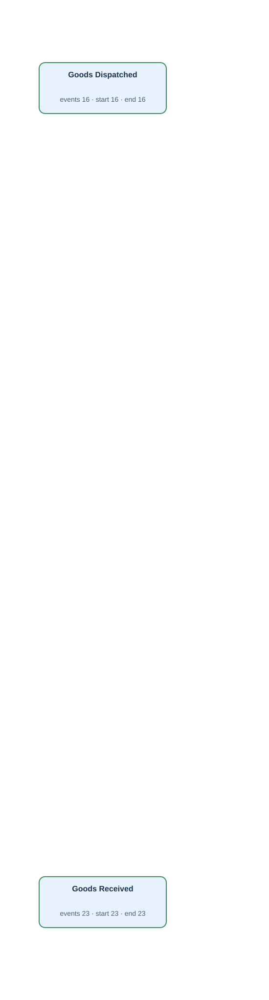</a></td><td width="58%" valign="top">
<a href="../../../datasets/warehouseflow_new/private/gold_sql/W05.sql">Gold SQL</a> · <a href="../../../datasets/warehouseflow_new/private/gold_logs/W05.csv">Gold CSV</a> · <a href="../../../datasets/warehouseflow_new/input/database.sqlite">Full source database (SQLite)</a>

<code>goods_movement</code> · 39 matched source rows
<table><tr><th>Column</th><th>Row 1</th><th>Row 2</th><th>Row 3</th></tr><tr><th>movement_id</th><td>0001</td><td>0024</td><td>0002</td></tr><tr><th>warehouse_id</th><td>1</td><td>1</td><td>2</td></tr><tr><th>goods_id</th><td>1</td><td>1</td><td>2</td></tr><tr><th>quantity</th><td>10</td><td>4</td><td>10</td></tr><tr><th>receipt_id</th><td>001</td><td><em>NULL</em></td><td>002</td></tr><tr><th>dispatch_id</th><td><em>NULL</em></td><td>001</td><td><em>NULL</em></td></tr><tr><th>code_family</th><td>MOVEMENT</td><td>MOVEMENT</td><td>MOVEMENT</td></tr><tr><th>movement_code</th><td>IN</td><td>OUT</td><td>IN</td></tr><tr><th>occurred_at</th><td>2026-02-01T05:35:00Z</td><td>2026-04-11T16:45:00Z</td><td>2026-02-01T10:35:00Z</td></tr></table>
<strong>Gold output for the same source rows</strong>
<ul><li>Row 1 → Goods Received · event M:0001 · case M:0001 · time from <code>occurred_at</code></li><li>Row 2 → Goods Dispatched · event M:0024 · case M:0024 · time from <code>occurred_at</code></li><li>Row 3 → Goods Received · event M:0002 · case M:0002 · time from <code>occurred_at</code></li></ul>
</td></tr></table>

## W05P — Q2

For every stock movement record, show the recorded receipt into stock or dispatch from stock, as applicable.

Events: **39** · Cases with events: **39** · Activities: **2** · Edges: **0** · Source tables: **1** · SQL tables: **1**

<table><tr><td width="42%" valign="top"></td><td width="58%" valign="top">
<a href="../../../datasets/warehouseflow_new/private/gold_sql/W05P.sql">Gold SQL</a> · <a href="../../../datasets/warehouseflow_new/private/gold_logs/W05P.csv">Gold CSV</a> · <a href="../../../datasets/warehouseflow_new/input/database.sqlite">Full source database (SQLite)</a>

<code>goods_movement</code> · 39 matched source rows
<table><tr><th>Column</th><th>Row 1</th><th>Row 2</th><th>Row 3</th></tr><tr><th>movement_id</th><td>0001</td><td>0024</td><td>0002</td></tr><tr><th>warehouse_id</th><td>1</td><td>1</td><td>2</td></tr><tr><th>goods_id</th><td>1</td><td>1</td><td>2</td></tr><tr><th>quantity</th><td>10</td><td>4</td><td>10</td></tr><tr><th>receipt_id</th><td>001</td><td><em>NULL</em></td><td>002</td></tr><tr><th>dispatch_id</th><td><em>NULL</em></td><td>001</td><td><em>NULL</em></td></tr><tr><th>code_family</th><td>MOVEMENT</td><td>MOVEMENT</td><td>MOVEMENT</td></tr><tr><th>movement_code</th><td>IN</td><td>OUT</td><td>IN</td></tr><tr><th>occurred_at</th><td>2026-02-01T05:35:00Z</td><td>2026-04-11T16:45:00Z</td><td>2026-02-01T10:35:00Z</td></tr></table>
<strong>Gold output for the same source rows</strong>
<ul><li>Row 1 → Goods Received · event M:0001 · case M:0001 · time from <code>occurred_at</code></li><li>Row 2 → Goods Dispatched · event M:0024 · case M:0024 · time from <code>occurred_at</code></li><li>Row 3 → Goods Received · event M:0002 · case M:0002 · time from <code>occurred_at</code></li></ul>
</td></tr></table>

## W06 — Q1

For each request action record, extract Request Checked, Request Held and Request Released events.

Events: **56** · Cases with events: **56** · Activities: **3** · Edges: **0** · Source tables: **1** · SQL tables: **1**

<table><tr><td width="42%" valign="top"><a href="graphs/W06.svg">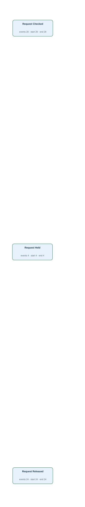</a></td><td width="58%" valign="top">
<a href="../../../datasets/warehouseflow_new/private/gold_sql/W06.sql">Gold SQL</a> · <a href="../../../datasets/warehouseflow_new/private/gold_logs/W06.csv">Gold CSV</a> · <a href="../../../datasets/warehouseflow_new/input/database.sqlite">Full source database (SQLite)</a>

<code>request_action</code> · 56 matched source rows
<table><tr><th>Column</th><th>Row 1</th><th>Row 2</th><th>Row 3</th></tr><tr><th>action_id</th><td>0001</td><td>0002</td><td>0010</td></tr><tr><th>request_id</th><td>001</td><td>001</td><td>005</td></tr><tr><th>worker_id</th><td>1</td><td>1</td><td>5</td></tr><tr><th>code_family</th><td>REQUEST</td><td>REQUEST</td><td>REQUEST</td></tr><tr><th>action_code</th><td>CHECK</td><td>RELEASE</td><td>HOLD</td></tr><tr><th>occurred_at</th><td>2026-02-01T05:05:00Z</td><td>2026-02-01T05:12:00Z</td><td>2026-02-02T01:08:00Z</td></tr></table>
<strong>Gold output for the same source rows</strong>
<ul><li>Row 1 → Request Checked · event C:0001 · case C:0001 · time from <code>occurred_at</code></li><li>Row 2 → Request Released · event C:0002 · case C:0002 · time from <code>occurred_at</code></li><li>Row 3 → Request Held · event C:0010 · case C:0010 · time from <code>occurred_at</code></li></ul>
</td></tr></table>

## W06P — Q2

For each individual request action record, show the checking, holding or releasing action that was recorded.

Events: **56** · Cases with events: **56** · Activities: **3** · Edges: **0** · Source tables: **1** · SQL tables: **1**

<table><tr><td width="42%" valign="top"></td><td width="58%" valign="top">
<a href="../../../datasets/warehouseflow_new/private/gold_sql/W06P.sql">Gold SQL</a> · <a href="../../../datasets/warehouseflow_new/private/gold_logs/W06P.csv">Gold CSV</a> · <a href="../../../datasets/warehouseflow_new/input/database.sqlite">Full source database (SQLite)</a>

<code>request_action</code> · 56 matched source rows
<table><tr><th>Column</th><th>Row 1</th><th>Row 2</th><th>Row 3</th></tr><tr><th>action_id</th><td>0001</td><td>0002</td><td>0010</td></tr><tr><th>request_id</th><td>001</td><td>001</td><td>005</td></tr><tr><th>worker_id</th><td>1</td><td>1</td><td>5</td></tr><tr><th>code_family</th><td>REQUEST</td><td>REQUEST</td><td>REQUEST</td></tr><tr><th>action_code</th><td>CHECK</td><td>RELEASE</td><td>HOLD</td></tr><tr><th>occurred_at</th><td>2026-02-01T05:05:00Z</td><td>2026-02-01T05:12:00Z</td><td>2026-02-02T01:08:00Z</td></tr></table>
<strong>Gold output for the same source rows</strong>
<ul><li>Row 1 → Request Checked · event C:0001 · case C:0001 · time from <code>occurred_at</code></li><li>Row 2 → Request Released · event C:0002 · case C:0002 · time from <code>occurred_at</code></li><li>Row 3 → Request Held · event C:0010 · case C:0010 · time from <code>occurred_at</code></li></ul>
</td></tr></table>

## W07 — Q1

For each warehouse task, extract Putaway Started, Putaway Completed, Picking Started, Picking Completed, Packing Started and Packing Completed events.

Events: **123** · Cases with events: **63** · Activities: **6** · Edges: **3** · Source tables: **1** · SQL tables: **1**

<table><tr><td width="42%" valign="top"><a href="graphs/W07.svg">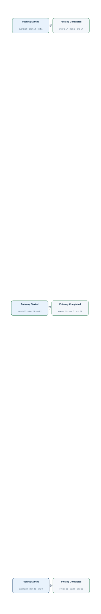</a></td><td width="58%" valign="top">
<a href="../../../datasets/warehouseflow_new/private/gold_sql/W07.sql">Gold SQL</a> · <a href="../../../datasets/warehouseflow_new/private/gold_logs/W07.csv">Gold CSV</a> · <a href="../../../datasets/warehouseflow_new/input/database.sqlite">Full source database (SQLite)</a>

<code>warehouse_task_history</code> · 63 matched source rows
<table><tr><th>Column</th><th>Row 1</th><th>Row 2</th><th>Row 3</th></tr><tr><th>task_id</th><td>0001</td><td>0024</td><td>0025</td></tr><tr><th>request_id</th><td>001</td><td><em>NULL</em></td><td><em>NULL</em></td></tr><tr><th>dispatch_id</th><td><em>NULL</em></td><td>001</td><td>001</td></tr><tr><th>worker_id</th><td>1</td><td>2</td><td>2</td></tr><tr><th>code_family</th><td>TASK</td><td>TASK</td><td>TASK</td></tr><tr><th>task_code</th><td>PUTAWAY</td><td>PICK</td><td>PACK</td></tr><tr><th>started_at</th><td>2026-02-01T05:40:00Z</td><td>2026-04-11T16:00:00Z</td><td>2026-04-11T16:15:00Z</td></tr><tr><th>completed_at</th><td>2026-02-01T05:50:00Z</td><td>2026-04-11T16:10:00Z</td><td>2026-04-11T16:25:00Z</td></tr><tr><th>outcome_code</th><td>OK</td><td>OK</td><td>OK</td></tr></table>
<strong>Gold output for the same source rows</strong>
<ul><li>Row 1 → Putaway Completed · event T:0001:complete · case T:0001 · time from <code>completed_at</code></li><li>Row 1 → Putaway Started · event T:0001:start · case T:0001 · time from <code>started_at</code></li><li>Row 2 → Picking Completed · event T:0024:complete · case T:0024 · time from <code>completed_at</code></li><li>Row 2 → Picking Started · event T:0024:start · case T:0024 · time from <code>started_at</code></li><li>Row 3 → Packing Completed · event T:0025:complete · case T:0025 · time from <code>completed_at</code></li><li>Row 3 → Packing Started · event T:0025:start · case T:0025 · time from <code>started_at</code></li></ul>
</td></tr></table>

## W07P — Q2

For every warehouse task, show the recorded beginnings and completions of putaway, picking or packing, as applicable.

Events: **123** · Cases with events: **63** · Activities: **6** · Edges: **3** · Source tables: **1** · SQL tables: **1**

<table><tr><td width="42%" valign="top"></td><td width="58%" valign="top">
<a href="../../../datasets/warehouseflow_new/private/gold_sql/W07P.sql">Gold SQL</a> · <a href="../../../datasets/warehouseflow_new/private/gold_logs/W07P.csv">Gold CSV</a> · <a href="../../../datasets/warehouseflow_new/input/database.sqlite">Full source database (SQLite)</a>

<code>warehouse_task_history</code> · 63 matched source rows
<table><tr><th>Column</th><th>Row 1</th><th>Row 2</th><th>Row 3</th></tr><tr><th>task_id</th><td>0001</td><td>0024</td><td>0025</td></tr><tr><th>request_id</th><td>001</td><td><em>NULL</em></td><td><em>NULL</em></td></tr><tr><th>dispatch_id</th><td><em>NULL</em></td><td>001</td><td>001</td></tr><tr><th>worker_id</th><td>1</td><td>2</td><td>2</td></tr><tr><th>code_family</th><td>TASK</td><td>TASK</td><td>TASK</td></tr><tr><th>task_code</th><td>PUTAWAY</td><td>PICK</td><td>PACK</td></tr><tr><th>started_at</th><td>2026-02-01T05:40:00Z</td><td>2026-04-11T16:00:00Z</td><td>2026-04-11T16:15:00Z</td></tr><tr><th>completed_at</th><td>2026-02-01T05:50:00Z</td><td>2026-04-11T16:10:00Z</td><td>2026-04-11T16:25:00Z</td></tr><tr><th>outcome_code</th><td>OK</td><td>OK</td><td>OK</td></tr></table>
<strong>Gold output for the same source rows</strong>
<ul><li>Row 1 → Putaway Completed · event T:0001:complete · case T:0001 · time from <code>completed_at</code></li><li>Row 1 → Putaway Started · event T:0001:start · case T:0001 · time from <code>started_at</code></li><li>Row 2 → Picking Completed · event T:0024:complete · case T:0024 · time from <code>completed_at</code></li><li>Row 2 → Picking Started · event T:0024:start · case T:0024 · time from <code>started_at</code></li><li>Row 3 → Packing Completed · event T:0025:complete · case T:0025 · time from <code>completed_at</code></li><li>Row 3 → Packing Started · event T:0025:start · case T:0025 · time from <code>started_at</code></li></ul>
</td></tr></table>

## W08 — Q1

For each handling record, extract Unloading Started, Unloading Completed, Loading Started and Loading Completed events.

Events: **80** · Cases with events: **41** · Activities: **4** · Edges: **2** · Source tables: **1** · SQL tables: **1**

<table><tr><td width="42%" valign="top"><a href="graphs/W08.svg">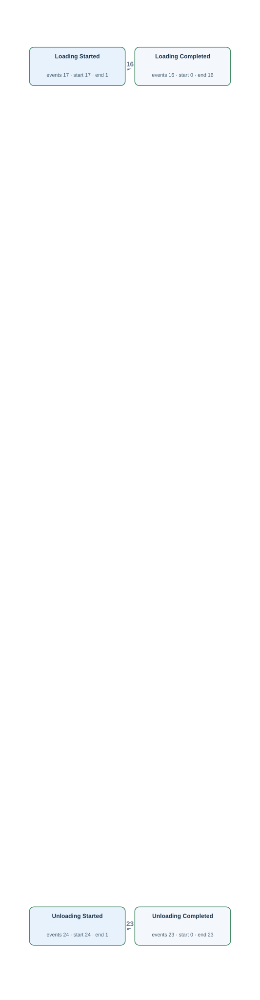</a></td><td width="58%" valign="top">
<a href="../../../datasets/warehouseflow_new/private/gold_sql/W08.sql">Gold SQL</a> · <a href="../../../datasets/warehouseflow_new/private/gold_logs/W08.csv">Gold CSV</a> · <a href="../../../datasets/warehouseflow_new/input/database.sqlite">Full source database (SQLite)</a>

<code>handling_history</code> · 41 matched source rows
<table><tr><th>Column</th><th>Row 1</th><th>Row 2</th><th>Row 3</th></tr><tr><th>handling_id</th><td>0001</td><td>0025</td><td>0002</td></tr><tr><th>request_id</th><td>001</td><td><em>NULL</em></td><td>002</td></tr><tr><th>dispatch_id</th><td><em>NULL</em></td><td>001</td><td><em>NULL</em></td></tr><tr><th>worker_id</th><td>1</td><td>2</td><td>2</td></tr><tr><th>code_family</th><td>HANDLING</td><td>HANDLING</td><td>HANDLING</td></tr><tr><th>handling_code</th><td>UNLOAD</td><td>LOAD</td><td>UNLOAD</td></tr><tr><th>started_at</th><td>2026-02-01T05:20:00Z</td><td>2026-04-11T16:30:00Z</td><td>2026-02-01T10:20:00Z</td></tr><tr><th>completed_at</th><td>2026-02-01T05:30:00Z</td><td>2026-04-11T16:40:00Z</td><td>2026-02-01T10:30:00Z</td></tr></table>
<strong>Gold output for the same source rows</strong>
<ul><li>Row 1 → Unloading Completed · event H:0001:complete · case H:0001 · time from <code>completed_at</code></li><li>Row 1 → Unloading Started · event H:0001:start · case H:0001 · time from <code>started_at</code></li><li>Row 2 → Loading Completed · event H:0025:complete · case H:0025 · time from <code>completed_at</code></li><li>Row 2 → Loading Started · event H:0025:start · case H:0025 · time from <code>started_at</code></li><li>Row 3 → Unloading Completed · event H:0002:complete · case H:0002 · time from <code>completed_at</code></li><li>Row 3 → Unloading Started · event H:0002:start · case H:0002 · time from <code>started_at</code></li></ul>
</td></tr></table>

## W08P — Q2

For each handling record, show when unloading or loading began and finished, as applicable.

Events: **80** · Cases with events: **41** · Activities: **4** · Edges: **2** · Source tables: **1** · SQL tables: **1**

<table><tr><td width="42%" valign="top"></td><td width="58%" valign="top">
<a href="../../../datasets/warehouseflow_new/private/gold_sql/W08P.sql">Gold SQL</a> · <a href="../../../datasets/warehouseflow_new/private/gold_logs/W08P.csv">Gold CSV</a> · <a href="../../../datasets/warehouseflow_new/input/database.sqlite">Full source database (SQLite)</a>

<code>handling_history</code> · 41 matched source rows
<table><tr><th>Column</th><th>Row 1</th><th>Row 2</th><th>Row 3</th></tr><tr><th>handling_id</th><td>0001</td><td>0025</td><td>0002</td></tr><tr><th>request_id</th><td>001</td><td><em>NULL</em></td><td>002</td></tr><tr><th>dispatch_id</th><td><em>NULL</em></td><td>001</td><td><em>NULL</em></td></tr><tr><th>worker_id</th><td>1</td><td>2</td><td>2</td></tr><tr><th>code_family</th><td>HANDLING</td><td>HANDLING</td><td>HANDLING</td></tr><tr><th>handling_code</th><td>UNLOAD</td><td>LOAD</td><td>UNLOAD</td></tr><tr><th>started_at</th><td>2026-02-01T05:20:00Z</td><td>2026-04-11T16:30:00Z</td><td>2026-02-01T10:20:00Z</td></tr><tr><th>completed_at</th><td>2026-02-01T05:30:00Z</td><td>2026-04-11T16:40:00Z</td><td>2026-02-01T10:30:00Z</td></tr></table>
<strong>Gold output for the same source rows</strong>
<ul><li>Row 1 → Unloading Completed · event H:0001:complete · case H:0001 · time from <code>completed_at</code></li><li>Row 1 → Unloading Started · event H:0001:start · case H:0001 · time from <code>started_at</code></li><li>Row 2 → Loading Completed · event H:0025:complete · case H:0025 · time from <code>completed_at</code></li><li>Row 2 → Loading Started · event H:0025:start · case H:0025 · time from <code>started_at</code></li><li>Row 3 → Unloading Completed · event H:0002:complete · case H:0002 · time from <code>completed_at</code></li><li>Row 3 → Unloading Started · event H:0002:start · case H:0002 · time from <code>started_at</code></li></ul>
</td></tr></table>

## W09 — Q1

For each warehouse, extract Stock Audit Started, Stock Audit Completed, Putaway Started, Putaway Completed, Loading Started and Loading Completed events.

Events: **94** · Cases with events: **3** · Activities: **6** · Edges: **10** · Source tables: **3** · SQL tables: **5**

<table><tr><td width="42%" valign="top"><a href="graphs/W09.svg">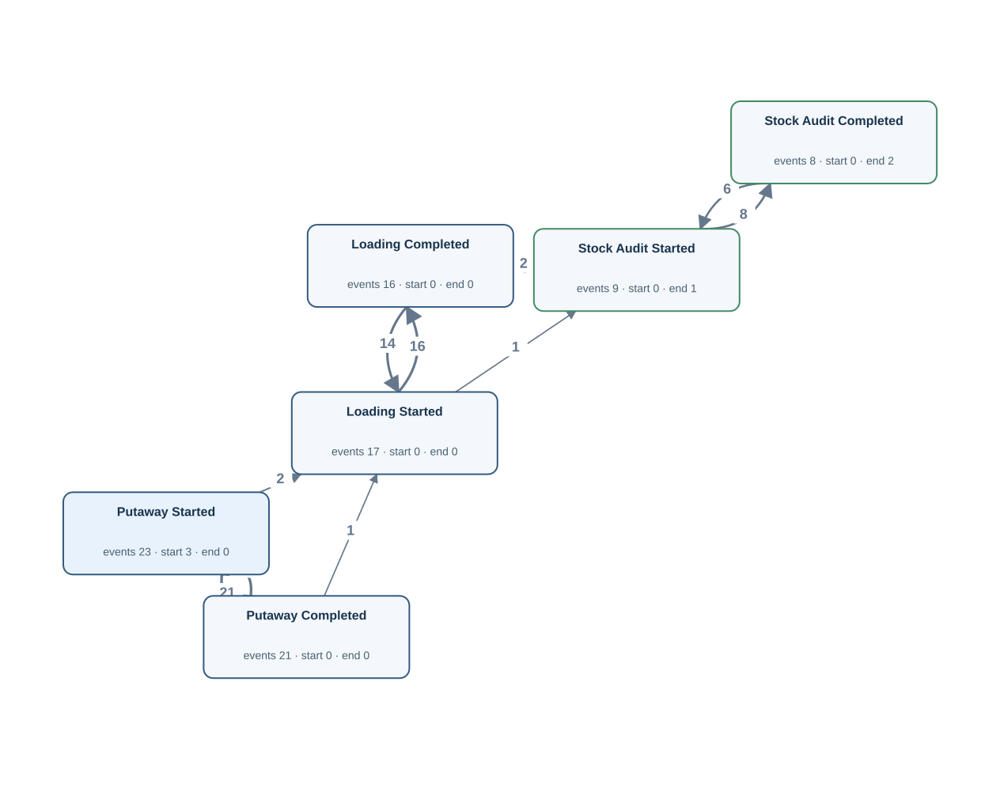</a></td><td width="58%" valign="top">
<a href="../../../datasets/warehouseflow_new/private/gold_sql/W09.sql">Gold SQL</a> · <a href="../../../datasets/warehouseflow_new/private/gold_logs/W09.csv">Gold CSV</a> · <a href="../../../datasets/warehouseflow_new/input/database.sqlite">Full source database (SQLite)</a>

<code>handling_history</code> · 17 matched source rows
<table><tr><th>Column</th><th>Row 1</th><th>Row 2</th><th>Row 3</th></tr><tr><th>handling_id</th><td>0025</td><td>0028</td><td>0031</td></tr><tr><th>request_id</th><td><em>NULL</em></td><td><em>NULL</em></td><td><em>NULL</em></td></tr><tr><th>dispatch_id</th><td>001</td><td>004</td><td>007</td></tr><tr><th>worker_id</th><td>2</td><td>5</td><td>2</td></tr><tr><th>code_family</th><td>HANDLING</td><td>HANDLING</td><td>HANDLING</td></tr><tr><th>handling_code</th><td>LOAD</td><td>LOAD</td><td>LOAD</td></tr><tr><th>started_at</th><td>2026-04-11T16:30:00Z</td><td>2026-04-12T07:30:00Z</td><td>2026-04-12T22:30:00Z</td></tr><tr><th>completed_at</th><td>2026-04-11T16:40:00Z</td><td>2026-04-12T07:40:00Z</td><td>2026-04-12T22:40:00Z</td></tr></table>
<strong>Gold output for the same source rows</strong>
<ul><li>Row 1 → Loading Completed · event H:0025:complete · case W:1 · time from <code>completed_at</code></li><li>Row 1 → Loading Started · event H:0025:start · case W:1 · time from <code>started_at</code></li><li>Row 2 → Loading Completed · event H:0028:complete · case W:1 · time from <code>completed_at</code></li><li>Row 2 → Loading Started · event H:0028:start · case W:1 · time from <code>started_at</code></li><li>Row 3 → Loading Completed · event H:0031:complete · case W:1 · time from <code>completed_at</code></li><li>Row 3 → Loading Started · event H:0031:start · case W:1 · time from <code>started_at</code></li></ul>

<code>warehouse_audit</code> · 9 matched source rows
<table><tr><th>Column</th><th>Row 1</th><th>Row 2</th><th>Row 3</th></tr><tr><th>audit_id</th><td>001</td><td>004</td><td>007</td></tr><tr><th>warehouse_id</th><td>1</td><td>1</td><td>1</td></tr><tr><th>worker_id</th><td>1</td><td>4</td><td>1</td></tr><tr><th>started_at</th><td>2026-05-16T05:40:00Z</td><td>2026-05-16T10:40:00Z</td><td>2026-05-16T15:40:00Z</td></tr><tr><th>completed_at</th><td>2026-05-16T06:20:00Z</td><td>2026-05-16T11:20:00Z</td><td>2026-05-16T16:20:00Z</td></tr><tr><th>result_code</th><td>PASS</td><td>PASS</td><td>PASS</td></tr></table>
<strong>Gold output for the same source rows</strong>
<ul><li>Row 1 → Stock Audit Completed · event A:001:complete · case W:1 · time from <code>completed_at</code></li><li>Row 1 → Stock Audit Started · event A:001:start · case W:1 · time from <code>started_at</code></li><li>Row 2 → Stock Audit Completed · event A:004:complete · case W:1 · time from <code>completed_at</code></li><li>Row 2 → Stock Audit Started · event A:004:start · case W:1 · time from <code>started_at</code></li><li>Row 3 → Stock Audit Completed · event A:007:complete · case W:1 · time from <code>completed_at</code></li><li>Row 3 → Stock Audit Started · event A:007:start · case W:1 · time from <code>started_at</code></li></ul>

<code>warehouse_task_history</code> · 23 matched source rows
<table><tr><th>Column</th><th>Row 1</th><th>Row 2</th><th>Row 3</th></tr><tr><th>task_id</th><td>0001</td><td>0004</td><td>0007</td></tr><tr><th>request_id</th><td>001</td><td>004</td><td>007</td></tr><tr><th>dispatch_id</th><td><em>NULL</em></td><td><em>NULL</em></td><td><em>NULL</em></td></tr><tr><th>worker_id</th><td>1</td><td>4</td><td>1</td></tr><tr><th>code_family</th><td>TASK</td><td>TASK</td><td>TASK</td></tr><tr><th>task_code</th><td>PUTAWAY</td><td>PUTAWAY</td><td>PUTAWAY</td></tr><tr><th>started_at</th><td>2026-02-01T05:40:00Z</td><td>2026-02-01T20:40:00Z</td><td>2026-02-02T11:40:00Z</td></tr><tr><th>completed_at</th><td>2026-02-01T05:50:00Z</td><td>2026-02-01T20:50:00Z</td><td>2026-02-02T11:50:00Z</td></tr><tr><th>outcome_code</th><td>OK</td><td>OK</td><td>OK</td></tr></table>
<strong>Gold output for the same source rows</strong>
<ul><li>Row 1 → Putaway Completed · event T:0001:complete · case W:1 · time from <code>completed_at</code></li><li>Row 1 → Putaway Started · event T:0001:start · case W:1 · time from <code>started_at</code></li><li>Row 2 → Putaway Completed · event T:0004:complete · case W:1 · time from <code>completed_at</code></li><li>Row 2 → Putaway Started · event T:0004:start · case W:1 · time from <code>started_at</code></li><li>Row 3 → Putaway Completed · event T:0007:complete · case W:1 · time from <code>completed_at</code></li><li>Row 3 → Putaway Started · event T:0007:start · case W:1 · time from <code>started_at</code></li></ul>

FK-linked case and join evidence
<ul><li><code>handling_history</code> → <code>dispatch_order</code> · dispatch_id → dispatch_id · dispatch_id = 001</li><li><code>warehouse_task_history</code> → <code>receiving_request</code> · request_id → request_id · request_id = 001</li></ul>
</td></tr></table>

## W09P — Q2

For each warehouse, show the beginnings and completions of its stock audits, putaway work and loading work.

Events: **94** · Cases with events: **3** · Activities: **6** · Edges: **10** · Source tables: **3** · SQL tables: **5**

<table><tr><td width="42%" valign="top"></td><td width="58%" valign="top">
<a href="../../../datasets/warehouseflow_new/private/gold_sql/W09P.sql">Gold SQL</a> · <a href="../../../datasets/warehouseflow_new/private/gold_logs/W09P.csv">Gold CSV</a> · <a href="../../../datasets/warehouseflow_new/input/database.sqlite">Full source database (SQLite)</a>

<code>handling_history</code> · 17 matched source rows
<table><tr><th>Column</th><th>Row 1</th><th>Row 2</th><th>Row 3</th></tr><tr><th>handling_id</th><td>0025</td><td>0028</td><td>0031</td></tr><tr><th>request_id</th><td><em>NULL</em></td><td><em>NULL</em></td><td><em>NULL</em></td></tr><tr><th>dispatch_id</th><td>001</td><td>004</td><td>007</td></tr><tr><th>worker_id</th><td>2</td><td>5</td><td>2</td></tr><tr><th>code_family</th><td>HANDLING</td><td>HANDLING</td><td>HANDLING</td></tr><tr><th>handling_code</th><td>LOAD</td><td>LOAD</td><td>LOAD</td></tr><tr><th>started_at</th><td>2026-04-11T16:30:00Z</td><td>2026-04-12T07:30:00Z</td><td>2026-04-12T22:30:00Z</td></tr><tr><th>completed_at</th><td>2026-04-11T16:40:00Z</td><td>2026-04-12T07:40:00Z</td><td>2026-04-12T22:40:00Z</td></tr></table>
<strong>Gold output for the same source rows</strong>
<ul><li>Row 1 → Loading Completed · event H:0025:complete · case W:1 · time from <code>completed_at</code></li><li>Row 1 → Loading Started · event H:0025:start · case W:1 · time from <code>started_at</code></li><li>Row 2 → Loading Completed · event H:0028:complete · case W:1 · time from <code>completed_at</code></li><li>Row 2 → Loading Started · event H:0028:start · case W:1 · time from <code>started_at</code></li><li>Row 3 → Loading Completed · event H:0031:complete · case W:1 · time from <code>completed_at</code></li><li>Row 3 → Loading Started · event H:0031:start · case W:1 · time from <code>started_at</code></li></ul>

<code>warehouse_audit</code> · 9 matched source rows
<table><tr><th>Column</th><th>Row 1</th><th>Row 2</th><th>Row 3</th></tr><tr><th>audit_id</th><td>001</td><td>004</td><td>007</td></tr><tr><th>warehouse_id</th><td>1</td><td>1</td><td>1</td></tr><tr><th>worker_id</th><td>1</td><td>4</td><td>1</td></tr><tr><th>started_at</th><td>2026-05-16T05:40:00Z</td><td>2026-05-16T10:40:00Z</td><td>2026-05-16T15:40:00Z</td></tr><tr><th>completed_at</th><td>2026-05-16T06:20:00Z</td><td>2026-05-16T11:20:00Z</td><td>2026-05-16T16:20:00Z</td></tr><tr><th>result_code</th><td>PASS</td><td>PASS</td><td>PASS</td></tr></table>
<strong>Gold output for the same source rows</strong>
<ul><li>Row 1 → Stock Audit Completed · event A:001:complete · case W:1 · time from <code>completed_at</code></li><li>Row 1 → Stock Audit Started · event A:001:start · case W:1 · time from <code>started_at</code></li><li>Row 2 → Stock Audit Completed · event A:004:complete · case W:1 · time from <code>completed_at</code></li><li>Row 2 → Stock Audit Started · event A:004:start · case W:1 · time from <code>started_at</code></li><li>Row 3 → Stock Audit Completed · event A:007:complete · case W:1 · time from <code>completed_at</code></li><li>Row 3 → Stock Audit Started · event A:007:start · case W:1 · time from <code>started_at</code></li></ul>

<code>warehouse_task_history</code> · 23 matched source rows
<table><tr><th>Column</th><th>Row 1</th><th>Row 2</th><th>Row 3</th></tr><tr><th>task_id</th><td>0001</td><td>0004</td><td>0007</td></tr><tr><th>request_id</th><td>001</td><td>004</td><td>007</td></tr><tr><th>dispatch_id</th><td><em>NULL</em></td><td><em>NULL</em></td><td><em>NULL</em></td></tr><tr><th>worker_id</th><td>1</td><td>4</td><td>1</td></tr><tr><th>code_family</th><td>TASK</td><td>TASK</td><td>TASK</td></tr><tr><th>task_code</th><td>PUTAWAY</td><td>PUTAWAY</td><td>PUTAWAY</td></tr><tr><th>started_at</th><td>2026-02-01T05:40:00Z</td><td>2026-02-01T20:40:00Z</td><td>2026-02-02T11:40:00Z</td></tr><tr><th>completed_at</th><td>2026-02-01T05:50:00Z</td><td>2026-02-01T20:50:00Z</td><td>2026-02-02T11:50:00Z</td></tr><tr><th>outcome_code</th><td>OK</td><td>OK</td><td>OK</td></tr></table>
<strong>Gold output for the same source rows</strong>
<ul><li>Row 1 → Putaway Completed · event T:0001:complete · case W:1 · time from <code>completed_at</code></li><li>Row 1 → Putaway Started · event T:0001:start · case W:1 · time from <code>started_at</code></li><li>Row 2 → Putaway Completed · event T:0004:complete · case W:1 · time from <code>completed_at</code></li><li>Row 2 → Putaway Started · event T:0004:start · case W:1 · time from <code>started_at</code></li><li>Row 3 → Putaway Completed · event T:0007:complete · case W:1 · time from <code>completed_at</code></li><li>Row 3 → Putaway Started · event T:0007:start · case W:1 · time from <code>started_at</code></li></ul>

FK-linked case and join evidence
<ul><li><code>handling_history</code> → <code>dispatch_order</code> · dispatch_id → dispatch_id · dispatch_id = 001</li><li><code>warehouse_task_history</code> → <code>receiving_request</code> · request_id → request_id · request_id = 001</li></ul>
</td></tr></table>

## W10 — Q1

For each receiving request, extract Unloading Started, Unloading Completed, Receipt Registered, Goods Received, Putaway Started and Putaway Completed events.

Events: **137** · Cases with events: **24** · Activities: **6** · Edges: **5** · Source tables: **4** · SQL tables: **4**

<table><tr><td width="42%" valign="top"><a href="graphs/W10.svg">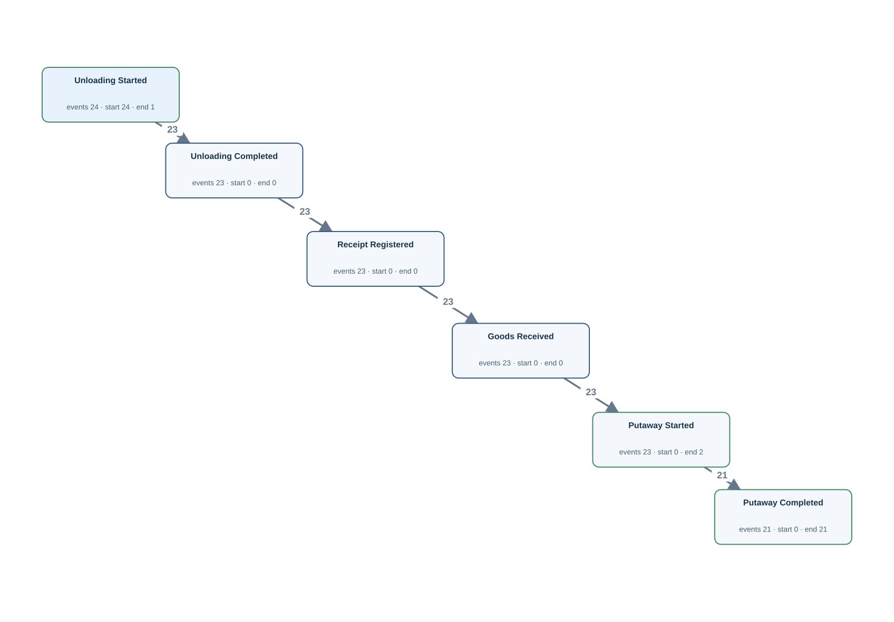</a></td><td width="58%" valign="top">
<a href="../../../datasets/warehouseflow_new/private/gold_sql/W10.sql">Gold SQL</a> · <a href="../../../datasets/warehouseflow_new/private/gold_logs/W10.csv">Gold CSV</a> · <a href="../../../datasets/warehouseflow_new/input/database.sqlite">Full source database (SQLite)</a>

<code>goods_movement</code> · 23 matched source rows
<table><tr><th>Column</th><th>Row 1</th><th>Row 2</th><th>Row 3</th></tr><tr><th>movement_id</th><td>0001</td><td>0002</td><td>0003</td></tr><tr><th>warehouse_id</th><td>1</td><td>2</td><td>3</td></tr><tr><th>goods_id</th><td>1</td><td>2</td><td>3</td></tr><tr><th>quantity</th><td>10</td><td>10</td><td>10</td></tr><tr><th>receipt_id</th><td>001</td><td>002</td><td>003</td></tr><tr><th>dispatch_id</th><td><em>NULL</em></td><td><em>NULL</em></td><td><em>NULL</em></td></tr><tr><th>code_family</th><td>MOVEMENT</td><td>MOVEMENT</td><td>MOVEMENT</td></tr><tr><th>movement_code</th><td>IN</td><td>IN</td><td>IN</td></tr><tr><th>occurred_at</th><td>2026-02-01T05:35:00Z</td><td>2026-02-01T10:35:00Z</td><td>2026-02-01T15:35:00Z</td></tr></table>
<strong>Gold output for the same source rows</strong>
<ul><li>Row 1 → Goods Received · event M:0001 · case Q:001 · time from <code>occurred_at</code></li><li>Row 2 → Goods Received · event M:0002 · case Q:002 · time from <code>occurred_at</code></li><li>Row 3 → Goods Received · event M:0003 · case Q:003 · time from <code>occurred_at</code></li></ul>

<code>goods_receipt</code> · 23 matched source rows
<table><tr><th>Column</th><th>Row 1</th><th>Row 2</th><th>Row 3</th></tr><tr><th>receipt_id</th><td>001</td><td>002</td><td>003</td></tr><tr><th>request_id</th><td>001</td><td>002</td><td>003</td></tr><tr><th>receiver_id</th><td>1</td><td>2</td><td>3</td></tr><tr><th>received_at</th><td>2026-02-01T05:32:00Z</td><td>2026-02-01T10:32:00Z</td><td>2026-02-01T15:32:00Z</td></tr><tr><th>condition_code</th><td>GOOD</td><td>GOOD</td><td>GOOD</td></tr></table>
<strong>Gold output for the same source rows</strong>
<ul><li>Row 1 → Receipt Registered · event R:001 · case Q:001 · time from <code>received_at</code></li><li>Row 2 → Receipt Registered · event R:002 · case Q:002 · time from <code>received_at</code></li><li>Row 3 → Receipt Registered · event R:003 · case Q:003 · time from <code>received_at</code></li></ul>

<code>handling_history</code> · 24 matched source rows
<table><tr><th>Column</th><th>Row 1</th><th>Row 2</th><th>Row 3</th></tr><tr><th>handling_id</th><td>0001</td><td>0002</td><td>0003</td></tr><tr><th>request_id</th><td>001</td><td>002</td><td>003</td></tr><tr><th>dispatch_id</th><td><em>NULL</em></td><td><em>NULL</em></td><td><em>NULL</em></td></tr><tr><th>worker_id</th><td>1</td><td>2</td><td>3</td></tr><tr><th>code_family</th><td>HANDLING</td><td>HANDLING</td><td>HANDLING</td></tr><tr><th>handling_code</th><td>UNLOAD</td><td>UNLOAD</td><td>UNLOAD</td></tr><tr><th>started_at</th><td>2026-02-01T05:20:00Z</td><td>2026-02-01T10:20:00Z</td><td>2026-02-01T15:20:00Z</td></tr><tr><th>completed_at</th><td>2026-02-01T05:30:00Z</td><td>2026-02-01T10:30:00Z</td><td>2026-02-01T15:30:00Z</td></tr></table>
<strong>Gold output for the same source rows</strong>
<ul><li>Row 1 → Unloading Completed · event H:0001:complete · case Q:001 · time from <code>completed_at</code></li><li>Row 1 → Unloading Started · event H:0001:start · case Q:001 · time from <code>started_at</code></li><li>Row 2 → Unloading Completed · event H:0002:complete · case Q:002 · time from <code>completed_at</code></li><li>Row 2 → Unloading Started · event H:0002:start · case Q:002 · time from <code>started_at</code></li><li>Row 3 → Unloading Completed · event H:0003:complete · case Q:003 · time from <code>completed_at</code></li><li>Row 3 → Unloading Started · event H:0003:start · case Q:003 · time from <code>started_at</code></li></ul>

<code>warehouse_task_history</code> · 23 matched source rows
<table><tr><th>Column</th><th>Row 1</th><th>Row 2</th><th>Row 3</th></tr><tr><th>task_id</th><td>0001</td><td>0002</td><td>0003</td></tr><tr><th>request_id</th><td>001</td><td>002</td><td>003</td></tr><tr><th>dispatch_id</th><td><em>NULL</em></td><td><em>NULL</em></td><td><em>NULL</em></td></tr><tr><th>worker_id</th><td>1</td><td>2</td><td>3</td></tr><tr><th>code_family</th><td>TASK</td><td>TASK</td><td>TASK</td></tr><tr><th>task_code</th><td>PUTAWAY</td><td>PUTAWAY</td><td>PUTAWAY</td></tr><tr><th>started_at</th><td>2026-02-01T05:40:00Z</td><td>2026-02-01T10:40:00Z</td><td>2026-02-01T15:40:00Z</td></tr><tr><th>completed_at</th><td>2026-02-01T05:50:00Z</td><td>2026-02-01T10:50:00Z</td><td>2026-02-01T15:50:00Z</td></tr><tr><th>outcome_code</th><td>OK</td><td>OK</td><td>OK</td></tr></table>
<strong>Gold output for the same source rows</strong>
<ul><li>Row 1 → Putaway Completed · event T:0001:complete · case Q:001 · time from <code>completed_at</code></li><li>Row 1 → Putaway Started · event T:0001:start · case Q:001 · time from <code>started_at</code></li><li>Row 2 → Putaway Completed · event T:0002:complete · case Q:002 · time from <code>completed_at</code></li><li>Row 2 → Putaway Started · event T:0002:start · case Q:002 · time from <code>started_at</code></li><li>Row 3 → Putaway Completed · event T:0003:complete · case Q:003 · time from <code>completed_at</code></li><li>Row 3 → Putaway Started · event T:0003:start · case Q:003 · time from <code>started_at</code></li></ul>
</td></tr></table>

## W10P — Q2

For every receiving request, show the start and completion of unloading, registration of the receipt, receipt into warehouse stock, and the start and completion of putaway.

Events: **137** · Cases with events: **24** · Activities: **6** · Edges: **5** · Source tables: **4** · SQL tables: **4**

<table><tr><td width="42%" valign="top"></td><td width="58%" valign="top">
<a href="../../../datasets/warehouseflow_new/private/gold_sql/W10P.sql">Gold SQL</a> · <a href="../../../datasets/warehouseflow_new/private/gold_logs/W10P.csv">Gold CSV</a> · <a href="../../../datasets/warehouseflow_new/input/database.sqlite">Full source database (SQLite)</a>

<code>goods_movement</code> · 23 matched source rows
<table><tr><th>Column</th><th>Row 1</th><th>Row 2</th><th>Row 3</th></tr><tr><th>movement_id</th><td>0001</td><td>0002</td><td>0003</td></tr><tr><th>warehouse_id</th><td>1</td><td>2</td><td>3</td></tr><tr><th>goods_id</th><td>1</td><td>2</td><td>3</td></tr><tr><th>quantity</th><td>10</td><td>10</td><td>10</td></tr><tr><th>receipt_id</th><td>001</td><td>002</td><td>003</td></tr><tr><th>dispatch_id</th><td><em>NULL</em></td><td><em>NULL</em></td><td><em>NULL</em></td></tr><tr><th>code_family</th><td>MOVEMENT</td><td>MOVEMENT</td><td>MOVEMENT</td></tr><tr><th>movement_code</th><td>IN</td><td>IN</td><td>IN</td></tr><tr><th>occurred_at</th><td>2026-02-01T05:35:00Z</td><td>2026-02-01T10:35:00Z</td><td>2026-02-01T15:35:00Z</td></tr></table>
<strong>Gold output for the same source rows</strong>
<ul><li>Row 1 → Goods Received · event M:0001 · case Q:001 · time from <code>occurred_at</code></li><li>Row 2 → Goods Received · event M:0002 · case Q:002 · time from <code>occurred_at</code></li><li>Row 3 → Goods Received · event M:0003 · case Q:003 · time from <code>occurred_at</code></li></ul>

<code>goods_receipt</code> · 23 matched source rows
<table><tr><th>Column</th><th>Row 1</th><th>Row 2</th><th>Row 3</th></tr><tr><th>receipt_id</th><td>001</td><td>002</td><td>003</td></tr><tr><th>request_id</th><td>001</td><td>002</td><td>003</td></tr><tr><th>receiver_id</th><td>1</td><td>2</td><td>3</td></tr><tr><th>received_at</th><td>2026-02-01T05:32:00Z</td><td>2026-02-01T10:32:00Z</td><td>2026-02-01T15:32:00Z</td></tr><tr><th>condition_code</th><td>GOOD</td><td>GOOD</td><td>GOOD</td></tr></table>
<strong>Gold output for the same source rows</strong>
<ul><li>Row 1 → Receipt Registered · event R:001 · case Q:001 · time from <code>received_at</code></li><li>Row 2 → Receipt Registered · event R:002 · case Q:002 · time from <code>received_at</code></li><li>Row 3 → Receipt Registered · event R:003 · case Q:003 · time from <code>received_at</code></li></ul>

<code>handling_history</code> · 24 matched source rows
<table><tr><th>Column</th><th>Row 1</th><th>Row 2</th><th>Row 3</th></tr><tr><th>handling_id</th><td>0001</td><td>0002</td><td>0003</td></tr><tr><th>request_id</th><td>001</td><td>002</td><td>003</td></tr><tr><th>dispatch_id</th><td><em>NULL</em></td><td><em>NULL</em></td><td><em>NULL</em></td></tr><tr><th>worker_id</th><td>1</td><td>2</td><td>3</td></tr><tr><th>code_family</th><td>HANDLING</td><td>HANDLING</td><td>HANDLING</td></tr><tr><th>handling_code</th><td>UNLOAD</td><td>UNLOAD</td><td>UNLOAD</td></tr><tr><th>started_at</th><td>2026-02-01T05:20:00Z</td><td>2026-02-01T10:20:00Z</td><td>2026-02-01T15:20:00Z</td></tr><tr><th>completed_at</th><td>2026-02-01T05:30:00Z</td><td>2026-02-01T10:30:00Z</td><td>2026-02-01T15:30:00Z</td></tr></table>
<strong>Gold output for the same source rows</strong>
<ul><li>Row 1 → Unloading Completed · event H:0001:complete · case Q:001 · time from <code>completed_at</code></li><li>Row 1 → Unloading Started · event H:0001:start · case Q:001 · time from <code>started_at</code></li><li>Row 2 → Unloading Completed · event H:0002:complete · case Q:002 · time from <code>completed_at</code></li><li>Row 2 → Unloading Started · event H:0002:start · case Q:002 · time from <code>started_at</code></li><li>Row 3 → Unloading Completed · event H:0003:complete · case Q:003 · time from <code>completed_at</code></li><li>Row 3 → Unloading Started · event H:0003:start · case Q:003 · time from <code>started_at</code></li></ul>

<code>warehouse_task_history</code> · 23 matched source rows
<table><tr><th>Column</th><th>Row 1</th><th>Row 2</th><th>Row 3</th></tr><tr><th>task_id</th><td>0001</td><td>0002</td><td>0003</td></tr><tr><th>request_id</th><td>001</td><td>002</td><td>003</td></tr><tr><th>dispatch_id</th><td><em>NULL</em></td><td><em>NULL</em></td><td><em>NULL</em></td></tr><tr><th>worker_id</th><td>1</td><td>2</td><td>3</td></tr><tr><th>code_family</th><td>TASK</td><td>TASK</td><td>TASK</td></tr><tr><th>task_code</th><td>PUTAWAY</td><td>PUTAWAY</td><td>PUTAWAY</td></tr><tr><th>started_at</th><td>2026-02-01T05:40:00Z</td><td>2026-02-01T10:40:00Z</td><td>2026-02-01T15:40:00Z</td></tr><tr><th>completed_at</th><td>2026-02-01T05:50:00Z</td><td>2026-02-01T10:50:00Z</td><td>2026-02-01T15:50:00Z</td></tr><tr><th>outcome_code</th><td>OK</td><td>OK</td><td>OK</td></tr></table>
<strong>Gold output for the same source rows</strong>
<ul><li>Row 1 → Putaway Completed · event T:0001:complete · case Q:001 · time from <code>completed_at</code></li><li>Row 1 → Putaway Started · event T:0001:start · case Q:001 · time from <code>started_at</code></li><li>Row 2 → Putaway Completed · event T:0002:complete · case Q:002 · time from <code>completed_at</code></li><li>Row 2 → Putaway Started · event T:0002:start · case Q:002 · time from <code>started_at</code></li><li>Row 3 → Putaway Completed · event T:0003:complete · case Q:003 · time from <code>completed_at</code></li><li>Row 3 → Putaway Started · event T:0003:start · case Q:003 · time from <code>started_at</code></li></ul>
</td></tr></table>

## W11 — Q1

For each dispatch order, extract Picking Started, Picking Completed, Packing Started, Packing Completed, Loading Started, Loading Completed and Goods Dispatched events.

Events: **128** · Cases with events: **18** · Activities: **7** · Edges: **7** · Source tables: **3** · SQL tables: **3**

<table><tr><td width="42%" valign="top"><a href="graphs/W11.svg">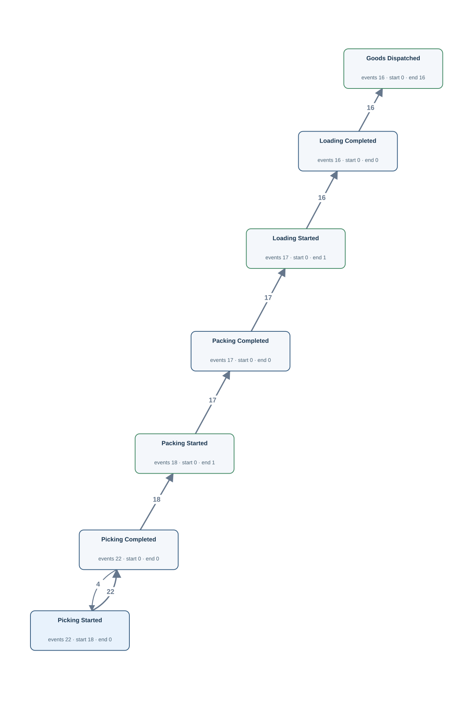</a></td><td width="58%" valign="top">
<a href="../../../datasets/warehouseflow_new/private/gold_sql/W11.sql">Gold SQL</a> · <a href="../../../datasets/warehouseflow_new/private/gold_logs/W11.csv">Gold CSV</a> · <a href="../../../datasets/warehouseflow_new/input/database.sqlite">Full source database (SQLite)</a>

<code>goods_movement</code> · 16 matched source rows
<table><tr><th>Column</th><th>Row 1</th><th>Row 2</th><th>Row 3</th></tr><tr><th>movement_id</th><td>0024</td><td>0025</td><td>0026</td></tr><tr><th>warehouse_id</th><td>1</td><td>2</td><td>3</td></tr><tr><th>goods_id</th><td>1</td><td>2</td><td>3</td></tr><tr><th>quantity</th><td>4</td><td>4</td><td>4</td></tr><tr><th>receipt_id</th><td><em>NULL</em></td><td><em>NULL</em></td><td><em>NULL</em></td></tr><tr><th>dispatch_id</th><td>001</td><td>002</td><td>003</td></tr><tr><th>code_family</th><td>MOVEMENT</td><td>MOVEMENT</td><td>MOVEMENT</td></tr><tr><th>movement_code</th><td>OUT</td><td>OUT</td><td>OUT</td></tr><tr><th>occurred_at</th><td>2026-04-11T16:45:00Z</td><td>2026-04-11T21:45:00Z</td><td>2026-04-12T02:45:00Z</td></tr></table>
<strong>Gold output for the same source rows</strong>
<ul><li>Row 1 → Goods Dispatched · event M:0024 · case D:001 · time from <code>occurred_at</code></li><li>Row 2 → Goods Dispatched · event M:0025 · case D:002 · time from <code>occurred_at</code></li><li>Row 3 → Goods Dispatched · event M:0026 · case D:003 · time from <code>occurred_at</code></li></ul>

<code>handling_history</code> · 17 matched source rows
<table><tr><th>Column</th><th>Row 1</th><th>Row 2</th><th>Row 3</th></tr><tr><th>handling_id</th><td>0025</td><td>0026</td><td>0027</td></tr><tr><th>request_id</th><td><em>NULL</em></td><td><em>NULL</em></td><td><em>NULL</em></td></tr><tr><th>dispatch_id</th><td>001</td><td>002</td><td>003</td></tr><tr><th>worker_id</th><td>2</td><td>3</td><td>4</td></tr><tr><th>code_family</th><td>HANDLING</td><td>HANDLING</td><td>HANDLING</td></tr><tr><th>handling_code</th><td>LOAD</td><td>LOAD</td><td>LOAD</td></tr><tr><th>started_at</th><td>2026-04-11T16:30:00Z</td><td>2026-04-11T21:30:00Z</td><td>2026-04-12T02:30:00Z</td></tr><tr><th>completed_at</th><td>2026-04-11T16:40:00Z</td><td>2026-04-11T21:40:00Z</td><td>2026-04-12T02:40:00Z</td></tr></table>
<strong>Gold output for the same source rows</strong>
<ul><li>Row 1 → Loading Completed · event H:0025:complete · case D:001 · time from <code>completed_at</code></li><li>Row 1 → Loading Started · event H:0025:start · case D:001 · time from <code>started_at</code></li><li>Row 2 → Loading Completed · event H:0026:complete · case D:002 · time from <code>completed_at</code></li><li>Row 2 → Loading Started · event H:0026:start · case D:002 · time from <code>started_at</code></li><li>Row 3 → Loading Completed · event H:0027:complete · case D:003 · time from <code>completed_at</code></li><li>Row 3 → Loading Started · event H:0027:start · case D:003 · time from <code>started_at</code></li></ul>

<code>warehouse_task_history</code> · 40 matched source rows
<table><tr><th>Column</th><th>Row 1</th><th>Row 2</th><th>Row 3</th></tr><tr><th>task_id</th><td>0024</td><td>0025</td><td>0026</td></tr><tr><th>request_id</th><td><em>NULL</em></td><td><em>NULL</em></td><td><em>NULL</em></td></tr><tr><th>dispatch_id</th><td>001</td><td>001</td><td>002</td></tr><tr><th>worker_id</th><td>2</td><td>2</td><td>3</td></tr><tr><th>code_family</th><td>TASK</td><td>TASK</td><td>TASK</td></tr><tr><th>task_code</th><td>PICK</td><td>PACK</td><td>PICK</td></tr><tr><th>started_at</th><td>2026-04-11T16:00:00Z</td><td>2026-04-11T16:15:00Z</td><td>2026-04-11T21:00:00Z</td></tr><tr><th>completed_at</th><td>2026-04-11T16:10:00Z</td><td>2026-04-11T16:25:00Z</td><td>2026-04-11T21:10:00Z</td></tr><tr><th>outcome_code</th><td>OK</td><td>OK</td><td>OK</td></tr></table>
<strong>Gold output for the same source rows</strong>
<ul><li>Row 1 → Picking Completed · event T:0024:complete · case D:001 · time from <code>completed_at</code></li><li>Row 1 → Picking Started · event T:0024:start · case D:001 · time from <code>started_at</code></li><li>Row 2 → Packing Completed · event T:0025:complete · case D:001 · time from <code>completed_at</code></li><li>Row 2 → Packing Started · event T:0025:start · case D:001 · time from <code>started_at</code></li><li>Row 3 → Picking Completed · event T:0026:complete · case D:002 · time from <code>completed_at</code></li><li>Row 3 → Picking Started · event T:0026:start · case D:002 · time from <code>started_at</code></li></ul>
</td></tr></table>

## W11P — Q2

For each dispatch order, show when picking, packing and loading began and finished, together with the dispatch of goods from stock.

Events: **128** · Cases with events: **18** · Activities: **7** · Edges: **7** · Source tables: **3** · SQL tables: **3**

<table><tr><td width="42%" valign="top"></td><td width="58%" valign="top">
<a href="../../../datasets/warehouseflow_new/private/gold_sql/W11P.sql">Gold SQL</a> · <a href="../../../datasets/warehouseflow_new/private/gold_logs/W11P.csv">Gold CSV</a> · <a href="../../../datasets/warehouseflow_new/input/database.sqlite">Full source database (SQLite)</a>

<code>goods_movement</code> · 16 matched source rows
<table><tr><th>Column</th><th>Row 1</th><th>Row 2</th><th>Row 3</th></tr><tr><th>movement_id</th><td>0024</td><td>0025</td><td>0026</td></tr><tr><th>warehouse_id</th><td>1</td><td>2</td><td>3</td></tr><tr><th>goods_id</th><td>1</td><td>2</td><td>3</td></tr><tr><th>quantity</th><td>4</td><td>4</td><td>4</td></tr><tr><th>receipt_id</th><td><em>NULL</em></td><td><em>NULL</em></td><td><em>NULL</em></td></tr><tr><th>dispatch_id</th><td>001</td><td>002</td><td>003</td></tr><tr><th>code_family</th><td>MOVEMENT</td><td>MOVEMENT</td><td>MOVEMENT</td></tr><tr><th>movement_code</th><td>OUT</td><td>OUT</td><td>OUT</td></tr><tr><th>occurred_at</th><td>2026-04-11T16:45:00Z</td><td>2026-04-11T21:45:00Z</td><td>2026-04-12T02:45:00Z</td></tr></table>
<strong>Gold output for the same source rows</strong>
<ul><li>Row 1 → Goods Dispatched · event M:0024 · case D:001 · time from <code>occurred_at</code></li><li>Row 2 → Goods Dispatched · event M:0025 · case D:002 · time from <code>occurred_at</code></li><li>Row 3 → Goods Dispatched · event M:0026 · case D:003 · time from <code>occurred_at</code></li></ul>

<code>handling_history</code> · 17 matched source rows
<table><tr><th>Column</th><th>Row 1</th><th>Row 2</th><th>Row 3</th></tr><tr><th>handling_id</th><td>0025</td><td>0026</td><td>0027</td></tr><tr><th>request_id</th><td><em>NULL</em></td><td><em>NULL</em></td><td><em>NULL</em></td></tr><tr><th>dispatch_id</th><td>001</td><td>002</td><td>003</td></tr><tr><th>worker_id</th><td>2</td><td>3</td><td>4</td></tr><tr><th>code_family</th><td>HANDLING</td><td>HANDLING</td><td>HANDLING</td></tr><tr><th>handling_code</th><td>LOAD</td><td>LOAD</td><td>LOAD</td></tr><tr><th>started_at</th><td>2026-04-11T16:30:00Z</td><td>2026-04-11T21:30:00Z</td><td>2026-04-12T02:30:00Z</td></tr><tr><th>completed_at</th><td>2026-04-11T16:40:00Z</td><td>2026-04-11T21:40:00Z</td><td>2026-04-12T02:40:00Z</td></tr></table>
<strong>Gold output for the same source rows</strong>
<ul><li>Row 1 → Loading Completed · event H:0025:complete · case D:001 · time from <code>completed_at</code></li><li>Row 1 → Loading Started · event H:0025:start · case D:001 · time from <code>started_at</code></li><li>Row 2 → Loading Completed · event H:0026:complete · case D:002 · time from <code>completed_at</code></li><li>Row 2 → Loading Started · event H:0026:start · case D:002 · time from <code>started_at</code></li><li>Row 3 → Loading Completed · event H:0027:complete · case D:003 · time from <code>completed_at</code></li><li>Row 3 → Loading Started · event H:0027:start · case D:003 · time from <code>started_at</code></li></ul>

<code>warehouse_task_history</code> · 40 matched source rows
<table><tr><th>Column</th><th>Row 1</th><th>Row 2</th><th>Row 3</th></tr><tr><th>task_id</th><td>0024</td><td>0025</td><td>0026</td></tr><tr><th>request_id</th><td><em>NULL</em></td><td><em>NULL</em></td><td><em>NULL</em></td></tr><tr><th>dispatch_id</th><td>001</td><td>001</td><td>002</td></tr><tr><th>worker_id</th><td>2</td><td>2</td><td>3</td></tr><tr><th>code_family</th><td>TASK</td><td>TASK</td><td>TASK</td></tr><tr><th>task_code</th><td>PICK</td><td>PACK</td><td>PICK</td></tr><tr><th>started_at</th><td>2026-04-11T16:00:00Z</td><td>2026-04-11T16:15:00Z</td><td>2026-04-11T21:00:00Z</td></tr><tr><th>completed_at</th><td>2026-04-11T16:10:00Z</td><td>2026-04-11T16:25:00Z</td><td>2026-04-11T21:10:00Z</td></tr><tr><th>outcome_code</th><td>OK</td><td>OK</td><td>OK</td></tr></table>
<strong>Gold output for the same source rows</strong>
<ul><li>Row 1 → Picking Completed · event T:0024:complete · case D:001 · time from <code>completed_at</code></li><li>Row 1 → Picking Started · event T:0024:start · case D:001 · time from <code>started_at</code></li><li>Row 2 → Packing Completed · event T:0025:complete · case D:001 · time from <code>completed_at</code></li><li>Row 2 → Packing Started · event T:0025:start · case D:001 · time from <code>started_at</code></li><li>Row 3 → Picking Completed · event T:0026:complete · case D:002 · time from <code>completed_at</code></li><li>Row 3 → Picking Started · event T:0026:start · case D:002 · time from <code>started_at</code></li></ul>
</td></tr></table>

## W12 — Q1

For each worker, extract Stock Audit Started, Stock Audit Completed, Picking Started and Picking Completed events.

Events: **61** · Cases with events: **6** · Activities: **4** · Edges: **5** · Source tables: **2** · SQL tables: **2**

<table><tr><td width="42%" valign="top"><a href="graphs/W12.svg">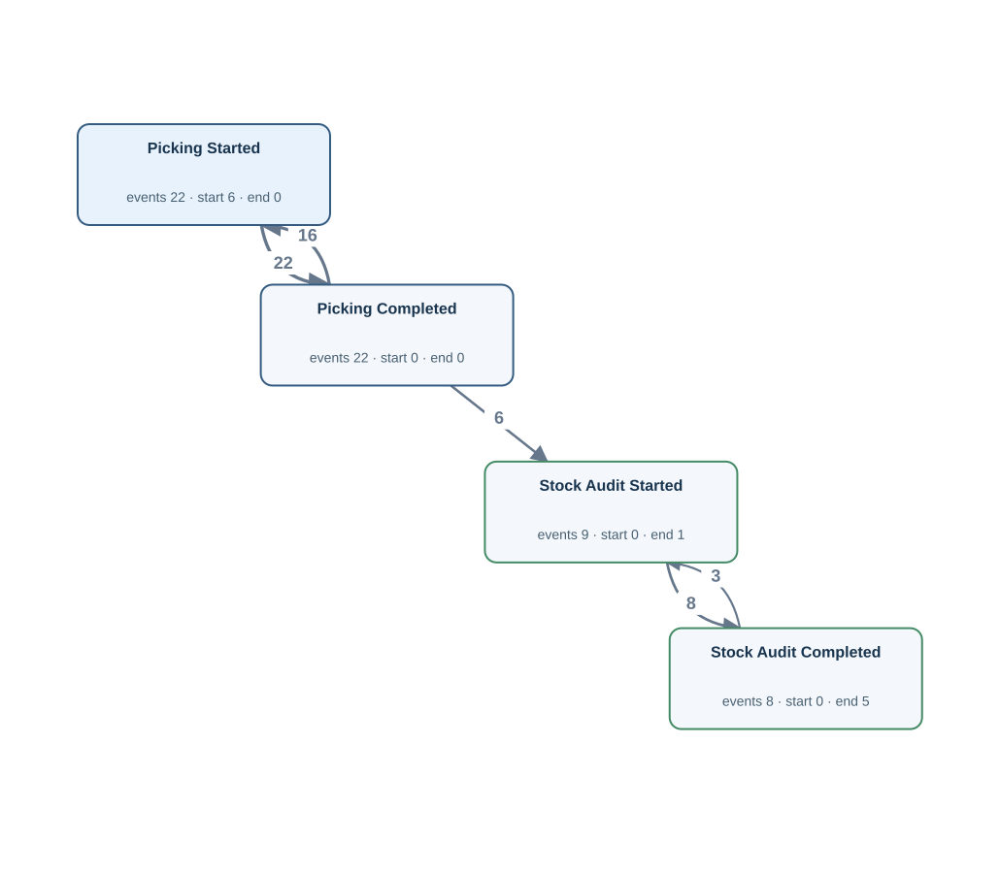</a></td><td width="58%" valign="top">
<a href="../../../datasets/warehouseflow_new/private/gold_sql/W12.sql">Gold SQL</a> · <a href="../../../datasets/warehouseflow_new/private/gold_logs/W12.csv">Gold CSV</a> · <a href="../../../datasets/warehouseflow_new/input/database.sqlite">Full source database (SQLite)</a>

<code>warehouse_audit</code> · 9 matched source rows
<table><tr><th>Column</th><th>Row 1</th><th>Row 2</th><th>Row 3</th></tr><tr><th>audit_id</th><td>001</td><td>007</td><td>002</td></tr><tr><th>warehouse_id</th><td>1</td><td>1</td><td>2</td></tr><tr><th>worker_id</th><td>1</td><td>1</td><td>2</td></tr><tr><th>started_at</th><td>2026-05-16T05:40:00Z</td><td>2026-05-16T15:40:00Z</td><td>2026-05-16T07:20:00Z</td></tr><tr><th>completed_at</th><td>2026-05-16T06:20:00Z</td><td>2026-05-16T16:20:00Z</td><td>2026-05-16T08:00:00Z</td></tr><tr><th>result_code</th><td>PASS</td><td>PASS</td><td>PASS</td></tr></table>
<strong>Gold output for the same source rows</strong>
<ul><li>Row 1 → Stock Audit Completed · event A:001:complete · case L:1 · time from <code>completed_at</code></li><li>Row 1 → Stock Audit Started · event A:001:start · case L:1 · time from <code>started_at</code></li><li>Row 2 → Stock Audit Completed · event A:007:complete · case L:1 · time from <code>completed_at</code></li><li>Row 2 → Stock Audit Started · event A:007:start · case L:1 · time from <code>started_at</code></li><li>Row 3 → Stock Audit Completed · event A:002:complete · case L:2 · time from <code>completed_at</code></li><li>Row 3 → Stock Audit Started · event A:002:start · case L:2 · time from <code>started_at</code></li></ul>

<code>warehouse_task_history</code> · 22 matched source rows
<table><tr><th>Column</th><th>Row 1</th><th>Row 2</th><th>Row 3</th></tr><tr><th>task_id</th><td>0035</td><td>0048</td><td>0049</td></tr><tr><th>request_id</th><td><em>NULL</em></td><td><em>NULL</em></td><td><em>NULL</em></td></tr><tr><th>dispatch_id</th><td>006</td><td>012</td><td>012</td></tr><tr><th>worker_id</th><td>1</td><td>1</td><td>1</td></tr><tr><th>code_family</th><td>TASK</td><td>TASK</td><td>TASK</td></tr><tr><th>task_code</th><td>PICK</td><td>PICK</td><td>PICK</td></tr><tr><th>started_at</th><td>2026-04-12T17:00:00Z</td><td>2026-04-13T23:00:00Z</td><td>2026-04-13T23:11:00Z</td></tr><tr><th>completed_at</th><td>2026-04-12T17:10:00Z</td><td>2026-04-13T23:10:00Z</td><td>2026-04-13T23:13:00Z</td></tr><tr><th>outcome_code</th><td>OK</td><td>RETRY</td><td>OK</td></tr></table>
<strong>Gold output for the same source rows</strong>
<ul><li>Row 1 → Picking Completed · event T:0035:complete · case L:1 · time from <code>completed_at</code></li><li>Row 1 → Picking Started · event T:0035:start · case L:1 · time from <code>started_at</code></li><li>Row 2 → Picking Completed · event T:0048:complete · case L:1 · time from <code>completed_at</code></li><li>Row 2 → Picking Started · event T:0048:start · case L:1 · time from <code>started_at</code></li><li>Row 3 → Picking Completed · event T:0049:complete · case L:1 · time from <code>completed_at</code></li><li>Row 3 → Picking Started · event T:0049:start · case L:1 · time from <code>started_at</code></li></ul>
</td></tr></table>

## W12P — Q2

For every worker, show when their stock audits and picking work began and finished.

Events: **61** · Cases with events: **6** · Activities: **4** · Edges: **5** · Source tables: **2** · SQL tables: **2**

<table><tr><td width="42%" valign="top"></td><td width="58%" valign="top">
<a href="../../../datasets/warehouseflow_new/private/gold_sql/W12P.sql">Gold SQL</a> · <a href="../../../datasets/warehouseflow_new/private/gold_logs/W12P.csv">Gold CSV</a> · <a href="../../../datasets/warehouseflow_new/input/database.sqlite">Full source database (SQLite)</a>

<code>warehouse_audit</code> · 9 matched source rows
<table><tr><th>Column</th><th>Row 1</th><th>Row 2</th><th>Row 3</th></tr><tr><th>audit_id</th><td>001</td><td>007</td><td>002</td></tr><tr><th>warehouse_id</th><td>1</td><td>1</td><td>2</td></tr><tr><th>worker_id</th><td>1</td><td>1</td><td>2</td></tr><tr><th>started_at</th><td>2026-05-16T05:40:00Z</td><td>2026-05-16T15:40:00Z</td><td>2026-05-16T07:20:00Z</td></tr><tr><th>completed_at</th><td>2026-05-16T06:20:00Z</td><td>2026-05-16T16:20:00Z</td><td>2026-05-16T08:00:00Z</td></tr><tr><th>result_code</th><td>PASS</td><td>PASS</td><td>PASS</td></tr></table>
<strong>Gold output for the same source rows</strong>
<ul><li>Row 1 → Stock Audit Completed · event A:001:complete · case L:1 · time from <code>completed_at</code></li><li>Row 1 → Stock Audit Started · event A:001:start · case L:1 · time from <code>started_at</code></li><li>Row 2 → Stock Audit Completed · event A:007:complete · case L:1 · time from <code>completed_at</code></li><li>Row 2 → Stock Audit Started · event A:007:start · case L:1 · time from <code>started_at</code></li><li>Row 3 → Stock Audit Completed · event A:002:complete · case L:2 · time from <code>completed_at</code></li><li>Row 3 → Stock Audit Started · event A:002:start · case L:2 · time from <code>started_at</code></li></ul>

<code>warehouse_task_history</code> · 22 matched source rows
<table><tr><th>Column</th><th>Row 1</th><th>Row 2</th><th>Row 3</th></tr><tr><th>task_id</th><td>0035</td><td>0048</td><td>0049</td></tr><tr><th>request_id</th><td><em>NULL</em></td><td><em>NULL</em></td><td><em>NULL</em></td></tr><tr><th>dispatch_id</th><td>006</td><td>012</td><td>012</td></tr><tr><th>worker_id</th><td>1</td><td>1</td><td>1</td></tr><tr><th>code_family</th><td>TASK</td><td>TASK</td><td>TASK</td></tr><tr><th>task_code</th><td>PICK</td><td>PICK</td><td>PICK</td></tr><tr><th>started_at</th><td>2026-04-12T17:00:00Z</td><td>2026-04-13T23:00:00Z</td><td>2026-04-13T23:11:00Z</td></tr><tr><th>completed_at</th><td>2026-04-12T17:10:00Z</td><td>2026-04-13T23:10:00Z</td><td>2026-04-13T23:13:00Z</td></tr><tr><th>outcome_code</th><td>OK</td><td>RETRY</td><td>OK</td></tr></table>
<strong>Gold output for the same source rows</strong>
<ul><li>Row 1 → Picking Completed · event T:0035:complete · case L:1 · time from <code>completed_at</code></li><li>Row 1 → Picking Started · event T:0035:start · case L:1 · time from <code>started_at</code></li><li>Row 2 → Picking Completed · event T:0048:complete · case L:1 · time from <code>completed_at</code></li><li>Row 2 → Picking Started · event T:0048:start · case L:1 · time from <code>started_at</code></li><li>Row 3 → Picking Completed · event T:0049:complete · case L:1 · time from <code>completed_at</code></li><li>Row 3 → Picking Started · event T:0049:start · case L:1 · time from <code>started_at</code></li></ul>
</td></tr></table>

## W13 — Q1

For each goods type, extract Goods Received and Goods Dispatched events.

Events: **39** · Cases with events: **6** · Activities: **2** · Edges: **3** · Source tables: **1** · SQL tables: **1**

<table><tr><td width="42%" valign="top"><a href="graphs/W13.svg">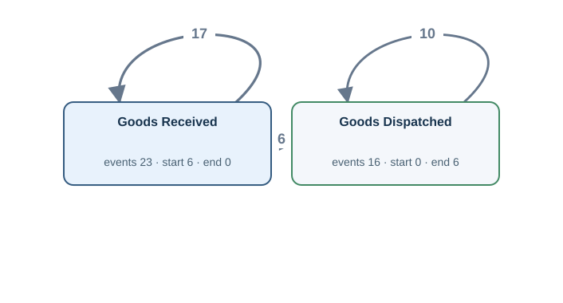</a></td><td width="58%" valign="top">
<a href="../../../datasets/warehouseflow_new/private/gold_sql/W13.sql">Gold SQL</a> · <a href="../../../datasets/warehouseflow_new/private/gold_logs/W13.csv">Gold CSV</a> · <a href="../../../datasets/warehouseflow_new/input/database.sqlite">Full source database (SQLite)</a>

<code>goods_movement</code> · 39 matched source rows
<table><tr><th>Column</th><th>Row 1</th><th>Row 2</th><th>Row 3</th></tr><tr><th>movement_id</th><td>0001</td><td>0024</td><td>0007</td></tr><tr><th>warehouse_id</th><td>1</td><td>1</td><td>1</td></tr><tr><th>goods_id</th><td>1</td><td>1</td><td>1</td></tr><tr><th>quantity</th><td>10</td><td>4</td><td>10</td></tr><tr><th>receipt_id</th><td>001</td><td><em>NULL</em></td><td>007</td></tr><tr><th>dispatch_id</th><td><em>NULL</em></td><td>001</td><td><em>NULL</em></td></tr><tr><th>code_family</th><td>MOVEMENT</td><td>MOVEMENT</td><td>MOVEMENT</td></tr><tr><th>movement_code</th><td>IN</td><td>OUT</td><td>IN</td></tr><tr><th>occurred_at</th><td>2026-02-01T05:35:00Z</td><td>2026-04-11T16:45:00Z</td><td>2026-02-02T11:35:00Z</td></tr></table>
<strong>Gold output for the same source rows</strong>
<ul><li>Row 1 → Goods Received · event M:0001 · case G:1 · time from <code>occurred_at</code></li><li>Row 2 → Goods Dispatched · event M:0024 · case G:1 · time from <code>occurred_at</code></li><li>Row 3 → Goods Received · event M:0007 · case G:1 · time from <code>occurred_at</code></li></ul>
</td></tr></table>

## W13P — Q2

For each goods type, show its recorded receipts into warehouse stock and dispatches from stock.

Events: **39** · Cases with events: **6** · Activities: **2** · Edges: **3** · Source tables: **1** · SQL tables: **1**

<table><tr><td width="42%" valign="top"></td><td width="58%" valign="top">
<a href="../../../datasets/warehouseflow_new/private/gold_sql/W13P.sql">Gold SQL</a> · <a href="../../../datasets/warehouseflow_new/private/gold_logs/W13P.csv">Gold CSV</a> · <a href="../../../datasets/warehouseflow_new/input/database.sqlite">Full source database (SQLite)</a>

<code>goods_movement</code> · 39 matched source rows
<table><tr><th>Column</th><th>Row 1</th><th>Row 2</th><th>Row 3</th></tr><tr><th>movement_id</th><td>0001</td><td>0024</td><td>0007</td></tr><tr><th>warehouse_id</th><td>1</td><td>1</td><td>1</td></tr><tr><th>goods_id</th><td>1</td><td>1</td><td>1</td></tr><tr><th>quantity</th><td>10</td><td>4</td><td>10</td></tr><tr><th>receipt_id</th><td>001</td><td><em>NULL</em></td><td>007</td></tr><tr><th>dispatch_id</th><td><em>NULL</em></td><td>001</td><td><em>NULL</em></td></tr><tr><th>code_family</th><td>MOVEMENT</td><td>MOVEMENT</td><td>MOVEMENT</td></tr><tr><th>movement_code</th><td>IN</td><td>OUT</td><td>IN</td></tr><tr><th>occurred_at</th><td>2026-02-01T05:35:00Z</td><td>2026-04-11T16:45:00Z</td><td>2026-02-02T11:35:00Z</td></tr></table>
<strong>Gold output for the same source rows</strong>
<ul><li>Row 1 → Goods Received · event M:0001 · case G:1 · time from <code>occurred_at</code></li><li>Row 2 → Goods Dispatched · event M:0024 · case G:1 · time from <code>occurred_at</code></li><li>Row 3 → Goods Received · event M:0007 · case G:1 · time from <code>occurred_at</code></li></ul>
</td></tr></table>

## W14 — Q1

For each receipt record, extract Receipt Registered and Goods Received events.

Events: **46** · Cases with events: **23** · Activities: **2** · Edges: **1** · Source tables: **2** · SQL tables: **2**

<table><tr><td width="42%" valign="top"><a href="graphs/W14.svg">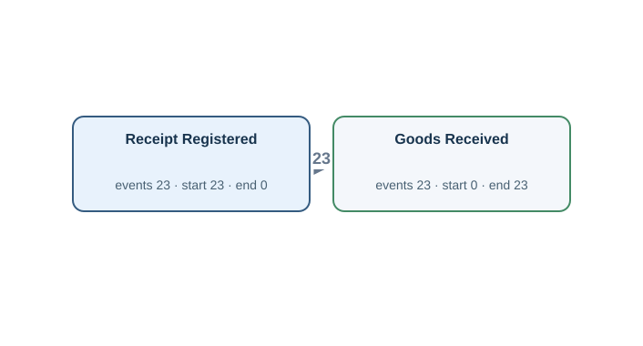</a></td><td width="58%" valign="top">
<a href="../../../datasets/warehouseflow_new/private/gold_sql/W14.sql">Gold SQL</a> · <a href="../../../datasets/warehouseflow_new/private/gold_logs/W14.csv">Gold CSV</a> · <a href="../../../datasets/warehouseflow_new/input/database.sqlite">Full source database (SQLite)</a>

<code>goods_movement</code> · 23 matched source rows
<table><tr><th>Column</th><th>Row 1</th><th>Row 2</th><th>Row 3</th></tr><tr><th>movement_id</th><td>0001</td><td>0002</td><td>0003</td></tr><tr><th>warehouse_id</th><td>1</td><td>2</td><td>3</td></tr><tr><th>goods_id</th><td>1</td><td>2</td><td>3</td></tr><tr><th>quantity</th><td>10</td><td>10</td><td>10</td></tr><tr><th>receipt_id</th><td>001</td><td>002</td><td>003</td></tr><tr><th>dispatch_id</th><td><em>NULL</em></td><td><em>NULL</em></td><td><em>NULL</em></td></tr><tr><th>code_family</th><td>MOVEMENT</td><td>MOVEMENT</td><td>MOVEMENT</td></tr><tr><th>movement_code</th><td>IN</td><td>IN</td><td>IN</td></tr><tr><th>occurred_at</th><td>2026-02-01T05:35:00Z</td><td>2026-02-01T10:35:00Z</td><td>2026-02-01T15:35:00Z</td></tr></table>
<strong>Gold output for the same source rows</strong>
<ul><li>Row 1 → Goods Received · event M:0001 · case R:001 · time from <code>occurred_at</code></li><li>Row 2 → Goods Received · event M:0002 · case R:002 · time from <code>occurred_at</code></li><li>Row 3 → Goods Received · event M:0003 · case R:003 · time from <code>occurred_at</code></li></ul>

<code>goods_receipt</code> · 23 matched source rows
<table><tr><th>Column</th><th>Row 1</th><th>Row 2</th><th>Row 3</th></tr><tr><th>receipt_id</th><td>001</td><td>002</td><td>003</td></tr><tr><th>request_id</th><td>001</td><td>002</td><td>003</td></tr><tr><th>receiver_id</th><td>1</td><td>2</td><td>3</td></tr><tr><th>received_at</th><td>2026-02-01T05:32:00Z</td><td>2026-02-01T10:32:00Z</td><td>2026-02-01T15:32:00Z</td></tr><tr><th>condition_code</th><td>GOOD</td><td>GOOD</td><td>GOOD</td></tr></table>
<strong>Gold output for the same source rows</strong>
<ul><li>Row 1 → Receipt Registered · event R:001 · case R:001 · time from <code>received_at</code></li><li>Row 2 → Receipt Registered · event R:002 · case R:002 · time from <code>received_at</code></li><li>Row 3 → Receipt Registered · event R:003 · case R:003 · time from <code>received_at</code></li></ul>
</td></tr></table>

## W14P — Q2

For every individual receipt record, show its registration and the corresponding receipt of goods into stock.

Events: **46** · Cases with events: **23** · Activities: **2** · Edges: **1** · Source tables: **2** · SQL tables: **2**

<table><tr><td width="42%" valign="top"></td><td width="58%" valign="top">
<a href="../../../datasets/warehouseflow_new/private/gold_sql/W14P.sql">Gold SQL</a> · <a href="../../../datasets/warehouseflow_new/private/gold_logs/W14P.csv">Gold CSV</a> · <a href="../../../datasets/warehouseflow_new/input/database.sqlite">Full source database (SQLite)</a>

<code>goods_movement</code> · 23 matched source rows
<table><tr><th>Column</th><th>Row 1</th><th>Row 2</th><th>Row 3</th></tr><tr><th>movement_id</th><td>0001</td><td>0002</td><td>0003</td></tr><tr><th>warehouse_id</th><td>1</td><td>2</td><td>3</td></tr><tr><th>goods_id</th><td>1</td><td>2</td><td>3</td></tr><tr><th>quantity</th><td>10</td><td>10</td><td>10</td></tr><tr><th>receipt_id</th><td>001</td><td>002</td><td>003</td></tr><tr><th>dispatch_id</th><td><em>NULL</em></td><td><em>NULL</em></td><td><em>NULL</em></td></tr><tr><th>code_family</th><td>MOVEMENT</td><td>MOVEMENT</td><td>MOVEMENT</td></tr><tr><th>movement_code</th><td>IN</td><td>IN</td><td>IN</td></tr><tr><th>occurred_at</th><td>2026-02-01T05:35:00Z</td><td>2026-02-01T10:35:00Z</td><td>2026-02-01T15:35:00Z</td></tr></table>
<strong>Gold output for the same source rows</strong>
<ul><li>Row 1 → Goods Received · event M:0001 · case R:001 · time from <code>occurred_at</code></li><li>Row 2 → Goods Received · event M:0002 · case R:002 · time from <code>occurred_at</code></li><li>Row 3 → Goods Received · event M:0003 · case R:003 · time from <code>occurred_at</code></li></ul>

<code>goods_receipt</code> · 23 matched source rows
<table><tr><th>Column</th><th>Row 1</th><th>Row 2</th><th>Row 3</th></tr><tr><th>receipt_id</th><td>001</td><td>002</td><td>003</td></tr><tr><th>request_id</th><td>001</td><td>002</td><td>003</td></tr><tr><th>receiver_id</th><td>1</td><td>2</td><td>3</td></tr><tr><th>received_at</th><td>2026-02-01T05:32:00Z</td><td>2026-02-01T10:32:00Z</td><td>2026-02-01T15:32:00Z</td></tr><tr><th>condition_code</th><td>GOOD</td><td>GOOD</td><td>GOOD</td></tr></table>
<strong>Gold output for the same source rows</strong>
<ul><li>Row 1 → Receipt Registered · event R:001 · case R:001 · time from <code>received_at</code></li><li>Row 2 → Receipt Registered · event R:002 · case R:002 · time from <code>received_at</code></li><li>Row 3 → Receipt Registered · event R:003 · case R:003 · time from <code>received_at</code></li></ul>
</td></tr></table>

## W15 — Q1

For each warehouse, extract Invoice Paid events.

**No Gold log:** No corresponding invoicing or carrier delivery records exist in this DB.

## W15P — Q2

For every warehouse, show when its invoices were paid.

**No Gold log:** No corresponding invoicing or carrier delivery records exist in this DB.

## W16 — Q1

For each dispatch order, extract Customer Delivery Completed events.

**No Gold log:** No corresponding invoicing or carrier delivery records exist in this DB.

## W16P — Q2

For each dispatch order, show when delivery to the customer was completed.

**No Gold log:** No corresponding invoicing or carrier delivery records exist in this DB.

## WF01 — Q3

Extract the full recorded lifecycle for each warehouse.

Events: **402** · Cases with events: **3** · Activities: **21** · Edges: **29** · Source tables: **8** · SQL tables: **8**

<table><tr><td width="42%" valign="top"><a href="graphs/WF01.svg">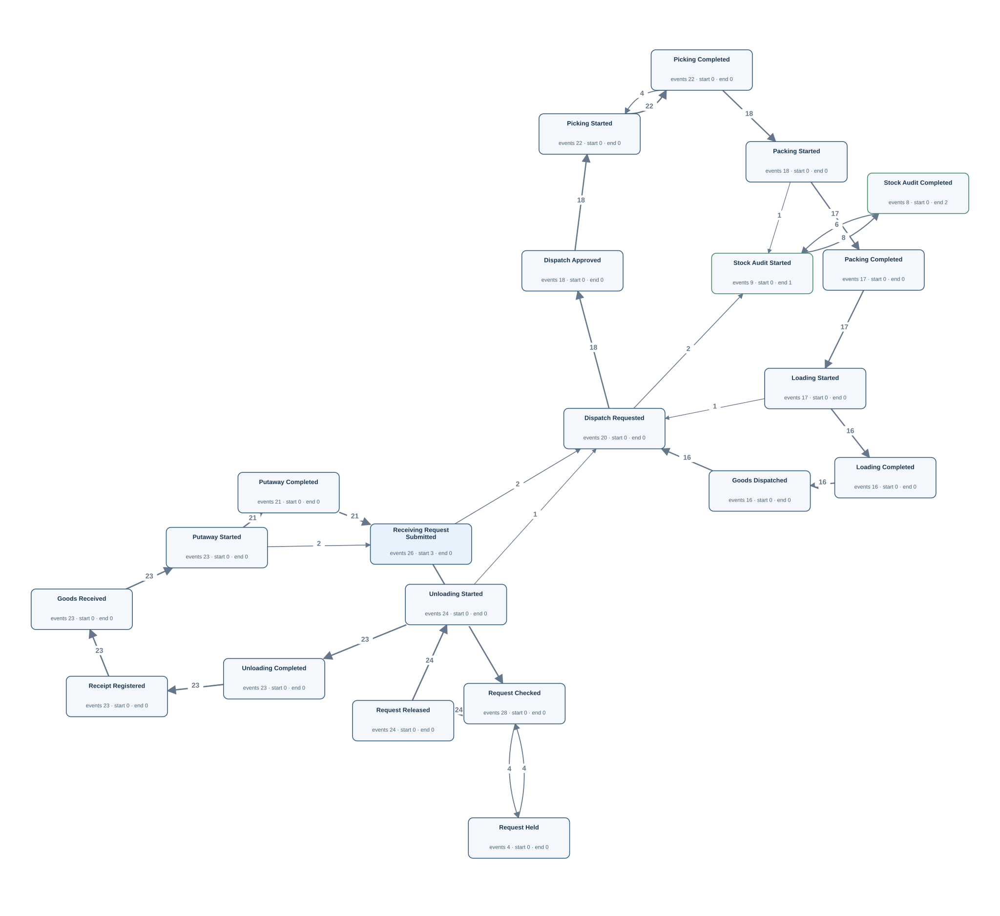</a></td><td width="58%" valign="top">
<a href="../../../datasets/warehouseflow_new/private/gold_sql/WF01.sql">Gold SQL</a> · <a href="../../../datasets/warehouseflow_new/private/gold_logs/WF01.csv">Gold CSV</a> · <a href="../../../datasets/warehouseflow_new/input/database.sqlite">Full source database (SQLite)</a>

<code>dispatch_order</code> · 20 matched source rows
<table><tr><th>Column</th><th>Row 1</th><th>Row 2</th><th>Row 3</th></tr><tr><th>dispatch_id</th><td>001</td><td>004</td><td>007</td></tr><tr><th>warehouse_id</th><td>1</td><td>1</td><td>1</td></tr><tr><th>goods_id</th><td>1</td><td>4</td><td>1</td></tr><tr><th>quantity</th><td>4</td><td>4</td><td>4</td></tr><tr><th>priority_code</th><td>NORMAL</td><td>NORMAL</td><td>NORMAL</td></tr><tr><th>requested_at</th><td>2026-04-11T15:40:00Z</td><td>2026-04-12T06:40:00Z</td><td>2026-04-12T21:40:00Z</td></tr><tr><th>approved_at</th><td>2026-04-11T15:50:00Z</td><td>2026-04-12T06:50:00Z</td><td>2026-04-12T21:50:00Z</td></tr></table>
<strong>Gold output for the same source rows</strong>
<ul><li>Row 1 → Dispatch Approved · event D:001:approved · case W:1 · time from <code>approved_at</code></li><li>Row 1 → Dispatch Requested · event D:001:requested · case W:1 · time from <code>requested_at</code></li><li>Row 2 → Dispatch Approved · event D:004:approved · case W:1 · time from <code>approved_at</code></li><li>Row 2 → Dispatch Requested · event D:004:requested · case W:1 · time from <code>requested_at</code></li><li>Row 3 → Dispatch Approved · event D:007:approved · case W:1 · time from <code>approved_at</code></li><li>Row 3 → Dispatch Requested · event D:007:requested · case W:1 · time from <code>requested_at</code></li></ul>

<code>goods_movement</code> · 39 matched source rows
<table><tr><th>Column</th><th>Row 1</th><th>Row 2</th><th>Row 3</th></tr><tr><th>movement_id</th><td>0001</td><td>0024</td><td>0004</td></tr><tr><th>warehouse_id</th><td>1</td><td>1</td><td>1</td></tr><tr><th>goods_id</th><td>1</td><td>1</td><td>4</td></tr><tr><th>quantity</th><td>10</td><td>4</td><td>10</td></tr><tr><th>receipt_id</th><td>001</td><td><em>NULL</em></td><td>004</td></tr><tr><th>dispatch_id</th><td><em>NULL</em></td><td>001</td><td><em>NULL</em></td></tr><tr><th>code_family</th><td>MOVEMENT</td><td>MOVEMENT</td><td>MOVEMENT</td></tr><tr><th>movement_code</th><td>IN</td><td>OUT</td><td>IN</td></tr><tr><th>occurred_at</th><td>2026-02-01T05:35:00Z</td><td>2026-04-11T16:45:00Z</td><td>2026-02-01T20:35:00Z</td></tr></table>
<strong>Gold output for the same source rows</strong>
<ul><li>Row 1 → Goods Received · event M:0001 · case W:1 · time from <code>occurred_at</code></li><li>Row 2 → Goods Dispatched · event M:0024 · case W:1 · time from <code>occurred_at</code></li><li>Row 3 → Goods Received · event M:0004 · case W:1 · time from <code>occurred_at</code></li></ul>

<code>goods_receipt</code> · 23 matched source rows
<table><tr><th>Column</th><th>Row 1</th><th>Row 2</th><th>Row 3</th></tr><tr><th>receipt_id</th><td>001</td><td>004</td><td>007</td></tr><tr><th>request_id</th><td>001</td><td>004</td><td>007</td></tr><tr><th>receiver_id</th><td>1</td><td>4</td><td>1</td></tr><tr><th>received_at</th><td>2026-02-01T05:32:00Z</td><td>2026-02-01T20:32:00Z</td><td>2026-02-02T11:32:00Z</td></tr><tr><th>condition_code</th><td>GOOD</td><td>GOOD</td><td>DAMAGED</td></tr></table>
<strong>Gold output for the same source rows</strong>
<ul><li>Row 1 → Receipt Registered · event R:001 · case W:1 · time from <code>received_at</code></li><li>Row 2 → Receipt Registered · event R:004 · case W:1 · time from <code>received_at</code></li><li>Row 3 → Receipt Registered · event R:007 · case W:1 · time from <code>received_at</code></li></ul>

<code>handling_history</code> · 41 matched source rows
<table><tr><th>Column</th><th>Row 1</th><th>Row 2</th><th>Row 3</th></tr><tr><th>handling_id</th><td>0001</td><td>0025</td><td>0004</td></tr><tr><th>request_id</th><td>001</td><td><em>NULL</em></td><td>004</td></tr><tr><th>dispatch_id</th><td><em>NULL</em></td><td>001</td><td><em>NULL</em></td></tr><tr><th>worker_id</th><td>1</td><td>2</td><td>4</td></tr><tr><th>code_family</th><td>HANDLING</td><td>HANDLING</td><td>HANDLING</td></tr><tr><th>handling_code</th><td>UNLOAD</td><td>LOAD</td><td>UNLOAD</td></tr><tr><th>started_at</th><td>2026-02-01T05:20:00Z</td><td>2026-04-11T16:30:00Z</td><td>2026-02-01T20:20:00Z</td></tr><tr><th>completed_at</th><td>2026-02-01T05:30:00Z</td><td>2026-04-11T16:40:00Z</td><td>2026-02-01T20:30:00Z</td></tr></table>
<strong>Gold output for the same source rows</strong>
<ul><li>Row 1 → Unloading Completed · event H:0001:complete · case W:1 · time from <code>completed_at</code></li><li>Row 1 → Unloading Started · event H:0001:start · case W:1 · time from <code>started_at</code></li><li>Row 2 → Loading Completed · event H:0025:complete · case W:1 · time from <code>completed_at</code></li><li>Row 2 → Loading Started · event H:0025:start · case W:1 · time from <code>started_at</code></li><li>Row 3 → Unloading Completed · event H:0004:complete · case W:1 · time from <code>completed_at</code></li><li>Row 3 → Unloading Started · event H:0004:start · case W:1 · time from <code>started_at</code></li></ul>

<code>receiving_request</code> · 26 matched source rows
<table><tr><th>Column</th><th>Row 1</th><th>Row 2</th><th>Row 3</th></tr><tr><th>request_id</th><td>001</td><td>004</td><td>007</td></tr><tr><th>warehouse_id</th><td>1</td><td>1</td><td>1</td></tr><tr><th>goods_id</th><td>1</td><td>4</td><td>1</td></tr><tr><th>quantity</th><td>10</td><td>10</td><td>10</td></tr><tr><th>submitted_at</th><td>2026-02-01T05:00:00Z</td><td>2026-02-01T20:00:00Z</td><td>2026-02-02T11:00:00Z</td></tr></table>
<strong>Gold output for the same source rows</strong>
<ul><li>Row 1 → Receiving Request Submitted · event Q:001 · case W:1 · time from <code>submitted_at</code></li><li>Row 2 → Receiving Request Submitted · event Q:004 · case W:1 · time from <code>submitted_at</code></li><li>Row 3 → Receiving Request Submitted · event Q:007 · case W:1 · time from <code>submitted_at</code></li></ul>

<code>request_action</code> · 56 matched source rows
<table><tr><th>Column</th><th>Row 1</th><th>Row 2</th><th>Row 3</th></tr><tr><th>action_id</th><td>0001</td><td>0002</td><td>0022</td></tr><tr><th>request_id</th><td>001</td><td>001</td><td>010</td></tr><tr><th>worker_id</th><td>1</td><td>1</td><td>4</td></tr><tr><th>code_family</th><td>REQUEST</td><td>REQUEST</td><td>REQUEST</td></tr><tr><th>action_code</th><td>CHECK</td><td>RELEASE</td><td>HOLD</td></tr><tr><th>occurred_at</th><td>2026-02-01T05:05:00Z</td><td>2026-02-01T05:12:00Z</td><td>2026-02-03T02:08:00Z</td></tr></table>
<strong>Gold output for the same source rows</strong>
<ul><li>Row 1 → Request Checked · event C:0001 · case W:1 · time from <code>occurred_at</code></li><li>Row 2 → Request Released · event C:0002 · case W:1 · time from <code>occurred_at</code></li><li>Row 3 → Request Held · event C:0022 · case W:1 · time from <code>occurred_at</code></li></ul>

<code>warehouse_audit</code> · 9 matched source rows
<table><tr><th>Column</th><th>Row 1</th><th>Row 2</th><th>Row 3</th></tr><tr><th>audit_id</th><td>001</td><td>004</td><td>007</td></tr><tr><th>warehouse_id</th><td>1</td><td>1</td><td>1</td></tr><tr><th>worker_id</th><td>1</td><td>4</td><td>1</td></tr><tr><th>started_at</th><td>2026-05-16T05:40:00Z</td><td>2026-05-16T10:40:00Z</td><td>2026-05-16T15:40:00Z</td></tr><tr><th>completed_at</th><td>2026-05-16T06:20:00Z</td><td>2026-05-16T11:20:00Z</td><td>2026-05-16T16:20:00Z</td></tr><tr><th>result_code</th><td>PASS</td><td>PASS</td><td>PASS</td></tr></table>
<strong>Gold output for the same source rows</strong>
<ul><li>Row 1 → Stock Audit Completed · event A:001:complete · case W:1 · time from <code>completed_at</code></li><li>Row 1 → Stock Audit Started · event A:001:start · case W:1 · time from <code>started_at</code></li><li>Row 2 → Stock Audit Completed · event A:004:complete · case W:1 · time from <code>completed_at</code></li><li>Row 2 → Stock Audit Started · event A:004:start · case W:1 · time from <code>started_at</code></li><li>Row 3 → Stock Audit Completed · event A:007:complete · case W:1 · time from <code>completed_at</code></li><li>Row 3 → Stock Audit Started · event A:007:start · case W:1 · time from <code>started_at</code></li></ul>

<code>warehouse_task_history</code> · 63 matched source rows
<table><tr><th>Column</th><th>Row 1</th><th>Row 2</th><th>Row 3</th></tr><tr><th>task_id</th><td>0001</td><td>0024</td><td>0025</td></tr><tr><th>request_id</th><td>001</td><td><em>NULL</em></td><td><em>NULL</em></td></tr><tr><th>dispatch_id</th><td><em>NULL</em></td><td>001</td><td>001</td></tr><tr><th>worker_id</th><td>1</td><td>2</td><td>2</td></tr><tr><th>code_family</th><td>TASK</td><td>TASK</td><td>TASK</td></tr><tr><th>task_code</th><td>PUTAWAY</td><td>PICK</td><td>PACK</td></tr><tr><th>started_at</th><td>2026-02-01T05:40:00Z</td><td>2026-04-11T16:00:00Z</td><td>2026-04-11T16:15:00Z</td></tr><tr><th>completed_at</th><td>2026-02-01T05:50:00Z</td><td>2026-04-11T16:10:00Z</td><td>2026-04-11T16:25:00Z</td></tr><tr><th>outcome_code</th><td>OK</td><td>OK</td><td>OK</td></tr></table>
<strong>Gold output for the same source rows</strong>
<ul><li>Row 1 → Putaway Completed · event T:0001:complete · case W:1 · time from <code>completed_at</code></li><li>Row 1 → Putaway Started · event T:0001:start · case W:1 · time from <code>started_at</code></li><li>Row 2 → Picking Completed · event T:0024:complete · case W:1 · time from <code>completed_at</code></li><li>Row 2 → Picking Started · event T:0024:start · case W:1 · time from <code>started_at</code></li><li>Row 3 → Packing Completed · event T:0025:complete · case W:1 · time from <code>completed_at</code></li><li>Row 3 → Packing Started · event T:0025:start · case W:1 · time from <code>started_at</code></li></ul>
</td></tr></table>

## WF01P — Q4

Show the complete recorded history of each warehouse.

Events: **402** · Cases with events: **3** · Activities: **21** · Edges: **29** · Source tables: **8** · SQL tables: **8**

<table><tr><td width="42%" valign="top"></td><td width="58%" valign="top">
<a href="../../../datasets/warehouseflow_new/private/gold_sql/WF01P.sql">Gold SQL</a> · <a href="../../../datasets/warehouseflow_new/private/gold_logs/WF01P.csv">Gold CSV</a> · <a href="../../../datasets/warehouseflow_new/input/database.sqlite">Full source database (SQLite)</a>

<code>dispatch_order</code> · 20 matched source rows
<table><tr><th>Column</th><th>Row 1</th><th>Row 2</th><th>Row 3</th></tr><tr><th>dispatch_id</th><td>001</td><td>004</td><td>007</td></tr><tr><th>warehouse_id</th><td>1</td><td>1</td><td>1</td></tr><tr><th>goods_id</th><td>1</td><td>4</td><td>1</td></tr><tr><th>quantity</th><td>4</td><td>4</td><td>4</td></tr><tr><th>priority_code</th><td>NORMAL</td><td>NORMAL</td><td>NORMAL</td></tr><tr><th>requested_at</th><td>2026-04-11T15:40:00Z</td><td>2026-04-12T06:40:00Z</td><td>2026-04-12T21:40:00Z</td></tr><tr><th>approved_at</th><td>2026-04-11T15:50:00Z</td><td>2026-04-12T06:50:00Z</td><td>2026-04-12T21:50:00Z</td></tr></table>
<strong>Gold output for the same source rows</strong>
<ul><li>Row 1 → Dispatch Approved · event D:001:approved · case W:1 · time from <code>approved_at</code></li><li>Row 1 → Dispatch Requested · event D:001:requested · case W:1 · time from <code>requested_at</code></li><li>Row 2 → Dispatch Approved · event D:004:approved · case W:1 · time from <code>approved_at</code></li><li>Row 2 → Dispatch Requested · event D:004:requested · case W:1 · time from <code>requested_at</code></li><li>Row 3 → Dispatch Approved · event D:007:approved · case W:1 · time from <code>approved_at</code></li><li>Row 3 → Dispatch Requested · event D:007:requested · case W:1 · time from <code>requested_at</code></li></ul>

<code>goods_movement</code> · 39 matched source rows
<table><tr><th>Column</th><th>Row 1</th><th>Row 2</th><th>Row 3</th></tr><tr><th>movement_id</th><td>0001</td><td>0024</td><td>0004</td></tr><tr><th>warehouse_id</th><td>1</td><td>1</td><td>1</td></tr><tr><th>goods_id</th><td>1</td><td>1</td><td>4</td></tr><tr><th>quantity</th><td>10</td><td>4</td><td>10</td></tr><tr><th>receipt_id</th><td>001</td><td><em>NULL</em></td><td>004</td></tr><tr><th>dispatch_id</th><td><em>NULL</em></td><td>001</td><td><em>NULL</em></td></tr><tr><th>code_family</th><td>MOVEMENT</td><td>MOVEMENT</td><td>MOVEMENT</td></tr><tr><th>movement_code</th><td>IN</td><td>OUT</td><td>IN</td></tr><tr><th>occurred_at</th><td>2026-02-01T05:35:00Z</td><td>2026-04-11T16:45:00Z</td><td>2026-02-01T20:35:00Z</td></tr></table>
<strong>Gold output for the same source rows</strong>
<ul><li>Row 1 → Goods Received · event M:0001 · case W:1 · time from <code>occurred_at</code></li><li>Row 2 → Goods Dispatched · event M:0024 · case W:1 · time from <code>occurred_at</code></li><li>Row 3 → Goods Received · event M:0004 · case W:1 · time from <code>occurred_at</code></li></ul>

<code>goods_receipt</code> · 23 matched source rows
<table><tr><th>Column</th><th>Row 1</th><th>Row 2</th><th>Row 3</th></tr><tr><th>receipt_id</th><td>001</td><td>004</td><td>007</td></tr><tr><th>request_id</th><td>001</td><td>004</td><td>007</td></tr><tr><th>receiver_id</th><td>1</td><td>4</td><td>1</td></tr><tr><th>received_at</th><td>2026-02-01T05:32:00Z</td><td>2026-02-01T20:32:00Z</td><td>2026-02-02T11:32:00Z</td></tr><tr><th>condition_code</th><td>GOOD</td><td>GOOD</td><td>DAMAGED</td></tr></table>
<strong>Gold output for the same source rows</strong>
<ul><li>Row 1 → Receipt Registered · event R:001 · case W:1 · time from <code>received_at</code></li><li>Row 2 → Receipt Registered · event R:004 · case W:1 · time from <code>received_at</code></li><li>Row 3 → Receipt Registered · event R:007 · case W:1 · time from <code>received_at</code></li></ul>

<code>handling_history</code> · 41 matched source rows
<table><tr><th>Column</th><th>Row 1</th><th>Row 2</th><th>Row 3</th></tr><tr><th>handling_id</th><td>0001</td><td>0025</td><td>0004</td></tr><tr><th>request_id</th><td>001</td><td><em>NULL</em></td><td>004</td></tr><tr><th>dispatch_id</th><td><em>NULL</em></td><td>001</td><td><em>NULL</em></td></tr><tr><th>worker_id</th><td>1</td><td>2</td><td>4</td></tr><tr><th>code_family</th><td>HANDLING</td><td>HANDLING</td><td>HANDLING</td></tr><tr><th>handling_code</th><td>UNLOAD</td><td>LOAD</td><td>UNLOAD</td></tr><tr><th>started_at</th><td>2026-02-01T05:20:00Z</td><td>2026-04-11T16:30:00Z</td><td>2026-02-01T20:20:00Z</td></tr><tr><th>completed_at</th><td>2026-02-01T05:30:00Z</td><td>2026-04-11T16:40:00Z</td><td>2026-02-01T20:30:00Z</td></tr></table>
<strong>Gold output for the same source rows</strong>
<ul><li>Row 1 → Unloading Completed · event H:0001:complete · case W:1 · time from <code>completed_at</code></li><li>Row 1 → Unloading Started · event H:0001:start · case W:1 · time from <code>started_at</code></li><li>Row 2 → Loading Completed · event H:0025:complete · case W:1 · time from <code>completed_at</code></li><li>Row 2 → Loading Started · event H:0025:start · case W:1 · time from <code>started_at</code></li><li>Row 3 → Unloading Completed · event H:0004:complete · case W:1 · time from <code>completed_at</code></li><li>Row 3 → Unloading Started · event H:0004:start · case W:1 · time from <code>started_at</code></li></ul>

<code>receiving_request</code> · 26 matched source rows
<table><tr><th>Column</th><th>Row 1</th><th>Row 2</th><th>Row 3</th></tr><tr><th>request_id</th><td>001</td><td>004</td><td>007</td></tr><tr><th>warehouse_id</th><td>1</td><td>1</td><td>1</td></tr><tr><th>goods_id</th><td>1</td><td>4</td><td>1</td></tr><tr><th>quantity</th><td>10</td><td>10</td><td>10</td></tr><tr><th>submitted_at</th><td>2026-02-01T05:00:00Z</td><td>2026-02-01T20:00:00Z</td><td>2026-02-02T11:00:00Z</td></tr></table>
<strong>Gold output for the same source rows</strong>
<ul><li>Row 1 → Receiving Request Submitted · event Q:001 · case W:1 · time from <code>submitted_at</code></li><li>Row 2 → Receiving Request Submitted · event Q:004 · case W:1 · time from <code>submitted_at</code></li><li>Row 3 → Receiving Request Submitted · event Q:007 · case W:1 · time from <code>submitted_at</code></li></ul>

<code>request_action</code> · 56 matched source rows
<table><tr><th>Column</th><th>Row 1</th><th>Row 2</th><th>Row 3</th></tr><tr><th>action_id</th><td>0001</td><td>0002</td><td>0022</td></tr><tr><th>request_id</th><td>001</td><td>001</td><td>010</td></tr><tr><th>worker_id</th><td>1</td><td>1</td><td>4</td></tr><tr><th>code_family</th><td>REQUEST</td><td>REQUEST</td><td>REQUEST</td></tr><tr><th>action_code</th><td>CHECK</td><td>RELEASE</td><td>HOLD</td></tr><tr><th>occurred_at</th><td>2026-02-01T05:05:00Z</td><td>2026-02-01T05:12:00Z</td><td>2026-02-03T02:08:00Z</td></tr></table>
<strong>Gold output for the same source rows</strong>
<ul><li>Row 1 → Request Checked · event C:0001 · case W:1 · time from <code>occurred_at</code></li><li>Row 2 → Request Released · event C:0002 · case W:1 · time from <code>occurred_at</code></li><li>Row 3 → Request Held · event C:0022 · case W:1 · time from <code>occurred_at</code></li></ul>

<code>warehouse_audit</code> · 9 matched source rows
<table><tr><th>Column</th><th>Row 1</th><th>Row 2</th><th>Row 3</th></tr><tr><th>audit_id</th><td>001</td><td>004</td><td>007</td></tr><tr><th>warehouse_id</th><td>1</td><td>1</td><td>1</td></tr><tr><th>worker_id</th><td>1</td><td>4</td><td>1</td></tr><tr><th>started_at</th><td>2026-05-16T05:40:00Z</td><td>2026-05-16T10:40:00Z</td><td>2026-05-16T15:40:00Z</td></tr><tr><th>completed_at</th><td>2026-05-16T06:20:00Z</td><td>2026-05-16T11:20:00Z</td><td>2026-05-16T16:20:00Z</td></tr><tr><th>result_code</th><td>PASS</td><td>PASS</td><td>PASS</td></tr></table>
<strong>Gold output for the same source rows</strong>
<ul><li>Row 1 → Stock Audit Completed · event A:001:complete · case W:1 · time from <code>completed_at</code></li><li>Row 1 → Stock Audit Started · event A:001:start · case W:1 · time from <code>started_at</code></li><li>Row 2 → Stock Audit Completed · event A:004:complete · case W:1 · time from <code>completed_at</code></li><li>Row 2 → Stock Audit Started · event A:004:start · case W:1 · time from <code>started_at</code></li><li>Row 3 → Stock Audit Completed · event A:007:complete · case W:1 · time from <code>completed_at</code></li><li>Row 3 → Stock Audit Started · event A:007:start · case W:1 · time from <code>started_at</code></li></ul>

<code>warehouse_task_history</code> · 63 matched source rows
<table><tr><th>Column</th><th>Row 1</th><th>Row 2</th><th>Row 3</th></tr><tr><th>task_id</th><td>0001</td><td>0024</td><td>0025</td></tr><tr><th>request_id</th><td>001</td><td><em>NULL</em></td><td><em>NULL</em></td></tr><tr><th>dispatch_id</th><td><em>NULL</em></td><td>001</td><td>001</td></tr><tr><th>worker_id</th><td>1</td><td>2</td><td>2</td></tr><tr><th>code_family</th><td>TASK</td><td>TASK</td><td>TASK</td></tr><tr><th>task_code</th><td>PUTAWAY</td><td>PICK</td><td>PACK</td></tr><tr><th>started_at</th><td>2026-02-01T05:40:00Z</td><td>2026-04-11T16:00:00Z</td><td>2026-04-11T16:15:00Z</td></tr><tr><th>completed_at</th><td>2026-02-01T05:50:00Z</td><td>2026-04-11T16:10:00Z</td><td>2026-04-11T16:25:00Z</td></tr><tr><th>outcome_code</th><td>OK</td><td>OK</td><td>OK</td></tr></table>
<strong>Gold output for the same source rows</strong>
<ul><li>Row 1 → Putaway Completed · event T:0001:complete · case W:1 · time from <code>completed_at</code></li><li>Row 1 → Putaway Started · event T:0001:start · case W:1 · time from <code>started_at</code></li><li>Row 2 → Picking Completed · event T:0024:complete · case W:1 · time from <code>completed_at</code></li><li>Row 2 → Picking Started · event T:0024:start · case W:1 · time from <code>started_at</code></li><li>Row 3 → Packing Completed · event T:0025:complete · case W:1 · time from <code>completed_at</code></li><li>Row 3 → Packing Started · event T:0025:start · case W:1 · time from <code>started_at</code></li></ul>
</td></tr></table>

## WF02 — Q3

Extract the full recorded lifecycle for each goods type.

Events: **385** · Cases with events: **6** · Activities: **19** · Edges: **25** · Source tables: **7** · SQL tables: **7**

<table><tr><td width="42%" valign="top"><a href="graphs/WF02.svg">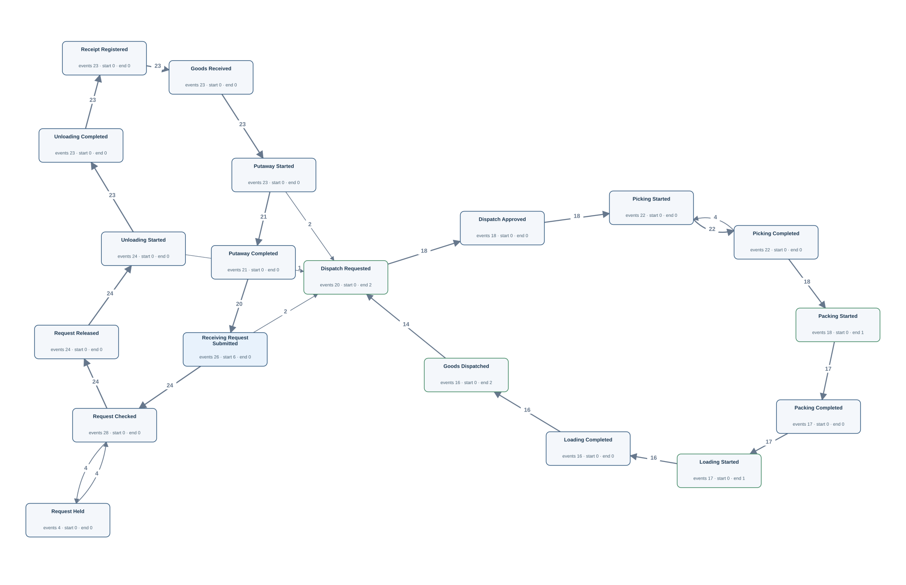</a></td><td width="58%" valign="top">
<a href="../../../datasets/warehouseflow_new/private/gold_sql/WF02.sql">Gold SQL</a> · <a href="../../../datasets/warehouseflow_new/private/gold_logs/WF02.csv">Gold CSV</a> · <a href="../../../datasets/warehouseflow_new/input/database.sqlite">Full source database (SQLite)</a>

<code>dispatch_order</code> · 20 matched source rows
<table><tr><th>Column</th><th>Row 1</th><th>Row 2</th><th>Row 3</th></tr><tr><th>dispatch_id</th><td>001</td><td>007</td><td>013</td></tr><tr><th>warehouse_id</th><td>1</td><td>1</td><td>1</td></tr><tr><th>goods_id</th><td>1</td><td>1</td><td>1</td></tr><tr><th>quantity</th><td>4</td><td>4</td><td>4</td></tr><tr><th>priority_code</th><td>NORMAL</td><td>NORMAL</td><td>NORMAL</td></tr><tr><th>requested_at</th><td>2026-04-11T15:40:00Z</td><td>2026-04-12T21:40:00Z</td><td>2026-04-14T03:40:00Z</td></tr><tr><th>approved_at</th><td>2026-04-11T15:50:00Z</td><td>2026-04-12T21:50:00Z</td><td>2026-04-14T03:50:00Z</td></tr></table>
<strong>Gold output for the same source rows</strong>
<ul><li>Row 1 → Dispatch Approved · event D:001:approved · case G:1 · time from <code>approved_at</code></li><li>Row 1 → Dispatch Requested · event D:001:requested · case G:1 · time from <code>requested_at</code></li><li>Row 2 → Dispatch Approved · event D:007:approved · case G:1 · time from <code>approved_at</code></li><li>Row 2 → Dispatch Requested · event D:007:requested · case G:1 · time from <code>requested_at</code></li><li>Row 3 → Dispatch Approved · event D:013:approved · case G:1 · time from <code>approved_at</code></li><li>Row 3 → Dispatch Requested · event D:013:requested · case G:1 · time from <code>requested_at</code></li></ul>

<code>goods_movement</code> · 39 matched source rows
<table><tr><th>Column</th><th>Row 1</th><th>Row 2</th><th>Row 3</th></tr><tr><th>movement_id</th><td>0001</td><td>0024</td><td>0007</td></tr><tr><th>warehouse_id</th><td>1</td><td>1</td><td>1</td></tr><tr><th>goods_id</th><td>1</td><td>1</td><td>1</td></tr><tr><th>quantity</th><td>10</td><td>4</td><td>10</td></tr><tr><th>receipt_id</th><td>001</td><td><em>NULL</em></td><td>007</td></tr><tr><th>dispatch_id</th><td><em>NULL</em></td><td>001</td><td><em>NULL</em></td></tr><tr><th>code_family</th><td>MOVEMENT</td><td>MOVEMENT</td><td>MOVEMENT</td></tr><tr><th>movement_code</th><td>IN</td><td>OUT</td><td>IN</td></tr><tr><th>occurred_at</th><td>2026-02-01T05:35:00Z</td><td>2026-04-11T16:45:00Z</td><td>2026-02-02T11:35:00Z</td></tr></table>
<strong>Gold output for the same source rows</strong>
<ul><li>Row 1 → Goods Received · event M:0001 · case G:1 · time from <code>occurred_at</code></li><li>Row 2 → Goods Dispatched · event M:0024 · case G:1 · time from <code>occurred_at</code></li><li>Row 3 → Goods Received · event M:0007 · case G:1 · time from <code>occurred_at</code></li></ul>

<code>goods_receipt</code> · 23 matched source rows
<table><tr><th>Column</th><th>Row 1</th><th>Row 2</th><th>Row 3</th></tr><tr><th>receipt_id</th><td>001</td><td>007</td><td>013</td></tr><tr><th>request_id</th><td>001</td><td>007</td><td>013</td></tr><tr><th>receiver_id</th><td>1</td><td>1</td><td>1</td></tr><tr><th>received_at</th><td>2026-02-01T05:32:00Z</td><td>2026-02-02T11:32:00Z</td><td>2026-02-03T17:32:00Z</td></tr><tr><th>condition_code</th><td>GOOD</td><td>DAMAGED</td><td>GOOD</td></tr></table>
<strong>Gold output for the same source rows</strong>
<ul><li>Row 1 → Receipt Registered · event R:001 · case G:1 · time from <code>received_at</code></li><li>Row 2 → Receipt Registered · event R:007 · case G:1 · time from <code>received_at</code></li><li>Row 3 → Receipt Registered · event R:013 · case G:1 · time from <code>received_at</code></li></ul>

<code>handling_history</code> · 41 matched source rows
<table><tr><th>Column</th><th>Row 1</th><th>Row 2</th><th>Row 3</th></tr><tr><th>handling_id</th><td>0001</td><td>0025</td><td>0007</td></tr><tr><th>request_id</th><td>001</td><td><em>NULL</em></td><td>007</td></tr><tr><th>dispatch_id</th><td><em>NULL</em></td><td>001</td><td><em>NULL</em></td></tr><tr><th>worker_id</th><td>1</td><td>2</td><td>1</td></tr><tr><th>code_family</th><td>HANDLING</td><td>HANDLING</td><td>HANDLING</td></tr><tr><th>handling_code</th><td>UNLOAD</td><td>LOAD</td><td>UNLOAD</td></tr><tr><th>started_at</th><td>2026-02-01T05:20:00Z</td><td>2026-04-11T16:30:00Z</td><td>2026-02-02T11:20:00Z</td></tr><tr><th>completed_at</th><td>2026-02-01T05:30:00Z</td><td>2026-04-11T16:40:00Z</td><td>2026-02-02T11:30:00Z</td></tr></table>
<strong>Gold output for the same source rows</strong>
<ul><li>Row 1 → Unloading Completed · event H:0001:complete · case G:1 · time from <code>completed_at</code></li><li>Row 1 → Unloading Started · event H:0001:start · case G:1 · time from <code>started_at</code></li><li>Row 2 → Loading Completed · event H:0025:complete · case G:1 · time from <code>completed_at</code></li><li>Row 2 → Loading Started · event H:0025:start · case G:1 · time from <code>started_at</code></li><li>Row 3 → Unloading Completed · event H:0007:complete · case G:1 · time from <code>completed_at</code></li><li>Row 3 → Unloading Started · event H:0007:start · case G:1 · time from <code>started_at</code></li></ul>

<code>receiving_request</code> · 26 matched source rows
<table><tr><th>Column</th><th>Row 1</th><th>Row 2</th><th>Row 3</th></tr><tr><th>request_id</th><td>001</td><td>007</td><td>013</td></tr><tr><th>warehouse_id</th><td>1</td><td>1</td><td>1</td></tr><tr><th>goods_id</th><td>1</td><td>1</td><td>1</td></tr><tr><th>quantity</th><td>10</td><td>10</td><td>10</td></tr><tr><th>submitted_at</th><td>2026-02-01T05:00:00Z</td><td>2026-02-02T11:00:00Z</td><td>2026-02-03T17:00:00Z</td></tr></table>
<strong>Gold output for the same source rows</strong>
<ul><li>Row 1 → Receiving Request Submitted · event Q:001 · case G:1 · time from <code>submitted_at</code></li><li>Row 2 → Receiving Request Submitted · event Q:007 · case G:1 · time from <code>submitted_at</code></li><li>Row 3 → Receiving Request Submitted · event Q:013 · case G:1 · time from <code>submitted_at</code></li></ul>

<code>request_action</code> · 56 matched source rows
<table><tr><th>Column</th><th>Row 1</th><th>Row 2</th><th>Row 3</th></tr><tr><th>action_id</th><td>0001</td><td>0002</td><td>0046</td></tr><tr><th>request_id</th><td>001</td><td>001</td><td>020</td></tr><tr><th>worker_id</th><td>1</td><td>1</td><td>2</td></tr><tr><th>code_family</th><td>REQUEST</td><td>REQUEST</td><td>REQUEST</td></tr><tr><th>action_code</th><td>CHECK</td><td>RELEASE</td><td>HOLD</td></tr><tr><th>occurred_at</th><td>2026-02-01T05:05:00Z</td><td>2026-02-01T05:12:00Z</td><td>2026-02-05T04:08:00Z</td></tr></table>
<strong>Gold output for the same source rows</strong>
<ul><li>Row 1 → Request Checked · event C:0001 · case G:1 · time from <code>occurred_at</code></li><li>Row 2 → Request Released · event C:0002 · case G:1 · time from <code>occurred_at</code></li><li>Row 3 → Request Held · event C:0046 · case G:2 · time from <code>occurred_at</code></li></ul>

<code>warehouse_task_history</code> · 63 matched source rows
<table><tr><th>Column</th><th>Row 1</th><th>Row 2</th><th>Row 3</th></tr><tr><th>task_id</th><td>0001</td><td>0024</td><td>0025</td></tr><tr><th>request_id</th><td>001</td><td><em>NULL</em></td><td><em>NULL</em></td></tr><tr><th>dispatch_id</th><td><em>NULL</em></td><td>001</td><td>001</td></tr><tr><th>worker_id</th><td>1</td><td>2</td><td>2</td></tr><tr><th>code_family</th><td>TASK</td><td>TASK</td><td>TASK</td></tr><tr><th>task_code</th><td>PUTAWAY</td><td>PICK</td><td>PACK</td></tr><tr><th>started_at</th><td>2026-02-01T05:40:00Z</td><td>2026-04-11T16:00:00Z</td><td>2026-04-11T16:15:00Z</td></tr><tr><th>completed_at</th><td>2026-02-01T05:50:00Z</td><td>2026-04-11T16:10:00Z</td><td>2026-04-11T16:25:00Z</td></tr><tr><th>outcome_code</th><td>OK</td><td>OK</td><td>OK</td></tr></table>
<strong>Gold output for the same source rows</strong>
<ul><li>Row 1 → Putaway Completed · event T:0001:complete · case G:1 · time from <code>completed_at</code></li><li>Row 1 → Putaway Started · event T:0001:start · case G:1 · time from <code>started_at</code></li><li>Row 2 → Picking Completed · event T:0024:complete · case G:1 · time from <code>completed_at</code></li><li>Row 2 → Picking Started · event T:0024:start · case G:1 · time from <code>started_at</code></li><li>Row 3 → Packing Completed · event T:0025:complete · case G:1 · time from <code>completed_at</code></li><li>Row 3 → Packing Started · event T:0025:start · case G:1 · time from <code>started_at</code></li></ul>
</td></tr></table>

## WF02P — Q4

Build the entire recorded timeline associated with every goods type.

Events: **385** · Cases with events: **6** · Activities: **19** · Edges: **25** · Source tables: **7** · SQL tables: **7**

<table><tr><td width="42%" valign="top"></td><td width="58%" valign="top">
<a href="../../../datasets/warehouseflow_new/private/gold_sql/WF02P.sql">Gold SQL</a> · <a href="../../../datasets/warehouseflow_new/private/gold_logs/WF02P.csv">Gold CSV</a> · <a href="../../../datasets/warehouseflow_new/input/database.sqlite">Full source database (SQLite)</a>

<code>dispatch_order</code> · 20 matched source rows
<table><tr><th>Column</th><th>Row 1</th><th>Row 2</th><th>Row 3</th></tr><tr><th>dispatch_id</th><td>001</td><td>007</td><td>013</td></tr><tr><th>warehouse_id</th><td>1</td><td>1</td><td>1</td></tr><tr><th>goods_id</th><td>1</td><td>1</td><td>1</td></tr><tr><th>quantity</th><td>4</td><td>4</td><td>4</td></tr><tr><th>priority_code</th><td>NORMAL</td><td>NORMAL</td><td>NORMAL</td></tr><tr><th>requested_at</th><td>2026-04-11T15:40:00Z</td><td>2026-04-12T21:40:00Z</td><td>2026-04-14T03:40:00Z</td></tr><tr><th>approved_at</th><td>2026-04-11T15:50:00Z</td><td>2026-04-12T21:50:00Z</td><td>2026-04-14T03:50:00Z</td></tr></table>
<strong>Gold output for the same source rows</strong>
<ul><li>Row 1 → Dispatch Approved · event D:001:approved · case G:1 · time from <code>approved_at</code></li><li>Row 1 → Dispatch Requested · event D:001:requested · case G:1 · time from <code>requested_at</code></li><li>Row 2 → Dispatch Approved · event D:007:approved · case G:1 · time from <code>approved_at</code></li><li>Row 2 → Dispatch Requested · event D:007:requested · case G:1 · time from <code>requested_at</code></li><li>Row 3 → Dispatch Approved · event D:013:approved · case G:1 · time from <code>approved_at</code></li><li>Row 3 → Dispatch Requested · event D:013:requested · case G:1 · time from <code>requested_at</code></li></ul>

<code>goods_movement</code> · 39 matched source rows
<table><tr><th>Column</th><th>Row 1</th><th>Row 2</th><th>Row 3</th></tr><tr><th>movement_id</th><td>0001</td><td>0024</td><td>0007</td></tr><tr><th>warehouse_id</th><td>1</td><td>1</td><td>1</td></tr><tr><th>goods_id</th><td>1</td><td>1</td><td>1</td></tr><tr><th>quantity</th><td>10</td><td>4</td><td>10</td></tr><tr><th>receipt_id</th><td>001</td><td><em>NULL</em></td><td>007</td></tr><tr><th>dispatch_id</th><td><em>NULL</em></td><td>001</td><td><em>NULL</em></td></tr><tr><th>code_family</th><td>MOVEMENT</td><td>MOVEMENT</td><td>MOVEMENT</td></tr><tr><th>movement_code</th><td>IN</td><td>OUT</td><td>IN</td></tr><tr><th>occurred_at</th><td>2026-02-01T05:35:00Z</td><td>2026-04-11T16:45:00Z</td><td>2026-02-02T11:35:00Z</td></tr></table>
<strong>Gold output for the same source rows</strong>
<ul><li>Row 1 → Goods Received · event M:0001 · case G:1 · time from <code>occurred_at</code></li><li>Row 2 → Goods Dispatched · event M:0024 · case G:1 · time from <code>occurred_at</code></li><li>Row 3 → Goods Received · event M:0007 · case G:1 · time from <code>occurred_at</code></li></ul>

<code>goods_receipt</code> · 23 matched source rows
<table><tr><th>Column</th><th>Row 1</th><th>Row 2</th><th>Row 3</th></tr><tr><th>receipt_id</th><td>001</td><td>007</td><td>013</td></tr><tr><th>request_id</th><td>001</td><td>007</td><td>013</td></tr><tr><th>receiver_id</th><td>1</td><td>1</td><td>1</td></tr><tr><th>received_at</th><td>2026-02-01T05:32:00Z</td><td>2026-02-02T11:32:00Z</td><td>2026-02-03T17:32:00Z</td></tr><tr><th>condition_code</th><td>GOOD</td><td>DAMAGED</td><td>GOOD</td></tr></table>
<strong>Gold output for the same source rows</strong>
<ul><li>Row 1 → Receipt Registered · event R:001 · case G:1 · time from <code>received_at</code></li><li>Row 2 → Receipt Registered · event R:007 · case G:1 · time from <code>received_at</code></li><li>Row 3 → Receipt Registered · event R:013 · case G:1 · time from <code>received_at</code></li></ul>

<code>handling_history</code> · 41 matched source rows
<table><tr><th>Column</th><th>Row 1</th><th>Row 2</th><th>Row 3</th></tr><tr><th>handling_id</th><td>0001</td><td>0025</td><td>0007</td></tr><tr><th>request_id</th><td>001</td><td><em>NULL</em></td><td>007</td></tr><tr><th>dispatch_id</th><td><em>NULL</em></td><td>001</td><td><em>NULL</em></td></tr><tr><th>worker_id</th><td>1</td><td>2</td><td>1</td></tr><tr><th>code_family</th><td>HANDLING</td><td>HANDLING</td><td>HANDLING</td></tr><tr><th>handling_code</th><td>UNLOAD</td><td>LOAD</td><td>UNLOAD</td></tr><tr><th>started_at</th><td>2026-02-01T05:20:00Z</td><td>2026-04-11T16:30:00Z</td><td>2026-02-02T11:20:00Z</td></tr><tr><th>completed_at</th><td>2026-02-01T05:30:00Z</td><td>2026-04-11T16:40:00Z</td><td>2026-02-02T11:30:00Z</td></tr></table>
<strong>Gold output for the same source rows</strong>
<ul><li>Row 1 → Unloading Completed · event H:0001:complete · case G:1 · time from <code>completed_at</code></li><li>Row 1 → Unloading Started · event H:0001:start · case G:1 · time from <code>started_at</code></li><li>Row 2 → Loading Completed · event H:0025:complete · case G:1 · time from <code>completed_at</code></li><li>Row 2 → Loading Started · event H:0025:start · case G:1 · time from <code>started_at</code></li><li>Row 3 → Unloading Completed · event H:0007:complete · case G:1 · time from <code>completed_at</code></li><li>Row 3 → Unloading Started · event H:0007:start · case G:1 · time from <code>started_at</code></li></ul>

<code>receiving_request</code> · 26 matched source rows
<table><tr><th>Column</th><th>Row 1</th><th>Row 2</th><th>Row 3</th></tr><tr><th>request_id</th><td>001</td><td>007</td><td>013</td></tr><tr><th>warehouse_id</th><td>1</td><td>1</td><td>1</td></tr><tr><th>goods_id</th><td>1</td><td>1</td><td>1</td></tr><tr><th>quantity</th><td>10</td><td>10</td><td>10</td></tr><tr><th>submitted_at</th><td>2026-02-01T05:00:00Z</td><td>2026-02-02T11:00:00Z</td><td>2026-02-03T17:00:00Z</td></tr></table>
<strong>Gold output for the same source rows</strong>
<ul><li>Row 1 → Receiving Request Submitted · event Q:001 · case G:1 · time from <code>submitted_at</code></li><li>Row 2 → Receiving Request Submitted · event Q:007 · case G:1 · time from <code>submitted_at</code></li><li>Row 3 → Receiving Request Submitted · event Q:013 · case G:1 · time from <code>submitted_at</code></li></ul>

<code>request_action</code> · 56 matched source rows
<table><tr><th>Column</th><th>Row 1</th><th>Row 2</th><th>Row 3</th></tr><tr><th>action_id</th><td>0001</td><td>0002</td><td>0046</td></tr><tr><th>request_id</th><td>001</td><td>001</td><td>020</td></tr><tr><th>worker_id</th><td>1</td><td>1</td><td>2</td></tr><tr><th>code_family</th><td>REQUEST</td><td>REQUEST</td><td>REQUEST</td></tr><tr><th>action_code</th><td>CHECK</td><td>RELEASE</td><td>HOLD</td></tr><tr><th>occurred_at</th><td>2026-02-01T05:05:00Z</td><td>2026-02-01T05:12:00Z</td><td>2026-02-05T04:08:00Z</td></tr></table>
<strong>Gold output for the same source rows</strong>
<ul><li>Row 1 → Request Checked · event C:0001 · case G:1 · time from <code>occurred_at</code></li><li>Row 2 → Request Released · event C:0002 · case G:1 · time from <code>occurred_at</code></li><li>Row 3 → Request Held · event C:0046 · case G:2 · time from <code>occurred_at</code></li></ul>

<code>warehouse_task_history</code> · 63 matched source rows
<table><tr><th>Column</th><th>Row 1</th><th>Row 2</th><th>Row 3</th></tr><tr><th>task_id</th><td>0001</td><td>0024</td><td>0025</td></tr><tr><th>request_id</th><td>001</td><td><em>NULL</em></td><td><em>NULL</em></td></tr><tr><th>dispatch_id</th><td><em>NULL</em></td><td>001</td><td>001</td></tr><tr><th>worker_id</th><td>1</td><td>2</td><td>2</td></tr><tr><th>code_family</th><td>TASK</td><td>TASK</td><td>TASK</td></tr><tr><th>task_code</th><td>PUTAWAY</td><td>PICK</td><td>PACK</td></tr><tr><th>started_at</th><td>2026-02-01T05:40:00Z</td><td>2026-04-11T16:00:00Z</td><td>2026-04-11T16:15:00Z</td></tr><tr><th>completed_at</th><td>2026-02-01T05:50:00Z</td><td>2026-04-11T16:10:00Z</td><td>2026-04-11T16:25:00Z</td></tr><tr><th>outcome_code</th><td>OK</td><td>OK</td><td>OK</td></tr></table>
<strong>Gold output for the same source rows</strong>
<ul><li>Row 1 → Putaway Completed · event T:0001:complete · case G:1 · time from <code>completed_at</code></li><li>Row 1 → Putaway Started · event T:0001:start · case G:1 · time from <code>started_at</code></li><li>Row 2 → Picking Completed · event T:0024:complete · case G:1 · time from <code>completed_at</code></li><li>Row 2 → Picking Started · event T:0024:start · case G:1 · time from <code>started_at</code></li><li>Row 3 → Packing Completed · event T:0025:complete · case G:1 · time from <code>completed_at</code></li><li>Row 3 → Packing Started · event T:0025:start · case G:1 · time from <code>started_at</code></li></ul>
</td></tr></table>

## WF03 — Q3

Extract the full recorded lifecycle for each worker.

Events: **299** · Cases with events: **6** · Activities: **16** · Edges: **24** · Source tables: **5** · SQL tables: **5**

<table><tr><td width="42%" valign="top"><a href="graphs/WF03.svg">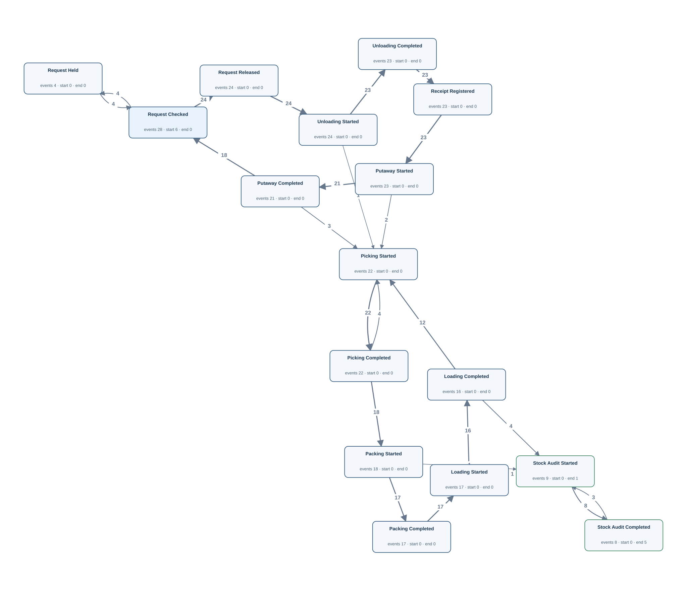</a></td><td width="58%" valign="top">
<a href="../../../datasets/warehouseflow_new/private/gold_sql/WF03.sql">Gold SQL</a> · <a href="../../../datasets/warehouseflow_new/private/gold_logs/WF03.csv">Gold CSV</a> · <a href="../../../datasets/warehouseflow_new/input/database.sqlite">Full source database (SQLite)</a>

<code>goods_receipt</code> · 23 matched source rows
<table><tr><th>Column</th><th>Row 1</th><th>Row 2</th><th>Row 3</th></tr><tr><th>receipt_id</th><td>001</td><td>007</td><td>013</td></tr><tr><th>request_id</th><td>001</td><td>007</td><td>013</td></tr><tr><th>receiver_id</th><td>1</td><td>1</td><td>1</td></tr><tr><th>received_at</th><td>2026-02-01T05:32:00Z</td><td>2026-02-02T11:32:00Z</td><td>2026-02-03T17:32:00Z</td></tr><tr><th>condition_code</th><td>GOOD</td><td>DAMAGED</td><td>GOOD</td></tr></table>
<strong>Gold output for the same source rows</strong>
<ul><li>Row 1 → Receipt Registered · event R:001 · case L:1 · time from <code>received_at</code></li><li>Row 2 → Receipt Registered · event R:007 · case L:1 · time from <code>received_at</code></li><li>Row 3 → Receipt Registered · event R:013 · case L:1 · time from <code>received_at</code></li></ul>

<code>handling_history</code> · 41 matched source rows
<table><tr><th>Column</th><th>Row 1</th><th>Row 2</th><th>Row 3</th></tr><tr><th>handling_id</th><td>0001</td><td>0030</td><td>0007</td></tr><tr><th>request_id</th><td>001</td><td><em>NULL</em></td><td>007</td></tr><tr><th>dispatch_id</th><td><em>NULL</em></td><td>006</td><td><em>NULL</em></td></tr><tr><th>worker_id</th><td>1</td><td>1</td><td>1</td></tr><tr><th>code_family</th><td>HANDLING</td><td>HANDLING</td><td>HANDLING</td></tr><tr><th>handling_code</th><td>UNLOAD</td><td>LOAD</td><td>UNLOAD</td></tr><tr><th>started_at</th><td>2026-02-01T05:20:00Z</td><td>2026-04-12T17:30:00Z</td><td>2026-02-02T11:20:00Z</td></tr><tr><th>completed_at</th><td>2026-02-01T05:30:00Z</td><td>2026-04-12T17:40:00Z</td><td>2026-02-02T11:30:00Z</td></tr></table>
<strong>Gold output for the same source rows</strong>
<ul><li>Row 1 → Unloading Completed · event H:0001:complete · case L:1 · time from <code>completed_at</code></li><li>Row 1 → Unloading Started · event H:0001:start · case L:1 · time from <code>started_at</code></li><li>Row 2 → Loading Completed · event H:0030:complete · case L:1 · time from <code>completed_at</code></li><li>Row 2 → Loading Started · event H:0030:start · case L:1 · time from <code>started_at</code></li><li>Row 3 → Unloading Completed · event H:0007:complete · case L:1 · time from <code>completed_at</code></li><li>Row 3 → Unloading Started · event H:0007:start · case L:1 · time from <code>started_at</code></li></ul>

<code>request_action</code> · 56 matched source rows
<table><tr><th>Column</th><th>Row 1</th><th>Row 2</th><th>Row 3</th></tr><tr><th>action_id</th><td>0001</td><td>0002</td><td>0046</td></tr><tr><th>request_id</th><td>001</td><td>001</td><td>020</td></tr><tr><th>worker_id</th><td>1</td><td>1</td><td>2</td></tr><tr><th>code_family</th><td>REQUEST</td><td>REQUEST</td><td>REQUEST</td></tr><tr><th>action_code</th><td>CHECK</td><td>RELEASE</td><td>HOLD</td></tr><tr><th>occurred_at</th><td>2026-02-01T05:05:00Z</td><td>2026-02-01T05:12:00Z</td><td>2026-02-05T04:08:00Z</td></tr></table>
<strong>Gold output for the same source rows</strong>
<ul><li>Row 1 → Request Checked · event C:0001 · case L:1 · time from <code>occurred_at</code></li><li>Row 2 → Request Released · event C:0002 · case L:1 · time from <code>occurred_at</code></li><li>Row 3 → Request Held · event C:0046 · case L:2 · time from <code>occurred_at</code></li></ul>

<code>warehouse_audit</code> · 9 matched source rows
<table><tr><th>Column</th><th>Row 1</th><th>Row 2</th><th>Row 3</th></tr><tr><th>audit_id</th><td>001</td><td>007</td><td>002</td></tr><tr><th>warehouse_id</th><td>1</td><td>1</td><td>2</td></tr><tr><th>worker_id</th><td>1</td><td>1</td><td>2</td></tr><tr><th>started_at</th><td>2026-05-16T05:40:00Z</td><td>2026-05-16T15:40:00Z</td><td>2026-05-16T07:20:00Z</td></tr><tr><th>completed_at</th><td>2026-05-16T06:20:00Z</td><td>2026-05-16T16:20:00Z</td><td>2026-05-16T08:00:00Z</td></tr><tr><th>result_code</th><td>PASS</td><td>PASS</td><td>PASS</td></tr></table>
<strong>Gold output for the same source rows</strong>
<ul><li>Row 1 → Stock Audit Completed · event A:001:complete · case L:1 · time from <code>completed_at</code></li><li>Row 1 → Stock Audit Started · event A:001:start · case L:1 · time from <code>started_at</code></li><li>Row 2 → Stock Audit Completed · event A:007:complete · case L:1 · time from <code>completed_at</code></li><li>Row 2 → Stock Audit Started · event A:007:start · case L:1 · time from <code>started_at</code></li><li>Row 3 → Stock Audit Completed · event A:002:complete · case L:2 · time from <code>completed_at</code></li><li>Row 3 → Stock Audit Started · event A:002:start · case L:2 · time from <code>started_at</code></li></ul>

<code>warehouse_task_history</code> · 63 matched source rows
<table><tr><th>Column</th><th>Row 1</th><th>Row 2</th><th>Row 3</th></tr><tr><th>task_id</th><td>0001</td><td>0035</td><td>0036</td></tr><tr><th>request_id</th><td>001</td><td><em>NULL</em></td><td><em>NULL</em></td></tr><tr><th>dispatch_id</th><td><em>NULL</em></td><td>006</td><td>006</td></tr><tr><th>worker_id</th><td>1</td><td>1</td><td>1</td></tr><tr><th>code_family</th><td>TASK</td><td>TASK</td><td>TASK</td></tr><tr><th>task_code</th><td>PUTAWAY</td><td>PICK</td><td>PACK</td></tr><tr><th>started_at</th><td>2026-02-01T05:40:00Z</td><td>2026-04-12T17:00:00Z</td><td>2026-04-12T17:15:00Z</td></tr><tr><th>completed_at</th><td>2026-02-01T05:50:00Z</td><td>2026-04-12T17:10:00Z</td><td>2026-04-12T17:25:00Z</td></tr><tr><th>outcome_code</th><td>OK</td><td>OK</td><td>OK</td></tr></table>
<strong>Gold output for the same source rows</strong>
<ul><li>Row 1 → Putaway Completed · event T:0001:complete · case L:1 · time from <code>completed_at</code></li><li>Row 1 → Putaway Started · event T:0001:start · case L:1 · time from <code>started_at</code></li><li>Row 2 → Picking Completed · event T:0035:complete · case L:1 · time from <code>completed_at</code></li><li>Row 2 → Picking Started · event T:0035:start · case L:1 · time from <code>started_at</code></li><li>Row 3 → Packing Completed · event T:0036:complete · case L:1 · time from <code>completed_at</code></li><li>Row 3 → Packing Started · event T:0036:start · case L:1 · time from <code>started_at</code></li></ul>
</td></tr></table>

## WF03P — Q4

Show every worker's full recorded history.

Events: **299** · Cases with events: **6** · Activities: **16** · Edges: **24** · Source tables: **5** · SQL tables: **5**

<table><tr><td width="42%" valign="top"></td><td width="58%" valign="top">
<a href="../../../datasets/warehouseflow_new/private/gold_sql/WF03P.sql">Gold SQL</a> · <a href="../../../datasets/warehouseflow_new/private/gold_logs/WF03P.csv">Gold CSV</a> · <a href="../../../datasets/warehouseflow_new/input/database.sqlite">Full source database (SQLite)</a>

<code>goods_receipt</code> · 23 matched source rows
<table><tr><th>Column</th><th>Row 1</th><th>Row 2</th><th>Row 3</th></tr><tr><th>receipt_id</th><td>001</td><td>007</td><td>013</td></tr><tr><th>request_id</th><td>001</td><td>007</td><td>013</td></tr><tr><th>receiver_id</th><td>1</td><td>1</td><td>1</td></tr><tr><th>received_at</th><td>2026-02-01T05:32:00Z</td><td>2026-02-02T11:32:00Z</td><td>2026-02-03T17:32:00Z</td></tr><tr><th>condition_code</th><td>GOOD</td><td>DAMAGED</td><td>GOOD</td></tr></table>
<strong>Gold output for the same source rows</strong>
<ul><li>Row 1 → Receipt Registered · event R:001 · case L:1 · time from <code>received_at</code></li><li>Row 2 → Receipt Registered · event R:007 · case L:1 · time from <code>received_at</code></li><li>Row 3 → Receipt Registered · event R:013 · case L:1 · time from <code>received_at</code></li></ul>

<code>handling_history</code> · 41 matched source rows
<table><tr><th>Column</th><th>Row 1</th><th>Row 2</th><th>Row 3</th></tr><tr><th>handling_id</th><td>0001</td><td>0030</td><td>0007</td></tr><tr><th>request_id</th><td>001</td><td><em>NULL</em></td><td>007</td></tr><tr><th>dispatch_id</th><td><em>NULL</em></td><td>006</td><td><em>NULL</em></td></tr><tr><th>worker_id</th><td>1</td><td>1</td><td>1</td></tr><tr><th>code_family</th><td>HANDLING</td><td>HANDLING</td><td>HANDLING</td></tr><tr><th>handling_code</th><td>UNLOAD</td><td>LOAD</td><td>UNLOAD</td></tr><tr><th>started_at</th><td>2026-02-01T05:20:00Z</td><td>2026-04-12T17:30:00Z</td><td>2026-02-02T11:20:00Z</td></tr><tr><th>completed_at</th><td>2026-02-01T05:30:00Z</td><td>2026-04-12T17:40:00Z</td><td>2026-02-02T11:30:00Z</td></tr></table>
<strong>Gold output for the same source rows</strong>
<ul><li>Row 1 → Unloading Completed · event H:0001:complete · case L:1 · time from <code>completed_at</code></li><li>Row 1 → Unloading Started · event H:0001:start · case L:1 · time from <code>started_at</code></li><li>Row 2 → Loading Completed · event H:0030:complete · case L:1 · time from <code>completed_at</code></li><li>Row 2 → Loading Started · event H:0030:start · case L:1 · time from <code>started_at</code></li><li>Row 3 → Unloading Completed · event H:0007:complete · case L:1 · time from <code>completed_at</code></li><li>Row 3 → Unloading Started · event H:0007:start · case L:1 · time from <code>started_at</code></li></ul>

<code>request_action</code> · 56 matched source rows
<table><tr><th>Column</th><th>Row 1</th><th>Row 2</th><th>Row 3</th></tr><tr><th>action_id</th><td>0001</td><td>0002</td><td>0046</td></tr><tr><th>request_id</th><td>001</td><td>001</td><td>020</td></tr><tr><th>worker_id</th><td>1</td><td>1</td><td>2</td></tr><tr><th>code_family</th><td>REQUEST</td><td>REQUEST</td><td>REQUEST</td></tr><tr><th>action_code</th><td>CHECK</td><td>RELEASE</td><td>HOLD</td></tr><tr><th>occurred_at</th><td>2026-02-01T05:05:00Z</td><td>2026-02-01T05:12:00Z</td><td>2026-02-05T04:08:00Z</td></tr></table>
<strong>Gold output for the same source rows</strong>
<ul><li>Row 1 → Request Checked · event C:0001 · case L:1 · time from <code>occurred_at</code></li><li>Row 2 → Request Released · event C:0002 · case L:1 · time from <code>occurred_at</code></li><li>Row 3 → Request Held · event C:0046 · case L:2 · time from <code>occurred_at</code></li></ul>

<code>warehouse_audit</code> · 9 matched source rows
<table><tr><th>Column</th><th>Row 1</th><th>Row 2</th><th>Row 3</th></tr><tr><th>audit_id</th><td>001</td><td>007</td><td>002</td></tr><tr><th>warehouse_id</th><td>1</td><td>1</td><td>2</td></tr><tr><th>worker_id</th><td>1</td><td>1</td><td>2</td></tr><tr><th>started_at</th><td>2026-05-16T05:40:00Z</td><td>2026-05-16T15:40:00Z</td><td>2026-05-16T07:20:00Z</td></tr><tr><th>completed_at</th><td>2026-05-16T06:20:00Z</td><td>2026-05-16T16:20:00Z</td><td>2026-05-16T08:00:00Z</td></tr><tr><th>result_code</th><td>PASS</td><td>PASS</td><td>PASS</td></tr></table>
<strong>Gold output for the same source rows</strong>
<ul><li>Row 1 → Stock Audit Completed · event A:001:complete · case L:1 · time from <code>completed_at</code></li><li>Row 1 → Stock Audit Started · event A:001:start · case L:1 · time from <code>started_at</code></li><li>Row 2 → Stock Audit Completed · event A:007:complete · case L:1 · time from <code>completed_at</code></li><li>Row 2 → Stock Audit Started · event A:007:start · case L:1 · time from <code>started_at</code></li><li>Row 3 → Stock Audit Completed · event A:002:complete · case L:2 · time from <code>completed_at</code></li><li>Row 3 → Stock Audit Started · event A:002:start · case L:2 · time from <code>started_at</code></li></ul>

<code>warehouse_task_history</code> · 63 matched source rows
<table><tr><th>Column</th><th>Row 1</th><th>Row 2</th><th>Row 3</th></tr><tr><th>task_id</th><td>0001</td><td>0035</td><td>0036</td></tr><tr><th>request_id</th><td>001</td><td><em>NULL</em></td><td><em>NULL</em></td></tr><tr><th>dispatch_id</th><td><em>NULL</em></td><td>006</td><td>006</td></tr><tr><th>worker_id</th><td>1</td><td>1</td><td>1</td></tr><tr><th>code_family</th><td>TASK</td><td>TASK</td><td>TASK</td></tr><tr><th>task_code</th><td>PUTAWAY</td><td>PICK</td><td>PACK</td></tr><tr><th>started_at</th><td>2026-02-01T05:40:00Z</td><td>2026-04-12T17:00:00Z</td><td>2026-04-12T17:15:00Z</td></tr><tr><th>completed_at</th><td>2026-02-01T05:50:00Z</td><td>2026-04-12T17:10:00Z</td><td>2026-04-12T17:25:00Z</td></tr><tr><th>outcome_code</th><td>OK</td><td>OK</td><td>OK</td></tr></table>
<strong>Gold output for the same source rows</strong>
<ul><li>Row 1 → Putaway Completed · event T:0001:complete · case L:1 · time from <code>completed_at</code></li><li>Row 1 → Putaway Started · event T:0001:start · case L:1 · time from <code>started_at</code></li><li>Row 2 → Picking Completed · event T:0035:complete · case L:1 · time from <code>completed_at</code></li><li>Row 2 → Picking Started · event T:0035:start · case L:1 · time from <code>started_at</code></li><li>Row 3 → Packing Completed · event T:0036:complete · case L:1 · time from <code>completed_at</code></li><li>Row 3 → Packing Started · event T:0036:start · case L:1 · time from <code>started_at</code></li></ul>
</td></tr></table>

## WF04 — Q3

Extract the full recorded lifecycle for each receiving request.

Events: **219** · Cases with events: **26** · Activities: **10** · Edges: **10** · Source tables: **6** · SQL tables: **6**

<table><tr><td width="42%" valign="top"><a href="graphs/WF04.svg">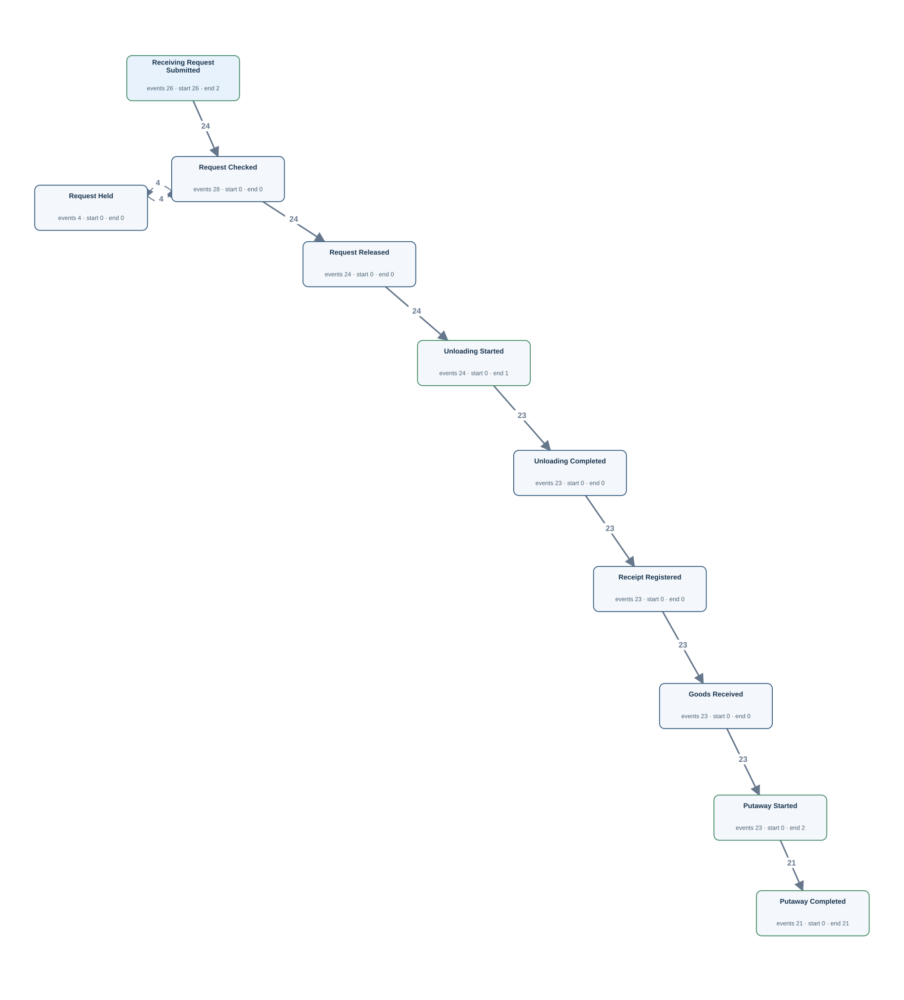</a></td><td width="58%" valign="top">
<a href="../../../datasets/warehouseflow_new/private/gold_sql/WF04.sql">Gold SQL</a> · <a href="../../../datasets/warehouseflow_new/private/gold_logs/WF04.csv">Gold CSV</a> · <a href="../../../datasets/warehouseflow_new/input/database.sqlite">Full source database (SQLite)</a>

<code>goods_movement</code> · 23 matched source rows
<table><tr><th>Column</th><th>Row 1</th><th>Row 2</th><th>Row 3</th></tr><tr><th>movement_id</th><td>0001</td><td>0002</td><td>0003</td></tr><tr><th>warehouse_id</th><td>1</td><td>2</td><td>3</td></tr><tr><th>goods_id</th><td>1</td><td>2</td><td>3</td></tr><tr><th>quantity</th><td>10</td><td>10</td><td>10</td></tr><tr><th>receipt_id</th><td>001</td><td>002</td><td>003</td></tr><tr><th>dispatch_id</th><td><em>NULL</em></td><td><em>NULL</em></td><td><em>NULL</em></td></tr><tr><th>code_family</th><td>MOVEMENT</td><td>MOVEMENT</td><td>MOVEMENT</td></tr><tr><th>movement_code</th><td>IN</td><td>IN</td><td>IN</td></tr><tr><th>occurred_at</th><td>2026-02-01T05:35:00Z</td><td>2026-02-01T10:35:00Z</td><td>2026-02-01T15:35:00Z</td></tr></table>
<strong>Gold output for the same source rows</strong>
<ul><li>Row 1 → Goods Received · event M:0001 · case Q:001 · time from <code>occurred_at</code></li><li>Row 2 → Goods Received · event M:0002 · case Q:002 · time from <code>occurred_at</code></li><li>Row 3 → Goods Received · event M:0003 · case Q:003 · time from <code>occurred_at</code></li></ul>

<code>goods_receipt</code> · 23 matched source rows
<table><tr><th>Column</th><th>Row 1</th><th>Row 2</th><th>Row 3</th></tr><tr><th>receipt_id</th><td>001</td><td>002</td><td>003</td></tr><tr><th>request_id</th><td>001</td><td>002</td><td>003</td></tr><tr><th>receiver_id</th><td>1</td><td>2</td><td>3</td></tr><tr><th>received_at</th><td>2026-02-01T05:32:00Z</td><td>2026-02-01T10:32:00Z</td><td>2026-02-01T15:32:00Z</td></tr><tr><th>condition_code</th><td>GOOD</td><td>GOOD</td><td>GOOD</td></tr></table>
<strong>Gold output for the same source rows</strong>
<ul><li>Row 1 → Receipt Registered · event R:001 · case Q:001 · time from <code>received_at</code></li><li>Row 2 → Receipt Registered · event R:002 · case Q:002 · time from <code>received_at</code></li><li>Row 3 → Receipt Registered · event R:003 · case Q:003 · time from <code>received_at</code></li></ul>

<code>handling_history</code> · 24 matched source rows
<table><tr><th>Column</th><th>Row 1</th><th>Row 2</th><th>Row 3</th></tr><tr><th>handling_id</th><td>0001</td><td>0002</td><td>0003</td></tr><tr><th>request_id</th><td>001</td><td>002</td><td>003</td></tr><tr><th>dispatch_id</th><td><em>NULL</em></td><td><em>NULL</em></td><td><em>NULL</em></td></tr><tr><th>worker_id</th><td>1</td><td>2</td><td>3</td></tr><tr><th>code_family</th><td>HANDLING</td><td>HANDLING</td><td>HANDLING</td></tr><tr><th>handling_code</th><td>UNLOAD</td><td>UNLOAD</td><td>UNLOAD</td></tr><tr><th>started_at</th><td>2026-02-01T05:20:00Z</td><td>2026-02-01T10:20:00Z</td><td>2026-02-01T15:20:00Z</td></tr><tr><th>completed_at</th><td>2026-02-01T05:30:00Z</td><td>2026-02-01T10:30:00Z</td><td>2026-02-01T15:30:00Z</td></tr></table>
<strong>Gold output for the same source rows</strong>
<ul><li>Row 1 → Unloading Completed · event H:0001:complete · case Q:001 · time from <code>completed_at</code></li><li>Row 1 → Unloading Started · event H:0001:start · case Q:001 · time from <code>started_at</code></li><li>Row 2 → Unloading Completed · event H:0002:complete · case Q:002 · time from <code>completed_at</code></li><li>Row 2 → Unloading Started · event H:0002:start · case Q:002 · time from <code>started_at</code></li><li>Row 3 → Unloading Completed · event H:0003:complete · case Q:003 · time from <code>completed_at</code></li><li>Row 3 → Unloading Started · event H:0003:start · case Q:003 · time from <code>started_at</code></li></ul>

<code>receiving_request</code> · 26 matched source rows
<table><tr><th>Column</th><th>Row 1</th><th>Row 2</th><th>Row 3</th></tr><tr><th>request_id</th><td>001</td><td>002</td><td>003</td></tr><tr><th>warehouse_id</th><td>1</td><td>2</td><td>3</td></tr><tr><th>goods_id</th><td>1</td><td>2</td><td>3</td></tr><tr><th>quantity</th><td>10</td><td>10</td><td>10</td></tr><tr><th>submitted_at</th><td>2026-02-01T05:00:00Z</td><td>2026-02-01T10:00:00Z</td><td>2026-02-01T15:00:00Z</td></tr></table>
<strong>Gold output for the same source rows</strong>
<ul><li>Row 1 → Receiving Request Submitted · event Q:001 · case Q:001 · time from <code>submitted_at</code></li><li>Row 2 → Receiving Request Submitted · event Q:002 · case Q:002 · time from <code>submitted_at</code></li><li>Row 3 → Receiving Request Submitted · event Q:003 · case Q:003 · time from <code>submitted_at</code></li></ul>

<code>request_action</code> · 56 matched source rows
<table><tr><th>Column</th><th>Row 1</th><th>Row 2</th><th>Row 3</th></tr><tr><th>action_id</th><td>0001</td><td>0002</td><td>0010</td></tr><tr><th>request_id</th><td>001</td><td>001</td><td>005</td></tr><tr><th>worker_id</th><td>1</td><td>1</td><td>5</td></tr><tr><th>code_family</th><td>REQUEST</td><td>REQUEST</td><td>REQUEST</td></tr><tr><th>action_code</th><td>CHECK</td><td>RELEASE</td><td>HOLD</td></tr><tr><th>occurred_at</th><td>2026-02-01T05:05:00Z</td><td>2026-02-01T05:12:00Z</td><td>2026-02-02T01:08:00Z</td></tr></table>
<strong>Gold output for the same source rows</strong>
<ul><li>Row 1 → Request Checked · event C:0001 · case Q:001 · time from <code>occurred_at</code></li><li>Row 2 → Request Released · event C:0002 · case Q:001 · time from <code>occurred_at</code></li><li>Row 3 → Request Held · event C:0010 · case Q:005 · time from <code>occurred_at</code></li></ul>

<code>warehouse_task_history</code> · 23 matched source rows
<table><tr><th>Column</th><th>Row 1</th><th>Row 2</th><th>Row 3</th></tr><tr><th>task_id</th><td>0001</td><td>0002</td><td>0003</td></tr><tr><th>request_id</th><td>001</td><td>002</td><td>003</td></tr><tr><th>dispatch_id</th><td><em>NULL</em></td><td><em>NULL</em></td><td><em>NULL</em></td></tr><tr><th>worker_id</th><td>1</td><td>2</td><td>3</td></tr><tr><th>code_family</th><td>TASK</td><td>TASK</td><td>TASK</td></tr><tr><th>task_code</th><td>PUTAWAY</td><td>PUTAWAY</td><td>PUTAWAY</td></tr><tr><th>started_at</th><td>2026-02-01T05:40:00Z</td><td>2026-02-01T10:40:00Z</td><td>2026-02-01T15:40:00Z</td></tr><tr><th>completed_at</th><td>2026-02-01T05:50:00Z</td><td>2026-02-01T10:50:00Z</td><td>2026-02-01T15:50:00Z</td></tr><tr><th>outcome_code</th><td>OK</td><td>OK</td><td>OK</td></tr></table>
<strong>Gold output for the same source rows</strong>
<ul><li>Row 1 → Putaway Completed · event T:0001:complete · case Q:001 · time from <code>completed_at</code></li><li>Row 1 → Putaway Started · event T:0001:start · case Q:001 · time from <code>started_at</code></li><li>Row 2 → Putaway Completed · event T:0002:complete · case Q:002 · time from <code>completed_at</code></li><li>Row 2 → Putaway Started · event T:0002:start · case Q:002 · time from <code>started_at</code></li><li>Row 3 → Putaway Completed · event T:0003:complete · case Q:003 · time from <code>completed_at</code></li><li>Row 3 → Putaway Started · event T:0003:start · case Q:003 · time from <code>started_at</code></li></ul>
</td></tr></table>

## WF04P — Q4

Trace each receiving request through its complete recorded lifecycle.

Events: **219** · Cases with events: **26** · Activities: **10** · Edges: **10** · Source tables: **6** · SQL tables: **6**

<table><tr><td width="42%" valign="top"></td><td width="58%" valign="top">
<a href="../../../datasets/warehouseflow_new/private/gold_sql/WF04P.sql">Gold SQL</a> · <a href="../../../datasets/warehouseflow_new/private/gold_logs/WF04P.csv">Gold CSV</a> · <a href="../../../datasets/warehouseflow_new/input/database.sqlite">Full source database (SQLite)</a>

<code>goods_movement</code> · 23 matched source rows
<table><tr><th>Column</th><th>Row 1</th><th>Row 2</th><th>Row 3</th></tr><tr><th>movement_id</th><td>0001</td><td>0002</td><td>0003</td></tr><tr><th>warehouse_id</th><td>1</td><td>2</td><td>3</td></tr><tr><th>goods_id</th><td>1</td><td>2</td><td>3</td></tr><tr><th>quantity</th><td>10</td><td>10</td><td>10</td></tr><tr><th>receipt_id</th><td>001</td><td>002</td><td>003</td></tr><tr><th>dispatch_id</th><td><em>NULL</em></td><td><em>NULL</em></td><td><em>NULL</em></td></tr><tr><th>code_family</th><td>MOVEMENT</td><td>MOVEMENT</td><td>MOVEMENT</td></tr><tr><th>movement_code</th><td>IN</td><td>IN</td><td>IN</td></tr><tr><th>occurred_at</th><td>2026-02-01T05:35:00Z</td><td>2026-02-01T10:35:00Z</td><td>2026-02-01T15:35:00Z</td></tr></table>
<strong>Gold output for the same source rows</strong>
<ul><li>Row 1 → Goods Received · event M:0001 · case Q:001 · time from <code>occurred_at</code></li><li>Row 2 → Goods Received · event M:0002 · case Q:002 · time from <code>occurred_at</code></li><li>Row 3 → Goods Received · event M:0003 · case Q:003 · time from <code>occurred_at</code></li></ul>

<code>goods_receipt</code> · 23 matched source rows
<table><tr><th>Column</th><th>Row 1</th><th>Row 2</th><th>Row 3</th></tr><tr><th>receipt_id</th><td>001</td><td>002</td><td>003</td></tr><tr><th>request_id</th><td>001</td><td>002</td><td>003</td></tr><tr><th>receiver_id</th><td>1</td><td>2</td><td>3</td></tr><tr><th>received_at</th><td>2026-02-01T05:32:00Z</td><td>2026-02-01T10:32:00Z</td><td>2026-02-01T15:32:00Z</td></tr><tr><th>condition_code</th><td>GOOD</td><td>GOOD</td><td>GOOD</td></tr></table>
<strong>Gold output for the same source rows</strong>
<ul><li>Row 1 → Receipt Registered · event R:001 · case Q:001 · time from <code>received_at</code></li><li>Row 2 → Receipt Registered · event R:002 · case Q:002 · time from <code>received_at</code></li><li>Row 3 → Receipt Registered · event R:003 · case Q:003 · time from <code>received_at</code></li></ul>

<code>handling_history</code> · 24 matched source rows
<table><tr><th>Column</th><th>Row 1</th><th>Row 2</th><th>Row 3</th></tr><tr><th>handling_id</th><td>0001</td><td>0002</td><td>0003</td></tr><tr><th>request_id</th><td>001</td><td>002</td><td>003</td></tr><tr><th>dispatch_id</th><td><em>NULL</em></td><td><em>NULL</em></td><td><em>NULL</em></td></tr><tr><th>worker_id</th><td>1</td><td>2</td><td>3</td></tr><tr><th>code_family</th><td>HANDLING</td><td>HANDLING</td><td>HANDLING</td></tr><tr><th>handling_code</th><td>UNLOAD</td><td>UNLOAD</td><td>UNLOAD</td></tr><tr><th>started_at</th><td>2026-02-01T05:20:00Z</td><td>2026-02-01T10:20:00Z</td><td>2026-02-01T15:20:00Z</td></tr><tr><th>completed_at</th><td>2026-02-01T05:30:00Z</td><td>2026-02-01T10:30:00Z</td><td>2026-02-01T15:30:00Z</td></tr></table>
<strong>Gold output for the same source rows</strong>
<ul><li>Row 1 → Unloading Completed · event H:0001:complete · case Q:001 · time from <code>completed_at</code></li><li>Row 1 → Unloading Started · event H:0001:start · case Q:001 · time from <code>started_at</code></li><li>Row 2 → Unloading Completed · event H:0002:complete · case Q:002 · time from <code>completed_at</code></li><li>Row 2 → Unloading Started · event H:0002:start · case Q:002 · time from <code>started_at</code></li><li>Row 3 → Unloading Completed · event H:0003:complete · case Q:003 · time from <code>completed_at</code></li><li>Row 3 → Unloading Started · event H:0003:start · case Q:003 · time from <code>started_at</code></li></ul>

<code>receiving_request</code> · 26 matched source rows
<table><tr><th>Column</th><th>Row 1</th><th>Row 2</th><th>Row 3</th></tr><tr><th>request_id</th><td>001</td><td>002</td><td>003</td></tr><tr><th>warehouse_id</th><td>1</td><td>2</td><td>3</td></tr><tr><th>goods_id</th><td>1</td><td>2</td><td>3</td></tr><tr><th>quantity</th><td>10</td><td>10</td><td>10</td></tr><tr><th>submitted_at</th><td>2026-02-01T05:00:00Z</td><td>2026-02-01T10:00:00Z</td><td>2026-02-01T15:00:00Z</td></tr></table>
<strong>Gold output for the same source rows</strong>
<ul><li>Row 1 → Receiving Request Submitted · event Q:001 · case Q:001 · time from <code>submitted_at</code></li><li>Row 2 → Receiving Request Submitted · event Q:002 · case Q:002 · time from <code>submitted_at</code></li><li>Row 3 → Receiving Request Submitted · event Q:003 · case Q:003 · time from <code>submitted_at</code></li></ul>

<code>request_action</code> · 56 matched source rows
<table><tr><th>Column</th><th>Row 1</th><th>Row 2</th><th>Row 3</th></tr><tr><th>action_id</th><td>0001</td><td>0002</td><td>0010</td></tr><tr><th>request_id</th><td>001</td><td>001</td><td>005</td></tr><tr><th>worker_id</th><td>1</td><td>1</td><td>5</td></tr><tr><th>code_family</th><td>REQUEST</td><td>REQUEST</td><td>REQUEST</td></tr><tr><th>action_code</th><td>CHECK</td><td>RELEASE</td><td>HOLD</td></tr><tr><th>occurred_at</th><td>2026-02-01T05:05:00Z</td><td>2026-02-01T05:12:00Z</td><td>2026-02-02T01:08:00Z</td></tr></table>
<strong>Gold output for the same source rows</strong>
<ul><li>Row 1 → Request Checked · event C:0001 · case Q:001 · time from <code>occurred_at</code></li><li>Row 2 → Request Released · event C:0002 · case Q:001 · time from <code>occurred_at</code></li><li>Row 3 → Request Held · event C:0010 · case Q:005 · time from <code>occurred_at</code></li></ul>

<code>warehouse_task_history</code> · 23 matched source rows
<table><tr><th>Column</th><th>Row 1</th><th>Row 2</th><th>Row 3</th></tr><tr><th>task_id</th><td>0001</td><td>0002</td><td>0003</td></tr><tr><th>request_id</th><td>001</td><td>002</td><td>003</td></tr><tr><th>dispatch_id</th><td><em>NULL</em></td><td><em>NULL</em></td><td><em>NULL</em></td></tr><tr><th>worker_id</th><td>1</td><td>2</td><td>3</td></tr><tr><th>code_family</th><td>TASK</td><td>TASK</td><td>TASK</td></tr><tr><th>task_code</th><td>PUTAWAY</td><td>PUTAWAY</td><td>PUTAWAY</td></tr><tr><th>started_at</th><td>2026-02-01T05:40:00Z</td><td>2026-02-01T10:40:00Z</td><td>2026-02-01T15:40:00Z</td></tr><tr><th>completed_at</th><td>2026-02-01T05:50:00Z</td><td>2026-02-01T10:50:00Z</td><td>2026-02-01T15:50:00Z</td></tr><tr><th>outcome_code</th><td>OK</td><td>OK</td><td>OK</td></tr></table>
<strong>Gold output for the same source rows</strong>
<ul><li>Row 1 → Putaway Completed · event T:0001:complete · case Q:001 · time from <code>completed_at</code></li><li>Row 1 → Putaway Started · event T:0001:start · case Q:001 · time from <code>started_at</code></li><li>Row 2 → Putaway Completed · event T:0002:complete · case Q:002 · time from <code>completed_at</code></li><li>Row 2 → Putaway Started · event T:0002:start · case Q:002 · time from <code>started_at</code></li><li>Row 3 → Putaway Completed · event T:0003:complete · case Q:003 · time from <code>completed_at</code></li><li>Row 3 → Putaway Started · event T:0003:start · case Q:003 · time from <code>started_at</code></li></ul>
</td></tr></table>

## WF05 — Q3

Extract the full recorded lifecycle for each receipt record.

Events: **46** · Cases with events: **23** · Activities: **2** · Edges: **1** · Source tables: **2** · SQL tables: **2**

<table><tr><td width="42%" valign="top"></td><td width="58%" valign="top">
<a href="../../../datasets/warehouseflow_new/private/gold_sql/WF05.sql">Gold SQL</a> · <a href="../../../datasets/warehouseflow_new/private/gold_logs/WF05.csv">Gold CSV</a> · <a href="../../../datasets/warehouseflow_new/input/database.sqlite">Full source database (SQLite)</a>

<code>goods_movement</code> · 23 matched source rows
<table><tr><th>Column</th><th>Row 1</th><th>Row 2</th><th>Row 3</th></tr><tr><th>movement_id</th><td>0001</td><td>0002</td><td>0003</td></tr><tr><th>warehouse_id</th><td>1</td><td>2</td><td>3</td></tr><tr><th>goods_id</th><td>1</td><td>2</td><td>3</td></tr><tr><th>quantity</th><td>10</td><td>10</td><td>10</td></tr><tr><th>receipt_id</th><td>001</td><td>002</td><td>003</td></tr><tr><th>dispatch_id</th><td><em>NULL</em></td><td><em>NULL</em></td><td><em>NULL</em></td></tr><tr><th>code_family</th><td>MOVEMENT</td><td>MOVEMENT</td><td>MOVEMENT</td></tr><tr><th>movement_code</th><td>IN</td><td>IN</td><td>IN</td></tr><tr><th>occurred_at</th><td>2026-02-01T05:35:00Z</td><td>2026-02-01T10:35:00Z</td><td>2026-02-01T15:35:00Z</td></tr></table>
<strong>Gold output for the same source rows</strong>
<ul><li>Row 1 → Goods Received · event M:0001 · case R:001 · time from <code>occurred_at</code></li><li>Row 2 → Goods Received · event M:0002 · case R:002 · time from <code>occurred_at</code></li><li>Row 3 → Goods Received · event M:0003 · case R:003 · time from <code>occurred_at</code></li></ul>

<code>goods_receipt</code> · 23 matched source rows
<table><tr><th>Column</th><th>Row 1</th><th>Row 2</th><th>Row 3</th></tr><tr><th>receipt_id</th><td>001</td><td>002</td><td>003</td></tr><tr><th>request_id</th><td>001</td><td>002</td><td>003</td></tr><tr><th>receiver_id</th><td>1</td><td>2</td><td>3</td></tr><tr><th>received_at</th><td>2026-02-01T05:32:00Z</td><td>2026-02-01T10:32:00Z</td><td>2026-02-01T15:32:00Z</td></tr><tr><th>condition_code</th><td>GOOD</td><td>GOOD</td><td>GOOD</td></tr></table>
<strong>Gold output for the same source rows</strong>
<ul><li>Row 1 → Receipt Registered · event R:001 · case R:001 · time from <code>received_at</code></li><li>Row 2 → Receipt Registered · event R:002 · case R:002 · time from <code>received_at</code></li><li>Row 3 → Receipt Registered · event R:003 · case R:003 · time from <code>received_at</code></li></ul>
</td></tr></table>

## WF05P — Q4

Show the entire recorded history associated with each individual receipt record.

Events: **46** · Cases with events: **23** · Activities: **2** · Edges: **1** · Source tables: **2** · SQL tables: **2**

<table><tr><td width="42%" valign="top"></td><td width="58%" valign="top">
<a href="../../../datasets/warehouseflow_new/private/gold_sql/WF05P.sql">Gold SQL</a> · <a href="../../../datasets/warehouseflow_new/private/gold_logs/WF05P.csv">Gold CSV</a> · <a href="../../../datasets/warehouseflow_new/input/database.sqlite">Full source database (SQLite)</a>

<code>goods_movement</code> · 23 matched source rows
<table><tr><th>Column</th><th>Row 1</th><th>Row 2</th><th>Row 3</th></tr><tr><th>movement_id</th><td>0001</td><td>0002</td><td>0003</td></tr><tr><th>warehouse_id</th><td>1</td><td>2</td><td>3</td></tr><tr><th>goods_id</th><td>1</td><td>2</td><td>3</td></tr><tr><th>quantity</th><td>10</td><td>10</td><td>10</td></tr><tr><th>receipt_id</th><td>001</td><td>002</td><td>003</td></tr><tr><th>dispatch_id</th><td><em>NULL</em></td><td><em>NULL</em></td><td><em>NULL</em></td></tr><tr><th>code_family</th><td>MOVEMENT</td><td>MOVEMENT</td><td>MOVEMENT</td></tr><tr><th>movement_code</th><td>IN</td><td>IN</td><td>IN</td></tr><tr><th>occurred_at</th><td>2026-02-01T05:35:00Z</td><td>2026-02-01T10:35:00Z</td><td>2026-02-01T15:35:00Z</td></tr></table>
<strong>Gold output for the same source rows</strong>
<ul><li>Row 1 → Goods Received · event M:0001 · case R:001 · time from <code>occurred_at</code></li><li>Row 2 → Goods Received · event M:0002 · case R:002 · time from <code>occurred_at</code></li><li>Row 3 → Goods Received · event M:0003 · case R:003 · time from <code>occurred_at</code></li></ul>

<code>goods_receipt</code> · 23 matched source rows
<table><tr><th>Column</th><th>Row 1</th><th>Row 2</th><th>Row 3</th></tr><tr><th>receipt_id</th><td>001</td><td>002</td><td>003</td></tr><tr><th>request_id</th><td>001</td><td>002</td><td>003</td></tr><tr><th>receiver_id</th><td>1</td><td>2</td><td>3</td></tr><tr><th>received_at</th><td>2026-02-01T05:32:00Z</td><td>2026-02-01T10:32:00Z</td><td>2026-02-01T15:32:00Z</td></tr><tr><th>condition_code</th><td>GOOD</td><td>GOOD</td><td>GOOD</td></tr></table>
<strong>Gold output for the same source rows</strong>
<ul><li>Row 1 → Receipt Registered · event R:001 · case R:001 · time from <code>received_at</code></li><li>Row 2 → Receipt Registered · event R:002 · case R:002 · time from <code>received_at</code></li><li>Row 3 → Receipt Registered · event R:003 · case R:003 · time from <code>received_at</code></li></ul>
</td></tr></table>

## WF06 — Q3

Extract the full recorded lifecycle for each dispatch order.

Events: **166** · Cases with events: **20** · Activities: **9** · Edges: **9** · Source tables: **4** · SQL tables: **4**

<table><tr><td width="42%" valign="top"><a href="graphs/WF06.svg">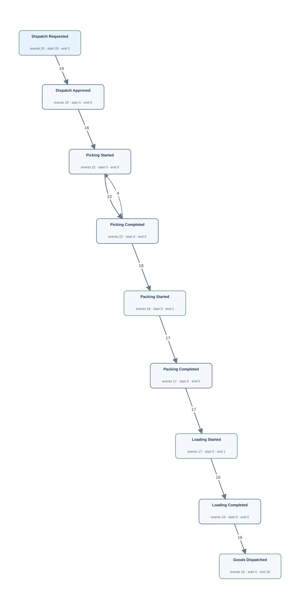</a></td><td width="58%" valign="top">
<a href="../../../datasets/warehouseflow_new/private/gold_sql/WF06.sql">Gold SQL</a> · <a href="../../../datasets/warehouseflow_new/private/gold_logs/WF06.csv">Gold CSV</a> · <a href="../../../datasets/warehouseflow_new/input/database.sqlite">Full source database (SQLite)</a>

<code>dispatch_order</code> · 20 matched source rows
<table><tr><th>Column</th><th>Row 1</th><th>Row 2</th><th>Row 3</th></tr><tr><th>dispatch_id</th><td>001</td><td>002</td><td>003</td></tr><tr><th>warehouse_id</th><td>1</td><td>2</td><td>3</td></tr><tr><th>goods_id</th><td>1</td><td>2</td><td>3</td></tr><tr><th>quantity</th><td>4</td><td>4</td><td>4</td></tr><tr><th>priority_code</th><td>NORMAL</td><td>NORMAL</td><td>URGENT</td></tr><tr><th>requested_at</th><td>2026-04-11T15:40:00Z</td><td>2026-04-11T20:40:00Z</td><td>2026-04-12T01:40:00Z</td></tr><tr><th>approved_at</th><td>2026-04-11T15:50:00Z</td><td>2026-04-11T20:50:00Z</td><td>2026-04-12T01:50:00Z</td></tr></table>
<strong>Gold output for the same source rows</strong>
<ul><li>Row 1 → Dispatch Approved · event D:001:approved · case D:001 · time from <code>approved_at</code></li><li>Row 1 → Dispatch Requested · event D:001:requested · case D:001 · time from <code>requested_at</code></li><li>Row 2 → Dispatch Approved · event D:002:approved · case D:002 · time from <code>approved_at</code></li><li>Row 2 → Dispatch Requested · event D:002:requested · case D:002 · time from <code>requested_at</code></li><li>Row 3 → Dispatch Approved · event D:003:approved · case D:003 · time from <code>approved_at</code></li><li>Row 3 → Dispatch Requested · event D:003:requested · case D:003 · time from <code>requested_at</code></li></ul>

<code>goods_movement</code> · 16 matched source rows
<table><tr><th>Column</th><th>Row 1</th><th>Row 2</th><th>Row 3</th></tr><tr><th>movement_id</th><td>0024</td><td>0025</td><td>0026</td></tr><tr><th>warehouse_id</th><td>1</td><td>2</td><td>3</td></tr><tr><th>goods_id</th><td>1</td><td>2</td><td>3</td></tr><tr><th>quantity</th><td>4</td><td>4</td><td>4</td></tr><tr><th>receipt_id</th><td><em>NULL</em></td><td><em>NULL</em></td><td><em>NULL</em></td></tr><tr><th>dispatch_id</th><td>001</td><td>002</td><td>003</td></tr><tr><th>code_family</th><td>MOVEMENT</td><td>MOVEMENT</td><td>MOVEMENT</td></tr><tr><th>movement_code</th><td>OUT</td><td>OUT</td><td>OUT</td></tr><tr><th>occurred_at</th><td>2026-04-11T16:45:00Z</td><td>2026-04-11T21:45:00Z</td><td>2026-04-12T02:45:00Z</td></tr></table>
<strong>Gold output for the same source rows</strong>
<ul><li>Row 1 → Goods Dispatched · event M:0024 · case D:001 · time from <code>occurred_at</code></li><li>Row 2 → Goods Dispatched · event M:0025 · case D:002 · time from <code>occurred_at</code></li><li>Row 3 → Goods Dispatched · event M:0026 · case D:003 · time from <code>occurred_at</code></li></ul>

<code>handling_history</code> · 17 matched source rows
<table><tr><th>Column</th><th>Row 1</th><th>Row 2</th><th>Row 3</th></tr><tr><th>handling_id</th><td>0025</td><td>0026</td><td>0027</td></tr><tr><th>request_id</th><td><em>NULL</em></td><td><em>NULL</em></td><td><em>NULL</em></td></tr><tr><th>dispatch_id</th><td>001</td><td>002</td><td>003</td></tr><tr><th>worker_id</th><td>2</td><td>3</td><td>4</td></tr><tr><th>code_family</th><td>HANDLING</td><td>HANDLING</td><td>HANDLING</td></tr><tr><th>handling_code</th><td>LOAD</td><td>LOAD</td><td>LOAD</td></tr><tr><th>started_at</th><td>2026-04-11T16:30:00Z</td><td>2026-04-11T21:30:00Z</td><td>2026-04-12T02:30:00Z</td></tr><tr><th>completed_at</th><td>2026-04-11T16:40:00Z</td><td>2026-04-11T21:40:00Z</td><td>2026-04-12T02:40:00Z</td></tr></table>
<strong>Gold output for the same source rows</strong>
<ul><li>Row 1 → Loading Completed · event H:0025:complete · case D:001 · time from <code>completed_at</code></li><li>Row 1 → Loading Started · event H:0025:start · case D:001 · time from <code>started_at</code></li><li>Row 2 → Loading Completed · event H:0026:complete · case D:002 · time from <code>completed_at</code></li><li>Row 2 → Loading Started · event H:0026:start · case D:002 · time from <code>started_at</code></li><li>Row 3 → Loading Completed · event H:0027:complete · case D:003 · time from <code>completed_at</code></li><li>Row 3 → Loading Started · event H:0027:start · case D:003 · time from <code>started_at</code></li></ul>

<code>warehouse_task_history</code> · 40 matched source rows
<table><tr><th>Column</th><th>Row 1</th><th>Row 2</th><th>Row 3</th></tr><tr><th>task_id</th><td>0024</td><td>0025</td><td>0026</td></tr><tr><th>request_id</th><td><em>NULL</em></td><td><em>NULL</em></td><td><em>NULL</em></td></tr><tr><th>dispatch_id</th><td>001</td><td>001</td><td>002</td></tr><tr><th>worker_id</th><td>2</td><td>2</td><td>3</td></tr><tr><th>code_family</th><td>TASK</td><td>TASK</td><td>TASK</td></tr><tr><th>task_code</th><td>PICK</td><td>PACK</td><td>PICK</td></tr><tr><th>started_at</th><td>2026-04-11T16:00:00Z</td><td>2026-04-11T16:15:00Z</td><td>2026-04-11T21:00:00Z</td></tr><tr><th>completed_at</th><td>2026-04-11T16:10:00Z</td><td>2026-04-11T16:25:00Z</td><td>2026-04-11T21:10:00Z</td></tr><tr><th>outcome_code</th><td>OK</td><td>OK</td><td>OK</td></tr></table>
<strong>Gold output for the same source rows</strong>
<ul><li>Row 1 → Picking Completed · event T:0024:complete · case D:001 · time from <code>completed_at</code></li><li>Row 1 → Picking Started · event T:0024:start · case D:001 · time from <code>started_at</code></li><li>Row 2 → Packing Completed · event T:0025:complete · case D:001 · time from <code>completed_at</code></li><li>Row 2 → Packing Started · event T:0025:start · case D:001 · time from <code>started_at</code></li><li>Row 3 → Picking Completed · event T:0026:complete · case D:002 · time from <code>completed_at</code></li><li>Row 3 → Picking Started · event T:0026:start · case D:002 · time from <code>started_at</code></li></ul>
</td></tr></table>

## WF06P — Q4

Build a complete recorded timeline for every dispatch order.

Events: **166** · Cases with events: **20** · Activities: **9** · Edges: **9** · Source tables: **4** · SQL tables: **4**

<table><tr><td width="42%" valign="top"></td><td width="58%" valign="top">
<a href="../../../datasets/warehouseflow_new/private/gold_sql/WF06P.sql">Gold SQL</a> · <a href="../../../datasets/warehouseflow_new/private/gold_logs/WF06P.csv">Gold CSV</a> · <a href="../../../datasets/warehouseflow_new/input/database.sqlite">Full source database (SQLite)</a>

<code>dispatch_order</code> · 20 matched source rows
<table><tr><th>Column</th><th>Row 1</th><th>Row 2</th><th>Row 3</th></tr><tr><th>dispatch_id</th><td>001</td><td>002</td><td>003</td></tr><tr><th>warehouse_id</th><td>1</td><td>2</td><td>3</td></tr><tr><th>goods_id</th><td>1</td><td>2</td><td>3</td></tr><tr><th>quantity</th><td>4</td><td>4</td><td>4</td></tr><tr><th>priority_code</th><td>NORMAL</td><td>NORMAL</td><td>URGENT</td></tr><tr><th>requested_at</th><td>2026-04-11T15:40:00Z</td><td>2026-04-11T20:40:00Z</td><td>2026-04-12T01:40:00Z</td></tr><tr><th>approved_at</th><td>2026-04-11T15:50:00Z</td><td>2026-04-11T20:50:00Z</td><td>2026-04-12T01:50:00Z</td></tr></table>
<strong>Gold output for the same source rows</strong>
<ul><li>Row 1 → Dispatch Approved · event D:001:approved · case D:001 · time from <code>approved_at</code></li><li>Row 1 → Dispatch Requested · event D:001:requested · case D:001 · time from <code>requested_at</code></li><li>Row 2 → Dispatch Approved · event D:002:approved · case D:002 · time from <code>approved_at</code></li><li>Row 2 → Dispatch Requested · event D:002:requested · case D:002 · time from <code>requested_at</code></li><li>Row 3 → Dispatch Approved · event D:003:approved · case D:003 · time from <code>approved_at</code></li><li>Row 3 → Dispatch Requested · event D:003:requested · case D:003 · time from <code>requested_at</code></li></ul>

<code>goods_movement</code> · 16 matched source rows
<table><tr><th>Column</th><th>Row 1</th><th>Row 2</th><th>Row 3</th></tr><tr><th>movement_id</th><td>0024</td><td>0025</td><td>0026</td></tr><tr><th>warehouse_id</th><td>1</td><td>2</td><td>3</td></tr><tr><th>goods_id</th><td>1</td><td>2</td><td>3</td></tr><tr><th>quantity</th><td>4</td><td>4</td><td>4</td></tr><tr><th>receipt_id</th><td><em>NULL</em></td><td><em>NULL</em></td><td><em>NULL</em></td></tr><tr><th>dispatch_id</th><td>001</td><td>002</td><td>003</td></tr><tr><th>code_family</th><td>MOVEMENT</td><td>MOVEMENT</td><td>MOVEMENT</td></tr><tr><th>movement_code</th><td>OUT</td><td>OUT</td><td>OUT</td></tr><tr><th>occurred_at</th><td>2026-04-11T16:45:00Z</td><td>2026-04-11T21:45:00Z</td><td>2026-04-12T02:45:00Z</td></tr></table>
<strong>Gold output for the same source rows</strong>
<ul><li>Row 1 → Goods Dispatched · event M:0024 · case D:001 · time from <code>occurred_at</code></li><li>Row 2 → Goods Dispatched · event M:0025 · case D:002 · time from <code>occurred_at</code></li><li>Row 3 → Goods Dispatched · event M:0026 · case D:003 · time from <code>occurred_at</code></li></ul>

<code>handling_history</code> · 17 matched source rows
<table><tr><th>Column</th><th>Row 1</th><th>Row 2</th><th>Row 3</th></tr><tr><th>handling_id</th><td>0025</td><td>0026</td><td>0027</td></tr><tr><th>request_id</th><td><em>NULL</em></td><td><em>NULL</em></td><td><em>NULL</em></td></tr><tr><th>dispatch_id</th><td>001</td><td>002</td><td>003</td></tr><tr><th>worker_id</th><td>2</td><td>3</td><td>4</td></tr><tr><th>code_family</th><td>HANDLING</td><td>HANDLING</td><td>HANDLING</td></tr><tr><th>handling_code</th><td>LOAD</td><td>LOAD</td><td>LOAD</td></tr><tr><th>started_at</th><td>2026-04-11T16:30:00Z</td><td>2026-04-11T21:30:00Z</td><td>2026-04-12T02:30:00Z</td></tr><tr><th>completed_at</th><td>2026-04-11T16:40:00Z</td><td>2026-04-11T21:40:00Z</td><td>2026-04-12T02:40:00Z</td></tr></table>
<strong>Gold output for the same source rows</strong>
<ul><li>Row 1 → Loading Completed · event H:0025:complete · case D:001 · time from <code>completed_at</code></li><li>Row 1 → Loading Started · event H:0025:start · case D:001 · time from <code>started_at</code></li><li>Row 2 → Loading Completed · event H:0026:complete · case D:002 · time from <code>completed_at</code></li><li>Row 2 → Loading Started · event H:0026:start · case D:002 · time from <code>started_at</code></li><li>Row 3 → Loading Completed · event H:0027:complete · case D:003 · time from <code>completed_at</code></li><li>Row 3 → Loading Started · event H:0027:start · case D:003 · time from <code>started_at</code></li></ul>

<code>warehouse_task_history</code> · 40 matched source rows
<table><tr><th>Column</th><th>Row 1</th><th>Row 2</th><th>Row 3</th></tr><tr><th>task_id</th><td>0024</td><td>0025</td><td>0026</td></tr><tr><th>request_id</th><td><em>NULL</em></td><td><em>NULL</em></td><td><em>NULL</em></td></tr><tr><th>dispatch_id</th><td>001</td><td>001</td><td>002</td></tr><tr><th>worker_id</th><td>2</td><td>2</td><td>3</td></tr><tr><th>code_family</th><td>TASK</td><td>TASK</td><td>TASK</td></tr><tr><th>task_code</th><td>PICK</td><td>PACK</td><td>PICK</td></tr><tr><th>started_at</th><td>2026-04-11T16:00:00Z</td><td>2026-04-11T16:15:00Z</td><td>2026-04-11T21:00:00Z</td></tr><tr><th>completed_at</th><td>2026-04-11T16:10:00Z</td><td>2026-04-11T16:25:00Z</td><td>2026-04-11T21:10:00Z</td></tr><tr><th>outcome_code</th><td>OK</td><td>OK</td><td>OK</td></tr></table>
<strong>Gold output for the same source rows</strong>
<ul><li>Row 1 → Picking Completed · event T:0024:complete · case D:001 · time from <code>completed_at</code></li><li>Row 1 → Picking Started · event T:0024:start · case D:001 · time from <code>started_at</code></li><li>Row 2 → Packing Completed · event T:0025:complete · case D:001 · time from <code>completed_at</code></li><li>Row 2 → Packing Started · event T:0025:start · case D:001 · time from <code>started_at</code></li><li>Row 3 → Picking Completed · event T:0026:complete · case D:002 · time from <code>completed_at</code></li><li>Row 3 → Picking Started · event T:0026:start · case D:002 · time from <code>started_at</code></li></ul>
</td></tr></table>

## WF07 — Q3

Extract the full recorded lifecycle for each stock audit.

Events: **17** · Cases with events: **9** · Activities: **2** · Edges: **1** · Source tables: **1** · SQL tables: **1**

<table><tr><td width="42%" valign="top"></td><td width="58%" valign="top">
<a href="../../../datasets/warehouseflow_new/private/gold_sql/WF07.sql">Gold SQL</a> · <a href="../../../datasets/warehouseflow_new/private/gold_logs/WF07.csv">Gold CSV</a> · <a href="../../../datasets/warehouseflow_new/input/database.sqlite">Full source database (SQLite)</a>

<code>warehouse_audit</code> · 9 matched source rows
<table><tr><th>Column</th><th>Row 1</th><th>Row 2</th><th>Row 3</th></tr><tr><th>audit_id</th><td>001</td><td>002</td><td>003</td></tr><tr><th>warehouse_id</th><td>1</td><td>2</td><td>3</td></tr><tr><th>worker_id</th><td>1</td><td>2</td><td>3</td></tr><tr><th>started_at</th><td>2026-05-16T05:40:00Z</td><td>2026-05-16T07:20:00Z</td><td>2026-05-16T09:00:00Z</td></tr><tr><th>completed_at</th><td>2026-05-16T06:20:00Z</td><td>2026-05-16T08:00:00Z</td><td>2026-05-16T09:40:00Z</td></tr><tr><th>result_code</th><td>PASS</td><td>PASS</td><td>RECOUNT</td></tr></table>
<strong>Gold output for the same source rows</strong>
<ul><li>Row 1 → Stock Audit Completed · event A:001:complete · case A:001 · time from <code>completed_at</code></li><li>Row 1 → Stock Audit Started · event A:001:start · case A:001 · time from <code>started_at</code></li><li>Row 2 → Stock Audit Completed · event A:002:complete · case A:002 · time from <code>completed_at</code></li><li>Row 2 → Stock Audit Started · event A:002:start · case A:002 · time from <code>started_at</code></li><li>Row 3 → Stock Audit Completed · event A:003:complete · case A:003 · time from <code>completed_at</code></li><li>Row 3 → Stock Audit Started · event A:003:start · case A:003 · time from <code>started_at</code></li></ul>
</td></tr></table>

## WF07P — Q4

Show the full recorded history of each stock audit.

Events: **17** · Cases with events: **9** · Activities: **2** · Edges: **1** · Source tables: **1** · SQL tables: **1**

<table><tr><td width="42%" valign="top"></td><td width="58%" valign="top">
<a href="../../../datasets/warehouseflow_new/private/gold_sql/WF07P.sql">Gold SQL</a> · <a href="../../../datasets/warehouseflow_new/private/gold_logs/WF07P.csv">Gold CSV</a> · <a href="../../../datasets/warehouseflow_new/input/database.sqlite">Full source database (SQLite)</a>

<code>warehouse_audit</code> · 9 matched source rows
<table><tr><th>Column</th><th>Row 1</th><th>Row 2</th><th>Row 3</th></tr><tr><th>audit_id</th><td>001</td><td>002</td><td>003</td></tr><tr><th>warehouse_id</th><td>1</td><td>2</td><td>3</td></tr><tr><th>worker_id</th><td>1</td><td>2</td><td>3</td></tr><tr><th>started_at</th><td>2026-05-16T05:40:00Z</td><td>2026-05-16T07:20:00Z</td><td>2026-05-16T09:00:00Z</td></tr><tr><th>completed_at</th><td>2026-05-16T06:20:00Z</td><td>2026-05-16T08:00:00Z</td><td>2026-05-16T09:40:00Z</td></tr><tr><th>result_code</th><td>PASS</td><td>PASS</td><td>RECOUNT</td></tr></table>
<strong>Gold output for the same source rows</strong>
<ul><li>Row 1 → Stock Audit Completed · event A:001:complete · case A:001 · time from <code>completed_at</code></li><li>Row 1 → Stock Audit Started · event A:001:start · case A:001 · time from <code>started_at</code></li><li>Row 2 → Stock Audit Completed · event A:002:complete · case A:002 · time from <code>completed_at</code></li><li>Row 2 → Stock Audit Started · event A:002:start · case A:002 · time from <code>started_at</code></li><li>Row 3 → Stock Audit Completed · event A:003:complete · case A:003 · time from <code>completed_at</code></li><li>Row 3 → Stock Audit Started · event A:003:start · case A:003 · time from <code>started_at</code></li></ul>
</td></tr></table>

## WF08 — Q3

Extract the full recorded lifecycle for each stock movement record.

Events: **39** · Cases with events: **39** · Activities: **2** · Edges: **0** · Source tables: **1** · SQL tables: **1**

<table><tr><td width="42%" valign="top"></td><td width="58%" valign="top">
<a href="../../../datasets/warehouseflow_new/private/gold_sql/WF08.sql">Gold SQL</a> · <a href="../../../datasets/warehouseflow_new/private/gold_logs/WF08.csv">Gold CSV</a> · <a href="../../../datasets/warehouseflow_new/input/database.sqlite">Full source database (SQLite)</a>

<code>goods_movement</code> · 39 matched source rows
<table><tr><th>Column</th><th>Row 1</th><th>Row 2</th><th>Row 3</th></tr><tr><th>movement_id</th><td>0001</td><td>0024</td><td>0002</td></tr><tr><th>warehouse_id</th><td>1</td><td>1</td><td>2</td></tr><tr><th>goods_id</th><td>1</td><td>1</td><td>2</td></tr><tr><th>quantity</th><td>10</td><td>4</td><td>10</td></tr><tr><th>receipt_id</th><td>001</td><td><em>NULL</em></td><td>002</td></tr><tr><th>dispatch_id</th><td><em>NULL</em></td><td>001</td><td><em>NULL</em></td></tr><tr><th>code_family</th><td>MOVEMENT</td><td>MOVEMENT</td><td>MOVEMENT</td></tr><tr><th>movement_code</th><td>IN</td><td>OUT</td><td>IN</td></tr><tr><th>occurred_at</th><td>2026-02-01T05:35:00Z</td><td>2026-04-11T16:45:00Z</td><td>2026-02-01T10:35:00Z</td></tr></table>
<strong>Gold output for the same source rows</strong>
<ul><li>Row 1 → Goods Received · event M:0001 · case M:0001 · time from <code>occurred_at</code></li><li>Row 2 → Goods Dispatched · event M:0024 · case M:0024 · time from <code>occurred_at</code></li><li>Row 3 → Goods Received · event M:0002 · case M:0002 · time from <code>occurred_at</code></li></ul>
</td></tr></table>

## WF08P — Q4

Trace each individual stock movement record through its entire recorded history.

Events: **39** · Cases with events: **39** · Activities: **2** · Edges: **0** · Source tables: **1** · SQL tables: **1**

<table><tr><td width="42%" valign="top"></td><td width="58%" valign="top">
<a href="../../../datasets/warehouseflow_new/private/gold_sql/WF08P.sql">Gold SQL</a> · <a href="../../../datasets/warehouseflow_new/private/gold_logs/WF08P.csv">Gold CSV</a> · <a href="../../../datasets/warehouseflow_new/input/database.sqlite">Full source database (SQLite)</a>

<code>goods_movement</code> · 39 matched source rows
<table><tr><th>Column</th><th>Row 1</th><th>Row 2</th><th>Row 3</th></tr><tr><th>movement_id</th><td>0001</td><td>0024</td><td>0002</td></tr><tr><th>warehouse_id</th><td>1</td><td>1</td><td>2</td></tr><tr><th>goods_id</th><td>1</td><td>1</td><td>2</td></tr><tr><th>quantity</th><td>10</td><td>4</td><td>10</td></tr><tr><th>receipt_id</th><td>001</td><td><em>NULL</em></td><td>002</td></tr><tr><th>dispatch_id</th><td><em>NULL</em></td><td>001</td><td><em>NULL</em></td></tr><tr><th>code_family</th><td>MOVEMENT</td><td>MOVEMENT</td><td>MOVEMENT</td></tr><tr><th>movement_code</th><td>IN</td><td>OUT</td><td>IN</td></tr><tr><th>occurred_at</th><td>2026-02-01T05:35:00Z</td><td>2026-04-11T16:45:00Z</td><td>2026-02-01T10:35:00Z</td></tr></table>
<strong>Gold output for the same source rows</strong>
<ul><li>Row 1 → Goods Received · event M:0001 · case M:0001 · time from <code>occurred_at</code></li><li>Row 2 → Goods Dispatched · event M:0024 · case M:0024 · time from <code>occurred_at</code></li><li>Row 3 → Goods Received · event M:0002 · case M:0002 · time from <code>occurred_at</code></li></ul>
</td></tr></table>

## WF09 — Q3

Extract the full recorded lifecycle for each request action record.

Events: **56** · Cases with events: **56** · Activities: **3** · Edges: **0** · Source tables: **1** · SQL tables: **1**

<table><tr><td width="42%" valign="top"></td><td width="58%" valign="top">
<a href="../../../datasets/warehouseflow_new/private/gold_sql/WF09.sql">Gold SQL</a> · <a href="../../../datasets/warehouseflow_new/private/gold_logs/WF09.csv">Gold CSV</a> · <a href="../../../datasets/warehouseflow_new/input/database.sqlite">Full source database (SQLite)</a>

<code>request_action</code> · 56 matched source rows
<table><tr><th>Column</th><th>Row 1</th><th>Row 2</th><th>Row 3</th></tr><tr><th>action_id</th><td>0001</td><td>0002</td><td>0010</td></tr><tr><th>request_id</th><td>001</td><td>001</td><td>005</td></tr><tr><th>worker_id</th><td>1</td><td>1</td><td>5</td></tr><tr><th>code_family</th><td>REQUEST</td><td>REQUEST</td><td>REQUEST</td></tr><tr><th>action_code</th><td>CHECK</td><td>RELEASE</td><td>HOLD</td></tr><tr><th>occurred_at</th><td>2026-02-01T05:05:00Z</td><td>2026-02-01T05:12:00Z</td><td>2026-02-02T01:08:00Z</td></tr></table>
<strong>Gold output for the same source rows</strong>
<ul><li>Row 1 → Request Checked · event C:0001 · case C:0001 · time from <code>occurred_at</code></li><li>Row 2 → Request Released · event C:0002 · case C:0002 · time from <code>occurred_at</code></li><li>Row 3 → Request Held · event C:0010 · case C:0010 · time from <code>occurred_at</code></li></ul>
</td></tr></table>

## WF09P — Q4

Show the complete recorded history of every individual request action record.

Events: **56** · Cases with events: **56** · Activities: **3** · Edges: **0** · Source tables: **1** · SQL tables: **1**

<table><tr><td width="42%" valign="top"></td><td width="58%" valign="top">
<a href="../../../datasets/warehouseflow_new/private/gold_sql/WF09P.sql">Gold SQL</a> · <a href="../../../datasets/warehouseflow_new/private/gold_logs/WF09P.csv">Gold CSV</a> · <a href="../../../datasets/warehouseflow_new/input/database.sqlite">Full source database (SQLite)</a>

<code>request_action</code> · 56 matched source rows
<table><tr><th>Column</th><th>Row 1</th><th>Row 2</th><th>Row 3</th></tr><tr><th>action_id</th><td>0001</td><td>0002</td><td>0010</td></tr><tr><th>request_id</th><td>001</td><td>001</td><td>005</td></tr><tr><th>worker_id</th><td>1</td><td>1</td><td>5</td></tr><tr><th>code_family</th><td>REQUEST</td><td>REQUEST</td><td>REQUEST</td></tr><tr><th>action_code</th><td>CHECK</td><td>RELEASE</td><td>HOLD</td></tr><tr><th>occurred_at</th><td>2026-02-01T05:05:00Z</td><td>2026-02-01T05:12:00Z</td><td>2026-02-02T01:08:00Z</td></tr></table>
<strong>Gold output for the same source rows</strong>
<ul><li>Row 1 → Request Checked · event C:0001 · case C:0001 · time from <code>occurred_at</code></li><li>Row 2 → Request Released · event C:0002 · case C:0002 · time from <code>occurred_at</code></li><li>Row 3 → Request Held · event C:0010 · case C:0010 · time from <code>occurred_at</code></li></ul>
</td></tr></table>

## WF10 — Q3

Extract the full recorded lifecycle for each warehouse task.

Events: **123** · Cases with events: **63** · Activities: **6** · Edges: **3** · Source tables: **1** · SQL tables: **1**

<table><tr><td width="42%" valign="top"></td><td width="58%" valign="top">
<a href="../../../datasets/warehouseflow_new/private/gold_sql/WF10.sql">Gold SQL</a> · <a href="../../../datasets/warehouseflow_new/private/gold_logs/WF10.csv">Gold CSV</a> · <a href="../../../datasets/warehouseflow_new/input/database.sqlite">Full source database (SQLite)</a>

<code>warehouse_task_history</code> · 63 matched source rows
<table><tr><th>Column</th><th>Row 1</th><th>Row 2</th><th>Row 3</th></tr><tr><th>task_id</th><td>0001</td><td>0024</td><td>0025</td></tr><tr><th>request_id</th><td>001</td><td><em>NULL</em></td><td><em>NULL</em></td></tr><tr><th>dispatch_id</th><td><em>NULL</em></td><td>001</td><td>001</td></tr><tr><th>worker_id</th><td>1</td><td>2</td><td>2</td></tr><tr><th>code_family</th><td>TASK</td><td>TASK</td><td>TASK</td></tr><tr><th>task_code</th><td>PUTAWAY</td><td>PICK</td><td>PACK</td></tr><tr><th>started_at</th><td>2026-02-01T05:40:00Z</td><td>2026-04-11T16:00:00Z</td><td>2026-04-11T16:15:00Z</td></tr><tr><th>completed_at</th><td>2026-02-01T05:50:00Z</td><td>2026-04-11T16:10:00Z</td><td>2026-04-11T16:25:00Z</td></tr><tr><th>outcome_code</th><td>OK</td><td>OK</td><td>OK</td></tr></table>
<strong>Gold output for the same source rows</strong>
<ul><li>Row 1 → Putaway Completed · event T:0001:complete · case T:0001 · time from <code>completed_at</code></li><li>Row 1 → Putaway Started · event T:0001:start · case T:0001 · time from <code>started_at</code></li><li>Row 2 → Picking Completed · event T:0024:complete · case T:0024 · time from <code>completed_at</code></li><li>Row 2 → Picking Started · event T:0024:start · case T:0024 · time from <code>started_at</code></li><li>Row 3 → Packing Completed · event T:0025:complete · case T:0025 · time from <code>completed_at</code></li><li>Row 3 → Packing Started · event T:0025:start · case T:0025 · time from <code>started_at</code></li></ul>
</td></tr></table>

## WF10P — Q4

Build the full recorded lifecycle of each warehouse task.

Events: **123** · Cases with events: **63** · Activities: **6** · Edges: **3** · Source tables: **1** · SQL tables: **1**

<table><tr><td width="42%" valign="top"></td><td width="58%" valign="top">
<a href="../../../datasets/warehouseflow_new/private/gold_sql/WF10P.sql">Gold SQL</a> · <a href="../../../datasets/warehouseflow_new/private/gold_logs/WF10P.csv">Gold CSV</a> · <a href="../../../datasets/warehouseflow_new/input/database.sqlite">Full source database (SQLite)</a>

<code>warehouse_task_history</code> · 63 matched source rows
<table><tr><th>Column</th><th>Row 1</th><th>Row 2</th><th>Row 3</th></tr><tr><th>task_id</th><td>0001</td><td>0024</td><td>0025</td></tr><tr><th>request_id</th><td>001</td><td><em>NULL</em></td><td><em>NULL</em></td></tr><tr><th>dispatch_id</th><td><em>NULL</em></td><td>001</td><td>001</td></tr><tr><th>worker_id</th><td>1</td><td>2</td><td>2</td></tr><tr><th>code_family</th><td>TASK</td><td>TASK</td><td>TASK</td></tr><tr><th>task_code</th><td>PUTAWAY</td><td>PICK</td><td>PACK</td></tr><tr><th>started_at</th><td>2026-02-01T05:40:00Z</td><td>2026-04-11T16:00:00Z</td><td>2026-04-11T16:15:00Z</td></tr><tr><th>completed_at</th><td>2026-02-01T05:50:00Z</td><td>2026-04-11T16:10:00Z</td><td>2026-04-11T16:25:00Z</td></tr><tr><th>outcome_code</th><td>OK</td><td>OK</td><td>OK</td></tr></table>
<strong>Gold output for the same source rows</strong>
<ul><li>Row 1 → Putaway Completed · event T:0001:complete · case T:0001 · time from <code>completed_at</code></li><li>Row 1 → Putaway Started · event T:0001:start · case T:0001 · time from <code>started_at</code></li><li>Row 2 → Picking Completed · event T:0024:complete · case T:0024 · time from <code>completed_at</code></li><li>Row 2 → Picking Started · event T:0024:start · case T:0024 · time from <code>started_at</code></li><li>Row 3 → Packing Completed · event T:0025:complete · case T:0025 · time from <code>completed_at</code></li><li>Row 3 → Packing Started · event T:0025:start · case T:0025 · time from <code>started_at</code></li></ul>
</td></tr></table>

## WF11 — Q3

Extract the full recorded lifecycle for each handling record.

Events: **80** · Cases with events: **41** · Activities: **4** · Edges: **2** · Source tables: **1** · SQL tables: **1**

<table><tr><td width="42%" valign="top"></td><td width="58%" valign="top">
<a href="../../../datasets/warehouseflow_new/private/gold_sql/WF11.sql">Gold SQL</a> · <a href="../../../datasets/warehouseflow_new/private/gold_logs/WF11.csv">Gold CSV</a> · <a href="../../../datasets/warehouseflow_new/input/database.sqlite">Full source database (SQLite)</a>

<code>handling_history</code> · 41 matched source rows
<table><tr><th>Column</th><th>Row 1</th><th>Row 2</th><th>Row 3</th></tr><tr><th>handling_id</th><td>0001</td><td>0025</td><td>0002</td></tr><tr><th>request_id</th><td>001</td><td><em>NULL</em></td><td>002</td></tr><tr><th>dispatch_id</th><td><em>NULL</em></td><td>001</td><td><em>NULL</em></td></tr><tr><th>worker_id</th><td>1</td><td>2</td><td>2</td></tr><tr><th>code_family</th><td>HANDLING</td><td>HANDLING</td><td>HANDLING</td></tr><tr><th>handling_code</th><td>UNLOAD</td><td>LOAD</td><td>UNLOAD</td></tr><tr><th>started_at</th><td>2026-02-01T05:20:00Z</td><td>2026-04-11T16:30:00Z</td><td>2026-02-01T10:20:00Z</td></tr><tr><th>completed_at</th><td>2026-02-01T05:30:00Z</td><td>2026-04-11T16:40:00Z</td><td>2026-02-01T10:30:00Z</td></tr></table>
<strong>Gold output for the same source rows</strong>
<ul><li>Row 1 → Unloading Completed · event H:0001:complete · case H:0001 · time from <code>completed_at</code></li><li>Row 1 → Unloading Started · event H:0001:start · case H:0001 · time from <code>started_at</code></li><li>Row 2 → Loading Completed · event H:0025:complete · case H:0025 · time from <code>completed_at</code></li><li>Row 2 → Loading Started · event H:0025:start · case H:0025 · time from <code>started_at</code></li><li>Row 3 → Unloading Completed · event H:0002:complete · case H:0002 · time from <code>completed_at</code></li><li>Row 3 → Unloading Started · event H:0002:start · case H:0002 · time from <code>started_at</code></li></ul>
</td></tr></table>

## WF11P — Q4

Trace every individual handling record through its complete recorded history.

Events: **80** · Cases with events: **41** · Activities: **4** · Edges: **2** · Source tables: **1** · SQL tables: **1**

<table><tr><td width="42%" valign="top"></td><td width="58%" valign="top">
<a href="../../../datasets/warehouseflow_new/private/gold_sql/WF11P.sql">Gold SQL</a> · <a href="../../../datasets/warehouseflow_new/private/gold_logs/WF11P.csv">Gold CSV</a> · <a href="../../../datasets/warehouseflow_new/input/database.sqlite">Full source database (SQLite)</a>

<code>handling_history</code> · 41 matched source rows
<table><tr><th>Column</th><th>Row 1</th><th>Row 2</th><th>Row 3</th></tr><tr><th>handling_id</th><td>0001</td><td>0025</td><td>0002</td></tr><tr><th>request_id</th><td>001</td><td><em>NULL</em></td><td>002</td></tr><tr><th>dispatch_id</th><td><em>NULL</em></td><td>001</td><td><em>NULL</em></td></tr><tr><th>worker_id</th><td>1</td><td>2</td><td>2</td></tr><tr><th>code_family</th><td>HANDLING</td><td>HANDLING</td><td>HANDLING</td></tr><tr><th>handling_code</th><td>UNLOAD</td><td>LOAD</td><td>UNLOAD</td></tr><tr><th>started_at</th><td>2026-02-01T05:20:00Z</td><td>2026-04-11T16:30:00Z</td><td>2026-02-01T10:20:00Z</td></tr><tr><th>completed_at</th><td>2026-02-01T05:30:00Z</td><td>2026-04-11T16:40:00Z</td><td>2026-02-01T10:30:00Z</td></tr></table>
<strong>Gold output for the same source rows</strong>
<ul><li>Row 1 → Unloading Completed · event H:0001:complete · case H:0001 · time from <code>completed_at</code></li><li>Row 1 → Unloading Started · event H:0001:start · case H:0001 · time from <code>started_at</code></li><li>Row 2 → Loading Completed · event H:0025:complete · case H:0025 · time from <code>completed_at</code></li><li>Row 2 → Loading Started · event H:0025:start · case H:0025 · time from <code>started_at</code></li><li>Row 3 → Unloading Completed · event H:0002:complete · case H:0002 · time from <code>completed_at</code></li><li>Row 3 → Unloading Started · event H:0002:start · case H:0002 · time from <code>started_at</code></li></ul>
</td></tr></table>
