# hospitalflow: questions and Gold DFGs

**EVALUATION ONLY — NEVER PROVIDE TO A MODEL.**

Source commit: `a0ba4c9631d12730d60bf7720d783a3a827b88dc`. Open index.html for search, review notes and complete case traces.

Node counts = event occurrences. Edge counts = adjacent selected events within a case. Dashed amber edges touch timestamp ties and depend on the tie-break rule. DFGs are projections of the selected log, not causal models.

All HospitalFlow records and row examples are synthetic. See the [dataset provenance](../../../datasets/hospitalflow/README.md) and [simulation code](../../../datasets/hospitalflow/simulation.py).

## Dataset overview

<table><tr><td width="50%" valign="top"><h3>All questions (44)</h3><table><thead><tr><th>ID</th><th>Type</th><th>Question</th></tr></thead><tbody><tr><td><a href="#h01--q1">H01</a></td><td>Q1</td><td>For each hospital admission, extract Order Entered, Order Reviewed and Order Cancelled events.</td></tr><tr><td><a href="#h01p--q2">H01P</a></td><td>Q2</td><td>For every hospital stay, build a timeline of when its orders were placed, checked and, if applicable, cancelled.</td></tr><tr><td><a href="#h02--q1">H02</a></td><td>Q1</td><td>For each hospital admission, extract Lab Result Available, Medication Administered and Procedure Completed events.</td></tr><tr><td><a href="#h02p--q2">H02P</a></td><td>Q2</td><td>For every hospital stay, show when laboratory findings became available, medicines were given and procedures finished.</td></tr><tr><td><a href="#h03--q1">H03</a></td><td>Q1</td><td>For each laboratory order, extract Specimen Collected, Lab Result Available and Lab Results Verified events.</td></tr><tr><td><a href="#h03p--q2">H03P</a></td><td>Q2</td><td>For every laboratory request, show when specimens were collected, when results became available and when those results were verified.</td></tr><tr><td><a href="#h04--q1">H04</a></td><td>Q1</td><td>For each medication order, extract Medication Dispensed, Medication Administered, Medication Not Given and Medication Stopped events.</td></tr><tr><td><a href="#h04p--q2">H04P</a></td><td>Q2</td><td>Create a timeline for each medication order covering dispensing, each dose given or not given, and the stopping of the medication.</td></tr><tr><td><a href="#h05--q1">H05</a></td><td>Q1</td><td>For each procedure order, extract Procedure Preparation Completed, Procedure Started and Procedure Completed events.</td></tr><tr><td><a href="#h05p--q2">H05P</a></td><td>Q2</td><td>For every procedure order, show when preparation finished and when each procedure occurrence began and ended.</td></tr><tr><td><a href="#h06--q1">H06</a></td><td>Q1</td><td>For each hospital admission, extract Emergency Department Registered, Hospital Admitted, Discharge Authorized and Hospital Discharged events.</td></tr><tr><td><a href="#h06p--q2">H06P</a></td><td>Q2</td><td>For every hospital stay, show arrival registration in the emergency department, admission, authorization to leave and actual discharge.</td></tr><tr><td><a href="#h07--q1">H07</a></td><td>Q1</td><td>For each patient, extract Hospital Admitted, Lab Result Available, Medication Administered, Procedure Completed and Hospital Discharged events.</td></tr><tr><td><a href="#h07p--q2">H07P</a></td><td>Q2</td><td>For each patient, collect the recorded hospital entries and departures, availability of laboratory findings, medicine administrations and finishes of procedures.</td></tr><tr><td><a href="#h08--q1">H08</a></td><td>Q1</td><td>For each hospital admission, extract Insurance Claim Paid events.</td></tr><tr><td><a href="#h08p--q2">H08P</a></td><td>Q2</td><td>For each hospital stay, show when its insurance claim was settled by payment.</td></tr><tr><td><a href="#hf01--q3">HF01</a></td><td>Q3</td><td>Extract the full recorded lifecycle for each patient.</td></tr><tr><td><a href="#hf01p--q4">HF01P</a></td><td>Q4</td><td>Build a complete timeline of all recorded care events for every patient.</td></tr><tr><td><a href="#hf02--q3">HF02</a></td><td>Q3</td><td>Extract the full recorded lifecycle for each hospital admission.</td></tr><tr><td><a href="#hf02p--q4">HF02P</a></td><td>Q4</td><td>Show the entire recorded history of each individual hospital stay.</td></tr><tr><td><a href="#hf03--q3">HF03</a></td><td>Q3</td><td>Extract the full recorded lifecycle for each order history record.</td></tr><tr><td><a href="#hf03p--q4">HF03P</a></td><td>Q4</td><td>Show the complete recorded history of every individual order history record.</td></tr><tr><td><a href="#hf04--q3">HF04</a></td><td>Q3</td><td>Extract the full recorded lifecycle for each laboratory order.</td></tr><tr><td><a href="#hf04p--q4">HF04P</a></td><td>Q4</td><td>Show everything recorded over the life of each laboratory order.</td></tr><tr><td><a href="#hf05--q3">HF05</a></td><td>Q3</td><td>Extract the full recorded lifecycle for each medication order.</td></tr><tr><td><a href="#hf05p--q4">HF05P</a></td><td>Q4</td><td>Build the complete recorded history of each medication order.</td></tr><tr><td><a href="#hf06--q3">HF06</a></td><td>Q3</td><td>Extract the full recorded lifecycle for each procedure order.</td></tr><tr><td><a href="#hf06p--q4">HF06P</a></td><td>Q4</td><td>Trace the whole recorded lifecycle of every procedure order.</td></tr><tr><td><a href="#h09--q1">H09</a></td><td>Q1</td><td>For each patient, extract Patient Profile Verified events.</td></tr><tr><td><a href="#h09p--q2">H09P</a></td><td>Q2</td><td>For each patient, show when their supplementary personal information was verified.</td></tr><tr><td><a href="#h10--q1">H10</a></td><td>Q1</td><td>For each hospital admission, extract Discharge Summary Signed events.</td></tr><tr><td><a href="#h10p--q2">H10P</a></td><td>Q2</td><td>For each hospital stay, show when its discharge summary was signed.</td></tr><tr><td><a href="#h11--q1">H11</a></td><td>Q1</td><td>For each patient, extract Patient Profile Verified and Hospital Admitted events.</td></tr><tr><td><a href="#h11p--q2">H11P</a></td><td>Q2</td><td>Build a timeline for every patient showing verification of their supplementary personal information and their entries into hospital.</td></tr><tr><td><a href="#hf07--q3">HF07</a></td><td>Q3</td><td>Extract the full recorded lifecycle for each lab measurement.</td></tr><tr><td><a href="#hf07p--q4">HF07P</a></td><td>Q4</td><td>Show the entire recorded history of each individual laboratory measurement.</td></tr><tr><td><a href="#hf08--q3">HF08</a></td><td>Q3</td><td>Extract the full recorded lifecycle for each medication administration.</td></tr><tr><td><a href="#hf08p--q4">HF08P</a></td><td>Q4</td><td>Build the complete recorded history of every individual medication administration record.</td></tr><tr><td><a href="#hf09--q3">HF09</a></td><td>Q3</td><td>Extract the full recorded lifecycle for each procedure episode.</td></tr><tr><td><a href="#hf09p--q4">HF09P</a></td><td>Q4</td><td>Trace each individual procedure episode through its whole recorded lifecycle.</td></tr><tr><td><a href="#hf10--q3">HF10</a></td><td>Q3</td><td>Extract the full recorded lifecycle for each pharmacy dispensing record.</td></tr><tr><td><a href="#hf10p--q4">HF10P</a></td><td>Q4</td><td>Show the complete recorded course associated with each individual pharmacy dispensing record.</td></tr><tr><td><a href="#h12--q1">H12</a></td><td>Q1</td><td>For each pharmacy dispensing record, extract Medication Dispensed, Medication Administered and Medication Not Given events.</td></tr><tr><td><a href="#h12p--q2">H12P</a></td><td>Q2</td><td>Group the medication dispensing, subsequent doses given and doses not given by the pharmacy dispensing record they refer to.</td></tr></tbody></table></td><td width="50%" valign="top"><h3>Database schema</h3>
<a href="../../../datasets/hospitalflow/docs/schema.png">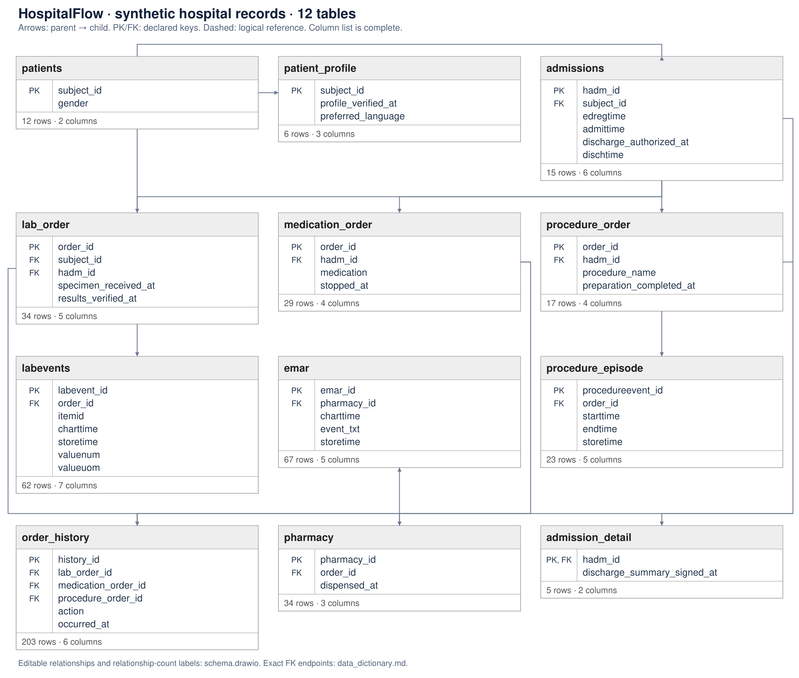</a>

<a href="../../../datasets/hospitalflow/docs/schema.png">Full-size diagram</a> · <a href="../../../datasets/hospitalflow/input/schema.sql">Full SQL schema</a>
</td></tr></table>

## H01 — Q1

For each hospital admission, extract Order Entered, Order Reviewed and Order Cancelled events.

Events: **194** · Cases with events: **15** · Activities: **3** · Edges: **8**

<table><tr><td width="50%" valign="top">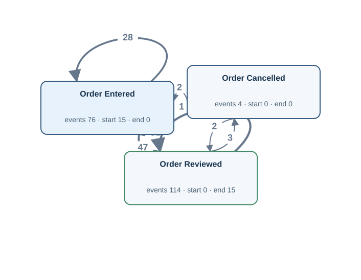</td><td width="50%" valign="top"><h4>Original tables</h4>
First 3 matched rows per table, in Gold log order. Matching uses event ID, activity and timestamp.

<strong><code>order_history</code></strong> · 194 source rows

<table><thead><tr><th>history_id</th><th>lab_order_id</th><th>medication_order_id</th><th>procedure_order_id</th><th>action</th><th>occurred_at</th><th>Gold event · timestamp column · case</th></tr></thead><tbody><tr><td>1</td><td><em>NULL</em></td><td>32064975</td><td><em>NULL</em></td><td>ENTERED</td><td>2026-01-17T17:00:00Z</td><td>OH:1 · Order Entered · occurred_at · A:20000001</td></tr><tr><td>2</td><td><em>NULL</em></td><td>32064975</td><td><em>NULL</em></td><td>REVIEWED</td><td>2026-01-17T17:22:00Z</td><td>OH:2 · Order Reviewed · occurred_at · A:20000001</td></tr><tr><td>3</td><td><em>NULL</em></td><td>32064975</td><td><em>NULL</em></td><td>REVIEWED</td><td>2026-01-17T17:39:00Z</td><td>OH:3 · Order Reviewed · occurred_at · A:20000001</td></tr></tbody></table>

FK-linked row examples for case and join context

<strong>admissions</strong>

<table><thead><tr><th>hadm_id</th><th>subject_id</th><th>edregtime</th><th>admittime</th><th>discharge_authorized_at</th><th>dischtime</th><th>Join from</th></tr></thead><tbody><tr><td>20000001</td><td>10000001</td><td>2026-01-17T13:42:00Z</td><td>2026-01-17T16:12:00Z</td><td>2026-01-19T13:33:00Z</td><td>2026-01-19T15:01:00Z</td><td>medication_order (hadm_id → hadm_id)</td></tr><tr><td>20000002</td><td>10000001</td><td><em>NULL</em></td><td>2026-01-27T13:19:00Z</td><td>2026-01-29T16:16:00Z</td><td>2026-01-29T18:54:00Z</td><td>procedure_order (hadm_id → hadm_id)</td></tr><tr><td>20000003</td><td>10000002</td><td>2026-02-03T09:01:00Z</td><td>2026-02-03T09:23:00Z</td><td>2026-02-08T17:49:00Z</td><td>2026-02-08T20:38:00Z</td><td>medication_order (hadm_id → hadm_id)</td></tr></tbody></table>

<strong>lab_order</strong>

<table><thead><tr><th>order_id</th><th>subject_id</th><th>hadm_id</th><th>specimen_received_at</th><th>results_verified_at</th><th>Join from</th></tr></thead><tbody><tr><td>31070762</td><td>10000001</td><td>20000002</td><td>2026-01-27T19:52:00Z</td><td>2026-01-28T00:32:00Z</td><td>order_history (lab_order_id → order_id)</td></tr><tr><td>31079248</td><td>10000002</td><td>20000003</td><td>2026-02-03T16:16:00Z</td><td>2026-02-03T20:48:00Z</td><td>order_history (lab_order_id → order_id)</td></tr><tr><td>31073704</td><td>10000002</td><td>20000003</td><td>2026-02-03T16:24:00Z</td><td>2026-02-03T18:34:00Z</td><td>order_history (lab_order_id → order_id)</td></tr></tbody></table>

<strong>medication_order</strong>

<table><thead><tr><th>order_id</th><th>hadm_id</th><th>medication</th><th>stopped_at</th><th>Join from</th></tr></thead><tbody><tr><td>32064975</td><td>20000001</td><td>Amoxicillin</td><td>2026-01-18T09:54:00Z</td><td>order_history (medication_order_id → order_id)</td></tr><tr><td>32028896</td><td>20000001</td><td>Acetaminophen</td><td>2026-01-18T20:48:00Z</td><td>order_history (medication_order_id → order_id)</td></tr><tr><td>32091033</td><td>20000003</td><td>Acetaminophen</td><td>2026-02-04T14:42:00Z</td><td>order_history (medication_order_id → order_id)</td></tr></tbody></table>

<strong>procedure_order</strong>

<table><thead><tr><th>order_id</th><th>hadm_id</th><th>procedure_name</th><th>preparation_completed_at</th><th>Join from</th></tr></thead><tbody><tr><td>33032683</td><td>20000002</td><td>Bronchoscopy</td><td>2026-01-27T16:50:00Z</td><td>order_history (procedure_order_id → order_id)</td></tr><tr><td>33088335</td><td>20000004</td><td>Endoscopy</td><td>2026-02-15T01:07:00Z</td><td>order_history (procedure_order_id → order_id)</td></tr><tr><td>33060273</td><td>20000004</td><td>Endoscopy</td><td><em>NULL</em></td><td>order_history (procedure_order_id → order_id)</td></tr></tbody></table>

Other tables referenced by Gold SQL

Includes case joins and branches of shared CTEs.
<ul><li><code>admission_detail</code> · discharge_summary_signed_at, hadm_id</li><li><code>admissions</code> · admittime, discharge_authorized_at, dischtime, edregtime, hadm_id, subject_id</li><li><code>emar</code> · charttime, emar_id, event_txt, pharmacy_id</li><li><code>lab_order</code> · hadm_id, order_id, results_verified_at, specimen_received_at, subject_id</li><li><code>labevents</code> · charttime, labevent_id, order_id, storetime</li><li><code>medication_order</code> · hadm_id, order_id, stopped_at</li><li><code>patient_profile</code> · profile_verified_at, subject_id</li><li><code>pharmacy</code> · dispensed_at, order_id, pharmacy_id</li><li><code>procedure_episode</code> · endtime, order_id, procedureevent_id, starttime</li><li><code>procedure_order</code> · hadm_id, order_id, preparation_completed_at</li></ul>
</td></tr></table>

[Gold CSV](../../../datasets/hospitalflow/private/gold_logs/H01.csv)

## H01P — Q2

For every hospital stay, build a timeline of when its orders were placed, checked and, if applicable, cancelled.

Events: **194** · Cases with events: **15** · Activities: **3** · Edges: **8**

<table><tr><td width="50%" valign="top"></td><td width="50%" valign="top"><h4>Original tables</h4>
First 3 matched rows per table, in Gold log order. Matching uses event ID, activity and timestamp.

<strong><code>order_history</code></strong> · 194 source rows

<table><thead><tr><th>history_id</th><th>lab_order_id</th><th>medication_order_id</th><th>procedure_order_id</th><th>action</th><th>occurred_at</th><th>Gold event · timestamp column · case</th></tr></thead><tbody><tr><td>1</td><td><em>NULL</em></td><td>32064975</td><td><em>NULL</em></td><td>ENTERED</td><td>2026-01-17T17:00:00Z</td><td>OH:1 · Order Entered · occurred_at · A:20000001</td></tr><tr><td>2</td><td><em>NULL</em></td><td>32064975</td><td><em>NULL</em></td><td>REVIEWED</td><td>2026-01-17T17:22:00Z</td><td>OH:2 · Order Reviewed · occurred_at · A:20000001</td></tr><tr><td>3</td><td><em>NULL</em></td><td>32064975</td><td><em>NULL</em></td><td>REVIEWED</td><td>2026-01-17T17:39:00Z</td><td>OH:3 · Order Reviewed · occurred_at · A:20000001</td></tr></tbody></table>

FK-linked row examples for case and join context

<strong>admissions</strong>

<table><thead><tr><th>hadm_id</th><th>subject_id</th><th>edregtime</th><th>admittime</th><th>discharge_authorized_at</th><th>dischtime</th><th>Join from</th></tr></thead><tbody><tr><td>20000001</td><td>10000001</td><td>2026-01-17T13:42:00Z</td><td>2026-01-17T16:12:00Z</td><td>2026-01-19T13:33:00Z</td><td>2026-01-19T15:01:00Z</td><td>medication_order (hadm_id → hadm_id)</td></tr><tr><td>20000002</td><td>10000001</td><td><em>NULL</em></td><td>2026-01-27T13:19:00Z</td><td>2026-01-29T16:16:00Z</td><td>2026-01-29T18:54:00Z</td><td>procedure_order (hadm_id → hadm_id)</td></tr><tr><td>20000003</td><td>10000002</td><td>2026-02-03T09:01:00Z</td><td>2026-02-03T09:23:00Z</td><td>2026-02-08T17:49:00Z</td><td>2026-02-08T20:38:00Z</td><td>medication_order (hadm_id → hadm_id)</td></tr></tbody></table>

<strong>lab_order</strong>

<table><thead><tr><th>order_id</th><th>subject_id</th><th>hadm_id</th><th>specimen_received_at</th><th>results_verified_at</th><th>Join from</th></tr></thead><tbody><tr><td>31070762</td><td>10000001</td><td>20000002</td><td>2026-01-27T19:52:00Z</td><td>2026-01-28T00:32:00Z</td><td>order_history (lab_order_id → order_id)</td></tr><tr><td>31079248</td><td>10000002</td><td>20000003</td><td>2026-02-03T16:16:00Z</td><td>2026-02-03T20:48:00Z</td><td>order_history (lab_order_id → order_id)</td></tr><tr><td>31073704</td><td>10000002</td><td>20000003</td><td>2026-02-03T16:24:00Z</td><td>2026-02-03T18:34:00Z</td><td>order_history (lab_order_id → order_id)</td></tr></tbody></table>

<strong>medication_order</strong>

<table><thead><tr><th>order_id</th><th>hadm_id</th><th>medication</th><th>stopped_at</th><th>Join from</th></tr></thead><tbody><tr><td>32064975</td><td>20000001</td><td>Amoxicillin</td><td>2026-01-18T09:54:00Z</td><td>order_history (medication_order_id → order_id)</td></tr><tr><td>32028896</td><td>20000001</td><td>Acetaminophen</td><td>2026-01-18T20:48:00Z</td><td>order_history (medication_order_id → order_id)</td></tr><tr><td>32091033</td><td>20000003</td><td>Acetaminophen</td><td>2026-02-04T14:42:00Z</td><td>order_history (medication_order_id → order_id)</td></tr></tbody></table>

<strong>procedure_order</strong>

<table><thead><tr><th>order_id</th><th>hadm_id</th><th>procedure_name</th><th>preparation_completed_at</th><th>Join from</th></tr></thead><tbody><tr><td>33032683</td><td>20000002</td><td>Bronchoscopy</td><td>2026-01-27T16:50:00Z</td><td>order_history (procedure_order_id → order_id)</td></tr><tr><td>33088335</td><td>20000004</td><td>Endoscopy</td><td>2026-02-15T01:07:00Z</td><td>order_history (procedure_order_id → order_id)</td></tr><tr><td>33060273</td><td>20000004</td><td>Endoscopy</td><td><em>NULL</em></td><td>order_history (procedure_order_id → order_id)</td></tr></tbody></table>

Other tables referenced by Gold SQL

Includes case joins and branches of shared CTEs.
<ul><li><code>admission_detail</code> · discharge_summary_signed_at, hadm_id</li><li><code>admissions</code> · admittime, discharge_authorized_at, dischtime, edregtime, hadm_id, subject_id</li><li><code>emar</code> · charttime, emar_id, event_txt, pharmacy_id</li><li><code>lab_order</code> · hadm_id, order_id, results_verified_at, specimen_received_at, subject_id</li><li><code>labevents</code> · charttime, labevent_id, order_id, storetime</li><li><code>medication_order</code> · hadm_id, order_id, stopped_at</li><li><code>patient_profile</code> · profile_verified_at, subject_id</li><li><code>pharmacy</code> · dispensed_at, order_id, pharmacy_id</li><li><code>procedure_episode</code> · endtime, order_id, procedureevent_id, starttime</li><li><code>procedure_order</code> · hadm_id, order_id, preparation_completed_at</li></ul>
</td></tr></table>

[Gold CSV](../../../datasets/hospitalflow/private/gold_logs/H01P.csv)

## H02 — Q1

For each hospital admission, extract Lab Result Available, Medication Administered and Procedure Completed events.

Events: **124** · Cases with events: **14** · Activities: **3** · Edges: **9**

<table><tr><td width="50%" valign="top">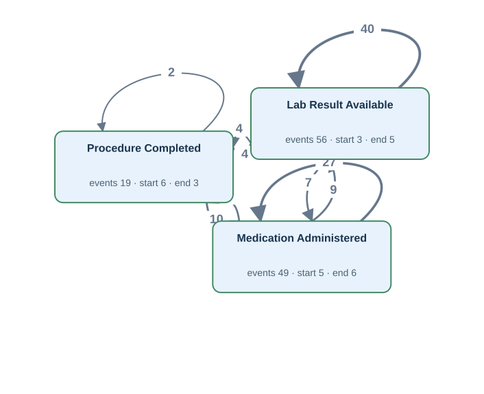</td><td width="50%" valign="top"><h4>Original tables</h4>
First 3 matched rows per table, in Gold log order. Matching uses event ID, activity and timestamp.

<strong><code>emar</code></strong> · 49 source rows

<table><thead><tr><th>emar_id</th><th>pharmacy_id</th><th>charttime</th><th>event_txt</th><th>storetime</th><th>Gold event · timestamp column · case</th></tr></thead><tbody><tr><td>1</td><td>40000001</td><td>2026-01-17T19:31:00Z</td><td>Administered</td><td>2026-01-17T20:12:00Z</td><td>EMAR:1 · Medication Administered · charttime · A:20000001</td></tr><tr><td>8</td><td>40000003</td><td>2026-01-17T23:03:00Z</td><td>Administered</td><td>2026-01-17T23:12:00Z</td><td>EMAR:8 · Medication Administered · charttime · A:20000001</td></tr><tr><td>3</td><td>40000001</td><td>2026-01-17T23:09:00Z</td><td>Administered</td><td>2026-01-17T23:56:00Z</td><td>EMAR:3 · Medication Administered · charttime · A:20000001</td></tr></tbody></table>

<strong><code>labevents</code></strong> · 56 source rows

<table><thead><tr><th>labevent_id</th><th>order_id</th><th>itemid</th><th>charttime</th><th>storetime</th><th>valuenum</th><th>valueuom</th><th>Gold event · timestamp column · case</th></tr></thead><tbody><tr><td>1</td><td>31070762</td><td>1003</td><td>2026-01-27T19:38:00Z</td><td>2026-01-27T23:09:00Z</td><td>14.6</td><td>g/dL</td><td>LABEV:1:result · Lab Result Available · storetime · A:20000002</td></tr><tr><td>4</td><td>31073704</td><td>1001</td><td>2026-02-03T15:46:00Z</td><td>2026-02-03T17:28:00Z</td><td>1.13</td><td>mg/dL</td><td>LABEV:4:result · Lab Result Available · storetime · A:20000003</td></tr><tr><td>2</td><td>31079248</td><td>1003</td><td>2026-02-03T16:09:00Z</td><td>2026-02-03T19:00:00Z</td><td>14.1</td><td>g/dL</td><td>LABEV:2:result · Lab Result Available · storetime · A:20000003</td></tr></tbody></table>

<strong><code>procedure_episode</code></strong> · 19 source rows

<table><thead><tr><th>procedureevent_id</th><th>order_id</th><th>starttime</th><th>endtime</th><th>storetime</th><th>Gold event · timestamp column · case</th></tr></thead><tbody><tr><td>1</td><td>33032683</td><td>2026-01-27T18:22:00Z</td><td>2026-01-27T19:24:00Z</td><td>2026-01-27T18:40:00Z</td><td>PROCEV:1:end · Procedure Completed · endtime · A:20000002</td></tr><tr><td>2</td><td>33088335</td><td>2026-02-15T01:42:00Z</td><td>2026-02-15T02:25:00Z</td><td>2026-02-15T02:16:00Z</td><td>PROCEV:2:end · Procedure Completed · endtime · A:20000004</td></tr><tr><td>3</td><td>33088335</td><td>2026-02-15T05:27:00Z</td><td>2026-02-15T06:34:00Z</td><td>2026-02-15T05:53:00Z</td><td>PROCEV:3:end · Procedure Completed · endtime · A:20000004</td></tr></tbody></table>

FK-linked row examples for case and join context

<strong>admissions</strong>

<table><thead><tr><th>hadm_id</th><th>subject_id</th><th>edregtime</th><th>admittime</th><th>discharge_authorized_at</th><th>dischtime</th><th>Join from</th></tr></thead><tbody><tr><td>20000002</td><td>10000001</td><td><em>NULL</em></td><td>2026-01-27T13:19:00Z</td><td>2026-01-29T16:16:00Z</td><td>2026-01-29T18:54:00Z</td><td>procedure_order (hadm_id → hadm_id)</td></tr><tr><td>20000004</td><td>10000002</td><td><em>NULL</em></td><td>2026-02-14T22:40:00Z</td><td>2026-02-19T12:53:00Z</td><td>2026-02-19T13:40:00Z</td><td>procedure_order (hadm_id → hadm_id)</td></tr><tr><td>20000005</td><td>10000003</td><td>2026-02-19T21:23:00Z</td><td>2026-02-20T00:15:00Z</td><td>2026-02-26T02:52:00Z</td><td>2026-02-26T06:10:00Z</td><td>procedure_order (hadm_id → hadm_id)</td></tr></tbody></table>

<strong>lab_order</strong>

<table><thead><tr><th>order_id</th><th>subject_id</th><th>hadm_id</th><th>specimen_received_at</th><th>results_verified_at</th><th>Join from</th></tr></thead><tbody><tr><td>31070762</td><td>10000001</td><td>20000002</td><td>2026-01-27T19:52:00Z</td><td>2026-01-28T00:32:00Z</td><td>labevents (order_id → order_id)</td></tr><tr><td>31073704</td><td>10000002</td><td>20000003</td><td>2026-02-03T16:24:00Z</td><td>2026-02-03T18:34:00Z</td><td>labevents (order_id → order_id)</td></tr><tr><td>31079248</td><td>10000002</td><td>20000003</td><td>2026-02-03T16:16:00Z</td><td>2026-02-03T20:48:00Z</td><td>labevents (order_id → order_id)</td></tr></tbody></table>

<strong>medication_order</strong>

<table><thead><tr><th>order_id</th><th>hadm_id</th><th>medication</th><th>stopped_at</th><th>Join from</th></tr></thead><tbody><tr><td>32064975</td><td>20000001</td><td>Amoxicillin</td><td>2026-01-18T09:54:00Z</td><td>pharmacy (order_id → order_id)</td></tr><tr><td>32028896</td><td>20000001</td><td>Acetaminophen</td><td>2026-01-18T20:48:00Z</td><td>pharmacy (order_id → order_id)</td></tr><tr><td>32042809</td><td>20000004</td><td>Amoxicillin</td><td>2026-02-15T13:40:00Z</td><td>pharmacy (order_id → order_id)</td></tr></tbody></table>

<strong>pharmacy</strong>

<table><thead><tr><th>pharmacy_id</th><th>order_id</th><th>dispensed_at</th><th>Join from</th></tr></thead><tbody><tr><td>40000001</td><td>32064975</td><td>2026-01-17T18:40:00Z</td><td>emar (pharmacy_id → pharmacy_id)</td></tr><tr><td>40000003</td><td>32028896</td><td>2026-01-17T19:12:00Z</td><td>emar (pharmacy_id → pharmacy_id)</td></tr><tr><td>40000002</td><td>32064975</td><td>2026-01-17T22:07:00Z</td><td>emar (pharmacy_id → pharmacy_id)</td></tr></tbody></table>

<strong>procedure_order</strong>

<table><thead><tr><th>order_id</th><th>hadm_id</th><th>procedure_name</th><th>preparation_completed_at</th><th>Join from</th></tr></thead><tbody><tr><td>33032683</td><td>20000002</td><td>Bronchoscopy</td><td>2026-01-27T16:50:00Z</td><td>procedure_episode (order_id → order_id)</td></tr><tr><td>33088335</td><td>20000004</td><td>Endoscopy</td><td>2026-02-15T01:07:00Z</td><td>procedure_episode (order_id → order_id)</td></tr><tr><td>33092897</td><td>20000005</td><td>Bronchoscopy</td><td>2026-02-20T03:02:00Z</td><td>procedure_episode (order_id → order_id)</td></tr></tbody></table>

Other tables referenced by Gold SQL

Includes case joins and branches of shared CTEs.
<ul><li><code>admission_detail</code> · discharge_summary_signed_at, hadm_id</li><li><code>admissions</code> · admittime, discharge_authorized_at, dischtime, edregtime, hadm_id, subject_id</li><li><code>lab_order</code> · hadm_id, order_id, results_verified_at, specimen_received_at, subject_id</li><li><code>medication_order</code> · hadm_id, order_id, stopped_at</li><li><code>order_history</code> · action, history_id, lab_order_id, medication_order_id, occurred_at, procedure_order_id</li><li><code>patient_profile</code> · profile_verified_at, subject_id</li><li><code>pharmacy</code> · dispensed_at, order_id, pharmacy_id</li><li><code>procedure_order</code> · hadm_id, order_id, preparation_completed_at</li></ul>
</td></tr></table>

[Gold CSV](../../../datasets/hospitalflow/private/gold_logs/H02.csv)

## H02P — Q2

For every hospital stay, show when laboratory findings became available, medicines were given and procedures finished.

Events: **124** · Cases with events: **14** · Activities: **3** · Edges: **9**

<table><tr><td width="50%" valign="top"></td><td width="50%" valign="top"><h4>Original tables</h4>
First 3 matched rows per table, in Gold log order. Matching uses event ID, activity and timestamp.

<strong><code>emar</code></strong> · 49 source rows

<table><thead><tr><th>emar_id</th><th>pharmacy_id</th><th>charttime</th><th>event_txt</th><th>storetime</th><th>Gold event · timestamp column · case</th></tr></thead><tbody><tr><td>1</td><td>40000001</td><td>2026-01-17T19:31:00Z</td><td>Administered</td><td>2026-01-17T20:12:00Z</td><td>EMAR:1 · Medication Administered · charttime · A:20000001</td></tr><tr><td>8</td><td>40000003</td><td>2026-01-17T23:03:00Z</td><td>Administered</td><td>2026-01-17T23:12:00Z</td><td>EMAR:8 · Medication Administered · charttime · A:20000001</td></tr><tr><td>3</td><td>40000001</td><td>2026-01-17T23:09:00Z</td><td>Administered</td><td>2026-01-17T23:56:00Z</td><td>EMAR:3 · Medication Administered · charttime · A:20000001</td></tr></tbody></table>

<strong><code>labevents</code></strong> · 56 source rows

<table><thead><tr><th>labevent_id</th><th>order_id</th><th>itemid</th><th>charttime</th><th>storetime</th><th>valuenum</th><th>valueuom</th><th>Gold event · timestamp column · case</th></tr></thead><tbody><tr><td>1</td><td>31070762</td><td>1003</td><td>2026-01-27T19:38:00Z</td><td>2026-01-27T23:09:00Z</td><td>14.6</td><td>g/dL</td><td>LABEV:1:result · Lab Result Available · storetime · A:20000002</td></tr><tr><td>4</td><td>31073704</td><td>1001</td><td>2026-02-03T15:46:00Z</td><td>2026-02-03T17:28:00Z</td><td>1.13</td><td>mg/dL</td><td>LABEV:4:result · Lab Result Available · storetime · A:20000003</td></tr><tr><td>2</td><td>31079248</td><td>1003</td><td>2026-02-03T16:09:00Z</td><td>2026-02-03T19:00:00Z</td><td>14.1</td><td>g/dL</td><td>LABEV:2:result · Lab Result Available · storetime · A:20000003</td></tr></tbody></table>

<strong><code>procedure_episode</code></strong> · 19 source rows

<table><thead><tr><th>procedureevent_id</th><th>order_id</th><th>starttime</th><th>endtime</th><th>storetime</th><th>Gold event · timestamp column · case</th></tr></thead><tbody><tr><td>1</td><td>33032683</td><td>2026-01-27T18:22:00Z</td><td>2026-01-27T19:24:00Z</td><td>2026-01-27T18:40:00Z</td><td>PROCEV:1:end · Procedure Completed · endtime · A:20000002</td></tr><tr><td>2</td><td>33088335</td><td>2026-02-15T01:42:00Z</td><td>2026-02-15T02:25:00Z</td><td>2026-02-15T02:16:00Z</td><td>PROCEV:2:end · Procedure Completed · endtime · A:20000004</td></tr><tr><td>3</td><td>33088335</td><td>2026-02-15T05:27:00Z</td><td>2026-02-15T06:34:00Z</td><td>2026-02-15T05:53:00Z</td><td>PROCEV:3:end · Procedure Completed · endtime · A:20000004</td></tr></tbody></table>

FK-linked row examples for case and join context

<strong>admissions</strong>

<table><thead><tr><th>hadm_id</th><th>subject_id</th><th>edregtime</th><th>admittime</th><th>discharge_authorized_at</th><th>dischtime</th><th>Join from</th></tr></thead><tbody><tr><td>20000002</td><td>10000001</td><td><em>NULL</em></td><td>2026-01-27T13:19:00Z</td><td>2026-01-29T16:16:00Z</td><td>2026-01-29T18:54:00Z</td><td>procedure_order (hadm_id → hadm_id)</td></tr><tr><td>20000004</td><td>10000002</td><td><em>NULL</em></td><td>2026-02-14T22:40:00Z</td><td>2026-02-19T12:53:00Z</td><td>2026-02-19T13:40:00Z</td><td>procedure_order (hadm_id → hadm_id)</td></tr><tr><td>20000005</td><td>10000003</td><td>2026-02-19T21:23:00Z</td><td>2026-02-20T00:15:00Z</td><td>2026-02-26T02:52:00Z</td><td>2026-02-26T06:10:00Z</td><td>procedure_order (hadm_id → hadm_id)</td></tr></tbody></table>

<strong>lab_order</strong>

<table><thead><tr><th>order_id</th><th>subject_id</th><th>hadm_id</th><th>specimen_received_at</th><th>results_verified_at</th><th>Join from</th></tr></thead><tbody><tr><td>31070762</td><td>10000001</td><td>20000002</td><td>2026-01-27T19:52:00Z</td><td>2026-01-28T00:32:00Z</td><td>labevents (order_id → order_id)</td></tr><tr><td>31073704</td><td>10000002</td><td>20000003</td><td>2026-02-03T16:24:00Z</td><td>2026-02-03T18:34:00Z</td><td>labevents (order_id → order_id)</td></tr><tr><td>31079248</td><td>10000002</td><td>20000003</td><td>2026-02-03T16:16:00Z</td><td>2026-02-03T20:48:00Z</td><td>labevents (order_id → order_id)</td></tr></tbody></table>

<strong>medication_order</strong>

<table><thead><tr><th>order_id</th><th>hadm_id</th><th>medication</th><th>stopped_at</th><th>Join from</th></tr></thead><tbody><tr><td>32064975</td><td>20000001</td><td>Amoxicillin</td><td>2026-01-18T09:54:00Z</td><td>pharmacy (order_id → order_id)</td></tr><tr><td>32028896</td><td>20000001</td><td>Acetaminophen</td><td>2026-01-18T20:48:00Z</td><td>pharmacy (order_id → order_id)</td></tr><tr><td>32042809</td><td>20000004</td><td>Amoxicillin</td><td>2026-02-15T13:40:00Z</td><td>pharmacy (order_id → order_id)</td></tr></tbody></table>

<strong>pharmacy</strong>

<table><thead><tr><th>pharmacy_id</th><th>order_id</th><th>dispensed_at</th><th>Join from</th></tr></thead><tbody><tr><td>40000001</td><td>32064975</td><td>2026-01-17T18:40:00Z</td><td>emar (pharmacy_id → pharmacy_id)</td></tr><tr><td>40000003</td><td>32028896</td><td>2026-01-17T19:12:00Z</td><td>emar (pharmacy_id → pharmacy_id)</td></tr><tr><td>40000002</td><td>32064975</td><td>2026-01-17T22:07:00Z</td><td>emar (pharmacy_id → pharmacy_id)</td></tr></tbody></table>

<strong>procedure_order</strong>

<table><thead><tr><th>order_id</th><th>hadm_id</th><th>procedure_name</th><th>preparation_completed_at</th><th>Join from</th></tr></thead><tbody><tr><td>33032683</td><td>20000002</td><td>Bronchoscopy</td><td>2026-01-27T16:50:00Z</td><td>procedure_episode (order_id → order_id)</td></tr><tr><td>33088335</td><td>20000004</td><td>Endoscopy</td><td>2026-02-15T01:07:00Z</td><td>procedure_episode (order_id → order_id)</td></tr><tr><td>33092897</td><td>20000005</td><td>Bronchoscopy</td><td>2026-02-20T03:02:00Z</td><td>procedure_episode (order_id → order_id)</td></tr></tbody></table>

Other tables referenced by Gold SQL

Includes case joins and branches of shared CTEs.
<ul><li><code>admission_detail</code> · discharge_summary_signed_at, hadm_id</li><li><code>admissions</code> · admittime, discharge_authorized_at, dischtime, edregtime, hadm_id, subject_id</li><li><code>lab_order</code> · hadm_id, order_id, results_verified_at, specimen_received_at, subject_id</li><li><code>medication_order</code> · hadm_id, order_id, stopped_at</li><li><code>order_history</code> · action, history_id, lab_order_id, medication_order_id, occurred_at, procedure_order_id</li><li><code>patient_profile</code> · profile_verified_at, subject_id</li><li><code>pharmacy</code> · dispensed_at, order_id, pharmacy_id</li><li><code>procedure_order</code> · hadm_id, order_id, preparation_completed_at</li></ul>
</td></tr></table>

[Gold CSV](../../../datasets/hospitalflow/private/gold_logs/H02P.csv)

## H03 — Q1

For each laboratory order, extract Specimen Collected, Lab Result Available and Lab Results Verified events.

Events: **154** · Cases with events: **30** · Activities: **3** · Edges: **4**

<table><tr><td width="50%" valign="top">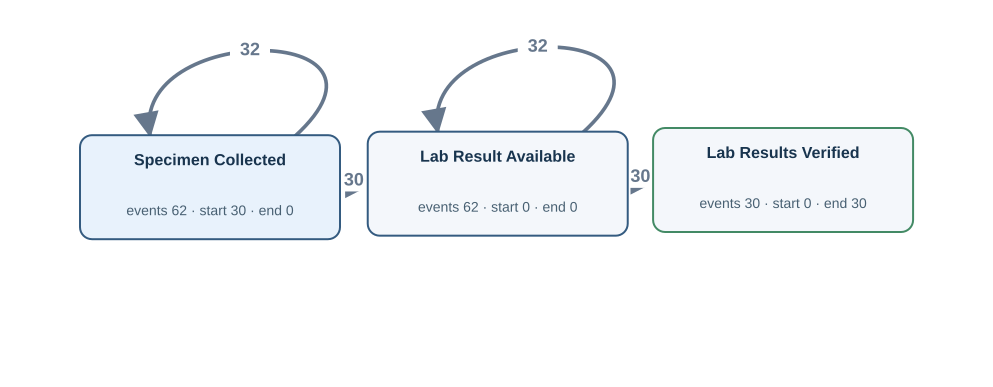</td><td width="50%" valign="top"><h4>Original tables</h4>
First 3 matched rows per table, in Gold log order. Matching uses event ID, activity and timestamp.

<strong><code>lab_order</code></strong> · 30 source rows

<table><thead><tr><th>order_id</th><th>subject_id</th><th>hadm_id</th><th>specimen_received_at</th><th>results_verified_at</th><th>Gold event · timestamp column · case</th></tr></thead><tbody><tr><td>30000117</td><td>10000005</td><td>20000009</td><td>2026-03-25T19:11:00Z</td><td>2026-03-25T20:41:00Z</td><td>LAB:30000117:verified · Lab Results Verified · results_verified_at · LAB:30000117</td></tr><tr><td>30000691</td><td>10000003</td><td>20000006</td><td>2026-03-06T10:37:00Z</td><td>2026-03-06T15:06:00Z</td><td>LAB:30000691:verified · Lab Results Verified · results_verified_at · LAB:30000691</td></tr><tr><td>30000983</td><td>10000009</td><td>20000013</td><td>2026-05-31T07:57:00Z</td><td>2026-05-31T13:32:00Z</td><td>LAB:30000983:verified · Lab Results Verified · results_verified_at · LAB:30000983</td></tr></tbody></table>

<strong><code>labevents</code></strong> · 62 source rows

<table><thead><tr><th>labevent_id</th><th>order_id</th><th>itemid</th><th>charttime</th><th>storetime</th><th>valuenum</th><th>valueuom</th><th>Gold event · timestamp column · case</th></tr></thead><tbody><tr><td>33</td><td>30000117</td><td>1003</td><td>2026-03-25T18:19:00Z</td><td>2026-03-25T19:43:00Z</td><td>14.3</td><td>g/dL</td><td>LABEV:33:chart · Specimen Collected · charttime · LAB:30000117 | LABEV:33:result · Lab Result Available · storetime · LAB:30000117</td></tr><tr><td>10</td><td>30000691</td><td>1003</td><td>2026-03-06T08:37:00Z</td><td>2026-03-06T11:15:00Z</td><td>12.5</td><td>g/dL</td><td>LABEV:10:chart · Specimen Collected · charttime · LAB:30000691 | LABEV:10:result · Lab Result Available · storetime · LAB:30000691</td></tr><tr><td>8</td><td>30000691</td><td>1001</td><td>2026-03-06T09:13:00Z</td><td>2026-03-06T13:48:00Z</td><td>1.66</td><td>mg/dL</td><td>LABEV:8:chart · Specimen Collected · charttime · LAB:30000691 | LABEV:8:result · Lab Result Available · storetime · LAB:30000691</td></tr></tbody></table>

FK-linked row examples for case and join context

<strong>admissions</strong>

<table><thead><tr><th>hadm_id</th><th>subject_id</th><th>edregtime</th><th>admittime</th><th>discharge_authorized_at</th><th>dischtime</th><th>Join from</th></tr></thead><tbody><tr><td>20000009</td><td>10000005</td><td>2026-03-25T08:39:00Z</td><td>2026-03-25T09:15:00Z</td><td>2026-04-01T14:15:00Z</td><td>2026-04-01T16:48:00Z</td><td>lab_order (hadm_id → hadm_id)</td></tr><tr><td>20000006</td><td>10000003</td><td><em>NULL</em></td><td>2026-03-06T05:26:00Z</td><td>2026-03-07T14:36:00Z</td><td>2026-03-07T17:34:00Z</td><td>lab_order (hadm_id → hadm_id)</td></tr><tr><td>20000013</td><td>10000009</td><td>2026-05-30T21:32:00Z</td><td>2026-05-31T01:02:00Z</td><td>2026-06-03T06:40:00Z</td><td>2026-06-03T09:20:00Z</td><td>lab_order (hadm_id → hadm_id)</td></tr></tbody></table>

Other tables referenced by Gold SQL

Includes case joins and branches of shared CTEs.
<ul><li><code>admission_detail</code> · discharge_summary_signed_at, hadm_id</li><li><code>admissions</code> · admittime, discharge_authorized_at, dischtime, edregtime, hadm_id</li><li><code>emar</code> · charttime, emar_id, event_txt, pharmacy_id</li><li><code>medication_order</code> · order_id, stopped_at</li><li><code>order_history</code> · action, history_id, lab_order_id, medication_order_id, occurred_at, procedure_order_id</li><li><code>patient_profile</code> · profile_verified_at, subject_id</li><li><code>pharmacy</code> · dispensed_at, order_id, pharmacy_id</li><li><code>procedure_episode</code> · endtime, order_id, procedureevent_id, starttime</li><li><code>procedure_order</code> · order_id, preparation_completed_at</li></ul>
</td></tr></table>

[Gold CSV](../../../datasets/hospitalflow/private/gold_logs/H03.csv)

## H03P — Q2

For every laboratory request, show when specimens were collected, when results became available and when those results were verified.

Events: **154** · Cases with events: **30** · Activities: **3** · Edges: **4**

<table><tr><td width="50%" valign="top"></td><td width="50%" valign="top"><h4>Original tables</h4>
First 3 matched rows per table, in Gold log order. Matching uses event ID, activity and timestamp.

<strong><code>lab_order</code></strong> · 30 source rows

<table><thead><tr><th>order_id</th><th>subject_id</th><th>hadm_id</th><th>specimen_received_at</th><th>results_verified_at</th><th>Gold event · timestamp column · case</th></tr></thead><tbody><tr><td>30000117</td><td>10000005</td><td>20000009</td><td>2026-03-25T19:11:00Z</td><td>2026-03-25T20:41:00Z</td><td>LAB:30000117:verified · Lab Results Verified · results_verified_at · LAB:30000117</td></tr><tr><td>30000691</td><td>10000003</td><td>20000006</td><td>2026-03-06T10:37:00Z</td><td>2026-03-06T15:06:00Z</td><td>LAB:30000691:verified · Lab Results Verified · results_verified_at · LAB:30000691</td></tr><tr><td>30000983</td><td>10000009</td><td>20000013</td><td>2026-05-31T07:57:00Z</td><td>2026-05-31T13:32:00Z</td><td>LAB:30000983:verified · Lab Results Verified · results_verified_at · LAB:30000983</td></tr></tbody></table>

<strong><code>labevents</code></strong> · 62 source rows

<table><thead><tr><th>labevent_id</th><th>order_id</th><th>itemid</th><th>charttime</th><th>storetime</th><th>valuenum</th><th>valueuom</th><th>Gold event · timestamp column · case</th></tr></thead><tbody><tr><td>33</td><td>30000117</td><td>1003</td><td>2026-03-25T18:19:00Z</td><td>2026-03-25T19:43:00Z</td><td>14.3</td><td>g/dL</td><td>LABEV:33:chart · Specimen Collected · charttime · LAB:30000117 | LABEV:33:result · Lab Result Available · storetime · LAB:30000117</td></tr><tr><td>10</td><td>30000691</td><td>1003</td><td>2026-03-06T08:37:00Z</td><td>2026-03-06T11:15:00Z</td><td>12.5</td><td>g/dL</td><td>LABEV:10:chart · Specimen Collected · charttime · LAB:30000691 | LABEV:10:result · Lab Result Available · storetime · LAB:30000691</td></tr><tr><td>8</td><td>30000691</td><td>1001</td><td>2026-03-06T09:13:00Z</td><td>2026-03-06T13:48:00Z</td><td>1.66</td><td>mg/dL</td><td>LABEV:8:chart · Specimen Collected · charttime · LAB:30000691 | LABEV:8:result · Lab Result Available · storetime · LAB:30000691</td></tr></tbody></table>

FK-linked row examples for case and join context

<strong>admissions</strong>

<table><thead><tr><th>hadm_id</th><th>subject_id</th><th>edregtime</th><th>admittime</th><th>discharge_authorized_at</th><th>dischtime</th><th>Join from</th></tr></thead><tbody><tr><td>20000009</td><td>10000005</td><td>2026-03-25T08:39:00Z</td><td>2026-03-25T09:15:00Z</td><td>2026-04-01T14:15:00Z</td><td>2026-04-01T16:48:00Z</td><td>lab_order (hadm_id → hadm_id)</td></tr><tr><td>20000006</td><td>10000003</td><td><em>NULL</em></td><td>2026-03-06T05:26:00Z</td><td>2026-03-07T14:36:00Z</td><td>2026-03-07T17:34:00Z</td><td>lab_order (hadm_id → hadm_id)</td></tr><tr><td>20000013</td><td>10000009</td><td>2026-05-30T21:32:00Z</td><td>2026-05-31T01:02:00Z</td><td>2026-06-03T06:40:00Z</td><td>2026-06-03T09:20:00Z</td><td>lab_order (hadm_id → hadm_id)</td></tr></tbody></table>

Other tables referenced by Gold SQL

Includes case joins and branches of shared CTEs.
<ul><li><code>admission_detail</code> · discharge_summary_signed_at, hadm_id</li><li><code>admissions</code> · admittime, discharge_authorized_at, dischtime, edregtime, hadm_id</li><li><code>emar</code> · charttime, emar_id, event_txt, pharmacy_id</li><li><code>medication_order</code> · order_id, stopped_at</li><li><code>order_history</code> · action, history_id, lab_order_id, medication_order_id, occurred_at, procedure_order_id</li><li><code>patient_profile</code> · profile_verified_at, subject_id</li><li><code>pharmacy</code> · dispensed_at, order_id, pharmacy_id</li><li><code>procedure_episode</code> · endtime, order_id, procedureevent_id, starttime</li><li><code>procedure_order</code> · order_id, preparation_completed_at</li></ul>
</td></tr></table>

[Gold CSV](../../../datasets/hospitalflow/private/gold_logs/H03P.csv)

## H04 — Q1

For each medication order, extract Medication Dispensed, Medication Administered, Medication Not Given and Medication Stopped events.

Events: **126** · Cases with events: **28** · Activities: **4** · Edges: **11**

<table><tr><td width="50%" valign="top">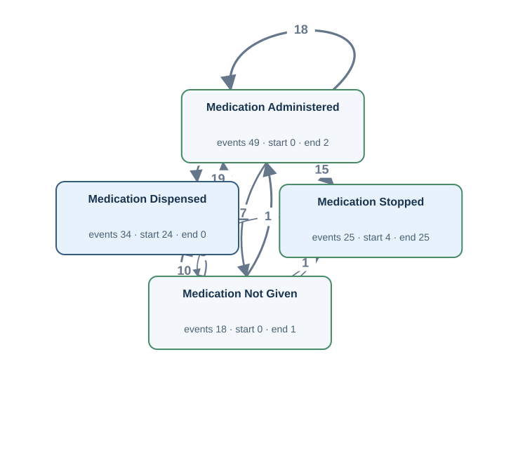</td><td width="50%" valign="top"><h4>Original tables</h4>
First 3 matched rows per table, in Gold log order. Matching uses event ID, activity and timestamp.

<strong><code>emar</code></strong> · 67 source rows

<table><thead><tr><th>emar_id</th><th>pharmacy_id</th><th>charttime</th><th>event_txt</th><th>storetime</th><th>Gold event · timestamp column · case</th></tr></thead><tbody><tr><td>20</td><td>40000009</td><td>2026-03-08T23:22:00Z</td><td>Administered</td><td>2026-03-08T23:41:00Z</td><td>EMAR:20 · Medication Administered · charttime · MED:30000691</td></tr><tr><td>23</td><td>40000010</td><td>2026-03-09T00:44:00Z</td><td>Not Given</td><td>2026-03-09T01:30:00Z</td><td>EMAR:23 · Medication Not Given · charttime · MED:30000691</td></tr><tr><td>21</td><td>40000009</td><td>2026-03-09T01:43:00Z</td><td>Not Given</td><td>2026-03-09T02:25:00Z</td><td>EMAR:21 · Medication Not Given · charttime · MED:30000691</td></tr></tbody></table>

<strong><code>medication_order</code></strong> · 25 source rows

<table><thead><tr><th>order_id</th><th>hadm_id</th><th>medication</th><th>stopped_at</th><th>Gold event · timestamp column · case</th></tr></thead><tbody><tr><td>30000117</td><td>20000010</td><td>Metformin</td><td>2026-04-11T22:04:00Z</td><td>MED:30000117:stop · Medication Stopped · stopped_at · MED:30000117</td></tr><tr><td>30000691</td><td>20000007</td><td>Omeprazole</td><td>2026-03-09T18:11:00Z</td><td>MED:30000691:stop · Medication Stopped · stopped_at · MED:30000691</td></tr><tr><td>30000983</td><td>20000013</td><td>Amoxicillin</td><td>2026-05-31T17:45:00Z</td><td>MED:30000983:stop · Medication Stopped · stopped_at · MED:30000983</td></tr></tbody></table>

<strong><code>pharmacy</code></strong> · 34 source rows

<table><thead><tr><th>pharmacy_id</th><th>order_id</th><th>dispensed_at</th><th>Gold event · timestamp column · case</th></tr></thead><tbody><tr><td>40000022</td><td>30000117</td><td>2026-04-11T06:53:00Z</td><td>PHARM:40000022:dispense · Medication Dispensed · dispensed_at · MED:30000117</td></tr><tr><td>40000009</td><td>30000691</td><td>2026-03-08T21:16:00Z</td><td>PHARM:40000009:dispense · Medication Dispensed · dispensed_at · MED:30000691</td></tr><tr><td>40000010</td><td>30000691</td><td>2026-03-08T23:40:00Z</td><td>PHARM:40000010:dispense · Medication Dispensed · dispensed_at · MED:30000691</td></tr></tbody></table>

FK-linked row examples for case and join context

<strong>admissions</strong>

<table><thead><tr><th>hadm_id</th><th>subject_id</th><th>edregtime</th><th>admittime</th><th>discharge_authorized_at</th><th>dischtime</th><th>Join from</th></tr></thead><tbody><tr><td>20000010</td><td>10000006</td><td><em>NULL</em></td><td>2026-04-11T01:01:00Z</td><td>2026-04-12T11:24:00Z</td><td>2026-04-12T13:01:00Z</td><td>medication_order (hadm_id → hadm_id)</td></tr><tr><td>20000007</td><td>10000004</td><td>2026-03-08T14:36:00Z</td><td>2026-03-08T17:59:00Z</td><td>2026-03-11T12:15:00Z</td><td>2026-03-11T13:09:00Z</td><td>medication_order (hadm_id → hadm_id)</td></tr><tr><td>20000013</td><td>10000009</td><td>2026-05-30T21:32:00Z</td><td>2026-05-31T01:02:00Z</td><td>2026-06-03T06:40:00Z</td><td>2026-06-03T09:20:00Z</td><td>medication_order (hadm_id → hadm_id)</td></tr></tbody></table>

<strong>medication_order</strong>

<table><thead><tr><th>order_id</th><th>hadm_id</th><th>medication</th><th>stopped_at</th><th>Join from</th></tr></thead><tbody><tr><td>32010923</td><td>20000014</td><td>Amoxicillin</td><td><em>NULL</em></td><td>pharmacy (order_id → order_id)</td></tr><tr><td>32034941</td><td>20000010</td><td>Metformin</td><td><em>NULL</em></td><td>pharmacy (order_id → order_id)</td></tr><tr><td>32094961</td><td>20000014</td><td>Acetaminophen</td><td><em>NULL</em></td><td>pharmacy (order_id → order_id)</td></tr></tbody></table>

Other tables referenced by Gold SQL

Includes case joins and branches of shared CTEs.
<ul><li><code>admission_detail</code> · discharge_summary_signed_at, hadm_id</li><li><code>admissions</code> · admittime, discharge_authorized_at, dischtime, edregtime, hadm_id</li><li><code>lab_order</code> · order_id, results_verified_at, specimen_received_at</li><li><code>labevents</code> · charttime, labevent_id, order_id, storetime</li><li><code>order_history</code> · action, history_id, lab_order_id, medication_order_id, occurred_at, procedure_order_id</li><li><code>patient_profile</code> · profile_verified_at, subject_id</li><li><code>procedure_episode</code> · endtime, order_id, procedureevent_id, starttime</li><li><code>procedure_order</code> · order_id, preparation_completed_at</li></ul>
</td></tr></table>

[Gold CSV](../../../datasets/hospitalflow/private/gold_logs/H04.csv)

## H04P — Q2

Create a timeline for each medication order covering dispensing, each dose given or not given, and the stopping of the medication.

Events: **126** · Cases with events: **28** · Activities: **4** · Edges: **11**

<table><tr><td width="50%" valign="top"></td><td width="50%" valign="top"><h4>Original tables</h4>
First 3 matched rows per table, in Gold log order. Matching uses event ID, activity and timestamp.

<strong><code>emar</code></strong> · 67 source rows

<table><thead><tr><th>emar_id</th><th>pharmacy_id</th><th>charttime</th><th>event_txt</th><th>storetime</th><th>Gold event · timestamp column · case</th></tr></thead><tbody><tr><td>20</td><td>40000009</td><td>2026-03-08T23:22:00Z</td><td>Administered</td><td>2026-03-08T23:41:00Z</td><td>EMAR:20 · Medication Administered · charttime · MED:30000691</td></tr><tr><td>23</td><td>40000010</td><td>2026-03-09T00:44:00Z</td><td>Not Given</td><td>2026-03-09T01:30:00Z</td><td>EMAR:23 · Medication Not Given · charttime · MED:30000691</td></tr><tr><td>21</td><td>40000009</td><td>2026-03-09T01:43:00Z</td><td>Not Given</td><td>2026-03-09T02:25:00Z</td><td>EMAR:21 · Medication Not Given · charttime · MED:30000691</td></tr></tbody></table>

<strong><code>medication_order</code></strong> · 25 source rows

<table><thead><tr><th>order_id</th><th>hadm_id</th><th>medication</th><th>stopped_at</th><th>Gold event · timestamp column · case</th></tr></thead><tbody><tr><td>30000117</td><td>20000010</td><td>Metformin</td><td>2026-04-11T22:04:00Z</td><td>MED:30000117:stop · Medication Stopped · stopped_at · MED:30000117</td></tr><tr><td>30000691</td><td>20000007</td><td>Omeprazole</td><td>2026-03-09T18:11:00Z</td><td>MED:30000691:stop · Medication Stopped · stopped_at · MED:30000691</td></tr><tr><td>30000983</td><td>20000013</td><td>Amoxicillin</td><td>2026-05-31T17:45:00Z</td><td>MED:30000983:stop · Medication Stopped · stopped_at · MED:30000983</td></tr></tbody></table>

<strong><code>pharmacy</code></strong> · 34 source rows

<table><thead><tr><th>pharmacy_id</th><th>order_id</th><th>dispensed_at</th><th>Gold event · timestamp column · case</th></tr></thead><tbody><tr><td>40000022</td><td>30000117</td><td>2026-04-11T06:53:00Z</td><td>PHARM:40000022:dispense · Medication Dispensed · dispensed_at · MED:30000117</td></tr><tr><td>40000009</td><td>30000691</td><td>2026-03-08T21:16:00Z</td><td>PHARM:40000009:dispense · Medication Dispensed · dispensed_at · MED:30000691</td></tr><tr><td>40000010</td><td>30000691</td><td>2026-03-08T23:40:00Z</td><td>PHARM:40000010:dispense · Medication Dispensed · dispensed_at · MED:30000691</td></tr></tbody></table>

FK-linked row examples for case and join context

<strong>admissions</strong>

<table><thead><tr><th>hadm_id</th><th>subject_id</th><th>edregtime</th><th>admittime</th><th>discharge_authorized_at</th><th>dischtime</th><th>Join from</th></tr></thead><tbody><tr><td>20000010</td><td>10000006</td><td><em>NULL</em></td><td>2026-04-11T01:01:00Z</td><td>2026-04-12T11:24:00Z</td><td>2026-04-12T13:01:00Z</td><td>medication_order (hadm_id → hadm_id)</td></tr><tr><td>20000007</td><td>10000004</td><td>2026-03-08T14:36:00Z</td><td>2026-03-08T17:59:00Z</td><td>2026-03-11T12:15:00Z</td><td>2026-03-11T13:09:00Z</td><td>medication_order (hadm_id → hadm_id)</td></tr><tr><td>20000013</td><td>10000009</td><td>2026-05-30T21:32:00Z</td><td>2026-05-31T01:02:00Z</td><td>2026-06-03T06:40:00Z</td><td>2026-06-03T09:20:00Z</td><td>medication_order (hadm_id → hadm_id)</td></tr></tbody></table>

<strong>medication_order</strong>

<table><thead><tr><th>order_id</th><th>hadm_id</th><th>medication</th><th>stopped_at</th><th>Join from</th></tr></thead><tbody><tr><td>32010923</td><td>20000014</td><td>Amoxicillin</td><td><em>NULL</em></td><td>pharmacy (order_id → order_id)</td></tr><tr><td>32034941</td><td>20000010</td><td>Metformin</td><td><em>NULL</em></td><td>pharmacy (order_id → order_id)</td></tr><tr><td>32094961</td><td>20000014</td><td>Acetaminophen</td><td><em>NULL</em></td><td>pharmacy (order_id → order_id)</td></tr></tbody></table>

Other tables referenced by Gold SQL

Includes case joins and branches of shared CTEs.
<ul><li><code>admission_detail</code> · discharge_summary_signed_at, hadm_id</li><li><code>admissions</code> · admittime, discharge_authorized_at, dischtime, edregtime, hadm_id</li><li><code>lab_order</code> · order_id, results_verified_at, specimen_received_at</li><li><code>labevents</code> · charttime, labevent_id, order_id, storetime</li><li><code>order_history</code> · action, history_id, lab_order_id, medication_order_id, occurred_at, procedure_order_id</li><li><code>patient_profile</code> · profile_verified_at, subject_id</li><li><code>procedure_episode</code> · endtime, order_id, procedureevent_id, starttime</li><li><code>procedure_order</code> · order_id, preparation_completed_at</li></ul>
</td></tr></table>

[Gold CSV](../../../datasets/hospitalflow/private/gold_logs/H04P.csv)

## H05 — Q1

For each procedure order, extract Procedure Preparation Completed, Procedure Started and Procedure Completed events.

Events: **55** · Cases with events: **13** · Activities: **3** · Edges: **4**

<table><tr><td width="50%" valign="top">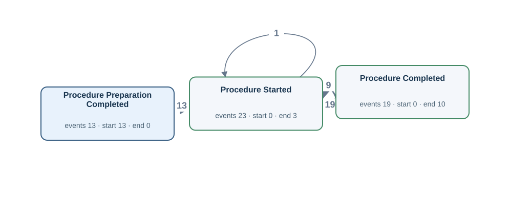</td><td width="50%" valign="top"><h4>Original tables</h4>
First 3 matched rows per table, in Gold log order. Matching uses event ID, activity and timestamp.

<strong><code>procedure_episode</code></strong> · 23 source rows

<table><thead><tr><th>procedureevent_id</th><th>order_id</th><th>starttime</th><th>endtime</th><th>storetime</th><th>Gold event · timestamp column · case</th></tr></thead><tbody><tr><td>6</td><td>30000691</td><td>2026-03-08T21:46:00Z</td><td>2026-03-08T22:28:01Z</td><td>2026-03-08T22:01:00Z</td><td>PROCEV:6:end · Procedure Completed · endtime · PROC:30000691 | PROCEV:6:start · Procedure Started · starttime · PROC:30000691</td></tr><tr><td>7</td><td>30000983</td><td>2026-03-18T21:29:00Z</td><td>2026-03-18T21:58:00Z</td><td>2026-03-18T21:58:00Z</td><td>PROCEV:7:end · Procedure Completed · endtime · PROC:30000983 | PROCEV:7:start · Procedure Started · starttime · PROC:30000983</td></tr><tr><td>23</td><td>33023112</td><td>2026-07-03T16:40:00Z</td><td><em>NULL</em></td><td>2026-07-03T17:12:00Z</td><td>PROCEV:23:start · Procedure Started · starttime · PROC:33023112</td></tr></tbody></table>

<strong><code>procedure_order</code></strong> · 13 source rows

<table><thead><tr><th>order_id</th><th>hadm_id</th><th>procedure_name</th><th>preparation_completed_at</th><th>Gold event · timestamp column · case</th></tr></thead><tbody><tr><td>30000691</td><td>20000007</td><td>Bronchoscopy</td><td>2026-03-08T20:31:00Z</td><td>PROC:30000691:prep · Procedure Preparation Completed · preparation_completed_at · PROC:30000691</td></tr><tr><td>30000983</td><td>20000008</td><td>Endoscopy</td><td>2026-03-18T20:27:00Z</td><td>PROC:30000983:prep · Procedure Preparation Completed · preparation_completed_at · PROC:30000983</td></tr><tr><td>33023112</td><td>20000015</td><td>Wound Debridement</td><td>2026-07-03T15:31:00Z</td><td>PROC:33023112:prep · Procedure Preparation Completed · preparation_completed_at · PROC:33023112</td></tr></tbody></table>

FK-linked row examples for case and join context

<strong>admissions</strong>

<table><thead><tr><th>hadm_id</th><th>subject_id</th><th>edregtime</th><th>admittime</th><th>discharge_authorized_at</th><th>dischtime</th><th>Join from</th></tr></thead><tbody><tr><td>20000007</td><td>10000004</td><td>2026-03-08T14:36:00Z</td><td>2026-03-08T17:59:00Z</td><td>2026-03-11T12:15:00Z</td><td>2026-03-11T13:09:00Z</td><td>procedure_order (hadm_id → hadm_id)</td></tr><tr><td>20000008</td><td>10000004</td><td><em>NULL</em></td><td>2026-03-18T17:20:00Z</td><td>2026-03-24T04:29:00Z</td><td>2026-03-24T06:27:00Z</td><td>procedure_order (hadm_id → hadm_id)</td></tr><tr><td>20000015</td><td>10000011</td><td>2026-07-03T08:35:00Z</td><td>2026-07-03T09:05:00Z</td><td><em>NULL</em></td><td><em>NULL</em></td><td>procedure_order (hadm_id → hadm_id)</td></tr></tbody></table>

Other tables referenced by Gold SQL

Includes case joins and branches of shared CTEs.
<ul><li><code>admission_detail</code> · discharge_summary_signed_at, hadm_id</li><li><code>admissions</code> · admittime, discharge_authorized_at, dischtime, edregtime, hadm_id</li><li><code>emar</code> · charttime, emar_id, event_txt, pharmacy_id</li><li><code>lab_order</code> · order_id, results_verified_at, specimen_received_at</li><li><code>labevents</code> · charttime, labevent_id, order_id, storetime</li><li><code>medication_order</code> · order_id, stopped_at</li><li><code>order_history</code> · action, history_id, lab_order_id, medication_order_id, occurred_at, procedure_order_id</li><li><code>patient_profile</code> · profile_verified_at, subject_id</li><li><code>pharmacy</code> · dispensed_at, order_id, pharmacy_id</li></ul>
</td></tr></table>

[Gold CSV](../../../datasets/hospitalflow/private/gold_logs/H05.csv)

## H05P — Q2

For every procedure order, show when preparation finished and when each procedure occurrence began and ended.

Events: **55** · Cases with events: **13** · Activities: **3** · Edges: **4**

<table><tr><td width="50%" valign="top"></td><td width="50%" valign="top"><h4>Original tables</h4>
First 3 matched rows per table, in Gold log order. Matching uses event ID, activity and timestamp.

<strong><code>procedure_episode</code></strong> · 23 source rows

<table><thead><tr><th>procedureevent_id</th><th>order_id</th><th>starttime</th><th>endtime</th><th>storetime</th><th>Gold event · timestamp column · case</th></tr></thead><tbody><tr><td>6</td><td>30000691</td><td>2026-03-08T21:46:00Z</td><td>2026-03-08T22:28:01Z</td><td>2026-03-08T22:01:00Z</td><td>PROCEV:6:end · Procedure Completed · endtime · PROC:30000691 | PROCEV:6:start · Procedure Started · starttime · PROC:30000691</td></tr><tr><td>7</td><td>30000983</td><td>2026-03-18T21:29:00Z</td><td>2026-03-18T21:58:00Z</td><td>2026-03-18T21:58:00Z</td><td>PROCEV:7:end · Procedure Completed · endtime · PROC:30000983 | PROCEV:7:start · Procedure Started · starttime · PROC:30000983</td></tr><tr><td>23</td><td>33023112</td><td>2026-07-03T16:40:00Z</td><td><em>NULL</em></td><td>2026-07-03T17:12:00Z</td><td>PROCEV:23:start · Procedure Started · starttime · PROC:33023112</td></tr></tbody></table>

<strong><code>procedure_order</code></strong> · 13 source rows

<table><thead><tr><th>order_id</th><th>hadm_id</th><th>procedure_name</th><th>preparation_completed_at</th><th>Gold event · timestamp column · case</th></tr></thead><tbody><tr><td>30000691</td><td>20000007</td><td>Bronchoscopy</td><td>2026-03-08T20:31:00Z</td><td>PROC:30000691:prep · Procedure Preparation Completed · preparation_completed_at · PROC:30000691</td></tr><tr><td>30000983</td><td>20000008</td><td>Endoscopy</td><td>2026-03-18T20:27:00Z</td><td>PROC:30000983:prep · Procedure Preparation Completed · preparation_completed_at · PROC:30000983</td></tr><tr><td>33023112</td><td>20000015</td><td>Wound Debridement</td><td>2026-07-03T15:31:00Z</td><td>PROC:33023112:prep · Procedure Preparation Completed · preparation_completed_at · PROC:33023112</td></tr></tbody></table>

FK-linked row examples for case and join context

<strong>admissions</strong>

<table><thead><tr><th>hadm_id</th><th>subject_id</th><th>edregtime</th><th>admittime</th><th>discharge_authorized_at</th><th>dischtime</th><th>Join from</th></tr></thead><tbody><tr><td>20000007</td><td>10000004</td><td>2026-03-08T14:36:00Z</td><td>2026-03-08T17:59:00Z</td><td>2026-03-11T12:15:00Z</td><td>2026-03-11T13:09:00Z</td><td>procedure_order (hadm_id → hadm_id)</td></tr><tr><td>20000008</td><td>10000004</td><td><em>NULL</em></td><td>2026-03-18T17:20:00Z</td><td>2026-03-24T04:29:00Z</td><td>2026-03-24T06:27:00Z</td><td>procedure_order (hadm_id → hadm_id)</td></tr><tr><td>20000015</td><td>10000011</td><td>2026-07-03T08:35:00Z</td><td>2026-07-03T09:05:00Z</td><td><em>NULL</em></td><td><em>NULL</em></td><td>procedure_order (hadm_id → hadm_id)</td></tr></tbody></table>

Other tables referenced by Gold SQL

Includes case joins and branches of shared CTEs.
<ul><li><code>admission_detail</code> · discharge_summary_signed_at, hadm_id</li><li><code>admissions</code> · admittime, discharge_authorized_at, dischtime, edregtime, hadm_id</li><li><code>emar</code> · charttime, emar_id, event_txt, pharmacy_id</li><li><code>lab_order</code> · order_id, results_verified_at, specimen_received_at</li><li><code>labevents</code> · charttime, labevent_id, order_id, storetime</li><li><code>medication_order</code> · order_id, stopped_at</li><li><code>order_history</code> · action, history_id, lab_order_id, medication_order_id, occurred_at, procedure_order_id</li><li><code>patient_profile</code> · profile_verified_at, subject_id</li><li><code>pharmacy</code> · dispensed_at, order_id, pharmacy_id</li></ul>
</td></tr></table>

[Gold CSV](../../../datasets/hospitalflow/private/gold_logs/H05P.csv)

## H06 — Q1

For each hospital admission, extract Emergency Department Registered, Hospital Admitted, Discharge Authorized and Hospital Discharged events.

Events: **49** · Cases with events: **15** · Activities: **4** · Edges: **3**

<table><tr><td width="50%" valign="top">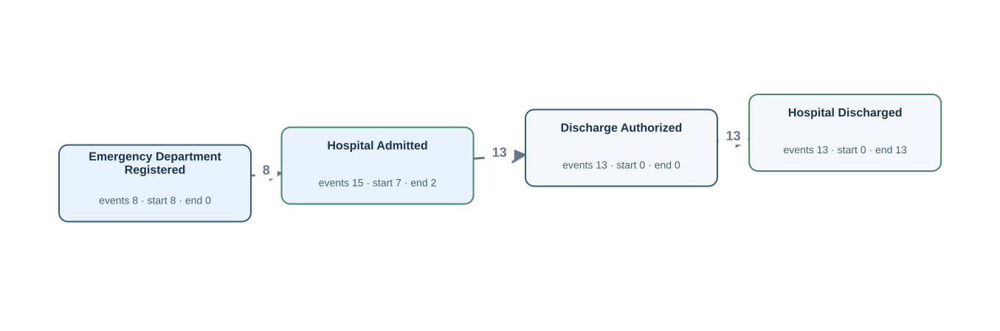</td><td width="50%" valign="top"><h4>Original tables</h4>
First 3 matched rows per table, in Gold log order. Matching uses event ID, activity and timestamp.

<strong><code>admissions</code></strong> · 15 source rows

<table><thead><tr><th>hadm_id</th><th>subject_id</th><th>edregtime</th><th>admittime</th><th>discharge_authorized_at</th><th>dischtime</th><th>Gold event · timestamp column · case</th></tr></thead><tbody><tr><td>20000001</td><td>10000001</td><td>2026-01-17T13:42:00Z</td><td>2026-01-17T16:12:00Z</td><td>2026-01-19T13:33:00Z</td><td>2026-01-19T15:01:00Z</td><td>ADM:20000001:auth · Discharge Authorized · discharge_authorized_at · A:20000001 | ADM:20000001:ed · Emergency Department Registered · edregtime · A:20000001 | ADM:20000001:in · Hospital Admitted · admittime · A:20000001 | ADM:20000001:out · Hospital Discharged · dischtime · A:20000001</td></tr><tr><td>20000002</td><td>10000001</td><td><em>NULL</em></td><td>2026-01-27T13:19:00Z</td><td>2026-01-29T16:16:00Z</td><td>2026-01-29T18:54:00Z</td><td>ADM:20000002:auth · Discharge Authorized · discharge_authorized_at · A:20000002 | ADM:20000002:in · Hospital Admitted · admittime · A:20000002 | ADM:20000002:out · Hospital Discharged · dischtime · A:20000002</td></tr><tr><td>20000003</td><td>10000002</td><td>2026-02-03T09:01:00Z</td><td>2026-02-03T09:23:00Z</td><td>2026-02-08T17:49:00Z</td><td>2026-02-08T20:38:00Z</td><td>ADM:20000003:auth · Discharge Authorized · discharge_authorized_at · A:20000003 | ADM:20000003:ed · Emergency Department Registered · edregtime · A:20000003 | ADM:20000003:in · Hospital Admitted · admittime · A:20000003 | ADM:20000003:out · Hospital Discharged · dischtime · A:20000003</td></tr></tbody></table>

Other tables referenced by Gold SQL

Includes case joins and branches of shared CTEs.
<ul><li><code>admission_detail</code> · discharge_summary_signed_at, hadm_id</li><li><code>emar</code> · charttime, emar_id, event_txt, pharmacy_id</li><li><code>lab_order</code> · hadm_id, order_id, results_verified_at, specimen_received_at, subject_id</li><li><code>labevents</code> · charttime, labevent_id, order_id, storetime</li><li><code>medication_order</code> · hadm_id, order_id, stopped_at</li><li><code>order_history</code> · action, history_id, lab_order_id, medication_order_id, occurred_at, procedure_order_id</li><li><code>patient_profile</code> · profile_verified_at, subject_id</li><li><code>pharmacy</code> · dispensed_at, order_id, pharmacy_id</li><li><code>procedure_episode</code> · endtime, order_id, procedureevent_id, starttime</li><li><code>procedure_order</code> · hadm_id, order_id, preparation_completed_at</li></ul>
</td></tr></table>

[Gold CSV](../../../datasets/hospitalflow/private/gold_logs/H06.csv)

## H06P — Q2

For every hospital stay, show arrival registration in the emergency department, admission, authorization to leave and actual discharge.

Events: **49** · Cases with events: **15** · Activities: **4** · Edges: **3**

<table><tr><td width="50%" valign="top"></td><td width="50%" valign="top"><h4>Original tables</h4>
First 3 matched rows per table, in Gold log order. Matching uses event ID, activity and timestamp.

<strong><code>admissions</code></strong> · 15 source rows

<table><thead><tr><th>hadm_id</th><th>subject_id</th><th>edregtime</th><th>admittime</th><th>discharge_authorized_at</th><th>dischtime</th><th>Gold event · timestamp column · case</th></tr></thead><tbody><tr><td>20000001</td><td>10000001</td><td>2026-01-17T13:42:00Z</td><td>2026-01-17T16:12:00Z</td><td>2026-01-19T13:33:00Z</td><td>2026-01-19T15:01:00Z</td><td>ADM:20000001:auth · Discharge Authorized · discharge_authorized_at · A:20000001 | ADM:20000001:ed · Emergency Department Registered · edregtime · A:20000001 | ADM:20000001:in · Hospital Admitted · admittime · A:20000001 | ADM:20000001:out · Hospital Discharged · dischtime · A:20000001</td></tr><tr><td>20000002</td><td>10000001</td><td><em>NULL</em></td><td>2026-01-27T13:19:00Z</td><td>2026-01-29T16:16:00Z</td><td>2026-01-29T18:54:00Z</td><td>ADM:20000002:auth · Discharge Authorized · discharge_authorized_at · A:20000002 | ADM:20000002:in · Hospital Admitted · admittime · A:20000002 | ADM:20000002:out · Hospital Discharged · dischtime · A:20000002</td></tr><tr><td>20000003</td><td>10000002</td><td>2026-02-03T09:01:00Z</td><td>2026-02-03T09:23:00Z</td><td>2026-02-08T17:49:00Z</td><td>2026-02-08T20:38:00Z</td><td>ADM:20000003:auth · Discharge Authorized · discharge_authorized_at · A:20000003 | ADM:20000003:ed · Emergency Department Registered · edregtime · A:20000003 | ADM:20000003:in · Hospital Admitted · admittime · A:20000003 | ADM:20000003:out · Hospital Discharged · dischtime · A:20000003</td></tr></tbody></table>

Other tables referenced by Gold SQL

Includes case joins and branches of shared CTEs.
<ul><li><code>admission_detail</code> · discharge_summary_signed_at, hadm_id</li><li><code>emar</code> · charttime, emar_id, event_txt, pharmacy_id</li><li><code>lab_order</code> · hadm_id, order_id, results_verified_at, specimen_received_at, subject_id</li><li><code>labevents</code> · charttime, labevent_id, order_id, storetime</li><li><code>medication_order</code> · hadm_id, order_id, stopped_at</li><li><code>order_history</code> · action, history_id, lab_order_id, medication_order_id, occurred_at, procedure_order_id</li><li><code>patient_profile</code> · profile_verified_at, subject_id</li><li><code>pharmacy</code> · dispensed_at, order_id, pharmacy_id</li><li><code>procedure_episode</code> · endtime, order_id, procedureevent_id, starttime</li><li><code>procedure_order</code> · hadm_id, order_id, preparation_completed_at</li></ul>
</td></tr></table>

[Gold CSV](../../../datasets/hospitalflow/private/gold_logs/H06P.csv)

## H07 — Q1

For each patient, extract Hospital Admitted, Lab Result Available, Medication Administered, Procedure Completed and Hospital Discharged events.

Events: **158** · Cases with events: **11** · Activities: **5** · Edges: **18**

<table><tr><td width="50%" valign="top">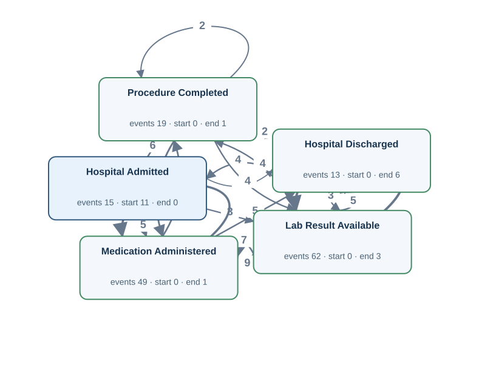</td><td width="50%" valign="top"><h4>Original tables</h4>
First 3 matched rows per table, in Gold log order. Matching uses event ID, activity and timestamp.

<strong><code>admissions</code></strong> · 15 source rows

<table><thead><tr><th>hadm_id</th><th>subject_id</th><th>edregtime</th><th>admittime</th><th>discharge_authorized_at</th><th>dischtime</th><th>Gold event · timestamp column · case</th></tr></thead><tbody><tr><td>20000001</td><td>10000001</td><td>2026-01-17T13:42:00Z</td><td>2026-01-17T16:12:00Z</td><td>2026-01-19T13:33:00Z</td><td>2026-01-19T15:01:00Z</td><td>ADM:20000001:in · Hospital Admitted · admittime · P:10000001 | ADM:20000001:out · Hospital Discharged · dischtime · P:10000001</td></tr><tr><td>20000002</td><td>10000001</td><td><em>NULL</em></td><td>2026-01-27T13:19:00Z</td><td>2026-01-29T16:16:00Z</td><td>2026-01-29T18:54:00Z</td><td>ADM:20000002:in · Hospital Admitted · admittime · P:10000001 | ADM:20000002:out · Hospital Discharged · dischtime · P:10000001</td></tr><tr><td>20000003</td><td>10000002</td><td>2026-02-03T09:01:00Z</td><td>2026-02-03T09:23:00Z</td><td>2026-02-08T17:49:00Z</td><td>2026-02-08T20:38:00Z</td><td>ADM:20000003:in · Hospital Admitted · admittime · P:10000002 | ADM:20000003:out · Hospital Discharged · dischtime · P:10000002</td></tr></tbody></table>

<strong><code>emar</code></strong> · 49 source rows

<table><thead><tr><th>emar_id</th><th>pharmacy_id</th><th>charttime</th><th>event_txt</th><th>storetime</th><th>Gold event · timestamp column · case</th></tr></thead><tbody><tr><td>1</td><td>40000001</td><td>2026-01-17T19:31:00Z</td><td>Administered</td><td>2026-01-17T20:12:00Z</td><td>EMAR:1 · Medication Administered · charttime · P:10000001</td></tr><tr><td>8</td><td>40000003</td><td>2026-01-17T23:03:00Z</td><td>Administered</td><td>2026-01-17T23:12:00Z</td><td>EMAR:8 · Medication Administered · charttime · P:10000001</td></tr><tr><td>3</td><td>40000001</td><td>2026-01-17T23:09:00Z</td><td>Administered</td><td>2026-01-17T23:56:00Z</td><td>EMAR:3 · Medication Administered · charttime · P:10000001</td></tr></tbody></table>

<strong><code>labevents</code></strong> · 62 source rows

<table><thead><tr><th>labevent_id</th><th>order_id</th><th>itemid</th><th>charttime</th><th>storetime</th><th>valuenum</th><th>valueuom</th><th>Gold event · timestamp column · case</th></tr></thead><tbody><tr><td>1</td><td>31070762</td><td>1003</td><td>2026-01-27T19:38:00Z</td><td>2026-01-27T23:09:00Z</td><td>14.6</td><td>g/dL</td><td>LABEV:1:result · Lab Result Available · storetime · P:10000001</td></tr><tr><td>57</td><td>35001904</td><td>1001</td><td>2026-07-28T12:11:00Z</td><td>2026-07-28T14:03:00Z</td><td>1.93</td><td>mg/dL</td><td>LABEV:57:result · Lab Result Available · storetime · P:10000001</td></tr><tr><td>58</td><td>35001904</td><td>1002</td><td>2026-07-28T12:11:01Z</td><td>2026-07-28T15:31:00Z</td><td>145.5</td><td>mmol/L</td><td>LABEV:58:result · Lab Result Available · storetime · P:10000001</td></tr></tbody></table>

<strong><code>procedure_episode</code></strong> · 19 source rows

<table><thead><tr><th>procedureevent_id</th><th>order_id</th><th>starttime</th><th>endtime</th><th>storetime</th><th>Gold event · timestamp column · case</th></tr></thead><tbody><tr><td>1</td><td>33032683</td><td>2026-01-27T18:22:00Z</td><td>2026-01-27T19:24:00Z</td><td>2026-01-27T18:40:00Z</td><td>PROCEV:1:end · Procedure Completed · endtime · P:10000001</td></tr><tr><td>2</td><td>33088335</td><td>2026-02-15T01:42:00Z</td><td>2026-02-15T02:25:00Z</td><td>2026-02-15T02:16:00Z</td><td>PROCEV:2:end · Procedure Completed · endtime · P:10000002</td></tr><tr><td>3</td><td>33088335</td><td>2026-02-15T05:27:00Z</td><td>2026-02-15T06:34:00Z</td><td>2026-02-15T05:53:00Z</td><td>PROCEV:3:end · Procedure Completed · endtime · P:10000002</td></tr></tbody></table>

FK-linked row examples for case and join context

<strong>lab_order</strong>

<table><thead><tr><th>order_id</th><th>subject_id</th><th>hadm_id</th><th>specimen_received_at</th><th>results_verified_at</th><th>Join from</th></tr></thead><tbody><tr><td>31070762</td><td>10000001</td><td>20000002</td><td>2026-01-27T19:52:00Z</td><td>2026-01-28T00:32:00Z</td><td>labevents (order_id → order_id)</td></tr><tr><td>35001904</td><td>10000001</td><td><em>NULL</em></td><td>2026-07-28T12:46:00Z</td><td>2026-07-28T17:38:00Z</td><td>labevents (order_id → order_id)</td></tr><tr><td>31073704</td><td>10000002</td><td>20000003</td><td>2026-02-03T16:24:00Z</td><td>2026-02-03T18:34:00Z</td><td>labevents (order_id → order_id)</td></tr></tbody></table>

<strong>medication_order</strong>

<table><thead><tr><th>order_id</th><th>hadm_id</th><th>medication</th><th>stopped_at</th><th>Join from</th></tr></thead><tbody><tr><td>32064975</td><td>20000001</td><td>Amoxicillin</td><td>2026-01-18T09:54:00Z</td><td>pharmacy (order_id → order_id)</td></tr><tr><td>32028896</td><td>20000001</td><td>Acetaminophen</td><td>2026-01-18T20:48:00Z</td><td>pharmacy (order_id → order_id)</td></tr><tr><td>32042809</td><td>20000004</td><td>Amoxicillin</td><td>2026-02-15T13:40:00Z</td><td>pharmacy (order_id → order_id)</td></tr></tbody></table>

<strong>pharmacy</strong>

<table><thead><tr><th>pharmacy_id</th><th>order_id</th><th>dispensed_at</th><th>Join from</th></tr></thead><tbody><tr><td>40000001</td><td>32064975</td><td>2026-01-17T18:40:00Z</td><td>emar (pharmacy_id → pharmacy_id)</td></tr><tr><td>40000003</td><td>32028896</td><td>2026-01-17T19:12:00Z</td><td>emar (pharmacy_id → pharmacy_id)</td></tr><tr><td>40000002</td><td>32064975</td><td>2026-01-17T22:07:00Z</td><td>emar (pharmacy_id → pharmacy_id)</td></tr></tbody></table>

<strong>procedure_order</strong>

<table><thead><tr><th>order_id</th><th>hadm_id</th><th>procedure_name</th><th>preparation_completed_at</th><th>Join from</th></tr></thead><tbody><tr><td>33032683</td><td>20000002</td><td>Bronchoscopy</td><td>2026-01-27T16:50:00Z</td><td>procedure_episode (order_id → order_id)</td></tr><tr><td>33088335</td><td>20000004</td><td>Endoscopy</td><td>2026-02-15T01:07:00Z</td><td>procedure_episode (order_id → order_id)</td></tr><tr><td>33092897</td><td>20000005</td><td>Bronchoscopy</td><td>2026-02-20T03:02:00Z</td><td>procedure_episode (order_id → order_id)</td></tr></tbody></table>

Other tables referenced by Gold SQL

Includes case joins and branches of shared CTEs.
<ul><li><code>admission_detail</code> · discharge_summary_signed_at, hadm_id</li><li><code>lab_order</code> · hadm_id, order_id, results_verified_at, specimen_received_at, subject_id</li><li><code>medication_order</code> · hadm_id, order_id, stopped_at</li><li><code>order_history</code> · action, history_id, lab_order_id, medication_order_id, occurred_at, procedure_order_id</li><li><code>patient_profile</code> · profile_verified_at, subject_id</li><li><code>pharmacy</code> · dispensed_at, order_id, pharmacy_id</li><li><code>procedure_order</code> · hadm_id, order_id, preparation_completed_at</li></ul>
</td></tr></table>

[Gold CSV](../../../datasets/hospitalflow/private/gold_logs/H07.csv)

## H07P — Q2

For each patient, collect the recorded hospital entries and departures, availability of laboratory findings, medicine administrations and finishes of procedures.

Events: **158** · Cases with events: **11** · Activities: **5** · Edges: **18**

<table><tr><td width="50%" valign="top"></td><td width="50%" valign="top"><h4>Original tables</h4>
First 3 matched rows per table, in Gold log order. Matching uses event ID, activity and timestamp.

<strong><code>admissions</code></strong> · 15 source rows

<table><thead><tr><th>hadm_id</th><th>subject_id</th><th>edregtime</th><th>admittime</th><th>discharge_authorized_at</th><th>dischtime</th><th>Gold event · timestamp column · case</th></tr></thead><tbody><tr><td>20000001</td><td>10000001</td><td>2026-01-17T13:42:00Z</td><td>2026-01-17T16:12:00Z</td><td>2026-01-19T13:33:00Z</td><td>2026-01-19T15:01:00Z</td><td>ADM:20000001:in · Hospital Admitted · admittime · P:10000001 | ADM:20000001:out · Hospital Discharged · dischtime · P:10000001</td></tr><tr><td>20000002</td><td>10000001</td><td><em>NULL</em></td><td>2026-01-27T13:19:00Z</td><td>2026-01-29T16:16:00Z</td><td>2026-01-29T18:54:00Z</td><td>ADM:20000002:in · Hospital Admitted · admittime · P:10000001 | ADM:20000002:out · Hospital Discharged · dischtime · P:10000001</td></tr><tr><td>20000003</td><td>10000002</td><td>2026-02-03T09:01:00Z</td><td>2026-02-03T09:23:00Z</td><td>2026-02-08T17:49:00Z</td><td>2026-02-08T20:38:00Z</td><td>ADM:20000003:in · Hospital Admitted · admittime · P:10000002 | ADM:20000003:out · Hospital Discharged · dischtime · P:10000002</td></tr></tbody></table>

<strong><code>emar</code></strong> · 49 source rows

<table><thead><tr><th>emar_id</th><th>pharmacy_id</th><th>charttime</th><th>event_txt</th><th>storetime</th><th>Gold event · timestamp column · case</th></tr></thead><tbody><tr><td>1</td><td>40000001</td><td>2026-01-17T19:31:00Z</td><td>Administered</td><td>2026-01-17T20:12:00Z</td><td>EMAR:1 · Medication Administered · charttime · P:10000001</td></tr><tr><td>8</td><td>40000003</td><td>2026-01-17T23:03:00Z</td><td>Administered</td><td>2026-01-17T23:12:00Z</td><td>EMAR:8 · Medication Administered · charttime · P:10000001</td></tr><tr><td>3</td><td>40000001</td><td>2026-01-17T23:09:00Z</td><td>Administered</td><td>2026-01-17T23:56:00Z</td><td>EMAR:3 · Medication Administered · charttime · P:10000001</td></tr></tbody></table>

<strong><code>labevents</code></strong> · 62 source rows

<table><thead><tr><th>labevent_id</th><th>order_id</th><th>itemid</th><th>charttime</th><th>storetime</th><th>valuenum</th><th>valueuom</th><th>Gold event · timestamp column · case</th></tr></thead><tbody><tr><td>1</td><td>31070762</td><td>1003</td><td>2026-01-27T19:38:00Z</td><td>2026-01-27T23:09:00Z</td><td>14.6</td><td>g/dL</td><td>LABEV:1:result · Lab Result Available · storetime · P:10000001</td></tr><tr><td>57</td><td>35001904</td><td>1001</td><td>2026-07-28T12:11:00Z</td><td>2026-07-28T14:03:00Z</td><td>1.93</td><td>mg/dL</td><td>LABEV:57:result · Lab Result Available · storetime · P:10000001</td></tr><tr><td>58</td><td>35001904</td><td>1002</td><td>2026-07-28T12:11:01Z</td><td>2026-07-28T15:31:00Z</td><td>145.5</td><td>mmol/L</td><td>LABEV:58:result · Lab Result Available · storetime · P:10000001</td></tr></tbody></table>

<strong><code>procedure_episode</code></strong> · 19 source rows

<table><thead><tr><th>procedureevent_id</th><th>order_id</th><th>starttime</th><th>endtime</th><th>storetime</th><th>Gold event · timestamp column · case</th></tr></thead><tbody><tr><td>1</td><td>33032683</td><td>2026-01-27T18:22:00Z</td><td>2026-01-27T19:24:00Z</td><td>2026-01-27T18:40:00Z</td><td>PROCEV:1:end · Procedure Completed · endtime · P:10000001</td></tr><tr><td>2</td><td>33088335</td><td>2026-02-15T01:42:00Z</td><td>2026-02-15T02:25:00Z</td><td>2026-02-15T02:16:00Z</td><td>PROCEV:2:end · Procedure Completed · endtime · P:10000002</td></tr><tr><td>3</td><td>33088335</td><td>2026-02-15T05:27:00Z</td><td>2026-02-15T06:34:00Z</td><td>2026-02-15T05:53:00Z</td><td>PROCEV:3:end · Procedure Completed · endtime · P:10000002</td></tr></tbody></table>

FK-linked row examples for case and join context

<strong>lab_order</strong>

<table><thead><tr><th>order_id</th><th>subject_id</th><th>hadm_id</th><th>specimen_received_at</th><th>results_verified_at</th><th>Join from</th></tr></thead><tbody><tr><td>31070762</td><td>10000001</td><td>20000002</td><td>2026-01-27T19:52:00Z</td><td>2026-01-28T00:32:00Z</td><td>labevents (order_id → order_id)</td></tr><tr><td>35001904</td><td>10000001</td><td><em>NULL</em></td><td>2026-07-28T12:46:00Z</td><td>2026-07-28T17:38:00Z</td><td>labevents (order_id → order_id)</td></tr><tr><td>31073704</td><td>10000002</td><td>20000003</td><td>2026-02-03T16:24:00Z</td><td>2026-02-03T18:34:00Z</td><td>labevents (order_id → order_id)</td></tr></tbody></table>

<strong>medication_order</strong>

<table><thead><tr><th>order_id</th><th>hadm_id</th><th>medication</th><th>stopped_at</th><th>Join from</th></tr></thead><tbody><tr><td>32064975</td><td>20000001</td><td>Amoxicillin</td><td>2026-01-18T09:54:00Z</td><td>pharmacy (order_id → order_id)</td></tr><tr><td>32028896</td><td>20000001</td><td>Acetaminophen</td><td>2026-01-18T20:48:00Z</td><td>pharmacy (order_id → order_id)</td></tr><tr><td>32042809</td><td>20000004</td><td>Amoxicillin</td><td>2026-02-15T13:40:00Z</td><td>pharmacy (order_id → order_id)</td></tr></tbody></table>

<strong>pharmacy</strong>

<table><thead><tr><th>pharmacy_id</th><th>order_id</th><th>dispensed_at</th><th>Join from</th></tr></thead><tbody><tr><td>40000001</td><td>32064975</td><td>2026-01-17T18:40:00Z</td><td>emar (pharmacy_id → pharmacy_id)</td></tr><tr><td>40000003</td><td>32028896</td><td>2026-01-17T19:12:00Z</td><td>emar (pharmacy_id → pharmacy_id)</td></tr><tr><td>40000002</td><td>32064975</td><td>2026-01-17T22:07:00Z</td><td>emar (pharmacy_id → pharmacy_id)</td></tr></tbody></table>

<strong>procedure_order</strong>

<table><thead><tr><th>order_id</th><th>hadm_id</th><th>procedure_name</th><th>preparation_completed_at</th><th>Join from</th></tr></thead><tbody><tr><td>33032683</td><td>20000002</td><td>Bronchoscopy</td><td>2026-01-27T16:50:00Z</td><td>procedure_episode (order_id → order_id)</td></tr><tr><td>33088335</td><td>20000004</td><td>Endoscopy</td><td>2026-02-15T01:07:00Z</td><td>procedure_episode (order_id → order_id)</td></tr><tr><td>33092897</td><td>20000005</td><td>Bronchoscopy</td><td>2026-02-20T03:02:00Z</td><td>procedure_episode (order_id → order_id)</td></tr></tbody></table>

Other tables referenced by Gold SQL

Includes case joins and branches of shared CTEs.
<ul><li><code>admission_detail</code> · discharge_summary_signed_at, hadm_id</li><li><code>lab_order</code> · hadm_id, order_id, results_verified_at, specimen_received_at, subject_id</li><li><code>medication_order</code> · hadm_id, order_id, stopped_at</li><li><code>order_history</code> · action, history_id, lab_order_id, medication_order_id, occurred_at, procedure_order_id</li><li><code>patient_profile</code> · profile_verified_at, subject_id</li><li><code>pharmacy</code> · dispensed_at, order_id, pharmacy_id</li><li><code>procedure_order</code> · hadm_id, order_id, preparation_completed_at</li></ul>
</td></tr></table>

[Gold CSV](../../../datasets/hospitalflow/private/gold_logs/H07P.csv)

## H08 — Q1

For each hospital admission, extract Insurance Claim Paid events.

**No Gold log:** No claim or payment records/timestamps exist in this DB; no Gold CSV is emitted.

## H08P — Q2

For each hospital stay, show when its insurance claim was settled by payment.

**No Gold log:** No claim or payment records/timestamps exist in this DB; no Gold CSV is emitted.

## HF01 — Q3

Extract the full recorded lifecycle for each patient.

Events: **628** · Cases with events: **11** · Activities: **20** · Edges: **132**

<table><tr><td width="50%" valign="top">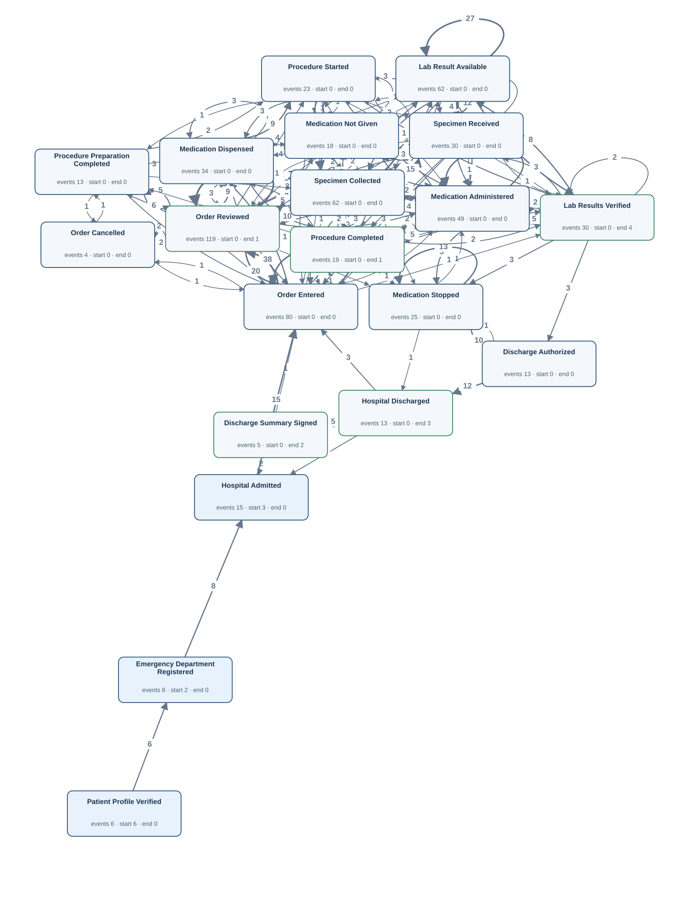</td><td width="50%" valign="top"><h4>Original tables</h4>
First 3 matched rows per table, in Gold log order. Matching uses event ID, activity and timestamp.

<strong><code>admission_detail</code></strong> · 5 source rows

<table><thead><tr><th>hadm_id</th><th>discharge_summary_signed_at</th><th>Gold event · timestamp column · case</th></tr></thead><tbody><tr><td>20000001</td><td>2026-01-19T18:13:00Z</td><td>ADM:20000001:summary · Discharge Summary Signed · discharge_summary_signed_at · P:10000001</td></tr><tr><td>20000004</td><td>2026-02-19T17:04:00Z</td><td>ADM:20000004:summary · Discharge Summary Signed · discharge_summary_signed_at · P:10000002</td></tr><tr><td>20000007</td><td>2026-03-11T15:45:00Z</td><td>ADM:20000007:summary · Discharge Summary Signed · discharge_summary_signed_at · P:10000004</td></tr></tbody></table>

<strong><code>admissions</code></strong> · 15 source rows

<table><thead><tr><th>hadm_id</th><th>subject_id</th><th>edregtime</th><th>admittime</th><th>discharge_authorized_at</th><th>dischtime</th><th>Gold event · timestamp column · case</th></tr></thead><tbody><tr><td>20000001</td><td>10000001</td><td>2026-01-17T13:42:00Z</td><td>2026-01-17T16:12:00Z</td><td>2026-01-19T13:33:00Z</td><td>2026-01-19T15:01:00Z</td><td>ADM:20000001:auth · Discharge Authorized · discharge_authorized_at · P:10000001 | ADM:20000001:ed · Emergency Department Registered · edregtime · P:10000001 | ADM:20000001:in · Hospital Admitted · admittime · P:10000001 | ADM:20000001:out · Hospital Discharged · dischtime · P:10000001</td></tr><tr><td>20000002</td><td>10000001</td><td><em>NULL</em></td><td>2026-01-27T13:19:00Z</td><td>2026-01-29T16:16:00Z</td><td>2026-01-29T18:54:00Z</td><td>ADM:20000002:auth · Discharge Authorized · discharge_authorized_at · P:10000001 | ADM:20000002:in · Hospital Admitted · admittime · P:10000001 | ADM:20000002:out · Hospital Discharged · dischtime · P:10000001</td></tr><tr><td>20000003</td><td>10000002</td><td>2026-02-03T09:01:00Z</td><td>2026-02-03T09:23:00Z</td><td>2026-02-08T17:49:00Z</td><td>2026-02-08T20:38:00Z</td><td>ADM:20000003:auth · Discharge Authorized · discharge_authorized_at · P:10000002 | ADM:20000003:ed · Emergency Department Registered · edregtime · P:10000002 | ADM:20000003:in · Hospital Admitted · admittime · P:10000002 | ADM:20000003:out · Hospital Discharged · dischtime · P:10000002</td></tr></tbody></table>

<strong><code>emar</code></strong> · 67 source rows

<table><thead><tr><th>emar_id</th><th>pharmacy_id</th><th>charttime</th><th>event_txt</th><th>storetime</th><th>Gold event · timestamp column · case</th></tr></thead><tbody><tr><td>1</td><td>40000001</td><td>2026-01-17T19:31:00Z</td><td>Administered</td><td>2026-01-17T20:12:00Z</td><td>EMAR:1 · Medication Administered · charttime · P:10000001</td></tr><tr><td>7</td><td>40000003</td><td>2026-01-17T20:59:00Z</td><td>Not Given</td><td>2026-01-17T21:21:00Z</td><td>EMAR:7 · Medication Not Given · charttime · P:10000001</td></tr><tr><td>2</td><td>40000001</td><td>2026-01-17T21:22:00Z</td><td>Not Given</td><td>2026-01-17T21:44:00Z</td><td>EMAR:2 · Medication Not Given · charttime · P:10000001</td></tr></tbody></table>

<strong><code>lab_order</code></strong> · 30 source rows

<table><thead><tr><th>order_id</th><th>subject_id</th><th>hadm_id</th><th>specimen_received_at</th><th>results_verified_at</th><th>Gold event · timestamp column · case</th></tr></thead><tbody><tr><td>31070762</td><td>10000001</td><td>20000002</td><td>2026-01-27T19:52:00Z</td><td>2026-01-28T00:32:00Z</td><td>LAB:31070762:received · Specimen Received · specimen_received_at · P:10000001 | LAB:31070762:verified · Lab Results Verified · results_verified_at · P:10000001</td></tr><tr><td>35001904</td><td>10000001</td><td><em>NULL</em></td><td>2026-07-28T12:46:00Z</td><td>2026-07-28T17:38:00Z</td><td>LAB:35001904:received · Specimen Received · specimen_received_at · P:10000001 | LAB:35001904:verified · Lab Results Verified · results_verified_at · P:10000001</td></tr><tr><td>31079248</td><td>10000002</td><td>20000003</td><td>2026-02-03T16:16:00Z</td><td>2026-02-03T20:48:00Z</td><td>LAB:31079248:received · Specimen Received · specimen_received_at · P:10000002 | LAB:31079248:verified · Lab Results Verified · results_verified_at · P:10000002</td></tr></tbody></table>

<strong><code>labevents</code></strong> · 62 source rows

<table><thead><tr><th>labevent_id</th><th>order_id</th><th>itemid</th><th>charttime</th><th>storetime</th><th>valuenum</th><th>valueuom</th><th>Gold event · timestamp column · case</th></tr></thead><tbody><tr><td>1</td><td>31070762</td><td>1003</td><td>2026-01-27T19:38:00Z</td><td>2026-01-27T23:09:00Z</td><td>14.6</td><td>g/dL</td><td>LABEV:1:chart · Specimen Collected · charttime · P:10000001 | LABEV:1:result · Lab Result Available · storetime · P:10000001</td></tr><tr><td>57</td><td>35001904</td><td>1001</td><td>2026-07-28T12:11:00Z</td><td>2026-07-28T14:03:00Z</td><td>1.93</td><td>mg/dL</td><td>LABEV:57:chart · Specimen Collected · charttime · P:10000001 | LABEV:57:result · Lab Result Available · storetime · P:10000001</td></tr><tr><td>58</td><td>35001904</td><td>1002</td><td>2026-07-28T12:11:01Z</td><td>2026-07-28T15:31:00Z</td><td>145.5</td><td>mmol/L</td><td>LABEV:58:chart · Specimen Collected · charttime · P:10000001 | LABEV:58:result · Lab Result Available · storetime · P:10000001</td></tr></tbody></table>

<strong><code>medication_order</code></strong> · 25 source rows

<table><thead><tr><th>order_id</th><th>hadm_id</th><th>medication</th><th>stopped_at</th><th>Gold event · timestamp column · case</th></tr></thead><tbody><tr><td>32064975</td><td>20000001</td><td>Amoxicillin</td><td>2026-01-18T09:54:00Z</td><td>MED:32064975:stop · Medication Stopped · stopped_at · P:10000001</td></tr><tr><td>32028896</td><td>20000001</td><td>Acetaminophen</td><td>2026-01-18T20:48:00Z</td><td>MED:32028896:stop · Medication Stopped · stopped_at · P:10000001</td></tr><tr><td>32091033</td><td>20000003</td><td>Acetaminophen</td><td>2026-02-04T14:42:00Z</td><td>MED:32091033:stop · Medication Stopped · stopped_at · P:10000002</td></tr></tbody></table>

<strong><code>order_history</code></strong> · 203 source rows

<table><thead><tr><th>history_id</th><th>lab_order_id</th><th>medication_order_id</th><th>procedure_order_id</th><th>action</th><th>occurred_at</th><th>Gold event · timestamp column · case</th></tr></thead><tbody><tr><td>1</td><td><em>NULL</em></td><td>32064975</td><td><em>NULL</em></td><td>ENTERED</td><td>2026-01-17T17:00:00Z</td><td>OH:1 · Order Entered · occurred_at · P:10000001</td></tr><tr><td>2</td><td><em>NULL</em></td><td>32064975</td><td><em>NULL</em></td><td>REVIEWED</td><td>2026-01-17T17:22:00Z</td><td>OH:2 · Order Reviewed · occurred_at · P:10000001</td></tr><tr><td>3</td><td><em>NULL</em></td><td>32064975</td><td><em>NULL</em></td><td>REVIEWED</td><td>2026-01-17T17:39:00Z</td><td>OH:3 · Order Reviewed · occurred_at · P:10000001</td></tr></tbody></table>

<strong><code>patient_profile</code></strong> · 6 source rows

<table><thead><tr><th>subject_id</th><th>profile_verified_at</th><th>preferred_language</th><th>Gold event · timestamp column · case</th></tr></thead><tbody><tr><td>10000001</td><td>2026-01-17T12:54:00Z</td><td>English</td><td>PAT:10000001:profile · Patient Profile Verified · profile_verified_at · P:10000001</td></tr><tr><td>10000003</td><td>2026-02-19T07:52:00Z</td><td>English</td><td>PAT:10000003:profile · Patient Profile Verified · profile_verified_at · P:10000003</td></tr><tr><td>10000005</td><td>2026-03-24T20:26:00Z</td><td>English</td><td>PAT:10000005:profile · Patient Profile Verified · profile_verified_at · P:10000005</td></tr></tbody></table>

<strong><code>pharmacy</code></strong> · 34 source rows

<table><thead><tr><th>pharmacy_id</th><th>order_id</th><th>dispensed_at</th><th>Gold event · timestamp column · case</th></tr></thead><tbody><tr><td>40000001</td><td>32064975</td><td>2026-01-17T18:40:00Z</td><td>PHARM:40000001:dispense · Medication Dispensed · dispensed_at · P:10000001</td></tr><tr><td>40000003</td><td>32028896</td><td>2026-01-17T19:12:00Z</td><td>PHARM:40000003:dispense · Medication Dispensed · dispensed_at · P:10000001</td></tr><tr><td>40000002</td><td>32064975</td><td>2026-01-17T22:07:00Z</td><td>PHARM:40000002:dispense · Medication Dispensed · dispensed_at · P:10000001</td></tr></tbody></table>

<strong><code>procedure_episode</code></strong> · 23 source rows

<table><thead><tr><th>procedureevent_id</th><th>order_id</th><th>starttime</th><th>endtime</th><th>storetime</th><th>Gold event · timestamp column · case</th></tr></thead><tbody><tr><td>1</td><td>33032683</td><td>2026-01-27T18:22:00Z</td><td>2026-01-27T19:24:00Z</td><td>2026-01-27T18:40:00Z</td><td>PROCEV:1:end · Procedure Completed · endtime · P:10000001 | PROCEV:1:start · Procedure Started · starttime · P:10000001</td></tr><tr><td>2</td><td>33088335</td><td>2026-02-15T01:42:00Z</td><td>2026-02-15T02:25:00Z</td><td>2026-02-15T02:16:00Z</td><td>PROCEV:2:end · Procedure Completed · endtime · P:10000002 | PROCEV:2:start · Procedure Started · starttime · P:10000002</td></tr><tr><td>3</td><td>33088335</td><td>2026-02-15T05:27:00Z</td><td>2026-02-15T06:34:00Z</td><td>2026-02-15T05:53:00Z</td><td>PROCEV:3:end · Procedure Completed · endtime · P:10000002 | PROCEV:3:start · Procedure Started · starttime · P:10000002</td></tr></tbody></table>

<strong><code>procedure_order</code></strong> · 13 source rows

<table><thead><tr><th>order_id</th><th>hadm_id</th><th>procedure_name</th><th>preparation_completed_at</th><th>Gold event · timestamp column · case</th></tr></thead><tbody><tr><td>33032683</td><td>20000002</td><td>Bronchoscopy</td><td>2026-01-27T16:50:00Z</td><td>PROC:33032683:prep · Procedure Preparation Completed · preparation_completed_at · P:10000001</td></tr><tr><td>33088335</td><td>20000004</td><td>Endoscopy</td><td>2026-02-15T01:07:00Z</td><td>PROC:33088335:prep · Procedure Preparation Completed · preparation_completed_at · P:10000002</td></tr><tr><td>33092897</td><td>20000005</td><td>Bronchoscopy</td><td>2026-02-20T03:02:00Z</td><td>PROC:33092897:prep · Procedure Preparation Completed · preparation_completed_at · P:10000003</td></tr></tbody></table>

FK-linked row examples for case and join context

<strong>lab_order</strong>

<table><thead><tr><th>order_id</th><th>subject_id</th><th>hadm_id</th><th>specimen_received_at</th><th>results_verified_at</th><th>Join from</th></tr></thead><tbody><tr><td>31073842</td><td>10000003</td><td>20000006</td><td><em>NULL</em></td><td><em>NULL</em></td><td>order_history (lab_order_id → order_id)</td></tr><tr><td>35007482</td><td>10000004</td><td><em>NULL</em></td><td><em>NULL</em></td><td><em>NULL</em></td><td>order_history (lab_order_id → order_id)</td></tr><tr><td>31097656</td><td>10000005</td><td>20000009</td><td><em>NULL</em></td><td><em>NULL</em></td><td>order_history (lab_order_id → order_id)</td></tr></tbody></table>

<strong>medication_order</strong>

<table><thead><tr><th>order_id</th><th>hadm_id</th><th>medication</th><th>stopped_at</th><th>Join from</th></tr></thead><tbody><tr><td>32034941</td><td>20000010</td><td>Metformin</td><td><em>NULL</em></td><td>order_history (medication_order_id → order_id)</td></tr><tr><td>32094961</td><td>20000014</td><td>Acetaminophen</td><td><em>NULL</em></td><td>order_history (medication_order_id → order_id)</td></tr><tr><td>32010923</td><td>20000014</td><td>Amoxicillin</td><td><em>NULL</em></td><td>order_history (medication_order_id → order_id)</td></tr></tbody></table>

<strong>procedure_order</strong>

<table><thead><tr><th>order_id</th><th>hadm_id</th><th>procedure_name</th><th>preparation_completed_at</th><th>Join from</th></tr></thead><tbody><tr><td>33060273</td><td>20000004</td><td>Endoscopy</td><td><em>NULL</em></td><td>order_history (procedure_order_id → order_id)</td></tr><tr><td>33050292</td><td>20000008</td><td>Endoscopy</td><td><em>NULL</em></td><td>order_history (procedure_order_id → order_id)</td></tr><tr><td>30000117</td><td>20000011</td><td>Wound Debridement</td><td><em>NULL</em></td><td>order_history (procedure_order_id → order_id)</td></tr></tbody></table>

</td></tr></table>

[Gold CSV](../../../datasets/hospitalflow/private/gold_logs/HF01.csv)

## HF01P — Q4

Build a complete timeline of all recorded care events for every patient.

Events: **628** · Cases with events: **11** · Activities: **20** · Edges: **132**

<table><tr><td width="50%" valign="top"></td><td width="50%" valign="top"><h4>Original tables</h4>
First 3 matched rows per table, in Gold log order. Matching uses event ID, activity and timestamp.

<strong><code>admission_detail</code></strong> · 5 source rows

<table><thead><tr><th>hadm_id</th><th>discharge_summary_signed_at</th><th>Gold event · timestamp column · case</th></tr></thead><tbody><tr><td>20000001</td><td>2026-01-19T18:13:00Z</td><td>ADM:20000001:summary · Discharge Summary Signed · discharge_summary_signed_at · P:10000001</td></tr><tr><td>20000004</td><td>2026-02-19T17:04:00Z</td><td>ADM:20000004:summary · Discharge Summary Signed · discharge_summary_signed_at · P:10000002</td></tr><tr><td>20000007</td><td>2026-03-11T15:45:00Z</td><td>ADM:20000007:summary · Discharge Summary Signed · discharge_summary_signed_at · P:10000004</td></tr></tbody></table>

<strong><code>admissions</code></strong> · 15 source rows

<table><thead><tr><th>hadm_id</th><th>subject_id</th><th>edregtime</th><th>admittime</th><th>discharge_authorized_at</th><th>dischtime</th><th>Gold event · timestamp column · case</th></tr></thead><tbody><tr><td>20000001</td><td>10000001</td><td>2026-01-17T13:42:00Z</td><td>2026-01-17T16:12:00Z</td><td>2026-01-19T13:33:00Z</td><td>2026-01-19T15:01:00Z</td><td>ADM:20000001:auth · Discharge Authorized · discharge_authorized_at · P:10000001 | ADM:20000001:ed · Emergency Department Registered · edregtime · P:10000001 | ADM:20000001:in · Hospital Admitted · admittime · P:10000001 | ADM:20000001:out · Hospital Discharged · dischtime · P:10000001</td></tr><tr><td>20000002</td><td>10000001</td><td><em>NULL</em></td><td>2026-01-27T13:19:00Z</td><td>2026-01-29T16:16:00Z</td><td>2026-01-29T18:54:00Z</td><td>ADM:20000002:auth · Discharge Authorized · discharge_authorized_at · P:10000001 | ADM:20000002:in · Hospital Admitted · admittime · P:10000001 | ADM:20000002:out · Hospital Discharged · dischtime · P:10000001</td></tr><tr><td>20000003</td><td>10000002</td><td>2026-02-03T09:01:00Z</td><td>2026-02-03T09:23:00Z</td><td>2026-02-08T17:49:00Z</td><td>2026-02-08T20:38:00Z</td><td>ADM:20000003:auth · Discharge Authorized · discharge_authorized_at · P:10000002 | ADM:20000003:ed · Emergency Department Registered · edregtime · P:10000002 | ADM:20000003:in · Hospital Admitted · admittime · P:10000002 | ADM:20000003:out · Hospital Discharged · dischtime · P:10000002</td></tr></tbody></table>

<strong><code>emar</code></strong> · 67 source rows

<table><thead><tr><th>emar_id</th><th>pharmacy_id</th><th>charttime</th><th>event_txt</th><th>storetime</th><th>Gold event · timestamp column · case</th></tr></thead><tbody><tr><td>1</td><td>40000001</td><td>2026-01-17T19:31:00Z</td><td>Administered</td><td>2026-01-17T20:12:00Z</td><td>EMAR:1 · Medication Administered · charttime · P:10000001</td></tr><tr><td>7</td><td>40000003</td><td>2026-01-17T20:59:00Z</td><td>Not Given</td><td>2026-01-17T21:21:00Z</td><td>EMAR:7 · Medication Not Given · charttime · P:10000001</td></tr><tr><td>2</td><td>40000001</td><td>2026-01-17T21:22:00Z</td><td>Not Given</td><td>2026-01-17T21:44:00Z</td><td>EMAR:2 · Medication Not Given · charttime · P:10000001</td></tr></tbody></table>

<strong><code>lab_order</code></strong> · 30 source rows

<table><thead><tr><th>order_id</th><th>subject_id</th><th>hadm_id</th><th>specimen_received_at</th><th>results_verified_at</th><th>Gold event · timestamp column · case</th></tr></thead><tbody><tr><td>31070762</td><td>10000001</td><td>20000002</td><td>2026-01-27T19:52:00Z</td><td>2026-01-28T00:32:00Z</td><td>LAB:31070762:received · Specimen Received · specimen_received_at · P:10000001 | LAB:31070762:verified · Lab Results Verified · results_verified_at · P:10000001</td></tr><tr><td>35001904</td><td>10000001</td><td><em>NULL</em></td><td>2026-07-28T12:46:00Z</td><td>2026-07-28T17:38:00Z</td><td>LAB:35001904:received · Specimen Received · specimen_received_at · P:10000001 | LAB:35001904:verified · Lab Results Verified · results_verified_at · P:10000001</td></tr><tr><td>31079248</td><td>10000002</td><td>20000003</td><td>2026-02-03T16:16:00Z</td><td>2026-02-03T20:48:00Z</td><td>LAB:31079248:received · Specimen Received · specimen_received_at · P:10000002 | LAB:31079248:verified · Lab Results Verified · results_verified_at · P:10000002</td></tr></tbody></table>

<strong><code>labevents</code></strong> · 62 source rows

<table><thead><tr><th>labevent_id</th><th>order_id</th><th>itemid</th><th>charttime</th><th>storetime</th><th>valuenum</th><th>valueuom</th><th>Gold event · timestamp column · case</th></tr></thead><tbody><tr><td>1</td><td>31070762</td><td>1003</td><td>2026-01-27T19:38:00Z</td><td>2026-01-27T23:09:00Z</td><td>14.6</td><td>g/dL</td><td>LABEV:1:chart · Specimen Collected · charttime · P:10000001 | LABEV:1:result · Lab Result Available · storetime · P:10000001</td></tr><tr><td>57</td><td>35001904</td><td>1001</td><td>2026-07-28T12:11:00Z</td><td>2026-07-28T14:03:00Z</td><td>1.93</td><td>mg/dL</td><td>LABEV:57:chart · Specimen Collected · charttime · P:10000001 | LABEV:57:result · Lab Result Available · storetime · P:10000001</td></tr><tr><td>58</td><td>35001904</td><td>1002</td><td>2026-07-28T12:11:01Z</td><td>2026-07-28T15:31:00Z</td><td>145.5</td><td>mmol/L</td><td>LABEV:58:chart · Specimen Collected · charttime · P:10000001 | LABEV:58:result · Lab Result Available · storetime · P:10000001</td></tr></tbody></table>

<strong><code>medication_order</code></strong> · 25 source rows

<table><thead><tr><th>order_id</th><th>hadm_id</th><th>medication</th><th>stopped_at</th><th>Gold event · timestamp column · case</th></tr></thead><tbody><tr><td>32064975</td><td>20000001</td><td>Amoxicillin</td><td>2026-01-18T09:54:00Z</td><td>MED:32064975:stop · Medication Stopped · stopped_at · P:10000001</td></tr><tr><td>32028896</td><td>20000001</td><td>Acetaminophen</td><td>2026-01-18T20:48:00Z</td><td>MED:32028896:stop · Medication Stopped · stopped_at · P:10000001</td></tr><tr><td>32091033</td><td>20000003</td><td>Acetaminophen</td><td>2026-02-04T14:42:00Z</td><td>MED:32091033:stop · Medication Stopped · stopped_at · P:10000002</td></tr></tbody></table>

<strong><code>order_history</code></strong> · 203 source rows

<table><thead><tr><th>history_id</th><th>lab_order_id</th><th>medication_order_id</th><th>procedure_order_id</th><th>action</th><th>occurred_at</th><th>Gold event · timestamp column · case</th></tr></thead><tbody><tr><td>1</td><td><em>NULL</em></td><td>32064975</td><td><em>NULL</em></td><td>ENTERED</td><td>2026-01-17T17:00:00Z</td><td>OH:1 · Order Entered · occurred_at · P:10000001</td></tr><tr><td>2</td><td><em>NULL</em></td><td>32064975</td><td><em>NULL</em></td><td>REVIEWED</td><td>2026-01-17T17:22:00Z</td><td>OH:2 · Order Reviewed · occurred_at · P:10000001</td></tr><tr><td>3</td><td><em>NULL</em></td><td>32064975</td><td><em>NULL</em></td><td>REVIEWED</td><td>2026-01-17T17:39:00Z</td><td>OH:3 · Order Reviewed · occurred_at · P:10000001</td></tr></tbody></table>

<strong><code>patient_profile</code></strong> · 6 source rows

<table><thead><tr><th>subject_id</th><th>profile_verified_at</th><th>preferred_language</th><th>Gold event · timestamp column · case</th></tr></thead><tbody><tr><td>10000001</td><td>2026-01-17T12:54:00Z</td><td>English</td><td>PAT:10000001:profile · Patient Profile Verified · profile_verified_at · P:10000001</td></tr><tr><td>10000003</td><td>2026-02-19T07:52:00Z</td><td>English</td><td>PAT:10000003:profile · Patient Profile Verified · profile_verified_at · P:10000003</td></tr><tr><td>10000005</td><td>2026-03-24T20:26:00Z</td><td>English</td><td>PAT:10000005:profile · Patient Profile Verified · profile_verified_at · P:10000005</td></tr></tbody></table>

<strong><code>pharmacy</code></strong> · 34 source rows

<table><thead><tr><th>pharmacy_id</th><th>order_id</th><th>dispensed_at</th><th>Gold event · timestamp column · case</th></tr></thead><tbody><tr><td>40000001</td><td>32064975</td><td>2026-01-17T18:40:00Z</td><td>PHARM:40000001:dispense · Medication Dispensed · dispensed_at · P:10000001</td></tr><tr><td>40000003</td><td>32028896</td><td>2026-01-17T19:12:00Z</td><td>PHARM:40000003:dispense · Medication Dispensed · dispensed_at · P:10000001</td></tr><tr><td>40000002</td><td>32064975</td><td>2026-01-17T22:07:00Z</td><td>PHARM:40000002:dispense · Medication Dispensed · dispensed_at · P:10000001</td></tr></tbody></table>

<strong><code>procedure_episode</code></strong> · 23 source rows

<table><thead><tr><th>procedureevent_id</th><th>order_id</th><th>starttime</th><th>endtime</th><th>storetime</th><th>Gold event · timestamp column · case</th></tr></thead><tbody><tr><td>1</td><td>33032683</td><td>2026-01-27T18:22:00Z</td><td>2026-01-27T19:24:00Z</td><td>2026-01-27T18:40:00Z</td><td>PROCEV:1:end · Procedure Completed · endtime · P:10000001 | PROCEV:1:start · Procedure Started · starttime · P:10000001</td></tr><tr><td>2</td><td>33088335</td><td>2026-02-15T01:42:00Z</td><td>2026-02-15T02:25:00Z</td><td>2026-02-15T02:16:00Z</td><td>PROCEV:2:end · Procedure Completed · endtime · P:10000002 | PROCEV:2:start · Procedure Started · starttime · P:10000002</td></tr><tr><td>3</td><td>33088335</td><td>2026-02-15T05:27:00Z</td><td>2026-02-15T06:34:00Z</td><td>2026-02-15T05:53:00Z</td><td>PROCEV:3:end · Procedure Completed · endtime · P:10000002 | PROCEV:3:start · Procedure Started · starttime · P:10000002</td></tr></tbody></table>

<strong><code>procedure_order</code></strong> · 13 source rows

<table><thead><tr><th>order_id</th><th>hadm_id</th><th>procedure_name</th><th>preparation_completed_at</th><th>Gold event · timestamp column · case</th></tr></thead><tbody><tr><td>33032683</td><td>20000002</td><td>Bronchoscopy</td><td>2026-01-27T16:50:00Z</td><td>PROC:33032683:prep · Procedure Preparation Completed · preparation_completed_at · P:10000001</td></tr><tr><td>33088335</td><td>20000004</td><td>Endoscopy</td><td>2026-02-15T01:07:00Z</td><td>PROC:33088335:prep · Procedure Preparation Completed · preparation_completed_at · P:10000002</td></tr><tr><td>33092897</td><td>20000005</td><td>Bronchoscopy</td><td>2026-02-20T03:02:00Z</td><td>PROC:33092897:prep · Procedure Preparation Completed · preparation_completed_at · P:10000003</td></tr></tbody></table>

FK-linked row examples for case and join context

<strong>lab_order</strong>

<table><thead><tr><th>order_id</th><th>subject_id</th><th>hadm_id</th><th>specimen_received_at</th><th>results_verified_at</th><th>Join from</th></tr></thead><tbody><tr><td>31073842</td><td>10000003</td><td>20000006</td><td><em>NULL</em></td><td><em>NULL</em></td><td>order_history (lab_order_id → order_id)</td></tr><tr><td>35007482</td><td>10000004</td><td><em>NULL</em></td><td><em>NULL</em></td><td><em>NULL</em></td><td>order_history (lab_order_id → order_id)</td></tr><tr><td>31097656</td><td>10000005</td><td>20000009</td><td><em>NULL</em></td><td><em>NULL</em></td><td>order_history (lab_order_id → order_id)</td></tr></tbody></table>

<strong>medication_order</strong>

<table><thead><tr><th>order_id</th><th>hadm_id</th><th>medication</th><th>stopped_at</th><th>Join from</th></tr></thead><tbody><tr><td>32034941</td><td>20000010</td><td>Metformin</td><td><em>NULL</em></td><td>order_history (medication_order_id → order_id)</td></tr><tr><td>32094961</td><td>20000014</td><td>Acetaminophen</td><td><em>NULL</em></td><td>order_history (medication_order_id → order_id)</td></tr><tr><td>32010923</td><td>20000014</td><td>Amoxicillin</td><td><em>NULL</em></td><td>order_history (medication_order_id → order_id)</td></tr></tbody></table>

<strong>procedure_order</strong>

<table><thead><tr><th>order_id</th><th>hadm_id</th><th>procedure_name</th><th>preparation_completed_at</th><th>Join from</th></tr></thead><tbody><tr><td>33060273</td><td>20000004</td><td>Endoscopy</td><td><em>NULL</em></td><td>order_history (procedure_order_id → order_id)</td></tr><tr><td>33050292</td><td>20000008</td><td>Endoscopy</td><td><em>NULL</em></td><td>order_history (procedure_order_id → order_id)</td></tr><tr><td>30000117</td><td>20000011</td><td>Wound Debridement</td><td><em>NULL</em></td><td>order_history (procedure_order_id → order_id)</td></tr></tbody></table>

</td></tr></table>

[Gold CSV](../../../datasets/hospitalflow/private/gold_logs/HF01P.csv)

## HF02 — Q3

Extract the full recorded lifecycle for each hospital admission.

Events: **595** · Cases with events: **15** · Activities: **19** · Edges: **127**

<table><tr><td width="50%" valign="top">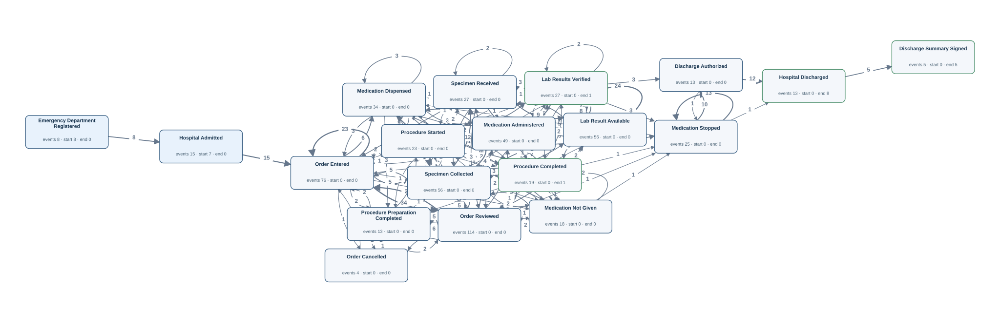</td><td width="50%" valign="top"><h4>Original tables</h4>
First 3 matched rows per table, in Gold log order. Matching uses event ID, activity and timestamp.

<strong><code>admission_detail</code></strong> · 5 source rows

<table><thead><tr><th>hadm_id</th><th>discharge_summary_signed_at</th><th>Gold event · timestamp column · case</th></tr></thead><tbody><tr><td>20000001</td><td>2026-01-19T18:13:00Z</td><td>ADM:20000001:summary · Discharge Summary Signed · discharge_summary_signed_at · A:20000001</td></tr><tr><td>20000004</td><td>2026-02-19T17:04:00Z</td><td>ADM:20000004:summary · Discharge Summary Signed · discharge_summary_signed_at · A:20000004</td></tr><tr><td>20000007</td><td>2026-03-11T15:45:00Z</td><td>ADM:20000007:summary · Discharge Summary Signed · discharge_summary_signed_at · A:20000007</td></tr></tbody></table>

<strong><code>admissions</code></strong> · 15 source rows

<table><thead><tr><th>hadm_id</th><th>subject_id</th><th>edregtime</th><th>admittime</th><th>discharge_authorized_at</th><th>dischtime</th><th>Gold event · timestamp column · case</th></tr></thead><tbody><tr><td>20000001</td><td>10000001</td><td>2026-01-17T13:42:00Z</td><td>2026-01-17T16:12:00Z</td><td>2026-01-19T13:33:00Z</td><td>2026-01-19T15:01:00Z</td><td>ADM:20000001:auth · Discharge Authorized · discharge_authorized_at · A:20000001 | ADM:20000001:ed · Emergency Department Registered · edregtime · A:20000001 | ADM:20000001:in · Hospital Admitted · admittime · A:20000001 | ADM:20000001:out · Hospital Discharged · dischtime · A:20000001</td></tr><tr><td>20000002</td><td>10000001</td><td><em>NULL</em></td><td>2026-01-27T13:19:00Z</td><td>2026-01-29T16:16:00Z</td><td>2026-01-29T18:54:00Z</td><td>ADM:20000002:auth · Discharge Authorized · discharge_authorized_at · A:20000002 | ADM:20000002:in · Hospital Admitted · admittime · A:20000002 | ADM:20000002:out · Hospital Discharged · dischtime · A:20000002</td></tr><tr><td>20000003</td><td>10000002</td><td>2026-02-03T09:01:00Z</td><td>2026-02-03T09:23:00Z</td><td>2026-02-08T17:49:00Z</td><td>2026-02-08T20:38:00Z</td><td>ADM:20000003:auth · Discharge Authorized · discharge_authorized_at · A:20000003 | ADM:20000003:ed · Emergency Department Registered · edregtime · A:20000003 | ADM:20000003:in · Hospital Admitted · admittime · A:20000003 | ADM:20000003:out · Hospital Discharged · dischtime · A:20000003</td></tr></tbody></table>

<strong><code>emar</code></strong> · 67 source rows

<table><thead><tr><th>emar_id</th><th>pharmacy_id</th><th>charttime</th><th>event_txt</th><th>storetime</th><th>Gold event · timestamp column · case</th></tr></thead><tbody><tr><td>1</td><td>40000001</td><td>2026-01-17T19:31:00Z</td><td>Administered</td><td>2026-01-17T20:12:00Z</td><td>EMAR:1 · Medication Administered · charttime · A:20000001</td></tr><tr><td>7</td><td>40000003</td><td>2026-01-17T20:59:00Z</td><td>Not Given</td><td>2026-01-17T21:21:00Z</td><td>EMAR:7 · Medication Not Given · charttime · A:20000001</td></tr><tr><td>2</td><td>40000001</td><td>2026-01-17T21:22:00Z</td><td>Not Given</td><td>2026-01-17T21:44:00Z</td><td>EMAR:2 · Medication Not Given · charttime · A:20000001</td></tr></tbody></table>

<strong><code>lab_order</code></strong> · 27 source rows

<table><thead><tr><th>order_id</th><th>subject_id</th><th>hadm_id</th><th>specimen_received_at</th><th>results_verified_at</th><th>Gold event · timestamp column · case</th></tr></thead><tbody><tr><td>31070762</td><td>10000001</td><td>20000002</td><td>2026-01-27T19:52:00Z</td><td>2026-01-28T00:32:00Z</td><td>LAB:31070762:received · Specimen Received · specimen_received_at · A:20000002 | LAB:31070762:verified · Lab Results Verified · results_verified_at · A:20000002</td></tr><tr><td>31079248</td><td>10000002</td><td>20000003</td><td>2026-02-03T16:16:00Z</td><td>2026-02-03T20:48:00Z</td><td>LAB:31079248:received · Specimen Received · specimen_received_at · A:20000003 | LAB:31079248:verified · Lab Results Verified · results_verified_at · A:20000003</td></tr><tr><td>31073704</td><td>10000002</td><td>20000003</td><td>2026-02-03T16:24:00Z</td><td>2026-02-03T18:34:00Z</td><td>LAB:31073704:received · Specimen Received · specimen_received_at · A:20000003 | LAB:31073704:verified · Lab Results Verified · results_verified_at · A:20000003</td></tr></tbody></table>

<strong><code>labevents</code></strong> · 56 source rows

<table><thead><tr><th>labevent_id</th><th>order_id</th><th>itemid</th><th>charttime</th><th>storetime</th><th>valuenum</th><th>valueuom</th><th>Gold event · timestamp column · case</th></tr></thead><tbody><tr><td>1</td><td>31070762</td><td>1003</td><td>2026-01-27T19:38:00Z</td><td>2026-01-27T23:09:00Z</td><td>14.6</td><td>g/dL</td><td>LABEV:1:chart · Specimen Collected · charttime · A:20000002 | LABEV:1:result · Lab Result Available · storetime · A:20000002</td></tr><tr><td>3</td><td>31079248</td><td>1002</td><td>2026-02-03T15:16:00Z</td><td>2026-02-03T19:38:00Z</td><td>141.8</td><td>mmol/L</td><td>LABEV:3:chart · Specimen Collected · charttime · A:20000003 | LABEV:3:result · Lab Result Available · storetime · A:20000003</td></tr><tr><td>4</td><td>31073704</td><td>1001</td><td>2026-02-03T15:46:00Z</td><td>2026-02-03T17:28:00Z</td><td>1.13</td><td>mg/dL</td><td>LABEV:4:chart · Specimen Collected · charttime · A:20000003 | LABEV:4:result · Lab Result Available · storetime · A:20000003</td></tr></tbody></table>

<strong><code>medication_order</code></strong> · 25 source rows

<table><thead><tr><th>order_id</th><th>hadm_id</th><th>medication</th><th>stopped_at</th><th>Gold event · timestamp column · case</th></tr></thead><tbody><tr><td>32064975</td><td>20000001</td><td>Amoxicillin</td><td>2026-01-18T09:54:00Z</td><td>MED:32064975:stop · Medication Stopped · stopped_at · A:20000001</td></tr><tr><td>32028896</td><td>20000001</td><td>Acetaminophen</td><td>2026-01-18T20:48:00Z</td><td>MED:32028896:stop · Medication Stopped · stopped_at · A:20000001</td></tr><tr><td>32091033</td><td>20000003</td><td>Acetaminophen</td><td>2026-02-04T14:42:00Z</td><td>MED:32091033:stop · Medication Stopped · stopped_at · A:20000003</td></tr></tbody></table>

<strong><code>order_history</code></strong> · 194 source rows

<table><thead><tr><th>history_id</th><th>lab_order_id</th><th>medication_order_id</th><th>procedure_order_id</th><th>action</th><th>occurred_at</th><th>Gold event · timestamp column · case</th></tr></thead><tbody><tr><td>1</td><td><em>NULL</em></td><td>32064975</td><td><em>NULL</em></td><td>ENTERED</td><td>2026-01-17T17:00:00Z</td><td>OH:1 · Order Entered · occurred_at · A:20000001</td></tr><tr><td>2</td><td><em>NULL</em></td><td>32064975</td><td><em>NULL</em></td><td>REVIEWED</td><td>2026-01-17T17:22:00Z</td><td>OH:2 · Order Reviewed · occurred_at · A:20000001</td></tr><tr><td>3</td><td><em>NULL</em></td><td>32064975</td><td><em>NULL</em></td><td>REVIEWED</td><td>2026-01-17T17:39:00Z</td><td>OH:3 · Order Reviewed · occurred_at · A:20000001</td></tr></tbody></table>

<strong><code>pharmacy</code></strong> · 34 source rows

<table><thead><tr><th>pharmacy_id</th><th>order_id</th><th>dispensed_at</th><th>Gold event · timestamp column · case</th></tr></thead><tbody><tr><td>40000001</td><td>32064975</td><td>2026-01-17T18:40:00Z</td><td>PHARM:40000001:dispense · Medication Dispensed · dispensed_at · A:20000001</td></tr><tr><td>40000003</td><td>32028896</td><td>2026-01-17T19:12:00Z</td><td>PHARM:40000003:dispense · Medication Dispensed · dispensed_at · A:20000001</td></tr><tr><td>40000002</td><td>32064975</td><td>2026-01-17T22:07:00Z</td><td>PHARM:40000002:dispense · Medication Dispensed · dispensed_at · A:20000001</td></tr></tbody></table>

<strong><code>procedure_episode</code></strong> · 23 source rows

<table><thead><tr><th>procedureevent_id</th><th>order_id</th><th>starttime</th><th>endtime</th><th>storetime</th><th>Gold event · timestamp column · case</th></tr></thead><tbody><tr><td>1</td><td>33032683</td><td>2026-01-27T18:22:00Z</td><td>2026-01-27T19:24:00Z</td><td>2026-01-27T18:40:00Z</td><td>PROCEV:1:end · Procedure Completed · endtime · A:20000002 | PROCEV:1:start · Procedure Started · starttime · A:20000002</td></tr><tr><td>2</td><td>33088335</td><td>2026-02-15T01:42:00Z</td><td>2026-02-15T02:25:00Z</td><td>2026-02-15T02:16:00Z</td><td>PROCEV:2:end · Procedure Completed · endtime · A:20000004 | PROCEV:2:start · Procedure Started · starttime · A:20000004</td></tr><tr><td>3</td><td>33088335</td><td>2026-02-15T05:27:00Z</td><td>2026-02-15T06:34:00Z</td><td>2026-02-15T05:53:00Z</td><td>PROCEV:3:end · Procedure Completed · endtime · A:20000004 | PROCEV:3:start · Procedure Started · starttime · A:20000004</td></tr></tbody></table>

<strong><code>procedure_order</code></strong> · 13 source rows

<table><thead><tr><th>order_id</th><th>hadm_id</th><th>procedure_name</th><th>preparation_completed_at</th><th>Gold event · timestamp column · case</th></tr></thead><tbody><tr><td>33032683</td><td>20000002</td><td>Bronchoscopy</td><td>2026-01-27T16:50:00Z</td><td>PROC:33032683:prep · Procedure Preparation Completed · preparation_completed_at · A:20000002</td></tr><tr><td>33088335</td><td>20000004</td><td>Endoscopy</td><td>2026-02-15T01:07:00Z</td><td>PROC:33088335:prep · Procedure Preparation Completed · preparation_completed_at · A:20000004</td></tr><tr><td>33092897</td><td>20000005</td><td>Bronchoscopy</td><td>2026-02-20T03:02:00Z</td><td>PROC:33092897:prep · Procedure Preparation Completed · preparation_completed_at · A:20000005</td></tr></tbody></table>

FK-linked row examples for case and join context

<strong>lab_order</strong>

<table><thead><tr><th>order_id</th><th>subject_id</th><th>hadm_id</th><th>specimen_received_at</th><th>results_verified_at</th><th>Join from</th></tr></thead><tbody><tr><td>31073842</td><td>10000003</td><td>20000006</td><td><em>NULL</em></td><td><em>NULL</em></td><td>order_history (lab_order_id → order_id)</td></tr><tr><td>31097656</td><td>10000005</td><td>20000009</td><td><em>NULL</em></td><td><em>NULL</em></td><td>order_history (lab_order_id → order_id)</td></tr><tr><td>31082773</td><td>10000011</td><td>20000015</td><td><em>NULL</em></td><td><em>NULL</em></td><td>order_history (lab_order_id → order_id)</td></tr></tbody></table>

<strong>medication_order</strong>

<table><thead><tr><th>order_id</th><th>hadm_id</th><th>medication</th><th>stopped_at</th><th>Join from</th></tr></thead><tbody><tr><td>32034941</td><td>20000010</td><td>Metformin</td><td><em>NULL</em></td><td>order_history (medication_order_id → order_id)</td></tr><tr><td>32094961</td><td>20000014</td><td>Acetaminophen</td><td><em>NULL</em></td><td>order_history (medication_order_id → order_id)</td></tr><tr><td>32010923</td><td>20000014</td><td>Amoxicillin</td><td><em>NULL</em></td><td>order_history (medication_order_id → order_id)</td></tr></tbody></table>

<strong>procedure_order</strong>

<table><thead><tr><th>order_id</th><th>hadm_id</th><th>procedure_name</th><th>preparation_completed_at</th><th>Join from</th></tr></thead><tbody><tr><td>33060273</td><td>20000004</td><td>Endoscopy</td><td><em>NULL</em></td><td>order_history (procedure_order_id → order_id)</td></tr><tr><td>33050292</td><td>20000008</td><td>Endoscopy</td><td><em>NULL</em></td><td>order_history (procedure_order_id → order_id)</td></tr><tr><td>30000117</td><td>20000011</td><td>Wound Debridement</td><td><em>NULL</em></td><td>order_history (procedure_order_id → order_id)</td></tr></tbody></table>

Other tables referenced by Gold SQL

Includes case joins and branches of shared CTEs.
<ul><li><code>patient_profile</code> · profile_verified_at, subject_id</li></ul>
</td></tr></table>

[Gold CSV](../../../datasets/hospitalflow/private/gold_logs/HF02.csv)

## HF02P — Q4

Show the entire recorded history of each individual hospital stay.

Events: **595** · Cases with events: **15** · Activities: **19** · Edges: **127**

<table><tr><td width="50%" valign="top"></td><td width="50%" valign="top"><h4>Original tables</h4>
First 3 matched rows per table, in Gold log order. Matching uses event ID, activity and timestamp.

<strong><code>admission_detail</code></strong> · 5 source rows

<table><thead><tr><th>hadm_id</th><th>discharge_summary_signed_at</th><th>Gold event · timestamp column · case</th></tr></thead><tbody><tr><td>20000001</td><td>2026-01-19T18:13:00Z</td><td>ADM:20000001:summary · Discharge Summary Signed · discharge_summary_signed_at · A:20000001</td></tr><tr><td>20000004</td><td>2026-02-19T17:04:00Z</td><td>ADM:20000004:summary · Discharge Summary Signed · discharge_summary_signed_at · A:20000004</td></tr><tr><td>20000007</td><td>2026-03-11T15:45:00Z</td><td>ADM:20000007:summary · Discharge Summary Signed · discharge_summary_signed_at · A:20000007</td></tr></tbody></table>

<strong><code>admissions</code></strong> · 15 source rows

<table><thead><tr><th>hadm_id</th><th>subject_id</th><th>edregtime</th><th>admittime</th><th>discharge_authorized_at</th><th>dischtime</th><th>Gold event · timestamp column · case</th></tr></thead><tbody><tr><td>20000001</td><td>10000001</td><td>2026-01-17T13:42:00Z</td><td>2026-01-17T16:12:00Z</td><td>2026-01-19T13:33:00Z</td><td>2026-01-19T15:01:00Z</td><td>ADM:20000001:auth · Discharge Authorized · discharge_authorized_at · A:20000001 | ADM:20000001:ed · Emergency Department Registered · edregtime · A:20000001 | ADM:20000001:in · Hospital Admitted · admittime · A:20000001 | ADM:20000001:out · Hospital Discharged · dischtime · A:20000001</td></tr><tr><td>20000002</td><td>10000001</td><td><em>NULL</em></td><td>2026-01-27T13:19:00Z</td><td>2026-01-29T16:16:00Z</td><td>2026-01-29T18:54:00Z</td><td>ADM:20000002:auth · Discharge Authorized · discharge_authorized_at · A:20000002 | ADM:20000002:in · Hospital Admitted · admittime · A:20000002 | ADM:20000002:out · Hospital Discharged · dischtime · A:20000002</td></tr><tr><td>20000003</td><td>10000002</td><td>2026-02-03T09:01:00Z</td><td>2026-02-03T09:23:00Z</td><td>2026-02-08T17:49:00Z</td><td>2026-02-08T20:38:00Z</td><td>ADM:20000003:auth · Discharge Authorized · discharge_authorized_at · A:20000003 | ADM:20000003:ed · Emergency Department Registered · edregtime · A:20000003 | ADM:20000003:in · Hospital Admitted · admittime · A:20000003 | ADM:20000003:out · Hospital Discharged · dischtime · A:20000003</td></tr></tbody></table>

<strong><code>emar</code></strong> · 67 source rows

<table><thead><tr><th>emar_id</th><th>pharmacy_id</th><th>charttime</th><th>event_txt</th><th>storetime</th><th>Gold event · timestamp column · case</th></tr></thead><tbody><tr><td>1</td><td>40000001</td><td>2026-01-17T19:31:00Z</td><td>Administered</td><td>2026-01-17T20:12:00Z</td><td>EMAR:1 · Medication Administered · charttime · A:20000001</td></tr><tr><td>7</td><td>40000003</td><td>2026-01-17T20:59:00Z</td><td>Not Given</td><td>2026-01-17T21:21:00Z</td><td>EMAR:7 · Medication Not Given · charttime · A:20000001</td></tr><tr><td>2</td><td>40000001</td><td>2026-01-17T21:22:00Z</td><td>Not Given</td><td>2026-01-17T21:44:00Z</td><td>EMAR:2 · Medication Not Given · charttime · A:20000001</td></tr></tbody></table>

<strong><code>lab_order</code></strong> · 27 source rows

<table><thead><tr><th>order_id</th><th>subject_id</th><th>hadm_id</th><th>specimen_received_at</th><th>results_verified_at</th><th>Gold event · timestamp column · case</th></tr></thead><tbody><tr><td>31070762</td><td>10000001</td><td>20000002</td><td>2026-01-27T19:52:00Z</td><td>2026-01-28T00:32:00Z</td><td>LAB:31070762:received · Specimen Received · specimen_received_at · A:20000002 | LAB:31070762:verified · Lab Results Verified · results_verified_at · A:20000002</td></tr><tr><td>31079248</td><td>10000002</td><td>20000003</td><td>2026-02-03T16:16:00Z</td><td>2026-02-03T20:48:00Z</td><td>LAB:31079248:received · Specimen Received · specimen_received_at · A:20000003 | LAB:31079248:verified · Lab Results Verified · results_verified_at · A:20000003</td></tr><tr><td>31073704</td><td>10000002</td><td>20000003</td><td>2026-02-03T16:24:00Z</td><td>2026-02-03T18:34:00Z</td><td>LAB:31073704:received · Specimen Received · specimen_received_at · A:20000003 | LAB:31073704:verified · Lab Results Verified · results_verified_at · A:20000003</td></tr></tbody></table>

<strong><code>labevents</code></strong> · 56 source rows

<table><thead><tr><th>labevent_id</th><th>order_id</th><th>itemid</th><th>charttime</th><th>storetime</th><th>valuenum</th><th>valueuom</th><th>Gold event · timestamp column · case</th></tr></thead><tbody><tr><td>1</td><td>31070762</td><td>1003</td><td>2026-01-27T19:38:00Z</td><td>2026-01-27T23:09:00Z</td><td>14.6</td><td>g/dL</td><td>LABEV:1:chart · Specimen Collected · charttime · A:20000002 | LABEV:1:result · Lab Result Available · storetime · A:20000002</td></tr><tr><td>3</td><td>31079248</td><td>1002</td><td>2026-02-03T15:16:00Z</td><td>2026-02-03T19:38:00Z</td><td>141.8</td><td>mmol/L</td><td>LABEV:3:chart · Specimen Collected · charttime · A:20000003 | LABEV:3:result · Lab Result Available · storetime · A:20000003</td></tr><tr><td>4</td><td>31073704</td><td>1001</td><td>2026-02-03T15:46:00Z</td><td>2026-02-03T17:28:00Z</td><td>1.13</td><td>mg/dL</td><td>LABEV:4:chart · Specimen Collected · charttime · A:20000003 | LABEV:4:result · Lab Result Available · storetime · A:20000003</td></tr></tbody></table>

<strong><code>medication_order</code></strong> · 25 source rows

<table><thead><tr><th>order_id</th><th>hadm_id</th><th>medication</th><th>stopped_at</th><th>Gold event · timestamp column · case</th></tr></thead><tbody><tr><td>32064975</td><td>20000001</td><td>Amoxicillin</td><td>2026-01-18T09:54:00Z</td><td>MED:32064975:stop · Medication Stopped · stopped_at · A:20000001</td></tr><tr><td>32028896</td><td>20000001</td><td>Acetaminophen</td><td>2026-01-18T20:48:00Z</td><td>MED:32028896:stop · Medication Stopped · stopped_at · A:20000001</td></tr><tr><td>32091033</td><td>20000003</td><td>Acetaminophen</td><td>2026-02-04T14:42:00Z</td><td>MED:32091033:stop · Medication Stopped · stopped_at · A:20000003</td></tr></tbody></table>

<strong><code>order_history</code></strong> · 194 source rows

<table><thead><tr><th>history_id</th><th>lab_order_id</th><th>medication_order_id</th><th>procedure_order_id</th><th>action</th><th>occurred_at</th><th>Gold event · timestamp column · case</th></tr></thead><tbody><tr><td>1</td><td><em>NULL</em></td><td>32064975</td><td><em>NULL</em></td><td>ENTERED</td><td>2026-01-17T17:00:00Z</td><td>OH:1 · Order Entered · occurred_at · A:20000001</td></tr><tr><td>2</td><td><em>NULL</em></td><td>32064975</td><td><em>NULL</em></td><td>REVIEWED</td><td>2026-01-17T17:22:00Z</td><td>OH:2 · Order Reviewed · occurred_at · A:20000001</td></tr><tr><td>3</td><td><em>NULL</em></td><td>32064975</td><td><em>NULL</em></td><td>REVIEWED</td><td>2026-01-17T17:39:00Z</td><td>OH:3 · Order Reviewed · occurred_at · A:20000001</td></tr></tbody></table>

<strong><code>pharmacy</code></strong> · 34 source rows

<table><thead><tr><th>pharmacy_id</th><th>order_id</th><th>dispensed_at</th><th>Gold event · timestamp column · case</th></tr></thead><tbody><tr><td>40000001</td><td>32064975</td><td>2026-01-17T18:40:00Z</td><td>PHARM:40000001:dispense · Medication Dispensed · dispensed_at · A:20000001</td></tr><tr><td>40000003</td><td>32028896</td><td>2026-01-17T19:12:00Z</td><td>PHARM:40000003:dispense · Medication Dispensed · dispensed_at · A:20000001</td></tr><tr><td>40000002</td><td>32064975</td><td>2026-01-17T22:07:00Z</td><td>PHARM:40000002:dispense · Medication Dispensed · dispensed_at · A:20000001</td></tr></tbody></table>

<strong><code>procedure_episode</code></strong> · 23 source rows

<table><thead><tr><th>procedureevent_id</th><th>order_id</th><th>starttime</th><th>endtime</th><th>storetime</th><th>Gold event · timestamp column · case</th></tr></thead><tbody><tr><td>1</td><td>33032683</td><td>2026-01-27T18:22:00Z</td><td>2026-01-27T19:24:00Z</td><td>2026-01-27T18:40:00Z</td><td>PROCEV:1:end · Procedure Completed · endtime · A:20000002 | PROCEV:1:start · Procedure Started · starttime · A:20000002</td></tr><tr><td>2</td><td>33088335</td><td>2026-02-15T01:42:00Z</td><td>2026-02-15T02:25:00Z</td><td>2026-02-15T02:16:00Z</td><td>PROCEV:2:end · Procedure Completed · endtime · A:20000004 | PROCEV:2:start · Procedure Started · starttime · A:20000004</td></tr><tr><td>3</td><td>33088335</td><td>2026-02-15T05:27:00Z</td><td>2026-02-15T06:34:00Z</td><td>2026-02-15T05:53:00Z</td><td>PROCEV:3:end · Procedure Completed · endtime · A:20000004 | PROCEV:3:start · Procedure Started · starttime · A:20000004</td></tr></tbody></table>

<strong><code>procedure_order</code></strong> · 13 source rows

<table><thead><tr><th>order_id</th><th>hadm_id</th><th>procedure_name</th><th>preparation_completed_at</th><th>Gold event · timestamp column · case</th></tr></thead><tbody><tr><td>33032683</td><td>20000002</td><td>Bronchoscopy</td><td>2026-01-27T16:50:00Z</td><td>PROC:33032683:prep · Procedure Preparation Completed · preparation_completed_at · A:20000002</td></tr><tr><td>33088335</td><td>20000004</td><td>Endoscopy</td><td>2026-02-15T01:07:00Z</td><td>PROC:33088335:prep · Procedure Preparation Completed · preparation_completed_at · A:20000004</td></tr><tr><td>33092897</td><td>20000005</td><td>Bronchoscopy</td><td>2026-02-20T03:02:00Z</td><td>PROC:33092897:prep · Procedure Preparation Completed · preparation_completed_at · A:20000005</td></tr></tbody></table>

FK-linked row examples for case and join context

<strong>lab_order</strong>

<table><thead><tr><th>order_id</th><th>subject_id</th><th>hadm_id</th><th>specimen_received_at</th><th>results_verified_at</th><th>Join from</th></tr></thead><tbody><tr><td>31073842</td><td>10000003</td><td>20000006</td><td><em>NULL</em></td><td><em>NULL</em></td><td>order_history (lab_order_id → order_id)</td></tr><tr><td>31097656</td><td>10000005</td><td>20000009</td><td><em>NULL</em></td><td><em>NULL</em></td><td>order_history (lab_order_id → order_id)</td></tr><tr><td>31082773</td><td>10000011</td><td>20000015</td><td><em>NULL</em></td><td><em>NULL</em></td><td>order_history (lab_order_id → order_id)</td></tr></tbody></table>

<strong>medication_order</strong>

<table><thead><tr><th>order_id</th><th>hadm_id</th><th>medication</th><th>stopped_at</th><th>Join from</th></tr></thead><tbody><tr><td>32034941</td><td>20000010</td><td>Metformin</td><td><em>NULL</em></td><td>order_history (medication_order_id → order_id)</td></tr><tr><td>32094961</td><td>20000014</td><td>Acetaminophen</td><td><em>NULL</em></td><td>order_history (medication_order_id → order_id)</td></tr><tr><td>32010923</td><td>20000014</td><td>Amoxicillin</td><td><em>NULL</em></td><td>order_history (medication_order_id → order_id)</td></tr></tbody></table>

<strong>procedure_order</strong>

<table><thead><tr><th>order_id</th><th>hadm_id</th><th>procedure_name</th><th>preparation_completed_at</th><th>Join from</th></tr></thead><tbody><tr><td>33060273</td><td>20000004</td><td>Endoscopy</td><td><em>NULL</em></td><td>order_history (procedure_order_id → order_id)</td></tr><tr><td>33050292</td><td>20000008</td><td>Endoscopy</td><td><em>NULL</em></td><td>order_history (procedure_order_id → order_id)</td></tr><tr><td>30000117</td><td>20000011</td><td>Wound Debridement</td><td><em>NULL</em></td><td>order_history (procedure_order_id → order_id)</td></tr></tbody></table>

Other tables referenced by Gold SQL

Includes case joins and branches of shared CTEs.
<ul><li><code>patient_profile</code> · profile_verified_at, subject_id</li></ul>
</td></tr></table>

[Gold CSV](../../../datasets/hospitalflow/private/gold_logs/HF02P.csv)

## HF03 — Q3

Extract the full recorded lifecycle for each order history record.

Events: **203** · Cases with events: **203** · Activities: **3** · Edges: **0**

<table><tr><td width="50%" valign="top">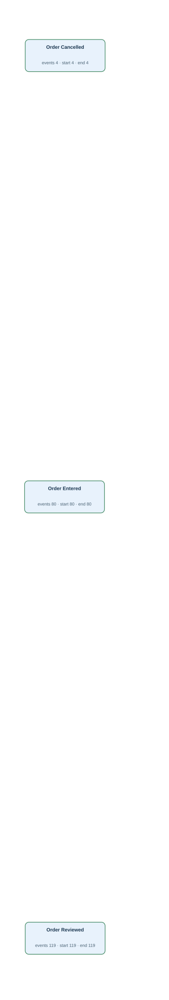</td><td width="50%" valign="top"><h4>Original tables</h4>
First 3 matched rows per table, in Gold log order. Matching uses event ID, activity and timestamp.

<strong><code>order_history</code></strong> · 203 source rows

<table><thead><tr><th>history_id</th><th>lab_order_id</th><th>medication_order_id</th><th>procedure_order_id</th><th>action</th><th>occurred_at</th><th>Gold event · timestamp column · case</th></tr></thead><tbody><tr><td>1</td><td><em>NULL</em></td><td>32064975</td><td><em>NULL</em></td><td>ENTERED</td><td>2026-01-17T17:00:00Z</td><td>OH:1 · Order Entered · occurred_at · H:1</td></tr><tr><td>10</td><td><em>NULL</em></td><td><em>NULL</em></td><td>33032683</td><td>REVIEWED</td><td>2026-01-27T15:11:00Z</td><td>OH:10 · Order Reviewed · occurred_at · H:10</td></tr><tr><td>100</td><td>31007707</td><td><em>NULL</em></td><td><em>NULL</em></td><td>REVIEWED</td><td>2026-03-25T15:54:00Z</td><td>OH:100 · Order Reviewed · occurred_at · H:100</td></tr></tbody></table>

FK-linked row examples for case and join context

<strong>admissions</strong>

<table><thead><tr><th>hadm_id</th><th>subject_id</th><th>edregtime</th><th>admittime</th><th>discharge_authorized_at</th><th>dischtime</th><th>Join from</th></tr></thead><tbody><tr><td>20000001</td><td>10000001</td><td>2026-01-17T13:42:00Z</td><td>2026-01-17T16:12:00Z</td><td>2026-01-19T13:33:00Z</td><td>2026-01-19T15:01:00Z</td><td>medication_order (hadm_id → hadm_id)</td></tr><tr><td>20000002</td><td>10000001</td><td><em>NULL</em></td><td>2026-01-27T13:19:00Z</td><td>2026-01-29T16:16:00Z</td><td>2026-01-29T18:54:00Z</td><td>procedure_order (hadm_id → hadm_id)</td></tr><tr><td>20000009</td><td>10000005</td><td>2026-03-25T08:39:00Z</td><td>2026-03-25T09:15:00Z</td><td>2026-04-01T14:15:00Z</td><td>2026-04-01T16:48:00Z</td><td>lab_order (hadm_id → hadm_id)</td></tr></tbody></table>

<strong>lab_order</strong>

<table><thead><tr><th>order_id</th><th>subject_id</th><th>hadm_id</th><th>specimen_received_at</th><th>results_verified_at</th><th>Join from</th></tr></thead><tbody><tr><td>31007707</td><td>10000005</td><td>20000009</td><td>2026-03-25T19:32:00Z</td><td>2026-03-26T00:43:00Z</td><td>order_history (lab_order_id → order_id)</td></tr><tr><td>31038448</td><td>10000005</td><td>20000009</td><td>2026-03-25T21:09:00Z</td><td>2026-03-26T02:00:00Z</td><td>order_history (lab_order_id → order_id)</td></tr><tr><td>31055690</td><td>10000006</td><td>20000010</td><td>2026-04-11T07:13:00Z</td><td>2026-04-11T09:02:00Z</td><td>order_history (lab_order_id → order_id)</td></tr></tbody></table>

<strong>medication_order</strong>

<table><thead><tr><th>order_id</th><th>hadm_id</th><th>medication</th><th>stopped_at</th><th>Join from</th></tr></thead><tbody><tr><td>32064975</td><td>20000001</td><td>Amoxicillin</td><td>2026-01-18T09:54:00Z</td><td>order_history (medication_order_id → order_id)</td></tr><tr><td>32021335</td><td>20000009</td><td>Amoxicillin</td><td>2026-03-26T15:14:00Z</td><td>order_history (medication_order_id → order_id)</td></tr><tr><td>32073878</td><td>20000010</td><td>Amoxicillin</td><td>2026-04-11T20:17:00Z</td><td>order_history (medication_order_id → order_id)</td></tr></tbody></table>

<strong>procedure_order</strong>

<table><thead><tr><th>order_id</th><th>hadm_id</th><th>procedure_name</th><th>preparation_completed_at</th><th>Join from</th></tr></thead><tbody><tr><td>33032683</td><td>20000002</td><td>Bronchoscopy</td><td>2026-01-27T16:50:00Z</td><td>order_history (procedure_order_id → order_id)</td></tr><tr><td>33043088</td><td>20000010</td><td>Endoscopy</td><td>2026-04-11T03:41:00Z</td><td>order_history (procedure_order_id → order_id)</td></tr><tr><td>33091192</td><td>20000011</td><td>Endoscopy</td><td>2026-04-27T20:26:00Z</td><td>order_history (procedure_order_id → order_id)</td></tr></tbody></table>

Other tables referenced by Gold SQL

Includes case joins and branches of shared CTEs.
<ul><li><code>admission_detail</code> · discharge_summary_signed_at, hadm_id</li><li><code>admissions</code> · admittime, discharge_authorized_at, dischtime, edregtime, hadm_id</li><li><code>emar</code> · charttime, emar_id, event_txt, pharmacy_id</li><li><code>lab_order</code> · order_id, results_verified_at, specimen_received_at</li><li><code>labevents</code> · charttime, labevent_id, order_id, storetime</li><li><code>medication_order</code> · order_id, stopped_at</li><li><code>patient_profile</code> · profile_verified_at, subject_id</li><li><code>pharmacy</code> · dispensed_at, order_id, pharmacy_id</li><li><code>procedure_episode</code> · endtime, order_id, procedureevent_id, starttime</li><li><code>procedure_order</code> · order_id, preparation_completed_at</li></ul>
</td></tr></table>

[Gold CSV](../../../datasets/hospitalflow/private/gold_logs/HF03.csv)

## HF03P — Q4

Show the complete recorded history of every individual order history record.

Events: **203** · Cases with events: **203** · Activities: **3** · Edges: **0**

<table><tr><td width="50%" valign="top"></td><td width="50%" valign="top"><h4>Original tables</h4>
First 3 matched rows per table, in Gold log order. Matching uses event ID, activity and timestamp.

<strong><code>order_history</code></strong> · 203 source rows

<table><thead><tr><th>history_id</th><th>lab_order_id</th><th>medication_order_id</th><th>procedure_order_id</th><th>action</th><th>occurred_at</th><th>Gold event · timestamp column · case</th></tr></thead><tbody><tr><td>1</td><td><em>NULL</em></td><td>32064975</td><td><em>NULL</em></td><td>ENTERED</td><td>2026-01-17T17:00:00Z</td><td>OH:1 · Order Entered · occurred_at · H:1</td></tr><tr><td>10</td><td><em>NULL</em></td><td><em>NULL</em></td><td>33032683</td><td>REVIEWED</td><td>2026-01-27T15:11:00Z</td><td>OH:10 · Order Reviewed · occurred_at · H:10</td></tr><tr><td>100</td><td>31007707</td><td><em>NULL</em></td><td><em>NULL</em></td><td>REVIEWED</td><td>2026-03-25T15:54:00Z</td><td>OH:100 · Order Reviewed · occurred_at · H:100</td></tr></tbody></table>

FK-linked row examples for case and join context

<strong>admissions</strong>

<table><thead><tr><th>hadm_id</th><th>subject_id</th><th>edregtime</th><th>admittime</th><th>discharge_authorized_at</th><th>dischtime</th><th>Join from</th></tr></thead><tbody><tr><td>20000001</td><td>10000001</td><td>2026-01-17T13:42:00Z</td><td>2026-01-17T16:12:00Z</td><td>2026-01-19T13:33:00Z</td><td>2026-01-19T15:01:00Z</td><td>medication_order (hadm_id → hadm_id)</td></tr><tr><td>20000002</td><td>10000001</td><td><em>NULL</em></td><td>2026-01-27T13:19:00Z</td><td>2026-01-29T16:16:00Z</td><td>2026-01-29T18:54:00Z</td><td>procedure_order (hadm_id → hadm_id)</td></tr><tr><td>20000009</td><td>10000005</td><td>2026-03-25T08:39:00Z</td><td>2026-03-25T09:15:00Z</td><td>2026-04-01T14:15:00Z</td><td>2026-04-01T16:48:00Z</td><td>lab_order (hadm_id → hadm_id)</td></tr></tbody></table>

<strong>lab_order</strong>

<table><thead><tr><th>order_id</th><th>subject_id</th><th>hadm_id</th><th>specimen_received_at</th><th>results_verified_at</th><th>Join from</th></tr></thead><tbody><tr><td>31007707</td><td>10000005</td><td>20000009</td><td>2026-03-25T19:32:00Z</td><td>2026-03-26T00:43:00Z</td><td>order_history (lab_order_id → order_id)</td></tr><tr><td>31038448</td><td>10000005</td><td>20000009</td><td>2026-03-25T21:09:00Z</td><td>2026-03-26T02:00:00Z</td><td>order_history (lab_order_id → order_id)</td></tr><tr><td>31055690</td><td>10000006</td><td>20000010</td><td>2026-04-11T07:13:00Z</td><td>2026-04-11T09:02:00Z</td><td>order_history (lab_order_id → order_id)</td></tr></tbody></table>

<strong>medication_order</strong>

<table><thead><tr><th>order_id</th><th>hadm_id</th><th>medication</th><th>stopped_at</th><th>Join from</th></tr></thead><tbody><tr><td>32064975</td><td>20000001</td><td>Amoxicillin</td><td>2026-01-18T09:54:00Z</td><td>order_history (medication_order_id → order_id)</td></tr><tr><td>32021335</td><td>20000009</td><td>Amoxicillin</td><td>2026-03-26T15:14:00Z</td><td>order_history (medication_order_id → order_id)</td></tr><tr><td>32073878</td><td>20000010</td><td>Amoxicillin</td><td>2026-04-11T20:17:00Z</td><td>order_history (medication_order_id → order_id)</td></tr></tbody></table>

<strong>procedure_order</strong>

<table><thead><tr><th>order_id</th><th>hadm_id</th><th>procedure_name</th><th>preparation_completed_at</th><th>Join from</th></tr></thead><tbody><tr><td>33032683</td><td>20000002</td><td>Bronchoscopy</td><td>2026-01-27T16:50:00Z</td><td>order_history (procedure_order_id → order_id)</td></tr><tr><td>33043088</td><td>20000010</td><td>Endoscopy</td><td>2026-04-11T03:41:00Z</td><td>order_history (procedure_order_id → order_id)</td></tr><tr><td>33091192</td><td>20000011</td><td>Endoscopy</td><td>2026-04-27T20:26:00Z</td><td>order_history (procedure_order_id → order_id)</td></tr></tbody></table>

Other tables referenced by Gold SQL

Includes case joins and branches of shared CTEs.
<ul><li><code>admission_detail</code> · discharge_summary_signed_at, hadm_id</li><li><code>admissions</code> · admittime, discharge_authorized_at, dischtime, edregtime, hadm_id</li><li><code>emar</code> · charttime, emar_id, event_txt, pharmacy_id</li><li><code>lab_order</code> · order_id, results_verified_at, specimen_received_at</li><li><code>labevents</code> · charttime, labevent_id, order_id, storetime</li><li><code>medication_order</code> · order_id, stopped_at</li><li><code>patient_profile</code> · profile_verified_at, subject_id</li><li><code>pharmacy</code> · dispensed_at, order_id, pharmacy_id</li><li><code>procedure_episode</code> · endtime, order_id, procedureevent_id, starttime</li><li><code>procedure_order</code> · order_id, preparation_completed_at</li></ul>
</td></tr></table>

[Gold CSV](../../../datasets/hospitalflow/private/gold_logs/HF03P.csv)

## HF04 — Q3

Extract the full recorded lifecycle for each laboratory order.

Events: **267** · Cases with events: **34** · Activities: **6** · Edges: **8**

<table><tr><td width="50%" valign="top">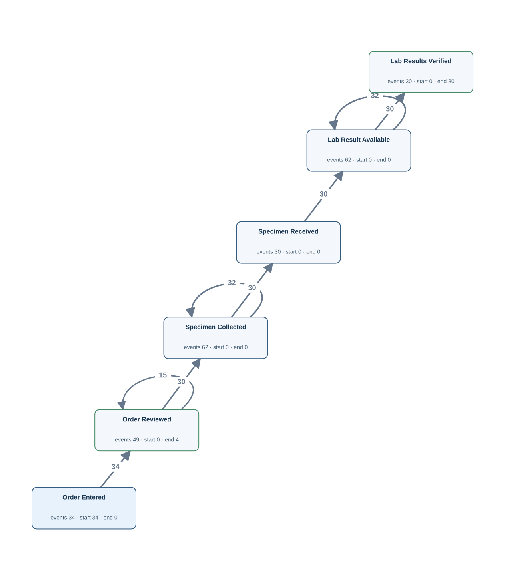</td><td width="50%" valign="top"><h4>Original tables</h4>
First 3 matched rows per table, in Gold log order. Matching uses event ID, activity and timestamp.

<strong><code>lab_order</code></strong> · 30 source rows

<table><thead><tr><th>order_id</th><th>subject_id</th><th>hadm_id</th><th>specimen_received_at</th><th>results_verified_at</th><th>Gold event · timestamp column · case</th></tr></thead><tbody><tr><td>30000117</td><td>10000005</td><td>20000009</td><td>2026-03-25T19:11:00Z</td><td>2026-03-25T20:41:00Z</td><td>LAB:30000117:received · Specimen Received · specimen_received_at · LAB:30000117 | LAB:30000117:verified · Lab Results Verified · results_verified_at · LAB:30000117</td></tr><tr><td>30000691</td><td>10000003</td><td>20000006</td><td>2026-03-06T10:37:00Z</td><td>2026-03-06T15:06:00Z</td><td>LAB:30000691:received · Specimen Received · specimen_received_at · LAB:30000691 | LAB:30000691:verified · Lab Results Verified · results_verified_at · LAB:30000691</td></tr><tr><td>30000983</td><td>10000009</td><td>20000013</td><td>2026-05-31T07:57:00Z</td><td>2026-05-31T13:32:00Z</td><td>LAB:30000983:received · Specimen Received · specimen_received_at · LAB:30000983 | LAB:30000983:verified · Lab Results Verified · results_verified_at · LAB:30000983</td></tr></tbody></table>

<strong><code>labevents</code></strong> · 62 source rows

<table><thead><tr><th>labevent_id</th><th>order_id</th><th>itemid</th><th>charttime</th><th>storetime</th><th>valuenum</th><th>valueuom</th><th>Gold event · timestamp column · case</th></tr></thead><tbody><tr><td>33</td><td>30000117</td><td>1003</td><td>2026-03-25T18:19:00Z</td><td>2026-03-25T19:43:00Z</td><td>14.3</td><td>g/dL</td><td>LABEV:33:chart · Specimen Collected · charttime · LAB:30000117 | LABEV:33:result · Lab Result Available · storetime · LAB:30000117</td></tr><tr><td>10</td><td>30000691</td><td>1003</td><td>2026-03-06T08:37:00Z</td><td>2026-03-06T11:15:00Z</td><td>12.5</td><td>g/dL</td><td>LABEV:10:chart · Specimen Collected · charttime · LAB:30000691 | LABEV:10:result · Lab Result Available · storetime · LAB:30000691</td></tr><tr><td>8</td><td>30000691</td><td>1001</td><td>2026-03-06T09:13:00Z</td><td>2026-03-06T13:48:00Z</td><td>1.66</td><td>mg/dL</td><td>LABEV:8:chart · Specimen Collected · charttime · LAB:30000691 | LABEV:8:result · Lab Result Available · storetime · LAB:30000691</td></tr></tbody></table>

<strong><code>order_history</code></strong> · 83 source rows

<table><thead><tr><th>history_id</th><th>lab_order_id</th><th>medication_order_id</th><th>procedure_order_id</th><th>action</th><th>occurred_at</th><th>Gold event · timestamp column · case</th></tr></thead><tbody><tr><td>96</td><td>30000117</td><td><em>NULL</em></td><td><em>NULL</em></td><td>ENTERED</td><td>2026-03-25T14:29:00Z</td><td>OH:96 · Order Entered · occurred_at · LAB:30000117</td></tr><tr><td>97</td><td>30000117</td><td><em>NULL</em></td><td><em>NULL</em></td><td>REVIEWED</td><td>2026-03-25T15:29:00Z</td><td>OH:97 · Order Reviewed · occurred_at · LAB:30000117</td></tr><tr><td>98</td><td>30000117</td><td><em>NULL</em></td><td><em>NULL</em></td><td>REVIEWED</td><td>2026-03-25T15:54:01Z</td><td>OH:98 · Order Reviewed · occurred_at · LAB:30000117</td></tr></tbody></table>

FK-linked row examples for case and join context

<strong>admissions</strong>

<table><thead><tr><th>hadm_id</th><th>subject_id</th><th>edregtime</th><th>admittime</th><th>discharge_authorized_at</th><th>dischtime</th><th>Join from</th></tr></thead><tbody><tr><td>20000009</td><td>10000005</td><td>2026-03-25T08:39:00Z</td><td>2026-03-25T09:15:00Z</td><td>2026-04-01T14:15:00Z</td><td>2026-04-01T16:48:00Z</td><td>lab_order (hadm_id → hadm_id)</td></tr><tr><td>20000006</td><td>10000003</td><td><em>NULL</em></td><td>2026-03-06T05:26:00Z</td><td>2026-03-07T14:36:00Z</td><td>2026-03-07T17:34:00Z</td><td>lab_order (hadm_id → hadm_id)</td></tr><tr><td>20000013</td><td>10000009</td><td>2026-05-30T21:32:00Z</td><td>2026-05-31T01:02:00Z</td><td>2026-06-03T06:40:00Z</td><td>2026-06-03T09:20:00Z</td><td>lab_order (hadm_id → hadm_id)</td></tr></tbody></table>

<strong>lab_order</strong>

<table><thead><tr><th>order_id</th><th>subject_id</th><th>hadm_id</th><th>specimen_received_at</th><th>results_verified_at</th><th>Join from</th></tr></thead><tbody><tr><td>31073842</td><td>10000003</td><td>20000006</td><td><em>NULL</em></td><td><em>NULL</em></td><td>order_history (lab_order_id → order_id)</td></tr><tr><td>31082773</td><td>10000011</td><td>20000015</td><td><em>NULL</em></td><td><em>NULL</em></td><td>order_history (lab_order_id → order_id)</td></tr><tr><td>31097656</td><td>10000005</td><td>20000009</td><td><em>NULL</em></td><td><em>NULL</em></td><td>order_history (lab_order_id → order_id)</td></tr></tbody></table>

Other tables referenced by Gold SQL

Includes case joins and branches of shared CTEs.
<ul><li><code>admission_detail</code> · discharge_summary_signed_at, hadm_id</li><li><code>admissions</code> · admittime, discharge_authorized_at, dischtime, edregtime, hadm_id</li><li><code>emar</code> · charttime, emar_id, event_txt, pharmacy_id</li><li><code>medication_order</code> · order_id, stopped_at</li><li><code>patient_profile</code> · profile_verified_at, subject_id</li><li><code>pharmacy</code> · dispensed_at, order_id, pharmacy_id</li><li><code>procedure_episode</code> · endtime, order_id, procedureevent_id, starttime</li><li><code>procedure_order</code> · order_id, preparation_completed_at</li></ul>
</td></tr></table>

[Gold CSV](../../../datasets/hospitalflow/private/gold_logs/HF04.csv)

## HF04P — Q4

Show everything recorded over the life of each laboratory order.

Events: **267** · Cases with events: **34** · Activities: **6** · Edges: **8**

<table><tr><td width="50%" valign="top"></td><td width="50%" valign="top"><h4>Original tables</h4>
First 3 matched rows per table, in Gold log order. Matching uses event ID, activity and timestamp.

<strong><code>lab_order</code></strong> · 30 source rows

<table><thead><tr><th>order_id</th><th>subject_id</th><th>hadm_id</th><th>specimen_received_at</th><th>results_verified_at</th><th>Gold event · timestamp column · case</th></tr></thead><tbody><tr><td>30000117</td><td>10000005</td><td>20000009</td><td>2026-03-25T19:11:00Z</td><td>2026-03-25T20:41:00Z</td><td>LAB:30000117:received · Specimen Received · specimen_received_at · LAB:30000117 | LAB:30000117:verified · Lab Results Verified · results_verified_at · LAB:30000117</td></tr><tr><td>30000691</td><td>10000003</td><td>20000006</td><td>2026-03-06T10:37:00Z</td><td>2026-03-06T15:06:00Z</td><td>LAB:30000691:received · Specimen Received · specimen_received_at · LAB:30000691 | LAB:30000691:verified · Lab Results Verified · results_verified_at · LAB:30000691</td></tr><tr><td>30000983</td><td>10000009</td><td>20000013</td><td>2026-05-31T07:57:00Z</td><td>2026-05-31T13:32:00Z</td><td>LAB:30000983:received · Specimen Received · specimen_received_at · LAB:30000983 | LAB:30000983:verified · Lab Results Verified · results_verified_at · LAB:30000983</td></tr></tbody></table>

<strong><code>labevents</code></strong> · 62 source rows

<table><thead><tr><th>labevent_id</th><th>order_id</th><th>itemid</th><th>charttime</th><th>storetime</th><th>valuenum</th><th>valueuom</th><th>Gold event · timestamp column · case</th></tr></thead><tbody><tr><td>33</td><td>30000117</td><td>1003</td><td>2026-03-25T18:19:00Z</td><td>2026-03-25T19:43:00Z</td><td>14.3</td><td>g/dL</td><td>LABEV:33:chart · Specimen Collected · charttime · LAB:30000117 | LABEV:33:result · Lab Result Available · storetime · LAB:30000117</td></tr><tr><td>10</td><td>30000691</td><td>1003</td><td>2026-03-06T08:37:00Z</td><td>2026-03-06T11:15:00Z</td><td>12.5</td><td>g/dL</td><td>LABEV:10:chart · Specimen Collected · charttime · LAB:30000691 | LABEV:10:result · Lab Result Available · storetime · LAB:30000691</td></tr><tr><td>8</td><td>30000691</td><td>1001</td><td>2026-03-06T09:13:00Z</td><td>2026-03-06T13:48:00Z</td><td>1.66</td><td>mg/dL</td><td>LABEV:8:chart · Specimen Collected · charttime · LAB:30000691 | LABEV:8:result · Lab Result Available · storetime · LAB:30000691</td></tr></tbody></table>

<strong><code>order_history</code></strong> · 83 source rows

<table><thead><tr><th>history_id</th><th>lab_order_id</th><th>medication_order_id</th><th>procedure_order_id</th><th>action</th><th>occurred_at</th><th>Gold event · timestamp column · case</th></tr></thead><tbody><tr><td>96</td><td>30000117</td><td><em>NULL</em></td><td><em>NULL</em></td><td>ENTERED</td><td>2026-03-25T14:29:00Z</td><td>OH:96 · Order Entered · occurred_at · LAB:30000117</td></tr><tr><td>97</td><td>30000117</td><td><em>NULL</em></td><td><em>NULL</em></td><td>REVIEWED</td><td>2026-03-25T15:29:00Z</td><td>OH:97 · Order Reviewed · occurred_at · LAB:30000117</td></tr><tr><td>98</td><td>30000117</td><td><em>NULL</em></td><td><em>NULL</em></td><td>REVIEWED</td><td>2026-03-25T15:54:01Z</td><td>OH:98 · Order Reviewed · occurred_at · LAB:30000117</td></tr></tbody></table>

FK-linked row examples for case and join context

<strong>admissions</strong>

<table><thead><tr><th>hadm_id</th><th>subject_id</th><th>edregtime</th><th>admittime</th><th>discharge_authorized_at</th><th>dischtime</th><th>Join from</th></tr></thead><tbody><tr><td>20000009</td><td>10000005</td><td>2026-03-25T08:39:00Z</td><td>2026-03-25T09:15:00Z</td><td>2026-04-01T14:15:00Z</td><td>2026-04-01T16:48:00Z</td><td>lab_order (hadm_id → hadm_id)</td></tr><tr><td>20000006</td><td>10000003</td><td><em>NULL</em></td><td>2026-03-06T05:26:00Z</td><td>2026-03-07T14:36:00Z</td><td>2026-03-07T17:34:00Z</td><td>lab_order (hadm_id → hadm_id)</td></tr><tr><td>20000013</td><td>10000009</td><td>2026-05-30T21:32:00Z</td><td>2026-05-31T01:02:00Z</td><td>2026-06-03T06:40:00Z</td><td>2026-06-03T09:20:00Z</td><td>lab_order (hadm_id → hadm_id)</td></tr></tbody></table>

<strong>lab_order</strong>

<table><thead><tr><th>order_id</th><th>subject_id</th><th>hadm_id</th><th>specimen_received_at</th><th>results_verified_at</th><th>Join from</th></tr></thead><tbody><tr><td>31073842</td><td>10000003</td><td>20000006</td><td><em>NULL</em></td><td><em>NULL</em></td><td>order_history (lab_order_id → order_id)</td></tr><tr><td>31082773</td><td>10000011</td><td>20000015</td><td><em>NULL</em></td><td><em>NULL</em></td><td>order_history (lab_order_id → order_id)</td></tr><tr><td>31097656</td><td>10000005</td><td>20000009</td><td><em>NULL</em></td><td><em>NULL</em></td><td>order_history (lab_order_id → order_id)</td></tr></tbody></table>

Other tables referenced by Gold SQL

Includes case joins and branches of shared CTEs.
<ul><li><code>admission_detail</code> · discharge_summary_signed_at, hadm_id</li><li><code>admissions</code> · admittime, discharge_authorized_at, dischtime, edregtime, hadm_id</li><li><code>emar</code> · charttime, emar_id, event_txt, pharmacy_id</li><li><code>medication_order</code> · order_id, stopped_at</li><li><code>patient_profile</code> · profile_verified_at, subject_id</li><li><code>pharmacy</code> · dispensed_at, order_id, pharmacy_id</li><li><code>procedure_episode</code> · endtime, order_id, procedureevent_id, starttime</li><li><code>procedure_order</code> · order_id, preparation_completed_at</li></ul>
</td></tr></table>

[Gold CSV](../../../datasets/hospitalflow/private/gold_logs/HF04P.csv)

## HF05 — Q3

Extract the full recorded lifecycle for each medication order.

Events: **198** · Cases with events: **29** · Activities: **6** · Edges: **15**

<table><tr><td width="50%" valign="top">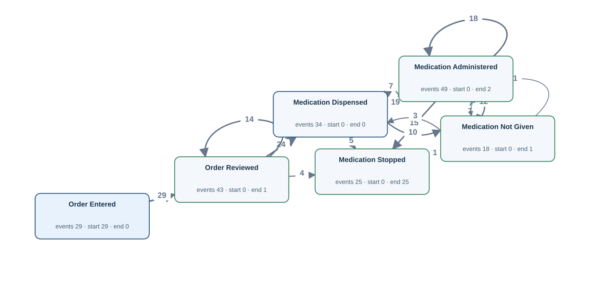</td><td width="50%" valign="top"><h4>Original tables</h4>
First 3 matched rows per table, in Gold log order. Matching uses event ID, activity and timestamp.

<strong><code>emar</code></strong> · 67 source rows

<table><thead><tr><th>emar_id</th><th>pharmacy_id</th><th>charttime</th><th>event_txt</th><th>storetime</th><th>Gold event · timestamp column · case</th></tr></thead><tbody><tr><td>20</td><td>40000009</td><td>2026-03-08T23:22:00Z</td><td>Administered</td><td>2026-03-08T23:41:00Z</td><td>EMAR:20 · Medication Administered · charttime · MED:30000691</td></tr><tr><td>23</td><td>40000010</td><td>2026-03-09T00:44:00Z</td><td>Not Given</td><td>2026-03-09T01:30:00Z</td><td>EMAR:23 · Medication Not Given · charttime · MED:30000691</td></tr><tr><td>21</td><td>40000009</td><td>2026-03-09T01:43:00Z</td><td>Not Given</td><td>2026-03-09T02:25:00Z</td><td>EMAR:21 · Medication Not Given · charttime · MED:30000691</td></tr></tbody></table>

<strong><code>medication_order</code></strong> · 25 source rows

<table><thead><tr><th>order_id</th><th>hadm_id</th><th>medication</th><th>stopped_at</th><th>Gold event · timestamp column · case</th></tr></thead><tbody><tr><td>30000117</td><td>20000010</td><td>Metformin</td><td>2026-04-11T22:04:00Z</td><td>MED:30000117:stop · Medication Stopped · stopped_at · MED:30000117</td></tr><tr><td>30000691</td><td>20000007</td><td>Omeprazole</td><td>2026-03-09T18:11:00Z</td><td>MED:30000691:stop · Medication Stopped · stopped_at · MED:30000691</td></tr><tr><td>30000983</td><td>20000013</td><td>Amoxicillin</td><td>2026-05-31T17:45:00Z</td><td>MED:30000983:stop · Medication Stopped · stopped_at · MED:30000983</td></tr></tbody></table>

<strong><code>order_history</code></strong> · 72 source rows

<table><thead><tr><th>history_id</th><th>lab_order_id</th><th>medication_order_id</th><th>procedure_order_id</th><th>action</th><th>occurred_at</th><th>Gold event · timestamp column · case</th></tr></thead><tbody><tr><td>114</td><td><em>NULL</em></td><td>30000117</td><td><em>NULL</em></td><td>ENTERED</td><td>2026-04-11T04:07:00Z</td><td>OH:114 · Order Entered · occurred_at · MED:30000117</td></tr><tr><td>115</td><td><em>NULL</em></td><td>30000117</td><td><em>NULL</em></td><td>REVIEWED</td><td>2026-04-11T05:33:00Z</td><td>OH:115 · Order Reviewed · occurred_at · MED:30000117</td></tr><tr><td>54</td><td><em>NULL</em></td><td>30000691</td><td><em>NULL</em></td><td>ENTERED</td><td>2026-03-08T18:24:00Z</td><td>OH:54 · Order Entered · occurred_at · MED:30000691</td></tr></tbody></table>

<strong><code>pharmacy</code></strong> · 34 source rows

<table><thead><tr><th>pharmacy_id</th><th>order_id</th><th>dispensed_at</th><th>Gold event · timestamp column · case</th></tr></thead><tbody><tr><td>40000022</td><td>30000117</td><td>2026-04-11T06:53:00Z</td><td>PHARM:40000022:dispense · Medication Dispensed · dispensed_at · MED:30000117</td></tr><tr><td>40000009</td><td>30000691</td><td>2026-03-08T21:16:00Z</td><td>PHARM:40000009:dispense · Medication Dispensed · dispensed_at · MED:30000691</td></tr><tr><td>40000010</td><td>30000691</td><td>2026-03-08T23:40:00Z</td><td>PHARM:40000010:dispense · Medication Dispensed · dispensed_at · MED:30000691</td></tr></tbody></table>

FK-linked row examples for case and join context

<strong>admissions</strong>

<table><thead><tr><th>hadm_id</th><th>subject_id</th><th>edregtime</th><th>admittime</th><th>discharge_authorized_at</th><th>dischtime</th><th>Join from</th></tr></thead><tbody><tr><td>20000010</td><td>10000006</td><td><em>NULL</em></td><td>2026-04-11T01:01:00Z</td><td>2026-04-12T11:24:00Z</td><td>2026-04-12T13:01:00Z</td><td>medication_order (hadm_id → hadm_id)</td></tr><tr><td>20000007</td><td>10000004</td><td>2026-03-08T14:36:00Z</td><td>2026-03-08T17:59:00Z</td><td>2026-03-11T12:15:00Z</td><td>2026-03-11T13:09:00Z</td><td>medication_order (hadm_id → hadm_id)</td></tr><tr><td>20000013</td><td>10000009</td><td>2026-05-30T21:32:00Z</td><td>2026-05-31T01:02:00Z</td><td>2026-06-03T06:40:00Z</td><td>2026-06-03T09:20:00Z</td><td>medication_order (hadm_id → hadm_id)</td></tr></tbody></table>

<strong>medication_order</strong>

<table><thead><tr><th>order_id</th><th>hadm_id</th><th>medication</th><th>stopped_at</th><th>Join from</th></tr></thead><tbody><tr><td>32010923</td><td>20000014</td><td>Amoxicillin</td><td><em>NULL</em></td><td>order_history (medication_order_id → order_id)</td></tr><tr><td>32034941</td><td>20000010</td><td>Metformin</td><td><em>NULL</em></td><td>order_history (medication_order_id → order_id)</td></tr><tr><td>32071610</td><td>20000015</td><td>Omeprazole</td><td><em>NULL</em></td><td>order_history (medication_order_id → order_id)</td></tr></tbody></table>

Other tables referenced by Gold SQL

Includes case joins and branches of shared CTEs.
<ul><li><code>admission_detail</code> · discharge_summary_signed_at, hadm_id</li><li><code>admissions</code> · admittime, discharge_authorized_at, dischtime, edregtime, hadm_id</li><li><code>lab_order</code> · order_id, results_verified_at, specimen_received_at</li><li><code>labevents</code> · charttime, labevent_id, order_id, storetime</li><li><code>patient_profile</code> · profile_verified_at, subject_id</li><li><code>procedure_episode</code> · endtime, order_id, procedureevent_id, starttime</li><li><code>procedure_order</code> · order_id, preparation_completed_at</li></ul>
</td></tr></table>

[Gold CSV](../../../datasets/hospitalflow/private/gold_logs/HF05.csv)

## HF05P — Q4

Build the complete recorded history of each medication order.

Events: **198** · Cases with events: **29** · Activities: **6** · Edges: **15**

<table><tr><td width="50%" valign="top"></td><td width="50%" valign="top"><h4>Original tables</h4>
First 3 matched rows per table, in Gold log order. Matching uses event ID, activity and timestamp.

<strong><code>emar</code></strong> · 67 source rows

<table><thead><tr><th>emar_id</th><th>pharmacy_id</th><th>charttime</th><th>event_txt</th><th>storetime</th><th>Gold event · timestamp column · case</th></tr></thead><tbody><tr><td>20</td><td>40000009</td><td>2026-03-08T23:22:00Z</td><td>Administered</td><td>2026-03-08T23:41:00Z</td><td>EMAR:20 · Medication Administered · charttime · MED:30000691</td></tr><tr><td>23</td><td>40000010</td><td>2026-03-09T00:44:00Z</td><td>Not Given</td><td>2026-03-09T01:30:00Z</td><td>EMAR:23 · Medication Not Given · charttime · MED:30000691</td></tr><tr><td>21</td><td>40000009</td><td>2026-03-09T01:43:00Z</td><td>Not Given</td><td>2026-03-09T02:25:00Z</td><td>EMAR:21 · Medication Not Given · charttime · MED:30000691</td></tr></tbody></table>

<strong><code>medication_order</code></strong> · 25 source rows

<table><thead><tr><th>order_id</th><th>hadm_id</th><th>medication</th><th>stopped_at</th><th>Gold event · timestamp column · case</th></tr></thead><tbody><tr><td>30000117</td><td>20000010</td><td>Metformin</td><td>2026-04-11T22:04:00Z</td><td>MED:30000117:stop · Medication Stopped · stopped_at · MED:30000117</td></tr><tr><td>30000691</td><td>20000007</td><td>Omeprazole</td><td>2026-03-09T18:11:00Z</td><td>MED:30000691:stop · Medication Stopped · stopped_at · MED:30000691</td></tr><tr><td>30000983</td><td>20000013</td><td>Amoxicillin</td><td>2026-05-31T17:45:00Z</td><td>MED:30000983:stop · Medication Stopped · stopped_at · MED:30000983</td></tr></tbody></table>

<strong><code>order_history</code></strong> · 72 source rows

<table><thead><tr><th>history_id</th><th>lab_order_id</th><th>medication_order_id</th><th>procedure_order_id</th><th>action</th><th>occurred_at</th><th>Gold event · timestamp column · case</th></tr></thead><tbody><tr><td>114</td><td><em>NULL</em></td><td>30000117</td><td><em>NULL</em></td><td>ENTERED</td><td>2026-04-11T04:07:00Z</td><td>OH:114 · Order Entered · occurred_at · MED:30000117</td></tr><tr><td>115</td><td><em>NULL</em></td><td>30000117</td><td><em>NULL</em></td><td>REVIEWED</td><td>2026-04-11T05:33:00Z</td><td>OH:115 · Order Reviewed · occurred_at · MED:30000117</td></tr><tr><td>54</td><td><em>NULL</em></td><td>30000691</td><td><em>NULL</em></td><td>ENTERED</td><td>2026-03-08T18:24:00Z</td><td>OH:54 · Order Entered · occurred_at · MED:30000691</td></tr></tbody></table>

<strong><code>pharmacy</code></strong> · 34 source rows

<table><thead><tr><th>pharmacy_id</th><th>order_id</th><th>dispensed_at</th><th>Gold event · timestamp column · case</th></tr></thead><tbody><tr><td>40000022</td><td>30000117</td><td>2026-04-11T06:53:00Z</td><td>PHARM:40000022:dispense · Medication Dispensed · dispensed_at · MED:30000117</td></tr><tr><td>40000009</td><td>30000691</td><td>2026-03-08T21:16:00Z</td><td>PHARM:40000009:dispense · Medication Dispensed · dispensed_at · MED:30000691</td></tr><tr><td>40000010</td><td>30000691</td><td>2026-03-08T23:40:00Z</td><td>PHARM:40000010:dispense · Medication Dispensed · dispensed_at · MED:30000691</td></tr></tbody></table>

FK-linked row examples for case and join context

<strong>admissions</strong>

<table><thead><tr><th>hadm_id</th><th>subject_id</th><th>edregtime</th><th>admittime</th><th>discharge_authorized_at</th><th>dischtime</th><th>Join from</th></tr></thead><tbody><tr><td>20000010</td><td>10000006</td><td><em>NULL</em></td><td>2026-04-11T01:01:00Z</td><td>2026-04-12T11:24:00Z</td><td>2026-04-12T13:01:00Z</td><td>medication_order (hadm_id → hadm_id)</td></tr><tr><td>20000007</td><td>10000004</td><td>2026-03-08T14:36:00Z</td><td>2026-03-08T17:59:00Z</td><td>2026-03-11T12:15:00Z</td><td>2026-03-11T13:09:00Z</td><td>medication_order (hadm_id → hadm_id)</td></tr><tr><td>20000013</td><td>10000009</td><td>2026-05-30T21:32:00Z</td><td>2026-05-31T01:02:00Z</td><td>2026-06-03T06:40:00Z</td><td>2026-06-03T09:20:00Z</td><td>medication_order (hadm_id → hadm_id)</td></tr></tbody></table>

<strong>medication_order</strong>

<table><thead><tr><th>order_id</th><th>hadm_id</th><th>medication</th><th>stopped_at</th><th>Join from</th></tr></thead><tbody><tr><td>32010923</td><td>20000014</td><td>Amoxicillin</td><td><em>NULL</em></td><td>order_history (medication_order_id → order_id)</td></tr><tr><td>32034941</td><td>20000010</td><td>Metformin</td><td><em>NULL</em></td><td>order_history (medication_order_id → order_id)</td></tr><tr><td>32071610</td><td>20000015</td><td>Omeprazole</td><td><em>NULL</em></td><td>order_history (medication_order_id → order_id)</td></tr></tbody></table>

Other tables referenced by Gold SQL

Includes case joins and branches of shared CTEs.
<ul><li><code>admission_detail</code> · discharge_summary_signed_at, hadm_id</li><li><code>admissions</code> · admittime, discharge_authorized_at, dischtime, edregtime, hadm_id</li><li><code>lab_order</code> · order_id, results_verified_at, specimen_received_at</li><li><code>labevents</code> · charttime, labevent_id, order_id, storetime</li><li><code>patient_profile</code> · profile_verified_at, subject_id</li><li><code>procedure_episode</code> · endtime, order_id, procedureevent_id, starttime</li><li><code>procedure_order</code> · order_id, preparation_completed_at</li></ul>
</td></tr></table>

[Gold CSV](../../../datasets/hospitalflow/private/gold_logs/HF05P.csv)

## HF06 — Q3

Extract the full recorded lifecycle for each procedure order.

Events: **103** · Cases with events: **17** · Activities: **6** · Edges: **8**

<table><tr><td width="50%" valign="top">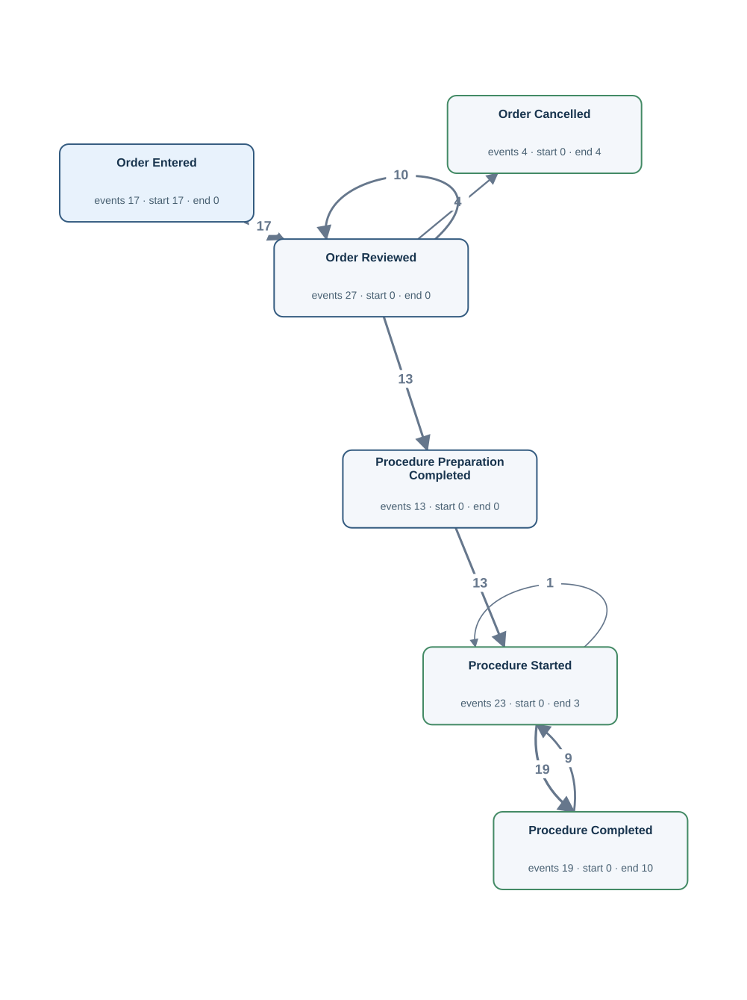</td><td width="50%" valign="top"><h4>Original tables</h4>
First 3 matched rows per table, in Gold log order. Matching uses event ID, activity and timestamp.

<strong><code>order_history</code></strong> · 48 source rows

<table><thead><tr><th>history_id</th><th>lab_order_id</th><th>medication_order_id</th><th>procedure_order_id</th><th>action</th><th>occurred_at</th><th>Gold event · timestamp column · case</th></tr></thead><tbody><tr><td>138</td><td><em>NULL</em></td><td><em>NULL</em></td><td>30000117</td><td>ENTERED</td><td>2026-04-27T19:47:00Z</td><td>OH:138 · Order Entered · occurred_at · PROC:30000117</td></tr><tr><td>139</td><td><em>NULL</em></td><td><em>NULL</em></td><td>30000117</td><td>REVIEWED</td><td>2026-04-27T20:05:00Z</td><td>OH:139 · Order Reviewed · occurred_at · PROC:30000117</td></tr><tr><td>140</td><td><em>NULL</em></td><td><em>NULL</em></td><td>30000117</td><td>CANCELLED</td><td>2026-04-27T20:17:00Z</td><td>OH:140 · Order Cancelled · occurred_at · PROC:30000117</td></tr></tbody></table>

<strong><code>procedure_episode</code></strong> · 23 source rows

<table><thead><tr><th>procedureevent_id</th><th>order_id</th><th>starttime</th><th>endtime</th><th>storetime</th><th>Gold event · timestamp column · case</th></tr></thead><tbody><tr><td>6</td><td>30000691</td><td>2026-03-08T21:46:00Z</td><td>2026-03-08T22:28:01Z</td><td>2026-03-08T22:01:00Z</td><td>PROCEV:6:end · Procedure Completed · endtime · PROC:30000691 | PROCEV:6:start · Procedure Started · starttime · PROC:30000691</td></tr><tr><td>7</td><td>30000983</td><td>2026-03-18T21:29:00Z</td><td>2026-03-18T21:58:00Z</td><td>2026-03-18T21:58:00Z</td><td>PROCEV:7:end · Procedure Completed · endtime · PROC:30000983 | PROCEV:7:start · Procedure Started · starttime · PROC:30000983</td></tr><tr><td>23</td><td>33023112</td><td>2026-07-03T16:40:00Z</td><td><em>NULL</em></td><td>2026-07-03T17:12:00Z</td><td>PROCEV:23:start · Procedure Started · starttime · PROC:33023112</td></tr></tbody></table>

<strong><code>procedure_order</code></strong> · 13 source rows

<table><thead><tr><th>order_id</th><th>hadm_id</th><th>procedure_name</th><th>preparation_completed_at</th><th>Gold event · timestamp column · case</th></tr></thead><tbody><tr><td>30000691</td><td>20000007</td><td>Bronchoscopy</td><td>2026-03-08T20:31:00Z</td><td>PROC:30000691:prep · Procedure Preparation Completed · preparation_completed_at · PROC:30000691</td></tr><tr><td>30000983</td><td>20000008</td><td>Endoscopy</td><td>2026-03-18T20:27:00Z</td><td>PROC:30000983:prep · Procedure Preparation Completed · preparation_completed_at · PROC:30000983</td></tr><tr><td>33023112</td><td>20000015</td><td>Wound Debridement</td><td>2026-07-03T15:31:00Z</td><td>PROC:33023112:prep · Procedure Preparation Completed · preparation_completed_at · PROC:33023112</td></tr></tbody></table>

FK-linked row examples for case and join context

<strong>admissions</strong>

<table><thead><tr><th>hadm_id</th><th>subject_id</th><th>edregtime</th><th>admittime</th><th>discharge_authorized_at</th><th>dischtime</th><th>Join from</th></tr></thead><tbody><tr><td>20000007</td><td>10000004</td><td>2026-03-08T14:36:00Z</td><td>2026-03-08T17:59:00Z</td><td>2026-03-11T12:15:00Z</td><td>2026-03-11T13:09:00Z</td><td>procedure_order (hadm_id → hadm_id)</td></tr><tr><td>20000008</td><td>10000004</td><td><em>NULL</em></td><td>2026-03-18T17:20:00Z</td><td>2026-03-24T04:29:00Z</td><td>2026-03-24T06:27:00Z</td><td>procedure_order (hadm_id → hadm_id)</td></tr><tr><td>20000015</td><td>10000011</td><td>2026-07-03T08:35:00Z</td><td>2026-07-03T09:05:00Z</td><td><em>NULL</em></td><td><em>NULL</em></td><td>procedure_order (hadm_id → hadm_id)</td></tr></tbody></table>

<strong>procedure_order</strong>

<table><thead><tr><th>order_id</th><th>hadm_id</th><th>procedure_name</th><th>preparation_completed_at</th><th>Join from</th></tr></thead><tbody><tr><td>30000117</td><td>20000011</td><td>Wound Debridement</td><td><em>NULL</em></td><td>order_history (procedure_order_id → order_id)</td></tr><tr><td>33050292</td><td>20000008</td><td>Endoscopy</td><td><em>NULL</em></td><td>order_history (procedure_order_id → order_id)</td></tr><tr><td>33060273</td><td>20000004</td><td>Endoscopy</td><td><em>NULL</em></td><td>order_history (procedure_order_id → order_id)</td></tr></tbody></table>

Other tables referenced by Gold SQL

Includes case joins and branches of shared CTEs.
<ul><li><code>admission_detail</code> · discharge_summary_signed_at, hadm_id</li><li><code>admissions</code> · admittime, discharge_authorized_at, dischtime, edregtime, hadm_id</li><li><code>emar</code> · charttime, emar_id, event_txt, pharmacy_id</li><li><code>lab_order</code> · order_id, results_verified_at, specimen_received_at</li><li><code>labevents</code> · charttime, labevent_id, order_id, storetime</li><li><code>medication_order</code> · order_id, stopped_at</li><li><code>patient_profile</code> · profile_verified_at, subject_id</li><li><code>pharmacy</code> · dispensed_at, order_id, pharmacy_id</li></ul>
</td></tr></table>

[Gold CSV](../../../datasets/hospitalflow/private/gold_logs/HF06.csv)

## HF06P — Q4

Trace the whole recorded lifecycle of every procedure order.

Events: **103** · Cases with events: **17** · Activities: **6** · Edges: **8**

<table><tr><td width="50%" valign="top"></td><td width="50%" valign="top"><h4>Original tables</h4>
First 3 matched rows per table, in Gold log order. Matching uses event ID, activity and timestamp.

<strong><code>order_history</code></strong> · 48 source rows

<table><thead><tr><th>history_id</th><th>lab_order_id</th><th>medication_order_id</th><th>procedure_order_id</th><th>action</th><th>occurred_at</th><th>Gold event · timestamp column · case</th></tr></thead><tbody><tr><td>138</td><td><em>NULL</em></td><td><em>NULL</em></td><td>30000117</td><td>ENTERED</td><td>2026-04-27T19:47:00Z</td><td>OH:138 · Order Entered · occurred_at · PROC:30000117</td></tr><tr><td>139</td><td><em>NULL</em></td><td><em>NULL</em></td><td>30000117</td><td>REVIEWED</td><td>2026-04-27T20:05:00Z</td><td>OH:139 · Order Reviewed · occurred_at · PROC:30000117</td></tr><tr><td>140</td><td><em>NULL</em></td><td><em>NULL</em></td><td>30000117</td><td>CANCELLED</td><td>2026-04-27T20:17:00Z</td><td>OH:140 · Order Cancelled · occurred_at · PROC:30000117</td></tr></tbody></table>

<strong><code>procedure_episode</code></strong> · 23 source rows

<table><thead><tr><th>procedureevent_id</th><th>order_id</th><th>starttime</th><th>endtime</th><th>storetime</th><th>Gold event · timestamp column · case</th></tr></thead><tbody><tr><td>6</td><td>30000691</td><td>2026-03-08T21:46:00Z</td><td>2026-03-08T22:28:01Z</td><td>2026-03-08T22:01:00Z</td><td>PROCEV:6:end · Procedure Completed · endtime · PROC:30000691 | PROCEV:6:start · Procedure Started · starttime · PROC:30000691</td></tr><tr><td>7</td><td>30000983</td><td>2026-03-18T21:29:00Z</td><td>2026-03-18T21:58:00Z</td><td>2026-03-18T21:58:00Z</td><td>PROCEV:7:end · Procedure Completed · endtime · PROC:30000983 | PROCEV:7:start · Procedure Started · starttime · PROC:30000983</td></tr><tr><td>23</td><td>33023112</td><td>2026-07-03T16:40:00Z</td><td><em>NULL</em></td><td>2026-07-03T17:12:00Z</td><td>PROCEV:23:start · Procedure Started · starttime · PROC:33023112</td></tr></tbody></table>

<strong><code>procedure_order</code></strong> · 13 source rows

<table><thead><tr><th>order_id</th><th>hadm_id</th><th>procedure_name</th><th>preparation_completed_at</th><th>Gold event · timestamp column · case</th></tr></thead><tbody><tr><td>30000691</td><td>20000007</td><td>Bronchoscopy</td><td>2026-03-08T20:31:00Z</td><td>PROC:30000691:prep · Procedure Preparation Completed · preparation_completed_at · PROC:30000691</td></tr><tr><td>30000983</td><td>20000008</td><td>Endoscopy</td><td>2026-03-18T20:27:00Z</td><td>PROC:30000983:prep · Procedure Preparation Completed · preparation_completed_at · PROC:30000983</td></tr><tr><td>33023112</td><td>20000015</td><td>Wound Debridement</td><td>2026-07-03T15:31:00Z</td><td>PROC:33023112:prep · Procedure Preparation Completed · preparation_completed_at · PROC:33023112</td></tr></tbody></table>

FK-linked row examples for case and join context

<strong>admissions</strong>

<table><thead><tr><th>hadm_id</th><th>subject_id</th><th>edregtime</th><th>admittime</th><th>discharge_authorized_at</th><th>dischtime</th><th>Join from</th></tr></thead><tbody><tr><td>20000007</td><td>10000004</td><td>2026-03-08T14:36:00Z</td><td>2026-03-08T17:59:00Z</td><td>2026-03-11T12:15:00Z</td><td>2026-03-11T13:09:00Z</td><td>procedure_order (hadm_id → hadm_id)</td></tr><tr><td>20000008</td><td>10000004</td><td><em>NULL</em></td><td>2026-03-18T17:20:00Z</td><td>2026-03-24T04:29:00Z</td><td>2026-03-24T06:27:00Z</td><td>procedure_order (hadm_id → hadm_id)</td></tr><tr><td>20000015</td><td>10000011</td><td>2026-07-03T08:35:00Z</td><td>2026-07-03T09:05:00Z</td><td><em>NULL</em></td><td><em>NULL</em></td><td>procedure_order (hadm_id → hadm_id)</td></tr></tbody></table>

<strong>procedure_order</strong>

<table><thead><tr><th>order_id</th><th>hadm_id</th><th>procedure_name</th><th>preparation_completed_at</th><th>Join from</th></tr></thead><tbody><tr><td>30000117</td><td>20000011</td><td>Wound Debridement</td><td><em>NULL</em></td><td>order_history (procedure_order_id → order_id)</td></tr><tr><td>33050292</td><td>20000008</td><td>Endoscopy</td><td><em>NULL</em></td><td>order_history (procedure_order_id → order_id)</td></tr><tr><td>33060273</td><td>20000004</td><td>Endoscopy</td><td><em>NULL</em></td><td>order_history (procedure_order_id → order_id)</td></tr></tbody></table>

Other tables referenced by Gold SQL

Includes case joins and branches of shared CTEs.
<ul><li><code>admission_detail</code> · discharge_summary_signed_at, hadm_id</li><li><code>admissions</code> · admittime, discharge_authorized_at, dischtime, edregtime, hadm_id</li><li><code>emar</code> · charttime, emar_id, event_txt, pharmacy_id</li><li><code>lab_order</code> · order_id, results_verified_at, specimen_received_at</li><li><code>labevents</code> · charttime, labevent_id, order_id, storetime</li><li><code>medication_order</code> · order_id, stopped_at</li><li><code>patient_profile</code> · profile_verified_at, subject_id</li><li><code>pharmacy</code> · dispensed_at, order_id, pharmacy_id</li></ul>
</td></tr></table>

[Gold CSV](../../../datasets/hospitalflow/private/gold_logs/HF06P.csv)

## H09 — Q1

For each patient, extract Patient Profile Verified events.

Events: **6** · Cases with events: **6** · Activities: **1** · Edges: **0**

<table><tr><td width="50%" valign="top">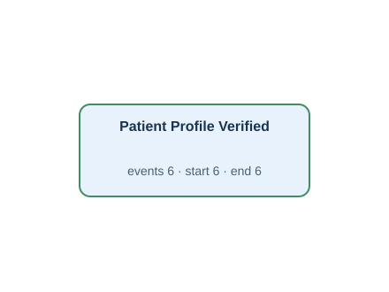</td><td width="50%" valign="top"><h4>Original tables</h4>
First 3 matched rows per table, in Gold log order. Matching uses event ID, activity and timestamp.

<strong><code>patient_profile</code></strong> · 6 source rows

<table><thead><tr><th>subject_id</th><th>profile_verified_at</th><th>preferred_language</th><th>Gold event · timestamp column · case</th></tr></thead><tbody><tr><td>10000001</td><td>2026-01-17T12:54:00Z</td><td>English</td><td>PAT:10000001:profile · Patient Profile Verified · profile_verified_at · P:10000001</td></tr><tr><td>10000003</td><td>2026-02-19T07:52:00Z</td><td>English</td><td>PAT:10000003:profile · Patient Profile Verified · profile_verified_at · P:10000003</td></tr><tr><td>10000005</td><td>2026-03-24T20:26:00Z</td><td>English</td><td>PAT:10000005:profile · Patient Profile Verified · profile_verified_at · P:10000005</td></tr></tbody></table>

Other tables referenced by Gold SQL

Includes case joins and branches of shared CTEs.
<ul><li><code>admission_detail</code> · discharge_summary_signed_at, hadm_id</li><li><code>admissions</code> · admittime, discharge_authorized_at, dischtime, edregtime, hadm_id, subject_id</li><li><code>emar</code> · charttime, emar_id, event_txt, pharmacy_id</li><li><code>lab_order</code> · hadm_id, order_id, results_verified_at, specimen_received_at, subject_id</li><li><code>labevents</code> · charttime, labevent_id, order_id, storetime</li><li><code>medication_order</code> · hadm_id, order_id, stopped_at</li><li><code>order_history</code> · action, history_id, lab_order_id, medication_order_id, occurred_at, procedure_order_id</li><li><code>pharmacy</code> · dispensed_at, order_id, pharmacy_id</li><li><code>procedure_episode</code> · endtime, order_id, procedureevent_id, starttime</li><li><code>procedure_order</code> · hadm_id, order_id, preparation_completed_at</li></ul>
</td></tr></table>

[Gold CSV](../../../datasets/hospitalflow/private/gold_logs/H09.csv)

## H09P — Q2

For each patient, show when their supplementary personal information was verified.

Events: **6** · Cases with events: **6** · Activities: **1** · Edges: **0**

<table><tr><td width="50%" valign="top"></td><td width="50%" valign="top"><h4>Original tables</h4>
First 3 matched rows per table, in Gold log order. Matching uses event ID, activity and timestamp.

<strong><code>patient_profile</code></strong> · 6 source rows

<table><thead><tr><th>subject_id</th><th>profile_verified_at</th><th>preferred_language</th><th>Gold event · timestamp column · case</th></tr></thead><tbody><tr><td>10000001</td><td>2026-01-17T12:54:00Z</td><td>English</td><td>PAT:10000001:profile · Patient Profile Verified · profile_verified_at · P:10000001</td></tr><tr><td>10000003</td><td>2026-02-19T07:52:00Z</td><td>English</td><td>PAT:10000003:profile · Patient Profile Verified · profile_verified_at · P:10000003</td></tr><tr><td>10000005</td><td>2026-03-24T20:26:00Z</td><td>English</td><td>PAT:10000005:profile · Patient Profile Verified · profile_verified_at · P:10000005</td></tr></tbody></table>

Other tables referenced by Gold SQL

Includes case joins and branches of shared CTEs.
<ul><li><code>admission_detail</code> · discharge_summary_signed_at, hadm_id</li><li><code>admissions</code> · admittime, discharge_authorized_at, dischtime, edregtime, hadm_id, subject_id</li><li><code>emar</code> · charttime, emar_id, event_txt, pharmacy_id</li><li><code>lab_order</code> · hadm_id, order_id, results_verified_at, specimen_received_at, subject_id</li><li><code>labevents</code> · charttime, labevent_id, order_id, storetime</li><li><code>medication_order</code> · hadm_id, order_id, stopped_at</li><li><code>order_history</code> · action, history_id, lab_order_id, medication_order_id, occurred_at, procedure_order_id</li><li><code>pharmacy</code> · dispensed_at, order_id, pharmacy_id</li><li><code>procedure_episode</code> · endtime, order_id, procedureevent_id, starttime</li><li><code>procedure_order</code> · hadm_id, order_id, preparation_completed_at</li></ul>
</td></tr></table>

[Gold CSV](../../../datasets/hospitalflow/private/gold_logs/H09P.csv)

## H10 — Q1

For each hospital admission, extract Discharge Summary Signed events.

Events: **5** · Cases with events: **5** · Activities: **1** · Edges: **0**

<table><tr><td width="50%" valign="top">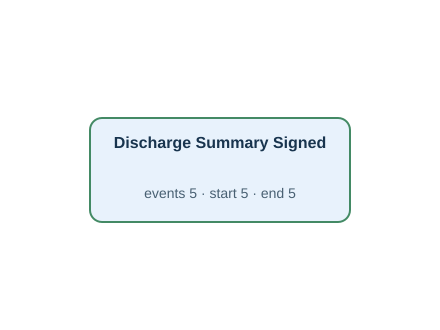</td><td width="50%" valign="top"><h4>Original tables</h4>
First 3 matched rows per table, in Gold log order. Matching uses event ID, activity and timestamp.

<strong><code>admission_detail</code></strong> · 5 source rows

<table><thead><tr><th>hadm_id</th><th>discharge_summary_signed_at</th><th>Gold event · timestamp column · case</th></tr></thead><tbody><tr><td>20000001</td><td>2026-01-19T18:13:00Z</td><td>ADM:20000001:summary · Discharge Summary Signed · discharge_summary_signed_at · A:20000001</td></tr><tr><td>20000004</td><td>2026-02-19T17:04:00Z</td><td>ADM:20000004:summary · Discharge Summary Signed · discharge_summary_signed_at · A:20000004</td></tr><tr><td>20000007</td><td>2026-03-11T15:45:00Z</td><td>ADM:20000007:summary · Discharge Summary Signed · discharge_summary_signed_at · A:20000007</td></tr></tbody></table>

FK-linked row examples for case and join context

<strong>admissions</strong>

<table><thead><tr><th>hadm_id</th><th>subject_id</th><th>edregtime</th><th>admittime</th><th>discharge_authorized_at</th><th>dischtime</th><th>Join from</th></tr></thead><tbody><tr><td>20000001</td><td>10000001</td><td>2026-01-17T13:42:00Z</td><td>2026-01-17T16:12:00Z</td><td>2026-01-19T13:33:00Z</td><td>2026-01-19T15:01:00Z</td><td>admission_detail (hadm_id → hadm_id)</td></tr><tr><td>20000004</td><td>10000002</td><td><em>NULL</em></td><td>2026-02-14T22:40:00Z</td><td>2026-02-19T12:53:00Z</td><td>2026-02-19T13:40:00Z</td><td>admission_detail (hadm_id → hadm_id)</td></tr><tr><td>20000007</td><td>10000004</td><td>2026-03-08T14:36:00Z</td><td>2026-03-08T17:59:00Z</td><td>2026-03-11T12:15:00Z</td><td>2026-03-11T13:09:00Z</td><td>admission_detail (hadm_id → hadm_id)</td></tr></tbody></table>

Other tables referenced by Gold SQL

Includes case joins and branches of shared CTEs.
<ul><li><code>admissions</code> · admittime, discharge_authorized_at, dischtime, edregtime, hadm_id, subject_id</li><li><code>emar</code> · charttime, emar_id, event_txt, pharmacy_id</li><li><code>lab_order</code> · hadm_id, order_id, results_verified_at, specimen_received_at, subject_id</li><li><code>labevents</code> · charttime, labevent_id, order_id, storetime</li><li><code>medication_order</code> · hadm_id, order_id, stopped_at</li><li><code>order_history</code> · action, history_id, lab_order_id, medication_order_id, occurred_at, procedure_order_id</li><li><code>patient_profile</code> · profile_verified_at, subject_id</li><li><code>pharmacy</code> · dispensed_at, order_id, pharmacy_id</li><li><code>procedure_episode</code> · endtime, order_id, procedureevent_id, starttime</li><li><code>procedure_order</code> · hadm_id, order_id, preparation_completed_at</li></ul>
</td></tr></table>

[Gold CSV](../../../datasets/hospitalflow/private/gold_logs/H10.csv)

## H10P — Q2

For each hospital stay, show when its discharge summary was signed.

Events: **5** · Cases with events: **5** · Activities: **1** · Edges: **0**

<table><tr><td width="50%" valign="top"></td><td width="50%" valign="top"><h4>Original tables</h4>
First 3 matched rows per table, in Gold log order. Matching uses event ID, activity and timestamp.

<strong><code>admission_detail</code></strong> · 5 source rows

<table><thead><tr><th>hadm_id</th><th>discharge_summary_signed_at</th><th>Gold event · timestamp column · case</th></tr></thead><tbody><tr><td>20000001</td><td>2026-01-19T18:13:00Z</td><td>ADM:20000001:summary · Discharge Summary Signed · discharge_summary_signed_at · A:20000001</td></tr><tr><td>20000004</td><td>2026-02-19T17:04:00Z</td><td>ADM:20000004:summary · Discharge Summary Signed · discharge_summary_signed_at · A:20000004</td></tr><tr><td>20000007</td><td>2026-03-11T15:45:00Z</td><td>ADM:20000007:summary · Discharge Summary Signed · discharge_summary_signed_at · A:20000007</td></tr></tbody></table>

FK-linked row examples for case and join context

<strong>admissions</strong>

<table><thead><tr><th>hadm_id</th><th>subject_id</th><th>edregtime</th><th>admittime</th><th>discharge_authorized_at</th><th>dischtime</th><th>Join from</th></tr></thead><tbody><tr><td>20000001</td><td>10000001</td><td>2026-01-17T13:42:00Z</td><td>2026-01-17T16:12:00Z</td><td>2026-01-19T13:33:00Z</td><td>2026-01-19T15:01:00Z</td><td>admission_detail (hadm_id → hadm_id)</td></tr><tr><td>20000004</td><td>10000002</td><td><em>NULL</em></td><td>2026-02-14T22:40:00Z</td><td>2026-02-19T12:53:00Z</td><td>2026-02-19T13:40:00Z</td><td>admission_detail (hadm_id → hadm_id)</td></tr><tr><td>20000007</td><td>10000004</td><td>2026-03-08T14:36:00Z</td><td>2026-03-08T17:59:00Z</td><td>2026-03-11T12:15:00Z</td><td>2026-03-11T13:09:00Z</td><td>admission_detail (hadm_id → hadm_id)</td></tr></tbody></table>

Other tables referenced by Gold SQL

Includes case joins and branches of shared CTEs.
<ul><li><code>admissions</code> · admittime, discharge_authorized_at, dischtime, edregtime, hadm_id, subject_id</li><li><code>emar</code> · charttime, emar_id, event_txt, pharmacy_id</li><li><code>lab_order</code> · hadm_id, order_id, results_verified_at, specimen_received_at, subject_id</li><li><code>labevents</code> · charttime, labevent_id, order_id, storetime</li><li><code>medication_order</code> · hadm_id, order_id, stopped_at</li><li><code>order_history</code> · action, history_id, lab_order_id, medication_order_id, occurred_at, procedure_order_id</li><li><code>patient_profile</code> · profile_verified_at, subject_id</li><li><code>pharmacy</code> · dispensed_at, order_id, pharmacy_id</li><li><code>procedure_episode</code> · endtime, order_id, procedureevent_id, starttime</li><li><code>procedure_order</code> · hadm_id, order_id, preparation_completed_at</li></ul>
</td></tr></table>

[Gold CSV](../../../datasets/hospitalflow/private/gold_logs/H10P.csv)

## H11 — Q1

For each patient, extract Patient Profile Verified and Hospital Admitted events.

Events: **21** · Cases with events: **11** · Activities: **2** · Edges: **2**

<table><tr><td width="50%" valign="top">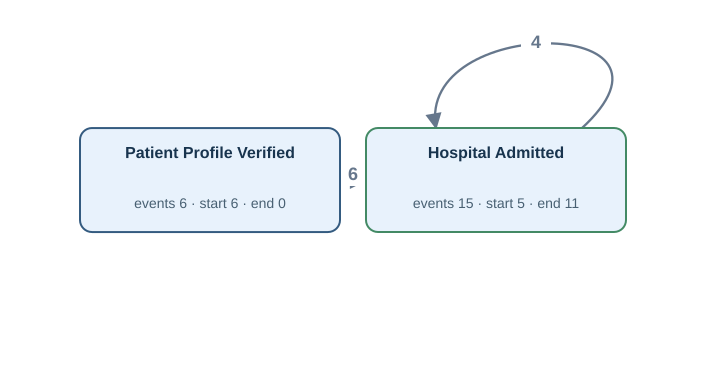</td><td width="50%" valign="top"><h4>Original tables</h4>
First 3 matched rows per table, in Gold log order. Matching uses event ID, activity and timestamp.

<strong><code>admissions</code></strong> · 15 source rows

<table><thead><tr><th>hadm_id</th><th>subject_id</th><th>edregtime</th><th>admittime</th><th>discharge_authorized_at</th><th>dischtime</th><th>Gold event · timestamp column · case</th></tr></thead><tbody><tr><td>20000001</td><td>10000001</td><td>2026-01-17T13:42:00Z</td><td>2026-01-17T16:12:00Z</td><td>2026-01-19T13:33:00Z</td><td>2026-01-19T15:01:00Z</td><td>ADM:20000001:in · Hospital Admitted · admittime · P:10000001</td></tr><tr><td>20000002</td><td>10000001</td><td><em>NULL</em></td><td>2026-01-27T13:19:00Z</td><td>2026-01-29T16:16:00Z</td><td>2026-01-29T18:54:00Z</td><td>ADM:20000002:in · Hospital Admitted · admittime · P:10000001</td></tr><tr><td>20000003</td><td>10000002</td><td>2026-02-03T09:01:00Z</td><td>2026-02-03T09:23:00Z</td><td>2026-02-08T17:49:00Z</td><td>2026-02-08T20:38:00Z</td><td>ADM:20000003:in · Hospital Admitted · admittime · P:10000002</td></tr></tbody></table>

<strong><code>patient_profile</code></strong> · 6 source rows

<table><thead><tr><th>subject_id</th><th>profile_verified_at</th><th>preferred_language</th><th>Gold event · timestamp column · case</th></tr></thead><tbody><tr><td>10000001</td><td>2026-01-17T12:54:00Z</td><td>English</td><td>PAT:10000001:profile · Patient Profile Verified · profile_verified_at · P:10000001</td></tr><tr><td>10000003</td><td>2026-02-19T07:52:00Z</td><td>English</td><td>PAT:10000003:profile · Patient Profile Verified · profile_verified_at · P:10000003</td></tr><tr><td>10000005</td><td>2026-03-24T20:26:00Z</td><td>English</td><td>PAT:10000005:profile · Patient Profile Verified · profile_verified_at · P:10000005</td></tr></tbody></table>

Other tables referenced by Gold SQL

Includes case joins and branches of shared CTEs.
<ul><li><code>admission_detail</code> · discharge_summary_signed_at, hadm_id</li><li><code>emar</code> · charttime, emar_id, event_txt, pharmacy_id</li><li><code>lab_order</code> · hadm_id, order_id, results_verified_at, specimen_received_at, subject_id</li><li><code>labevents</code> · charttime, labevent_id, order_id, storetime</li><li><code>medication_order</code> · hadm_id, order_id, stopped_at</li><li><code>order_history</code> · action, history_id, lab_order_id, medication_order_id, occurred_at, procedure_order_id</li><li><code>pharmacy</code> · dispensed_at, order_id, pharmacy_id</li><li><code>procedure_episode</code> · endtime, order_id, procedureevent_id, starttime</li><li><code>procedure_order</code> · hadm_id, order_id, preparation_completed_at</li></ul>
</td></tr></table>

[Gold CSV](../../../datasets/hospitalflow/private/gold_logs/H11.csv)

## H11P — Q2

Build a timeline for every patient showing verification of their supplementary personal information and their entries into hospital.

Events: **21** · Cases with events: **11** · Activities: **2** · Edges: **2**

<table><tr><td width="50%" valign="top"></td><td width="50%" valign="top"><h4>Original tables</h4>
First 3 matched rows per table, in Gold log order. Matching uses event ID, activity and timestamp.

<strong><code>admissions</code></strong> · 15 source rows

<table><thead><tr><th>hadm_id</th><th>subject_id</th><th>edregtime</th><th>admittime</th><th>discharge_authorized_at</th><th>dischtime</th><th>Gold event · timestamp column · case</th></tr></thead><tbody><tr><td>20000001</td><td>10000001</td><td>2026-01-17T13:42:00Z</td><td>2026-01-17T16:12:00Z</td><td>2026-01-19T13:33:00Z</td><td>2026-01-19T15:01:00Z</td><td>ADM:20000001:in · Hospital Admitted · admittime · P:10000001</td></tr><tr><td>20000002</td><td>10000001</td><td><em>NULL</em></td><td>2026-01-27T13:19:00Z</td><td>2026-01-29T16:16:00Z</td><td>2026-01-29T18:54:00Z</td><td>ADM:20000002:in · Hospital Admitted · admittime · P:10000001</td></tr><tr><td>20000003</td><td>10000002</td><td>2026-02-03T09:01:00Z</td><td>2026-02-03T09:23:00Z</td><td>2026-02-08T17:49:00Z</td><td>2026-02-08T20:38:00Z</td><td>ADM:20000003:in · Hospital Admitted · admittime · P:10000002</td></tr></tbody></table>

<strong><code>patient_profile</code></strong> · 6 source rows

<table><thead><tr><th>subject_id</th><th>profile_verified_at</th><th>preferred_language</th><th>Gold event · timestamp column · case</th></tr></thead><tbody><tr><td>10000001</td><td>2026-01-17T12:54:00Z</td><td>English</td><td>PAT:10000001:profile · Patient Profile Verified · profile_verified_at · P:10000001</td></tr><tr><td>10000003</td><td>2026-02-19T07:52:00Z</td><td>English</td><td>PAT:10000003:profile · Patient Profile Verified · profile_verified_at · P:10000003</td></tr><tr><td>10000005</td><td>2026-03-24T20:26:00Z</td><td>English</td><td>PAT:10000005:profile · Patient Profile Verified · profile_verified_at · P:10000005</td></tr></tbody></table>

Other tables referenced by Gold SQL

Includes case joins and branches of shared CTEs.
<ul><li><code>admission_detail</code> · discharge_summary_signed_at, hadm_id</li><li><code>emar</code> · charttime, emar_id, event_txt, pharmacy_id</li><li><code>lab_order</code> · hadm_id, order_id, results_verified_at, specimen_received_at, subject_id</li><li><code>labevents</code> · charttime, labevent_id, order_id, storetime</li><li><code>medication_order</code> · hadm_id, order_id, stopped_at</li><li><code>order_history</code> · action, history_id, lab_order_id, medication_order_id, occurred_at, procedure_order_id</li><li><code>pharmacy</code> · dispensed_at, order_id, pharmacy_id</li><li><code>procedure_episode</code> · endtime, order_id, procedureevent_id, starttime</li><li><code>procedure_order</code> · hadm_id, order_id, preparation_completed_at</li></ul>
</td></tr></table>

[Gold CSV](../../../datasets/hospitalflow/private/gold_logs/H11P.csv)

## HF07 — Q3

Extract the full recorded lifecycle for each lab measurement.

Events: **124** · Cases with events: **62** · Activities: **2** · Edges: **1**

<table><tr><td width="50%" valign="top">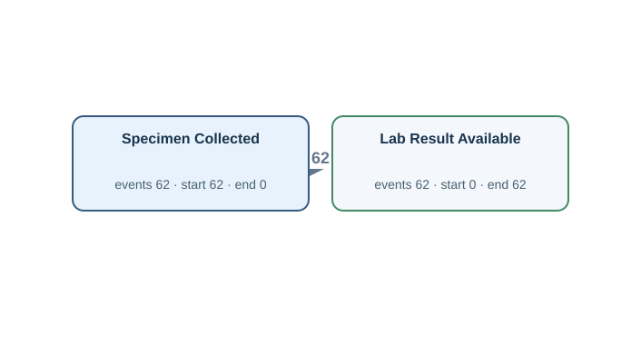</td><td width="50%" valign="top"><h4>Original tables</h4>
First 3 matched rows per table, in Gold log order. Matching uses event ID, activity and timestamp.

<strong><code>labevents</code></strong> · 62 source rows

<table><thead><tr><th>labevent_id</th><th>order_id</th><th>itemid</th><th>charttime</th><th>storetime</th><th>valuenum</th><th>valueuom</th><th>Gold event · timestamp column · case</th></tr></thead><tbody><tr><td>1</td><td>31070762</td><td>1003</td><td>2026-01-27T19:38:00Z</td><td>2026-01-27T23:09:00Z</td><td>14.6</td><td>g/dL</td><td>LABEV:1:chart · Specimen Collected · charttime · LM:1 | LABEV:1:result · Lab Result Available · storetime · LM:1</td></tr><tr><td>10</td><td>30000691</td><td>1003</td><td>2026-03-06T08:37:00Z</td><td>2026-03-06T11:15:00Z</td><td>12.5</td><td>g/dL</td><td>LABEV:10:chart · Specimen Collected · charttime · LM:10 | LABEV:10:result · Lab Result Available · storetime · LM:10</td></tr><tr><td>11</td><td>31023611</td><td>1001</td><td>2026-03-06T12:23:00Z</td><td>2026-03-06T14:41:00Z</td><td>0.69</td><td>mg/dL</td><td>LABEV:11:chart · Specimen Collected · charttime · LM:11 | LABEV:11:result · Lab Result Available · storetime · LM:11</td></tr></tbody></table>

FK-linked row examples for case and join context

<strong>admissions</strong>

<table><thead><tr><th>hadm_id</th><th>subject_id</th><th>edregtime</th><th>admittime</th><th>discharge_authorized_at</th><th>dischtime</th><th>Join from</th></tr></thead><tbody><tr><td>20000002</td><td>10000001</td><td><em>NULL</em></td><td>2026-01-27T13:19:00Z</td><td>2026-01-29T16:16:00Z</td><td>2026-01-29T18:54:00Z</td><td>lab_order (hadm_id → hadm_id)</td></tr><tr><td>20000006</td><td>10000003</td><td><em>NULL</em></td><td>2026-03-06T05:26:00Z</td><td>2026-03-07T14:36:00Z</td><td>2026-03-07T17:34:00Z</td><td>lab_order (hadm_id → hadm_id)</td></tr><tr><td>20000007</td><td>10000004</td><td>2026-03-08T14:36:00Z</td><td>2026-03-08T17:59:00Z</td><td>2026-03-11T12:15:00Z</td><td>2026-03-11T13:09:00Z</td><td>lab_order (hadm_id → hadm_id)</td></tr></tbody></table>

<strong>lab_order</strong>

<table><thead><tr><th>order_id</th><th>subject_id</th><th>hadm_id</th><th>specimen_received_at</th><th>results_verified_at</th><th>Join from</th></tr></thead><tbody><tr><td>31070762</td><td>10000001</td><td>20000002</td><td>2026-01-27T19:52:00Z</td><td>2026-01-28T00:32:00Z</td><td>labevents (order_id → order_id)</td></tr><tr><td>30000691</td><td>10000003</td><td>20000006</td><td>2026-03-06T10:37:00Z</td><td>2026-03-06T15:06:00Z</td><td>labevents (order_id → order_id)</td></tr><tr><td>31023611</td><td>10000003</td><td>20000006</td><td>2026-03-06T13:06:00Z</td><td>2026-03-06T16:40:00Z</td><td>labevents (order_id → order_id)</td></tr></tbody></table>

Other tables referenced by Gold SQL

Includes case joins and branches of shared CTEs.
<ul><li><code>admission_detail</code> · discharge_summary_signed_at, hadm_id</li><li><code>admissions</code> · admittime, discharge_authorized_at, dischtime, edregtime, hadm_id</li><li><code>emar</code> · charttime, emar_id, event_txt, pharmacy_id</li><li><code>lab_order</code> · order_id, results_verified_at, specimen_received_at</li><li><code>medication_order</code> · order_id, stopped_at</li><li><code>order_history</code> · action, history_id, lab_order_id, medication_order_id, occurred_at, procedure_order_id</li><li><code>patient_profile</code> · profile_verified_at, subject_id</li><li><code>pharmacy</code> · dispensed_at, order_id, pharmacy_id</li><li><code>procedure_episode</code> · endtime, order_id, procedureevent_id, starttime</li><li><code>procedure_order</code> · order_id, preparation_completed_at</li></ul>
</td></tr></table>

[Gold CSV](../../../datasets/hospitalflow/private/gold_logs/HF07.csv)

## HF07P — Q4

Show the entire recorded history of each individual laboratory measurement.

Events: **124** · Cases with events: **62** · Activities: **2** · Edges: **1**

<table><tr><td width="50%" valign="top"></td><td width="50%" valign="top"><h4>Original tables</h4>
First 3 matched rows per table, in Gold log order. Matching uses event ID, activity and timestamp.

<strong><code>labevents</code></strong> · 62 source rows

<table><thead><tr><th>labevent_id</th><th>order_id</th><th>itemid</th><th>charttime</th><th>storetime</th><th>valuenum</th><th>valueuom</th><th>Gold event · timestamp column · case</th></tr></thead><tbody><tr><td>1</td><td>31070762</td><td>1003</td><td>2026-01-27T19:38:00Z</td><td>2026-01-27T23:09:00Z</td><td>14.6</td><td>g/dL</td><td>LABEV:1:chart · Specimen Collected · charttime · LM:1 | LABEV:1:result · Lab Result Available · storetime · LM:1</td></tr><tr><td>10</td><td>30000691</td><td>1003</td><td>2026-03-06T08:37:00Z</td><td>2026-03-06T11:15:00Z</td><td>12.5</td><td>g/dL</td><td>LABEV:10:chart · Specimen Collected · charttime · LM:10 | LABEV:10:result · Lab Result Available · storetime · LM:10</td></tr><tr><td>11</td><td>31023611</td><td>1001</td><td>2026-03-06T12:23:00Z</td><td>2026-03-06T14:41:00Z</td><td>0.69</td><td>mg/dL</td><td>LABEV:11:chart · Specimen Collected · charttime · LM:11 | LABEV:11:result · Lab Result Available · storetime · LM:11</td></tr></tbody></table>

FK-linked row examples for case and join context

<strong>admissions</strong>

<table><thead><tr><th>hadm_id</th><th>subject_id</th><th>edregtime</th><th>admittime</th><th>discharge_authorized_at</th><th>dischtime</th><th>Join from</th></tr></thead><tbody><tr><td>20000002</td><td>10000001</td><td><em>NULL</em></td><td>2026-01-27T13:19:00Z</td><td>2026-01-29T16:16:00Z</td><td>2026-01-29T18:54:00Z</td><td>lab_order (hadm_id → hadm_id)</td></tr><tr><td>20000006</td><td>10000003</td><td><em>NULL</em></td><td>2026-03-06T05:26:00Z</td><td>2026-03-07T14:36:00Z</td><td>2026-03-07T17:34:00Z</td><td>lab_order (hadm_id → hadm_id)</td></tr><tr><td>20000007</td><td>10000004</td><td>2026-03-08T14:36:00Z</td><td>2026-03-08T17:59:00Z</td><td>2026-03-11T12:15:00Z</td><td>2026-03-11T13:09:00Z</td><td>lab_order (hadm_id → hadm_id)</td></tr></tbody></table>

<strong>lab_order</strong>

<table><thead><tr><th>order_id</th><th>subject_id</th><th>hadm_id</th><th>specimen_received_at</th><th>results_verified_at</th><th>Join from</th></tr></thead><tbody><tr><td>31070762</td><td>10000001</td><td>20000002</td><td>2026-01-27T19:52:00Z</td><td>2026-01-28T00:32:00Z</td><td>labevents (order_id → order_id)</td></tr><tr><td>30000691</td><td>10000003</td><td>20000006</td><td>2026-03-06T10:37:00Z</td><td>2026-03-06T15:06:00Z</td><td>labevents (order_id → order_id)</td></tr><tr><td>31023611</td><td>10000003</td><td>20000006</td><td>2026-03-06T13:06:00Z</td><td>2026-03-06T16:40:00Z</td><td>labevents (order_id → order_id)</td></tr></tbody></table>

Other tables referenced by Gold SQL

Includes case joins and branches of shared CTEs.
<ul><li><code>admission_detail</code> · discharge_summary_signed_at, hadm_id</li><li><code>admissions</code> · admittime, discharge_authorized_at, dischtime, edregtime, hadm_id</li><li><code>emar</code> · charttime, emar_id, event_txt, pharmacy_id</li><li><code>lab_order</code> · order_id, results_verified_at, specimen_received_at</li><li><code>medication_order</code> · order_id, stopped_at</li><li><code>order_history</code> · action, history_id, lab_order_id, medication_order_id, occurred_at, procedure_order_id</li><li><code>patient_profile</code> · profile_verified_at, subject_id</li><li><code>pharmacy</code> · dispensed_at, order_id, pharmacy_id</li><li><code>procedure_episode</code> · endtime, order_id, procedureevent_id, starttime</li><li><code>procedure_order</code> · order_id, preparation_completed_at</li></ul>
</td></tr></table>

[Gold CSV](../../../datasets/hospitalflow/private/gold_logs/HF07P.csv)

## HF08 — Q3

Extract the full recorded lifecycle for each medication administration.

Events: **67** · Cases with events: **67** · Activities: **2** · Edges: **0**

<table><tr><td width="50%" valign="top">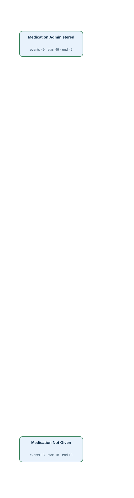</td><td width="50%" valign="top"><h4>Original tables</h4>
First 3 matched rows per table, in Gold log order. Matching uses event ID, activity and timestamp.

<strong><code>emar</code></strong> · 67 source rows

<table><thead><tr><th>emar_id</th><th>pharmacy_id</th><th>charttime</th><th>event_txt</th><th>storetime</th><th>Gold event · timestamp column · case</th></tr></thead><tbody><tr><td>1</td><td>40000001</td><td>2026-01-17T19:31:00Z</td><td>Administered</td><td>2026-01-17T20:12:00Z</td><td>EMAR:1 · Medication Administered · charttime · DOSE:1</td></tr><tr><td>10</td><td>40000004</td><td>2026-02-15T04:31:00Z</td><td>Not Given</td><td>2026-02-15T04:39:00Z</td><td>EMAR:10 · Medication Not Given · charttime · DOSE:10</td></tr><tr><td>11</td><td>40000004</td><td>2026-02-15T06:43:00Z</td><td>Administered</td><td>2026-02-15T07:38:00Z</td><td>EMAR:11 · Medication Administered · charttime · DOSE:11</td></tr></tbody></table>

FK-linked row examples for case and join context

<strong>admissions</strong>

<table><thead><tr><th>hadm_id</th><th>subject_id</th><th>edregtime</th><th>admittime</th><th>discharge_authorized_at</th><th>dischtime</th><th>Join from</th></tr></thead><tbody><tr><td>20000001</td><td>10000001</td><td>2026-01-17T13:42:00Z</td><td>2026-01-17T16:12:00Z</td><td>2026-01-19T13:33:00Z</td><td>2026-01-19T15:01:00Z</td><td>medication_order (hadm_id → hadm_id)</td></tr><tr><td>20000004</td><td>10000002</td><td><em>NULL</em></td><td>2026-02-14T22:40:00Z</td><td>2026-02-19T12:53:00Z</td><td>2026-02-19T13:40:00Z</td><td>medication_order (hadm_id → hadm_id)</td></tr><tr><td>20000005</td><td>10000003</td><td>2026-02-19T21:23:00Z</td><td>2026-02-20T00:15:00Z</td><td>2026-02-26T02:52:00Z</td><td>2026-02-26T06:10:00Z</td><td>medication_order (hadm_id → hadm_id)</td></tr></tbody></table>

<strong>medication_order</strong>

<table><thead><tr><th>order_id</th><th>hadm_id</th><th>medication</th><th>stopped_at</th><th>Join from</th></tr></thead><tbody><tr><td>32064975</td><td>20000001</td><td>Amoxicillin</td><td>2026-01-18T09:54:00Z</td><td>pharmacy (order_id → order_id)</td></tr><tr><td>32042809</td><td>20000004</td><td>Amoxicillin</td><td>2026-02-15T13:40:00Z</td><td>pharmacy (order_id → order_id)</td></tr><tr><td>32094539</td><td>20000004</td><td>Acetaminophen</td><td>2026-02-15T19:09:00Z</td><td>pharmacy (order_id → order_id)</td></tr></tbody></table>

<strong>pharmacy</strong>

<table><thead><tr><th>pharmacy_id</th><th>order_id</th><th>dispensed_at</th><th>Join from</th></tr></thead><tbody><tr><td>40000001</td><td>32064975</td><td>2026-01-17T18:40:00Z</td><td>emar (pharmacy_id → pharmacy_id)</td></tr><tr><td>40000004</td><td>32042809</td><td>2026-02-15T01:12:00Z</td><td>emar (pharmacy_id → pharmacy_id)</td></tr><tr><td>40000005</td><td>32094539</td><td>2026-02-15T02:21:00Z</td><td>emar (pharmacy_id → pharmacy_id)</td></tr></tbody></table>

Other tables referenced by Gold SQL

Includes case joins and branches of shared CTEs.
<ul><li><code>admission_detail</code> · discharge_summary_signed_at, hadm_id</li><li><code>admissions</code> · admittime, discharge_authorized_at, dischtime, edregtime, hadm_id</li><li><code>lab_order</code> · order_id, results_verified_at, specimen_received_at</li><li><code>labevents</code> · charttime, labevent_id, order_id, storetime</li><li><code>medication_order</code> · order_id, stopped_at</li><li><code>order_history</code> · action, history_id, lab_order_id, medication_order_id, occurred_at, procedure_order_id</li><li><code>patient_profile</code> · profile_verified_at, subject_id</li><li><code>pharmacy</code> · dispensed_at, order_id, pharmacy_id</li><li><code>procedure_episode</code> · endtime, order_id, procedureevent_id, starttime</li><li><code>procedure_order</code> · order_id, preparation_completed_at</li></ul>
</td></tr></table>

[Gold CSV](../../../datasets/hospitalflow/private/gold_logs/HF08.csv)

## HF08P — Q4

Build the complete recorded history of every individual medication administration record.

Events: **67** · Cases with events: **67** · Activities: **2** · Edges: **0**

<table><tr><td width="50%" valign="top"></td><td width="50%" valign="top"><h4>Original tables</h4>
First 3 matched rows per table, in Gold log order. Matching uses event ID, activity and timestamp.

<strong><code>emar</code></strong> · 67 source rows

<table><thead><tr><th>emar_id</th><th>pharmacy_id</th><th>charttime</th><th>event_txt</th><th>storetime</th><th>Gold event · timestamp column · case</th></tr></thead><tbody><tr><td>1</td><td>40000001</td><td>2026-01-17T19:31:00Z</td><td>Administered</td><td>2026-01-17T20:12:00Z</td><td>EMAR:1 · Medication Administered · charttime · DOSE:1</td></tr><tr><td>10</td><td>40000004</td><td>2026-02-15T04:31:00Z</td><td>Not Given</td><td>2026-02-15T04:39:00Z</td><td>EMAR:10 · Medication Not Given · charttime · DOSE:10</td></tr><tr><td>11</td><td>40000004</td><td>2026-02-15T06:43:00Z</td><td>Administered</td><td>2026-02-15T07:38:00Z</td><td>EMAR:11 · Medication Administered · charttime · DOSE:11</td></tr></tbody></table>

FK-linked row examples for case and join context

<strong>admissions</strong>

<table><thead><tr><th>hadm_id</th><th>subject_id</th><th>edregtime</th><th>admittime</th><th>discharge_authorized_at</th><th>dischtime</th><th>Join from</th></tr></thead><tbody><tr><td>20000001</td><td>10000001</td><td>2026-01-17T13:42:00Z</td><td>2026-01-17T16:12:00Z</td><td>2026-01-19T13:33:00Z</td><td>2026-01-19T15:01:00Z</td><td>medication_order (hadm_id → hadm_id)</td></tr><tr><td>20000004</td><td>10000002</td><td><em>NULL</em></td><td>2026-02-14T22:40:00Z</td><td>2026-02-19T12:53:00Z</td><td>2026-02-19T13:40:00Z</td><td>medication_order (hadm_id → hadm_id)</td></tr><tr><td>20000005</td><td>10000003</td><td>2026-02-19T21:23:00Z</td><td>2026-02-20T00:15:00Z</td><td>2026-02-26T02:52:00Z</td><td>2026-02-26T06:10:00Z</td><td>medication_order (hadm_id → hadm_id)</td></tr></tbody></table>

<strong>medication_order</strong>

<table><thead><tr><th>order_id</th><th>hadm_id</th><th>medication</th><th>stopped_at</th><th>Join from</th></tr></thead><tbody><tr><td>32064975</td><td>20000001</td><td>Amoxicillin</td><td>2026-01-18T09:54:00Z</td><td>pharmacy (order_id → order_id)</td></tr><tr><td>32042809</td><td>20000004</td><td>Amoxicillin</td><td>2026-02-15T13:40:00Z</td><td>pharmacy (order_id → order_id)</td></tr><tr><td>32094539</td><td>20000004</td><td>Acetaminophen</td><td>2026-02-15T19:09:00Z</td><td>pharmacy (order_id → order_id)</td></tr></tbody></table>

<strong>pharmacy</strong>

<table><thead><tr><th>pharmacy_id</th><th>order_id</th><th>dispensed_at</th><th>Join from</th></tr></thead><tbody><tr><td>40000001</td><td>32064975</td><td>2026-01-17T18:40:00Z</td><td>emar (pharmacy_id → pharmacy_id)</td></tr><tr><td>40000004</td><td>32042809</td><td>2026-02-15T01:12:00Z</td><td>emar (pharmacy_id → pharmacy_id)</td></tr><tr><td>40000005</td><td>32094539</td><td>2026-02-15T02:21:00Z</td><td>emar (pharmacy_id → pharmacy_id)</td></tr></tbody></table>

Other tables referenced by Gold SQL

Includes case joins and branches of shared CTEs.
<ul><li><code>admission_detail</code> · discharge_summary_signed_at, hadm_id</li><li><code>admissions</code> · admittime, discharge_authorized_at, dischtime, edregtime, hadm_id</li><li><code>lab_order</code> · order_id, results_verified_at, specimen_received_at</li><li><code>labevents</code> · charttime, labevent_id, order_id, storetime</li><li><code>medication_order</code> · order_id, stopped_at</li><li><code>order_history</code> · action, history_id, lab_order_id, medication_order_id, occurred_at, procedure_order_id</li><li><code>patient_profile</code> · profile_verified_at, subject_id</li><li><code>pharmacy</code> · dispensed_at, order_id, pharmacy_id</li><li><code>procedure_episode</code> · endtime, order_id, procedureevent_id, starttime</li><li><code>procedure_order</code> · order_id, preparation_completed_at</li></ul>
</td></tr></table>

[Gold CSV](../../../datasets/hospitalflow/private/gold_logs/HF08P.csv)

## HF09 — Q3

Extract the full recorded lifecycle for each procedure episode.

Events: **42** · Cases with events: **23** · Activities: **2** · Edges: **1**

<table><tr><td width="50%" valign="top">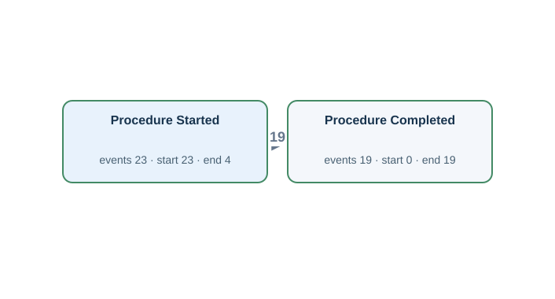</td><td width="50%" valign="top"><h4>Original tables</h4>
First 3 matched rows per table, in Gold log order. Matching uses event ID, activity and timestamp.

<strong><code>procedure_episode</code></strong> · 23 source rows

<table><thead><tr><th>procedureevent_id</th><th>order_id</th><th>starttime</th><th>endtime</th><th>storetime</th><th>Gold event · timestamp column · case</th></tr></thead><tbody><tr><td>1</td><td>33032683</td><td>2026-01-27T18:22:00Z</td><td>2026-01-27T19:24:00Z</td><td>2026-01-27T18:40:00Z</td><td>PROCEV:1:end · Procedure Completed · endtime · EP:1 | PROCEV:1:start · Procedure Started · starttime · EP:1</td></tr><tr><td>10</td><td>33043088</td><td>2026-04-11T06:57:00Z</td><td>2026-04-11T09:07:00Z</td><td>2026-04-11T07:25:00Z</td><td>PROCEV:10:end · Procedure Completed · endtime · EP:10 | PROCEV:10:start · Procedure Started · starttime · EP:10</td></tr><tr><td>11</td><td>33043088</td><td>2026-04-11T11:30:00Z</td><td>2026-04-11T13:22:00Z</td><td>2026-04-11T11:48:00Z</td><td>PROCEV:11:end · Procedure Completed · endtime · EP:11 | PROCEV:11:start · Procedure Started · starttime · EP:11</td></tr></tbody></table>

FK-linked row examples for case and join context

<strong>admissions</strong>

<table><thead><tr><th>hadm_id</th><th>subject_id</th><th>edregtime</th><th>admittime</th><th>discharge_authorized_at</th><th>dischtime</th><th>Join from</th></tr></thead><tbody><tr><td>20000002</td><td>10000001</td><td><em>NULL</em></td><td>2026-01-27T13:19:00Z</td><td>2026-01-29T16:16:00Z</td><td>2026-01-29T18:54:00Z</td><td>procedure_order (hadm_id → hadm_id)</td></tr><tr><td>20000010</td><td>10000006</td><td><em>NULL</em></td><td>2026-04-11T01:01:00Z</td><td>2026-04-12T11:24:00Z</td><td>2026-04-12T13:01:00Z</td><td>procedure_order (hadm_id → hadm_id)</td></tr><tr><td>20000011</td><td>10000007</td><td>2026-04-27T14:12:00Z</td><td>2026-04-27T17:48:00Z</td><td>2026-04-30T17:44:00Z</td><td>2026-04-30T21:24:00Z</td><td>procedure_order (hadm_id → hadm_id)</td></tr></tbody></table>

<strong>procedure_order</strong>

<table><thead><tr><th>order_id</th><th>hadm_id</th><th>procedure_name</th><th>preparation_completed_at</th><th>Join from</th></tr></thead><tbody><tr><td>33032683</td><td>20000002</td><td>Bronchoscopy</td><td>2026-01-27T16:50:00Z</td><td>procedure_episode (order_id → order_id)</td></tr><tr><td>33043088</td><td>20000010</td><td>Endoscopy</td><td>2026-04-11T03:41:00Z</td><td>procedure_episode (order_id → order_id)</td></tr><tr><td>33091192</td><td>20000011</td><td>Endoscopy</td><td>2026-04-27T20:26:00Z</td><td>procedure_episode (order_id → order_id)</td></tr></tbody></table>

Other tables referenced by Gold SQL

Includes case joins and branches of shared CTEs.
<ul><li><code>admission_detail</code> · discharge_summary_signed_at, hadm_id</li><li><code>admissions</code> · admittime, discharge_authorized_at, dischtime, edregtime, hadm_id</li><li><code>emar</code> · charttime, emar_id, event_txt, pharmacy_id</li><li><code>lab_order</code> · order_id, results_verified_at, specimen_received_at</li><li><code>labevents</code> · charttime, labevent_id, order_id, storetime</li><li><code>medication_order</code> · order_id, stopped_at</li><li><code>order_history</code> · action, history_id, lab_order_id, medication_order_id, occurred_at, procedure_order_id</li><li><code>patient_profile</code> · profile_verified_at, subject_id</li><li><code>pharmacy</code> · dispensed_at, order_id, pharmacy_id</li><li><code>procedure_order</code> · order_id, preparation_completed_at</li></ul>
</td></tr></table>

[Gold CSV](../../../datasets/hospitalflow/private/gold_logs/HF09.csv)

## HF09P — Q4

Trace each individual procedure episode through its whole recorded lifecycle.

Events: **42** · Cases with events: **23** · Activities: **2** · Edges: **1**

<table><tr><td width="50%" valign="top"></td><td width="50%" valign="top"><h4>Original tables</h4>
First 3 matched rows per table, in Gold log order. Matching uses event ID, activity and timestamp.

<strong><code>procedure_episode</code></strong> · 23 source rows

<table><thead><tr><th>procedureevent_id</th><th>order_id</th><th>starttime</th><th>endtime</th><th>storetime</th><th>Gold event · timestamp column · case</th></tr></thead><tbody><tr><td>1</td><td>33032683</td><td>2026-01-27T18:22:00Z</td><td>2026-01-27T19:24:00Z</td><td>2026-01-27T18:40:00Z</td><td>PROCEV:1:end · Procedure Completed · endtime · EP:1 | PROCEV:1:start · Procedure Started · starttime · EP:1</td></tr><tr><td>10</td><td>33043088</td><td>2026-04-11T06:57:00Z</td><td>2026-04-11T09:07:00Z</td><td>2026-04-11T07:25:00Z</td><td>PROCEV:10:end · Procedure Completed · endtime · EP:10 | PROCEV:10:start · Procedure Started · starttime · EP:10</td></tr><tr><td>11</td><td>33043088</td><td>2026-04-11T11:30:00Z</td><td>2026-04-11T13:22:00Z</td><td>2026-04-11T11:48:00Z</td><td>PROCEV:11:end · Procedure Completed · endtime · EP:11 | PROCEV:11:start · Procedure Started · starttime · EP:11</td></tr></tbody></table>

FK-linked row examples for case and join context

<strong>admissions</strong>

<table><thead><tr><th>hadm_id</th><th>subject_id</th><th>edregtime</th><th>admittime</th><th>discharge_authorized_at</th><th>dischtime</th><th>Join from</th></tr></thead><tbody><tr><td>20000002</td><td>10000001</td><td><em>NULL</em></td><td>2026-01-27T13:19:00Z</td><td>2026-01-29T16:16:00Z</td><td>2026-01-29T18:54:00Z</td><td>procedure_order (hadm_id → hadm_id)</td></tr><tr><td>20000010</td><td>10000006</td><td><em>NULL</em></td><td>2026-04-11T01:01:00Z</td><td>2026-04-12T11:24:00Z</td><td>2026-04-12T13:01:00Z</td><td>procedure_order (hadm_id → hadm_id)</td></tr><tr><td>20000011</td><td>10000007</td><td>2026-04-27T14:12:00Z</td><td>2026-04-27T17:48:00Z</td><td>2026-04-30T17:44:00Z</td><td>2026-04-30T21:24:00Z</td><td>procedure_order (hadm_id → hadm_id)</td></tr></tbody></table>

<strong>procedure_order</strong>

<table><thead><tr><th>order_id</th><th>hadm_id</th><th>procedure_name</th><th>preparation_completed_at</th><th>Join from</th></tr></thead><tbody><tr><td>33032683</td><td>20000002</td><td>Bronchoscopy</td><td>2026-01-27T16:50:00Z</td><td>procedure_episode (order_id → order_id)</td></tr><tr><td>33043088</td><td>20000010</td><td>Endoscopy</td><td>2026-04-11T03:41:00Z</td><td>procedure_episode (order_id → order_id)</td></tr><tr><td>33091192</td><td>20000011</td><td>Endoscopy</td><td>2026-04-27T20:26:00Z</td><td>procedure_episode (order_id → order_id)</td></tr></tbody></table>

Other tables referenced by Gold SQL

Includes case joins and branches of shared CTEs.
<ul><li><code>admission_detail</code> · discharge_summary_signed_at, hadm_id</li><li><code>admissions</code> · admittime, discharge_authorized_at, dischtime, edregtime, hadm_id</li><li><code>emar</code> · charttime, emar_id, event_txt, pharmacy_id</li><li><code>lab_order</code> · order_id, results_verified_at, specimen_received_at</li><li><code>labevents</code> · charttime, labevent_id, order_id, storetime</li><li><code>medication_order</code> · order_id, stopped_at</li><li><code>order_history</code> · action, history_id, lab_order_id, medication_order_id, occurred_at, procedure_order_id</li><li><code>patient_profile</code> · profile_verified_at, subject_id</li><li><code>pharmacy</code> · dispensed_at, order_id, pharmacy_id</li><li><code>procedure_order</code> · order_id, preparation_completed_at</li></ul>
</td></tr></table>

[Gold CSV](../../../datasets/hospitalflow/private/gold_logs/HF09P.csv)

## HF10 — Q3

Extract the full recorded lifecycle for each pharmacy dispensing record.

Events: **101** · Cases with events: **34** · Activities: **3** · Edges: **5**

<table><tr><td width="50%" valign="top">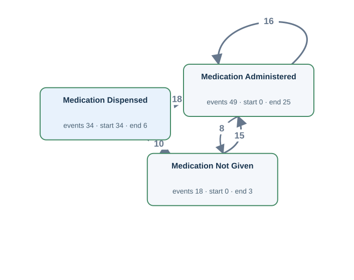</td><td width="50%" valign="top"><h4>Original tables</h4>
First 3 matched rows per table, in Gold log order. Matching uses event ID, activity and timestamp.

<strong><code>emar</code></strong> · 67 source rows

<table><thead><tr><th>emar_id</th><th>pharmacy_id</th><th>charttime</th><th>event_txt</th><th>storetime</th><th>Gold event · timestamp column · case</th></tr></thead><tbody><tr><td>1</td><td>40000001</td><td>2026-01-17T19:31:00Z</td><td>Administered</td><td>2026-01-17T20:12:00Z</td><td>EMAR:1 · Medication Administered · charttime · PHARM:40000001</td></tr><tr><td>2</td><td>40000001</td><td>2026-01-17T21:22:00Z</td><td>Not Given</td><td>2026-01-17T21:44:00Z</td><td>EMAR:2 · Medication Not Given · charttime · PHARM:40000001</td></tr><tr><td>3</td><td>40000001</td><td>2026-01-17T23:09:00Z</td><td>Administered</td><td>2026-01-17T23:56:00Z</td><td>EMAR:3 · Medication Administered · charttime · PHARM:40000001</td></tr></tbody></table>

<strong><code>pharmacy</code></strong> · 34 source rows

<table><thead><tr><th>pharmacy_id</th><th>order_id</th><th>dispensed_at</th><th>Gold event · timestamp column · case</th></tr></thead><tbody><tr><td>40000001</td><td>32064975</td><td>2026-01-17T18:40:00Z</td><td>PHARM:40000001:dispense · Medication Dispensed · dispensed_at · PHARM:40000001</td></tr><tr><td>40000002</td><td>32064975</td><td>2026-01-17T22:07:00Z</td><td>PHARM:40000002:dispense · Medication Dispensed · dispensed_at · PHARM:40000002</td></tr><tr><td>40000003</td><td>32028896</td><td>2026-01-17T19:12:00Z</td><td>PHARM:40000003:dispense · Medication Dispensed · dispensed_at · PHARM:40000003</td></tr></tbody></table>

FK-linked row examples for case and join context

<strong>admissions</strong>

<table><thead><tr><th>hadm_id</th><th>subject_id</th><th>edregtime</th><th>admittime</th><th>discharge_authorized_at</th><th>dischtime</th><th>Join from</th></tr></thead><tbody><tr><td>20000001</td><td>10000001</td><td>2026-01-17T13:42:00Z</td><td>2026-01-17T16:12:00Z</td><td>2026-01-19T13:33:00Z</td><td>2026-01-19T15:01:00Z</td><td>medication_order (hadm_id → hadm_id)</td></tr><tr><td>20000004</td><td>10000002</td><td><em>NULL</em></td><td>2026-02-14T22:40:00Z</td><td>2026-02-19T12:53:00Z</td><td>2026-02-19T13:40:00Z</td><td>medication_order (hadm_id → hadm_id)</td></tr><tr><td>20000005</td><td>10000003</td><td>2026-02-19T21:23:00Z</td><td>2026-02-20T00:15:00Z</td><td>2026-02-26T02:52:00Z</td><td>2026-02-26T06:10:00Z</td><td>medication_order (hadm_id → hadm_id)</td></tr></tbody></table>

<strong>medication_order</strong>

<table><thead><tr><th>order_id</th><th>hadm_id</th><th>medication</th><th>stopped_at</th><th>Join from</th></tr></thead><tbody><tr><td>32064975</td><td>20000001</td><td>Amoxicillin</td><td>2026-01-18T09:54:00Z</td><td>pharmacy (order_id → order_id)</td></tr><tr><td>32028896</td><td>20000001</td><td>Acetaminophen</td><td>2026-01-18T20:48:00Z</td><td>pharmacy (order_id → order_id)</td></tr><tr><td>32042809</td><td>20000004</td><td>Amoxicillin</td><td>2026-02-15T13:40:00Z</td><td>pharmacy (order_id → order_id)</td></tr></tbody></table>

Other tables referenced by Gold SQL

Includes case joins and branches of shared CTEs.
<ul><li><code>admission_detail</code> · discharge_summary_signed_at, hadm_id</li><li><code>admissions</code> · admittime, discharge_authorized_at, dischtime, edregtime, hadm_id</li><li><code>lab_order</code> · order_id, results_verified_at, specimen_received_at</li><li><code>labevents</code> · charttime, labevent_id, order_id, storetime</li><li><code>medication_order</code> · order_id, stopped_at</li><li><code>order_history</code> · action, history_id, lab_order_id, medication_order_id, occurred_at, procedure_order_id</li><li><code>patient_profile</code> · profile_verified_at, subject_id</li><li><code>procedure_episode</code> · endtime, order_id, procedureevent_id, starttime</li><li><code>procedure_order</code> · order_id, preparation_completed_at</li></ul>
</td></tr></table>

[Gold CSV](../../../datasets/hospitalflow/private/gold_logs/HF10.csv)

## HF10P — Q4

Show the complete recorded course associated with each individual pharmacy dispensing record.

Events: **101** · Cases with events: **34** · Activities: **3** · Edges: **5**

<table><tr><td width="50%" valign="top"></td><td width="50%" valign="top"><h4>Original tables</h4>
First 3 matched rows per table, in Gold log order. Matching uses event ID, activity and timestamp.

<strong><code>emar</code></strong> · 67 source rows

<table><thead><tr><th>emar_id</th><th>pharmacy_id</th><th>charttime</th><th>event_txt</th><th>storetime</th><th>Gold event · timestamp column · case</th></tr></thead><tbody><tr><td>1</td><td>40000001</td><td>2026-01-17T19:31:00Z</td><td>Administered</td><td>2026-01-17T20:12:00Z</td><td>EMAR:1 · Medication Administered · charttime · PHARM:40000001</td></tr><tr><td>2</td><td>40000001</td><td>2026-01-17T21:22:00Z</td><td>Not Given</td><td>2026-01-17T21:44:00Z</td><td>EMAR:2 · Medication Not Given · charttime · PHARM:40000001</td></tr><tr><td>3</td><td>40000001</td><td>2026-01-17T23:09:00Z</td><td>Administered</td><td>2026-01-17T23:56:00Z</td><td>EMAR:3 · Medication Administered · charttime · PHARM:40000001</td></tr></tbody></table>

<strong><code>pharmacy</code></strong> · 34 source rows

<table><thead><tr><th>pharmacy_id</th><th>order_id</th><th>dispensed_at</th><th>Gold event · timestamp column · case</th></tr></thead><tbody><tr><td>40000001</td><td>32064975</td><td>2026-01-17T18:40:00Z</td><td>PHARM:40000001:dispense · Medication Dispensed · dispensed_at · PHARM:40000001</td></tr><tr><td>40000002</td><td>32064975</td><td>2026-01-17T22:07:00Z</td><td>PHARM:40000002:dispense · Medication Dispensed · dispensed_at · PHARM:40000002</td></tr><tr><td>40000003</td><td>32028896</td><td>2026-01-17T19:12:00Z</td><td>PHARM:40000003:dispense · Medication Dispensed · dispensed_at · PHARM:40000003</td></tr></tbody></table>

FK-linked row examples for case and join context

<strong>admissions</strong>

<table><thead><tr><th>hadm_id</th><th>subject_id</th><th>edregtime</th><th>admittime</th><th>discharge_authorized_at</th><th>dischtime</th><th>Join from</th></tr></thead><tbody><tr><td>20000001</td><td>10000001</td><td>2026-01-17T13:42:00Z</td><td>2026-01-17T16:12:00Z</td><td>2026-01-19T13:33:00Z</td><td>2026-01-19T15:01:00Z</td><td>medication_order (hadm_id → hadm_id)</td></tr><tr><td>20000004</td><td>10000002</td><td><em>NULL</em></td><td>2026-02-14T22:40:00Z</td><td>2026-02-19T12:53:00Z</td><td>2026-02-19T13:40:00Z</td><td>medication_order (hadm_id → hadm_id)</td></tr><tr><td>20000005</td><td>10000003</td><td>2026-02-19T21:23:00Z</td><td>2026-02-20T00:15:00Z</td><td>2026-02-26T02:52:00Z</td><td>2026-02-26T06:10:00Z</td><td>medication_order (hadm_id → hadm_id)</td></tr></tbody></table>

<strong>medication_order</strong>

<table><thead><tr><th>order_id</th><th>hadm_id</th><th>medication</th><th>stopped_at</th><th>Join from</th></tr></thead><tbody><tr><td>32064975</td><td>20000001</td><td>Amoxicillin</td><td>2026-01-18T09:54:00Z</td><td>pharmacy (order_id → order_id)</td></tr><tr><td>32028896</td><td>20000001</td><td>Acetaminophen</td><td>2026-01-18T20:48:00Z</td><td>pharmacy (order_id → order_id)</td></tr><tr><td>32042809</td><td>20000004</td><td>Amoxicillin</td><td>2026-02-15T13:40:00Z</td><td>pharmacy (order_id → order_id)</td></tr></tbody></table>

Other tables referenced by Gold SQL

Includes case joins and branches of shared CTEs.
<ul><li><code>admission_detail</code> · discharge_summary_signed_at, hadm_id</li><li><code>admissions</code> · admittime, discharge_authorized_at, dischtime, edregtime, hadm_id</li><li><code>lab_order</code> · order_id, results_verified_at, specimen_received_at</li><li><code>labevents</code> · charttime, labevent_id, order_id, storetime</li><li><code>medication_order</code> · order_id, stopped_at</li><li><code>order_history</code> · action, history_id, lab_order_id, medication_order_id, occurred_at, procedure_order_id</li><li><code>patient_profile</code> · profile_verified_at, subject_id</li><li><code>procedure_episode</code> · endtime, order_id, procedureevent_id, starttime</li><li><code>procedure_order</code> · order_id, preparation_completed_at</li></ul>
</td></tr></table>

[Gold CSV](../../../datasets/hospitalflow/private/gold_logs/HF10P.csv)

## H12 — Q1

For each pharmacy dispensing record, extract Medication Dispensed, Medication Administered and Medication Not Given events.

Events: **101** · Cases with events: **34** · Activities: **3** · Edges: **5**

<table><tr><td width="50%" valign="top"></td><td width="50%" valign="top"><h4>Original tables</h4>
First 3 matched rows per table, in Gold log order. Matching uses event ID, activity and timestamp.

<strong><code>emar</code></strong> · 67 source rows

<table><thead><tr><th>emar_id</th><th>pharmacy_id</th><th>charttime</th><th>event_txt</th><th>storetime</th><th>Gold event · timestamp column · case</th></tr></thead><tbody><tr><td>1</td><td>40000001</td><td>2026-01-17T19:31:00Z</td><td>Administered</td><td>2026-01-17T20:12:00Z</td><td>EMAR:1 · Medication Administered · charttime · PHARM:40000001</td></tr><tr><td>2</td><td>40000001</td><td>2026-01-17T21:22:00Z</td><td>Not Given</td><td>2026-01-17T21:44:00Z</td><td>EMAR:2 · Medication Not Given · charttime · PHARM:40000001</td></tr><tr><td>3</td><td>40000001</td><td>2026-01-17T23:09:00Z</td><td>Administered</td><td>2026-01-17T23:56:00Z</td><td>EMAR:3 · Medication Administered · charttime · PHARM:40000001</td></tr></tbody></table>

<strong><code>pharmacy</code></strong> · 34 source rows

<table><thead><tr><th>pharmacy_id</th><th>order_id</th><th>dispensed_at</th><th>Gold event · timestamp column · case</th></tr></thead><tbody><tr><td>40000001</td><td>32064975</td><td>2026-01-17T18:40:00Z</td><td>PHARM:40000001:dispense · Medication Dispensed · dispensed_at · PHARM:40000001</td></tr><tr><td>40000002</td><td>32064975</td><td>2026-01-17T22:07:00Z</td><td>PHARM:40000002:dispense · Medication Dispensed · dispensed_at · PHARM:40000002</td></tr><tr><td>40000003</td><td>32028896</td><td>2026-01-17T19:12:00Z</td><td>PHARM:40000003:dispense · Medication Dispensed · dispensed_at · PHARM:40000003</td></tr></tbody></table>

FK-linked row examples for case and join context

<strong>admissions</strong>

<table><thead><tr><th>hadm_id</th><th>subject_id</th><th>edregtime</th><th>admittime</th><th>discharge_authorized_at</th><th>dischtime</th><th>Join from</th></tr></thead><tbody><tr><td>20000001</td><td>10000001</td><td>2026-01-17T13:42:00Z</td><td>2026-01-17T16:12:00Z</td><td>2026-01-19T13:33:00Z</td><td>2026-01-19T15:01:00Z</td><td>medication_order (hadm_id → hadm_id)</td></tr><tr><td>20000004</td><td>10000002</td><td><em>NULL</em></td><td>2026-02-14T22:40:00Z</td><td>2026-02-19T12:53:00Z</td><td>2026-02-19T13:40:00Z</td><td>medication_order (hadm_id → hadm_id)</td></tr><tr><td>20000005</td><td>10000003</td><td>2026-02-19T21:23:00Z</td><td>2026-02-20T00:15:00Z</td><td>2026-02-26T02:52:00Z</td><td>2026-02-26T06:10:00Z</td><td>medication_order (hadm_id → hadm_id)</td></tr></tbody></table>

<strong>medication_order</strong>

<table><thead><tr><th>order_id</th><th>hadm_id</th><th>medication</th><th>stopped_at</th><th>Join from</th></tr></thead><tbody><tr><td>32064975</td><td>20000001</td><td>Amoxicillin</td><td>2026-01-18T09:54:00Z</td><td>pharmacy (order_id → order_id)</td></tr><tr><td>32028896</td><td>20000001</td><td>Acetaminophen</td><td>2026-01-18T20:48:00Z</td><td>pharmacy (order_id → order_id)</td></tr><tr><td>32042809</td><td>20000004</td><td>Amoxicillin</td><td>2026-02-15T13:40:00Z</td><td>pharmacy (order_id → order_id)</td></tr></tbody></table>

Other tables referenced by Gold SQL

Includes case joins and branches of shared CTEs.
<ul><li><code>admission_detail</code> · discharge_summary_signed_at, hadm_id</li><li><code>admissions</code> · admittime, discharge_authorized_at, dischtime, edregtime, hadm_id</li><li><code>lab_order</code> · order_id, results_verified_at, specimen_received_at</li><li><code>labevents</code> · charttime, labevent_id, order_id, storetime</li><li><code>medication_order</code> · order_id, stopped_at</li><li><code>order_history</code> · action, history_id, lab_order_id, medication_order_id, occurred_at, procedure_order_id</li><li><code>patient_profile</code> · profile_verified_at, subject_id</li><li><code>procedure_episode</code> · endtime, order_id, procedureevent_id, starttime</li><li><code>procedure_order</code> · order_id, preparation_completed_at</li></ul>
</td></tr></table>

[Gold CSV](../../../datasets/hospitalflow/private/gold_logs/H12.csv)

## H12P — Q2

Group the medication dispensing, subsequent doses given and doses not given by the pharmacy dispensing record they refer to.

Events: **101** · Cases with events: **34** · Activities: **3** · Edges: **5**

<table><tr><td width="50%" valign="top"></td><td width="50%" valign="top"><h4>Original tables</h4>
First 3 matched rows per table, in Gold log order. Matching uses event ID, activity and timestamp.

<strong><code>emar</code></strong> · 67 source rows

<table><thead><tr><th>emar_id</th><th>pharmacy_id</th><th>charttime</th><th>event_txt</th><th>storetime</th><th>Gold event · timestamp column · case</th></tr></thead><tbody><tr><td>1</td><td>40000001</td><td>2026-01-17T19:31:00Z</td><td>Administered</td><td>2026-01-17T20:12:00Z</td><td>EMAR:1 · Medication Administered · charttime · PHARM:40000001</td></tr><tr><td>2</td><td>40000001</td><td>2026-01-17T21:22:00Z</td><td>Not Given</td><td>2026-01-17T21:44:00Z</td><td>EMAR:2 · Medication Not Given · charttime · PHARM:40000001</td></tr><tr><td>3</td><td>40000001</td><td>2026-01-17T23:09:00Z</td><td>Administered</td><td>2026-01-17T23:56:00Z</td><td>EMAR:3 · Medication Administered · charttime · PHARM:40000001</td></tr></tbody></table>

<strong><code>pharmacy</code></strong> · 34 source rows

<table><thead><tr><th>pharmacy_id</th><th>order_id</th><th>dispensed_at</th><th>Gold event · timestamp column · case</th></tr></thead><tbody><tr><td>40000001</td><td>32064975</td><td>2026-01-17T18:40:00Z</td><td>PHARM:40000001:dispense · Medication Dispensed · dispensed_at · PHARM:40000001</td></tr><tr><td>40000002</td><td>32064975</td><td>2026-01-17T22:07:00Z</td><td>PHARM:40000002:dispense · Medication Dispensed · dispensed_at · PHARM:40000002</td></tr><tr><td>40000003</td><td>32028896</td><td>2026-01-17T19:12:00Z</td><td>PHARM:40000003:dispense · Medication Dispensed · dispensed_at · PHARM:40000003</td></tr></tbody></table>

FK-linked row examples for case and join context

<strong>admissions</strong>

<table><thead><tr><th>hadm_id</th><th>subject_id</th><th>edregtime</th><th>admittime</th><th>discharge_authorized_at</th><th>dischtime</th><th>Join from</th></tr></thead><tbody><tr><td>20000001</td><td>10000001</td><td>2026-01-17T13:42:00Z</td><td>2026-01-17T16:12:00Z</td><td>2026-01-19T13:33:00Z</td><td>2026-01-19T15:01:00Z</td><td>medication_order (hadm_id → hadm_id)</td></tr><tr><td>20000004</td><td>10000002</td><td><em>NULL</em></td><td>2026-02-14T22:40:00Z</td><td>2026-02-19T12:53:00Z</td><td>2026-02-19T13:40:00Z</td><td>medication_order (hadm_id → hadm_id)</td></tr><tr><td>20000005</td><td>10000003</td><td>2026-02-19T21:23:00Z</td><td>2026-02-20T00:15:00Z</td><td>2026-02-26T02:52:00Z</td><td>2026-02-26T06:10:00Z</td><td>medication_order (hadm_id → hadm_id)</td></tr></tbody></table>

<strong>medication_order</strong>

<table><thead><tr><th>order_id</th><th>hadm_id</th><th>medication</th><th>stopped_at</th><th>Join from</th></tr></thead><tbody><tr><td>32064975</td><td>20000001</td><td>Amoxicillin</td><td>2026-01-18T09:54:00Z</td><td>pharmacy (order_id → order_id)</td></tr><tr><td>32028896</td><td>20000001</td><td>Acetaminophen</td><td>2026-01-18T20:48:00Z</td><td>pharmacy (order_id → order_id)</td></tr><tr><td>32042809</td><td>20000004</td><td>Amoxicillin</td><td>2026-02-15T13:40:00Z</td><td>pharmacy (order_id → order_id)</td></tr></tbody></table>

Other tables referenced by Gold SQL

Includes case joins and branches of shared CTEs.
<ul><li><code>admission_detail</code> · discharge_summary_signed_at, hadm_id</li><li><code>admissions</code> · admittime, discharge_authorized_at, dischtime, edregtime, hadm_id</li><li><code>lab_order</code> · order_id, results_verified_at, specimen_received_at</li><li><code>labevents</code> · charttime, labevent_id, order_id, storetime</li><li><code>medication_order</code> · order_id, stopped_at</li><li><code>order_history</code> · action, history_id, lab_order_id, medication_order_id, occurred_at, procedure_order_id</li><li><code>patient_profile</code> · profile_verified_at, subject_id</li><li><code>procedure_episode</code> · endtime, order_id, procedureevent_id, starttime</li><li><code>procedure_order</code> · order_id, preparation_completed_at</li></ul>
</td></tr></table>

[Gold CSV](../../../datasets/hospitalflow/private/gold_logs/H12P.csv)
