# plateflow: questions and Gold DFGs

**EVALUATION ONLY — NEVER PROVIDE TO A MODEL.**

Source commit: `a0ba4c9631d12730d60bf7720d783a3a827b88dc`. Open index.html for search, review notes and complete case traces.

Node counts = event occurrences. Edge counts = adjacent selected events within a case. Dashed amber edges touch timestamp ties and depend on the tie-break rule. DFGs are projections of the selected log, not causal models.

## V01 — Q1

Extract Reheating Started, Rolling Completed, Crop Shear Passed events for each as-rolled mother material.

Events: **72** · Cases with events: **30** · Activities: **3** · Edges: **2**

<table><tr><td width="50%">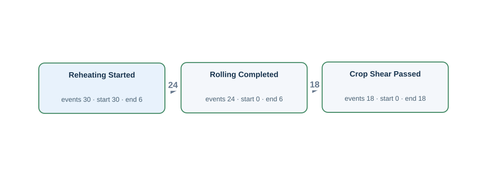</td><td width="50%"><h4>Original tables</h4>
Rows matched by event ID, activity and timestamp using the authored source bindings.

<strong><code>as_rolled_material</code></strong> · 30 source rows

<code>material_id</code> = M002, <code>as_rolled_plate_no</code> = AR002, <code>slab_id</code> = SL002, <code>instruction_id</code> = RI002, <code>furnace_charged_at</code> = 2026-03-03T04:00:00Z, <code>crop_shear_passed_at</code> = NULL, <code>latest_operation_completed_at</code> = NULL, <code>created_at</code> = 2026-03-02T23:00:00Z, <code>updated_at</code> = 2026-03-03T22:00:00Z RH:M002 · Reheating Started · furnace_charged_at · M002

<code>material_id</code> = M003, <code>as_rolled_plate_no</code> = AR003, <code>slab_id</code> = SL003, <code>instruction_id</code> = RI003, <code>furnace_charged_at</code> = 2026-03-04T03:00:00Z, <code>crop_shear_passed_at</code> = NULL, <code>latest_operation_completed_at</code> = 2026-03-04T06:00:00Z, <code>created_at</code> = 2026-03-03T23:00:00Z, <code>updated_at</code> = 2026-03-04T22:00:00Z RH:M003 · Reheating Started · furnace_charged_at · M003

<code>material_id</code> = M004, <code>as_rolled_plate_no</code> = AR004, <code>slab_id</code> = SL004, <code>instruction_id</code> = RI004, <code>furnace_charged_at</code> = 2026-03-05T02:00:00Z, <code>crop_shear_passed_at</code> = 2026-03-05T09:00:00Z, <code>latest_operation_completed_at</code> = 2026-03-05T11:00:00Z, <code>created_at</code> = 2026-03-04T23:00:00Z, <code>updated_at</code> = 2026-03-05T22:00:00Z CS:M004 · Crop Shear Passed · crop_shear_passed_at · M004 | RH:M004 · Reheating Started · furnace_charged_at · M004

<strong><code>material_operation_history</code></strong> · 24 source rows

<code>transaction_id</code> = M003-RL, <code>material_id</code> = M003, <code>operation_code</code> = RL, <code>started_at</code> = 2026-03-04T05:30:00Z, <code>completed_at</code> = 2026-03-04T06:00:00Z, <code>created_at</code> = 2026-03-04T06:06:00Z OP:M003-RL · Rolling Completed · completed_at · M003

<code>transaction_id</code> = M004-RL, <code>material_id</code> = M004, <code>operation_code</code> = RL, <code>started_at</code> = 2026-03-05T05:30:00Z, <code>completed_at</code> = 2026-03-05T06:00:00Z, <code>created_at</code> = 2026-03-05T06:06:00Z OP:M004-RL · Rolling Completed · completed_at · M004

<code>transaction_id</code> = M005-RL, <code>material_id</code> = M005, <code>operation_code</code> = RL, <code>started_at</code> = 2026-03-06T05:30:00Z, <code>completed_at</code> = 2026-03-06T06:00:00Z, <code>created_at</code> = 2026-03-06T06:06:00Z OP:M005-RL · Rolling Completed · completed_at · M005

Other tables referenced by Gold SQL

Includes case joins and branches of shared CTEs.
<ul><li><code>plate_material</code> · parent_as_rolled_plate_no, plate_material_id</li></ul>
</td></tr></table>

[Gold CSV](../../../datasets/plateflow/private/gold_logs/V01.csv)

## V02 — Q2

For each as-rolled mother material, build a timeline of the material entering the reheating furnace, rolling finishing, the mother plate passing the crop shear.

Events: **72** · Cases with events: **30** · Activities: **3** · Edges: **2**

<table><tr><td width="50%"></td><td width="50%"><h4>Original tables</h4>
Rows matched by event ID, activity and timestamp using the authored source bindings.

<strong><code>as_rolled_material</code></strong> · 30 source rows

<code>material_id</code> = M002, <code>as_rolled_plate_no</code> = AR002, <code>slab_id</code> = SL002, <code>instruction_id</code> = RI002, <code>furnace_charged_at</code> = 2026-03-03T04:00:00Z, <code>crop_shear_passed_at</code> = NULL, <code>latest_operation_completed_at</code> = NULL, <code>created_at</code> = 2026-03-02T23:00:00Z, <code>updated_at</code> = 2026-03-03T22:00:00Z RH:M002 · Reheating Started · furnace_charged_at · M002

<code>material_id</code> = M003, <code>as_rolled_plate_no</code> = AR003, <code>slab_id</code> = SL003, <code>instruction_id</code> = RI003, <code>furnace_charged_at</code> = 2026-03-04T03:00:00Z, <code>crop_shear_passed_at</code> = NULL, <code>latest_operation_completed_at</code> = 2026-03-04T06:00:00Z, <code>created_at</code> = 2026-03-03T23:00:00Z, <code>updated_at</code> = 2026-03-04T22:00:00Z RH:M003 · Reheating Started · furnace_charged_at · M003

<code>material_id</code> = M004, <code>as_rolled_plate_no</code> = AR004, <code>slab_id</code> = SL004, <code>instruction_id</code> = RI004, <code>furnace_charged_at</code> = 2026-03-05T02:00:00Z, <code>crop_shear_passed_at</code> = 2026-03-05T09:00:00Z, <code>latest_operation_completed_at</code> = 2026-03-05T11:00:00Z, <code>created_at</code> = 2026-03-04T23:00:00Z, <code>updated_at</code> = 2026-03-05T22:00:00Z CS:M004 · Crop Shear Passed · crop_shear_passed_at · M004 | RH:M004 · Reheating Started · furnace_charged_at · M004

<strong><code>material_operation_history</code></strong> · 24 source rows

<code>transaction_id</code> = M003-RL, <code>material_id</code> = M003, <code>operation_code</code> = RL, <code>started_at</code> = 2026-03-04T05:30:00Z, <code>completed_at</code> = 2026-03-04T06:00:00Z, <code>created_at</code> = 2026-03-04T06:06:00Z OP:M003-RL · Rolling Completed · completed_at · M003

<code>transaction_id</code> = M004-RL, <code>material_id</code> = M004, <code>operation_code</code> = RL, <code>started_at</code> = 2026-03-05T05:30:00Z, <code>completed_at</code> = 2026-03-05T06:00:00Z, <code>created_at</code> = 2026-03-05T06:06:00Z OP:M004-RL · Rolling Completed · completed_at · M004

<code>transaction_id</code> = M005-RL, <code>material_id</code> = M005, <code>operation_code</code> = RL, <code>started_at</code> = 2026-03-06T05:30:00Z, <code>completed_at</code> = 2026-03-06T06:00:00Z, <code>created_at</code> = 2026-03-06T06:06:00Z OP:M005-RL · Rolling Completed · completed_at · M005

Other tables referenced by Gold SQL

Includes case joins and branches of shared CTEs.
<ul><li><code>plate_material</code> · parent_as_rolled_plate_no, plate_material_id</li></ul>
</td></tr></table>

[Gold CSV](../../../datasets/plateflow/private/gold_logs/V02.csv)

## V03 — Q1

Extract Inspection Failed, Heat Treatment Completed, Inspection Passed events for each as-rolled mother material.

Events: **75** · Cases with events: **18** · Activities: **3** · Edges: **7**

<table><tr><td width="50%">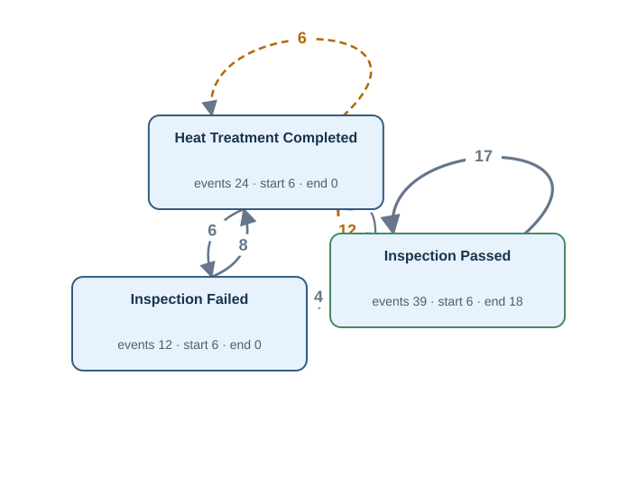</td><td width="50%"><h4>Original tables</h4>
Rows matched by event ID, activity and timestamp using the authored source bindings.

<strong><code>material_operation_history</code></strong> · 75 source rows

<code>transaction_id</code> = P004-1-IP, <code>material_id</code> = P004-1, <code>operation_code</code> = IP, <code>started_at</code> = 2026-03-05T12:36:00Z, <code>completed_at</code> = 2026-03-05T13:06:00Z, <code>created_at</code> = 2026-03-05T13:12:00Z OP:P004-1-IP · Inspection Passed · completed_at · M004

<code>transaction_id</code> = P005-1-HT1, <code>material_id</code> = P005-1, <code>operation_code</code> = HT, <code>started_at</code> = 2026-03-06T11:30:00Z, <code>completed_at</code> = 2026-03-06T12:00:00Z, <code>created_at</code> = 2026-03-06T12:06:00Z OP:P005-1-HT1 · Heat Treatment Completed · completed_at · M005

<code>transaction_id</code> = P006-1-IF1, <code>material_id</code> = P006-1, <code>operation_code</code> = IF, <code>started_at</code> = 2026-03-07T11:30:00Z, <code>completed_at</code> = 2026-03-07T12:00:00Z, <code>created_at</code> = 2026-03-07T12:06:00Z OP:P006-1-IF1 · Inspection Failed · completed_at · M006

Other tables referenced by Gold SQL

Includes case joins and branches of shared CTEs.
<ul><li><code>as_rolled_material</code> · as_rolled_plate_no, material_id</li><li><code>plate_material</code> · parent_as_rolled_plate_no, plate_material_id</li></ul>
</td></tr></table>

[Gold CSV](../../../datasets/plateflow/private/gold_logs/V03.csv)

## V04 — Q2

For each as-rolled mother material, build a timeline of a quality check rejecting the material, heat treatment finishing, a quality check accepting the material.

Events: **75** · Cases with events: **18** · Activities: **3** · Edges: **7**

<table><tr><td width="50%"></td><td width="50%"><h4>Original tables</h4>
Rows matched by event ID, activity and timestamp using the authored source bindings.

<strong><code>material_operation_history</code></strong> · 75 source rows

<code>transaction_id</code> = P004-1-IP, <code>material_id</code> = P004-1, <code>operation_code</code> = IP, <code>started_at</code> = 2026-03-05T12:36:00Z, <code>completed_at</code> = 2026-03-05T13:06:00Z, <code>created_at</code> = 2026-03-05T13:12:00Z OP:P004-1-IP · Inspection Passed · completed_at · M004

<code>transaction_id</code> = P005-1-HT1, <code>material_id</code> = P005-1, <code>operation_code</code> = HT, <code>started_at</code> = 2026-03-06T11:30:00Z, <code>completed_at</code> = 2026-03-06T12:00:00Z, <code>created_at</code> = 2026-03-06T12:06:00Z OP:P005-1-HT1 · Heat Treatment Completed · completed_at · M005

<code>transaction_id</code> = P006-1-IF1, <code>material_id</code> = P006-1, <code>operation_code</code> = IF, <code>started_at</code> = 2026-03-07T11:30:00Z, <code>completed_at</code> = 2026-03-07T12:00:00Z, <code>created_at</code> = 2026-03-07T12:06:00Z OP:P006-1-IF1 · Inspection Failed · completed_at · M006

Other tables referenced by Gold SQL

Includes case joins and branches of shared CTEs.
<ul><li><code>as_rolled_material</code> · as_rolled_plate_no, material_id</li><li><code>plate_material</code> · parent_as_rolled_plate_no, plate_material_id</li></ul>
</td></tr></table>

[Gold CSV](../../../datasets/plateflow/private/gold_logs/V04.csv)

## V05 — Q3

Extract the full recorded lifecycle event log for each as-rolled mother material.

Events: **1108** · Cases with events: **36** · Activities: **39** · Edges: **63**

<table><tr><td width="50%">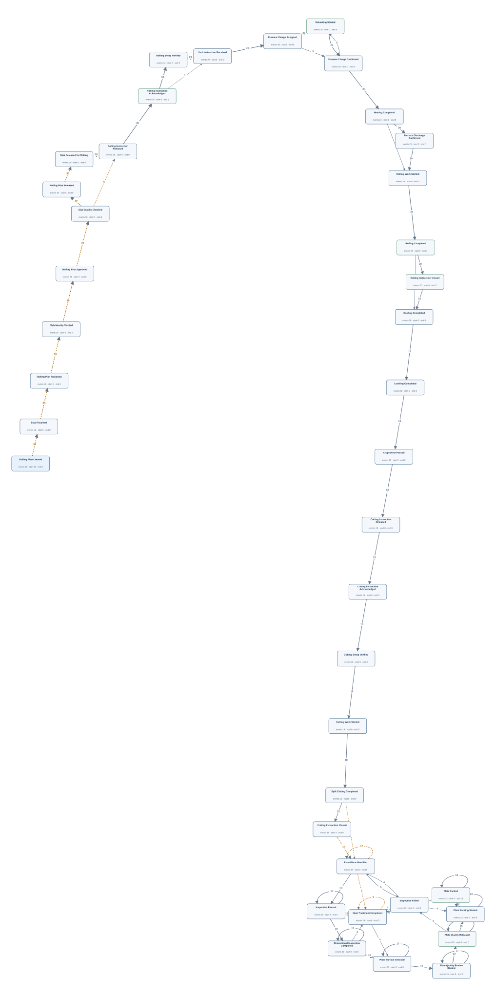</td><td width="50%"><h4>Original tables</h4>
Rows matched by event ID, activity and timestamp using the authored source bindings.

<strong><code>as_rolled_material</code></strong> · 30 source rows

<code>material_id</code> = M002, <code>as_rolled_plate_no</code> = AR002, <code>slab_id</code> = SL002, <code>instruction_id</code> = RI002, <code>furnace_charged_at</code> = 2026-03-03T04:00:00Z, <code>crop_shear_passed_at</code> = NULL, <code>latest_operation_completed_at</code> = NULL, <code>created_at</code> = 2026-03-02T23:00:00Z, <code>updated_at</code> = 2026-03-03T22:00:00Z RH:M002 · Reheating Started · furnace_charged_at · M002

<code>material_id</code> = M003, <code>as_rolled_plate_no</code> = AR003, <code>slab_id</code> = SL003, <code>instruction_id</code> = RI003, <code>furnace_charged_at</code> = 2026-03-04T03:00:00Z, <code>crop_shear_passed_at</code> = NULL, <code>latest_operation_completed_at</code> = 2026-03-04T06:00:00Z, <code>created_at</code> = 2026-03-03T23:00:00Z, <code>updated_at</code> = 2026-03-04T22:00:00Z RH:M003 · Reheating Started · furnace_charged_at · M003

<code>material_id</code> = M004, <code>as_rolled_plate_no</code> = AR004, <code>slab_id</code> = SL004, <code>instruction_id</code> = RI004, <code>furnace_charged_at</code> = 2026-03-05T02:00:00Z, <code>crop_shear_passed_at</code> = 2026-03-05T09:00:00Z, <code>latest_operation_completed_at</code> = 2026-03-05T11:00:00Z, <code>created_at</code> = 2026-03-04T23:00:00Z, <code>updated_at</code> = 2026-03-05T22:00:00Z CS:M004 · Crop Shear Passed · crop_shear_passed_at · M004 | RH:M004 · Reheating Started · furnace_charged_at · M004

<strong><code>cutting_finishing_instruction</code></strong> · 18 source rows

<code>instruction_id</code> = CIM004, <code>material_id</code> = M004, <code>released_at</code> = 2026-03-05T10:00:00Z, <code>cut_method</code> = SPLIT, <code>cutting_instruction_acknowledged_at</code> = 2026-03-05T10:05:00Z, <code>cutting_setup_verified_at</code> = 2026-03-05T10:10:00Z, <code>cutting_work_started_at</code> = 2026-03-05T10:55:00Z, <code>cutting_instruction_closed_at</code> = NULL CI:CIM004 · Cutting Instruction Released · released_at · M004 | LC:cutting_finishing_instruction:CIM004:1 · Cutting Instruction Acknowledged · cutting_instruction_acknowledged_at · M004 | LC:cutting_finishing_instruction:CIM004:2 · Cutting Setup Verified · cutting_setup_verified_at · M004 | LC:cutting_finishing_instruction:CIM004:3 · Cutting Work Started · cutting_work_started_at · M004

<code>instruction_id</code> = CIM005, <code>material_id</code> = M005, <code>released_at</code> = 2026-03-06T10:00:00Z, <code>cut_method</code> = SPLIT, <code>cutting_instruction_acknowledged_at</code> = 2026-03-06T10:05:00Z, <code>cutting_setup_verified_at</code> = 2026-03-06T10:10:00Z, <code>cutting_work_started_at</code> = 2026-03-06T10:55:00Z, <code>cutting_instruction_closed_at</code> = 2026-03-06T11:05:00Z CI:CIM005 · Cutting Instruction Released · released_at · M005 | LC:cutting_finishing_instruction:CIM005:1 · Cutting Instruction Acknowledged · cutting_instruction_acknowledged_at · M005 | LC:cutting_finishing_instruction:CIM005:2 · Cutting Setup Verified · cutting_setup_verified_at · M005 | LC:cutting_finishing_instruction:CIM005:3 · Cutting Work Started · cutting_work_started_at · M005 | LC:cutting_finishing_instruction:CIM005:4 · Cutting Instruction Closed · cutting_instruction_closed_at · M005

<code>instruction_id</code> = CIM006, <code>material_id</code> = M006, <code>released_at</code> = 2026-03-07T10:00:00Z, <code>cut_method</code> = SPLIT, <code>cutting_instruction_acknowledged_at</code> = 2026-03-07T10:05:00Z, <code>cutting_setup_verified_at</code> = 2026-03-07T10:10:00Z, <code>cutting_work_started_at</code> = 2026-03-07T10:55:00Z, <code>cutting_instruction_closed_at</code> = 2026-03-07T11:05:00Z CI:CIM006 · Cutting Instruction Released · released_at · M006 | LC:cutting_finishing_instruction:CIM006:1 · Cutting Instruction Acknowledged · cutting_instruction_acknowledged_at · M006 | LC:cutting_finishing_instruction:CIM006:2 · Cutting Setup Verified · cutting_setup_verified_at · M006 | LC:cutting_finishing_instruction:CIM006:3 · Cutting Work Started · cutting_work_started_at · M006 | LC:cutting_finishing_instruction:CIM006:4 · Cutting Instruction Closed · cutting_instruction_closed_at · M006

<strong><code>furnace_charge_tracking</code></strong> · 30 source rows

<code>tracking_id</code> = TRM002, <code>material_id</code> = M002, <code>yard_instruction_received_at</code> = 2026-03-03T01:00:00Z, <code>lot_charging_started_at</code> = 2026-03-03T01:30:00Z, <code>furnace_charge_assigned_at</code> = 2026-03-03T01:05:00Z, <code>furnace_charge_confirmed_at</code> = NULL, <code>furnace_discharge_confirmed_at</code> = NULL LC:furnace_charge_tracking:TRM002:1 · Furnace Charge Assigned · furnace_charge_assigned_at · M002 | YD:TRM002 · Yard Instruction Received · yard_instruction_received_at · M002

<code>tracking_id</code> = TRM003, <code>material_id</code> = M003, <code>yard_instruction_received_at</code> = 2026-03-04T01:00:00Z, <code>lot_charging_started_at</code> = 2026-03-04T01:30:00Z, <code>furnace_charge_assigned_at</code> = 2026-03-04T01:05:00Z, <code>furnace_charge_confirmed_at</code> = 2026-03-04T03:01:00Z, <code>furnace_discharge_confirmed_at</code> = 2026-03-04T05:50:00Z LC:furnace_charge_tracking:TRM003:1 · Furnace Charge Assigned · furnace_charge_assigned_at · M003 | LC:furnace_charge_tracking:TRM003:2 · Furnace Charge Confirmed · furnace_charge_confirmed_at · M003 | LC:furnace_charge_tracking:TRM003:4 · Furnace Discharge Confirmed · furnace_discharge_confirmed_at · M003 | YD:TRM003 · Yard Instruction Received · yard_instruction_received_at · M003

<code>tracking_id</code> = TRM004, <code>material_id</code> = M004, <code>yard_instruction_received_at</code> = 2026-03-05T01:00:00Z, <code>lot_charging_started_at</code> = 2026-03-05T01:30:00Z, <code>furnace_charge_assigned_at</code> = 2026-03-05T01:05:00Z, <code>furnace_charge_confirmed_at</code> = 2026-03-05T02:01:00Z, <code>furnace_discharge_confirmed_at</code> = 2026-03-05T05:50:00Z LC:furnace_charge_tracking:TRM004:1 · Furnace Charge Assigned · furnace_charge_assigned_at · M004 | LC:furnace_charge_tracking:TRM004:2 · Furnace Charge Confirmed · furnace_charge_confirmed_at · M004 | LC:furnace_charge_tracking:TRM004:4 · Furnace Discharge Confirmed · furnace_discharge_confirmed_at · M004 | YD:TRM004 · Yard Instruction Received · yard_instruction_received_at · M004

<strong><code>material_operation_history</code></strong> · 216 source rows

<code>transaction_id</code> = LC:furnace_charge_tracking:TRM003:3, <code>material_id</code> = M003, <code>operation_code</code> = HF, <code>started_at</code> = 2026-03-04T05:39:00Z, <code>completed_at</code> = 2026-03-04T05:40:00Z, <code>created_at</code> = 2026-03-04T05:39:00Z LC:furnace_charge_tracking:TRM003:3 · Heating Completed · completed_at · M003

<code>transaction_id</code> = M003-RL, <code>material_id</code> = M003, <code>operation_code</code> = RL, <code>started_at</code> = 2026-03-04T05:30:00Z, <code>completed_at</code> = 2026-03-04T06:00:00Z, <code>created_at</code> = 2026-03-04T06:06:00Z OP:M003-RL · Rolling Completed · completed_at · M003

<code>transaction_id</code> = M004-CO, <code>material_id</code> = M004, <code>operation_code</code> = CO, <code>started_at</code> = 2026-03-05T06:30:00Z, <code>completed_at</code> = 2026-03-05T07:00:00Z, <code>created_at</code> = 2026-03-05T07:06:00Z OP:M004-CO · Cooling Completed · completed_at · M004

<strong><code>planned_rolling_instruction</code></strong> · 36 source rows

<code>plan_id</code> = PLAN001, <code>slab_id</code> = SL001, <code>planned_reheat_at</code> = 2026-03-02T02:00:00Z, <code>rolling_plan_created_at</code> = 2026-03-01T14:00:00Z, <code>rolling_plan_reviewed_at</code> = 2026-03-01T15:00:00Z, <code>rolling_plan_approved_at</code> = 2026-03-01T16:00:00Z, <code>rolling_plan_released_at</code> = NULL LC:planned_rolling_instruction:PLAN001:1 · Rolling Plan Created · rolling_plan_created_at · M001 | LC:planned_rolling_instruction:PLAN001:2 · Rolling Plan Reviewed · rolling_plan_reviewed_at · M001 | LC:planned_rolling_instruction:PLAN001:3 · Rolling Plan Approved · rolling_plan_approved_at · M001

<code>plan_id</code> = PLAN002, <code>slab_id</code> = SL002, <code>planned_reheat_at</code> = 2026-03-03T02:00:00Z, <code>rolling_plan_created_at</code> = 2026-03-02T14:00:00Z, <code>rolling_plan_reviewed_at</code> = 2026-03-02T15:00:00Z, <code>rolling_plan_approved_at</code> = 2026-03-02T16:00:00Z, <code>rolling_plan_released_at</code> = 2026-03-02T17:00:00Z LC:planned_rolling_instruction:PLAN002:1 · Rolling Plan Created · rolling_plan_created_at · M002 | LC:planned_rolling_instruction:PLAN002:2 · Rolling Plan Reviewed · rolling_plan_reviewed_at · M002 | LC:planned_rolling_instruction:PLAN002:3 · Rolling Plan Approved · rolling_plan_approved_at · M002 | LC:planned_rolling_instruction:PLAN002:4 · Rolling Plan Released · rolling_plan_released_at · M002

<code>plan_id</code> = PLAN003, <code>slab_id</code> = SL003, <code>planned_reheat_at</code> = 2026-03-04T02:00:00Z, <code>rolling_plan_created_at</code> = 2026-03-03T14:00:00Z, <code>rolling_plan_reviewed_at</code> = 2026-03-03T15:00:00Z, <code>rolling_plan_approved_at</code> = 2026-03-03T16:00:00Z, <code>rolling_plan_released_at</code> = 2026-03-03T17:00:00Z LC:planned_rolling_instruction:PLAN003:1 · Rolling Plan Created · rolling_plan_created_at · M003 | LC:planned_rolling_instruction:PLAN003:2 · Rolling Plan Reviewed · rolling_plan_reviewed_at · M003 | LC:planned_rolling_instruction:PLAN003:3 · Rolling Plan Approved · rolling_plan_approved_at · M003 | LC:planned_rolling_instruction:PLAN003:4 · Rolling Plan Released · rolling_plan_released_at · M003

<strong><code>plate_material</code></strong> · 39 source rows

<code>plate_material_id</code> = P004-1, <code>plate_no</code> = PLP004-1, <code>parent_as_rolled_plate_no</code> = AR004, <code>dimension_inspected_at</code> = 2026-03-05T13:36:00Z, <code>latest_operation_completed_at</code> = 2026-03-05T14:06:00Z, <code>plate_piece_identified_at</code> = 2026-03-05T12:36:00Z, <code>plate_quality_released_at</code> = 2026-03-05T14:36:00Z, <code>plate_packed_at</code> = NULL, <code>plate_quality_review_started_at</code> = 2026-03-05T14:21:00Z, <code>plate_packing_started_at</code> = NULL DIM:P004-1 · Dimensional Inspection Completed · dimension_inspected_at · M004 | LC:plate_material:P004-1:1 · Plate Piece Identified · plate_piece_identified_at · M004 | LC:plate_material:P004-1:3 · Plate Quality Released · plate_quality_released_at · M004 | LC:plate_material:P004-1:5 · Plate Quality Review Started · plate_quality_review_started_at · M004

<code>plate_material_id</code> = P004-2, <code>plate_no</code> = PLP004-2, <code>parent_as_rolled_plate_no</code> = AR004, <code>dimension_inspected_at</code> = 2026-03-05T13:42:00Z, <code>latest_operation_completed_at</code> = 2026-03-05T14:12:00Z, <code>plate_piece_identified_at</code> = 2026-03-05T12:42:00Z, <code>plate_quality_released_at</code> = 2026-03-05T14:42:00Z, <code>plate_packed_at</code> = 2026-03-05T15:42:00Z, <code>plate_quality_review_started_at</code> = 2026-03-05T14:27:00Z, <code>plate_packing_started_at</code> = 2026-03-05T15:27:00Z DIM:P004-2 · Dimensional Inspection Completed · dimension_inspected_at · M004 | LC:plate_material:P004-2:1 · Plate Piece Identified · plate_piece_identified_at · M004 | LC:plate_material:P004-2:3 · Plate Quality Released · plate_quality_released_at · M004 | LC:plate_material:P004-2:4 · Plate Packed · plate_packed_at · M004 | LC:plate_material:P004-2:5 · Plate Quality Review Started · plate_quality_review_started_at · M004 | LC:plate_material:P004-2:6 · Plate Packing Started · plate_packing_started_at · M004

<code>plate_material_id</code> = P004-3, <code>plate_no</code> = PLP004-3, <code>parent_as_rolled_plate_no</code> = AR004, <code>dimension_inspected_at</code> = 2026-03-05T13:48:00Z, <code>latest_operation_completed_at</code> = 2026-03-05T14:18:00Z, <code>plate_piece_identified_at</code> = 2026-03-05T12:48:00Z, <code>plate_quality_released_at</code> = 2026-03-05T14:48:00Z, <code>plate_packed_at</code> = 2026-03-05T15:48:00Z, <code>plate_quality_review_started_at</code> = 2026-03-05T14:33:00Z, <code>plate_packing_started_at</code> = 2026-03-05T15:33:00Z DIM:P004-3 · Dimensional Inspection Completed · dimension_inspected_at · M004 | LC:plate_material:P004-3:1 · Plate Piece Identified · plate_piece_identified_at · M004 | LC:plate_material:P004-3:3 · Plate Quality Released · plate_quality_released_at · M004 | LC:plate_material:P004-3:4 · Plate Packed · plate_packed_at · M004 | LC:plate_material:P004-3:5 · Plate Quality Review Started · plate_quality_review_started_at · M004 | LC:plate_material:P004-3:6 · Plate Packing Started · plate_packing_started_at · M004

<strong><code>rolling_instruction</code></strong> · 36 source rows

<code>instruction_id</code> = RI001, <code>plan_id</code> = PLAN001, <code>released_at</code> = 2026-03-02T00:00:00Z, <code>rolling_instruction_acknowledged_at</code> = 2026-03-02T00:05:00Z, <code>rolling_setup_verified_at</code> = NULL, <code>rolling_work_started_at</code> = NULL, <code>rolling_instruction_closed_at</code> = NULL LC:rolling_instruction:RI001:1 · Rolling Instruction Acknowledged · rolling_instruction_acknowledged_at · M001 | RI:RI001 · Rolling Instruction Released · released_at · M001

<code>instruction_id</code> = RI002, <code>plan_id</code> = PLAN002, <code>released_at</code> = 2026-03-03T00:00:00Z, <code>rolling_instruction_acknowledged_at</code> = 2026-03-03T00:05:00Z, <code>rolling_setup_verified_at</code> = 2026-03-03T00:10:00Z, <code>rolling_work_started_at</code> = NULL, <code>rolling_instruction_closed_at</code> = NULL LC:rolling_instruction:RI002:1 · Rolling Instruction Acknowledged · rolling_instruction_acknowledged_at · M002 | LC:rolling_instruction:RI002:2 · Rolling Setup Verified · rolling_setup_verified_at · M002 | RI:RI002 · Rolling Instruction Released · released_at · M002

<code>instruction_id</code> = RI003, <code>plan_id</code> = PLAN003, <code>released_at</code> = 2026-03-04T00:00:00Z, <code>rolling_instruction_acknowledged_at</code> = 2026-03-04T00:05:00Z, <code>rolling_setup_verified_at</code> = 2026-03-04T00:10:00Z, <code>rolling_work_started_at</code> = 2026-03-04T05:55:00Z, <code>rolling_instruction_closed_at</code> = 2026-03-04T06:05:00Z LC:rolling_instruction:RI003:1 · Rolling Instruction Acknowledged · rolling_instruction_acknowledged_at · M003 | LC:rolling_instruction:RI003:2 · Rolling Setup Verified · rolling_setup_verified_at · M003 | LC:rolling_instruction:RI003:3 · Rolling Work Started · rolling_work_started_at · M003 | LC:rolling_instruction:RI003:4 · Rolling Instruction Closed · rolling_instruction_closed_at · M003 | RI:RI003 · Rolling Instruction Released · released_at · M003

<strong><code>slab_material</code></strong> · 36 source rows

<code>slab_id</code> = SL001, <code>charge_id</code> = CH001, <code>slab_received_at</code> = 2026-03-01T14:00:00Z, <code>slab_identity_verified_at</code> = 2026-03-01T15:00:00Z, <code>slab_quality_checked_at</code> = 2026-03-01T16:00:00Z, <code>slab_released_for_rolling_at</code> = NULL LC:slab_material:SL001:1 · Slab Received · slab_received_at · M001 | LC:slab_material:SL001:2 · Slab Identity Verified · slab_identity_verified_at · M001 | LC:slab_material:SL001:3 · Slab Quality Checked · slab_quality_checked_at · M001

<code>slab_id</code> = SL002, <code>charge_id</code> = CH002, <code>slab_received_at</code> = 2026-03-02T14:00:00Z, <code>slab_identity_verified_at</code> = 2026-03-02T15:00:00Z, <code>slab_quality_checked_at</code> = 2026-03-02T16:00:00Z, <code>slab_released_for_rolling_at</code> = 2026-03-02T17:00:00Z LC:slab_material:SL002:1 · Slab Received · slab_received_at · M002 | LC:slab_material:SL002:2 · Slab Identity Verified · slab_identity_verified_at · M002 | LC:slab_material:SL002:3 · Slab Quality Checked · slab_quality_checked_at · M002 | LC:slab_material:SL002:4 · Slab Released for Rolling · slab_released_for_rolling_at · M002

<code>slab_id</code> = SL003, <code>charge_id</code> = CH003, <code>slab_received_at</code> = 2026-03-03T14:00:00Z, <code>slab_identity_verified_at</code> = 2026-03-03T15:00:00Z, <code>slab_quality_checked_at</code> = 2026-03-03T16:00:00Z, <code>slab_released_for_rolling_at</code> = 2026-03-03T17:00:00Z LC:slab_material:SL003:1 · Slab Received · slab_received_at · M003 | LC:slab_material:SL003:2 · Slab Identity Verified · slab_identity_verified_at · M003 | LC:slab_material:SL003:3 · Slab Quality Checked · slab_quality_checked_at · M003 | LC:slab_material:SL003:4 · Slab Released for Rolling · slab_released_for_rolling_at · M003
</td></tr></table>

[Gold CSV](../../../datasets/plateflow/private/gold_logs/V05.csv)

## V06 — Q4

Show the complete recorded history associated with each as-rolled mother material.

Events: **1108** · Cases with events: **36** · Activities: **39** · Edges: **63**

<table><tr><td width="50%"></td><td width="50%"><h4>Original tables</h4>
Rows matched by event ID, activity and timestamp using the authored source bindings.

<strong><code>as_rolled_material</code></strong> · 30 source rows

<code>material_id</code> = M002, <code>as_rolled_plate_no</code> = AR002, <code>slab_id</code> = SL002, <code>instruction_id</code> = RI002, <code>furnace_charged_at</code> = 2026-03-03T04:00:00Z, <code>crop_shear_passed_at</code> = NULL, <code>latest_operation_completed_at</code> = NULL, <code>created_at</code> = 2026-03-02T23:00:00Z, <code>updated_at</code> = 2026-03-03T22:00:00Z RH:M002 · Reheating Started · furnace_charged_at · M002

<code>material_id</code> = M003, <code>as_rolled_plate_no</code> = AR003, <code>slab_id</code> = SL003, <code>instruction_id</code> = RI003, <code>furnace_charged_at</code> = 2026-03-04T03:00:00Z, <code>crop_shear_passed_at</code> = NULL, <code>latest_operation_completed_at</code> = 2026-03-04T06:00:00Z, <code>created_at</code> = 2026-03-03T23:00:00Z, <code>updated_at</code> = 2026-03-04T22:00:00Z RH:M003 · Reheating Started · furnace_charged_at · M003

<code>material_id</code> = M004, <code>as_rolled_plate_no</code> = AR004, <code>slab_id</code> = SL004, <code>instruction_id</code> = RI004, <code>furnace_charged_at</code> = 2026-03-05T02:00:00Z, <code>crop_shear_passed_at</code> = 2026-03-05T09:00:00Z, <code>latest_operation_completed_at</code> = 2026-03-05T11:00:00Z, <code>created_at</code> = 2026-03-04T23:00:00Z, <code>updated_at</code> = 2026-03-05T22:00:00Z CS:M004 · Crop Shear Passed · crop_shear_passed_at · M004 | RH:M004 · Reheating Started · furnace_charged_at · M004

<strong><code>cutting_finishing_instruction</code></strong> · 18 source rows

<code>instruction_id</code> = CIM004, <code>material_id</code> = M004, <code>released_at</code> = 2026-03-05T10:00:00Z, <code>cut_method</code> = SPLIT, <code>cutting_instruction_acknowledged_at</code> = 2026-03-05T10:05:00Z, <code>cutting_setup_verified_at</code> = 2026-03-05T10:10:00Z, <code>cutting_work_started_at</code> = 2026-03-05T10:55:00Z, <code>cutting_instruction_closed_at</code> = NULL CI:CIM004 · Cutting Instruction Released · released_at · M004 | LC:cutting_finishing_instruction:CIM004:1 · Cutting Instruction Acknowledged · cutting_instruction_acknowledged_at · M004 | LC:cutting_finishing_instruction:CIM004:2 · Cutting Setup Verified · cutting_setup_verified_at · M004 | LC:cutting_finishing_instruction:CIM004:3 · Cutting Work Started · cutting_work_started_at · M004

<code>instruction_id</code> = CIM005, <code>material_id</code> = M005, <code>released_at</code> = 2026-03-06T10:00:00Z, <code>cut_method</code> = SPLIT, <code>cutting_instruction_acknowledged_at</code> = 2026-03-06T10:05:00Z, <code>cutting_setup_verified_at</code> = 2026-03-06T10:10:00Z, <code>cutting_work_started_at</code> = 2026-03-06T10:55:00Z, <code>cutting_instruction_closed_at</code> = 2026-03-06T11:05:00Z CI:CIM005 · Cutting Instruction Released · released_at · M005 | LC:cutting_finishing_instruction:CIM005:1 · Cutting Instruction Acknowledged · cutting_instruction_acknowledged_at · M005 | LC:cutting_finishing_instruction:CIM005:2 · Cutting Setup Verified · cutting_setup_verified_at · M005 | LC:cutting_finishing_instruction:CIM005:3 · Cutting Work Started · cutting_work_started_at · M005 | LC:cutting_finishing_instruction:CIM005:4 · Cutting Instruction Closed · cutting_instruction_closed_at · M005

<code>instruction_id</code> = CIM006, <code>material_id</code> = M006, <code>released_at</code> = 2026-03-07T10:00:00Z, <code>cut_method</code> = SPLIT, <code>cutting_instruction_acknowledged_at</code> = 2026-03-07T10:05:00Z, <code>cutting_setup_verified_at</code> = 2026-03-07T10:10:00Z, <code>cutting_work_started_at</code> = 2026-03-07T10:55:00Z, <code>cutting_instruction_closed_at</code> = 2026-03-07T11:05:00Z CI:CIM006 · Cutting Instruction Released · released_at · M006 | LC:cutting_finishing_instruction:CIM006:1 · Cutting Instruction Acknowledged · cutting_instruction_acknowledged_at · M006 | LC:cutting_finishing_instruction:CIM006:2 · Cutting Setup Verified · cutting_setup_verified_at · M006 | LC:cutting_finishing_instruction:CIM006:3 · Cutting Work Started · cutting_work_started_at · M006 | LC:cutting_finishing_instruction:CIM006:4 · Cutting Instruction Closed · cutting_instruction_closed_at · M006

<strong><code>furnace_charge_tracking</code></strong> · 30 source rows

<code>tracking_id</code> = TRM002, <code>material_id</code> = M002, <code>yard_instruction_received_at</code> = 2026-03-03T01:00:00Z, <code>lot_charging_started_at</code> = 2026-03-03T01:30:00Z, <code>furnace_charge_assigned_at</code> = 2026-03-03T01:05:00Z, <code>furnace_charge_confirmed_at</code> = NULL, <code>furnace_discharge_confirmed_at</code> = NULL LC:furnace_charge_tracking:TRM002:1 · Furnace Charge Assigned · furnace_charge_assigned_at · M002 | YD:TRM002 · Yard Instruction Received · yard_instruction_received_at · M002

<code>tracking_id</code> = TRM003, <code>material_id</code> = M003, <code>yard_instruction_received_at</code> = 2026-03-04T01:00:00Z, <code>lot_charging_started_at</code> = 2026-03-04T01:30:00Z, <code>furnace_charge_assigned_at</code> = 2026-03-04T01:05:00Z, <code>furnace_charge_confirmed_at</code> = 2026-03-04T03:01:00Z, <code>furnace_discharge_confirmed_at</code> = 2026-03-04T05:50:00Z LC:furnace_charge_tracking:TRM003:1 · Furnace Charge Assigned · furnace_charge_assigned_at · M003 | LC:furnace_charge_tracking:TRM003:2 · Furnace Charge Confirmed · furnace_charge_confirmed_at · M003 | LC:furnace_charge_tracking:TRM003:4 · Furnace Discharge Confirmed · furnace_discharge_confirmed_at · M003 | YD:TRM003 · Yard Instruction Received · yard_instruction_received_at · M003

<code>tracking_id</code> = TRM004, <code>material_id</code> = M004, <code>yard_instruction_received_at</code> = 2026-03-05T01:00:00Z, <code>lot_charging_started_at</code> = 2026-03-05T01:30:00Z, <code>furnace_charge_assigned_at</code> = 2026-03-05T01:05:00Z, <code>furnace_charge_confirmed_at</code> = 2026-03-05T02:01:00Z, <code>furnace_discharge_confirmed_at</code> = 2026-03-05T05:50:00Z LC:furnace_charge_tracking:TRM004:1 · Furnace Charge Assigned · furnace_charge_assigned_at · M004 | LC:furnace_charge_tracking:TRM004:2 · Furnace Charge Confirmed · furnace_charge_confirmed_at · M004 | LC:furnace_charge_tracking:TRM004:4 · Furnace Discharge Confirmed · furnace_discharge_confirmed_at · M004 | YD:TRM004 · Yard Instruction Received · yard_instruction_received_at · M004

<strong><code>material_operation_history</code></strong> · 216 source rows

<code>transaction_id</code> = LC:furnace_charge_tracking:TRM003:3, <code>material_id</code> = M003, <code>operation_code</code> = HF, <code>started_at</code> = 2026-03-04T05:39:00Z, <code>completed_at</code> = 2026-03-04T05:40:00Z, <code>created_at</code> = 2026-03-04T05:39:00Z LC:furnace_charge_tracking:TRM003:3 · Heating Completed · completed_at · M003

<code>transaction_id</code> = M003-RL, <code>material_id</code> = M003, <code>operation_code</code> = RL, <code>started_at</code> = 2026-03-04T05:30:00Z, <code>completed_at</code> = 2026-03-04T06:00:00Z, <code>created_at</code> = 2026-03-04T06:06:00Z OP:M003-RL · Rolling Completed · completed_at · M003

<code>transaction_id</code> = M004-CO, <code>material_id</code> = M004, <code>operation_code</code> = CO, <code>started_at</code> = 2026-03-05T06:30:00Z, <code>completed_at</code> = 2026-03-05T07:00:00Z, <code>created_at</code> = 2026-03-05T07:06:00Z OP:M004-CO · Cooling Completed · completed_at · M004

<strong><code>planned_rolling_instruction</code></strong> · 36 source rows

<code>plan_id</code> = PLAN001, <code>slab_id</code> = SL001, <code>planned_reheat_at</code> = 2026-03-02T02:00:00Z, <code>rolling_plan_created_at</code> = 2026-03-01T14:00:00Z, <code>rolling_plan_reviewed_at</code> = 2026-03-01T15:00:00Z, <code>rolling_plan_approved_at</code> = 2026-03-01T16:00:00Z, <code>rolling_plan_released_at</code> = NULL LC:planned_rolling_instruction:PLAN001:1 · Rolling Plan Created · rolling_plan_created_at · M001 | LC:planned_rolling_instruction:PLAN001:2 · Rolling Plan Reviewed · rolling_plan_reviewed_at · M001 | LC:planned_rolling_instruction:PLAN001:3 · Rolling Plan Approved · rolling_plan_approved_at · M001

<code>plan_id</code> = PLAN002, <code>slab_id</code> = SL002, <code>planned_reheat_at</code> = 2026-03-03T02:00:00Z, <code>rolling_plan_created_at</code> = 2026-03-02T14:00:00Z, <code>rolling_plan_reviewed_at</code> = 2026-03-02T15:00:00Z, <code>rolling_plan_approved_at</code> = 2026-03-02T16:00:00Z, <code>rolling_plan_released_at</code> = 2026-03-02T17:00:00Z LC:planned_rolling_instruction:PLAN002:1 · Rolling Plan Created · rolling_plan_created_at · M002 | LC:planned_rolling_instruction:PLAN002:2 · Rolling Plan Reviewed · rolling_plan_reviewed_at · M002 | LC:planned_rolling_instruction:PLAN002:3 · Rolling Plan Approved · rolling_plan_approved_at · M002 | LC:planned_rolling_instruction:PLAN002:4 · Rolling Plan Released · rolling_plan_released_at · M002

<code>plan_id</code> = PLAN003, <code>slab_id</code> = SL003, <code>planned_reheat_at</code> = 2026-03-04T02:00:00Z, <code>rolling_plan_created_at</code> = 2026-03-03T14:00:00Z, <code>rolling_plan_reviewed_at</code> = 2026-03-03T15:00:00Z, <code>rolling_plan_approved_at</code> = 2026-03-03T16:00:00Z, <code>rolling_plan_released_at</code> = 2026-03-03T17:00:00Z LC:planned_rolling_instruction:PLAN003:1 · Rolling Plan Created · rolling_plan_created_at · M003 | LC:planned_rolling_instruction:PLAN003:2 · Rolling Plan Reviewed · rolling_plan_reviewed_at · M003 | LC:planned_rolling_instruction:PLAN003:3 · Rolling Plan Approved · rolling_plan_approved_at · M003 | LC:planned_rolling_instruction:PLAN003:4 · Rolling Plan Released · rolling_plan_released_at · M003

<strong><code>plate_material</code></strong> · 39 source rows

<code>plate_material_id</code> = P004-1, <code>plate_no</code> = PLP004-1, <code>parent_as_rolled_plate_no</code> = AR004, <code>dimension_inspected_at</code> = 2026-03-05T13:36:00Z, <code>latest_operation_completed_at</code> = 2026-03-05T14:06:00Z, <code>plate_piece_identified_at</code> = 2026-03-05T12:36:00Z, <code>plate_quality_released_at</code> = 2026-03-05T14:36:00Z, <code>plate_packed_at</code> = NULL, <code>plate_quality_review_started_at</code> = 2026-03-05T14:21:00Z, <code>plate_packing_started_at</code> = NULL DIM:P004-1 · Dimensional Inspection Completed · dimension_inspected_at · M004 | LC:plate_material:P004-1:1 · Plate Piece Identified · plate_piece_identified_at · M004 | LC:plate_material:P004-1:3 · Plate Quality Released · plate_quality_released_at · M004 | LC:plate_material:P004-1:5 · Plate Quality Review Started · plate_quality_review_started_at · M004

<code>plate_material_id</code> = P004-2, <code>plate_no</code> = PLP004-2, <code>parent_as_rolled_plate_no</code> = AR004, <code>dimension_inspected_at</code> = 2026-03-05T13:42:00Z, <code>latest_operation_completed_at</code> = 2026-03-05T14:12:00Z, <code>plate_piece_identified_at</code> = 2026-03-05T12:42:00Z, <code>plate_quality_released_at</code> = 2026-03-05T14:42:00Z, <code>plate_packed_at</code> = 2026-03-05T15:42:00Z, <code>plate_quality_review_started_at</code> = 2026-03-05T14:27:00Z, <code>plate_packing_started_at</code> = 2026-03-05T15:27:00Z DIM:P004-2 · Dimensional Inspection Completed · dimension_inspected_at · M004 | LC:plate_material:P004-2:1 · Plate Piece Identified · plate_piece_identified_at · M004 | LC:plate_material:P004-2:3 · Plate Quality Released · plate_quality_released_at · M004 | LC:plate_material:P004-2:4 · Plate Packed · plate_packed_at · M004 | LC:plate_material:P004-2:5 · Plate Quality Review Started · plate_quality_review_started_at · M004 | LC:plate_material:P004-2:6 · Plate Packing Started · plate_packing_started_at · M004

<code>plate_material_id</code> = P004-3, <code>plate_no</code> = PLP004-3, <code>parent_as_rolled_plate_no</code> = AR004, <code>dimension_inspected_at</code> = 2026-03-05T13:48:00Z, <code>latest_operation_completed_at</code> = 2026-03-05T14:18:00Z, <code>plate_piece_identified_at</code> = 2026-03-05T12:48:00Z, <code>plate_quality_released_at</code> = 2026-03-05T14:48:00Z, <code>plate_packed_at</code> = 2026-03-05T15:48:00Z, <code>plate_quality_review_started_at</code> = 2026-03-05T14:33:00Z, <code>plate_packing_started_at</code> = 2026-03-05T15:33:00Z DIM:P004-3 · Dimensional Inspection Completed · dimension_inspected_at · M004 | LC:plate_material:P004-3:1 · Plate Piece Identified · plate_piece_identified_at · M004 | LC:plate_material:P004-3:3 · Plate Quality Released · plate_quality_released_at · M004 | LC:plate_material:P004-3:4 · Plate Packed · plate_packed_at · M004 | LC:plate_material:P004-3:5 · Plate Quality Review Started · plate_quality_review_started_at · M004 | LC:plate_material:P004-3:6 · Plate Packing Started · plate_packing_started_at · M004

<strong><code>rolling_instruction</code></strong> · 36 source rows

<code>instruction_id</code> = RI001, <code>plan_id</code> = PLAN001, <code>released_at</code> = 2026-03-02T00:00:00Z, <code>rolling_instruction_acknowledged_at</code> = 2026-03-02T00:05:00Z, <code>rolling_setup_verified_at</code> = NULL, <code>rolling_work_started_at</code> = NULL, <code>rolling_instruction_closed_at</code> = NULL LC:rolling_instruction:RI001:1 · Rolling Instruction Acknowledged · rolling_instruction_acknowledged_at · M001 | RI:RI001 · Rolling Instruction Released · released_at · M001

<code>instruction_id</code> = RI002, <code>plan_id</code> = PLAN002, <code>released_at</code> = 2026-03-03T00:00:00Z, <code>rolling_instruction_acknowledged_at</code> = 2026-03-03T00:05:00Z, <code>rolling_setup_verified_at</code> = 2026-03-03T00:10:00Z, <code>rolling_work_started_at</code> = NULL, <code>rolling_instruction_closed_at</code> = NULL LC:rolling_instruction:RI002:1 · Rolling Instruction Acknowledged · rolling_instruction_acknowledged_at · M002 | LC:rolling_instruction:RI002:2 · Rolling Setup Verified · rolling_setup_verified_at · M002 | RI:RI002 · Rolling Instruction Released · released_at · M002

<code>instruction_id</code> = RI003, <code>plan_id</code> = PLAN003, <code>released_at</code> = 2026-03-04T00:00:00Z, <code>rolling_instruction_acknowledged_at</code> = 2026-03-04T00:05:00Z, <code>rolling_setup_verified_at</code> = 2026-03-04T00:10:00Z, <code>rolling_work_started_at</code> = 2026-03-04T05:55:00Z, <code>rolling_instruction_closed_at</code> = 2026-03-04T06:05:00Z LC:rolling_instruction:RI003:1 · Rolling Instruction Acknowledged · rolling_instruction_acknowledged_at · M003 | LC:rolling_instruction:RI003:2 · Rolling Setup Verified · rolling_setup_verified_at · M003 | LC:rolling_instruction:RI003:3 · Rolling Work Started · rolling_work_started_at · M003 | LC:rolling_instruction:RI003:4 · Rolling Instruction Closed · rolling_instruction_closed_at · M003 | RI:RI003 · Rolling Instruction Released · released_at · M003

<strong><code>slab_material</code></strong> · 36 source rows

<code>slab_id</code> = SL001, <code>charge_id</code> = CH001, <code>slab_received_at</code> = 2026-03-01T14:00:00Z, <code>slab_identity_verified_at</code> = 2026-03-01T15:00:00Z, <code>slab_quality_checked_at</code> = 2026-03-01T16:00:00Z, <code>slab_released_for_rolling_at</code> = NULL LC:slab_material:SL001:1 · Slab Received · slab_received_at · M001 | LC:slab_material:SL001:2 · Slab Identity Verified · slab_identity_verified_at · M001 | LC:slab_material:SL001:3 · Slab Quality Checked · slab_quality_checked_at · M001

<code>slab_id</code> = SL002, <code>charge_id</code> = CH002, <code>slab_received_at</code> = 2026-03-02T14:00:00Z, <code>slab_identity_verified_at</code> = 2026-03-02T15:00:00Z, <code>slab_quality_checked_at</code> = 2026-03-02T16:00:00Z, <code>slab_released_for_rolling_at</code> = 2026-03-02T17:00:00Z LC:slab_material:SL002:1 · Slab Received · slab_received_at · M002 | LC:slab_material:SL002:2 · Slab Identity Verified · slab_identity_verified_at · M002 | LC:slab_material:SL002:3 · Slab Quality Checked · slab_quality_checked_at · M002 | LC:slab_material:SL002:4 · Slab Released for Rolling · slab_released_for_rolling_at · M002

<code>slab_id</code> = SL003, <code>charge_id</code> = CH003, <code>slab_received_at</code> = 2026-03-03T14:00:00Z, <code>slab_identity_verified_at</code> = 2026-03-03T15:00:00Z, <code>slab_quality_checked_at</code> = 2026-03-03T16:00:00Z, <code>slab_released_for_rolling_at</code> = 2026-03-03T17:00:00Z LC:slab_material:SL003:1 · Slab Received · slab_received_at · M003 | LC:slab_material:SL003:2 · Slab Identity Verified · slab_identity_verified_at · M003 | LC:slab_material:SL003:3 · Slab Quality Checked · slab_quality_checked_at · M003 | LC:slab_material:SL003:4 · Slab Released for Rolling · slab_released_for_rolling_at · M003
</td></tr></table>

[Gold CSV](../../../datasets/plateflow/private/gold_logs/V06.csv)

## V07 — Q1

Extract Cutting Instruction Released, Split Cutting Completed, Dimensional Inspection Completed events for each as-rolled mother material.

Events: **75** · Cases with events: **18** · Activities: **3** · Edges: **3**

<table><tr><td width="50%">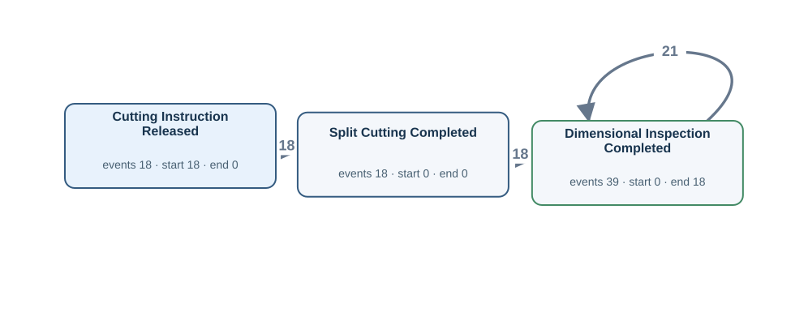</td><td width="50%"><h4>Original tables</h4>
Rows matched by event ID, activity and timestamp using the authored source bindings.

<strong><code>cutting_finishing_instruction</code></strong> · 18 source rows

<code>instruction_id</code> = CIM004, <code>material_id</code> = M004, <code>released_at</code> = 2026-03-05T10:00:00Z, <code>cut_method</code> = SPLIT, <code>cutting_instruction_acknowledged_at</code> = 2026-03-05T10:05:00Z, <code>cutting_setup_verified_at</code> = 2026-03-05T10:10:00Z, <code>cutting_work_started_at</code> = 2026-03-05T10:55:00Z, <code>cutting_instruction_closed_at</code> = NULL CI:CIM004 · Cutting Instruction Released · released_at · M004

<code>instruction_id</code> = CIM005, <code>material_id</code> = M005, <code>released_at</code> = 2026-03-06T10:00:00Z, <code>cut_method</code> = SPLIT, <code>cutting_instruction_acknowledged_at</code> = 2026-03-06T10:05:00Z, <code>cutting_setup_verified_at</code> = 2026-03-06T10:10:00Z, <code>cutting_work_started_at</code> = 2026-03-06T10:55:00Z, <code>cutting_instruction_closed_at</code> = 2026-03-06T11:05:00Z CI:CIM005 · Cutting Instruction Released · released_at · M005

<code>instruction_id</code> = CIM006, <code>material_id</code> = M006, <code>released_at</code> = 2026-03-07T10:00:00Z, <code>cut_method</code> = SPLIT, <code>cutting_instruction_acknowledged_at</code> = 2026-03-07T10:05:00Z, <code>cutting_setup_verified_at</code> = 2026-03-07T10:10:00Z, <code>cutting_work_started_at</code> = 2026-03-07T10:55:00Z, <code>cutting_instruction_closed_at</code> = 2026-03-07T11:05:00Z CI:CIM006 · Cutting Instruction Released · released_at · M006

<strong><code>material_operation_history</code></strong> · 18 source rows

<code>transaction_id</code> = M004-SC, <code>material_id</code> = M004, <code>operation_code</code> = SC, <code>started_at</code> = 2026-03-05T10:30:00Z, <code>completed_at</code> = 2026-03-05T11:00:00Z, <code>created_at</code> = 2026-03-05T11:06:00Z OP:M004-SC · Split Cutting Completed · completed_at · M004

<code>transaction_id</code> = M005-SC, <code>material_id</code> = M005, <code>operation_code</code> = SC, <code>started_at</code> = 2026-03-06T10:30:00Z, <code>completed_at</code> = 2026-03-06T11:00:00Z, <code>created_at</code> = 2026-03-06T11:06:00Z OP:M005-SC · Split Cutting Completed · completed_at · M005

<code>transaction_id</code> = M006-SC, <code>material_id</code> = M006, <code>operation_code</code> = SC, <code>started_at</code> = 2026-03-07T10:30:00Z, <code>completed_at</code> = 2026-03-07T11:00:00Z, <code>created_at</code> = 2026-03-07T11:06:00Z OP:M006-SC · Split Cutting Completed · completed_at · M006

<strong><code>plate_material</code></strong> · 39 source rows

<code>plate_material_id</code> = P004-1, <code>plate_no</code> = PLP004-1, <code>parent_as_rolled_plate_no</code> = AR004, <code>dimension_inspected_at</code> = 2026-03-05T13:36:00Z, <code>latest_operation_completed_at</code> = 2026-03-05T14:06:00Z, <code>plate_piece_identified_at</code> = 2026-03-05T12:36:00Z, <code>plate_quality_released_at</code> = 2026-03-05T14:36:00Z, <code>plate_packed_at</code> = NULL, <code>plate_quality_review_started_at</code> = 2026-03-05T14:21:00Z, <code>plate_packing_started_at</code> = NULL DIM:P004-1 · Dimensional Inspection Completed · dimension_inspected_at · M004

<code>plate_material_id</code> = P004-2, <code>plate_no</code> = PLP004-2, <code>parent_as_rolled_plate_no</code> = AR004, <code>dimension_inspected_at</code> = 2026-03-05T13:42:00Z, <code>latest_operation_completed_at</code> = 2026-03-05T14:12:00Z, <code>plate_piece_identified_at</code> = 2026-03-05T12:42:00Z, <code>plate_quality_released_at</code> = 2026-03-05T14:42:00Z, <code>plate_packed_at</code> = 2026-03-05T15:42:00Z, <code>plate_quality_review_started_at</code> = 2026-03-05T14:27:00Z, <code>plate_packing_started_at</code> = 2026-03-05T15:27:00Z DIM:P004-2 · Dimensional Inspection Completed · dimension_inspected_at · M004

<code>plate_material_id</code> = P004-3, <code>plate_no</code> = PLP004-3, <code>parent_as_rolled_plate_no</code> = AR004, <code>dimension_inspected_at</code> = 2026-03-05T13:48:00Z, <code>latest_operation_completed_at</code> = 2026-03-05T14:18:00Z, <code>plate_piece_identified_at</code> = 2026-03-05T12:48:00Z, <code>plate_quality_released_at</code> = 2026-03-05T14:48:00Z, <code>plate_packed_at</code> = 2026-03-05T15:48:00Z, <code>plate_quality_review_started_at</code> = 2026-03-05T14:33:00Z, <code>plate_packing_started_at</code> = 2026-03-05T15:33:00Z DIM:P004-3 · Dimensional Inspection Completed · dimension_inspected_at · M004

FK-linked row examples for case and join context

<strong>as_rolled_material</strong>

cutting_finishing_instruction (material_id → material_id) <code>material_id</code> = M004, <code>as_rolled_plate_no</code> = AR004, <code>slab_id</code> = SL004, <code>instruction_id</code> = RI004, <code>furnace_charged_at</code> = 2026-03-05T02:00:00Z, <code>crop_shear_passed_at</code> = 2026-03-05T09:00:00Z, <code>latest_operation_completed_at</code> = 2026-03-05T11:00:00Z, <code>created_at</code> = 2026-03-04T23:00:00Z, <code>updated_at</code> = 2026-03-05T22:00:00Z

cutting_finishing_instruction (material_id → material_id) <code>material_id</code> = M005, <code>as_rolled_plate_no</code> = AR005, <code>slab_id</code> = SL005, <code>instruction_id</code> = RI005, <code>furnace_charged_at</code> = 2026-03-06T04:00:00Z, <code>crop_shear_passed_at</code> = 2026-03-06T09:00:00Z, <code>latest_operation_completed_at</code> = 2026-03-06T11:00:00Z, <code>created_at</code> = 2026-03-05T23:00:00Z, <code>updated_at</code> = 2026-03-06T22:00:00Z

cutting_finishing_instruction (material_id → material_id) <code>material_id</code> = M006, <code>as_rolled_plate_no</code> = AR006, <code>slab_id</code> = SL006, <code>instruction_id</code> = RI006, <code>furnace_charged_at</code> = 2026-03-07T03:00:00Z, <code>crop_shear_passed_at</code> = 2026-03-07T09:00:00Z, <code>latest_operation_completed_at</code> = 2026-03-07T11:00:00Z, <code>created_at</code> = 2026-03-06T23:00:00Z, <code>updated_at</code> = 2026-03-07T22:00:00Z

Other tables referenced by Gold SQL

Includes case joins and branches of shared CTEs.
<ul><li><code>as_rolled_material</code> · as_rolled_plate_no, material_id</li></ul>
</td></tr></table>

[Gold CSV](../../../datasets/plateflow/private/gold_logs/V07.csv)

## V08 — Q1

Extract Slab Cast events for each slab.

**No Gold log:** No casting event times in this selected schema.

## OPV01 — Q3

Extract the full recorded lifecycle event log for each slab.

Events: **1108** · Cases with events: **36** · Activities: **39** · Edges: **63**

<table><tr><td width="50%"></td><td width="50%"><h4>Original tables</h4>
Rows matched by event ID, activity and timestamp using the authored source bindings.

<strong><code>as_rolled_material</code></strong> · 30 source rows

<code>material_id</code> = M002, <code>as_rolled_plate_no</code> = AR002, <code>slab_id</code> = SL002, <code>instruction_id</code> = RI002, <code>furnace_charged_at</code> = 2026-03-03T04:00:00Z, <code>crop_shear_passed_at</code> = NULL, <code>latest_operation_completed_at</code> = NULL, <code>created_at</code> = 2026-03-02T23:00:00Z, <code>updated_at</code> = 2026-03-03T22:00:00Z RH:M002 · Reheating Started · furnace_charged_at · SL002

<code>material_id</code> = M003, <code>as_rolled_plate_no</code> = AR003, <code>slab_id</code> = SL003, <code>instruction_id</code> = RI003, <code>furnace_charged_at</code> = 2026-03-04T03:00:00Z, <code>crop_shear_passed_at</code> = NULL, <code>latest_operation_completed_at</code> = 2026-03-04T06:00:00Z, <code>created_at</code> = 2026-03-03T23:00:00Z, <code>updated_at</code> = 2026-03-04T22:00:00Z RH:M003 · Reheating Started · furnace_charged_at · SL003

<code>material_id</code> = M004, <code>as_rolled_plate_no</code> = AR004, <code>slab_id</code> = SL004, <code>instruction_id</code> = RI004, <code>furnace_charged_at</code> = 2026-03-05T02:00:00Z, <code>crop_shear_passed_at</code> = 2026-03-05T09:00:00Z, <code>latest_operation_completed_at</code> = 2026-03-05T11:00:00Z, <code>created_at</code> = 2026-03-04T23:00:00Z, <code>updated_at</code> = 2026-03-05T22:00:00Z CS:M004 · Crop Shear Passed · crop_shear_passed_at · SL004 | RH:M004 · Reheating Started · furnace_charged_at · SL004

<strong><code>cutting_finishing_instruction</code></strong> · 18 source rows

<code>instruction_id</code> = CIM004, <code>material_id</code> = M004, <code>released_at</code> = 2026-03-05T10:00:00Z, <code>cut_method</code> = SPLIT, <code>cutting_instruction_acknowledged_at</code> = 2026-03-05T10:05:00Z, <code>cutting_setup_verified_at</code> = 2026-03-05T10:10:00Z, <code>cutting_work_started_at</code> = 2026-03-05T10:55:00Z, <code>cutting_instruction_closed_at</code> = NULL CI:CIM004 · Cutting Instruction Released · released_at · SL004 | LC:cutting_finishing_instruction:CIM004:1 · Cutting Instruction Acknowledged · cutting_instruction_acknowledged_at · SL004 | LC:cutting_finishing_instruction:CIM004:2 · Cutting Setup Verified · cutting_setup_verified_at · SL004 | LC:cutting_finishing_instruction:CIM004:3 · Cutting Work Started · cutting_work_started_at · SL004

<code>instruction_id</code> = CIM005, <code>material_id</code> = M005, <code>released_at</code> = 2026-03-06T10:00:00Z, <code>cut_method</code> = SPLIT, <code>cutting_instruction_acknowledged_at</code> = 2026-03-06T10:05:00Z, <code>cutting_setup_verified_at</code> = 2026-03-06T10:10:00Z, <code>cutting_work_started_at</code> = 2026-03-06T10:55:00Z, <code>cutting_instruction_closed_at</code> = 2026-03-06T11:05:00Z CI:CIM005 · Cutting Instruction Released · released_at · SL005 | LC:cutting_finishing_instruction:CIM005:1 · Cutting Instruction Acknowledged · cutting_instruction_acknowledged_at · SL005 | LC:cutting_finishing_instruction:CIM005:2 · Cutting Setup Verified · cutting_setup_verified_at · SL005 | LC:cutting_finishing_instruction:CIM005:3 · Cutting Work Started · cutting_work_started_at · SL005 | LC:cutting_finishing_instruction:CIM005:4 · Cutting Instruction Closed · cutting_instruction_closed_at · SL005

<code>instruction_id</code> = CIM006, <code>material_id</code> = M006, <code>released_at</code> = 2026-03-07T10:00:00Z, <code>cut_method</code> = SPLIT, <code>cutting_instruction_acknowledged_at</code> = 2026-03-07T10:05:00Z, <code>cutting_setup_verified_at</code> = 2026-03-07T10:10:00Z, <code>cutting_work_started_at</code> = 2026-03-07T10:55:00Z, <code>cutting_instruction_closed_at</code> = 2026-03-07T11:05:00Z CI:CIM006 · Cutting Instruction Released · released_at · SL006 | LC:cutting_finishing_instruction:CIM006:1 · Cutting Instruction Acknowledged · cutting_instruction_acknowledged_at · SL006 | LC:cutting_finishing_instruction:CIM006:2 · Cutting Setup Verified · cutting_setup_verified_at · SL006 | LC:cutting_finishing_instruction:CIM006:3 · Cutting Work Started · cutting_work_started_at · SL006 | LC:cutting_finishing_instruction:CIM006:4 · Cutting Instruction Closed · cutting_instruction_closed_at · SL006

<strong><code>furnace_charge_tracking</code></strong> · 30 source rows

<code>tracking_id</code> = TRM002, <code>material_id</code> = M002, <code>yard_instruction_received_at</code> = 2026-03-03T01:00:00Z, <code>lot_charging_started_at</code> = 2026-03-03T01:30:00Z, <code>furnace_charge_assigned_at</code> = 2026-03-03T01:05:00Z, <code>furnace_charge_confirmed_at</code> = NULL, <code>furnace_discharge_confirmed_at</code> = NULL LC:furnace_charge_tracking:TRM002:1 · Furnace Charge Assigned · furnace_charge_assigned_at · SL002 | YD:TRM002 · Yard Instruction Received · yard_instruction_received_at · SL002

<code>tracking_id</code> = TRM003, <code>material_id</code> = M003, <code>yard_instruction_received_at</code> = 2026-03-04T01:00:00Z, <code>lot_charging_started_at</code> = 2026-03-04T01:30:00Z, <code>furnace_charge_assigned_at</code> = 2026-03-04T01:05:00Z, <code>furnace_charge_confirmed_at</code> = 2026-03-04T03:01:00Z, <code>furnace_discharge_confirmed_at</code> = 2026-03-04T05:50:00Z LC:furnace_charge_tracking:TRM003:1 · Furnace Charge Assigned · furnace_charge_assigned_at · SL003 | LC:furnace_charge_tracking:TRM003:2 · Furnace Charge Confirmed · furnace_charge_confirmed_at · SL003 | LC:furnace_charge_tracking:TRM003:4 · Furnace Discharge Confirmed · furnace_discharge_confirmed_at · SL003 | YD:TRM003 · Yard Instruction Received · yard_instruction_received_at · SL003

<code>tracking_id</code> = TRM004, <code>material_id</code> = M004, <code>yard_instruction_received_at</code> = 2026-03-05T01:00:00Z, <code>lot_charging_started_at</code> = 2026-03-05T01:30:00Z, <code>furnace_charge_assigned_at</code> = 2026-03-05T01:05:00Z, <code>furnace_charge_confirmed_at</code> = 2026-03-05T02:01:00Z, <code>furnace_discharge_confirmed_at</code> = 2026-03-05T05:50:00Z LC:furnace_charge_tracking:TRM004:1 · Furnace Charge Assigned · furnace_charge_assigned_at · SL004 | LC:furnace_charge_tracking:TRM004:2 · Furnace Charge Confirmed · furnace_charge_confirmed_at · SL004 | LC:furnace_charge_tracking:TRM004:4 · Furnace Discharge Confirmed · furnace_discharge_confirmed_at · SL004 | YD:TRM004 · Yard Instruction Received · yard_instruction_received_at · SL004

<strong><code>material_operation_history</code></strong> · 216 source rows

<code>transaction_id</code> = LC:furnace_charge_tracking:TRM003:3, <code>material_id</code> = M003, <code>operation_code</code> = HF, <code>started_at</code> = 2026-03-04T05:39:00Z, <code>completed_at</code> = 2026-03-04T05:40:00Z, <code>created_at</code> = 2026-03-04T05:39:00Z LC:furnace_charge_tracking:TRM003:3 · Heating Completed · completed_at · SL003

<code>transaction_id</code> = M003-RL, <code>material_id</code> = M003, <code>operation_code</code> = RL, <code>started_at</code> = 2026-03-04T05:30:00Z, <code>completed_at</code> = 2026-03-04T06:00:00Z, <code>created_at</code> = 2026-03-04T06:06:00Z OP:M003-RL · Rolling Completed · completed_at · SL003

<code>transaction_id</code> = M004-CO, <code>material_id</code> = M004, <code>operation_code</code> = CO, <code>started_at</code> = 2026-03-05T06:30:00Z, <code>completed_at</code> = 2026-03-05T07:00:00Z, <code>created_at</code> = 2026-03-05T07:06:00Z OP:M004-CO · Cooling Completed · completed_at · SL004

<strong><code>planned_rolling_instruction</code></strong> · 36 source rows

<code>plan_id</code> = PLAN001, <code>slab_id</code> = SL001, <code>planned_reheat_at</code> = 2026-03-02T02:00:00Z, <code>rolling_plan_created_at</code> = 2026-03-01T14:00:00Z, <code>rolling_plan_reviewed_at</code> = 2026-03-01T15:00:00Z, <code>rolling_plan_approved_at</code> = 2026-03-01T16:00:00Z, <code>rolling_plan_released_at</code> = NULL LC:planned_rolling_instruction:PLAN001:1 · Rolling Plan Created · rolling_plan_created_at · SL001 | LC:planned_rolling_instruction:PLAN001:2 · Rolling Plan Reviewed · rolling_plan_reviewed_at · SL001 | LC:planned_rolling_instruction:PLAN001:3 · Rolling Plan Approved · rolling_plan_approved_at · SL001

<code>plan_id</code> = PLAN002, <code>slab_id</code> = SL002, <code>planned_reheat_at</code> = 2026-03-03T02:00:00Z, <code>rolling_plan_created_at</code> = 2026-03-02T14:00:00Z, <code>rolling_plan_reviewed_at</code> = 2026-03-02T15:00:00Z, <code>rolling_plan_approved_at</code> = 2026-03-02T16:00:00Z, <code>rolling_plan_released_at</code> = 2026-03-02T17:00:00Z LC:planned_rolling_instruction:PLAN002:1 · Rolling Plan Created · rolling_plan_created_at · SL002 | LC:planned_rolling_instruction:PLAN002:2 · Rolling Plan Reviewed · rolling_plan_reviewed_at · SL002 | LC:planned_rolling_instruction:PLAN002:3 · Rolling Plan Approved · rolling_plan_approved_at · SL002 | LC:planned_rolling_instruction:PLAN002:4 · Rolling Plan Released · rolling_plan_released_at · SL002

<code>plan_id</code> = PLAN003, <code>slab_id</code> = SL003, <code>planned_reheat_at</code> = 2026-03-04T02:00:00Z, <code>rolling_plan_created_at</code> = 2026-03-03T14:00:00Z, <code>rolling_plan_reviewed_at</code> = 2026-03-03T15:00:00Z, <code>rolling_plan_approved_at</code> = 2026-03-03T16:00:00Z, <code>rolling_plan_released_at</code> = 2026-03-03T17:00:00Z LC:planned_rolling_instruction:PLAN003:1 · Rolling Plan Created · rolling_plan_created_at · SL003 | LC:planned_rolling_instruction:PLAN003:2 · Rolling Plan Reviewed · rolling_plan_reviewed_at · SL003 | LC:planned_rolling_instruction:PLAN003:3 · Rolling Plan Approved · rolling_plan_approved_at · SL003 | LC:planned_rolling_instruction:PLAN003:4 · Rolling Plan Released · rolling_plan_released_at · SL003

<strong><code>plate_material</code></strong> · 39 source rows

<code>plate_material_id</code> = P004-1, <code>plate_no</code> = PLP004-1, <code>parent_as_rolled_plate_no</code> = AR004, <code>dimension_inspected_at</code> = 2026-03-05T13:36:00Z, <code>latest_operation_completed_at</code> = 2026-03-05T14:06:00Z, <code>plate_piece_identified_at</code> = 2026-03-05T12:36:00Z, <code>plate_quality_released_at</code> = 2026-03-05T14:36:00Z, <code>plate_packed_at</code> = NULL, <code>plate_quality_review_started_at</code> = 2026-03-05T14:21:00Z, <code>plate_packing_started_at</code> = NULL DIM:P004-1 · Dimensional Inspection Completed · dimension_inspected_at · SL004 | LC:plate_material:P004-1:1 · Plate Piece Identified · plate_piece_identified_at · SL004 | LC:plate_material:P004-1:3 · Plate Quality Released · plate_quality_released_at · SL004 | LC:plate_material:P004-1:5 · Plate Quality Review Started · plate_quality_review_started_at · SL004

<code>plate_material_id</code> = P004-2, <code>plate_no</code> = PLP004-2, <code>parent_as_rolled_plate_no</code> = AR004, <code>dimension_inspected_at</code> = 2026-03-05T13:42:00Z, <code>latest_operation_completed_at</code> = 2026-03-05T14:12:00Z, <code>plate_piece_identified_at</code> = 2026-03-05T12:42:00Z, <code>plate_quality_released_at</code> = 2026-03-05T14:42:00Z, <code>plate_packed_at</code> = 2026-03-05T15:42:00Z, <code>plate_quality_review_started_at</code> = 2026-03-05T14:27:00Z, <code>plate_packing_started_at</code> = 2026-03-05T15:27:00Z DIM:P004-2 · Dimensional Inspection Completed · dimension_inspected_at · SL004 | LC:plate_material:P004-2:1 · Plate Piece Identified · plate_piece_identified_at · SL004 | LC:plate_material:P004-2:3 · Plate Quality Released · plate_quality_released_at · SL004 | LC:plate_material:P004-2:4 · Plate Packed · plate_packed_at · SL004 | LC:plate_material:P004-2:5 · Plate Quality Review Started · plate_quality_review_started_at · SL004 | LC:plate_material:P004-2:6 · Plate Packing Started · plate_packing_started_at · SL004

<code>plate_material_id</code> = P004-3, <code>plate_no</code> = PLP004-3, <code>parent_as_rolled_plate_no</code> = AR004, <code>dimension_inspected_at</code> = 2026-03-05T13:48:00Z, <code>latest_operation_completed_at</code> = 2026-03-05T14:18:00Z, <code>plate_piece_identified_at</code> = 2026-03-05T12:48:00Z, <code>plate_quality_released_at</code> = 2026-03-05T14:48:00Z, <code>plate_packed_at</code> = 2026-03-05T15:48:00Z, <code>plate_quality_review_started_at</code> = 2026-03-05T14:33:00Z, <code>plate_packing_started_at</code> = 2026-03-05T15:33:00Z DIM:P004-3 · Dimensional Inspection Completed · dimension_inspected_at · SL004 | LC:plate_material:P004-3:1 · Plate Piece Identified · plate_piece_identified_at · SL004 | LC:plate_material:P004-3:3 · Plate Quality Released · plate_quality_released_at · SL004 | LC:plate_material:P004-3:4 · Plate Packed · plate_packed_at · SL004 | LC:plate_material:P004-3:5 · Plate Quality Review Started · plate_quality_review_started_at · SL004 | LC:plate_material:P004-3:6 · Plate Packing Started · plate_packing_started_at · SL004

<strong><code>rolling_instruction</code></strong> · 36 source rows

<code>instruction_id</code> = RI001, <code>plan_id</code> = PLAN001, <code>released_at</code> = 2026-03-02T00:00:00Z, <code>rolling_instruction_acknowledged_at</code> = 2026-03-02T00:05:00Z, <code>rolling_setup_verified_at</code> = NULL, <code>rolling_work_started_at</code> = NULL, <code>rolling_instruction_closed_at</code> = NULL LC:rolling_instruction:RI001:1 · Rolling Instruction Acknowledged · rolling_instruction_acknowledged_at · SL001 | RI:RI001 · Rolling Instruction Released · released_at · SL001

<code>instruction_id</code> = RI002, <code>plan_id</code> = PLAN002, <code>released_at</code> = 2026-03-03T00:00:00Z, <code>rolling_instruction_acknowledged_at</code> = 2026-03-03T00:05:00Z, <code>rolling_setup_verified_at</code> = 2026-03-03T00:10:00Z, <code>rolling_work_started_at</code> = NULL, <code>rolling_instruction_closed_at</code> = NULL LC:rolling_instruction:RI002:1 · Rolling Instruction Acknowledged · rolling_instruction_acknowledged_at · SL002 | LC:rolling_instruction:RI002:2 · Rolling Setup Verified · rolling_setup_verified_at · SL002 | RI:RI002 · Rolling Instruction Released · released_at · SL002

<code>instruction_id</code> = RI003, <code>plan_id</code> = PLAN003, <code>released_at</code> = 2026-03-04T00:00:00Z, <code>rolling_instruction_acknowledged_at</code> = 2026-03-04T00:05:00Z, <code>rolling_setup_verified_at</code> = 2026-03-04T00:10:00Z, <code>rolling_work_started_at</code> = 2026-03-04T05:55:00Z, <code>rolling_instruction_closed_at</code> = 2026-03-04T06:05:00Z LC:rolling_instruction:RI003:1 · Rolling Instruction Acknowledged · rolling_instruction_acknowledged_at · SL003 | LC:rolling_instruction:RI003:2 · Rolling Setup Verified · rolling_setup_verified_at · SL003 | LC:rolling_instruction:RI003:3 · Rolling Work Started · rolling_work_started_at · SL003 | LC:rolling_instruction:RI003:4 · Rolling Instruction Closed · rolling_instruction_closed_at · SL003 | RI:RI003 · Rolling Instruction Released · released_at · SL003

<strong><code>slab_material</code></strong> · 36 source rows

<code>slab_id</code> = SL001, <code>charge_id</code> = CH001, <code>slab_received_at</code> = 2026-03-01T14:00:00Z, <code>slab_identity_verified_at</code> = 2026-03-01T15:00:00Z, <code>slab_quality_checked_at</code> = 2026-03-01T16:00:00Z, <code>slab_released_for_rolling_at</code> = NULL LC:slab_material:SL001:1 · Slab Received · slab_received_at · SL001 | LC:slab_material:SL001:2 · Slab Identity Verified · slab_identity_verified_at · SL001 | LC:slab_material:SL001:3 · Slab Quality Checked · slab_quality_checked_at · SL001

<code>slab_id</code> = SL002, <code>charge_id</code> = CH002, <code>slab_received_at</code> = 2026-03-02T14:00:00Z, <code>slab_identity_verified_at</code> = 2026-03-02T15:00:00Z, <code>slab_quality_checked_at</code> = 2026-03-02T16:00:00Z, <code>slab_released_for_rolling_at</code> = 2026-03-02T17:00:00Z LC:slab_material:SL002:1 · Slab Received · slab_received_at · SL002 | LC:slab_material:SL002:2 · Slab Identity Verified · slab_identity_verified_at · SL002 | LC:slab_material:SL002:3 · Slab Quality Checked · slab_quality_checked_at · SL002 | LC:slab_material:SL002:4 · Slab Released for Rolling · slab_released_for_rolling_at · SL002

<code>slab_id</code> = SL003, <code>charge_id</code> = CH003, <code>slab_received_at</code> = 2026-03-03T14:00:00Z, <code>slab_identity_verified_at</code> = 2026-03-03T15:00:00Z, <code>slab_quality_checked_at</code> = 2026-03-03T16:00:00Z, <code>slab_released_for_rolling_at</code> = 2026-03-03T17:00:00Z LC:slab_material:SL003:1 · Slab Received · slab_received_at · SL003 | LC:slab_material:SL003:2 · Slab Identity Verified · slab_identity_verified_at · SL003 | LC:slab_material:SL003:3 · Slab Quality Checked · slab_quality_checked_at · SL003 | LC:slab_material:SL003:4 · Slab Released for Rolling · slab_released_for_rolling_at · SL003
</td></tr></table>

[Gold CSV](../../../datasets/plateflow/private/gold_logs/OPV01.csv)

## OPV02 — Q3

Extract the full recorded lifecycle event log for each rolling plan.

Events: **174** · Cases with events: **36** · Activities: **5** · Edges: **5**

<table><tr><td width="50%">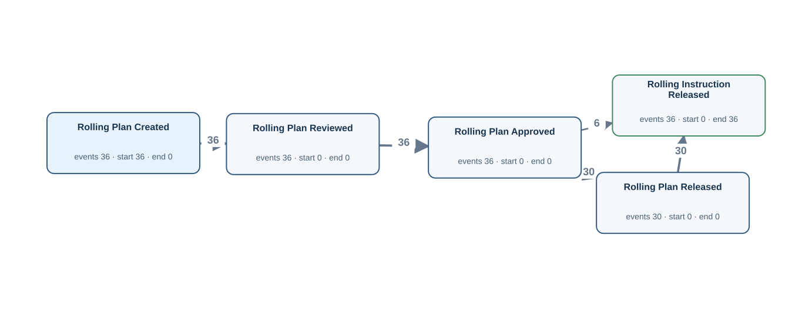</td><td width="50%"><h4>Original tables</h4>
Rows matched by event ID, activity and timestamp using the authored source bindings.

<strong><code>planned_rolling_instruction</code></strong> · 36 source rows

<code>plan_id</code> = PLAN001, <code>slab_id</code> = SL001, <code>planned_reheat_at</code> = 2026-03-02T02:00:00Z, <code>rolling_plan_created_at</code> = 2026-03-01T14:00:00Z, <code>rolling_plan_reviewed_at</code> = 2026-03-01T15:00:00Z, <code>rolling_plan_approved_at</code> = 2026-03-01T16:00:00Z, <code>rolling_plan_released_at</code> = NULL LC:planned_rolling_instruction:PLAN001:1 · Rolling Plan Created · rolling_plan_created_at · PLAN001 | LC:planned_rolling_instruction:PLAN001:2 · Rolling Plan Reviewed · rolling_plan_reviewed_at · PLAN001 | LC:planned_rolling_instruction:PLAN001:3 · Rolling Plan Approved · rolling_plan_approved_at · PLAN001

<code>plan_id</code> = PLAN002, <code>slab_id</code> = SL002, <code>planned_reheat_at</code> = 2026-03-03T02:00:00Z, <code>rolling_plan_created_at</code> = 2026-03-02T14:00:00Z, <code>rolling_plan_reviewed_at</code> = 2026-03-02T15:00:00Z, <code>rolling_plan_approved_at</code> = 2026-03-02T16:00:00Z, <code>rolling_plan_released_at</code> = 2026-03-02T17:00:00Z LC:planned_rolling_instruction:PLAN002:1 · Rolling Plan Created · rolling_plan_created_at · PLAN002 | LC:planned_rolling_instruction:PLAN002:2 · Rolling Plan Reviewed · rolling_plan_reviewed_at · PLAN002 | LC:planned_rolling_instruction:PLAN002:3 · Rolling Plan Approved · rolling_plan_approved_at · PLAN002 | LC:planned_rolling_instruction:PLAN002:4 · Rolling Plan Released · rolling_plan_released_at · PLAN002

<code>plan_id</code> = PLAN003, <code>slab_id</code> = SL003, <code>planned_reheat_at</code> = 2026-03-04T02:00:00Z, <code>rolling_plan_created_at</code> = 2026-03-03T14:00:00Z, <code>rolling_plan_reviewed_at</code> = 2026-03-03T15:00:00Z, <code>rolling_plan_approved_at</code> = 2026-03-03T16:00:00Z, <code>rolling_plan_released_at</code> = 2026-03-03T17:00:00Z LC:planned_rolling_instruction:PLAN003:1 · Rolling Plan Created · rolling_plan_created_at · PLAN003 | LC:planned_rolling_instruction:PLAN003:2 · Rolling Plan Reviewed · rolling_plan_reviewed_at · PLAN003 | LC:planned_rolling_instruction:PLAN003:3 · Rolling Plan Approved · rolling_plan_approved_at · PLAN003 | LC:planned_rolling_instruction:PLAN003:4 · Rolling Plan Released · rolling_plan_released_at · PLAN003

<strong><code>rolling_instruction</code></strong> · 36 source rows

<code>instruction_id</code> = RI001, <code>plan_id</code> = PLAN001, <code>released_at</code> = 2026-03-02T00:00:00Z, <code>rolling_instruction_acknowledged_at</code> = 2026-03-02T00:05:00Z, <code>rolling_setup_verified_at</code> = NULL, <code>rolling_work_started_at</code> = NULL, <code>rolling_instruction_closed_at</code> = NULL RI:RI001 · Rolling Instruction Released · released_at · PLAN001

<code>instruction_id</code> = RI002, <code>plan_id</code> = PLAN002, <code>released_at</code> = 2026-03-03T00:00:00Z, <code>rolling_instruction_acknowledged_at</code> = 2026-03-03T00:05:00Z, <code>rolling_setup_verified_at</code> = 2026-03-03T00:10:00Z, <code>rolling_work_started_at</code> = NULL, <code>rolling_instruction_closed_at</code> = NULL RI:RI002 · Rolling Instruction Released · released_at · PLAN002

<code>instruction_id</code> = RI003, <code>plan_id</code> = PLAN003, <code>released_at</code> = 2026-03-04T00:00:00Z, <code>rolling_instruction_acknowledged_at</code> = 2026-03-04T00:05:00Z, <code>rolling_setup_verified_at</code> = 2026-03-04T00:10:00Z, <code>rolling_work_started_at</code> = 2026-03-04T05:55:00Z, <code>rolling_instruction_closed_at</code> = 2026-03-04T06:05:00Z RI:RI003 · Rolling Instruction Released · released_at · PLAN003

FK-linked row examples for case and join context

<strong>slab_material</strong>

planned_rolling_instruction (slab_id → slab_id) <code>slab_id</code> = SL001, <code>charge_id</code> = CH001, <code>slab_received_at</code> = 2026-03-01T14:00:00Z, <code>slab_identity_verified_at</code> = 2026-03-01T15:00:00Z, <code>slab_quality_checked_at</code> = 2026-03-01T16:00:00Z, <code>slab_released_for_rolling_at</code> = NULL

planned_rolling_instruction (slab_id → slab_id) <code>slab_id</code> = SL002, <code>charge_id</code> = CH002, <code>slab_received_at</code> = 2026-03-02T14:00:00Z, <code>slab_identity_verified_at</code> = 2026-03-02T15:00:00Z, <code>slab_quality_checked_at</code> = 2026-03-02T16:00:00Z, <code>slab_released_for_rolling_at</code> = 2026-03-02T17:00:00Z

planned_rolling_instruction (slab_id → slab_id) <code>slab_id</code> = SL003, <code>charge_id</code> = CH003, <code>slab_received_at</code> = 2026-03-03T14:00:00Z, <code>slab_identity_verified_at</code> = 2026-03-03T15:00:00Z, <code>slab_quality_checked_at</code> = 2026-03-03T16:00:00Z, <code>slab_released_for_rolling_at</code> = 2026-03-03T17:00:00Z

Other tables referenced by Gold SQL

Includes case joins and branches of shared CTEs.
<ul><li><code>as_rolled_material</code> · as_rolled_plate_no, crop_shear_passed_at, furnace_charged_at, instruction_id, material_id</li><li><code>cutting_finishing_instruction</code> · cutting_instruction_acknowledged_at, cutting_instruction_closed_at, cutting_setup_verified_at, cutting_work_started_at, instruction_id, material_id, released_at</li><li><code>furnace_charge_tracking</code> · furnace_charge_assigned_at, furnace_charge_confirmed_at, furnace_discharge_confirmed_at, material_id, tracking_id, yard_instruction_received_at</li><li><code>material_operation_history</code> · completed_at, material_id, operation_code, transaction_id</li><li><code>plate_material</code> · dimension_inspected_at, parent_as_rolled_plate_no, plate_material_id, plate_packed_at, plate_packing_started_at, plate_piece_identified_at, plate_quality_released_at, plate_quality_review_started_at</li><li><code>slab_material</code> · slab_id, slab_identity_verified_at, slab_quality_checked_at, slab_received_at, slab_released_for_rolling_at</li></ul>
</td></tr></table>

[Gold CSV](../../../datasets/plateflow/private/gold_logs/OPV02.csv)

## OPV03 — Q3

Extract the full recorded lifecycle event log for each rolling instruction.

Events: **150** · Cases with events: **36** · Activities: **5** · Edges: **4**

<table><tr><td width="50%">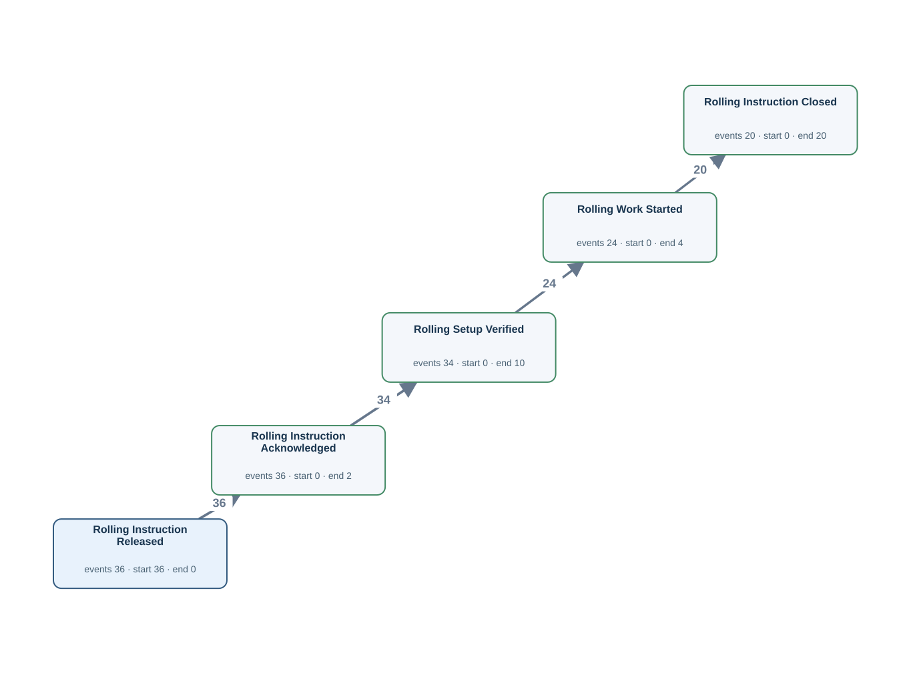</td><td width="50%"><h4>Original tables</h4>
Rows matched by event ID, activity and timestamp using the authored source bindings.

<strong><code>rolling_instruction</code></strong> · 36 source rows

<code>instruction_id</code> = RI001, <code>plan_id</code> = PLAN001, <code>released_at</code> = 2026-03-02T00:00:00Z, <code>rolling_instruction_acknowledged_at</code> = 2026-03-02T00:05:00Z, <code>rolling_setup_verified_at</code> = NULL, <code>rolling_work_started_at</code> = NULL, <code>rolling_instruction_closed_at</code> = NULL LC:rolling_instruction:RI001:1 · Rolling Instruction Acknowledged · rolling_instruction_acknowledged_at · RI001 | RI:RI001 · Rolling Instruction Released · released_at · RI001

<code>instruction_id</code> = RI002, <code>plan_id</code> = PLAN002, <code>released_at</code> = 2026-03-03T00:00:00Z, <code>rolling_instruction_acknowledged_at</code> = 2026-03-03T00:05:00Z, <code>rolling_setup_verified_at</code> = 2026-03-03T00:10:00Z, <code>rolling_work_started_at</code> = NULL, <code>rolling_instruction_closed_at</code> = NULL LC:rolling_instruction:RI002:1 · Rolling Instruction Acknowledged · rolling_instruction_acknowledged_at · RI002 | LC:rolling_instruction:RI002:2 · Rolling Setup Verified · rolling_setup_verified_at · RI002 | RI:RI002 · Rolling Instruction Released · released_at · RI002

<code>instruction_id</code> = RI003, <code>plan_id</code> = PLAN003, <code>released_at</code> = 2026-03-04T00:00:00Z, <code>rolling_instruction_acknowledged_at</code> = 2026-03-04T00:05:00Z, <code>rolling_setup_verified_at</code> = 2026-03-04T00:10:00Z, <code>rolling_work_started_at</code> = 2026-03-04T05:55:00Z, <code>rolling_instruction_closed_at</code> = 2026-03-04T06:05:00Z LC:rolling_instruction:RI003:1 · Rolling Instruction Acknowledged · rolling_instruction_acknowledged_at · RI003 | LC:rolling_instruction:RI003:2 · Rolling Setup Verified · rolling_setup_verified_at · RI003 | LC:rolling_instruction:RI003:3 · Rolling Work Started · rolling_work_started_at · RI003 | LC:rolling_instruction:RI003:4 · Rolling Instruction Closed · rolling_instruction_closed_at · RI003 | RI:RI003 · Rolling Instruction Released · released_at · RI003

FK-linked row examples for case and join context

<strong>planned_rolling_instruction</strong>

rolling_instruction (plan_id → plan_id) <code>plan_id</code> = PLAN001, <code>slab_id</code> = SL001, <code>planned_reheat_at</code> = 2026-03-02T02:00:00Z, <code>rolling_plan_created_at</code> = 2026-03-01T14:00:00Z, <code>rolling_plan_reviewed_at</code> = 2026-03-01T15:00:00Z, <code>rolling_plan_approved_at</code> = 2026-03-01T16:00:00Z, <code>rolling_plan_released_at</code> = NULL

rolling_instruction (plan_id → plan_id) <code>plan_id</code> = PLAN002, <code>slab_id</code> = SL002, <code>planned_reheat_at</code> = 2026-03-03T02:00:00Z, <code>rolling_plan_created_at</code> = 2026-03-02T14:00:00Z, <code>rolling_plan_reviewed_at</code> = 2026-03-02T15:00:00Z, <code>rolling_plan_approved_at</code> = 2026-03-02T16:00:00Z, <code>rolling_plan_released_at</code> = 2026-03-02T17:00:00Z

rolling_instruction (plan_id → plan_id) <code>plan_id</code> = PLAN003, <code>slab_id</code> = SL003, <code>planned_reheat_at</code> = 2026-03-04T02:00:00Z, <code>rolling_plan_created_at</code> = 2026-03-03T14:00:00Z, <code>rolling_plan_reviewed_at</code> = 2026-03-03T15:00:00Z, <code>rolling_plan_approved_at</code> = 2026-03-03T16:00:00Z, <code>rolling_plan_released_at</code> = 2026-03-03T17:00:00Z

<strong>slab_material</strong>

planned_rolling_instruction (slab_id → slab_id) <code>slab_id</code> = SL001, <code>charge_id</code> = CH001, <code>slab_received_at</code> = 2026-03-01T14:00:00Z, <code>slab_identity_verified_at</code> = 2026-03-01T15:00:00Z, <code>slab_quality_checked_at</code> = 2026-03-01T16:00:00Z, <code>slab_released_for_rolling_at</code> = NULL

planned_rolling_instruction (slab_id → slab_id) <code>slab_id</code> = SL002, <code>charge_id</code> = CH002, <code>slab_received_at</code> = 2026-03-02T14:00:00Z, <code>slab_identity_verified_at</code> = 2026-03-02T15:00:00Z, <code>slab_quality_checked_at</code> = 2026-03-02T16:00:00Z, <code>slab_released_for_rolling_at</code> = 2026-03-02T17:00:00Z

planned_rolling_instruction (slab_id → slab_id) <code>slab_id</code> = SL003, <code>charge_id</code> = CH003, <code>slab_received_at</code> = 2026-03-03T14:00:00Z, <code>slab_identity_verified_at</code> = 2026-03-03T15:00:00Z, <code>slab_quality_checked_at</code> = 2026-03-03T16:00:00Z, <code>slab_released_for_rolling_at</code> = 2026-03-03T17:00:00Z

Other tables referenced by Gold SQL

Includes case joins and branches of shared CTEs.
<ul><li><code>as_rolled_material</code> · as_rolled_plate_no, crop_shear_passed_at, furnace_charged_at, instruction_id, material_id</li><li><code>cutting_finishing_instruction</code> · cutting_instruction_acknowledged_at, cutting_instruction_closed_at, cutting_setup_verified_at, cutting_work_started_at, instruction_id, material_id, released_at</li><li><code>furnace_charge_tracking</code> · furnace_charge_assigned_at, furnace_charge_confirmed_at, furnace_discharge_confirmed_at, material_id, tracking_id, yard_instruction_received_at</li><li><code>material_operation_history</code> · completed_at, material_id, operation_code, transaction_id</li><li><code>planned_rolling_instruction</code> · plan_id, rolling_plan_approved_at, rolling_plan_created_at, rolling_plan_released_at, rolling_plan_reviewed_at</li><li><code>plate_material</code> · dimension_inspected_at, parent_as_rolled_plate_no, plate_material_id, plate_packed_at, plate_packing_started_at, plate_piece_identified_at, plate_quality_released_at, plate_quality_review_started_at</li><li><code>slab_material</code> · slab_id, slab_identity_verified_at, slab_quality_checked_at, slab_received_at, slab_released_for_rolling_at</li></ul>
</td></tr></table>

[Gold CSV](../../../datasets/plateflow/private/gold_logs/OPV03.csv)

## OPV04 — Q3

Extract the full recorded lifecycle event log for each mother material.

Events: **1108** · Cases with events: **36** · Activities: **39** · Edges: **63**

<table><tr><td width="50%"></td><td width="50%"><h4>Original tables</h4>
Rows matched by event ID, activity and timestamp using the authored source bindings.

<strong><code>as_rolled_material</code></strong> · 30 source rows

<code>material_id</code> = M002, <code>as_rolled_plate_no</code> = AR002, <code>slab_id</code> = SL002, <code>instruction_id</code> = RI002, <code>furnace_charged_at</code> = 2026-03-03T04:00:00Z, <code>crop_shear_passed_at</code> = NULL, <code>latest_operation_completed_at</code> = NULL, <code>created_at</code> = 2026-03-02T23:00:00Z, <code>updated_at</code> = 2026-03-03T22:00:00Z RH:M002 · Reheating Started · furnace_charged_at · M002

<code>material_id</code> = M003, <code>as_rolled_plate_no</code> = AR003, <code>slab_id</code> = SL003, <code>instruction_id</code> = RI003, <code>furnace_charged_at</code> = 2026-03-04T03:00:00Z, <code>crop_shear_passed_at</code> = NULL, <code>latest_operation_completed_at</code> = 2026-03-04T06:00:00Z, <code>created_at</code> = 2026-03-03T23:00:00Z, <code>updated_at</code> = 2026-03-04T22:00:00Z RH:M003 · Reheating Started · furnace_charged_at · M003

<code>material_id</code> = M004, <code>as_rolled_plate_no</code> = AR004, <code>slab_id</code> = SL004, <code>instruction_id</code> = RI004, <code>furnace_charged_at</code> = 2026-03-05T02:00:00Z, <code>crop_shear_passed_at</code> = 2026-03-05T09:00:00Z, <code>latest_operation_completed_at</code> = 2026-03-05T11:00:00Z, <code>created_at</code> = 2026-03-04T23:00:00Z, <code>updated_at</code> = 2026-03-05T22:00:00Z CS:M004 · Crop Shear Passed · crop_shear_passed_at · M004 | RH:M004 · Reheating Started · furnace_charged_at · M004

<strong><code>cutting_finishing_instruction</code></strong> · 18 source rows

<code>instruction_id</code> = CIM004, <code>material_id</code> = M004, <code>released_at</code> = 2026-03-05T10:00:00Z, <code>cut_method</code> = SPLIT, <code>cutting_instruction_acknowledged_at</code> = 2026-03-05T10:05:00Z, <code>cutting_setup_verified_at</code> = 2026-03-05T10:10:00Z, <code>cutting_work_started_at</code> = 2026-03-05T10:55:00Z, <code>cutting_instruction_closed_at</code> = NULL CI:CIM004 · Cutting Instruction Released · released_at · M004 | LC:cutting_finishing_instruction:CIM004:1 · Cutting Instruction Acknowledged · cutting_instruction_acknowledged_at · M004 | LC:cutting_finishing_instruction:CIM004:2 · Cutting Setup Verified · cutting_setup_verified_at · M004 | LC:cutting_finishing_instruction:CIM004:3 · Cutting Work Started · cutting_work_started_at · M004

<code>instruction_id</code> = CIM005, <code>material_id</code> = M005, <code>released_at</code> = 2026-03-06T10:00:00Z, <code>cut_method</code> = SPLIT, <code>cutting_instruction_acknowledged_at</code> = 2026-03-06T10:05:00Z, <code>cutting_setup_verified_at</code> = 2026-03-06T10:10:00Z, <code>cutting_work_started_at</code> = 2026-03-06T10:55:00Z, <code>cutting_instruction_closed_at</code> = 2026-03-06T11:05:00Z CI:CIM005 · Cutting Instruction Released · released_at · M005 | LC:cutting_finishing_instruction:CIM005:1 · Cutting Instruction Acknowledged · cutting_instruction_acknowledged_at · M005 | LC:cutting_finishing_instruction:CIM005:2 · Cutting Setup Verified · cutting_setup_verified_at · M005 | LC:cutting_finishing_instruction:CIM005:3 · Cutting Work Started · cutting_work_started_at · M005 | LC:cutting_finishing_instruction:CIM005:4 · Cutting Instruction Closed · cutting_instruction_closed_at · M005

<code>instruction_id</code> = CIM006, <code>material_id</code> = M006, <code>released_at</code> = 2026-03-07T10:00:00Z, <code>cut_method</code> = SPLIT, <code>cutting_instruction_acknowledged_at</code> = 2026-03-07T10:05:00Z, <code>cutting_setup_verified_at</code> = 2026-03-07T10:10:00Z, <code>cutting_work_started_at</code> = 2026-03-07T10:55:00Z, <code>cutting_instruction_closed_at</code> = 2026-03-07T11:05:00Z CI:CIM006 · Cutting Instruction Released · released_at · M006 | LC:cutting_finishing_instruction:CIM006:1 · Cutting Instruction Acknowledged · cutting_instruction_acknowledged_at · M006 | LC:cutting_finishing_instruction:CIM006:2 · Cutting Setup Verified · cutting_setup_verified_at · M006 | LC:cutting_finishing_instruction:CIM006:3 · Cutting Work Started · cutting_work_started_at · M006 | LC:cutting_finishing_instruction:CIM006:4 · Cutting Instruction Closed · cutting_instruction_closed_at · M006

<strong><code>furnace_charge_tracking</code></strong> · 30 source rows

<code>tracking_id</code> = TRM002, <code>material_id</code> = M002, <code>yard_instruction_received_at</code> = 2026-03-03T01:00:00Z, <code>lot_charging_started_at</code> = 2026-03-03T01:30:00Z, <code>furnace_charge_assigned_at</code> = 2026-03-03T01:05:00Z, <code>furnace_charge_confirmed_at</code> = NULL, <code>furnace_discharge_confirmed_at</code> = NULL LC:furnace_charge_tracking:TRM002:1 · Furnace Charge Assigned · furnace_charge_assigned_at · M002 | YD:TRM002 · Yard Instruction Received · yard_instruction_received_at · M002

<code>tracking_id</code> = TRM003, <code>material_id</code> = M003, <code>yard_instruction_received_at</code> = 2026-03-04T01:00:00Z, <code>lot_charging_started_at</code> = 2026-03-04T01:30:00Z, <code>furnace_charge_assigned_at</code> = 2026-03-04T01:05:00Z, <code>furnace_charge_confirmed_at</code> = 2026-03-04T03:01:00Z, <code>furnace_discharge_confirmed_at</code> = 2026-03-04T05:50:00Z LC:furnace_charge_tracking:TRM003:1 · Furnace Charge Assigned · furnace_charge_assigned_at · M003 | LC:furnace_charge_tracking:TRM003:2 · Furnace Charge Confirmed · furnace_charge_confirmed_at · M003 | LC:furnace_charge_tracking:TRM003:4 · Furnace Discharge Confirmed · furnace_discharge_confirmed_at · M003 | YD:TRM003 · Yard Instruction Received · yard_instruction_received_at · M003

<code>tracking_id</code> = TRM004, <code>material_id</code> = M004, <code>yard_instruction_received_at</code> = 2026-03-05T01:00:00Z, <code>lot_charging_started_at</code> = 2026-03-05T01:30:00Z, <code>furnace_charge_assigned_at</code> = 2026-03-05T01:05:00Z, <code>furnace_charge_confirmed_at</code> = 2026-03-05T02:01:00Z, <code>furnace_discharge_confirmed_at</code> = 2026-03-05T05:50:00Z LC:furnace_charge_tracking:TRM004:1 · Furnace Charge Assigned · furnace_charge_assigned_at · M004 | LC:furnace_charge_tracking:TRM004:2 · Furnace Charge Confirmed · furnace_charge_confirmed_at · M004 | LC:furnace_charge_tracking:TRM004:4 · Furnace Discharge Confirmed · furnace_discharge_confirmed_at · M004 | YD:TRM004 · Yard Instruction Received · yard_instruction_received_at · M004

<strong><code>material_operation_history</code></strong> · 216 source rows

<code>transaction_id</code> = LC:furnace_charge_tracking:TRM003:3, <code>material_id</code> = M003, <code>operation_code</code> = HF, <code>started_at</code> = 2026-03-04T05:39:00Z, <code>completed_at</code> = 2026-03-04T05:40:00Z, <code>created_at</code> = 2026-03-04T05:39:00Z LC:furnace_charge_tracking:TRM003:3 · Heating Completed · completed_at · M003

<code>transaction_id</code> = M003-RL, <code>material_id</code> = M003, <code>operation_code</code> = RL, <code>started_at</code> = 2026-03-04T05:30:00Z, <code>completed_at</code> = 2026-03-04T06:00:00Z, <code>created_at</code> = 2026-03-04T06:06:00Z OP:M003-RL · Rolling Completed · completed_at · M003

<code>transaction_id</code> = M004-CO, <code>material_id</code> = M004, <code>operation_code</code> = CO, <code>started_at</code> = 2026-03-05T06:30:00Z, <code>completed_at</code> = 2026-03-05T07:00:00Z, <code>created_at</code> = 2026-03-05T07:06:00Z OP:M004-CO · Cooling Completed · completed_at · M004

<strong><code>planned_rolling_instruction</code></strong> · 36 source rows

<code>plan_id</code> = PLAN001, <code>slab_id</code> = SL001, <code>planned_reheat_at</code> = 2026-03-02T02:00:00Z, <code>rolling_plan_created_at</code> = 2026-03-01T14:00:00Z, <code>rolling_plan_reviewed_at</code> = 2026-03-01T15:00:00Z, <code>rolling_plan_approved_at</code> = 2026-03-01T16:00:00Z, <code>rolling_plan_released_at</code> = NULL LC:planned_rolling_instruction:PLAN001:1 · Rolling Plan Created · rolling_plan_created_at · M001 | LC:planned_rolling_instruction:PLAN001:2 · Rolling Plan Reviewed · rolling_plan_reviewed_at · M001 | LC:planned_rolling_instruction:PLAN001:3 · Rolling Plan Approved · rolling_plan_approved_at · M001

<code>plan_id</code> = PLAN002, <code>slab_id</code> = SL002, <code>planned_reheat_at</code> = 2026-03-03T02:00:00Z, <code>rolling_plan_created_at</code> = 2026-03-02T14:00:00Z, <code>rolling_plan_reviewed_at</code> = 2026-03-02T15:00:00Z, <code>rolling_plan_approved_at</code> = 2026-03-02T16:00:00Z, <code>rolling_plan_released_at</code> = 2026-03-02T17:00:00Z LC:planned_rolling_instruction:PLAN002:1 · Rolling Plan Created · rolling_plan_created_at · M002 | LC:planned_rolling_instruction:PLAN002:2 · Rolling Plan Reviewed · rolling_plan_reviewed_at · M002 | LC:planned_rolling_instruction:PLAN002:3 · Rolling Plan Approved · rolling_plan_approved_at · M002 | LC:planned_rolling_instruction:PLAN002:4 · Rolling Plan Released · rolling_plan_released_at · M002

<code>plan_id</code> = PLAN003, <code>slab_id</code> = SL003, <code>planned_reheat_at</code> = 2026-03-04T02:00:00Z, <code>rolling_plan_created_at</code> = 2026-03-03T14:00:00Z, <code>rolling_plan_reviewed_at</code> = 2026-03-03T15:00:00Z, <code>rolling_plan_approved_at</code> = 2026-03-03T16:00:00Z, <code>rolling_plan_released_at</code> = 2026-03-03T17:00:00Z LC:planned_rolling_instruction:PLAN003:1 · Rolling Plan Created · rolling_plan_created_at · M003 | LC:planned_rolling_instruction:PLAN003:2 · Rolling Plan Reviewed · rolling_plan_reviewed_at · M003 | LC:planned_rolling_instruction:PLAN003:3 · Rolling Plan Approved · rolling_plan_approved_at · M003 | LC:planned_rolling_instruction:PLAN003:4 · Rolling Plan Released · rolling_plan_released_at · M003

<strong><code>plate_material</code></strong> · 39 source rows

<code>plate_material_id</code> = P004-1, <code>plate_no</code> = PLP004-1, <code>parent_as_rolled_plate_no</code> = AR004, <code>dimension_inspected_at</code> = 2026-03-05T13:36:00Z, <code>latest_operation_completed_at</code> = 2026-03-05T14:06:00Z, <code>plate_piece_identified_at</code> = 2026-03-05T12:36:00Z, <code>plate_quality_released_at</code> = 2026-03-05T14:36:00Z, <code>plate_packed_at</code> = NULL, <code>plate_quality_review_started_at</code> = 2026-03-05T14:21:00Z, <code>plate_packing_started_at</code> = NULL DIM:P004-1 · Dimensional Inspection Completed · dimension_inspected_at · M004 | LC:plate_material:P004-1:1 · Plate Piece Identified · plate_piece_identified_at · M004 | LC:plate_material:P004-1:3 · Plate Quality Released · plate_quality_released_at · M004 | LC:plate_material:P004-1:5 · Plate Quality Review Started · plate_quality_review_started_at · M004

<code>plate_material_id</code> = P004-2, <code>plate_no</code> = PLP004-2, <code>parent_as_rolled_plate_no</code> = AR004, <code>dimension_inspected_at</code> = 2026-03-05T13:42:00Z, <code>latest_operation_completed_at</code> = 2026-03-05T14:12:00Z, <code>plate_piece_identified_at</code> = 2026-03-05T12:42:00Z, <code>plate_quality_released_at</code> = 2026-03-05T14:42:00Z, <code>plate_packed_at</code> = 2026-03-05T15:42:00Z, <code>plate_quality_review_started_at</code> = 2026-03-05T14:27:00Z, <code>plate_packing_started_at</code> = 2026-03-05T15:27:00Z DIM:P004-2 · Dimensional Inspection Completed · dimension_inspected_at · M004 | LC:plate_material:P004-2:1 · Plate Piece Identified · plate_piece_identified_at · M004 | LC:plate_material:P004-2:3 · Plate Quality Released · plate_quality_released_at · M004 | LC:plate_material:P004-2:4 · Plate Packed · plate_packed_at · M004 | LC:plate_material:P004-2:5 · Plate Quality Review Started · plate_quality_review_started_at · M004 | LC:plate_material:P004-2:6 · Plate Packing Started · plate_packing_started_at · M004

<code>plate_material_id</code> = P004-3, <code>plate_no</code> = PLP004-3, <code>parent_as_rolled_plate_no</code> = AR004, <code>dimension_inspected_at</code> = 2026-03-05T13:48:00Z, <code>latest_operation_completed_at</code> = 2026-03-05T14:18:00Z, <code>plate_piece_identified_at</code> = 2026-03-05T12:48:00Z, <code>plate_quality_released_at</code> = 2026-03-05T14:48:00Z, <code>plate_packed_at</code> = 2026-03-05T15:48:00Z, <code>plate_quality_review_started_at</code> = 2026-03-05T14:33:00Z, <code>plate_packing_started_at</code> = 2026-03-05T15:33:00Z DIM:P004-3 · Dimensional Inspection Completed · dimension_inspected_at · M004 | LC:plate_material:P004-3:1 · Plate Piece Identified · plate_piece_identified_at · M004 | LC:plate_material:P004-3:3 · Plate Quality Released · plate_quality_released_at · M004 | LC:plate_material:P004-3:4 · Plate Packed · plate_packed_at · M004 | LC:plate_material:P004-3:5 · Plate Quality Review Started · plate_quality_review_started_at · M004 | LC:plate_material:P004-3:6 · Plate Packing Started · plate_packing_started_at · M004

<strong><code>rolling_instruction</code></strong> · 36 source rows

<code>instruction_id</code> = RI001, <code>plan_id</code> = PLAN001, <code>released_at</code> = 2026-03-02T00:00:00Z, <code>rolling_instruction_acknowledged_at</code> = 2026-03-02T00:05:00Z, <code>rolling_setup_verified_at</code> = NULL, <code>rolling_work_started_at</code> = NULL, <code>rolling_instruction_closed_at</code> = NULL LC:rolling_instruction:RI001:1 · Rolling Instruction Acknowledged · rolling_instruction_acknowledged_at · M001 | RI:RI001 · Rolling Instruction Released · released_at · M001

<code>instruction_id</code> = RI002, <code>plan_id</code> = PLAN002, <code>released_at</code> = 2026-03-03T00:00:00Z, <code>rolling_instruction_acknowledged_at</code> = 2026-03-03T00:05:00Z, <code>rolling_setup_verified_at</code> = 2026-03-03T00:10:00Z, <code>rolling_work_started_at</code> = NULL, <code>rolling_instruction_closed_at</code> = NULL LC:rolling_instruction:RI002:1 · Rolling Instruction Acknowledged · rolling_instruction_acknowledged_at · M002 | LC:rolling_instruction:RI002:2 · Rolling Setup Verified · rolling_setup_verified_at · M002 | RI:RI002 · Rolling Instruction Released · released_at · M002

<code>instruction_id</code> = RI003, <code>plan_id</code> = PLAN003, <code>released_at</code> = 2026-03-04T00:00:00Z, <code>rolling_instruction_acknowledged_at</code> = 2026-03-04T00:05:00Z, <code>rolling_setup_verified_at</code> = 2026-03-04T00:10:00Z, <code>rolling_work_started_at</code> = 2026-03-04T05:55:00Z, <code>rolling_instruction_closed_at</code> = 2026-03-04T06:05:00Z LC:rolling_instruction:RI003:1 · Rolling Instruction Acknowledged · rolling_instruction_acknowledged_at · M003 | LC:rolling_instruction:RI003:2 · Rolling Setup Verified · rolling_setup_verified_at · M003 | LC:rolling_instruction:RI003:3 · Rolling Work Started · rolling_work_started_at · M003 | LC:rolling_instruction:RI003:4 · Rolling Instruction Closed · rolling_instruction_closed_at · M003 | RI:RI003 · Rolling Instruction Released · released_at · M003

<strong><code>slab_material</code></strong> · 36 source rows

<code>slab_id</code> = SL001, <code>charge_id</code> = CH001, <code>slab_received_at</code> = 2026-03-01T14:00:00Z, <code>slab_identity_verified_at</code> = 2026-03-01T15:00:00Z, <code>slab_quality_checked_at</code> = 2026-03-01T16:00:00Z, <code>slab_released_for_rolling_at</code> = NULL LC:slab_material:SL001:1 · Slab Received · slab_received_at · M001 | LC:slab_material:SL001:2 · Slab Identity Verified · slab_identity_verified_at · M001 | LC:slab_material:SL001:3 · Slab Quality Checked · slab_quality_checked_at · M001

<code>slab_id</code> = SL002, <code>charge_id</code> = CH002, <code>slab_received_at</code> = 2026-03-02T14:00:00Z, <code>slab_identity_verified_at</code> = 2026-03-02T15:00:00Z, <code>slab_quality_checked_at</code> = 2026-03-02T16:00:00Z, <code>slab_released_for_rolling_at</code> = 2026-03-02T17:00:00Z LC:slab_material:SL002:1 · Slab Received · slab_received_at · M002 | LC:slab_material:SL002:2 · Slab Identity Verified · slab_identity_verified_at · M002 | LC:slab_material:SL002:3 · Slab Quality Checked · slab_quality_checked_at · M002 | LC:slab_material:SL002:4 · Slab Released for Rolling · slab_released_for_rolling_at · M002

<code>slab_id</code> = SL003, <code>charge_id</code> = CH003, <code>slab_received_at</code> = 2026-03-03T14:00:00Z, <code>slab_identity_verified_at</code> = 2026-03-03T15:00:00Z, <code>slab_quality_checked_at</code> = 2026-03-03T16:00:00Z, <code>slab_released_for_rolling_at</code> = 2026-03-03T17:00:00Z LC:slab_material:SL003:1 · Slab Received · slab_received_at · M003 | LC:slab_material:SL003:2 · Slab Identity Verified · slab_identity_verified_at · M003 | LC:slab_material:SL003:3 · Slab Quality Checked · slab_quality_checked_at · M003 | LC:slab_material:SL003:4 · Slab Released for Rolling · slab_released_for_rolling_at · M003
</td></tr></table>

[Gold CSV](../../../datasets/plateflow/private/gold_logs/OPV04.csv)

## OPV05 — Q3

Extract the full recorded lifecycle event log for each furnace tracking record.

Events: **133** · Cases with events: **30** · Activities: **5** · Edges: **4**

<table><tr><td width="50%">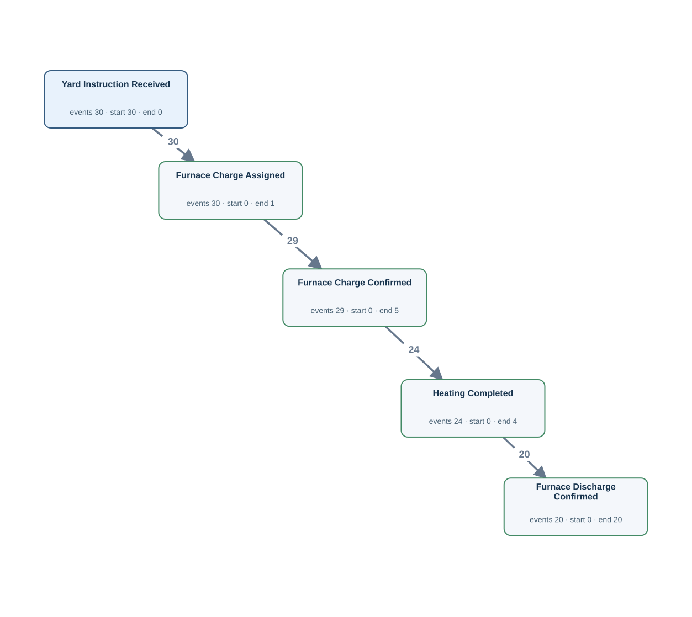</td><td width="50%"><h4>Original tables</h4>
Rows matched by event ID, activity and timestamp using the authored source bindings.

<strong><code>furnace_charge_tracking</code></strong> · 30 source rows

<code>tracking_id</code> = TRM002, <code>material_id</code> = M002, <code>yard_instruction_received_at</code> = 2026-03-03T01:00:00Z, <code>lot_charging_started_at</code> = 2026-03-03T01:30:00Z, <code>furnace_charge_assigned_at</code> = 2026-03-03T01:05:00Z, <code>furnace_charge_confirmed_at</code> = NULL, <code>furnace_discharge_confirmed_at</code> = NULL LC:furnace_charge_tracking:TRM002:1 · Furnace Charge Assigned · furnace_charge_assigned_at · TRM002 | YD:TRM002 · Yard Instruction Received · yard_instruction_received_at · TRM002

<code>tracking_id</code> = TRM003, <code>material_id</code> = M003, <code>yard_instruction_received_at</code> = 2026-03-04T01:00:00Z, <code>lot_charging_started_at</code> = 2026-03-04T01:30:00Z, <code>furnace_charge_assigned_at</code> = 2026-03-04T01:05:00Z, <code>furnace_charge_confirmed_at</code> = 2026-03-04T03:01:00Z, <code>furnace_discharge_confirmed_at</code> = 2026-03-04T05:50:00Z LC:furnace_charge_tracking:TRM003:1 · Furnace Charge Assigned · furnace_charge_assigned_at · TRM003 | LC:furnace_charge_tracking:TRM003:2 · Furnace Charge Confirmed · furnace_charge_confirmed_at · TRM003 | LC:furnace_charge_tracking:TRM003:4 · Furnace Discharge Confirmed · furnace_discharge_confirmed_at · TRM003 | YD:TRM003 · Yard Instruction Received · yard_instruction_received_at · TRM003

<code>tracking_id</code> = TRM004, <code>material_id</code> = M004, <code>yard_instruction_received_at</code> = 2026-03-05T01:00:00Z, <code>lot_charging_started_at</code> = 2026-03-05T01:30:00Z, <code>furnace_charge_assigned_at</code> = 2026-03-05T01:05:00Z, <code>furnace_charge_confirmed_at</code> = 2026-03-05T02:01:00Z, <code>furnace_discharge_confirmed_at</code> = 2026-03-05T05:50:00Z LC:furnace_charge_tracking:TRM004:1 · Furnace Charge Assigned · furnace_charge_assigned_at · TRM004 | LC:furnace_charge_tracking:TRM004:2 · Furnace Charge Confirmed · furnace_charge_confirmed_at · TRM004 | LC:furnace_charge_tracking:TRM004:4 · Furnace Discharge Confirmed · furnace_discharge_confirmed_at · TRM004 | YD:TRM004 · Yard Instruction Received · yard_instruction_received_at · TRM004

<strong><code>material_operation_history</code></strong> · 24 source rows

<code>transaction_id</code> = LC:furnace_charge_tracking:TRM003:3, <code>material_id</code> = M003, <code>operation_code</code> = HF, <code>started_at</code> = 2026-03-04T05:39:00Z, <code>completed_at</code> = 2026-03-04T05:40:00Z, <code>created_at</code> = 2026-03-04T05:39:00Z LC:furnace_charge_tracking:TRM003:3 · Heating Completed · completed_at · TRM003

<code>transaction_id</code> = LC:furnace_charge_tracking:TRM004:3, <code>material_id</code> = M004, <code>operation_code</code> = HF, <code>started_at</code> = 2026-03-05T05:39:00Z, <code>completed_at</code> = 2026-03-05T05:40:00Z, <code>created_at</code> = 2026-03-05T05:39:00Z LC:furnace_charge_tracking:TRM004:3 · Heating Completed · completed_at · TRM004

<code>transaction_id</code> = LC:furnace_charge_tracking:TRM005:3, <code>material_id</code> = M005, <code>operation_code</code> = HF, <code>started_at</code> = 2026-03-06T05:39:00Z, <code>completed_at</code> = 2026-03-06T05:40:00Z, <code>created_at</code> = 2026-03-06T05:39:00Z LC:furnace_charge_tracking:TRM005:3 · Heating Completed · completed_at · TRM005

FK-linked row examples for case and join context

<strong>as_rolled_material</strong>

furnace_charge_tracking (material_id → material_id) <code>material_id</code> = M002, <code>as_rolled_plate_no</code> = AR002, <code>slab_id</code> = SL002, <code>instruction_id</code> = RI002, <code>furnace_charged_at</code> = 2026-03-03T04:00:00Z, <code>crop_shear_passed_at</code> = NULL, <code>latest_operation_completed_at</code> = NULL, <code>created_at</code> = 2026-03-02T23:00:00Z, <code>updated_at</code> = 2026-03-03T22:00:00Z

furnace_charge_tracking (material_id → material_id) <code>material_id</code> = M003, <code>as_rolled_plate_no</code> = AR003, <code>slab_id</code> = SL003, <code>instruction_id</code> = RI003, <code>furnace_charged_at</code> = 2026-03-04T03:00:00Z, <code>crop_shear_passed_at</code> = NULL, <code>latest_operation_completed_at</code> = 2026-03-04T06:00:00Z, <code>created_at</code> = 2026-03-03T23:00:00Z, <code>updated_at</code> = 2026-03-04T22:00:00Z

furnace_charge_tracking (material_id → material_id) <code>material_id</code> = M004, <code>as_rolled_plate_no</code> = AR004, <code>slab_id</code> = SL004, <code>instruction_id</code> = RI004, <code>furnace_charged_at</code> = 2026-03-05T02:00:00Z, <code>crop_shear_passed_at</code> = 2026-03-05T09:00:00Z, <code>latest_operation_completed_at</code> = 2026-03-05T11:00:00Z, <code>created_at</code> = 2026-03-04T23:00:00Z, <code>updated_at</code> = 2026-03-05T22:00:00Z

<strong>planned_rolling_instruction</strong>

rolling_instruction (plan_id → plan_id) <code>plan_id</code> = PLAN002, <code>slab_id</code> = SL002, <code>planned_reheat_at</code> = 2026-03-03T02:00:00Z, <code>rolling_plan_created_at</code> = 2026-03-02T14:00:00Z, <code>rolling_plan_reviewed_at</code> = 2026-03-02T15:00:00Z, <code>rolling_plan_approved_at</code> = 2026-03-02T16:00:00Z, <code>rolling_plan_released_at</code> = 2026-03-02T17:00:00Z

rolling_instruction (plan_id → plan_id) <code>plan_id</code> = PLAN003, <code>slab_id</code> = SL003, <code>planned_reheat_at</code> = 2026-03-04T02:00:00Z, <code>rolling_plan_created_at</code> = 2026-03-03T14:00:00Z, <code>rolling_plan_reviewed_at</code> = 2026-03-03T15:00:00Z, <code>rolling_plan_approved_at</code> = 2026-03-03T16:00:00Z, <code>rolling_plan_released_at</code> = 2026-03-03T17:00:00Z

rolling_instruction (plan_id → plan_id) <code>plan_id</code> = PLAN004, <code>slab_id</code> = SL004, <code>planned_reheat_at</code> = 2026-03-05T02:00:00Z, <code>rolling_plan_created_at</code> = 2026-03-04T14:00:00Z, <code>rolling_plan_reviewed_at</code> = 2026-03-04T15:00:00Z, <code>rolling_plan_approved_at</code> = 2026-03-04T16:00:00Z, <code>rolling_plan_released_at</code> = 2026-03-04T17:00:00Z

<strong>rolling_instruction</strong>

as_rolled_material (instruction_id → instruction_id) <code>instruction_id</code> = RI002, <code>plan_id</code> = PLAN002, <code>released_at</code> = 2026-03-03T00:00:00Z, <code>rolling_instruction_acknowledged_at</code> = 2026-03-03T00:05:00Z, <code>rolling_setup_verified_at</code> = 2026-03-03T00:10:00Z, <code>rolling_work_started_at</code> = NULL, <code>rolling_instruction_closed_at</code> = NULL

as_rolled_material (instruction_id → instruction_id) <code>instruction_id</code> = RI003, <code>plan_id</code> = PLAN003, <code>released_at</code> = 2026-03-04T00:00:00Z, <code>rolling_instruction_acknowledged_at</code> = 2026-03-04T00:05:00Z, <code>rolling_setup_verified_at</code> = 2026-03-04T00:10:00Z, <code>rolling_work_started_at</code> = 2026-03-04T05:55:00Z, <code>rolling_instruction_closed_at</code> = 2026-03-04T06:05:00Z

as_rolled_material (instruction_id → instruction_id) <code>instruction_id</code> = RI004, <code>plan_id</code> = PLAN004, <code>released_at</code> = 2026-03-05T00:00:00Z, <code>rolling_instruction_acknowledged_at</code> = 2026-03-05T00:05:00Z, <code>rolling_setup_verified_at</code> = 2026-03-05T00:10:00Z, <code>rolling_work_started_at</code> = 2026-03-05T05:55:00Z, <code>rolling_instruction_closed_at</code> = 2026-03-05T06:05:00Z

<strong>slab_material</strong>

as_rolled_material (slab_id → slab_id) <code>slab_id</code> = SL002, <code>charge_id</code> = CH002, <code>slab_received_at</code> = 2026-03-02T14:00:00Z, <code>slab_identity_verified_at</code> = 2026-03-02T15:00:00Z, <code>slab_quality_checked_at</code> = 2026-03-02T16:00:00Z, <code>slab_released_for_rolling_at</code> = 2026-03-02T17:00:00Z

as_rolled_material (slab_id → slab_id) <code>slab_id</code> = SL003, <code>charge_id</code> = CH003, <code>slab_received_at</code> = 2026-03-03T14:00:00Z, <code>slab_identity_verified_at</code> = 2026-03-03T15:00:00Z, <code>slab_quality_checked_at</code> = 2026-03-03T16:00:00Z, <code>slab_released_for_rolling_at</code> = 2026-03-03T17:00:00Z

as_rolled_material (slab_id → slab_id) <code>slab_id</code> = SL004, <code>charge_id</code> = CH004, <code>slab_received_at</code> = 2026-03-04T14:00:00Z, <code>slab_identity_verified_at</code> = 2026-03-04T15:00:00Z, <code>slab_quality_checked_at</code> = 2026-03-04T16:00:00Z, <code>slab_released_for_rolling_at</code> = 2026-03-04T17:00:00Z

Other tables referenced by Gold SQL

Includes case joins and branches of shared CTEs.
<ul><li><code>as_rolled_material</code> · as_rolled_plate_no, crop_shear_passed_at, furnace_charged_at, instruction_id, material_id</li><li><code>cutting_finishing_instruction</code> · cutting_instruction_acknowledged_at, cutting_instruction_closed_at, cutting_setup_verified_at, cutting_work_started_at, instruction_id, material_id, released_at</li><li><code>planned_rolling_instruction</code> · plan_id, rolling_plan_approved_at, rolling_plan_created_at, rolling_plan_released_at, rolling_plan_reviewed_at</li><li><code>plate_material</code> · dimension_inspected_at, parent_as_rolled_plate_no, plate_material_id, plate_packed_at, plate_packing_started_at, plate_piece_identified_at, plate_quality_released_at, plate_quality_review_started_at</li><li><code>rolling_instruction</code> · instruction_id, released_at, rolling_instruction_acknowledged_at, rolling_instruction_closed_at, rolling_setup_verified_at, rolling_work_started_at</li><li><code>slab_material</code> · slab_id, slab_identity_verified_at, slab_quality_checked_at, slab_received_at, slab_released_for_rolling_at</li></ul>
</td></tr></table>

[Gold CSV](../../../datasets/plateflow/private/gold_logs/OPV05.csv)

## OPV06 — Q3

Extract the full recorded lifecycle event log for each cutting instruction.

Events: **87** · Cases with events: **18** · Activities: **5** · Edges: **4**

<table><tr><td width="50%">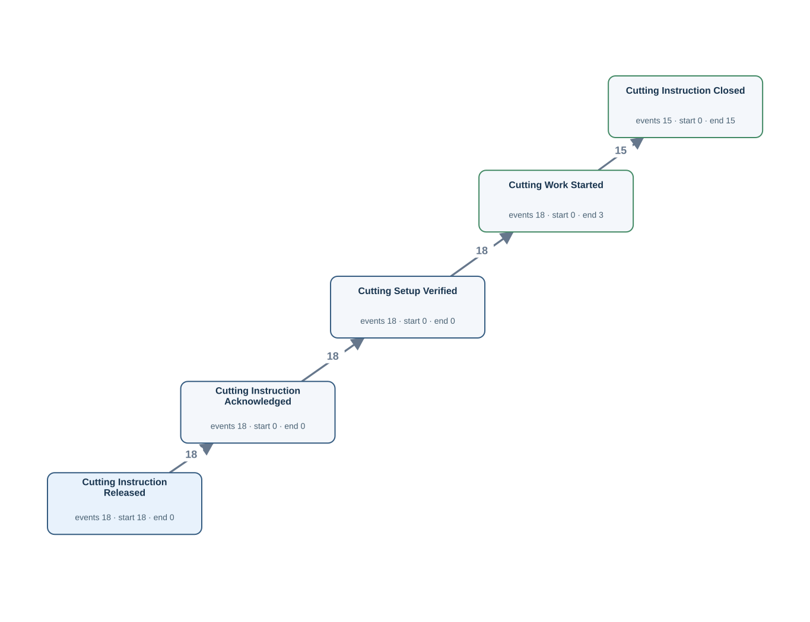</td><td width="50%"><h4>Original tables</h4>
Rows matched by event ID, activity and timestamp using the authored source bindings.

<strong><code>cutting_finishing_instruction</code></strong> · 18 source rows

<code>instruction_id</code> = CIM004, <code>material_id</code> = M004, <code>released_at</code> = 2026-03-05T10:00:00Z, <code>cut_method</code> = SPLIT, <code>cutting_instruction_acknowledged_at</code> = 2026-03-05T10:05:00Z, <code>cutting_setup_verified_at</code> = 2026-03-05T10:10:00Z, <code>cutting_work_started_at</code> = 2026-03-05T10:55:00Z, <code>cutting_instruction_closed_at</code> = NULL CI:CIM004 · Cutting Instruction Released · released_at · CIM004 | LC:cutting_finishing_instruction:CIM004:1 · Cutting Instruction Acknowledged · cutting_instruction_acknowledged_at · CIM004 | LC:cutting_finishing_instruction:CIM004:2 · Cutting Setup Verified · cutting_setup_verified_at · CIM004 | LC:cutting_finishing_instruction:CIM004:3 · Cutting Work Started · cutting_work_started_at · CIM004

<code>instruction_id</code> = CIM005, <code>material_id</code> = M005, <code>released_at</code> = 2026-03-06T10:00:00Z, <code>cut_method</code> = SPLIT, <code>cutting_instruction_acknowledged_at</code> = 2026-03-06T10:05:00Z, <code>cutting_setup_verified_at</code> = 2026-03-06T10:10:00Z, <code>cutting_work_started_at</code> = 2026-03-06T10:55:00Z, <code>cutting_instruction_closed_at</code> = 2026-03-06T11:05:00Z CI:CIM005 · Cutting Instruction Released · released_at · CIM005 | LC:cutting_finishing_instruction:CIM005:1 · Cutting Instruction Acknowledged · cutting_instruction_acknowledged_at · CIM005 | LC:cutting_finishing_instruction:CIM005:2 · Cutting Setup Verified · cutting_setup_verified_at · CIM005 | LC:cutting_finishing_instruction:CIM005:3 · Cutting Work Started · cutting_work_started_at · CIM005 | LC:cutting_finishing_instruction:CIM005:4 · Cutting Instruction Closed · cutting_instruction_closed_at · CIM005

<code>instruction_id</code> = CIM006, <code>material_id</code> = M006, <code>released_at</code> = 2026-03-07T10:00:00Z, <code>cut_method</code> = SPLIT, <code>cutting_instruction_acknowledged_at</code> = 2026-03-07T10:05:00Z, <code>cutting_setup_verified_at</code> = 2026-03-07T10:10:00Z, <code>cutting_work_started_at</code> = 2026-03-07T10:55:00Z, <code>cutting_instruction_closed_at</code> = 2026-03-07T11:05:00Z CI:CIM006 · Cutting Instruction Released · released_at · CIM006 | LC:cutting_finishing_instruction:CIM006:1 · Cutting Instruction Acknowledged · cutting_instruction_acknowledged_at · CIM006 | LC:cutting_finishing_instruction:CIM006:2 · Cutting Setup Verified · cutting_setup_verified_at · CIM006 | LC:cutting_finishing_instruction:CIM006:3 · Cutting Work Started · cutting_work_started_at · CIM006 | LC:cutting_finishing_instruction:CIM006:4 · Cutting Instruction Closed · cutting_instruction_closed_at · CIM006

FK-linked row examples for case and join context

<strong>as_rolled_material</strong>

cutting_finishing_instruction (material_id → material_id) <code>material_id</code> = M004, <code>as_rolled_plate_no</code> = AR004, <code>slab_id</code> = SL004, <code>instruction_id</code> = RI004, <code>furnace_charged_at</code> = 2026-03-05T02:00:00Z, <code>crop_shear_passed_at</code> = 2026-03-05T09:00:00Z, <code>latest_operation_completed_at</code> = 2026-03-05T11:00:00Z, <code>created_at</code> = 2026-03-04T23:00:00Z, <code>updated_at</code> = 2026-03-05T22:00:00Z

cutting_finishing_instruction (material_id → material_id) <code>material_id</code> = M005, <code>as_rolled_plate_no</code> = AR005, <code>slab_id</code> = SL005, <code>instruction_id</code> = RI005, <code>furnace_charged_at</code> = 2026-03-06T04:00:00Z, <code>crop_shear_passed_at</code> = 2026-03-06T09:00:00Z, <code>latest_operation_completed_at</code> = 2026-03-06T11:00:00Z, <code>created_at</code> = 2026-03-05T23:00:00Z, <code>updated_at</code> = 2026-03-06T22:00:00Z

cutting_finishing_instruction (material_id → material_id) <code>material_id</code> = M006, <code>as_rolled_plate_no</code> = AR006, <code>slab_id</code> = SL006, <code>instruction_id</code> = RI006, <code>furnace_charged_at</code> = 2026-03-07T03:00:00Z, <code>crop_shear_passed_at</code> = 2026-03-07T09:00:00Z, <code>latest_operation_completed_at</code> = 2026-03-07T11:00:00Z, <code>created_at</code> = 2026-03-06T23:00:00Z, <code>updated_at</code> = 2026-03-07T22:00:00Z

<strong>planned_rolling_instruction</strong>

rolling_instruction (plan_id → plan_id) <code>plan_id</code> = PLAN004, <code>slab_id</code> = SL004, <code>planned_reheat_at</code> = 2026-03-05T02:00:00Z, <code>rolling_plan_created_at</code> = 2026-03-04T14:00:00Z, <code>rolling_plan_reviewed_at</code> = 2026-03-04T15:00:00Z, <code>rolling_plan_approved_at</code> = 2026-03-04T16:00:00Z, <code>rolling_plan_released_at</code> = 2026-03-04T17:00:00Z

rolling_instruction (plan_id → plan_id) <code>plan_id</code> = PLAN005, <code>slab_id</code> = SL005, <code>planned_reheat_at</code> = 2026-03-06T02:00:00Z, <code>rolling_plan_created_at</code> = 2026-03-05T14:00:00Z, <code>rolling_plan_reviewed_at</code> = 2026-03-05T15:00:00Z, <code>rolling_plan_approved_at</code> = 2026-03-05T16:00:00Z, <code>rolling_plan_released_at</code> = 2026-03-05T17:00:00Z

rolling_instruction (plan_id → plan_id) <code>plan_id</code> = PLAN006, <code>slab_id</code> = SL006, <code>planned_reheat_at</code> = 2026-03-07T02:00:00Z, <code>rolling_plan_created_at</code> = 2026-03-06T14:00:00Z, <code>rolling_plan_reviewed_at</code> = 2026-03-06T15:00:00Z, <code>rolling_plan_approved_at</code> = 2026-03-06T16:00:00Z, <code>rolling_plan_released_at</code> = 2026-03-06T17:00:00Z

<strong>rolling_instruction</strong>

as_rolled_material (instruction_id → instruction_id) <code>instruction_id</code> = RI004, <code>plan_id</code> = PLAN004, <code>released_at</code> = 2026-03-05T00:00:00Z, <code>rolling_instruction_acknowledged_at</code> = 2026-03-05T00:05:00Z, <code>rolling_setup_verified_at</code> = 2026-03-05T00:10:00Z, <code>rolling_work_started_at</code> = 2026-03-05T05:55:00Z, <code>rolling_instruction_closed_at</code> = 2026-03-05T06:05:00Z

as_rolled_material (instruction_id → instruction_id) <code>instruction_id</code> = RI005, <code>plan_id</code> = PLAN005, <code>released_at</code> = 2026-03-06T00:00:00Z, <code>rolling_instruction_acknowledged_at</code> = 2026-03-06T00:05:00Z, <code>rolling_setup_verified_at</code> = 2026-03-06T00:10:00Z, <code>rolling_work_started_at</code> = 2026-03-06T05:55:00Z, <code>rolling_instruction_closed_at</code> = 2026-03-06T06:05:00Z

as_rolled_material (instruction_id → instruction_id) <code>instruction_id</code> = RI006, <code>plan_id</code> = PLAN006, <code>released_at</code> = 2026-03-07T00:00:00Z, <code>rolling_instruction_acknowledged_at</code> = 2026-03-07T00:05:00Z, <code>rolling_setup_verified_at</code> = 2026-03-07T00:10:00Z, <code>rolling_work_started_at</code> = 2026-03-07T05:55:00Z, <code>rolling_instruction_closed_at</code> = 2026-03-07T06:05:00Z

<strong>slab_material</strong>

as_rolled_material (slab_id → slab_id) <code>slab_id</code> = SL004, <code>charge_id</code> = CH004, <code>slab_received_at</code> = 2026-03-04T14:00:00Z, <code>slab_identity_verified_at</code> = 2026-03-04T15:00:00Z, <code>slab_quality_checked_at</code> = 2026-03-04T16:00:00Z, <code>slab_released_for_rolling_at</code> = 2026-03-04T17:00:00Z

as_rolled_material (slab_id → slab_id) <code>slab_id</code> = SL005, <code>charge_id</code> = CH005, <code>slab_received_at</code> = 2026-03-05T14:00:00Z, <code>slab_identity_verified_at</code> = 2026-03-05T15:00:00Z, <code>slab_quality_checked_at</code> = 2026-03-05T16:00:00Z, <code>slab_released_for_rolling_at</code> = 2026-03-05T17:00:00Z

as_rolled_material (slab_id → slab_id) <code>slab_id</code> = SL006, <code>charge_id</code> = CH006, <code>slab_received_at</code> = 2026-03-06T14:00:00Z, <code>slab_identity_verified_at</code> = 2026-03-06T15:00:00Z, <code>slab_quality_checked_at</code> = 2026-03-06T16:00:00Z, <code>slab_released_for_rolling_at</code> = 2026-03-06T17:00:00Z

Other tables referenced by Gold SQL

Includes case joins and branches of shared CTEs.
<ul><li><code>as_rolled_material</code> · as_rolled_plate_no, crop_shear_passed_at, furnace_charged_at, instruction_id, material_id</li><li><code>furnace_charge_tracking</code> · furnace_charge_assigned_at, furnace_charge_confirmed_at, furnace_discharge_confirmed_at, material_id, tracking_id, yard_instruction_received_at</li><li><code>material_operation_history</code> · completed_at, material_id, operation_code, transaction_id</li><li><code>planned_rolling_instruction</code> · plan_id, rolling_plan_approved_at, rolling_plan_created_at, rolling_plan_released_at, rolling_plan_reviewed_at</li><li><code>plate_material</code> · dimension_inspected_at, parent_as_rolled_plate_no, plate_material_id, plate_packed_at, plate_packing_started_at, plate_piece_identified_at, plate_quality_released_at, plate_quality_review_started_at</li><li><code>rolling_instruction</code> · instruction_id, released_at, rolling_instruction_acknowledged_at, rolling_instruction_closed_at, rolling_setup_verified_at, rolling_work_started_at</li><li><code>slab_material</code> · slab_id, slab_identity_verified_at, slab_quality_checked_at, slab_received_at, slab_released_for_rolling_at</li></ul>
</td></tr></table>

[Gold CSV](../../../datasets/plateflow/private/gold_logs/OPV06.csv)

## OPV07 — Q3

Extract the full recorded lifecycle event log for each cut plate piece.

Events: **336** · Cases with events: **39** · Activities: **10** · Edges: **12**

<table><tr><td width="50%">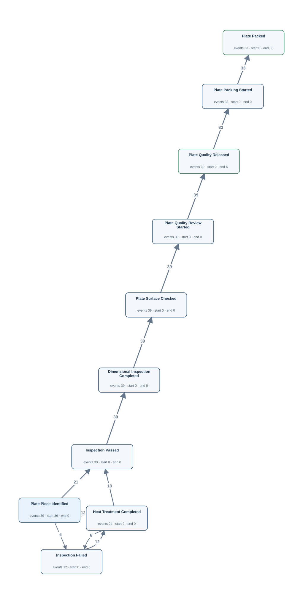</td><td width="50%"><h4>Original tables</h4>
Rows matched by event ID, activity and timestamp using the authored source bindings.

<strong><code>material_operation_history</code></strong> · 114 source rows

<code>transaction_id</code> = P004-1-IP, <code>material_id</code> = P004-1, <code>operation_code</code> = IP, <code>started_at</code> = 2026-03-05T12:36:00Z, <code>completed_at</code> = 2026-03-05T13:06:00Z, <code>created_at</code> = 2026-03-05T13:12:00Z OP:P004-1-IP · Inspection Passed · completed_at · P004-1

<code>transaction_id</code> = LC:plate_material:P004-1:2, <code>material_id</code> = P004-1, <code>operation_code</code> = SF, <code>started_at</code> = 2026-03-05T14:05:00Z, <code>completed_at</code> = 2026-03-05T14:06:00Z, <code>created_at</code> = 2026-03-05T14:05:00Z LC:plate_material:P004-1:2 · Plate Surface Checked · completed_at · P004-1

<code>transaction_id</code> = P005-1-HT1, <code>material_id</code> = P005-1, <code>operation_code</code> = HT, <code>started_at</code> = 2026-03-06T11:30:00Z, <code>completed_at</code> = 2026-03-06T12:00:00Z, <code>created_at</code> = 2026-03-06T12:06:00Z OP:P005-1-HT1 · Heat Treatment Completed · completed_at · P005-1

<strong><code>plate_material</code></strong> · 39 source rows

<code>plate_material_id</code> = P004-1, <code>plate_no</code> = PLP004-1, <code>parent_as_rolled_plate_no</code> = AR004, <code>dimension_inspected_at</code> = 2026-03-05T13:36:00Z, <code>latest_operation_completed_at</code> = 2026-03-05T14:06:00Z, <code>plate_piece_identified_at</code> = 2026-03-05T12:36:00Z, <code>plate_quality_released_at</code> = 2026-03-05T14:36:00Z, <code>plate_packed_at</code> = NULL, <code>plate_quality_review_started_at</code> = 2026-03-05T14:21:00Z, <code>plate_packing_started_at</code> = NULL DIM:P004-1 · Dimensional Inspection Completed · dimension_inspected_at · P004-1 | LC:plate_material:P004-1:1 · Plate Piece Identified · plate_piece_identified_at · P004-1 | LC:plate_material:P004-1:3 · Plate Quality Released · plate_quality_released_at · P004-1 | LC:plate_material:P004-1:5 · Plate Quality Review Started · plate_quality_review_started_at · P004-1

<code>plate_material_id</code> = P004-2, <code>plate_no</code> = PLP004-2, <code>parent_as_rolled_plate_no</code> = AR004, <code>dimension_inspected_at</code> = 2026-03-05T13:42:00Z, <code>latest_operation_completed_at</code> = 2026-03-05T14:12:00Z, <code>plate_piece_identified_at</code> = 2026-03-05T12:42:00Z, <code>plate_quality_released_at</code> = 2026-03-05T14:42:00Z, <code>plate_packed_at</code> = 2026-03-05T15:42:00Z, <code>plate_quality_review_started_at</code> = 2026-03-05T14:27:00Z, <code>plate_packing_started_at</code> = 2026-03-05T15:27:00Z DIM:P004-2 · Dimensional Inspection Completed · dimension_inspected_at · P004-2 | LC:plate_material:P004-2:1 · Plate Piece Identified · plate_piece_identified_at · P004-2 | LC:plate_material:P004-2:3 · Plate Quality Released · plate_quality_released_at · P004-2 | LC:plate_material:P004-2:4 · Plate Packed · plate_packed_at · P004-2 | LC:plate_material:P004-2:5 · Plate Quality Review Started · plate_quality_review_started_at · P004-2 | LC:plate_material:P004-2:6 · Plate Packing Started · plate_packing_started_at · P004-2

<code>plate_material_id</code> = P004-3, <code>plate_no</code> = PLP004-3, <code>parent_as_rolled_plate_no</code> = AR004, <code>dimension_inspected_at</code> = 2026-03-05T13:48:00Z, <code>latest_operation_completed_at</code> = 2026-03-05T14:18:00Z, <code>plate_piece_identified_at</code> = 2026-03-05T12:48:00Z, <code>plate_quality_released_at</code> = 2026-03-05T14:48:00Z, <code>plate_packed_at</code> = 2026-03-05T15:48:00Z, <code>plate_quality_review_started_at</code> = 2026-03-05T14:33:00Z, <code>plate_packing_started_at</code> = 2026-03-05T15:33:00Z DIM:P004-3 · Dimensional Inspection Completed · dimension_inspected_at · P004-3 | LC:plate_material:P004-3:1 · Plate Piece Identified · plate_piece_identified_at · P004-3 | LC:plate_material:P004-3:3 · Plate Quality Released · plate_quality_released_at · P004-3 | LC:plate_material:P004-3:4 · Plate Packed · plate_packed_at · P004-3 | LC:plate_material:P004-3:5 · Plate Quality Review Started · plate_quality_review_started_at · P004-3 | LC:plate_material:P004-3:6 · Plate Packing Started · plate_packing_started_at · P004-3

FK-linked row examples for case and join context

<strong>as_rolled_material</strong>

plate_material (parent_as_rolled_plate_no → as_rolled_plate_no) <code>material_id</code> = M004, <code>as_rolled_plate_no</code> = AR004, <code>slab_id</code> = SL004, <code>instruction_id</code> = RI004, <code>furnace_charged_at</code> = 2026-03-05T02:00:00Z, <code>crop_shear_passed_at</code> = 2026-03-05T09:00:00Z, <code>latest_operation_completed_at</code> = 2026-03-05T11:00:00Z, <code>created_at</code> = 2026-03-04T23:00:00Z, <code>updated_at</code> = 2026-03-05T22:00:00Z

plate_material (parent_as_rolled_plate_no → as_rolled_plate_no) <code>material_id</code> = M005, <code>as_rolled_plate_no</code> = AR005, <code>slab_id</code> = SL005, <code>instruction_id</code> = RI005, <code>furnace_charged_at</code> = 2026-03-06T04:00:00Z, <code>crop_shear_passed_at</code> = 2026-03-06T09:00:00Z, <code>latest_operation_completed_at</code> = 2026-03-06T11:00:00Z, <code>created_at</code> = 2026-03-05T23:00:00Z, <code>updated_at</code> = 2026-03-06T22:00:00Z

plate_material (parent_as_rolled_plate_no → as_rolled_plate_no) <code>material_id</code> = M006, <code>as_rolled_plate_no</code> = AR006, <code>slab_id</code> = SL006, <code>instruction_id</code> = RI006, <code>furnace_charged_at</code> = 2026-03-07T03:00:00Z, <code>crop_shear_passed_at</code> = 2026-03-07T09:00:00Z, <code>latest_operation_completed_at</code> = 2026-03-07T11:00:00Z, <code>created_at</code> = 2026-03-06T23:00:00Z, <code>updated_at</code> = 2026-03-07T22:00:00Z

<strong>planned_rolling_instruction</strong>

rolling_instruction (plan_id → plan_id) <code>plan_id</code> = PLAN004, <code>slab_id</code> = SL004, <code>planned_reheat_at</code> = 2026-03-05T02:00:00Z, <code>rolling_plan_created_at</code> = 2026-03-04T14:00:00Z, <code>rolling_plan_reviewed_at</code> = 2026-03-04T15:00:00Z, <code>rolling_plan_approved_at</code> = 2026-03-04T16:00:00Z, <code>rolling_plan_released_at</code> = 2026-03-04T17:00:00Z

rolling_instruction (plan_id → plan_id) <code>plan_id</code> = PLAN005, <code>slab_id</code> = SL005, <code>planned_reheat_at</code> = 2026-03-06T02:00:00Z, <code>rolling_plan_created_at</code> = 2026-03-05T14:00:00Z, <code>rolling_plan_reviewed_at</code> = 2026-03-05T15:00:00Z, <code>rolling_plan_approved_at</code> = 2026-03-05T16:00:00Z, <code>rolling_plan_released_at</code> = 2026-03-05T17:00:00Z

rolling_instruction (plan_id → plan_id) <code>plan_id</code> = PLAN006, <code>slab_id</code> = SL006, <code>planned_reheat_at</code> = 2026-03-07T02:00:00Z, <code>rolling_plan_created_at</code> = 2026-03-06T14:00:00Z, <code>rolling_plan_reviewed_at</code> = 2026-03-06T15:00:00Z, <code>rolling_plan_approved_at</code> = 2026-03-06T16:00:00Z, <code>rolling_plan_released_at</code> = 2026-03-06T17:00:00Z

<strong>rolling_instruction</strong>

as_rolled_material (instruction_id → instruction_id) <code>instruction_id</code> = RI004, <code>plan_id</code> = PLAN004, <code>released_at</code> = 2026-03-05T00:00:00Z, <code>rolling_instruction_acknowledged_at</code> = 2026-03-05T00:05:00Z, <code>rolling_setup_verified_at</code> = 2026-03-05T00:10:00Z, <code>rolling_work_started_at</code> = 2026-03-05T05:55:00Z, <code>rolling_instruction_closed_at</code> = 2026-03-05T06:05:00Z

as_rolled_material (instruction_id → instruction_id) <code>instruction_id</code> = RI005, <code>plan_id</code> = PLAN005, <code>released_at</code> = 2026-03-06T00:00:00Z, <code>rolling_instruction_acknowledged_at</code> = 2026-03-06T00:05:00Z, <code>rolling_setup_verified_at</code> = 2026-03-06T00:10:00Z, <code>rolling_work_started_at</code> = 2026-03-06T05:55:00Z, <code>rolling_instruction_closed_at</code> = 2026-03-06T06:05:00Z

as_rolled_material (instruction_id → instruction_id) <code>instruction_id</code> = RI006, <code>plan_id</code> = PLAN006, <code>released_at</code> = 2026-03-07T00:00:00Z, <code>rolling_instruction_acknowledged_at</code> = 2026-03-07T00:05:00Z, <code>rolling_setup_verified_at</code> = 2026-03-07T00:10:00Z, <code>rolling_work_started_at</code> = 2026-03-07T05:55:00Z, <code>rolling_instruction_closed_at</code> = 2026-03-07T06:05:00Z

<strong>slab_material</strong>

as_rolled_material (slab_id → slab_id) <code>slab_id</code> = SL004, <code>charge_id</code> = CH004, <code>slab_received_at</code> = 2026-03-04T14:00:00Z, <code>slab_identity_verified_at</code> = 2026-03-04T15:00:00Z, <code>slab_quality_checked_at</code> = 2026-03-04T16:00:00Z, <code>slab_released_for_rolling_at</code> = 2026-03-04T17:00:00Z

as_rolled_material (slab_id → slab_id) <code>slab_id</code> = SL005, <code>charge_id</code> = CH005, <code>slab_received_at</code> = 2026-03-05T14:00:00Z, <code>slab_identity_verified_at</code> = 2026-03-05T15:00:00Z, <code>slab_quality_checked_at</code> = 2026-03-05T16:00:00Z, <code>slab_released_for_rolling_at</code> = 2026-03-05T17:00:00Z

as_rolled_material (slab_id → slab_id) <code>slab_id</code> = SL006, <code>charge_id</code> = CH006, <code>slab_received_at</code> = 2026-03-06T14:00:00Z, <code>slab_identity_verified_at</code> = 2026-03-06T15:00:00Z, <code>slab_quality_checked_at</code> = 2026-03-06T16:00:00Z, <code>slab_released_for_rolling_at</code> = 2026-03-06T17:00:00Z

Other tables referenced by Gold SQL

Includes case joins and branches of shared CTEs.
<ul><li><code>as_rolled_material</code> · as_rolled_plate_no, crop_shear_passed_at, furnace_charged_at, instruction_id, material_id</li><li><code>cutting_finishing_instruction</code> · cutting_instruction_acknowledged_at, cutting_instruction_closed_at, cutting_setup_verified_at, cutting_work_started_at, instruction_id, material_id, released_at</li><li><code>furnace_charge_tracking</code> · furnace_charge_assigned_at, furnace_charge_confirmed_at, furnace_discharge_confirmed_at, material_id, tracking_id, yard_instruction_received_at</li><li><code>planned_rolling_instruction</code> · plan_id, rolling_plan_approved_at, rolling_plan_created_at, rolling_plan_released_at, rolling_plan_reviewed_at</li><li><code>rolling_instruction</code> · instruction_id, released_at, rolling_instruction_acknowledged_at, rolling_instruction_closed_at, rolling_setup_verified_at, rolling_work_started_at</li><li><code>slab_material</code> · slab_id, slab_identity_verified_at, slab_quality_checked_at, slab_received_at, slab_released_for_rolling_at</li></ul>
</td></tr></table>

[Gold CSV](../../../datasets/plateflow/private/gold_logs/OPV07.csv)

## OPV08 — Q3

Extract the full recorded lifecycle event log for each material operation record.

Events: **216** · Cases with events: **216** · Activities: **9** · Edges: **0**

<table><tr><td width="50%"></td><td width="50%"><h4>Original tables</h4>
Rows matched by event ID, activity and timestamp using the authored source bindings.

<strong><code>material_operation_history</code></strong> · 216 source rows

<code>transaction_id</code> = LC:furnace_charge_tracking:TRM003:3, <code>material_id</code> = M003, <code>operation_code</code> = HF, <code>started_at</code> = 2026-03-04T05:39:00Z, <code>completed_at</code> = 2026-03-04T05:40:00Z, <code>created_at</code> = 2026-03-04T05:39:00Z LC:furnace_charge_tracking:TRM003:3 · Heating Completed · completed_at · LC:furnace_charge_tracking:TRM003:3

<code>transaction_id</code> = LC:plate_material:P004-1:2, <code>material_id</code> = P004-1, <code>operation_code</code> = SF, <code>started_at</code> = 2026-03-05T14:05:00Z, <code>completed_at</code> = 2026-03-05T14:06:00Z, <code>created_at</code> = 2026-03-05T14:05:00Z LC:plate_material:P004-1:2 · Plate Surface Checked · completed_at · LC:plate_material:P004-1:2

<code>transaction_id</code> = M003-RL, <code>material_id</code> = M003, <code>operation_code</code> = RL, <code>started_at</code> = 2026-03-04T05:30:00Z, <code>completed_at</code> = 2026-03-04T06:00:00Z, <code>created_at</code> = 2026-03-04T06:06:00Z OP:M003-RL · Rolling Completed · completed_at · M003-RL

Other tables referenced by Gold SQL

Includes case joins and branches of shared CTEs.
<ul><li><code>as_rolled_material</code> · as_rolled_plate_no, crop_shear_passed_at, furnace_charged_at, instruction_id, material_id</li><li><code>cutting_finishing_instruction</code> · cutting_instruction_acknowledged_at, cutting_instruction_closed_at, cutting_setup_verified_at, cutting_work_started_at, instruction_id, material_id, released_at</li><li><code>furnace_charge_tracking</code> · furnace_charge_assigned_at, furnace_charge_confirmed_at, furnace_discharge_confirmed_at, material_id, tracking_id, yard_instruction_received_at</li><li><code>planned_rolling_instruction</code> · plan_id, rolling_plan_approved_at, rolling_plan_created_at, rolling_plan_released_at, rolling_plan_reviewed_at</li><li><code>plate_material</code> · dimension_inspected_at, parent_as_rolled_plate_no, plate_material_id, plate_packed_at, plate_packing_started_at, plate_piece_identified_at, plate_quality_released_at, plate_quality_review_started_at</li><li><code>rolling_instruction</code> · instruction_id, released_at, rolling_instruction_acknowledged_at, rolling_instruction_closed_at, rolling_setup_verified_at, rolling_work_started_at</li><li><code>slab_material</code> · slab_id, slab_identity_verified_at, slab_quality_checked_at, slab_received_at, slab_released_for_rolling_at</li></ul>
</td></tr></table>

[Gold CSV](../../../datasets/plateflow/private/gold_logs/OPV08.csv)

## TS01 — Q1

Extract Plate Quality Review Started, Plate Packing Started events for each cut plate piece.

Events: **72** · Cases with events: **39** · Activities: **2** · Edges: **1**

<table><tr><td width="50%">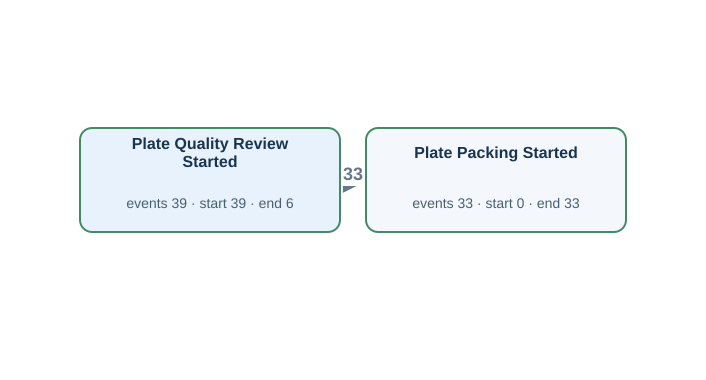</td><td width="50%"><h4>Original tables</h4>
Rows matched by event ID, activity and timestamp using the authored source bindings.

<strong><code>plate_material</code></strong> · 39 source rows

<code>plate_material_id</code> = P004-1, <code>plate_no</code> = PLP004-1, <code>parent_as_rolled_plate_no</code> = AR004, <code>dimension_inspected_at</code> = 2026-03-05T13:36:00Z, <code>latest_operation_completed_at</code> = 2026-03-05T14:06:00Z, <code>plate_piece_identified_at</code> = 2026-03-05T12:36:00Z, <code>plate_quality_released_at</code> = 2026-03-05T14:36:00Z, <code>plate_packed_at</code> = NULL, <code>plate_quality_review_started_at</code> = 2026-03-05T14:21:00Z, <code>plate_packing_started_at</code> = NULL LC:plate_material:P004-1:5 · Plate Quality Review Started · plate_quality_review_started_at · P004-1

<code>plate_material_id</code> = P004-2, <code>plate_no</code> = PLP004-2, <code>parent_as_rolled_plate_no</code> = AR004, <code>dimension_inspected_at</code> = 2026-03-05T13:42:00Z, <code>latest_operation_completed_at</code> = 2026-03-05T14:12:00Z, <code>plate_piece_identified_at</code> = 2026-03-05T12:42:00Z, <code>plate_quality_released_at</code> = 2026-03-05T14:42:00Z, <code>plate_packed_at</code> = 2026-03-05T15:42:00Z, <code>plate_quality_review_started_at</code> = 2026-03-05T14:27:00Z, <code>plate_packing_started_at</code> = 2026-03-05T15:27:00Z LC:plate_material:P004-2:5 · Plate Quality Review Started · plate_quality_review_started_at · P004-2 | LC:plate_material:P004-2:6 · Plate Packing Started · plate_packing_started_at · P004-2

<code>plate_material_id</code> = P004-3, <code>plate_no</code> = PLP004-3, <code>parent_as_rolled_plate_no</code> = AR004, <code>dimension_inspected_at</code> = 2026-03-05T13:48:00Z, <code>latest_operation_completed_at</code> = 2026-03-05T14:18:00Z, <code>plate_piece_identified_at</code> = 2026-03-05T12:48:00Z, <code>plate_quality_released_at</code> = 2026-03-05T14:48:00Z, <code>plate_packed_at</code> = 2026-03-05T15:48:00Z, <code>plate_quality_review_started_at</code> = 2026-03-05T14:33:00Z, <code>plate_packing_started_at</code> = 2026-03-05T15:33:00Z LC:plate_material:P004-3:5 · Plate Quality Review Started · plate_quality_review_started_at · P004-3 | LC:plate_material:P004-3:6 · Plate Packing Started · plate_packing_started_at · P004-3

FK-linked row examples for case and join context

<strong>as_rolled_material</strong>

plate_material (parent_as_rolled_plate_no → as_rolled_plate_no) <code>material_id</code> = M004, <code>as_rolled_plate_no</code> = AR004, <code>slab_id</code> = SL004, <code>instruction_id</code> = RI004, <code>furnace_charged_at</code> = 2026-03-05T02:00:00Z, <code>crop_shear_passed_at</code> = 2026-03-05T09:00:00Z, <code>latest_operation_completed_at</code> = 2026-03-05T11:00:00Z, <code>created_at</code> = 2026-03-04T23:00:00Z, <code>updated_at</code> = 2026-03-05T22:00:00Z

plate_material (parent_as_rolled_plate_no → as_rolled_plate_no) <code>material_id</code> = M005, <code>as_rolled_plate_no</code> = AR005, <code>slab_id</code> = SL005, <code>instruction_id</code> = RI005, <code>furnace_charged_at</code> = 2026-03-06T04:00:00Z, <code>crop_shear_passed_at</code> = 2026-03-06T09:00:00Z, <code>latest_operation_completed_at</code> = 2026-03-06T11:00:00Z, <code>created_at</code> = 2026-03-05T23:00:00Z, <code>updated_at</code> = 2026-03-06T22:00:00Z

plate_material (parent_as_rolled_plate_no → as_rolled_plate_no) <code>material_id</code> = M006, <code>as_rolled_plate_no</code> = AR006, <code>slab_id</code> = SL006, <code>instruction_id</code> = RI006, <code>furnace_charged_at</code> = 2026-03-07T03:00:00Z, <code>crop_shear_passed_at</code> = 2026-03-07T09:00:00Z, <code>latest_operation_completed_at</code> = 2026-03-07T11:00:00Z, <code>created_at</code> = 2026-03-06T23:00:00Z, <code>updated_at</code> = 2026-03-07T22:00:00Z

<strong>planned_rolling_instruction</strong>

rolling_instruction (plan_id → plan_id) <code>plan_id</code> = PLAN004, <code>slab_id</code> = SL004, <code>planned_reheat_at</code> = 2026-03-05T02:00:00Z, <code>rolling_plan_created_at</code> = 2026-03-04T14:00:00Z, <code>rolling_plan_reviewed_at</code> = 2026-03-04T15:00:00Z, <code>rolling_plan_approved_at</code> = 2026-03-04T16:00:00Z, <code>rolling_plan_released_at</code> = 2026-03-04T17:00:00Z

rolling_instruction (plan_id → plan_id) <code>plan_id</code> = PLAN005, <code>slab_id</code> = SL005, <code>planned_reheat_at</code> = 2026-03-06T02:00:00Z, <code>rolling_plan_created_at</code> = 2026-03-05T14:00:00Z, <code>rolling_plan_reviewed_at</code> = 2026-03-05T15:00:00Z, <code>rolling_plan_approved_at</code> = 2026-03-05T16:00:00Z, <code>rolling_plan_released_at</code> = 2026-03-05T17:00:00Z

rolling_instruction (plan_id → plan_id) <code>plan_id</code> = PLAN006, <code>slab_id</code> = SL006, <code>planned_reheat_at</code> = 2026-03-07T02:00:00Z, <code>rolling_plan_created_at</code> = 2026-03-06T14:00:00Z, <code>rolling_plan_reviewed_at</code> = 2026-03-06T15:00:00Z, <code>rolling_plan_approved_at</code> = 2026-03-06T16:00:00Z, <code>rolling_plan_released_at</code> = 2026-03-06T17:00:00Z

<strong>rolling_instruction</strong>

as_rolled_material (instruction_id → instruction_id) <code>instruction_id</code> = RI004, <code>plan_id</code> = PLAN004, <code>released_at</code> = 2026-03-05T00:00:00Z, <code>rolling_instruction_acknowledged_at</code> = 2026-03-05T00:05:00Z, <code>rolling_setup_verified_at</code> = 2026-03-05T00:10:00Z, <code>rolling_work_started_at</code> = 2026-03-05T05:55:00Z, <code>rolling_instruction_closed_at</code> = 2026-03-05T06:05:00Z

as_rolled_material (instruction_id → instruction_id) <code>instruction_id</code> = RI005, <code>plan_id</code> = PLAN005, <code>released_at</code> = 2026-03-06T00:00:00Z, <code>rolling_instruction_acknowledged_at</code> = 2026-03-06T00:05:00Z, <code>rolling_setup_verified_at</code> = 2026-03-06T00:10:00Z, <code>rolling_work_started_at</code> = 2026-03-06T05:55:00Z, <code>rolling_instruction_closed_at</code> = 2026-03-06T06:05:00Z

as_rolled_material (instruction_id → instruction_id) <code>instruction_id</code> = RI006, <code>plan_id</code> = PLAN006, <code>released_at</code> = 2026-03-07T00:00:00Z, <code>rolling_instruction_acknowledged_at</code> = 2026-03-07T00:05:00Z, <code>rolling_setup_verified_at</code> = 2026-03-07T00:10:00Z, <code>rolling_work_started_at</code> = 2026-03-07T05:55:00Z, <code>rolling_instruction_closed_at</code> = 2026-03-07T06:05:00Z

<strong>slab_material</strong>

as_rolled_material (slab_id → slab_id) <code>slab_id</code> = SL004, <code>charge_id</code> = CH004, <code>slab_received_at</code> = 2026-03-04T14:00:00Z, <code>slab_identity_verified_at</code> = 2026-03-04T15:00:00Z, <code>slab_quality_checked_at</code> = 2026-03-04T16:00:00Z, <code>slab_released_for_rolling_at</code> = 2026-03-04T17:00:00Z

as_rolled_material (slab_id → slab_id) <code>slab_id</code> = SL005, <code>charge_id</code> = CH005, <code>slab_received_at</code> = 2026-03-05T14:00:00Z, <code>slab_identity_verified_at</code> = 2026-03-05T15:00:00Z, <code>slab_quality_checked_at</code> = 2026-03-05T16:00:00Z, <code>slab_released_for_rolling_at</code> = 2026-03-05T17:00:00Z

as_rolled_material (slab_id → slab_id) <code>slab_id</code> = SL006, <code>charge_id</code> = CH006, <code>slab_received_at</code> = 2026-03-06T14:00:00Z, <code>slab_identity_verified_at</code> = 2026-03-06T15:00:00Z, <code>slab_quality_checked_at</code> = 2026-03-06T16:00:00Z, <code>slab_released_for_rolling_at</code> = 2026-03-06T17:00:00Z

Other tables referenced by Gold SQL

Includes case joins and branches of shared CTEs.
<ul><li><code>as_rolled_material</code> · as_rolled_plate_no, crop_shear_passed_at, furnace_charged_at, instruction_id, material_id</li><li><code>cutting_finishing_instruction</code> · cutting_instruction_acknowledged_at, cutting_instruction_closed_at, cutting_setup_verified_at, cutting_work_started_at, instruction_id, material_id, released_at</li><li><code>furnace_charge_tracking</code> · furnace_charge_assigned_at, furnace_charge_confirmed_at, furnace_discharge_confirmed_at, material_id, tracking_id, yard_instruction_received_at</li><li><code>material_operation_history</code> · completed_at, material_id, operation_code, transaction_id</li><li><code>planned_rolling_instruction</code> · plan_id, rolling_plan_approved_at, rolling_plan_created_at, rolling_plan_released_at, rolling_plan_reviewed_at</li><li><code>rolling_instruction</code> · instruction_id, released_at, rolling_instruction_acknowledged_at, rolling_instruction_closed_at, rolling_setup_verified_at, rolling_work_started_at</li><li><code>slab_material</code> · slab_id, slab_identity_verified_at, slab_quality_checked_at, slab_received_at, slab_released_for_rolling_at</li></ul>
</td></tr></table>

[Gold CSV](../../../datasets/plateflow/private/gold_logs/TS01.csv)

## V07P — Q2

For each as-rolled mother material, build a timeline of the cutting work order being issued, the mother plate being cut into separate pieces, the dimensions of a cut piece being checked.

Events: **75** · Cases with events: **18** · Activities: **3** · Edges: **3**

<table><tr><td width="50%"></td><td width="50%"><h4>Original tables</h4>
Rows matched by event ID, activity and timestamp using the authored source bindings.

<strong><code>cutting_finishing_instruction</code></strong> · 18 source rows

<code>instruction_id</code> = CIM004, <code>material_id</code> = M004, <code>released_at</code> = 2026-03-05T10:00:00Z, <code>cut_method</code> = SPLIT, <code>cutting_instruction_acknowledged_at</code> = 2026-03-05T10:05:00Z, <code>cutting_setup_verified_at</code> = 2026-03-05T10:10:00Z, <code>cutting_work_started_at</code> = 2026-03-05T10:55:00Z, <code>cutting_instruction_closed_at</code> = NULL CI:CIM004 · Cutting Instruction Released · released_at · M004

<code>instruction_id</code> = CIM005, <code>material_id</code> = M005, <code>released_at</code> = 2026-03-06T10:00:00Z, <code>cut_method</code> = SPLIT, <code>cutting_instruction_acknowledged_at</code> = 2026-03-06T10:05:00Z, <code>cutting_setup_verified_at</code> = 2026-03-06T10:10:00Z, <code>cutting_work_started_at</code> = 2026-03-06T10:55:00Z, <code>cutting_instruction_closed_at</code> = 2026-03-06T11:05:00Z CI:CIM005 · Cutting Instruction Released · released_at · M005

<code>instruction_id</code> = CIM006, <code>material_id</code> = M006, <code>released_at</code> = 2026-03-07T10:00:00Z, <code>cut_method</code> = SPLIT, <code>cutting_instruction_acknowledged_at</code> = 2026-03-07T10:05:00Z, <code>cutting_setup_verified_at</code> = 2026-03-07T10:10:00Z, <code>cutting_work_started_at</code> = 2026-03-07T10:55:00Z, <code>cutting_instruction_closed_at</code> = 2026-03-07T11:05:00Z CI:CIM006 · Cutting Instruction Released · released_at · M006

<strong><code>material_operation_history</code></strong> · 18 source rows

<code>transaction_id</code> = M004-SC, <code>material_id</code> = M004, <code>operation_code</code> = SC, <code>started_at</code> = 2026-03-05T10:30:00Z, <code>completed_at</code> = 2026-03-05T11:00:00Z, <code>created_at</code> = 2026-03-05T11:06:00Z OP:M004-SC · Split Cutting Completed · completed_at · M004

<code>transaction_id</code> = M005-SC, <code>material_id</code> = M005, <code>operation_code</code> = SC, <code>started_at</code> = 2026-03-06T10:30:00Z, <code>completed_at</code> = 2026-03-06T11:00:00Z, <code>created_at</code> = 2026-03-06T11:06:00Z OP:M005-SC · Split Cutting Completed · completed_at · M005

<code>transaction_id</code> = M006-SC, <code>material_id</code> = M006, <code>operation_code</code> = SC, <code>started_at</code> = 2026-03-07T10:30:00Z, <code>completed_at</code> = 2026-03-07T11:00:00Z, <code>created_at</code> = 2026-03-07T11:06:00Z OP:M006-SC · Split Cutting Completed · completed_at · M006

<strong><code>plate_material</code></strong> · 39 source rows

<code>plate_material_id</code> = P004-1, <code>plate_no</code> = PLP004-1, <code>parent_as_rolled_plate_no</code> = AR004, <code>dimension_inspected_at</code> = 2026-03-05T13:36:00Z, <code>latest_operation_completed_at</code> = 2026-03-05T14:06:00Z, <code>plate_piece_identified_at</code> = 2026-03-05T12:36:00Z, <code>plate_quality_released_at</code> = 2026-03-05T14:36:00Z, <code>plate_packed_at</code> = NULL, <code>plate_quality_review_started_at</code> = 2026-03-05T14:21:00Z, <code>plate_packing_started_at</code> = NULL DIM:P004-1 · Dimensional Inspection Completed · dimension_inspected_at · M004

<code>plate_material_id</code> = P004-2, <code>plate_no</code> = PLP004-2, <code>parent_as_rolled_plate_no</code> = AR004, <code>dimension_inspected_at</code> = 2026-03-05T13:42:00Z, <code>latest_operation_completed_at</code> = 2026-03-05T14:12:00Z, <code>plate_piece_identified_at</code> = 2026-03-05T12:42:00Z, <code>plate_quality_released_at</code> = 2026-03-05T14:42:00Z, <code>plate_packed_at</code> = 2026-03-05T15:42:00Z, <code>plate_quality_review_started_at</code> = 2026-03-05T14:27:00Z, <code>plate_packing_started_at</code> = 2026-03-05T15:27:00Z DIM:P004-2 · Dimensional Inspection Completed · dimension_inspected_at · M004

<code>plate_material_id</code> = P004-3, <code>plate_no</code> = PLP004-3, <code>parent_as_rolled_plate_no</code> = AR004, <code>dimension_inspected_at</code> = 2026-03-05T13:48:00Z, <code>latest_operation_completed_at</code> = 2026-03-05T14:18:00Z, <code>plate_piece_identified_at</code> = 2026-03-05T12:48:00Z, <code>plate_quality_released_at</code> = 2026-03-05T14:48:00Z, <code>plate_packed_at</code> = 2026-03-05T15:48:00Z, <code>plate_quality_review_started_at</code> = 2026-03-05T14:33:00Z, <code>plate_packing_started_at</code> = 2026-03-05T15:33:00Z DIM:P004-3 · Dimensional Inspection Completed · dimension_inspected_at · M004

FK-linked row examples for case and join context

<strong>as_rolled_material</strong>

cutting_finishing_instruction (material_id → material_id) <code>material_id</code> = M004, <code>as_rolled_plate_no</code> = AR004, <code>slab_id</code> = SL004, <code>instruction_id</code> = RI004, <code>furnace_charged_at</code> = 2026-03-05T02:00:00Z, <code>crop_shear_passed_at</code> = 2026-03-05T09:00:00Z, <code>latest_operation_completed_at</code> = 2026-03-05T11:00:00Z, <code>created_at</code> = 2026-03-04T23:00:00Z, <code>updated_at</code> = 2026-03-05T22:00:00Z

cutting_finishing_instruction (material_id → material_id) <code>material_id</code> = M005, <code>as_rolled_plate_no</code> = AR005, <code>slab_id</code> = SL005, <code>instruction_id</code> = RI005, <code>furnace_charged_at</code> = 2026-03-06T04:00:00Z, <code>crop_shear_passed_at</code> = 2026-03-06T09:00:00Z, <code>latest_operation_completed_at</code> = 2026-03-06T11:00:00Z, <code>created_at</code> = 2026-03-05T23:00:00Z, <code>updated_at</code> = 2026-03-06T22:00:00Z

cutting_finishing_instruction (material_id → material_id) <code>material_id</code> = M006, <code>as_rolled_plate_no</code> = AR006, <code>slab_id</code> = SL006, <code>instruction_id</code> = RI006, <code>furnace_charged_at</code> = 2026-03-07T03:00:00Z, <code>crop_shear_passed_at</code> = 2026-03-07T09:00:00Z, <code>latest_operation_completed_at</code> = 2026-03-07T11:00:00Z, <code>created_at</code> = 2026-03-06T23:00:00Z, <code>updated_at</code> = 2026-03-07T22:00:00Z

Other tables referenced by Gold SQL

Includes case joins and branches of shared CTEs.
<ul><li><code>as_rolled_material</code> · as_rolled_plate_no, material_id</li></ul>
</td></tr></table>

[Gold CSV](../../../datasets/plateflow/private/gold_logs/V07P.csv)

## V08P — Q2

For each slab, build a timeline of the initial casting of a slab.

**No Gold log:** No casting event times in this selected schema.

## TS01P — Q2

For each cut plate piece, build a timeline of a finished plate quality review beginning, packaging of a finished plate beginning.

Events: **72** · Cases with events: **39** · Activities: **2** · Edges: **1**

<table><tr><td width="50%"></td><td width="50%"><h4>Original tables</h4>
Rows matched by event ID, activity and timestamp using the authored source bindings.

<strong><code>plate_material</code></strong> · 39 source rows

<code>plate_material_id</code> = P004-1, <code>plate_no</code> = PLP004-1, <code>parent_as_rolled_plate_no</code> = AR004, <code>dimension_inspected_at</code> = 2026-03-05T13:36:00Z, <code>latest_operation_completed_at</code> = 2026-03-05T14:06:00Z, <code>plate_piece_identified_at</code> = 2026-03-05T12:36:00Z, <code>plate_quality_released_at</code> = 2026-03-05T14:36:00Z, <code>plate_packed_at</code> = NULL, <code>plate_quality_review_started_at</code> = 2026-03-05T14:21:00Z, <code>plate_packing_started_at</code> = NULL LC:plate_material:P004-1:5 · Plate Quality Review Started · plate_quality_review_started_at · P004-1

<code>plate_material_id</code> = P004-2, <code>plate_no</code> = PLP004-2, <code>parent_as_rolled_plate_no</code> = AR004, <code>dimension_inspected_at</code> = 2026-03-05T13:42:00Z, <code>latest_operation_completed_at</code> = 2026-03-05T14:12:00Z, <code>plate_piece_identified_at</code> = 2026-03-05T12:42:00Z, <code>plate_quality_released_at</code> = 2026-03-05T14:42:00Z, <code>plate_packed_at</code> = 2026-03-05T15:42:00Z, <code>plate_quality_review_started_at</code> = 2026-03-05T14:27:00Z, <code>plate_packing_started_at</code> = 2026-03-05T15:27:00Z LC:plate_material:P004-2:5 · Plate Quality Review Started · plate_quality_review_started_at · P004-2 | LC:plate_material:P004-2:6 · Plate Packing Started · plate_packing_started_at · P004-2

<code>plate_material_id</code> = P004-3, <code>plate_no</code> = PLP004-3, <code>parent_as_rolled_plate_no</code> = AR004, <code>dimension_inspected_at</code> = 2026-03-05T13:48:00Z, <code>latest_operation_completed_at</code> = 2026-03-05T14:18:00Z, <code>plate_piece_identified_at</code> = 2026-03-05T12:48:00Z, <code>plate_quality_released_at</code> = 2026-03-05T14:48:00Z, <code>plate_packed_at</code> = 2026-03-05T15:48:00Z, <code>plate_quality_review_started_at</code> = 2026-03-05T14:33:00Z, <code>plate_packing_started_at</code> = 2026-03-05T15:33:00Z LC:plate_material:P004-3:5 · Plate Quality Review Started · plate_quality_review_started_at · P004-3 | LC:plate_material:P004-3:6 · Plate Packing Started · plate_packing_started_at · P004-3

FK-linked row examples for case and join context

<strong>as_rolled_material</strong>

plate_material (parent_as_rolled_plate_no → as_rolled_plate_no) <code>material_id</code> = M004, <code>as_rolled_plate_no</code> = AR004, <code>slab_id</code> = SL004, <code>instruction_id</code> = RI004, <code>furnace_charged_at</code> = 2026-03-05T02:00:00Z, <code>crop_shear_passed_at</code> = 2026-03-05T09:00:00Z, <code>latest_operation_completed_at</code> = 2026-03-05T11:00:00Z, <code>created_at</code> = 2026-03-04T23:00:00Z, <code>updated_at</code> = 2026-03-05T22:00:00Z

plate_material (parent_as_rolled_plate_no → as_rolled_plate_no) <code>material_id</code> = M005, <code>as_rolled_plate_no</code> = AR005, <code>slab_id</code> = SL005, <code>instruction_id</code> = RI005, <code>furnace_charged_at</code> = 2026-03-06T04:00:00Z, <code>crop_shear_passed_at</code> = 2026-03-06T09:00:00Z, <code>latest_operation_completed_at</code> = 2026-03-06T11:00:00Z, <code>created_at</code> = 2026-03-05T23:00:00Z, <code>updated_at</code> = 2026-03-06T22:00:00Z

plate_material (parent_as_rolled_plate_no → as_rolled_plate_no) <code>material_id</code> = M006, <code>as_rolled_plate_no</code> = AR006, <code>slab_id</code> = SL006, <code>instruction_id</code> = RI006, <code>furnace_charged_at</code> = 2026-03-07T03:00:00Z, <code>crop_shear_passed_at</code> = 2026-03-07T09:00:00Z, <code>latest_operation_completed_at</code> = 2026-03-07T11:00:00Z, <code>created_at</code> = 2026-03-06T23:00:00Z, <code>updated_at</code> = 2026-03-07T22:00:00Z

<strong>planned_rolling_instruction</strong>

rolling_instruction (plan_id → plan_id) <code>plan_id</code> = PLAN004, <code>slab_id</code> = SL004, <code>planned_reheat_at</code> = 2026-03-05T02:00:00Z, <code>rolling_plan_created_at</code> = 2026-03-04T14:00:00Z, <code>rolling_plan_reviewed_at</code> = 2026-03-04T15:00:00Z, <code>rolling_plan_approved_at</code> = 2026-03-04T16:00:00Z, <code>rolling_plan_released_at</code> = 2026-03-04T17:00:00Z

rolling_instruction (plan_id → plan_id) <code>plan_id</code> = PLAN005, <code>slab_id</code> = SL005, <code>planned_reheat_at</code> = 2026-03-06T02:00:00Z, <code>rolling_plan_created_at</code> = 2026-03-05T14:00:00Z, <code>rolling_plan_reviewed_at</code> = 2026-03-05T15:00:00Z, <code>rolling_plan_approved_at</code> = 2026-03-05T16:00:00Z, <code>rolling_plan_released_at</code> = 2026-03-05T17:00:00Z

rolling_instruction (plan_id → plan_id) <code>plan_id</code> = PLAN006, <code>slab_id</code> = SL006, <code>planned_reheat_at</code> = 2026-03-07T02:00:00Z, <code>rolling_plan_created_at</code> = 2026-03-06T14:00:00Z, <code>rolling_plan_reviewed_at</code> = 2026-03-06T15:00:00Z, <code>rolling_plan_approved_at</code> = 2026-03-06T16:00:00Z, <code>rolling_plan_released_at</code> = 2026-03-06T17:00:00Z

<strong>rolling_instruction</strong>

as_rolled_material (instruction_id → instruction_id) <code>instruction_id</code> = RI004, <code>plan_id</code> = PLAN004, <code>released_at</code> = 2026-03-05T00:00:00Z, <code>rolling_instruction_acknowledged_at</code> = 2026-03-05T00:05:00Z, <code>rolling_setup_verified_at</code> = 2026-03-05T00:10:00Z, <code>rolling_work_started_at</code> = 2026-03-05T05:55:00Z, <code>rolling_instruction_closed_at</code> = 2026-03-05T06:05:00Z

as_rolled_material (instruction_id → instruction_id) <code>instruction_id</code> = RI005, <code>plan_id</code> = PLAN005, <code>released_at</code> = 2026-03-06T00:00:00Z, <code>rolling_instruction_acknowledged_at</code> = 2026-03-06T00:05:00Z, <code>rolling_setup_verified_at</code> = 2026-03-06T00:10:00Z, <code>rolling_work_started_at</code> = 2026-03-06T05:55:00Z, <code>rolling_instruction_closed_at</code> = 2026-03-06T06:05:00Z

as_rolled_material (instruction_id → instruction_id) <code>instruction_id</code> = RI006, <code>plan_id</code> = PLAN006, <code>released_at</code> = 2026-03-07T00:00:00Z, <code>rolling_instruction_acknowledged_at</code> = 2026-03-07T00:05:00Z, <code>rolling_setup_verified_at</code> = 2026-03-07T00:10:00Z, <code>rolling_work_started_at</code> = 2026-03-07T05:55:00Z, <code>rolling_instruction_closed_at</code> = 2026-03-07T06:05:00Z

<strong>slab_material</strong>

as_rolled_material (slab_id → slab_id) <code>slab_id</code> = SL004, <code>charge_id</code> = CH004, <code>slab_received_at</code> = 2026-03-04T14:00:00Z, <code>slab_identity_verified_at</code> = 2026-03-04T15:00:00Z, <code>slab_quality_checked_at</code> = 2026-03-04T16:00:00Z, <code>slab_released_for_rolling_at</code> = 2026-03-04T17:00:00Z

as_rolled_material (slab_id → slab_id) <code>slab_id</code> = SL005, <code>charge_id</code> = CH005, <code>slab_received_at</code> = 2026-03-05T14:00:00Z, <code>slab_identity_verified_at</code> = 2026-03-05T15:00:00Z, <code>slab_quality_checked_at</code> = 2026-03-05T16:00:00Z, <code>slab_released_for_rolling_at</code> = 2026-03-05T17:00:00Z

as_rolled_material (slab_id → slab_id) <code>slab_id</code> = SL006, <code>charge_id</code> = CH006, <code>slab_received_at</code> = 2026-03-06T14:00:00Z, <code>slab_identity_verified_at</code> = 2026-03-06T15:00:00Z, <code>slab_quality_checked_at</code> = 2026-03-06T16:00:00Z, <code>slab_released_for_rolling_at</code> = 2026-03-06T17:00:00Z

Other tables referenced by Gold SQL

Includes case joins and branches of shared CTEs.
<ul><li><code>as_rolled_material</code> · as_rolled_plate_no, crop_shear_passed_at, furnace_charged_at, instruction_id, material_id</li><li><code>cutting_finishing_instruction</code> · cutting_instruction_acknowledged_at, cutting_instruction_closed_at, cutting_setup_verified_at, cutting_work_started_at, instruction_id, material_id, released_at</li><li><code>furnace_charge_tracking</code> · furnace_charge_assigned_at, furnace_charge_confirmed_at, furnace_discharge_confirmed_at, material_id, tracking_id, yard_instruction_received_at</li><li><code>material_operation_history</code> · completed_at, material_id, operation_code, transaction_id</li><li><code>planned_rolling_instruction</code> · plan_id, rolling_plan_approved_at, rolling_plan_created_at, rolling_plan_released_at, rolling_plan_reviewed_at</li><li><code>rolling_instruction</code> · instruction_id, released_at, rolling_instruction_acknowledged_at, rolling_instruction_closed_at, rolling_setup_verified_at, rolling_work_started_at</li><li><code>slab_material</code> · slab_id, slab_identity_verified_at, slab_quality_checked_at, slab_received_at, slab_released_for_rolling_at</li></ul>
</td></tr></table>

[Gold CSV](../../../datasets/plateflow/private/gold_logs/TS01P.csv)

## OPV01P — Q4

Show the complete recorded history associated with each slab.

Events: **1108** · Cases with events: **36** · Activities: **39** · Edges: **63**

<table><tr><td width="50%"></td><td width="50%"><h4>Original tables</h4>
Rows matched by event ID, activity and timestamp using the authored source bindings.

<strong><code>as_rolled_material</code></strong> · 30 source rows

<code>material_id</code> = M002, <code>as_rolled_plate_no</code> = AR002, <code>slab_id</code> = SL002, <code>instruction_id</code> = RI002, <code>furnace_charged_at</code> = 2026-03-03T04:00:00Z, <code>crop_shear_passed_at</code> = NULL, <code>latest_operation_completed_at</code> = NULL, <code>created_at</code> = 2026-03-02T23:00:00Z, <code>updated_at</code> = 2026-03-03T22:00:00Z RH:M002 · Reheating Started · furnace_charged_at · SL002

<code>material_id</code> = M003, <code>as_rolled_plate_no</code> = AR003, <code>slab_id</code> = SL003, <code>instruction_id</code> = RI003, <code>furnace_charged_at</code> = 2026-03-04T03:00:00Z, <code>crop_shear_passed_at</code> = NULL, <code>latest_operation_completed_at</code> = 2026-03-04T06:00:00Z, <code>created_at</code> = 2026-03-03T23:00:00Z, <code>updated_at</code> = 2026-03-04T22:00:00Z RH:M003 · Reheating Started · furnace_charged_at · SL003

<code>material_id</code> = M004, <code>as_rolled_plate_no</code> = AR004, <code>slab_id</code> = SL004, <code>instruction_id</code> = RI004, <code>furnace_charged_at</code> = 2026-03-05T02:00:00Z, <code>crop_shear_passed_at</code> = 2026-03-05T09:00:00Z, <code>latest_operation_completed_at</code> = 2026-03-05T11:00:00Z, <code>created_at</code> = 2026-03-04T23:00:00Z, <code>updated_at</code> = 2026-03-05T22:00:00Z CS:M004 · Crop Shear Passed · crop_shear_passed_at · SL004 | RH:M004 · Reheating Started · furnace_charged_at · SL004

<strong><code>cutting_finishing_instruction</code></strong> · 18 source rows

<code>instruction_id</code> = CIM004, <code>material_id</code> = M004, <code>released_at</code> = 2026-03-05T10:00:00Z, <code>cut_method</code> = SPLIT, <code>cutting_instruction_acknowledged_at</code> = 2026-03-05T10:05:00Z, <code>cutting_setup_verified_at</code> = 2026-03-05T10:10:00Z, <code>cutting_work_started_at</code> = 2026-03-05T10:55:00Z, <code>cutting_instruction_closed_at</code> = NULL CI:CIM004 · Cutting Instruction Released · released_at · SL004 | LC:cutting_finishing_instruction:CIM004:1 · Cutting Instruction Acknowledged · cutting_instruction_acknowledged_at · SL004 | LC:cutting_finishing_instruction:CIM004:2 · Cutting Setup Verified · cutting_setup_verified_at · SL004 | LC:cutting_finishing_instruction:CIM004:3 · Cutting Work Started · cutting_work_started_at · SL004

<code>instruction_id</code> = CIM005, <code>material_id</code> = M005, <code>released_at</code> = 2026-03-06T10:00:00Z, <code>cut_method</code> = SPLIT, <code>cutting_instruction_acknowledged_at</code> = 2026-03-06T10:05:00Z, <code>cutting_setup_verified_at</code> = 2026-03-06T10:10:00Z, <code>cutting_work_started_at</code> = 2026-03-06T10:55:00Z, <code>cutting_instruction_closed_at</code> = 2026-03-06T11:05:00Z CI:CIM005 · Cutting Instruction Released · released_at · SL005 | LC:cutting_finishing_instruction:CIM005:1 · Cutting Instruction Acknowledged · cutting_instruction_acknowledged_at · SL005 | LC:cutting_finishing_instruction:CIM005:2 · Cutting Setup Verified · cutting_setup_verified_at · SL005 | LC:cutting_finishing_instruction:CIM005:3 · Cutting Work Started · cutting_work_started_at · SL005 | LC:cutting_finishing_instruction:CIM005:4 · Cutting Instruction Closed · cutting_instruction_closed_at · SL005

<code>instruction_id</code> = CIM006, <code>material_id</code> = M006, <code>released_at</code> = 2026-03-07T10:00:00Z, <code>cut_method</code> = SPLIT, <code>cutting_instruction_acknowledged_at</code> = 2026-03-07T10:05:00Z, <code>cutting_setup_verified_at</code> = 2026-03-07T10:10:00Z, <code>cutting_work_started_at</code> = 2026-03-07T10:55:00Z, <code>cutting_instruction_closed_at</code> = 2026-03-07T11:05:00Z CI:CIM006 · Cutting Instruction Released · released_at · SL006 | LC:cutting_finishing_instruction:CIM006:1 · Cutting Instruction Acknowledged · cutting_instruction_acknowledged_at · SL006 | LC:cutting_finishing_instruction:CIM006:2 · Cutting Setup Verified · cutting_setup_verified_at · SL006 | LC:cutting_finishing_instruction:CIM006:3 · Cutting Work Started · cutting_work_started_at · SL006 | LC:cutting_finishing_instruction:CIM006:4 · Cutting Instruction Closed · cutting_instruction_closed_at · SL006

<strong><code>furnace_charge_tracking</code></strong> · 30 source rows

<code>tracking_id</code> = TRM002, <code>material_id</code> = M002, <code>yard_instruction_received_at</code> = 2026-03-03T01:00:00Z, <code>lot_charging_started_at</code> = 2026-03-03T01:30:00Z, <code>furnace_charge_assigned_at</code> = 2026-03-03T01:05:00Z, <code>furnace_charge_confirmed_at</code> = NULL, <code>furnace_discharge_confirmed_at</code> = NULL LC:furnace_charge_tracking:TRM002:1 · Furnace Charge Assigned · furnace_charge_assigned_at · SL002 | YD:TRM002 · Yard Instruction Received · yard_instruction_received_at · SL002

<code>tracking_id</code> = TRM003, <code>material_id</code> = M003, <code>yard_instruction_received_at</code> = 2026-03-04T01:00:00Z, <code>lot_charging_started_at</code> = 2026-03-04T01:30:00Z, <code>furnace_charge_assigned_at</code> = 2026-03-04T01:05:00Z, <code>furnace_charge_confirmed_at</code> = 2026-03-04T03:01:00Z, <code>furnace_discharge_confirmed_at</code> = 2026-03-04T05:50:00Z LC:furnace_charge_tracking:TRM003:1 · Furnace Charge Assigned · furnace_charge_assigned_at · SL003 | LC:furnace_charge_tracking:TRM003:2 · Furnace Charge Confirmed · furnace_charge_confirmed_at · SL003 | LC:furnace_charge_tracking:TRM003:4 · Furnace Discharge Confirmed · furnace_discharge_confirmed_at · SL003 | YD:TRM003 · Yard Instruction Received · yard_instruction_received_at · SL003

<code>tracking_id</code> = TRM004, <code>material_id</code> = M004, <code>yard_instruction_received_at</code> = 2026-03-05T01:00:00Z, <code>lot_charging_started_at</code> = 2026-03-05T01:30:00Z, <code>furnace_charge_assigned_at</code> = 2026-03-05T01:05:00Z, <code>furnace_charge_confirmed_at</code> = 2026-03-05T02:01:00Z, <code>furnace_discharge_confirmed_at</code> = 2026-03-05T05:50:00Z LC:furnace_charge_tracking:TRM004:1 · Furnace Charge Assigned · furnace_charge_assigned_at · SL004 | LC:furnace_charge_tracking:TRM004:2 · Furnace Charge Confirmed · furnace_charge_confirmed_at · SL004 | LC:furnace_charge_tracking:TRM004:4 · Furnace Discharge Confirmed · furnace_discharge_confirmed_at · SL004 | YD:TRM004 · Yard Instruction Received · yard_instruction_received_at · SL004

<strong><code>material_operation_history</code></strong> · 216 source rows

<code>transaction_id</code> = LC:furnace_charge_tracking:TRM003:3, <code>material_id</code> = M003, <code>operation_code</code> = HF, <code>started_at</code> = 2026-03-04T05:39:00Z, <code>completed_at</code> = 2026-03-04T05:40:00Z, <code>created_at</code> = 2026-03-04T05:39:00Z LC:furnace_charge_tracking:TRM003:3 · Heating Completed · completed_at · SL003

<code>transaction_id</code> = M003-RL, <code>material_id</code> = M003, <code>operation_code</code> = RL, <code>started_at</code> = 2026-03-04T05:30:00Z, <code>completed_at</code> = 2026-03-04T06:00:00Z, <code>created_at</code> = 2026-03-04T06:06:00Z OP:M003-RL · Rolling Completed · completed_at · SL003

<code>transaction_id</code> = M004-CO, <code>material_id</code> = M004, <code>operation_code</code> = CO, <code>started_at</code> = 2026-03-05T06:30:00Z, <code>completed_at</code> = 2026-03-05T07:00:00Z, <code>created_at</code> = 2026-03-05T07:06:00Z OP:M004-CO · Cooling Completed · completed_at · SL004

<strong><code>planned_rolling_instruction</code></strong> · 36 source rows

<code>plan_id</code> = PLAN001, <code>slab_id</code> = SL001, <code>planned_reheat_at</code> = 2026-03-02T02:00:00Z, <code>rolling_plan_created_at</code> = 2026-03-01T14:00:00Z, <code>rolling_plan_reviewed_at</code> = 2026-03-01T15:00:00Z, <code>rolling_plan_approved_at</code> = 2026-03-01T16:00:00Z, <code>rolling_plan_released_at</code> = NULL LC:planned_rolling_instruction:PLAN001:1 · Rolling Plan Created · rolling_plan_created_at · SL001 | LC:planned_rolling_instruction:PLAN001:2 · Rolling Plan Reviewed · rolling_plan_reviewed_at · SL001 | LC:planned_rolling_instruction:PLAN001:3 · Rolling Plan Approved · rolling_plan_approved_at · SL001

<code>plan_id</code> = PLAN002, <code>slab_id</code> = SL002, <code>planned_reheat_at</code> = 2026-03-03T02:00:00Z, <code>rolling_plan_created_at</code> = 2026-03-02T14:00:00Z, <code>rolling_plan_reviewed_at</code> = 2026-03-02T15:00:00Z, <code>rolling_plan_approved_at</code> = 2026-03-02T16:00:00Z, <code>rolling_plan_released_at</code> = 2026-03-02T17:00:00Z LC:planned_rolling_instruction:PLAN002:1 · Rolling Plan Created · rolling_plan_created_at · SL002 | LC:planned_rolling_instruction:PLAN002:2 · Rolling Plan Reviewed · rolling_plan_reviewed_at · SL002 | LC:planned_rolling_instruction:PLAN002:3 · Rolling Plan Approved · rolling_plan_approved_at · SL002 | LC:planned_rolling_instruction:PLAN002:4 · Rolling Plan Released · rolling_plan_released_at · SL002

<code>plan_id</code> = PLAN003, <code>slab_id</code> = SL003, <code>planned_reheat_at</code> = 2026-03-04T02:00:00Z, <code>rolling_plan_created_at</code> = 2026-03-03T14:00:00Z, <code>rolling_plan_reviewed_at</code> = 2026-03-03T15:00:00Z, <code>rolling_plan_approved_at</code> = 2026-03-03T16:00:00Z, <code>rolling_plan_released_at</code> = 2026-03-03T17:00:00Z LC:planned_rolling_instruction:PLAN003:1 · Rolling Plan Created · rolling_plan_created_at · SL003 | LC:planned_rolling_instruction:PLAN003:2 · Rolling Plan Reviewed · rolling_plan_reviewed_at · SL003 | LC:planned_rolling_instruction:PLAN003:3 · Rolling Plan Approved · rolling_plan_approved_at · SL003 | LC:planned_rolling_instruction:PLAN003:4 · Rolling Plan Released · rolling_plan_released_at · SL003

<strong><code>plate_material</code></strong> · 39 source rows

<code>plate_material_id</code> = P004-1, <code>plate_no</code> = PLP004-1, <code>parent_as_rolled_plate_no</code> = AR004, <code>dimension_inspected_at</code> = 2026-03-05T13:36:00Z, <code>latest_operation_completed_at</code> = 2026-03-05T14:06:00Z, <code>plate_piece_identified_at</code> = 2026-03-05T12:36:00Z, <code>plate_quality_released_at</code> = 2026-03-05T14:36:00Z, <code>plate_packed_at</code> = NULL, <code>plate_quality_review_started_at</code> = 2026-03-05T14:21:00Z, <code>plate_packing_started_at</code> = NULL DIM:P004-1 · Dimensional Inspection Completed · dimension_inspected_at · SL004 | LC:plate_material:P004-1:1 · Plate Piece Identified · plate_piece_identified_at · SL004 | LC:plate_material:P004-1:3 · Plate Quality Released · plate_quality_released_at · SL004 | LC:plate_material:P004-1:5 · Plate Quality Review Started · plate_quality_review_started_at · SL004

<code>plate_material_id</code> = P004-2, <code>plate_no</code> = PLP004-2, <code>parent_as_rolled_plate_no</code> = AR004, <code>dimension_inspected_at</code> = 2026-03-05T13:42:00Z, <code>latest_operation_completed_at</code> = 2026-03-05T14:12:00Z, <code>plate_piece_identified_at</code> = 2026-03-05T12:42:00Z, <code>plate_quality_released_at</code> = 2026-03-05T14:42:00Z, <code>plate_packed_at</code> = 2026-03-05T15:42:00Z, <code>plate_quality_review_started_at</code> = 2026-03-05T14:27:00Z, <code>plate_packing_started_at</code> = 2026-03-05T15:27:00Z DIM:P004-2 · Dimensional Inspection Completed · dimension_inspected_at · SL004 | LC:plate_material:P004-2:1 · Plate Piece Identified · plate_piece_identified_at · SL004 | LC:plate_material:P004-2:3 · Plate Quality Released · plate_quality_released_at · SL004 | LC:plate_material:P004-2:4 · Plate Packed · plate_packed_at · SL004 | LC:plate_material:P004-2:5 · Plate Quality Review Started · plate_quality_review_started_at · SL004 | LC:plate_material:P004-2:6 · Plate Packing Started · plate_packing_started_at · SL004

<code>plate_material_id</code> = P004-3, <code>plate_no</code> = PLP004-3, <code>parent_as_rolled_plate_no</code> = AR004, <code>dimension_inspected_at</code> = 2026-03-05T13:48:00Z, <code>latest_operation_completed_at</code> = 2026-03-05T14:18:00Z, <code>plate_piece_identified_at</code> = 2026-03-05T12:48:00Z, <code>plate_quality_released_at</code> = 2026-03-05T14:48:00Z, <code>plate_packed_at</code> = 2026-03-05T15:48:00Z, <code>plate_quality_review_started_at</code> = 2026-03-05T14:33:00Z, <code>plate_packing_started_at</code> = 2026-03-05T15:33:00Z DIM:P004-3 · Dimensional Inspection Completed · dimension_inspected_at · SL004 | LC:plate_material:P004-3:1 · Plate Piece Identified · plate_piece_identified_at · SL004 | LC:plate_material:P004-3:3 · Plate Quality Released · plate_quality_released_at · SL004 | LC:plate_material:P004-3:4 · Plate Packed · plate_packed_at · SL004 | LC:plate_material:P004-3:5 · Plate Quality Review Started · plate_quality_review_started_at · SL004 | LC:plate_material:P004-3:6 · Plate Packing Started · plate_packing_started_at · SL004

<strong><code>rolling_instruction</code></strong> · 36 source rows

<code>instruction_id</code> = RI001, <code>plan_id</code> = PLAN001, <code>released_at</code> = 2026-03-02T00:00:00Z, <code>rolling_instruction_acknowledged_at</code> = 2026-03-02T00:05:00Z, <code>rolling_setup_verified_at</code> = NULL, <code>rolling_work_started_at</code> = NULL, <code>rolling_instruction_closed_at</code> = NULL LC:rolling_instruction:RI001:1 · Rolling Instruction Acknowledged · rolling_instruction_acknowledged_at · SL001 | RI:RI001 · Rolling Instruction Released · released_at · SL001

<code>instruction_id</code> = RI002, <code>plan_id</code> = PLAN002, <code>released_at</code> = 2026-03-03T00:00:00Z, <code>rolling_instruction_acknowledged_at</code> = 2026-03-03T00:05:00Z, <code>rolling_setup_verified_at</code> = 2026-03-03T00:10:00Z, <code>rolling_work_started_at</code> = NULL, <code>rolling_instruction_closed_at</code> = NULL LC:rolling_instruction:RI002:1 · Rolling Instruction Acknowledged · rolling_instruction_acknowledged_at · SL002 | LC:rolling_instruction:RI002:2 · Rolling Setup Verified · rolling_setup_verified_at · SL002 | RI:RI002 · Rolling Instruction Released · released_at · SL002

<code>instruction_id</code> = RI003, <code>plan_id</code> = PLAN003, <code>released_at</code> = 2026-03-04T00:00:00Z, <code>rolling_instruction_acknowledged_at</code> = 2026-03-04T00:05:00Z, <code>rolling_setup_verified_at</code> = 2026-03-04T00:10:00Z, <code>rolling_work_started_at</code> = 2026-03-04T05:55:00Z, <code>rolling_instruction_closed_at</code> = 2026-03-04T06:05:00Z LC:rolling_instruction:RI003:1 · Rolling Instruction Acknowledged · rolling_instruction_acknowledged_at · SL003 | LC:rolling_instruction:RI003:2 · Rolling Setup Verified · rolling_setup_verified_at · SL003 | LC:rolling_instruction:RI003:3 · Rolling Work Started · rolling_work_started_at · SL003 | LC:rolling_instruction:RI003:4 · Rolling Instruction Closed · rolling_instruction_closed_at · SL003 | RI:RI003 · Rolling Instruction Released · released_at · SL003

<strong><code>slab_material</code></strong> · 36 source rows

<code>slab_id</code> = SL001, <code>charge_id</code> = CH001, <code>slab_received_at</code> = 2026-03-01T14:00:00Z, <code>slab_identity_verified_at</code> = 2026-03-01T15:00:00Z, <code>slab_quality_checked_at</code> = 2026-03-01T16:00:00Z, <code>slab_released_for_rolling_at</code> = NULL LC:slab_material:SL001:1 · Slab Received · slab_received_at · SL001 | LC:slab_material:SL001:2 · Slab Identity Verified · slab_identity_verified_at · SL001 | LC:slab_material:SL001:3 · Slab Quality Checked · slab_quality_checked_at · SL001

<code>slab_id</code> = SL002, <code>charge_id</code> = CH002, <code>slab_received_at</code> = 2026-03-02T14:00:00Z, <code>slab_identity_verified_at</code> = 2026-03-02T15:00:00Z, <code>slab_quality_checked_at</code> = 2026-03-02T16:00:00Z, <code>slab_released_for_rolling_at</code> = 2026-03-02T17:00:00Z LC:slab_material:SL002:1 · Slab Received · slab_received_at · SL002 | LC:slab_material:SL002:2 · Slab Identity Verified · slab_identity_verified_at · SL002 | LC:slab_material:SL002:3 · Slab Quality Checked · slab_quality_checked_at · SL002 | LC:slab_material:SL002:4 · Slab Released for Rolling · slab_released_for_rolling_at · SL002

<code>slab_id</code> = SL003, <code>charge_id</code> = CH003, <code>slab_received_at</code> = 2026-03-03T14:00:00Z, <code>slab_identity_verified_at</code> = 2026-03-03T15:00:00Z, <code>slab_quality_checked_at</code> = 2026-03-03T16:00:00Z, <code>slab_released_for_rolling_at</code> = 2026-03-03T17:00:00Z LC:slab_material:SL003:1 · Slab Received · slab_received_at · SL003 | LC:slab_material:SL003:2 · Slab Identity Verified · slab_identity_verified_at · SL003 | LC:slab_material:SL003:3 · Slab Quality Checked · slab_quality_checked_at · SL003 | LC:slab_material:SL003:4 · Slab Released for Rolling · slab_released_for_rolling_at · SL003
</td></tr></table>

[Gold CSV](../../../datasets/plateflow/private/gold_logs/OPV01P.csv)

## OPV01E — Q1

Extract Slab Received, Slab Quality Checked, Slab Released for Rolling events for each slab.

Events: **102** · Cases with events: **36** · Activities: **3** · Edges: **2**

<table><tr><td width="50%"></td><td width="50%"><h4>Original tables</h4>
Rows matched by event ID, activity and timestamp using the authored source bindings.

<strong><code>slab_material</code></strong> · 36 source rows

<code>slab_id</code> = SL001, <code>charge_id</code> = CH001, <code>slab_received_at</code> = 2026-03-01T14:00:00Z, <code>slab_identity_verified_at</code> = 2026-03-01T15:00:00Z, <code>slab_quality_checked_at</code> = 2026-03-01T16:00:00Z, <code>slab_released_for_rolling_at</code> = NULL LC:slab_material:SL001:1 · Slab Received · slab_received_at · SL001 | LC:slab_material:SL001:3 · Slab Quality Checked · slab_quality_checked_at · SL001

<code>slab_id</code> = SL002, <code>charge_id</code> = CH002, <code>slab_received_at</code> = 2026-03-02T14:00:00Z, <code>slab_identity_verified_at</code> = 2026-03-02T15:00:00Z, <code>slab_quality_checked_at</code> = 2026-03-02T16:00:00Z, <code>slab_released_for_rolling_at</code> = 2026-03-02T17:00:00Z LC:slab_material:SL002:1 · Slab Received · slab_received_at · SL002 | LC:slab_material:SL002:3 · Slab Quality Checked · slab_quality_checked_at · SL002 | LC:slab_material:SL002:4 · Slab Released for Rolling · slab_released_for_rolling_at · SL002

<code>slab_id</code> = SL003, <code>charge_id</code> = CH003, <code>slab_received_at</code> = 2026-03-03T14:00:00Z, <code>slab_identity_verified_at</code> = 2026-03-03T15:00:00Z, <code>slab_quality_checked_at</code> = 2026-03-03T16:00:00Z, <code>slab_released_for_rolling_at</code> = 2026-03-03T17:00:00Z LC:slab_material:SL003:1 · Slab Received · slab_received_at · SL003 | LC:slab_material:SL003:3 · Slab Quality Checked · slab_quality_checked_at · SL003 | LC:slab_material:SL003:4 · Slab Released for Rolling · slab_released_for_rolling_at · SL003

Other tables referenced by Gold SQL

Includes case joins and branches of shared CTEs.
<ul><li><code>as_rolled_material</code> · as_rolled_plate_no, crop_shear_passed_at, furnace_charged_at, instruction_id, material_id, slab_id</li><li><code>cutting_finishing_instruction</code> · cutting_instruction_acknowledged_at, cutting_instruction_closed_at, cutting_setup_verified_at, cutting_work_started_at, instruction_id, material_id, released_at</li><li><code>furnace_charge_tracking</code> · furnace_charge_assigned_at, furnace_charge_confirmed_at, furnace_discharge_confirmed_at, material_id, tracking_id, yard_instruction_received_at</li><li><code>material_operation_history</code> · completed_at, material_id, operation_code, transaction_id</li><li><code>planned_rolling_instruction</code> · plan_id, rolling_plan_approved_at, rolling_plan_created_at, rolling_plan_released_at, rolling_plan_reviewed_at, slab_id</li><li><code>plate_material</code> · dimension_inspected_at, parent_as_rolled_plate_no, plate_material_id, plate_packed_at, plate_packing_started_at, plate_piece_identified_at, plate_quality_released_at, plate_quality_review_started_at</li><li><code>rolling_instruction</code> · instruction_id, released_at, rolling_instruction_acknowledged_at, rolling_instruction_closed_at, rolling_setup_verified_at, rolling_work_started_at</li></ul>
</td></tr></table>

[Gold CSV](../../../datasets/plateflow/private/gold_logs/OPV01E.csv)

## OPV01EP — Q2

For each slab, build a timeline of an incoming slab being received, the quality of a slab being checked, a slab being authorized for rolling.

Events: **102** · Cases with events: **36** · Activities: **3** · Edges: **2**

<table><tr><td width="50%"></td><td width="50%"><h4>Original tables</h4>
Rows matched by event ID, activity and timestamp using the authored source bindings.

<strong><code>slab_material</code></strong> · 36 source rows

<code>slab_id</code> = SL001, <code>charge_id</code> = CH001, <code>slab_received_at</code> = 2026-03-01T14:00:00Z, <code>slab_identity_verified_at</code> = 2026-03-01T15:00:00Z, <code>slab_quality_checked_at</code> = 2026-03-01T16:00:00Z, <code>slab_released_for_rolling_at</code> = NULL LC:slab_material:SL001:1 · Slab Received · slab_received_at · SL001 | LC:slab_material:SL001:3 · Slab Quality Checked · slab_quality_checked_at · SL001

<code>slab_id</code> = SL002, <code>charge_id</code> = CH002, <code>slab_received_at</code> = 2026-03-02T14:00:00Z, <code>slab_identity_verified_at</code> = 2026-03-02T15:00:00Z, <code>slab_quality_checked_at</code> = 2026-03-02T16:00:00Z, <code>slab_released_for_rolling_at</code> = 2026-03-02T17:00:00Z LC:slab_material:SL002:1 · Slab Received · slab_received_at · SL002 | LC:slab_material:SL002:3 · Slab Quality Checked · slab_quality_checked_at · SL002 | LC:slab_material:SL002:4 · Slab Released for Rolling · slab_released_for_rolling_at · SL002

<code>slab_id</code> = SL003, <code>charge_id</code> = CH003, <code>slab_received_at</code> = 2026-03-03T14:00:00Z, <code>slab_identity_verified_at</code> = 2026-03-03T15:00:00Z, <code>slab_quality_checked_at</code> = 2026-03-03T16:00:00Z, <code>slab_released_for_rolling_at</code> = 2026-03-03T17:00:00Z LC:slab_material:SL003:1 · Slab Received · slab_received_at · SL003 | LC:slab_material:SL003:3 · Slab Quality Checked · slab_quality_checked_at · SL003 | LC:slab_material:SL003:4 · Slab Released for Rolling · slab_released_for_rolling_at · SL003

Other tables referenced by Gold SQL

Includes case joins and branches of shared CTEs.
<ul><li><code>as_rolled_material</code> · as_rolled_plate_no, crop_shear_passed_at, furnace_charged_at, instruction_id, material_id, slab_id</li><li><code>cutting_finishing_instruction</code> · cutting_instruction_acknowledged_at, cutting_instruction_closed_at, cutting_setup_verified_at, cutting_work_started_at, instruction_id, material_id, released_at</li><li><code>furnace_charge_tracking</code> · furnace_charge_assigned_at, furnace_charge_confirmed_at, furnace_discharge_confirmed_at, material_id, tracking_id, yard_instruction_received_at</li><li><code>material_operation_history</code> · completed_at, material_id, operation_code, transaction_id</li><li><code>planned_rolling_instruction</code> · plan_id, rolling_plan_approved_at, rolling_plan_created_at, rolling_plan_released_at, rolling_plan_reviewed_at, slab_id</li><li><code>plate_material</code> · dimension_inspected_at, parent_as_rolled_plate_no, plate_material_id, plate_packed_at, plate_packing_started_at, plate_piece_identified_at, plate_quality_released_at, plate_quality_review_started_at</li><li><code>rolling_instruction</code> · instruction_id, released_at, rolling_instruction_acknowledged_at, rolling_instruction_closed_at, rolling_setup_verified_at, rolling_work_started_at</li></ul>
</td></tr></table>

[Gold CSV](../../../datasets/plateflow/private/gold_logs/OPV01EP.csv)

## OPV02P — Q4

Show the complete recorded history associated with each rolling plan.

Events: **174** · Cases with events: **36** · Activities: **5** · Edges: **5**

<table><tr><td width="50%"></td><td width="50%"><h4>Original tables</h4>
Rows matched by event ID, activity and timestamp using the authored source bindings.

<strong><code>planned_rolling_instruction</code></strong> · 36 source rows

<code>plan_id</code> = PLAN001, <code>slab_id</code> = SL001, <code>planned_reheat_at</code> = 2026-03-02T02:00:00Z, <code>rolling_plan_created_at</code> = 2026-03-01T14:00:00Z, <code>rolling_plan_reviewed_at</code> = 2026-03-01T15:00:00Z, <code>rolling_plan_approved_at</code> = 2026-03-01T16:00:00Z, <code>rolling_plan_released_at</code> = NULL LC:planned_rolling_instruction:PLAN001:1 · Rolling Plan Created · rolling_plan_created_at · PLAN001 | LC:planned_rolling_instruction:PLAN001:2 · Rolling Plan Reviewed · rolling_plan_reviewed_at · PLAN001 | LC:planned_rolling_instruction:PLAN001:3 · Rolling Plan Approved · rolling_plan_approved_at · PLAN001

<code>plan_id</code> = PLAN002, <code>slab_id</code> = SL002, <code>planned_reheat_at</code> = 2026-03-03T02:00:00Z, <code>rolling_plan_created_at</code> = 2026-03-02T14:00:00Z, <code>rolling_plan_reviewed_at</code> = 2026-03-02T15:00:00Z, <code>rolling_plan_approved_at</code> = 2026-03-02T16:00:00Z, <code>rolling_plan_released_at</code> = 2026-03-02T17:00:00Z LC:planned_rolling_instruction:PLAN002:1 · Rolling Plan Created · rolling_plan_created_at · PLAN002 | LC:planned_rolling_instruction:PLAN002:2 · Rolling Plan Reviewed · rolling_plan_reviewed_at · PLAN002 | LC:planned_rolling_instruction:PLAN002:3 · Rolling Plan Approved · rolling_plan_approved_at · PLAN002 | LC:planned_rolling_instruction:PLAN002:4 · Rolling Plan Released · rolling_plan_released_at · PLAN002

<code>plan_id</code> = PLAN003, <code>slab_id</code> = SL003, <code>planned_reheat_at</code> = 2026-03-04T02:00:00Z, <code>rolling_plan_created_at</code> = 2026-03-03T14:00:00Z, <code>rolling_plan_reviewed_at</code> = 2026-03-03T15:00:00Z, <code>rolling_plan_approved_at</code> = 2026-03-03T16:00:00Z, <code>rolling_plan_released_at</code> = 2026-03-03T17:00:00Z LC:planned_rolling_instruction:PLAN003:1 · Rolling Plan Created · rolling_plan_created_at · PLAN003 | LC:planned_rolling_instruction:PLAN003:2 · Rolling Plan Reviewed · rolling_plan_reviewed_at · PLAN003 | LC:planned_rolling_instruction:PLAN003:3 · Rolling Plan Approved · rolling_plan_approved_at · PLAN003 | LC:planned_rolling_instruction:PLAN003:4 · Rolling Plan Released · rolling_plan_released_at · PLAN003

<strong><code>rolling_instruction</code></strong> · 36 source rows

<code>instruction_id</code> = RI001, <code>plan_id</code> = PLAN001, <code>released_at</code> = 2026-03-02T00:00:00Z, <code>rolling_instruction_acknowledged_at</code> = 2026-03-02T00:05:00Z, <code>rolling_setup_verified_at</code> = NULL, <code>rolling_work_started_at</code> = NULL, <code>rolling_instruction_closed_at</code> = NULL RI:RI001 · Rolling Instruction Released · released_at · PLAN001

<code>instruction_id</code> = RI002, <code>plan_id</code> = PLAN002, <code>released_at</code> = 2026-03-03T00:00:00Z, <code>rolling_instruction_acknowledged_at</code> = 2026-03-03T00:05:00Z, <code>rolling_setup_verified_at</code> = 2026-03-03T00:10:00Z, <code>rolling_work_started_at</code> = NULL, <code>rolling_instruction_closed_at</code> = NULL RI:RI002 · Rolling Instruction Released · released_at · PLAN002

<code>instruction_id</code> = RI003, <code>plan_id</code> = PLAN003, <code>released_at</code> = 2026-03-04T00:00:00Z, <code>rolling_instruction_acknowledged_at</code> = 2026-03-04T00:05:00Z, <code>rolling_setup_verified_at</code> = 2026-03-04T00:10:00Z, <code>rolling_work_started_at</code> = 2026-03-04T05:55:00Z, <code>rolling_instruction_closed_at</code> = 2026-03-04T06:05:00Z RI:RI003 · Rolling Instruction Released · released_at · PLAN003

FK-linked row examples for case and join context

<strong>slab_material</strong>

planned_rolling_instruction (slab_id → slab_id) <code>slab_id</code> = SL001, <code>charge_id</code> = CH001, <code>slab_received_at</code> = 2026-03-01T14:00:00Z, <code>slab_identity_verified_at</code> = 2026-03-01T15:00:00Z, <code>slab_quality_checked_at</code> = 2026-03-01T16:00:00Z, <code>slab_released_for_rolling_at</code> = NULL

planned_rolling_instruction (slab_id → slab_id) <code>slab_id</code> = SL002, <code>charge_id</code> = CH002, <code>slab_received_at</code> = 2026-03-02T14:00:00Z, <code>slab_identity_verified_at</code> = 2026-03-02T15:00:00Z, <code>slab_quality_checked_at</code> = 2026-03-02T16:00:00Z, <code>slab_released_for_rolling_at</code> = 2026-03-02T17:00:00Z

planned_rolling_instruction (slab_id → slab_id) <code>slab_id</code> = SL003, <code>charge_id</code> = CH003, <code>slab_received_at</code> = 2026-03-03T14:00:00Z, <code>slab_identity_verified_at</code> = 2026-03-03T15:00:00Z, <code>slab_quality_checked_at</code> = 2026-03-03T16:00:00Z, <code>slab_released_for_rolling_at</code> = 2026-03-03T17:00:00Z

Other tables referenced by Gold SQL

Includes case joins and branches of shared CTEs.
<ul><li><code>as_rolled_material</code> · as_rolled_plate_no, crop_shear_passed_at, furnace_charged_at, instruction_id, material_id</li><li><code>cutting_finishing_instruction</code> · cutting_instruction_acknowledged_at, cutting_instruction_closed_at, cutting_setup_verified_at, cutting_work_started_at, instruction_id, material_id, released_at</li><li><code>furnace_charge_tracking</code> · furnace_charge_assigned_at, furnace_charge_confirmed_at, furnace_discharge_confirmed_at, material_id, tracking_id, yard_instruction_received_at</li><li><code>material_operation_history</code> · completed_at, material_id, operation_code, transaction_id</li><li><code>plate_material</code> · dimension_inspected_at, parent_as_rolled_plate_no, plate_material_id, plate_packed_at, plate_packing_started_at, plate_piece_identified_at, plate_quality_released_at, plate_quality_review_started_at</li><li><code>slab_material</code> · slab_id, slab_identity_verified_at, slab_quality_checked_at, slab_received_at, slab_released_for_rolling_at</li></ul>
</td></tr></table>

[Gold CSV](../../../datasets/plateflow/private/gold_logs/OPV02P.csv)

## OPV02E — Q1

Extract Rolling Instruction Released, Rolling Plan Approved, Rolling Plan Created events for each rolling plan.

Events: **108** · Cases with events: **36** · Activities: **3** · Edges: **2**

<table><tr><td width="50%">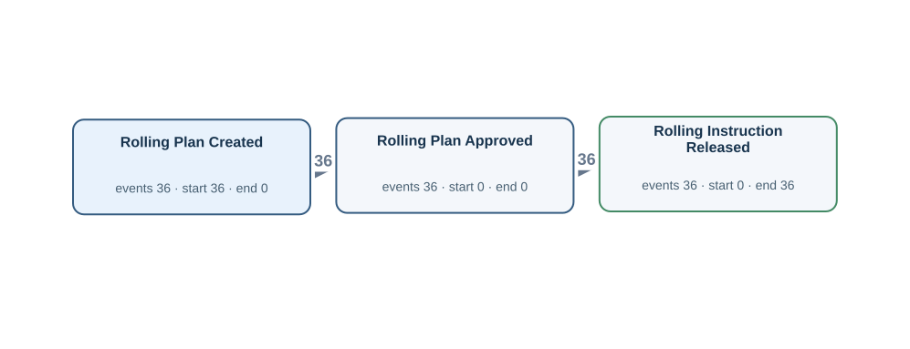</td><td width="50%"><h4>Original tables</h4>
Rows matched by event ID, activity and timestamp using the authored source bindings.

<strong><code>planned_rolling_instruction</code></strong> · 36 source rows

<code>plan_id</code> = PLAN001, <code>slab_id</code> = SL001, <code>planned_reheat_at</code> = 2026-03-02T02:00:00Z, <code>rolling_plan_created_at</code> = 2026-03-01T14:00:00Z, <code>rolling_plan_reviewed_at</code> = 2026-03-01T15:00:00Z, <code>rolling_plan_approved_at</code> = 2026-03-01T16:00:00Z, <code>rolling_plan_released_at</code> = NULL LC:planned_rolling_instruction:PLAN001:1 · Rolling Plan Created · rolling_plan_created_at · PLAN001 | LC:planned_rolling_instruction:PLAN001:3 · Rolling Plan Approved · rolling_plan_approved_at · PLAN001

<code>plan_id</code> = PLAN002, <code>slab_id</code> = SL002, <code>planned_reheat_at</code> = 2026-03-03T02:00:00Z, <code>rolling_plan_created_at</code> = 2026-03-02T14:00:00Z, <code>rolling_plan_reviewed_at</code> = 2026-03-02T15:00:00Z, <code>rolling_plan_approved_at</code> = 2026-03-02T16:00:00Z, <code>rolling_plan_released_at</code> = 2026-03-02T17:00:00Z LC:planned_rolling_instruction:PLAN002:1 · Rolling Plan Created · rolling_plan_created_at · PLAN002 | LC:planned_rolling_instruction:PLAN002:3 · Rolling Plan Approved · rolling_plan_approved_at · PLAN002

<code>plan_id</code> = PLAN003, <code>slab_id</code> = SL003, <code>planned_reheat_at</code> = 2026-03-04T02:00:00Z, <code>rolling_plan_created_at</code> = 2026-03-03T14:00:00Z, <code>rolling_plan_reviewed_at</code> = 2026-03-03T15:00:00Z, <code>rolling_plan_approved_at</code> = 2026-03-03T16:00:00Z, <code>rolling_plan_released_at</code> = 2026-03-03T17:00:00Z LC:planned_rolling_instruction:PLAN003:1 · Rolling Plan Created · rolling_plan_created_at · PLAN003 | LC:planned_rolling_instruction:PLAN003:3 · Rolling Plan Approved · rolling_plan_approved_at · PLAN003

<strong><code>rolling_instruction</code></strong> · 36 source rows

<code>instruction_id</code> = RI001, <code>plan_id</code> = PLAN001, <code>released_at</code> = 2026-03-02T00:00:00Z, <code>rolling_instruction_acknowledged_at</code> = 2026-03-02T00:05:00Z, <code>rolling_setup_verified_at</code> = NULL, <code>rolling_work_started_at</code> = NULL, <code>rolling_instruction_closed_at</code> = NULL RI:RI001 · Rolling Instruction Released · released_at · PLAN001

<code>instruction_id</code> = RI002, <code>plan_id</code> = PLAN002, <code>released_at</code> = 2026-03-03T00:00:00Z, <code>rolling_instruction_acknowledged_at</code> = 2026-03-03T00:05:00Z, <code>rolling_setup_verified_at</code> = 2026-03-03T00:10:00Z, <code>rolling_work_started_at</code> = NULL, <code>rolling_instruction_closed_at</code> = NULL RI:RI002 · Rolling Instruction Released · released_at · PLAN002

<code>instruction_id</code> = RI003, <code>plan_id</code> = PLAN003, <code>released_at</code> = 2026-03-04T00:00:00Z, <code>rolling_instruction_acknowledged_at</code> = 2026-03-04T00:05:00Z, <code>rolling_setup_verified_at</code> = 2026-03-04T00:10:00Z, <code>rolling_work_started_at</code> = 2026-03-04T05:55:00Z, <code>rolling_instruction_closed_at</code> = 2026-03-04T06:05:00Z RI:RI003 · Rolling Instruction Released · released_at · PLAN003

FK-linked row examples for case and join context

<strong>slab_material</strong>

planned_rolling_instruction (slab_id → slab_id) <code>slab_id</code> = SL001, <code>charge_id</code> = CH001, <code>slab_received_at</code> = 2026-03-01T14:00:00Z, <code>slab_identity_verified_at</code> = 2026-03-01T15:00:00Z, <code>slab_quality_checked_at</code> = 2026-03-01T16:00:00Z, <code>slab_released_for_rolling_at</code> = NULL

planned_rolling_instruction (slab_id → slab_id) <code>slab_id</code> = SL002, <code>charge_id</code> = CH002, <code>slab_received_at</code> = 2026-03-02T14:00:00Z, <code>slab_identity_verified_at</code> = 2026-03-02T15:00:00Z, <code>slab_quality_checked_at</code> = 2026-03-02T16:00:00Z, <code>slab_released_for_rolling_at</code> = 2026-03-02T17:00:00Z

planned_rolling_instruction (slab_id → slab_id) <code>slab_id</code> = SL003, <code>charge_id</code> = CH003, <code>slab_received_at</code> = 2026-03-03T14:00:00Z, <code>slab_identity_verified_at</code> = 2026-03-03T15:00:00Z, <code>slab_quality_checked_at</code> = 2026-03-03T16:00:00Z, <code>slab_released_for_rolling_at</code> = 2026-03-03T17:00:00Z

Other tables referenced by Gold SQL

Includes case joins and branches of shared CTEs.
<ul><li><code>as_rolled_material</code> · as_rolled_plate_no, crop_shear_passed_at, furnace_charged_at, instruction_id, material_id</li><li><code>cutting_finishing_instruction</code> · cutting_instruction_acknowledged_at, cutting_instruction_closed_at, cutting_setup_verified_at, cutting_work_started_at, instruction_id, material_id, released_at</li><li><code>furnace_charge_tracking</code> · furnace_charge_assigned_at, furnace_charge_confirmed_at, furnace_discharge_confirmed_at, material_id, tracking_id, yard_instruction_received_at</li><li><code>material_operation_history</code> · completed_at, material_id, operation_code, transaction_id</li><li><code>plate_material</code> · dimension_inspected_at, parent_as_rolled_plate_no, plate_material_id, plate_packed_at, plate_packing_started_at, plate_piece_identified_at, plate_quality_released_at, plate_quality_review_started_at</li><li><code>slab_material</code> · slab_id, slab_identity_verified_at, slab_quality_checked_at, slab_received_at, slab_released_for_rolling_at</li></ul>
</td></tr></table>

[Gold CSV](../../../datasets/plateflow/private/gold_logs/OPV02E.csv)

## OPV02EP — Q2

For each rolling plan, build a timeline of the rolling work order being issued, a rolling schedule being authorized, a rolling schedule being prepared.

Events: **108** · Cases with events: **36** · Activities: **3** · Edges: **2**

<table><tr><td width="50%"></td><td width="50%"><h4>Original tables</h4>
Rows matched by event ID, activity and timestamp using the authored source bindings.

<strong><code>planned_rolling_instruction</code></strong> · 36 source rows

<code>plan_id</code> = PLAN001, <code>slab_id</code> = SL001, <code>planned_reheat_at</code> = 2026-03-02T02:00:00Z, <code>rolling_plan_created_at</code> = 2026-03-01T14:00:00Z, <code>rolling_plan_reviewed_at</code> = 2026-03-01T15:00:00Z, <code>rolling_plan_approved_at</code> = 2026-03-01T16:00:00Z, <code>rolling_plan_released_at</code> = NULL LC:planned_rolling_instruction:PLAN001:1 · Rolling Plan Created · rolling_plan_created_at · PLAN001 | LC:planned_rolling_instruction:PLAN001:3 · Rolling Plan Approved · rolling_plan_approved_at · PLAN001

<code>plan_id</code> = PLAN002, <code>slab_id</code> = SL002, <code>planned_reheat_at</code> = 2026-03-03T02:00:00Z, <code>rolling_plan_created_at</code> = 2026-03-02T14:00:00Z, <code>rolling_plan_reviewed_at</code> = 2026-03-02T15:00:00Z, <code>rolling_plan_approved_at</code> = 2026-03-02T16:00:00Z, <code>rolling_plan_released_at</code> = 2026-03-02T17:00:00Z LC:planned_rolling_instruction:PLAN002:1 · Rolling Plan Created · rolling_plan_created_at · PLAN002 | LC:planned_rolling_instruction:PLAN002:3 · Rolling Plan Approved · rolling_plan_approved_at · PLAN002

<code>plan_id</code> = PLAN003, <code>slab_id</code> = SL003, <code>planned_reheat_at</code> = 2026-03-04T02:00:00Z, <code>rolling_plan_created_at</code> = 2026-03-03T14:00:00Z, <code>rolling_plan_reviewed_at</code> = 2026-03-03T15:00:00Z, <code>rolling_plan_approved_at</code> = 2026-03-03T16:00:00Z, <code>rolling_plan_released_at</code> = 2026-03-03T17:00:00Z LC:planned_rolling_instruction:PLAN003:1 · Rolling Plan Created · rolling_plan_created_at · PLAN003 | LC:planned_rolling_instruction:PLAN003:3 · Rolling Plan Approved · rolling_plan_approved_at · PLAN003

<strong><code>rolling_instruction</code></strong> · 36 source rows

<code>instruction_id</code> = RI001, <code>plan_id</code> = PLAN001, <code>released_at</code> = 2026-03-02T00:00:00Z, <code>rolling_instruction_acknowledged_at</code> = 2026-03-02T00:05:00Z, <code>rolling_setup_verified_at</code> = NULL, <code>rolling_work_started_at</code> = NULL, <code>rolling_instruction_closed_at</code> = NULL RI:RI001 · Rolling Instruction Released · released_at · PLAN001

<code>instruction_id</code> = RI002, <code>plan_id</code> = PLAN002, <code>released_at</code> = 2026-03-03T00:00:00Z, <code>rolling_instruction_acknowledged_at</code> = 2026-03-03T00:05:00Z, <code>rolling_setup_verified_at</code> = 2026-03-03T00:10:00Z, <code>rolling_work_started_at</code> = NULL, <code>rolling_instruction_closed_at</code> = NULL RI:RI002 · Rolling Instruction Released · released_at · PLAN002

<code>instruction_id</code> = RI003, <code>plan_id</code> = PLAN003, <code>released_at</code> = 2026-03-04T00:00:00Z, <code>rolling_instruction_acknowledged_at</code> = 2026-03-04T00:05:00Z, <code>rolling_setup_verified_at</code> = 2026-03-04T00:10:00Z, <code>rolling_work_started_at</code> = 2026-03-04T05:55:00Z, <code>rolling_instruction_closed_at</code> = 2026-03-04T06:05:00Z RI:RI003 · Rolling Instruction Released · released_at · PLAN003

FK-linked row examples for case and join context

<strong>slab_material</strong>

planned_rolling_instruction (slab_id → slab_id) <code>slab_id</code> = SL001, <code>charge_id</code> = CH001, <code>slab_received_at</code> = 2026-03-01T14:00:00Z, <code>slab_identity_verified_at</code> = 2026-03-01T15:00:00Z, <code>slab_quality_checked_at</code> = 2026-03-01T16:00:00Z, <code>slab_released_for_rolling_at</code> = NULL

planned_rolling_instruction (slab_id → slab_id) <code>slab_id</code> = SL002, <code>charge_id</code> = CH002, <code>slab_received_at</code> = 2026-03-02T14:00:00Z, <code>slab_identity_verified_at</code> = 2026-03-02T15:00:00Z, <code>slab_quality_checked_at</code> = 2026-03-02T16:00:00Z, <code>slab_released_for_rolling_at</code> = 2026-03-02T17:00:00Z

planned_rolling_instruction (slab_id → slab_id) <code>slab_id</code> = SL003, <code>charge_id</code> = CH003, <code>slab_received_at</code> = 2026-03-03T14:00:00Z, <code>slab_identity_verified_at</code> = 2026-03-03T15:00:00Z, <code>slab_quality_checked_at</code> = 2026-03-03T16:00:00Z, <code>slab_released_for_rolling_at</code> = 2026-03-03T17:00:00Z

Other tables referenced by Gold SQL

Includes case joins and branches of shared CTEs.
<ul><li><code>as_rolled_material</code> · as_rolled_plate_no, crop_shear_passed_at, furnace_charged_at, instruction_id, material_id</li><li><code>cutting_finishing_instruction</code> · cutting_instruction_acknowledged_at, cutting_instruction_closed_at, cutting_setup_verified_at, cutting_work_started_at, instruction_id, material_id, released_at</li><li><code>furnace_charge_tracking</code> · furnace_charge_assigned_at, furnace_charge_confirmed_at, furnace_discharge_confirmed_at, material_id, tracking_id, yard_instruction_received_at</li><li><code>material_operation_history</code> · completed_at, material_id, operation_code, transaction_id</li><li><code>plate_material</code> · dimension_inspected_at, parent_as_rolled_plate_no, plate_material_id, plate_packed_at, plate_packing_started_at, plate_piece_identified_at, plate_quality_released_at, plate_quality_review_started_at</li><li><code>slab_material</code> · slab_id, slab_identity_verified_at, slab_quality_checked_at, slab_received_at, slab_released_for_rolling_at</li></ul>
</td></tr></table>

[Gold CSV](../../../datasets/plateflow/private/gold_logs/OPV02EP.csv)

## OPV03P — Q4

Show the complete recorded history associated with each rolling instruction.

Events: **150** · Cases with events: **36** · Activities: **5** · Edges: **4**

<table><tr><td width="50%"></td><td width="50%"><h4>Original tables</h4>
Rows matched by event ID, activity and timestamp using the authored source bindings.

<strong><code>rolling_instruction</code></strong> · 36 source rows

<code>instruction_id</code> = RI001, <code>plan_id</code> = PLAN001, <code>released_at</code> = 2026-03-02T00:00:00Z, <code>rolling_instruction_acknowledged_at</code> = 2026-03-02T00:05:00Z, <code>rolling_setup_verified_at</code> = NULL, <code>rolling_work_started_at</code> = NULL, <code>rolling_instruction_closed_at</code> = NULL LC:rolling_instruction:RI001:1 · Rolling Instruction Acknowledged · rolling_instruction_acknowledged_at · RI001 | RI:RI001 · Rolling Instruction Released · released_at · RI001

<code>instruction_id</code> = RI002, <code>plan_id</code> = PLAN002, <code>released_at</code> = 2026-03-03T00:00:00Z, <code>rolling_instruction_acknowledged_at</code> = 2026-03-03T00:05:00Z, <code>rolling_setup_verified_at</code> = 2026-03-03T00:10:00Z, <code>rolling_work_started_at</code> = NULL, <code>rolling_instruction_closed_at</code> = NULL LC:rolling_instruction:RI002:1 · Rolling Instruction Acknowledged · rolling_instruction_acknowledged_at · RI002 | LC:rolling_instruction:RI002:2 · Rolling Setup Verified · rolling_setup_verified_at · RI002 | RI:RI002 · Rolling Instruction Released · released_at · RI002

<code>instruction_id</code> = RI003, <code>plan_id</code> = PLAN003, <code>released_at</code> = 2026-03-04T00:00:00Z, <code>rolling_instruction_acknowledged_at</code> = 2026-03-04T00:05:00Z, <code>rolling_setup_verified_at</code> = 2026-03-04T00:10:00Z, <code>rolling_work_started_at</code> = 2026-03-04T05:55:00Z, <code>rolling_instruction_closed_at</code> = 2026-03-04T06:05:00Z LC:rolling_instruction:RI003:1 · Rolling Instruction Acknowledged · rolling_instruction_acknowledged_at · RI003 | LC:rolling_instruction:RI003:2 · Rolling Setup Verified · rolling_setup_verified_at · RI003 | LC:rolling_instruction:RI003:3 · Rolling Work Started · rolling_work_started_at · RI003 | LC:rolling_instruction:RI003:4 · Rolling Instruction Closed · rolling_instruction_closed_at · RI003 | RI:RI003 · Rolling Instruction Released · released_at · RI003

FK-linked row examples for case and join context

<strong>planned_rolling_instruction</strong>

rolling_instruction (plan_id → plan_id) <code>plan_id</code> = PLAN001, <code>slab_id</code> = SL001, <code>planned_reheat_at</code> = 2026-03-02T02:00:00Z, <code>rolling_plan_created_at</code> = 2026-03-01T14:00:00Z, <code>rolling_plan_reviewed_at</code> = 2026-03-01T15:00:00Z, <code>rolling_plan_approved_at</code> = 2026-03-01T16:00:00Z, <code>rolling_plan_released_at</code> = NULL

rolling_instruction (plan_id → plan_id) <code>plan_id</code> = PLAN002, <code>slab_id</code> = SL002, <code>planned_reheat_at</code> = 2026-03-03T02:00:00Z, <code>rolling_plan_created_at</code> = 2026-03-02T14:00:00Z, <code>rolling_plan_reviewed_at</code> = 2026-03-02T15:00:00Z, <code>rolling_plan_approved_at</code> = 2026-03-02T16:00:00Z, <code>rolling_plan_released_at</code> = 2026-03-02T17:00:00Z

rolling_instruction (plan_id → plan_id) <code>plan_id</code> = PLAN003, <code>slab_id</code> = SL003, <code>planned_reheat_at</code> = 2026-03-04T02:00:00Z, <code>rolling_plan_created_at</code> = 2026-03-03T14:00:00Z, <code>rolling_plan_reviewed_at</code> = 2026-03-03T15:00:00Z, <code>rolling_plan_approved_at</code> = 2026-03-03T16:00:00Z, <code>rolling_plan_released_at</code> = 2026-03-03T17:00:00Z

<strong>slab_material</strong>

planned_rolling_instruction (slab_id → slab_id) <code>slab_id</code> = SL001, <code>charge_id</code> = CH001, <code>slab_received_at</code> = 2026-03-01T14:00:00Z, <code>slab_identity_verified_at</code> = 2026-03-01T15:00:00Z, <code>slab_quality_checked_at</code> = 2026-03-01T16:00:00Z, <code>slab_released_for_rolling_at</code> = NULL

planned_rolling_instruction (slab_id → slab_id) <code>slab_id</code> = SL002, <code>charge_id</code> = CH002, <code>slab_received_at</code> = 2026-03-02T14:00:00Z, <code>slab_identity_verified_at</code> = 2026-03-02T15:00:00Z, <code>slab_quality_checked_at</code> = 2026-03-02T16:00:00Z, <code>slab_released_for_rolling_at</code> = 2026-03-02T17:00:00Z

planned_rolling_instruction (slab_id → slab_id) <code>slab_id</code> = SL003, <code>charge_id</code> = CH003, <code>slab_received_at</code> = 2026-03-03T14:00:00Z, <code>slab_identity_verified_at</code> = 2026-03-03T15:00:00Z, <code>slab_quality_checked_at</code> = 2026-03-03T16:00:00Z, <code>slab_released_for_rolling_at</code> = 2026-03-03T17:00:00Z

Other tables referenced by Gold SQL

Includes case joins and branches of shared CTEs.
<ul><li><code>as_rolled_material</code> · as_rolled_plate_no, crop_shear_passed_at, furnace_charged_at, instruction_id, material_id</li><li><code>cutting_finishing_instruction</code> · cutting_instruction_acknowledged_at, cutting_instruction_closed_at, cutting_setup_verified_at, cutting_work_started_at, instruction_id, material_id, released_at</li><li><code>furnace_charge_tracking</code> · furnace_charge_assigned_at, furnace_charge_confirmed_at, furnace_discharge_confirmed_at, material_id, tracking_id, yard_instruction_received_at</li><li><code>material_operation_history</code> · completed_at, material_id, operation_code, transaction_id</li><li><code>planned_rolling_instruction</code> · plan_id, rolling_plan_approved_at, rolling_plan_created_at, rolling_plan_released_at, rolling_plan_reviewed_at</li><li><code>plate_material</code> · dimension_inspected_at, parent_as_rolled_plate_no, plate_material_id, plate_packed_at, plate_packing_started_at, plate_piece_identified_at, plate_quality_released_at, plate_quality_review_started_at</li><li><code>slab_material</code> · slab_id, slab_identity_verified_at, slab_quality_checked_at, slab_received_at, slab_released_for_rolling_at</li></ul>
</td></tr></table>

[Gold CSV](../../../datasets/plateflow/private/gold_logs/OPV03P.csv)

## OPV03E — Q1

Extract Rolling Instruction Acknowledged, Rolling Instruction Closed, Rolling Instruction Released events for each rolling instruction.

Events: **92** · Cases with events: **36** · Activities: **3** · Edges: **2**

<table><tr><td width="50%">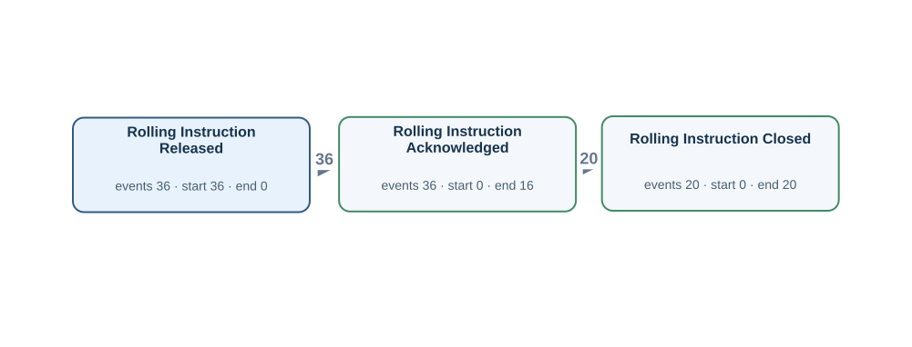</td><td width="50%"><h4>Original tables</h4>
Rows matched by event ID, activity and timestamp using the authored source bindings.

<strong><code>rolling_instruction</code></strong> · 36 source rows

<code>instruction_id</code> = RI001, <code>plan_id</code> = PLAN001, <code>released_at</code> = 2026-03-02T00:00:00Z, <code>rolling_instruction_acknowledged_at</code> = 2026-03-02T00:05:00Z, <code>rolling_setup_verified_at</code> = NULL, <code>rolling_work_started_at</code> = NULL, <code>rolling_instruction_closed_at</code> = NULL LC:rolling_instruction:RI001:1 · Rolling Instruction Acknowledged · rolling_instruction_acknowledged_at · RI001 | RI:RI001 · Rolling Instruction Released · released_at · RI001

<code>instruction_id</code> = RI002, <code>plan_id</code> = PLAN002, <code>released_at</code> = 2026-03-03T00:00:00Z, <code>rolling_instruction_acknowledged_at</code> = 2026-03-03T00:05:00Z, <code>rolling_setup_verified_at</code> = 2026-03-03T00:10:00Z, <code>rolling_work_started_at</code> = NULL, <code>rolling_instruction_closed_at</code> = NULL LC:rolling_instruction:RI002:1 · Rolling Instruction Acknowledged · rolling_instruction_acknowledged_at · RI002 | RI:RI002 · Rolling Instruction Released · released_at · RI002

<code>instruction_id</code> = RI003, <code>plan_id</code> = PLAN003, <code>released_at</code> = 2026-03-04T00:00:00Z, <code>rolling_instruction_acknowledged_at</code> = 2026-03-04T00:05:00Z, <code>rolling_setup_verified_at</code> = 2026-03-04T00:10:00Z, <code>rolling_work_started_at</code> = 2026-03-04T05:55:00Z, <code>rolling_instruction_closed_at</code> = 2026-03-04T06:05:00Z LC:rolling_instruction:RI003:1 · Rolling Instruction Acknowledged · rolling_instruction_acknowledged_at · RI003 | LC:rolling_instruction:RI003:4 · Rolling Instruction Closed · rolling_instruction_closed_at · RI003 | RI:RI003 · Rolling Instruction Released · released_at · RI003

FK-linked row examples for case and join context

<strong>planned_rolling_instruction</strong>

rolling_instruction (plan_id → plan_id) <code>plan_id</code> = PLAN001, <code>slab_id</code> = SL001, <code>planned_reheat_at</code> = 2026-03-02T02:00:00Z, <code>rolling_plan_created_at</code> = 2026-03-01T14:00:00Z, <code>rolling_plan_reviewed_at</code> = 2026-03-01T15:00:00Z, <code>rolling_plan_approved_at</code> = 2026-03-01T16:00:00Z, <code>rolling_plan_released_at</code> = NULL

rolling_instruction (plan_id → plan_id) <code>plan_id</code> = PLAN002, <code>slab_id</code> = SL002, <code>planned_reheat_at</code> = 2026-03-03T02:00:00Z, <code>rolling_plan_created_at</code> = 2026-03-02T14:00:00Z, <code>rolling_plan_reviewed_at</code> = 2026-03-02T15:00:00Z, <code>rolling_plan_approved_at</code> = 2026-03-02T16:00:00Z, <code>rolling_plan_released_at</code> = 2026-03-02T17:00:00Z

rolling_instruction (plan_id → plan_id) <code>plan_id</code> = PLAN003, <code>slab_id</code> = SL003, <code>planned_reheat_at</code> = 2026-03-04T02:00:00Z, <code>rolling_plan_created_at</code> = 2026-03-03T14:00:00Z, <code>rolling_plan_reviewed_at</code> = 2026-03-03T15:00:00Z, <code>rolling_plan_approved_at</code> = 2026-03-03T16:00:00Z, <code>rolling_plan_released_at</code> = 2026-03-03T17:00:00Z

<strong>slab_material</strong>

planned_rolling_instruction (slab_id → slab_id) <code>slab_id</code> = SL001, <code>charge_id</code> = CH001, <code>slab_received_at</code> = 2026-03-01T14:00:00Z, <code>slab_identity_verified_at</code> = 2026-03-01T15:00:00Z, <code>slab_quality_checked_at</code> = 2026-03-01T16:00:00Z, <code>slab_released_for_rolling_at</code> = NULL

planned_rolling_instruction (slab_id → slab_id) <code>slab_id</code> = SL002, <code>charge_id</code> = CH002, <code>slab_received_at</code> = 2026-03-02T14:00:00Z, <code>slab_identity_verified_at</code> = 2026-03-02T15:00:00Z, <code>slab_quality_checked_at</code> = 2026-03-02T16:00:00Z, <code>slab_released_for_rolling_at</code> = 2026-03-02T17:00:00Z

planned_rolling_instruction (slab_id → slab_id) <code>slab_id</code> = SL003, <code>charge_id</code> = CH003, <code>slab_received_at</code> = 2026-03-03T14:00:00Z, <code>slab_identity_verified_at</code> = 2026-03-03T15:00:00Z, <code>slab_quality_checked_at</code> = 2026-03-03T16:00:00Z, <code>slab_released_for_rolling_at</code> = 2026-03-03T17:00:00Z

Other tables referenced by Gold SQL

Includes case joins and branches of shared CTEs.
<ul><li><code>as_rolled_material</code> · as_rolled_plate_no, crop_shear_passed_at, furnace_charged_at, instruction_id, material_id</li><li><code>cutting_finishing_instruction</code> · cutting_instruction_acknowledged_at, cutting_instruction_closed_at, cutting_setup_verified_at, cutting_work_started_at, instruction_id, material_id, released_at</li><li><code>furnace_charge_tracking</code> · furnace_charge_assigned_at, furnace_charge_confirmed_at, furnace_discharge_confirmed_at, material_id, tracking_id, yard_instruction_received_at</li><li><code>material_operation_history</code> · completed_at, material_id, operation_code, transaction_id</li><li><code>planned_rolling_instruction</code> · plan_id, rolling_plan_approved_at, rolling_plan_created_at, rolling_plan_released_at, rolling_plan_reviewed_at</li><li><code>plate_material</code> · dimension_inspected_at, parent_as_rolled_plate_no, plate_material_id, plate_packed_at, plate_packing_started_at, plate_piece_identified_at, plate_quality_released_at, plate_quality_review_started_at</li><li><code>slab_material</code> · slab_id, slab_identity_verified_at, slab_quality_checked_at, slab_received_at, slab_released_for_rolling_at</li></ul>
</td></tr></table>

[Gold CSV](../../../datasets/plateflow/private/gold_logs/OPV03E.csv)

## OPV03EP — Q2

For each rolling instruction, build a timeline of the rolling team acknowledging its work order, the rolling work order being closed, the rolling work order being issued.

Events: **92** · Cases with events: **36** · Activities: **3** · Edges: **2**

<table><tr><td width="50%"></td><td width="50%"><h4>Original tables</h4>
Rows matched by event ID, activity and timestamp using the authored source bindings.

<strong><code>rolling_instruction</code></strong> · 36 source rows

<code>instruction_id</code> = RI001, <code>plan_id</code> = PLAN001, <code>released_at</code> = 2026-03-02T00:00:00Z, <code>rolling_instruction_acknowledged_at</code> = 2026-03-02T00:05:00Z, <code>rolling_setup_verified_at</code> = NULL, <code>rolling_work_started_at</code> = NULL, <code>rolling_instruction_closed_at</code> = NULL LC:rolling_instruction:RI001:1 · Rolling Instruction Acknowledged · rolling_instruction_acknowledged_at · RI001 | RI:RI001 · Rolling Instruction Released · released_at · RI001

<code>instruction_id</code> = RI002, <code>plan_id</code> = PLAN002, <code>released_at</code> = 2026-03-03T00:00:00Z, <code>rolling_instruction_acknowledged_at</code> = 2026-03-03T00:05:00Z, <code>rolling_setup_verified_at</code> = 2026-03-03T00:10:00Z, <code>rolling_work_started_at</code> = NULL, <code>rolling_instruction_closed_at</code> = NULL LC:rolling_instruction:RI002:1 · Rolling Instruction Acknowledged · rolling_instruction_acknowledged_at · RI002 | RI:RI002 · Rolling Instruction Released · released_at · RI002

<code>instruction_id</code> = RI003, <code>plan_id</code> = PLAN003, <code>released_at</code> = 2026-03-04T00:00:00Z, <code>rolling_instruction_acknowledged_at</code> = 2026-03-04T00:05:00Z, <code>rolling_setup_verified_at</code> = 2026-03-04T00:10:00Z, <code>rolling_work_started_at</code> = 2026-03-04T05:55:00Z, <code>rolling_instruction_closed_at</code> = 2026-03-04T06:05:00Z LC:rolling_instruction:RI003:1 · Rolling Instruction Acknowledged · rolling_instruction_acknowledged_at · RI003 | LC:rolling_instruction:RI003:4 · Rolling Instruction Closed · rolling_instruction_closed_at · RI003 | RI:RI003 · Rolling Instruction Released · released_at · RI003

FK-linked row examples for case and join context

<strong>planned_rolling_instruction</strong>

rolling_instruction (plan_id → plan_id) <code>plan_id</code> = PLAN001, <code>slab_id</code> = SL001, <code>planned_reheat_at</code> = 2026-03-02T02:00:00Z, <code>rolling_plan_created_at</code> = 2026-03-01T14:00:00Z, <code>rolling_plan_reviewed_at</code> = 2026-03-01T15:00:00Z, <code>rolling_plan_approved_at</code> = 2026-03-01T16:00:00Z, <code>rolling_plan_released_at</code> = NULL

rolling_instruction (plan_id → plan_id) <code>plan_id</code> = PLAN002, <code>slab_id</code> = SL002, <code>planned_reheat_at</code> = 2026-03-03T02:00:00Z, <code>rolling_plan_created_at</code> = 2026-03-02T14:00:00Z, <code>rolling_plan_reviewed_at</code> = 2026-03-02T15:00:00Z, <code>rolling_plan_approved_at</code> = 2026-03-02T16:00:00Z, <code>rolling_plan_released_at</code> = 2026-03-02T17:00:00Z

rolling_instruction (plan_id → plan_id) <code>plan_id</code> = PLAN003, <code>slab_id</code> = SL003, <code>planned_reheat_at</code> = 2026-03-04T02:00:00Z, <code>rolling_plan_created_at</code> = 2026-03-03T14:00:00Z, <code>rolling_plan_reviewed_at</code> = 2026-03-03T15:00:00Z, <code>rolling_plan_approved_at</code> = 2026-03-03T16:00:00Z, <code>rolling_plan_released_at</code> = 2026-03-03T17:00:00Z

<strong>slab_material</strong>

planned_rolling_instruction (slab_id → slab_id) <code>slab_id</code> = SL001, <code>charge_id</code> = CH001, <code>slab_received_at</code> = 2026-03-01T14:00:00Z, <code>slab_identity_verified_at</code> = 2026-03-01T15:00:00Z, <code>slab_quality_checked_at</code> = 2026-03-01T16:00:00Z, <code>slab_released_for_rolling_at</code> = NULL

planned_rolling_instruction (slab_id → slab_id) <code>slab_id</code> = SL002, <code>charge_id</code> = CH002, <code>slab_received_at</code> = 2026-03-02T14:00:00Z, <code>slab_identity_verified_at</code> = 2026-03-02T15:00:00Z, <code>slab_quality_checked_at</code> = 2026-03-02T16:00:00Z, <code>slab_released_for_rolling_at</code> = 2026-03-02T17:00:00Z

planned_rolling_instruction (slab_id → slab_id) <code>slab_id</code> = SL003, <code>charge_id</code> = CH003, <code>slab_received_at</code> = 2026-03-03T14:00:00Z, <code>slab_identity_verified_at</code> = 2026-03-03T15:00:00Z, <code>slab_quality_checked_at</code> = 2026-03-03T16:00:00Z, <code>slab_released_for_rolling_at</code> = 2026-03-03T17:00:00Z

Other tables referenced by Gold SQL

Includes case joins and branches of shared CTEs.
<ul><li><code>as_rolled_material</code> · as_rolled_plate_no, crop_shear_passed_at, furnace_charged_at, instruction_id, material_id</li><li><code>cutting_finishing_instruction</code> · cutting_instruction_acknowledged_at, cutting_instruction_closed_at, cutting_setup_verified_at, cutting_work_started_at, instruction_id, material_id, released_at</li><li><code>furnace_charge_tracking</code> · furnace_charge_assigned_at, furnace_charge_confirmed_at, furnace_discharge_confirmed_at, material_id, tracking_id, yard_instruction_received_at</li><li><code>material_operation_history</code> · completed_at, material_id, operation_code, transaction_id</li><li><code>planned_rolling_instruction</code> · plan_id, rolling_plan_approved_at, rolling_plan_created_at, rolling_plan_released_at, rolling_plan_reviewed_at</li><li><code>plate_material</code> · dimension_inspected_at, parent_as_rolled_plate_no, plate_material_id, plate_packed_at, plate_packing_started_at, plate_piece_identified_at, plate_quality_released_at, plate_quality_review_started_at</li><li><code>slab_material</code> · slab_id, slab_identity_verified_at, slab_quality_checked_at, slab_received_at, slab_released_for_rolling_at</li></ul>
</td></tr></table>

[Gold CSV](../../../datasets/plateflow/private/gold_logs/OPV03EP.csv)

## OPV04P — Q4

Show the complete recorded history associated with each mother material.

Events: **1108** · Cases with events: **36** · Activities: **39** · Edges: **63**

<table><tr><td width="50%"></td><td width="50%"><h4>Original tables</h4>
Rows matched by event ID, activity and timestamp using the authored source bindings.

<strong><code>as_rolled_material</code></strong> · 30 source rows

<code>material_id</code> = M002, <code>as_rolled_plate_no</code> = AR002, <code>slab_id</code> = SL002, <code>instruction_id</code> = RI002, <code>furnace_charged_at</code> = 2026-03-03T04:00:00Z, <code>crop_shear_passed_at</code> = NULL, <code>latest_operation_completed_at</code> = NULL, <code>created_at</code> = 2026-03-02T23:00:00Z, <code>updated_at</code> = 2026-03-03T22:00:00Z RH:M002 · Reheating Started · furnace_charged_at · M002

<code>material_id</code> = M003, <code>as_rolled_plate_no</code> = AR003, <code>slab_id</code> = SL003, <code>instruction_id</code> = RI003, <code>furnace_charged_at</code> = 2026-03-04T03:00:00Z, <code>crop_shear_passed_at</code> = NULL, <code>latest_operation_completed_at</code> = 2026-03-04T06:00:00Z, <code>created_at</code> = 2026-03-03T23:00:00Z, <code>updated_at</code> = 2026-03-04T22:00:00Z RH:M003 · Reheating Started · furnace_charged_at · M003

<code>material_id</code> = M004, <code>as_rolled_plate_no</code> = AR004, <code>slab_id</code> = SL004, <code>instruction_id</code> = RI004, <code>furnace_charged_at</code> = 2026-03-05T02:00:00Z, <code>crop_shear_passed_at</code> = 2026-03-05T09:00:00Z, <code>latest_operation_completed_at</code> = 2026-03-05T11:00:00Z, <code>created_at</code> = 2026-03-04T23:00:00Z, <code>updated_at</code> = 2026-03-05T22:00:00Z CS:M004 · Crop Shear Passed · crop_shear_passed_at · M004 | RH:M004 · Reheating Started · furnace_charged_at · M004

<strong><code>cutting_finishing_instruction</code></strong> · 18 source rows

<code>instruction_id</code> = CIM004, <code>material_id</code> = M004, <code>released_at</code> = 2026-03-05T10:00:00Z, <code>cut_method</code> = SPLIT, <code>cutting_instruction_acknowledged_at</code> = 2026-03-05T10:05:00Z, <code>cutting_setup_verified_at</code> = 2026-03-05T10:10:00Z, <code>cutting_work_started_at</code> = 2026-03-05T10:55:00Z, <code>cutting_instruction_closed_at</code> = NULL CI:CIM004 · Cutting Instruction Released · released_at · M004 | LC:cutting_finishing_instruction:CIM004:1 · Cutting Instruction Acknowledged · cutting_instruction_acknowledged_at · M004 | LC:cutting_finishing_instruction:CIM004:2 · Cutting Setup Verified · cutting_setup_verified_at · M004 | LC:cutting_finishing_instruction:CIM004:3 · Cutting Work Started · cutting_work_started_at · M004

<code>instruction_id</code> = CIM005, <code>material_id</code> = M005, <code>released_at</code> = 2026-03-06T10:00:00Z, <code>cut_method</code> = SPLIT, <code>cutting_instruction_acknowledged_at</code> = 2026-03-06T10:05:00Z, <code>cutting_setup_verified_at</code> = 2026-03-06T10:10:00Z, <code>cutting_work_started_at</code> = 2026-03-06T10:55:00Z, <code>cutting_instruction_closed_at</code> = 2026-03-06T11:05:00Z CI:CIM005 · Cutting Instruction Released · released_at · M005 | LC:cutting_finishing_instruction:CIM005:1 · Cutting Instruction Acknowledged · cutting_instruction_acknowledged_at · M005 | LC:cutting_finishing_instruction:CIM005:2 · Cutting Setup Verified · cutting_setup_verified_at · M005 | LC:cutting_finishing_instruction:CIM005:3 · Cutting Work Started · cutting_work_started_at · M005 | LC:cutting_finishing_instruction:CIM005:4 · Cutting Instruction Closed · cutting_instruction_closed_at · M005

<code>instruction_id</code> = CIM006, <code>material_id</code> = M006, <code>released_at</code> = 2026-03-07T10:00:00Z, <code>cut_method</code> = SPLIT, <code>cutting_instruction_acknowledged_at</code> = 2026-03-07T10:05:00Z, <code>cutting_setup_verified_at</code> = 2026-03-07T10:10:00Z, <code>cutting_work_started_at</code> = 2026-03-07T10:55:00Z, <code>cutting_instruction_closed_at</code> = 2026-03-07T11:05:00Z CI:CIM006 · Cutting Instruction Released · released_at · M006 | LC:cutting_finishing_instruction:CIM006:1 · Cutting Instruction Acknowledged · cutting_instruction_acknowledged_at · M006 | LC:cutting_finishing_instruction:CIM006:2 · Cutting Setup Verified · cutting_setup_verified_at · M006 | LC:cutting_finishing_instruction:CIM006:3 · Cutting Work Started · cutting_work_started_at · M006 | LC:cutting_finishing_instruction:CIM006:4 · Cutting Instruction Closed · cutting_instruction_closed_at · M006

<strong><code>furnace_charge_tracking</code></strong> · 30 source rows

<code>tracking_id</code> = TRM002, <code>material_id</code> = M002, <code>yard_instruction_received_at</code> = 2026-03-03T01:00:00Z, <code>lot_charging_started_at</code> = 2026-03-03T01:30:00Z, <code>furnace_charge_assigned_at</code> = 2026-03-03T01:05:00Z, <code>furnace_charge_confirmed_at</code> = NULL, <code>furnace_discharge_confirmed_at</code> = NULL LC:furnace_charge_tracking:TRM002:1 · Furnace Charge Assigned · furnace_charge_assigned_at · M002 | YD:TRM002 · Yard Instruction Received · yard_instruction_received_at · M002

<code>tracking_id</code> = TRM003, <code>material_id</code> = M003, <code>yard_instruction_received_at</code> = 2026-03-04T01:00:00Z, <code>lot_charging_started_at</code> = 2026-03-04T01:30:00Z, <code>furnace_charge_assigned_at</code> = 2026-03-04T01:05:00Z, <code>furnace_charge_confirmed_at</code> = 2026-03-04T03:01:00Z, <code>furnace_discharge_confirmed_at</code> = 2026-03-04T05:50:00Z LC:furnace_charge_tracking:TRM003:1 · Furnace Charge Assigned · furnace_charge_assigned_at · M003 | LC:furnace_charge_tracking:TRM003:2 · Furnace Charge Confirmed · furnace_charge_confirmed_at · M003 | LC:furnace_charge_tracking:TRM003:4 · Furnace Discharge Confirmed · furnace_discharge_confirmed_at · M003 | YD:TRM003 · Yard Instruction Received · yard_instruction_received_at · M003

<code>tracking_id</code> = TRM004, <code>material_id</code> = M004, <code>yard_instruction_received_at</code> = 2026-03-05T01:00:00Z, <code>lot_charging_started_at</code> = 2026-03-05T01:30:00Z, <code>furnace_charge_assigned_at</code> = 2026-03-05T01:05:00Z, <code>furnace_charge_confirmed_at</code> = 2026-03-05T02:01:00Z, <code>furnace_discharge_confirmed_at</code> = 2026-03-05T05:50:00Z LC:furnace_charge_tracking:TRM004:1 · Furnace Charge Assigned · furnace_charge_assigned_at · M004 | LC:furnace_charge_tracking:TRM004:2 · Furnace Charge Confirmed · furnace_charge_confirmed_at · M004 | LC:furnace_charge_tracking:TRM004:4 · Furnace Discharge Confirmed · furnace_discharge_confirmed_at · M004 | YD:TRM004 · Yard Instruction Received · yard_instruction_received_at · M004

<strong><code>material_operation_history</code></strong> · 216 source rows

<code>transaction_id</code> = LC:furnace_charge_tracking:TRM003:3, <code>material_id</code> = M003, <code>operation_code</code> = HF, <code>started_at</code> = 2026-03-04T05:39:00Z, <code>completed_at</code> = 2026-03-04T05:40:00Z, <code>created_at</code> = 2026-03-04T05:39:00Z LC:furnace_charge_tracking:TRM003:3 · Heating Completed · completed_at · M003

<code>transaction_id</code> = M003-RL, <code>material_id</code> = M003, <code>operation_code</code> = RL, <code>started_at</code> = 2026-03-04T05:30:00Z, <code>completed_at</code> = 2026-03-04T06:00:00Z, <code>created_at</code> = 2026-03-04T06:06:00Z OP:M003-RL · Rolling Completed · completed_at · M003

<code>transaction_id</code> = M004-CO, <code>material_id</code> = M004, <code>operation_code</code> = CO, <code>started_at</code> = 2026-03-05T06:30:00Z, <code>completed_at</code> = 2026-03-05T07:00:00Z, <code>created_at</code> = 2026-03-05T07:06:00Z OP:M004-CO · Cooling Completed · completed_at · M004

<strong><code>planned_rolling_instruction</code></strong> · 36 source rows

<code>plan_id</code> = PLAN001, <code>slab_id</code> = SL001, <code>planned_reheat_at</code> = 2026-03-02T02:00:00Z, <code>rolling_plan_created_at</code> = 2026-03-01T14:00:00Z, <code>rolling_plan_reviewed_at</code> = 2026-03-01T15:00:00Z, <code>rolling_plan_approved_at</code> = 2026-03-01T16:00:00Z, <code>rolling_plan_released_at</code> = NULL LC:planned_rolling_instruction:PLAN001:1 · Rolling Plan Created · rolling_plan_created_at · M001 | LC:planned_rolling_instruction:PLAN001:2 · Rolling Plan Reviewed · rolling_plan_reviewed_at · M001 | LC:planned_rolling_instruction:PLAN001:3 · Rolling Plan Approved · rolling_plan_approved_at · M001

<code>plan_id</code> = PLAN002, <code>slab_id</code> = SL002, <code>planned_reheat_at</code> = 2026-03-03T02:00:00Z, <code>rolling_plan_created_at</code> = 2026-03-02T14:00:00Z, <code>rolling_plan_reviewed_at</code> = 2026-03-02T15:00:00Z, <code>rolling_plan_approved_at</code> = 2026-03-02T16:00:00Z, <code>rolling_plan_released_at</code> = 2026-03-02T17:00:00Z LC:planned_rolling_instruction:PLAN002:1 · Rolling Plan Created · rolling_plan_created_at · M002 | LC:planned_rolling_instruction:PLAN002:2 · Rolling Plan Reviewed · rolling_plan_reviewed_at · M002 | LC:planned_rolling_instruction:PLAN002:3 · Rolling Plan Approved · rolling_plan_approved_at · M002 | LC:planned_rolling_instruction:PLAN002:4 · Rolling Plan Released · rolling_plan_released_at · M002

<code>plan_id</code> = PLAN003, <code>slab_id</code> = SL003, <code>planned_reheat_at</code> = 2026-03-04T02:00:00Z, <code>rolling_plan_created_at</code> = 2026-03-03T14:00:00Z, <code>rolling_plan_reviewed_at</code> = 2026-03-03T15:00:00Z, <code>rolling_plan_approved_at</code> = 2026-03-03T16:00:00Z, <code>rolling_plan_released_at</code> = 2026-03-03T17:00:00Z LC:planned_rolling_instruction:PLAN003:1 · Rolling Plan Created · rolling_plan_created_at · M003 | LC:planned_rolling_instruction:PLAN003:2 · Rolling Plan Reviewed · rolling_plan_reviewed_at · M003 | LC:planned_rolling_instruction:PLAN003:3 · Rolling Plan Approved · rolling_plan_approved_at · M003 | LC:planned_rolling_instruction:PLAN003:4 · Rolling Plan Released · rolling_plan_released_at · M003

<strong><code>plate_material</code></strong> · 39 source rows

<code>plate_material_id</code> = P004-1, <code>plate_no</code> = PLP004-1, <code>parent_as_rolled_plate_no</code> = AR004, <code>dimension_inspected_at</code> = 2026-03-05T13:36:00Z, <code>latest_operation_completed_at</code> = 2026-03-05T14:06:00Z, <code>plate_piece_identified_at</code> = 2026-03-05T12:36:00Z, <code>plate_quality_released_at</code> = 2026-03-05T14:36:00Z, <code>plate_packed_at</code> = NULL, <code>plate_quality_review_started_at</code> = 2026-03-05T14:21:00Z, <code>plate_packing_started_at</code> = NULL DIM:P004-1 · Dimensional Inspection Completed · dimension_inspected_at · M004 | LC:plate_material:P004-1:1 · Plate Piece Identified · plate_piece_identified_at · M004 | LC:plate_material:P004-1:3 · Plate Quality Released · plate_quality_released_at · M004 | LC:plate_material:P004-1:5 · Plate Quality Review Started · plate_quality_review_started_at · M004

<code>plate_material_id</code> = P004-2, <code>plate_no</code> = PLP004-2, <code>parent_as_rolled_plate_no</code> = AR004, <code>dimension_inspected_at</code> = 2026-03-05T13:42:00Z, <code>latest_operation_completed_at</code> = 2026-03-05T14:12:00Z, <code>plate_piece_identified_at</code> = 2026-03-05T12:42:00Z, <code>plate_quality_released_at</code> = 2026-03-05T14:42:00Z, <code>plate_packed_at</code> = 2026-03-05T15:42:00Z, <code>plate_quality_review_started_at</code> = 2026-03-05T14:27:00Z, <code>plate_packing_started_at</code> = 2026-03-05T15:27:00Z DIM:P004-2 · Dimensional Inspection Completed · dimension_inspected_at · M004 | LC:plate_material:P004-2:1 · Plate Piece Identified · plate_piece_identified_at · M004 | LC:plate_material:P004-2:3 · Plate Quality Released · plate_quality_released_at · M004 | LC:plate_material:P004-2:4 · Plate Packed · plate_packed_at · M004 | LC:plate_material:P004-2:5 · Plate Quality Review Started · plate_quality_review_started_at · M004 | LC:plate_material:P004-2:6 · Plate Packing Started · plate_packing_started_at · M004

<code>plate_material_id</code> = P004-3, <code>plate_no</code> = PLP004-3, <code>parent_as_rolled_plate_no</code> = AR004, <code>dimension_inspected_at</code> = 2026-03-05T13:48:00Z, <code>latest_operation_completed_at</code> = 2026-03-05T14:18:00Z, <code>plate_piece_identified_at</code> = 2026-03-05T12:48:00Z, <code>plate_quality_released_at</code> = 2026-03-05T14:48:00Z, <code>plate_packed_at</code> = 2026-03-05T15:48:00Z, <code>plate_quality_review_started_at</code> = 2026-03-05T14:33:00Z, <code>plate_packing_started_at</code> = 2026-03-05T15:33:00Z DIM:P004-3 · Dimensional Inspection Completed · dimension_inspected_at · M004 | LC:plate_material:P004-3:1 · Plate Piece Identified · plate_piece_identified_at · M004 | LC:plate_material:P004-3:3 · Plate Quality Released · plate_quality_released_at · M004 | LC:plate_material:P004-3:4 · Plate Packed · plate_packed_at · M004 | LC:plate_material:P004-3:5 · Plate Quality Review Started · plate_quality_review_started_at · M004 | LC:plate_material:P004-3:6 · Plate Packing Started · plate_packing_started_at · M004

<strong><code>rolling_instruction</code></strong> · 36 source rows

<code>instruction_id</code> = RI001, <code>plan_id</code> = PLAN001, <code>released_at</code> = 2026-03-02T00:00:00Z, <code>rolling_instruction_acknowledged_at</code> = 2026-03-02T00:05:00Z, <code>rolling_setup_verified_at</code> = NULL, <code>rolling_work_started_at</code> = NULL, <code>rolling_instruction_closed_at</code> = NULL LC:rolling_instruction:RI001:1 · Rolling Instruction Acknowledged · rolling_instruction_acknowledged_at · M001 | RI:RI001 · Rolling Instruction Released · released_at · M001

<code>instruction_id</code> = RI002, <code>plan_id</code> = PLAN002, <code>released_at</code> = 2026-03-03T00:00:00Z, <code>rolling_instruction_acknowledged_at</code> = 2026-03-03T00:05:00Z, <code>rolling_setup_verified_at</code> = 2026-03-03T00:10:00Z, <code>rolling_work_started_at</code> = NULL, <code>rolling_instruction_closed_at</code> = NULL LC:rolling_instruction:RI002:1 · Rolling Instruction Acknowledged · rolling_instruction_acknowledged_at · M002 | LC:rolling_instruction:RI002:2 · Rolling Setup Verified · rolling_setup_verified_at · M002 | RI:RI002 · Rolling Instruction Released · released_at · M002

<code>instruction_id</code> = RI003, <code>plan_id</code> = PLAN003, <code>released_at</code> = 2026-03-04T00:00:00Z, <code>rolling_instruction_acknowledged_at</code> = 2026-03-04T00:05:00Z, <code>rolling_setup_verified_at</code> = 2026-03-04T00:10:00Z, <code>rolling_work_started_at</code> = 2026-03-04T05:55:00Z, <code>rolling_instruction_closed_at</code> = 2026-03-04T06:05:00Z LC:rolling_instruction:RI003:1 · Rolling Instruction Acknowledged · rolling_instruction_acknowledged_at · M003 | LC:rolling_instruction:RI003:2 · Rolling Setup Verified · rolling_setup_verified_at · M003 | LC:rolling_instruction:RI003:3 · Rolling Work Started · rolling_work_started_at · M003 | LC:rolling_instruction:RI003:4 · Rolling Instruction Closed · rolling_instruction_closed_at · M003 | RI:RI003 · Rolling Instruction Released · released_at · M003

<strong><code>slab_material</code></strong> · 36 source rows

<code>slab_id</code> = SL001, <code>charge_id</code> = CH001, <code>slab_received_at</code> = 2026-03-01T14:00:00Z, <code>slab_identity_verified_at</code> = 2026-03-01T15:00:00Z, <code>slab_quality_checked_at</code> = 2026-03-01T16:00:00Z, <code>slab_released_for_rolling_at</code> = NULL LC:slab_material:SL001:1 · Slab Received · slab_received_at · M001 | LC:slab_material:SL001:2 · Slab Identity Verified · slab_identity_verified_at · M001 | LC:slab_material:SL001:3 · Slab Quality Checked · slab_quality_checked_at · M001

<code>slab_id</code> = SL002, <code>charge_id</code> = CH002, <code>slab_received_at</code> = 2026-03-02T14:00:00Z, <code>slab_identity_verified_at</code> = 2026-03-02T15:00:00Z, <code>slab_quality_checked_at</code> = 2026-03-02T16:00:00Z, <code>slab_released_for_rolling_at</code> = 2026-03-02T17:00:00Z LC:slab_material:SL002:1 · Slab Received · slab_received_at · M002 | LC:slab_material:SL002:2 · Slab Identity Verified · slab_identity_verified_at · M002 | LC:slab_material:SL002:3 · Slab Quality Checked · slab_quality_checked_at · M002 | LC:slab_material:SL002:4 · Slab Released for Rolling · slab_released_for_rolling_at · M002

<code>slab_id</code> = SL003, <code>charge_id</code> = CH003, <code>slab_received_at</code> = 2026-03-03T14:00:00Z, <code>slab_identity_verified_at</code> = 2026-03-03T15:00:00Z, <code>slab_quality_checked_at</code> = 2026-03-03T16:00:00Z, <code>slab_released_for_rolling_at</code> = 2026-03-03T17:00:00Z LC:slab_material:SL003:1 · Slab Received · slab_received_at · M003 | LC:slab_material:SL003:2 · Slab Identity Verified · slab_identity_verified_at · M003 | LC:slab_material:SL003:3 · Slab Quality Checked · slab_quality_checked_at · M003 | LC:slab_material:SL003:4 · Slab Released for Rolling · slab_released_for_rolling_at · M003
</td></tr></table>

[Gold CSV](../../../datasets/plateflow/private/gold_logs/OPV04P.csv)

## OPV04E — Q1

Extract Slab Received, Slab Quality Checked, Slab Released for Rolling events for each mother material.

Events: **102** · Cases with events: **36** · Activities: **3** · Edges: **2**

<table><tr><td width="50%">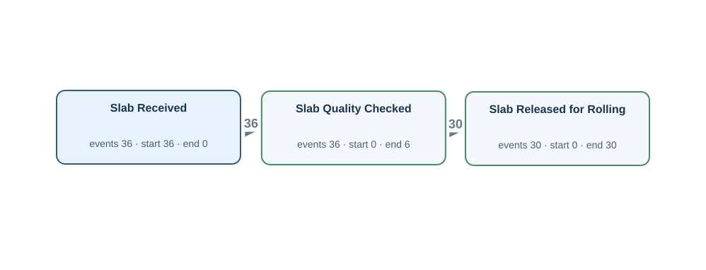</td><td width="50%"><h4>Original tables</h4>
Rows matched by event ID, activity and timestamp using the authored source bindings.

<strong><code>slab_material</code></strong> · 36 source rows

<code>slab_id</code> = SL001, <code>charge_id</code> = CH001, <code>slab_received_at</code> = 2026-03-01T14:00:00Z, <code>slab_identity_verified_at</code> = 2026-03-01T15:00:00Z, <code>slab_quality_checked_at</code> = 2026-03-01T16:00:00Z, <code>slab_released_for_rolling_at</code> = NULL LC:slab_material:SL001:1 · Slab Received · slab_received_at · M001 | LC:slab_material:SL001:3 · Slab Quality Checked · slab_quality_checked_at · M001

<code>slab_id</code> = SL002, <code>charge_id</code> = CH002, <code>slab_received_at</code> = 2026-03-02T14:00:00Z, <code>slab_identity_verified_at</code> = 2026-03-02T15:00:00Z, <code>slab_quality_checked_at</code> = 2026-03-02T16:00:00Z, <code>slab_released_for_rolling_at</code> = 2026-03-02T17:00:00Z LC:slab_material:SL002:1 · Slab Received · slab_received_at · M002 | LC:slab_material:SL002:3 · Slab Quality Checked · slab_quality_checked_at · M002 | LC:slab_material:SL002:4 · Slab Released for Rolling · slab_released_for_rolling_at · M002

<code>slab_id</code> = SL003, <code>charge_id</code> = CH003, <code>slab_received_at</code> = 2026-03-03T14:00:00Z, <code>slab_identity_verified_at</code> = 2026-03-03T15:00:00Z, <code>slab_quality_checked_at</code> = 2026-03-03T16:00:00Z, <code>slab_released_for_rolling_at</code> = 2026-03-03T17:00:00Z LC:slab_material:SL003:1 · Slab Received · slab_received_at · M003 | LC:slab_material:SL003:3 · Slab Quality Checked · slab_quality_checked_at · M003 | LC:slab_material:SL003:4 · Slab Released for Rolling · slab_released_for_rolling_at · M003

Other tables referenced by Gold SQL

Includes case joins and branches of shared CTEs.
<ul><li><code>as_rolled_material</code> · as_rolled_plate_no, crop_shear_passed_at, furnace_charged_at, instruction_id, material_id, slab_id</li><li><code>cutting_finishing_instruction</code> · cutting_instruction_acknowledged_at, cutting_instruction_closed_at, cutting_setup_verified_at, cutting_work_started_at, instruction_id, material_id, released_at</li><li><code>furnace_charge_tracking</code> · furnace_charge_assigned_at, furnace_charge_confirmed_at, furnace_discharge_confirmed_at, material_id, tracking_id, yard_instruction_received_at</li><li><code>material_operation_history</code> · completed_at, material_id, operation_code, transaction_id</li><li><code>planned_rolling_instruction</code> · plan_id, rolling_plan_approved_at, rolling_plan_created_at, rolling_plan_released_at, rolling_plan_reviewed_at, slab_id</li><li><code>plate_material</code> · dimension_inspected_at, parent_as_rolled_plate_no, plate_material_id, plate_packed_at, plate_packing_started_at, plate_piece_identified_at, plate_quality_released_at, plate_quality_review_started_at</li><li><code>rolling_instruction</code> · instruction_id, released_at, rolling_instruction_acknowledged_at, rolling_instruction_closed_at, rolling_setup_verified_at, rolling_work_started_at</li></ul>
</td></tr></table>

[Gold CSV](../../../datasets/plateflow/private/gold_logs/OPV04E.csv)

## OPV04EP — Q2

For each mother material, build a timeline of an incoming slab being received, the quality of a slab being checked, a slab being authorized for rolling.

Events: **102** · Cases with events: **36** · Activities: **3** · Edges: **2**

<table><tr><td width="50%"></td><td width="50%"><h4>Original tables</h4>
Rows matched by event ID, activity and timestamp using the authored source bindings.

<strong><code>slab_material</code></strong> · 36 source rows

<code>slab_id</code> = SL001, <code>charge_id</code> = CH001, <code>slab_received_at</code> = 2026-03-01T14:00:00Z, <code>slab_identity_verified_at</code> = 2026-03-01T15:00:00Z, <code>slab_quality_checked_at</code> = 2026-03-01T16:00:00Z, <code>slab_released_for_rolling_at</code> = NULL LC:slab_material:SL001:1 · Slab Received · slab_received_at · M001 | LC:slab_material:SL001:3 · Slab Quality Checked · slab_quality_checked_at · M001

<code>slab_id</code> = SL002, <code>charge_id</code> = CH002, <code>slab_received_at</code> = 2026-03-02T14:00:00Z, <code>slab_identity_verified_at</code> = 2026-03-02T15:00:00Z, <code>slab_quality_checked_at</code> = 2026-03-02T16:00:00Z, <code>slab_released_for_rolling_at</code> = 2026-03-02T17:00:00Z LC:slab_material:SL002:1 · Slab Received · slab_received_at · M002 | LC:slab_material:SL002:3 · Slab Quality Checked · slab_quality_checked_at · M002 | LC:slab_material:SL002:4 · Slab Released for Rolling · slab_released_for_rolling_at · M002

<code>slab_id</code> = SL003, <code>charge_id</code> = CH003, <code>slab_received_at</code> = 2026-03-03T14:00:00Z, <code>slab_identity_verified_at</code> = 2026-03-03T15:00:00Z, <code>slab_quality_checked_at</code> = 2026-03-03T16:00:00Z, <code>slab_released_for_rolling_at</code> = 2026-03-03T17:00:00Z LC:slab_material:SL003:1 · Slab Received · slab_received_at · M003 | LC:slab_material:SL003:3 · Slab Quality Checked · slab_quality_checked_at · M003 | LC:slab_material:SL003:4 · Slab Released for Rolling · slab_released_for_rolling_at · M003

Other tables referenced by Gold SQL

Includes case joins and branches of shared CTEs.
<ul><li><code>as_rolled_material</code> · as_rolled_plate_no, crop_shear_passed_at, furnace_charged_at, instruction_id, material_id, slab_id</li><li><code>cutting_finishing_instruction</code> · cutting_instruction_acknowledged_at, cutting_instruction_closed_at, cutting_setup_verified_at, cutting_work_started_at, instruction_id, material_id, released_at</li><li><code>furnace_charge_tracking</code> · furnace_charge_assigned_at, furnace_charge_confirmed_at, furnace_discharge_confirmed_at, material_id, tracking_id, yard_instruction_received_at</li><li><code>material_operation_history</code> · completed_at, material_id, operation_code, transaction_id</li><li><code>planned_rolling_instruction</code> · plan_id, rolling_plan_approved_at, rolling_plan_created_at, rolling_plan_released_at, rolling_plan_reviewed_at, slab_id</li><li><code>plate_material</code> · dimension_inspected_at, parent_as_rolled_plate_no, plate_material_id, plate_packed_at, plate_packing_started_at, plate_piece_identified_at, plate_quality_released_at, plate_quality_review_started_at</li><li><code>rolling_instruction</code> · instruction_id, released_at, rolling_instruction_acknowledged_at, rolling_instruction_closed_at, rolling_setup_verified_at, rolling_work_started_at</li></ul>
</td></tr></table>

[Gold CSV](../../../datasets/plateflow/private/gold_logs/OPV04EP.csv)

## OPV05P — Q4

Show the complete recorded history associated with each furnace tracking record.

Events: **133** · Cases with events: **30** · Activities: **5** · Edges: **4**

<table><tr><td width="50%"></td><td width="50%"><h4>Original tables</h4>
Rows matched by event ID, activity and timestamp using the authored source bindings.

<strong><code>furnace_charge_tracking</code></strong> · 30 source rows

<code>tracking_id</code> = TRM002, <code>material_id</code> = M002, <code>yard_instruction_received_at</code> = 2026-03-03T01:00:00Z, <code>lot_charging_started_at</code> = 2026-03-03T01:30:00Z, <code>furnace_charge_assigned_at</code> = 2026-03-03T01:05:00Z, <code>furnace_charge_confirmed_at</code> = NULL, <code>furnace_discharge_confirmed_at</code> = NULL LC:furnace_charge_tracking:TRM002:1 · Furnace Charge Assigned · furnace_charge_assigned_at · TRM002 | YD:TRM002 · Yard Instruction Received · yard_instruction_received_at · TRM002

<code>tracking_id</code> = TRM003, <code>material_id</code> = M003, <code>yard_instruction_received_at</code> = 2026-03-04T01:00:00Z, <code>lot_charging_started_at</code> = 2026-03-04T01:30:00Z, <code>furnace_charge_assigned_at</code> = 2026-03-04T01:05:00Z, <code>furnace_charge_confirmed_at</code> = 2026-03-04T03:01:00Z, <code>furnace_discharge_confirmed_at</code> = 2026-03-04T05:50:00Z LC:furnace_charge_tracking:TRM003:1 · Furnace Charge Assigned · furnace_charge_assigned_at · TRM003 | LC:furnace_charge_tracking:TRM003:2 · Furnace Charge Confirmed · furnace_charge_confirmed_at · TRM003 | LC:furnace_charge_tracking:TRM003:4 · Furnace Discharge Confirmed · furnace_discharge_confirmed_at · TRM003 | YD:TRM003 · Yard Instruction Received · yard_instruction_received_at · TRM003

<code>tracking_id</code> = TRM004, <code>material_id</code> = M004, <code>yard_instruction_received_at</code> = 2026-03-05T01:00:00Z, <code>lot_charging_started_at</code> = 2026-03-05T01:30:00Z, <code>furnace_charge_assigned_at</code> = 2026-03-05T01:05:00Z, <code>furnace_charge_confirmed_at</code> = 2026-03-05T02:01:00Z, <code>furnace_discharge_confirmed_at</code> = 2026-03-05T05:50:00Z LC:furnace_charge_tracking:TRM004:1 · Furnace Charge Assigned · furnace_charge_assigned_at · TRM004 | LC:furnace_charge_tracking:TRM004:2 · Furnace Charge Confirmed · furnace_charge_confirmed_at · TRM004 | LC:furnace_charge_tracking:TRM004:4 · Furnace Discharge Confirmed · furnace_discharge_confirmed_at · TRM004 | YD:TRM004 · Yard Instruction Received · yard_instruction_received_at · TRM004

<strong><code>material_operation_history</code></strong> · 24 source rows

<code>transaction_id</code> = LC:furnace_charge_tracking:TRM003:3, <code>material_id</code> = M003, <code>operation_code</code> = HF, <code>started_at</code> = 2026-03-04T05:39:00Z, <code>completed_at</code> = 2026-03-04T05:40:00Z, <code>created_at</code> = 2026-03-04T05:39:00Z LC:furnace_charge_tracking:TRM003:3 · Heating Completed · completed_at · TRM003

<code>transaction_id</code> = LC:furnace_charge_tracking:TRM004:3, <code>material_id</code> = M004, <code>operation_code</code> = HF, <code>started_at</code> = 2026-03-05T05:39:00Z, <code>completed_at</code> = 2026-03-05T05:40:00Z, <code>created_at</code> = 2026-03-05T05:39:00Z LC:furnace_charge_tracking:TRM004:3 · Heating Completed · completed_at · TRM004

<code>transaction_id</code> = LC:furnace_charge_tracking:TRM005:3, <code>material_id</code> = M005, <code>operation_code</code> = HF, <code>started_at</code> = 2026-03-06T05:39:00Z, <code>completed_at</code> = 2026-03-06T05:40:00Z, <code>created_at</code> = 2026-03-06T05:39:00Z LC:furnace_charge_tracking:TRM005:3 · Heating Completed · completed_at · TRM005

FK-linked row examples for case and join context

<strong>as_rolled_material</strong>

furnace_charge_tracking (material_id → material_id) <code>material_id</code> = M002, <code>as_rolled_plate_no</code> = AR002, <code>slab_id</code> = SL002, <code>instruction_id</code> = RI002, <code>furnace_charged_at</code> = 2026-03-03T04:00:00Z, <code>crop_shear_passed_at</code> = NULL, <code>latest_operation_completed_at</code> = NULL, <code>created_at</code> = 2026-03-02T23:00:00Z, <code>updated_at</code> = 2026-03-03T22:00:00Z

furnace_charge_tracking (material_id → material_id) <code>material_id</code> = M003, <code>as_rolled_plate_no</code> = AR003, <code>slab_id</code> = SL003, <code>instruction_id</code> = RI003, <code>furnace_charged_at</code> = 2026-03-04T03:00:00Z, <code>crop_shear_passed_at</code> = NULL, <code>latest_operation_completed_at</code> = 2026-03-04T06:00:00Z, <code>created_at</code> = 2026-03-03T23:00:00Z, <code>updated_at</code> = 2026-03-04T22:00:00Z

furnace_charge_tracking (material_id → material_id) <code>material_id</code> = M004, <code>as_rolled_plate_no</code> = AR004, <code>slab_id</code> = SL004, <code>instruction_id</code> = RI004, <code>furnace_charged_at</code> = 2026-03-05T02:00:00Z, <code>crop_shear_passed_at</code> = 2026-03-05T09:00:00Z, <code>latest_operation_completed_at</code> = 2026-03-05T11:00:00Z, <code>created_at</code> = 2026-03-04T23:00:00Z, <code>updated_at</code> = 2026-03-05T22:00:00Z

<strong>planned_rolling_instruction</strong>

rolling_instruction (plan_id → plan_id) <code>plan_id</code> = PLAN002, <code>slab_id</code> = SL002, <code>planned_reheat_at</code> = 2026-03-03T02:00:00Z, <code>rolling_plan_created_at</code> = 2026-03-02T14:00:00Z, <code>rolling_plan_reviewed_at</code> = 2026-03-02T15:00:00Z, <code>rolling_plan_approved_at</code> = 2026-03-02T16:00:00Z, <code>rolling_plan_released_at</code> = 2026-03-02T17:00:00Z

rolling_instruction (plan_id → plan_id) <code>plan_id</code> = PLAN003, <code>slab_id</code> = SL003, <code>planned_reheat_at</code> = 2026-03-04T02:00:00Z, <code>rolling_plan_created_at</code> = 2026-03-03T14:00:00Z, <code>rolling_plan_reviewed_at</code> = 2026-03-03T15:00:00Z, <code>rolling_plan_approved_at</code> = 2026-03-03T16:00:00Z, <code>rolling_plan_released_at</code> = 2026-03-03T17:00:00Z

rolling_instruction (plan_id → plan_id) <code>plan_id</code> = PLAN004, <code>slab_id</code> = SL004, <code>planned_reheat_at</code> = 2026-03-05T02:00:00Z, <code>rolling_plan_created_at</code> = 2026-03-04T14:00:00Z, <code>rolling_plan_reviewed_at</code> = 2026-03-04T15:00:00Z, <code>rolling_plan_approved_at</code> = 2026-03-04T16:00:00Z, <code>rolling_plan_released_at</code> = 2026-03-04T17:00:00Z

<strong>rolling_instruction</strong>

as_rolled_material (instruction_id → instruction_id) <code>instruction_id</code> = RI002, <code>plan_id</code> = PLAN002, <code>released_at</code> = 2026-03-03T00:00:00Z, <code>rolling_instruction_acknowledged_at</code> = 2026-03-03T00:05:00Z, <code>rolling_setup_verified_at</code> = 2026-03-03T00:10:00Z, <code>rolling_work_started_at</code> = NULL, <code>rolling_instruction_closed_at</code> = NULL

as_rolled_material (instruction_id → instruction_id) <code>instruction_id</code> = RI003, <code>plan_id</code> = PLAN003, <code>released_at</code> = 2026-03-04T00:00:00Z, <code>rolling_instruction_acknowledged_at</code> = 2026-03-04T00:05:00Z, <code>rolling_setup_verified_at</code> = 2026-03-04T00:10:00Z, <code>rolling_work_started_at</code> = 2026-03-04T05:55:00Z, <code>rolling_instruction_closed_at</code> = 2026-03-04T06:05:00Z

as_rolled_material (instruction_id → instruction_id) <code>instruction_id</code> = RI004, <code>plan_id</code> = PLAN004, <code>released_at</code> = 2026-03-05T00:00:00Z, <code>rolling_instruction_acknowledged_at</code> = 2026-03-05T00:05:00Z, <code>rolling_setup_verified_at</code> = 2026-03-05T00:10:00Z, <code>rolling_work_started_at</code> = 2026-03-05T05:55:00Z, <code>rolling_instruction_closed_at</code> = 2026-03-05T06:05:00Z

<strong>slab_material</strong>

as_rolled_material (slab_id → slab_id) <code>slab_id</code> = SL002, <code>charge_id</code> = CH002, <code>slab_received_at</code> = 2026-03-02T14:00:00Z, <code>slab_identity_verified_at</code> = 2026-03-02T15:00:00Z, <code>slab_quality_checked_at</code> = 2026-03-02T16:00:00Z, <code>slab_released_for_rolling_at</code> = 2026-03-02T17:00:00Z

as_rolled_material (slab_id → slab_id) <code>slab_id</code> = SL003, <code>charge_id</code> = CH003, <code>slab_received_at</code> = 2026-03-03T14:00:00Z, <code>slab_identity_verified_at</code> = 2026-03-03T15:00:00Z, <code>slab_quality_checked_at</code> = 2026-03-03T16:00:00Z, <code>slab_released_for_rolling_at</code> = 2026-03-03T17:00:00Z

as_rolled_material (slab_id → slab_id) <code>slab_id</code> = SL004, <code>charge_id</code> = CH004, <code>slab_received_at</code> = 2026-03-04T14:00:00Z, <code>slab_identity_verified_at</code> = 2026-03-04T15:00:00Z, <code>slab_quality_checked_at</code> = 2026-03-04T16:00:00Z, <code>slab_released_for_rolling_at</code> = 2026-03-04T17:00:00Z

Other tables referenced by Gold SQL

Includes case joins and branches of shared CTEs.
<ul><li><code>as_rolled_material</code> · as_rolled_plate_no, crop_shear_passed_at, furnace_charged_at, instruction_id, material_id</li><li><code>cutting_finishing_instruction</code> · cutting_instruction_acknowledged_at, cutting_instruction_closed_at, cutting_setup_verified_at, cutting_work_started_at, instruction_id, material_id, released_at</li><li><code>planned_rolling_instruction</code> · plan_id, rolling_plan_approved_at, rolling_plan_created_at, rolling_plan_released_at, rolling_plan_reviewed_at</li><li><code>plate_material</code> · dimension_inspected_at, parent_as_rolled_plate_no, plate_material_id, plate_packed_at, plate_packing_started_at, plate_piece_identified_at, plate_quality_released_at, plate_quality_review_started_at</li><li><code>rolling_instruction</code> · instruction_id, released_at, rolling_instruction_acknowledged_at, rolling_instruction_closed_at, rolling_setup_verified_at, rolling_work_started_at</li><li><code>slab_material</code> · slab_id, slab_identity_verified_at, slab_quality_checked_at, slab_received_at, slab_released_for_rolling_at</li></ul>
</td></tr></table>

[Gold CSV](../../../datasets/plateflow/private/gold_logs/OPV05P.csv)

## OPV05E — Q1

Extract Furnace Charge Assigned, Furnace Charge Confirmed, Furnace Discharge Confirmed events for each furnace tracking record.

Events: **79** · Cases with events: **30** · Activities: **3** · Edges: **2**

<table><tr><td width="50%">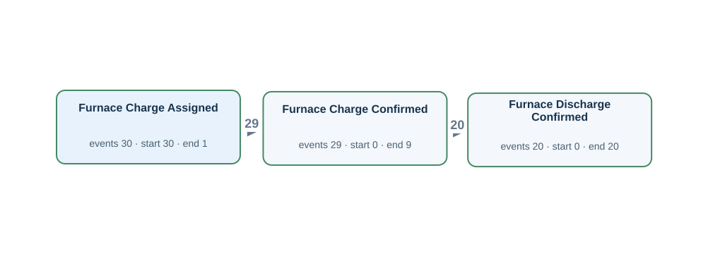</td><td width="50%"><h4>Original tables</h4>
Rows matched by event ID, activity and timestamp using the authored source bindings.

<strong><code>furnace_charge_tracking</code></strong> · 30 source rows

<code>tracking_id</code> = TRM002, <code>material_id</code> = M002, <code>yard_instruction_received_at</code> = 2026-03-03T01:00:00Z, <code>lot_charging_started_at</code> = 2026-03-03T01:30:00Z, <code>furnace_charge_assigned_at</code> = 2026-03-03T01:05:00Z, <code>furnace_charge_confirmed_at</code> = NULL, <code>furnace_discharge_confirmed_at</code> = NULL LC:furnace_charge_tracking:TRM002:1 · Furnace Charge Assigned · furnace_charge_assigned_at · TRM002

<code>tracking_id</code> = TRM003, <code>material_id</code> = M003, <code>yard_instruction_received_at</code> = 2026-03-04T01:00:00Z, <code>lot_charging_started_at</code> = 2026-03-04T01:30:00Z, <code>furnace_charge_assigned_at</code> = 2026-03-04T01:05:00Z, <code>furnace_charge_confirmed_at</code> = 2026-03-04T03:01:00Z, <code>furnace_discharge_confirmed_at</code> = 2026-03-04T05:50:00Z LC:furnace_charge_tracking:TRM003:1 · Furnace Charge Assigned · furnace_charge_assigned_at · TRM003 | LC:furnace_charge_tracking:TRM003:2 · Furnace Charge Confirmed · furnace_charge_confirmed_at · TRM003 | LC:furnace_charge_tracking:TRM003:4 · Furnace Discharge Confirmed · furnace_discharge_confirmed_at · TRM003

<code>tracking_id</code> = TRM004, <code>material_id</code> = M004, <code>yard_instruction_received_at</code> = 2026-03-05T01:00:00Z, <code>lot_charging_started_at</code> = 2026-03-05T01:30:00Z, <code>furnace_charge_assigned_at</code> = 2026-03-05T01:05:00Z, <code>furnace_charge_confirmed_at</code> = 2026-03-05T02:01:00Z, <code>furnace_discharge_confirmed_at</code> = 2026-03-05T05:50:00Z LC:furnace_charge_tracking:TRM004:1 · Furnace Charge Assigned · furnace_charge_assigned_at · TRM004 | LC:furnace_charge_tracking:TRM004:2 · Furnace Charge Confirmed · furnace_charge_confirmed_at · TRM004 | LC:furnace_charge_tracking:TRM004:4 · Furnace Discharge Confirmed · furnace_discharge_confirmed_at · TRM004

FK-linked row examples for case and join context

<strong>as_rolled_material</strong>

furnace_charge_tracking (material_id → material_id) <code>material_id</code> = M002, <code>as_rolled_plate_no</code> = AR002, <code>slab_id</code> = SL002, <code>instruction_id</code> = RI002, <code>furnace_charged_at</code> = 2026-03-03T04:00:00Z, <code>crop_shear_passed_at</code> = NULL, <code>latest_operation_completed_at</code> = NULL, <code>created_at</code> = 2026-03-02T23:00:00Z, <code>updated_at</code> = 2026-03-03T22:00:00Z

furnace_charge_tracking (material_id → material_id) <code>material_id</code> = M003, <code>as_rolled_plate_no</code> = AR003, <code>slab_id</code> = SL003, <code>instruction_id</code> = RI003, <code>furnace_charged_at</code> = 2026-03-04T03:00:00Z, <code>crop_shear_passed_at</code> = NULL, <code>latest_operation_completed_at</code> = 2026-03-04T06:00:00Z, <code>created_at</code> = 2026-03-03T23:00:00Z, <code>updated_at</code> = 2026-03-04T22:00:00Z

furnace_charge_tracking (material_id → material_id) <code>material_id</code> = M004, <code>as_rolled_plate_no</code> = AR004, <code>slab_id</code> = SL004, <code>instruction_id</code> = RI004, <code>furnace_charged_at</code> = 2026-03-05T02:00:00Z, <code>crop_shear_passed_at</code> = 2026-03-05T09:00:00Z, <code>latest_operation_completed_at</code> = 2026-03-05T11:00:00Z, <code>created_at</code> = 2026-03-04T23:00:00Z, <code>updated_at</code> = 2026-03-05T22:00:00Z

<strong>planned_rolling_instruction</strong>

rolling_instruction (plan_id → plan_id) <code>plan_id</code> = PLAN002, <code>slab_id</code> = SL002, <code>planned_reheat_at</code> = 2026-03-03T02:00:00Z, <code>rolling_plan_created_at</code> = 2026-03-02T14:00:00Z, <code>rolling_plan_reviewed_at</code> = 2026-03-02T15:00:00Z, <code>rolling_plan_approved_at</code> = 2026-03-02T16:00:00Z, <code>rolling_plan_released_at</code> = 2026-03-02T17:00:00Z

rolling_instruction (plan_id → plan_id) <code>plan_id</code> = PLAN003, <code>slab_id</code> = SL003, <code>planned_reheat_at</code> = 2026-03-04T02:00:00Z, <code>rolling_plan_created_at</code> = 2026-03-03T14:00:00Z, <code>rolling_plan_reviewed_at</code> = 2026-03-03T15:00:00Z, <code>rolling_plan_approved_at</code> = 2026-03-03T16:00:00Z, <code>rolling_plan_released_at</code> = 2026-03-03T17:00:00Z

rolling_instruction (plan_id → plan_id) <code>plan_id</code> = PLAN004, <code>slab_id</code> = SL004, <code>planned_reheat_at</code> = 2026-03-05T02:00:00Z, <code>rolling_plan_created_at</code> = 2026-03-04T14:00:00Z, <code>rolling_plan_reviewed_at</code> = 2026-03-04T15:00:00Z, <code>rolling_plan_approved_at</code> = 2026-03-04T16:00:00Z, <code>rolling_plan_released_at</code> = 2026-03-04T17:00:00Z

<strong>rolling_instruction</strong>

as_rolled_material (instruction_id → instruction_id) <code>instruction_id</code> = RI002, <code>plan_id</code> = PLAN002, <code>released_at</code> = 2026-03-03T00:00:00Z, <code>rolling_instruction_acknowledged_at</code> = 2026-03-03T00:05:00Z, <code>rolling_setup_verified_at</code> = 2026-03-03T00:10:00Z, <code>rolling_work_started_at</code> = NULL, <code>rolling_instruction_closed_at</code> = NULL

as_rolled_material (instruction_id → instruction_id) <code>instruction_id</code> = RI003, <code>plan_id</code> = PLAN003, <code>released_at</code> = 2026-03-04T00:00:00Z, <code>rolling_instruction_acknowledged_at</code> = 2026-03-04T00:05:00Z, <code>rolling_setup_verified_at</code> = 2026-03-04T00:10:00Z, <code>rolling_work_started_at</code> = 2026-03-04T05:55:00Z, <code>rolling_instruction_closed_at</code> = 2026-03-04T06:05:00Z

as_rolled_material (instruction_id → instruction_id) <code>instruction_id</code> = RI004, <code>plan_id</code> = PLAN004, <code>released_at</code> = 2026-03-05T00:00:00Z, <code>rolling_instruction_acknowledged_at</code> = 2026-03-05T00:05:00Z, <code>rolling_setup_verified_at</code> = 2026-03-05T00:10:00Z, <code>rolling_work_started_at</code> = 2026-03-05T05:55:00Z, <code>rolling_instruction_closed_at</code> = 2026-03-05T06:05:00Z

<strong>slab_material</strong>

as_rolled_material (slab_id → slab_id) <code>slab_id</code> = SL002, <code>charge_id</code> = CH002, <code>slab_received_at</code> = 2026-03-02T14:00:00Z, <code>slab_identity_verified_at</code> = 2026-03-02T15:00:00Z, <code>slab_quality_checked_at</code> = 2026-03-02T16:00:00Z, <code>slab_released_for_rolling_at</code> = 2026-03-02T17:00:00Z

as_rolled_material (slab_id → slab_id) <code>slab_id</code> = SL003, <code>charge_id</code> = CH003, <code>slab_received_at</code> = 2026-03-03T14:00:00Z, <code>slab_identity_verified_at</code> = 2026-03-03T15:00:00Z, <code>slab_quality_checked_at</code> = 2026-03-03T16:00:00Z, <code>slab_released_for_rolling_at</code> = 2026-03-03T17:00:00Z

as_rolled_material (slab_id → slab_id) <code>slab_id</code> = SL004, <code>charge_id</code> = CH004, <code>slab_received_at</code> = 2026-03-04T14:00:00Z, <code>slab_identity_verified_at</code> = 2026-03-04T15:00:00Z, <code>slab_quality_checked_at</code> = 2026-03-04T16:00:00Z, <code>slab_released_for_rolling_at</code> = 2026-03-04T17:00:00Z

Other tables referenced by Gold SQL

Includes case joins and branches of shared CTEs.
<ul><li><code>as_rolled_material</code> · as_rolled_plate_no, crop_shear_passed_at, furnace_charged_at, instruction_id, material_id</li><li><code>cutting_finishing_instruction</code> · cutting_instruction_acknowledged_at, cutting_instruction_closed_at, cutting_setup_verified_at, cutting_work_started_at, instruction_id, material_id, released_at</li><li><code>material_operation_history</code> · completed_at, material_id, operation_code, transaction_id</li><li><code>planned_rolling_instruction</code> · plan_id, rolling_plan_approved_at, rolling_plan_created_at, rolling_plan_released_at, rolling_plan_reviewed_at</li><li><code>plate_material</code> · dimension_inspected_at, parent_as_rolled_plate_no, plate_material_id, plate_packed_at, plate_packing_started_at, plate_piece_identified_at, plate_quality_released_at, plate_quality_review_started_at</li><li><code>rolling_instruction</code> · instruction_id, released_at, rolling_instruction_acknowledged_at, rolling_instruction_closed_at, rolling_setup_verified_at, rolling_work_started_at</li><li><code>slab_material</code> · slab_id, slab_identity_verified_at, slab_quality_checked_at, slab_received_at, slab_released_for_rolling_at</li></ul>
</td></tr></table>

[Gold CSV](../../../datasets/plateflow/private/gold_logs/OPV05E.csv)

## OPV05EP — Q2

For each furnace tracking record, build a timeline of a furnace charge being assigned, the furnace charge being confirmed, the material leaving the furnace being confirmed.

Events: **79** · Cases with events: **30** · Activities: **3** · Edges: **2**

<table><tr><td width="50%"></td><td width="50%"><h4>Original tables</h4>
Rows matched by event ID, activity and timestamp using the authored source bindings.

<strong><code>furnace_charge_tracking</code></strong> · 30 source rows

<code>tracking_id</code> = TRM002, <code>material_id</code> = M002, <code>yard_instruction_received_at</code> = 2026-03-03T01:00:00Z, <code>lot_charging_started_at</code> = 2026-03-03T01:30:00Z, <code>furnace_charge_assigned_at</code> = 2026-03-03T01:05:00Z, <code>furnace_charge_confirmed_at</code> = NULL, <code>furnace_discharge_confirmed_at</code> = NULL LC:furnace_charge_tracking:TRM002:1 · Furnace Charge Assigned · furnace_charge_assigned_at · TRM002

<code>tracking_id</code> = TRM003, <code>material_id</code> = M003, <code>yard_instruction_received_at</code> = 2026-03-04T01:00:00Z, <code>lot_charging_started_at</code> = 2026-03-04T01:30:00Z, <code>furnace_charge_assigned_at</code> = 2026-03-04T01:05:00Z, <code>furnace_charge_confirmed_at</code> = 2026-03-04T03:01:00Z, <code>furnace_discharge_confirmed_at</code> = 2026-03-04T05:50:00Z LC:furnace_charge_tracking:TRM003:1 · Furnace Charge Assigned · furnace_charge_assigned_at · TRM003 | LC:furnace_charge_tracking:TRM003:2 · Furnace Charge Confirmed · furnace_charge_confirmed_at · TRM003 | LC:furnace_charge_tracking:TRM003:4 · Furnace Discharge Confirmed · furnace_discharge_confirmed_at · TRM003

<code>tracking_id</code> = TRM004, <code>material_id</code> = M004, <code>yard_instruction_received_at</code> = 2026-03-05T01:00:00Z, <code>lot_charging_started_at</code> = 2026-03-05T01:30:00Z, <code>furnace_charge_assigned_at</code> = 2026-03-05T01:05:00Z, <code>furnace_charge_confirmed_at</code> = 2026-03-05T02:01:00Z, <code>furnace_discharge_confirmed_at</code> = 2026-03-05T05:50:00Z LC:furnace_charge_tracking:TRM004:1 · Furnace Charge Assigned · furnace_charge_assigned_at · TRM004 | LC:furnace_charge_tracking:TRM004:2 · Furnace Charge Confirmed · furnace_charge_confirmed_at · TRM004 | LC:furnace_charge_tracking:TRM004:4 · Furnace Discharge Confirmed · furnace_discharge_confirmed_at · TRM004

FK-linked row examples for case and join context

<strong>as_rolled_material</strong>

furnace_charge_tracking (material_id → material_id) <code>material_id</code> = M002, <code>as_rolled_plate_no</code> = AR002, <code>slab_id</code> = SL002, <code>instruction_id</code> = RI002, <code>furnace_charged_at</code> = 2026-03-03T04:00:00Z, <code>crop_shear_passed_at</code> = NULL, <code>latest_operation_completed_at</code> = NULL, <code>created_at</code> = 2026-03-02T23:00:00Z, <code>updated_at</code> = 2026-03-03T22:00:00Z

furnace_charge_tracking (material_id → material_id) <code>material_id</code> = M003, <code>as_rolled_plate_no</code> = AR003, <code>slab_id</code> = SL003, <code>instruction_id</code> = RI003, <code>furnace_charged_at</code> = 2026-03-04T03:00:00Z, <code>crop_shear_passed_at</code> = NULL, <code>latest_operation_completed_at</code> = 2026-03-04T06:00:00Z, <code>created_at</code> = 2026-03-03T23:00:00Z, <code>updated_at</code> = 2026-03-04T22:00:00Z

furnace_charge_tracking (material_id → material_id) <code>material_id</code> = M004, <code>as_rolled_plate_no</code> = AR004, <code>slab_id</code> = SL004, <code>instruction_id</code> = RI004, <code>furnace_charged_at</code> = 2026-03-05T02:00:00Z, <code>crop_shear_passed_at</code> = 2026-03-05T09:00:00Z, <code>latest_operation_completed_at</code> = 2026-03-05T11:00:00Z, <code>created_at</code> = 2026-03-04T23:00:00Z, <code>updated_at</code> = 2026-03-05T22:00:00Z

<strong>planned_rolling_instruction</strong>

rolling_instruction (plan_id → plan_id) <code>plan_id</code> = PLAN002, <code>slab_id</code> = SL002, <code>planned_reheat_at</code> = 2026-03-03T02:00:00Z, <code>rolling_plan_created_at</code> = 2026-03-02T14:00:00Z, <code>rolling_plan_reviewed_at</code> = 2026-03-02T15:00:00Z, <code>rolling_plan_approved_at</code> = 2026-03-02T16:00:00Z, <code>rolling_plan_released_at</code> = 2026-03-02T17:00:00Z

rolling_instruction (plan_id → plan_id) <code>plan_id</code> = PLAN003, <code>slab_id</code> = SL003, <code>planned_reheat_at</code> = 2026-03-04T02:00:00Z, <code>rolling_plan_created_at</code> = 2026-03-03T14:00:00Z, <code>rolling_plan_reviewed_at</code> = 2026-03-03T15:00:00Z, <code>rolling_plan_approved_at</code> = 2026-03-03T16:00:00Z, <code>rolling_plan_released_at</code> = 2026-03-03T17:00:00Z

rolling_instruction (plan_id → plan_id) <code>plan_id</code> = PLAN004, <code>slab_id</code> = SL004, <code>planned_reheat_at</code> = 2026-03-05T02:00:00Z, <code>rolling_plan_created_at</code> = 2026-03-04T14:00:00Z, <code>rolling_plan_reviewed_at</code> = 2026-03-04T15:00:00Z, <code>rolling_plan_approved_at</code> = 2026-03-04T16:00:00Z, <code>rolling_plan_released_at</code> = 2026-03-04T17:00:00Z

<strong>rolling_instruction</strong>

as_rolled_material (instruction_id → instruction_id) <code>instruction_id</code> = RI002, <code>plan_id</code> = PLAN002, <code>released_at</code> = 2026-03-03T00:00:00Z, <code>rolling_instruction_acknowledged_at</code> = 2026-03-03T00:05:00Z, <code>rolling_setup_verified_at</code> = 2026-03-03T00:10:00Z, <code>rolling_work_started_at</code> = NULL, <code>rolling_instruction_closed_at</code> = NULL

as_rolled_material (instruction_id → instruction_id) <code>instruction_id</code> = RI003, <code>plan_id</code> = PLAN003, <code>released_at</code> = 2026-03-04T00:00:00Z, <code>rolling_instruction_acknowledged_at</code> = 2026-03-04T00:05:00Z, <code>rolling_setup_verified_at</code> = 2026-03-04T00:10:00Z, <code>rolling_work_started_at</code> = 2026-03-04T05:55:00Z, <code>rolling_instruction_closed_at</code> = 2026-03-04T06:05:00Z

as_rolled_material (instruction_id → instruction_id) <code>instruction_id</code> = RI004, <code>plan_id</code> = PLAN004, <code>released_at</code> = 2026-03-05T00:00:00Z, <code>rolling_instruction_acknowledged_at</code> = 2026-03-05T00:05:00Z, <code>rolling_setup_verified_at</code> = 2026-03-05T00:10:00Z, <code>rolling_work_started_at</code> = 2026-03-05T05:55:00Z, <code>rolling_instruction_closed_at</code> = 2026-03-05T06:05:00Z

<strong>slab_material</strong>

as_rolled_material (slab_id → slab_id) <code>slab_id</code> = SL002, <code>charge_id</code> = CH002, <code>slab_received_at</code> = 2026-03-02T14:00:00Z, <code>slab_identity_verified_at</code> = 2026-03-02T15:00:00Z, <code>slab_quality_checked_at</code> = 2026-03-02T16:00:00Z, <code>slab_released_for_rolling_at</code> = 2026-03-02T17:00:00Z

as_rolled_material (slab_id → slab_id) <code>slab_id</code> = SL003, <code>charge_id</code> = CH003, <code>slab_received_at</code> = 2026-03-03T14:00:00Z, <code>slab_identity_verified_at</code> = 2026-03-03T15:00:00Z, <code>slab_quality_checked_at</code> = 2026-03-03T16:00:00Z, <code>slab_released_for_rolling_at</code> = 2026-03-03T17:00:00Z

as_rolled_material (slab_id → slab_id) <code>slab_id</code> = SL004, <code>charge_id</code> = CH004, <code>slab_received_at</code> = 2026-03-04T14:00:00Z, <code>slab_identity_verified_at</code> = 2026-03-04T15:00:00Z, <code>slab_quality_checked_at</code> = 2026-03-04T16:00:00Z, <code>slab_released_for_rolling_at</code> = 2026-03-04T17:00:00Z

Other tables referenced by Gold SQL

Includes case joins and branches of shared CTEs.
<ul><li><code>as_rolled_material</code> · as_rolled_plate_no, crop_shear_passed_at, furnace_charged_at, instruction_id, material_id</li><li><code>cutting_finishing_instruction</code> · cutting_instruction_acknowledged_at, cutting_instruction_closed_at, cutting_setup_verified_at, cutting_work_started_at, instruction_id, material_id, released_at</li><li><code>material_operation_history</code> · completed_at, material_id, operation_code, transaction_id</li><li><code>planned_rolling_instruction</code> · plan_id, rolling_plan_approved_at, rolling_plan_created_at, rolling_plan_released_at, rolling_plan_reviewed_at</li><li><code>plate_material</code> · dimension_inspected_at, parent_as_rolled_plate_no, plate_material_id, plate_packed_at, plate_packing_started_at, plate_piece_identified_at, plate_quality_released_at, plate_quality_review_started_at</li><li><code>rolling_instruction</code> · instruction_id, released_at, rolling_instruction_acknowledged_at, rolling_instruction_closed_at, rolling_setup_verified_at, rolling_work_started_at</li><li><code>slab_material</code> · slab_id, slab_identity_verified_at, slab_quality_checked_at, slab_received_at, slab_released_for_rolling_at</li></ul>
</td></tr></table>

[Gold CSV](../../../datasets/plateflow/private/gold_logs/OPV05EP.csv)

## OPV06P — Q4

Show the complete recorded history associated with each cutting instruction.

Events: **87** · Cases with events: **18** · Activities: **5** · Edges: **4**

<table><tr><td width="50%"></td><td width="50%"><h4>Original tables</h4>
Rows matched by event ID, activity and timestamp using the authored source bindings.

<strong><code>cutting_finishing_instruction</code></strong> · 18 source rows

<code>instruction_id</code> = CIM004, <code>material_id</code> = M004, <code>released_at</code> = 2026-03-05T10:00:00Z, <code>cut_method</code> = SPLIT, <code>cutting_instruction_acknowledged_at</code> = 2026-03-05T10:05:00Z, <code>cutting_setup_verified_at</code> = 2026-03-05T10:10:00Z, <code>cutting_work_started_at</code> = 2026-03-05T10:55:00Z, <code>cutting_instruction_closed_at</code> = NULL CI:CIM004 · Cutting Instruction Released · released_at · CIM004 | LC:cutting_finishing_instruction:CIM004:1 · Cutting Instruction Acknowledged · cutting_instruction_acknowledged_at · CIM004 | LC:cutting_finishing_instruction:CIM004:2 · Cutting Setup Verified · cutting_setup_verified_at · CIM004 | LC:cutting_finishing_instruction:CIM004:3 · Cutting Work Started · cutting_work_started_at · CIM004

<code>instruction_id</code> = CIM005, <code>material_id</code> = M005, <code>released_at</code> = 2026-03-06T10:00:00Z, <code>cut_method</code> = SPLIT, <code>cutting_instruction_acknowledged_at</code> = 2026-03-06T10:05:00Z, <code>cutting_setup_verified_at</code> = 2026-03-06T10:10:00Z, <code>cutting_work_started_at</code> = 2026-03-06T10:55:00Z, <code>cutting_instruction_closed_at</code> = 2026-03-06T11:05:00Z CI:CIM005 · Cutting Instruction Released · released_at · CIM005 | LC:cutting_finishing_instruction:CIM005:1 · Cutting Instruction Acknowledged · cutting_instruction_acknowledged_at · CIM005 | LC:cutting_finishing_instruction:CIM005:2 · Cutting Setup Verified · cutting_setup_verified_at · CIM005 | LC:cutting_finishing_instruction:CIM005:3 · Cutting Work Started · cutting_work_started_at · CIM005 | LC:cutting_finishing_instruction:CIM005:4 · Cutting Instruction Closed · cutting_instruction_closed_at · CIM005

<code>instruction_id</code> = CIM006, <code>material_id</code> = M006, <code>released_at</code> = 2026-03-07T10:00:00Z, <code>cut_method</code> = SPLIT, <code>cutting_instruction_acknowledged_at</code> = 2026-03-07T10:05:00Z, <code>cutting_setup_verified_at</code> = 2026-03-07T10:10:00Z, <code>cutting_work_started_at</code> = 2026-03-07T10:55:00Z, <code>cutting_instruction_closed_at</code> = 2026-03-07T11:05:00Z CI:CIM006 · Cutting Instruction Released · released_at · CIM006 | LC:cutting_finishing_instruction:CIM006:1 · Cutting Instruction Acknowledged · cutting_instruction_acknowledged_at · CIM006 | LC:cutting_finishing_instruction:CIM006:2 · Cutting Setup Verified · cutting_setup_verified_at · CIM006 | LC:cutting_finishing_instruction:CIM006:3 · Cutting Work Started · cutting_work_started_at · CIM006 | LC:cutting_finishing_instruction:CIM006:4 · Cutting Instruction Closed · cutting_instruction_closed_at · CIM006

FK-linked row examples for case and join context

<strong>as_rolled_material</strong>

cutting_finishing_instruction (material_id → material_id) <code>material_id</code> = M004, <code>as_rolled_plate_no</code> = AR004, <code>slab_id</code> = SL004, <code>instruction_id</code> = RI004, <code>furnace_charged_at</code> = 2026-03-05T02:00:00Z, <code>crop_shear_passed_at</code> = 2026-03-05T09:00:00Z, <code>latest_operation_completed_at</code> = 2026-03-05T11:00:00Z, <code>created_at</code> = 2026-03-04T23:00:00Z, <code>updated_at</code> = 2026-03-05T22:00:00Z

cutting_finishing_instruction (material_id → material_id) <code>material_id</code> = M005, <code>as_rolled_plate_no</code> = AR005, <code>slab_id</code> = SL005, <code>instruction_id</code> = RI005, <code>furnace_charged_at</code> = 2026-03-06T04:00:00Z, <code>crop_shear_passed_at</code> = 2026-03-06T09:00:00Z, <code>latest_operation_completed_at</code> = 2026-03-06T11:00:00Z, <code>created_at</code> = 2026-03-05T23:00:00Z, <code>updated_at</code> = 2026-03-06T22:00:00Z

cutting_finishing_instruction (material_id → material_id) <code>material_id</code> = M006, <code>as_rolled_plate_no</code> = AR006, <code>slab_id</code> = SL006, <code>instruction_id</code> = RI006, <code>furnace_charged_at</code> = 2026-03-07T03:00:00Z, <code>crop_shear_passed_at</code> = 2026-03-07T09:00:00Z, <code>latest_operation_completed_at</code> = 2026-03-07T11:00:00Z, <code>created_at</code> = 2026-03-06T23:00:00Z, <code>updated_at</code> = 2026-03-07T22:00:00Z

<strong>planned_rolling_instruction</strong>

rolling_instruction (plan_id → plan_id) <code>plan_id</code> = PLAN004, <code>slab_id</code> = SL004, <code>planned_reheat_at</code> = 2026-03-05T02:00:00Z, <code>rolling_plan_created_at</code> = 2026-03-04T14:00:00Z, <code>rolling_plan_reviewed_at</code> = 2026-03-04T15:00:00Z, <code>rolling_plan_approved_at</code> = 2026-03-04T16:00:00Z, <code>rolling_plan_released_at</code> = 2026-03-04T17:00:00Z

rolling_instruction (plan_id → plan_id) <code>plan_id</code> = PLAN005, <code>slab_id</code> = SL005, <code>planned_reheat_at</code> = 2026-03-06T02:00:00Z, <code>rolling_plan_created_at</code> = 2026-03-05T14:00:00Z, <code>rolling_plan_reviewed_at</code> = 2026-03-05T15:00:00Z, <code>rolling_plan_approved_at</code> = 2026-03-05T16:00:00Z, <code>rolling_plan_released_at</code> = 2026-03-05T17:00:00Z

rolling_instruction (plan_id → plan_id) <code>plan_id</code> = PLAN006, <code>slab_id</code> = SL006, <code>planned_reheat_at</code> = 2026-03-07T02:00:00Z, <code>rolling_plan_created_at</code> = 2026-03-06T14:00:00Z, <code>rolling_plan_reviewed_at</code> = 2026-03-06T15:00:00Z, <code>rolling_plan_approved_at</code> = 2026-03-06T16:00:00Z, <code>rolling_plan_released_at</code> = 2026-03-06T17:00:00Z

<strong>rolling_instruction</strong>

as_rolled_material (instruction_id → instruction_id) <code>instruction_id</code> = RI004, <code>plan_id</code> = PLAN004, <code>released_at</code> = 2026-03-05T00:00:00Z, <code>rolling_instruction_acknowledged_at</code> = 2026-03-05T00:05:00Z, <code>rolling_setup_verified_at</code> = 2026-03-05T00:10:00Z, <code>rolling_work_started_at</code> = 2026-03-05T05:55:00Z, <code>rolling_instruction_closed_at</code> = 2026-03-05T06:05:00Z

as_rolled_material (instruction_id → instruction_id) <code>instruction_id</code> = RI005, <code>plan_id</code> = PLAN005, <code>released_at</code> = 2026-03-06T00:00:00Z, <code>rolling_instruction_acknowledged_at</code> = 2026-03-06T00:05:00Z, <code>rolling_setup_verified_at</code> = 2026-03-06T00:10:00Z, <code>rolling_work_started_at</code> = 2026-03-06T05:55:00Z, <code>rolling_instruction_closed_at</code> = 2026-03-06T06:05:00Z

as_rolled_material (instruction_id → instruction_id) <code>instruction_id</code> = RI006, <code>plan_id</code> = PLAN006, <code>released_at</code> = 2026-03-07T00:00:00Z, <code>rolling_instruction_acknowledged_at</code> = 2026-03-07T00:05:00Z, <code>rolling_setup_verified_at</code> = 2026-03-07T00:10:00Z, <code>rolling_work_started_at</code> = 2026-03-07T05:55:00Z, <code>rolling_instruction_closed_at</code> = 2026-03-07T06:05:00Z

<strong>slab_material</strong>

as_rolled_material (slab_id → slab_id) <code>slab_id</code> = SL004, <code>charge_id</code> = CH004, <code>slab_received_at</code> = 2026-03-04T14:00:00Z, <code>slab_identity_verified_at</code> = 2026-03-04T15:00:00Z, <code>slab_quality_checked_at</code> = 2026-03-04T16:00:00Z, <code>slab_released_for_rolling_at</code> = 2026-03-04T17:00:00Z

as_rolled_material (slab_id → slab_id) <code>slab_id</code> = SL005, <code>charge_id</code> = CH005, <code>slab_received_at</code> = 2026-03-05T14:00:00Z, <code>slab_identity_verified_at</code> = 2026-03-05T15:00:00Z, <code>slab_quality_checked_at</code> = 2026-03-05T16:00:00Z, <code>slab_released_for_rolling_at</code> = 2026-03-05T17:00:00Z

as_rolled_material (slab_id → slab_id) <code>slab_id</code> = SL006, <code>charge_id</code> = CH006, <code>slab_received_at</code> = 2026-03-06T14:00:00Z, <code>slab_identity_verified_at</code> = 2026-03-06T15:00:00Z, <code>slab_quality_checked_at</code> = 2026-03-06T16:00:00Z, <code>slab_released_for_rolling_at</code> = 2026-03-06T17:00:00Z

Other tables referenced by Gold SQL

Includes case joins and branches of shared CTEs.
<ul><li><code>as_rolled_material</code> · as_rolled_plate_no, crop_shear_passed_at, furnace_charged_at, instruction_id, material_id</li><li><code>furnace_charge_tracking</code> · furnace_charge_assigned_at, furnace_charge_confirmed_at, furnace_discharge_confirmed_at, material_id, tracking_id, yard_instruction_received_at</li><li><code>material_operation_history</code> · completed_at, material_id, operation_code, transaction_id</li><li><code>planned_rolling_instruction</code> · plan_id, rolling_plan_approved_at, rolling_plan_created_at, rolling_plan_released_at, rolling_plan_reviewed_at</li><li><code>plate_material</code> · dimension_inspected_at, parent_as_rolled_plate_no, plate_material_id, plate_packed_at, plate_packing_started_at, plate_piece_identified_at, plate_quality_released_at, plate_quality_review_started_at</li><li><code>rolling_instruction</code> · instruction_id, released_at, rolling_instruction_acknowledged_at, rolling_instruction_closed_at, rolling_setup_verified_at, rolling_work_started_at</li><li><code>slab_material</code> · slab_id, slab_identity_verified_at, slab_quality_checked_at, slab_received_at, slab_released_for_rolling_at</li></ul>
</td></tr></table>

[Gold CSV](../../../datasets/plateflow/private/gold_logs/OPV06P.csv)

## OPV06E — Q1

Extract Cutting Instruction Acknowledged, Cutting Instruction Closed, Cutting Instruction Released events for each cutting instruction.

Events: **51** · Cases with events: **18** · Activities: **3** · Edges: **2**

<table><tr><td width="50%">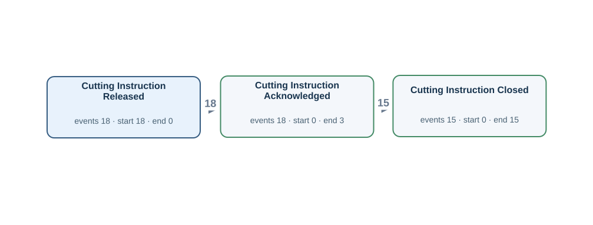</td><td width="50%"><h4>Original tables</h4>
Rows matched by event ID, activity and timestamp using the authored source bindings.

<strong><code>cutting_finishing_instruction</code></strong> · 18 source rows

<code>instruction_id</code> = CIM004, <code>material_id</code> = M004, <code>released_at</code> = 2026-03-05T10:00:00Z, <code>cut_method</code> = SPLIT, <code>cutting_instruction_acknowledged_at</code> = 2026-03-05T10:05:00Z, <code>cutting_setup_verified_at</code> = 2026-03-05T10:10:00Z, <code>cutting_work_started_at</code> = 2026-03-05T10:55:00Z, <code>cutting_instruction_closed_at</code> = NULL CI:CIM004 · Cutting Instruction Released · released_at · CIM004 | LC:cutting_finishing_instruction:CIM004:1 · Cutting Instruction Acknowledged · cutting_instruction_acknowledged_at · CIM004

<code>instruction_id</code> = CIM005, <code>material_id</code> = M005, <code>released_at</code> = 2026-03-06T10:00:00Z, <code>cut_method</code> = SPLIT, <code>cutting_instruction_acknowledged_at</code> = 2026-03-06T10:05:00Z, <code>cutting_setup_verified_at</code> = 2026-03-06T10:10:00Z, <code>cutting_work_started_at</code> = 2026-03-06T10:55:00Z, <code>cutting_instruction_closed_at</code> = 2026-03-06T11:05:00Z CI:CIM005 · Cutting Instruction Released · released_at · CIM005 | LC:cutting_finishing_instruction:CIM005:1 · Cutting Instruction Acknowledged · cutting_instruction_acknowledged_at · CIM005 | LC:cutting_finishing_instruction:CIM005:4 · Cutting Instruction Closed · cutting_instruction_closed_at · CIM005

<code>instruction_id</code> = CIM006, <code>material_id</code> = M006, <code>released_at</code> = 2026-03-07T10:00:00Z, <code>cut_method</code> = SPLIT, <code>cutting_instruction_acknowledged_at</code> = 2026-03-07T10:05:00Z, <code>cutting_setup_verified_at</code> = 2026-03-07T10:10:00Z, <code>cutting_work_started_at</code> = 2026-03-07T10:55:00Z, <code>cutting_instruction_closed_at</code> = 2026-03-07T11:05:00Z CI:CIM006 · Cutting Instruction Released · released_at · CIM006 | LC:cutting_finishing_instruction:CIM006:1 · Cutting Instruction Acknowledged · cutting_instruction_acknowledged_at · CIM006 | LC:cutting_finishing_instruction:CIM006:4 · Cutting Instruction Closed · cutting_instruction_closed_at · CIM006

FK-linked row examples for case and join context

<strong>as_rolled_material</strong>

cutting_finishing_instruction (material_id → material_id) <code>material_id</code> = M004, <code>as_rolled_plate_no</code> = AR004, <code>slab_id</code> = SL004, <code>instruction_id</code> = RI004, <code>furnace_charged_at</code> = 2026-03-05T02:00:00Z, <code>crop_shear_passed_at</code> = 2026-03-05T09:00:00Z, <code>latest_operation_completed_at</code> = 2026-03-05T11:00:00Z, <code>created_at</code> = 2026-03-04T23:00:00Z, <code>updated_at</code> = 2026-03-05T22:00:00Z

cutting_finishing_instruction (material_id → material_id) <code>material_id</code> = M005, <code>as_rolled_plate_no</code> = AR005, <code>slab_id</code> = SL005, <code>instruction_id</code> = RI005, <code>furnace_charged_at</code> = 2026-03-06T04:00:00Z, <code>crop_shear_passed_at</code> = 2026-03-06T09:00:00Z, <code>latest_operation_completed_at</code> = 2026-03-06T11:00:00Z, <code>created_at</code> = 2026-03-05T23:00:00Z, <code>updated_at</code> = 2026-03-06T22:00:00Z

cutting_finishing_instruction (material_id → material_id) <code>material_id</code> = M006, <code>as_rolled_plate_no</code> = AR006, <code>slab_id</code> = SL006, <code>instruction_id</code> = RI006, <code>furnace_charged_at</code> = 2026-03-07T03:00:00Z, <code>crop_shear_passed_at</code> = 2026-03-07T09:00:00Z, <code>latest_operation_completed_at</code> = 2026-03-07T11:00:00Z, <code>created_at</code> = 2026-03-06T23:00:00Z, <code>updated_at</code> = 2026-03-07T22:00:00Z

<strong>planned_rolling_instruction</strong>

rolling_instruction (plan_id → plan_id) <code>plan_id</code> = PLAN004, <code>slab_id</code> = SL004, <code>planned_reheat_at</code> = 2026-03-05T02:00:00Z, <code>rolling_plan_created_at</code> = 2026-03-04T14:00:00Z, <code>rolling_plan_reviewed_at</code> = 2026-03-04T15:00:00Z, <code>rolling_plan_approved_at</code> = 2026-03-04T16:00:00Z, <code>rolling_plan_released_at</code> = 2026-03-04T17:00:00Z

rolling_instruction (plan_id → plan_id) <code>plan_id</code> = PLAN005, <code>slab_id</code> = SL005, <code>planned_reheat_at</code> = 2026-03-06T02:00:00Z, <code>rolling_plan_created_at</code> = 2026-03-05T14:00:00Z, <code>rolling_plan_reviewed_at</code> = 2026-03-05T15:00:00Z, <code>rolling_plan_approved_at</code> = 2026-03-05T16:00:00Z, <code>rolling_plan_released_at</code> = 2026-03-05T17:00:00Z

rolling_instruction (plan_id → plan_id) <code>plan_id</code> = PLAN006, <code>slab_id</code> = SL006, <code>planned_reheat_at</code> = 2026-03-07T02:00:00Z, <code>rolling_plan_created_at</code> = 2026-03-06T14:00:00Z, <code>rolling_plan_reviewed_at</code> = 2026-03-06T15:00:00Z, <code>rolling_plan_approved_at</code> = 2026-03-06T16:00:00Z, <code>rolling_plan_released_at</code> = 2026-03-06T17:00:00Z

<strong>rolling_instruction</strong>

as_rolled_material (instruction_id → instruction_id) <code>instruction_id</code> = RI004, <code>plan_id</code> = PLAN004, <code>released_at</code> = 2026-03-05T00:00:00Z, <code>rolling_instruction_acknowledged_at</code> = 2026-03-05T00:05:00Z, <code>rolling_setup_verified_at</code> = 2026-03-05T00:10:00Z, <code>rolling_work_started_at</code> = 2026-03-05T05:55:00Z, <code>rolling_instruction_closed_at</code> = 2026-03-05T06:05:00Z

as_rolled_material (instruction_id → instruction_id) <code>instruction_id</code> = RI005, <code>plan_id</code> = PLAN005, <code>released_at</code> = 2026-03-06T00:00:00Z, <code>rolling_instruction_acknowledged_at</code> = 2026-03-06T00:05:00Z, <code>rolling_setup_verified_at</code> = 2026-03-06T00:10:00Z, <code>rolling_work_started_at</code> = 2026-03-06T05:55:00Z, <code>rolling_instruction_closed_at</code> = 2026-03-06T06:05:00Z

as_rolled_material (instruction_id → instruction_id) <code>instruction_id</code> = RI006, <code>plan_id</code> = PLAN006, <code>released_at</code> = 2026-03-07T00:00:00Z, <code>rolling_instruction_acknowledged_at</code> = 2026-03-07T00:05:00Z, <code>rolling_setup_verified_at</code> = 2026-03-07T00:10:00Z, <code>rolling_work_started_at</code> = 2026-03-07T05:55:00Z, <code>rolling_instruction_closed_at</code> = 2026-03-07T06:05:00Z

<strong>slab_material</strong>

as_rolled_material (slab_id → slab_id) <code>slab_id</code> = SL004, <code>charge_id</code> = CH004, <code>slab_received_at</code> = 2026-03-04T14:00:00Z, <code>slab_identity_verified_at</code> = 2026-03-04T15:00:00Z, <code>slab_quality_checked_at</code> = 2026-03-04T16:00:00Z, <code>slab_released_for_rolling_at</code> = 2026-03-04T17:00:00Z

as_rolled_material (slab_id → slab_id) <code>slab_id</code> = SL005, <code>charge_id</code> = CH005, <code>slab_received_at</code> = 2026-03-05T14:00:00Z, <code>slab_identity_verified_at</code> = 2026-03-05T15:00:00Z, <code>slab_quality_checked_at</code> = 2026-03-05T16:00:00Z, <code>slab_released_for_rolling_at</code> = 2026-03-05T17:00:00Z

as_rolled_material (slab_id → slab_id) <code>slab_id</code> = SL006, <code>charge_id</code> = CH006, <code>slab_received_at</code> = 2026-03-06T14:00:00Z, <code>slab_identity_verified_at</code> = 2026-03-06T15:00:00Z, <code>slab_quality_checked_at</code> = 2026-03-06T16:00:00Z, <code>slab_released_for_rolling_at</code> = 2026-03-06T17:00:00Z

Other tables referenced by Gold SQL

Includes case joins and branches of shared CTEs.
<ul><li><code>as_rolled_material</code> · as_rolled_plate_no, crop_shear_passed_at, furnace_charged_at, instruction_id, material_id</li><li><code>furnace_charge_tracking</code> · furnace_charge_assigned_at, furnace_charge_confirmed_at, furnace_discharge_confirmed_at, material_id, tracking_id, yard_instruction_received_at</li><li><code>material_operation_history</code> · completed_at, material_id, operation_code, transaction_id</li><li><code>planned_rolling_instruction</code> · plan_id, rolling_plan_approved_at, rolling_plan_created_at, rolling_plan_released_at, rolling_plan_reviewed_at</li><li><code>plate_material</code> · dimension_inspected_at, parent_as_rolled_plate_no, plate_material_id, plate_packed_at, plate_packing_started_at, plate_piece_identified_at, plate_quality_released_at, plate_quality_review_started_at</li><li><code>rolling_instruction</code> · instruction_id, released_at, rolling_instruction_acknowledged_at, rolling_instruction_closed_at, rolling_setup_verified_at, rolling_work_started_at</li><li><code>slab_material</code> · slab_id, slab_identity_verified_at, slab_quality_checked_at, slab_received_at, slab_released_for_rolling_at</li></ul>
</td></tr></table>

[Gold CSV](../../../datasets/plateflow/private/gold_logs/OPV06E.csv)

## OPV06EP — Q2

For each cutting instruction, build a timeline of the cutting team acknowledging its work order, the cutting work order being closed, the cutting work order being issued.

Events: **51** · Cases with events: **18** · Activities: **3** · Edges: **2**

<table><tr><td width="50%"></td><td width="50%"><h4>Original tables</h4>
Rows matched by event ID, activity and timestamp using the authored source bindings.

<strong><code>cutting_finishing_instruction</code></strong> · 18 source rows

<code>instruction_id</code> = CIM004, <code>material_id</code> = M004, <code>released_at</code> = 2026-03-05T10:00:00Z, <code>cut_method</code> = SPLIT, <code>cutting_instruction_acknowledged_at</code> = 2026-03-05T10:05:00Z, <code>cutting_setup_verified_at</code> = 2026-03-05T10:10:00Z, <code>cutting_work_started_at</code> = 2026-03-05T10:55:00Z, <code>cutting_instruction_closed_at</code> = NULL CI:CIM004 · Cutting Instruction Released · released_at · CIM004 | LC:cutting_finishing_instruction:CIM004:1 · Cutting Instruction Acknowledged · cutting_instruction_acknowledged_at · CIM004

<code>instruction_id</code> = CIM005, <code>material_id</code> = M005, <code>released_at</code> = 2026-03-06T10:00:00Z, <code>cut_method</code> = SPLIT, <code>cutting_instruction_acknowledged_at</code> = 2026-03-06T10:05:00Z, <code>cutting_setup_verified_at</code> = 2026-03-06T10:10:00Z, <code>cutting_work_started_at</code> = 2026-03-06T10:55:00Z, <code>cutting_instruction_closed_at</code> = 2026-03-06T11:05:00Z CI:CIM005 · Cutting Instruction Released · released_at · CIM005 | LC:cutting_finishing_instruction:CIM005:1 · Cutting Instruction Acknowledged · cutting_instruction_acknowledged_at · CIM005 | LC:cutting_finishing_instruction:CIM005:4 · Cutting Instruction Closed · cutting_instruction_closed_at · CIM005

<code>instruction_id</code> = CIM006, <code>material_id</code> = M006, <code>released_at</code> = 2026-03-07T10:00:00Z, <code>cut_method</code> = SPLIT, <code>cutting_instruction_acknowledged_at</code> = 2026-03-07T10:05:00Z, <code>cutting_setup_verified_at</code> = 2026-03-07T10:10:00Z, <code>cutting_work_started_at</code> = 2026-03-07T10:55:00Z, <code>cutting_instruction_closed_at</code> = 2026-03-07T11:05:00Z CI:CIM006 · Cutting Instruction Released · released_at · CIM006 | LC:cutting_finishing_instruction:CIM006:1 · Cutting Instruction Acknowledged · cutting_instruction_acknowledged_at · CIM006 | LC:cutting_finishing_instruction:CIM006:4 · Cutting Instruction Closed · cutting_instruction_closed_at · CIM006

FK-linked row examples for case and join context

<strong>as_rolled_material</strong>

cutting_finishing_instruction (material_id → material_id) <code>material_id</code> = M004, <code>as_rolled_plate_no</code> = AR004, <code>slab_id</code> = SL004, <code>instruction_id</code> = RI004, <code>furnace_charged_at</code> = 2026-03-05T02:00:00Z, <code>crop_shear_passed_at</code> = 2026-03-05T09:00:00Z, <code>latest_operation_completed_at</code> = 2026-03-05T11:00:00Z, <code>created_at</code> = 2026-03-04T23:00:00Z, <code>updated_at</code> = 2026-03-05T22:00:00Z

cutting_finishing_instruction (material_id → material_id) <code>material_id</code> = M005, <code>as_rolled_plate_no</code> = AR005, <code>slab_id</code> = SL005, <code>instruction_id</code> = RI005, <code>furnace_charged_at</code> = 2026-03-06T04:00:00Z, <code>crop_shear_passed_at</code> = 2026-03-06T09:00:00Z, <code>latest_operation_completed_at</code> = 2026-03-06T11:00:00Z, <code>created_at</code> = 2026-03-05T23:00:00Z, <code>updated_at</code> = 2026-03-06T22:00:00Z

cutting_finishing_instruction (material_id → material_id) <code>material_id</code> = M006, <code>as_rolled_plate_no</code> = AR006, <code>slab_id</code> = SL006, <code>instruction_id</code> = RI006, <code>furnace_charged_at</code> = 2026-03-07T03:00:00Z, <code>crop_shear_passed_at</code> = 2026-03-07T09:00:00Z, <code>latest_operation_completed_at</code> = 2026-03-07T11:00:00Z, <code>created_at</code> = 2026-03-06T23:00:00Z, <code>updated_at</code> = 2026-03-07T22:00:00Z

<strong>planned_rolling_instruction</strong>

rolling_instruction (plan_id → plan_id) <code>plan_id</code> = PLAN004, <code>slab_id</code> = SL004, <code>planned_reheat_at</code> = 2026-03-05T02:00:00Z, <code>rolling_plan_created_at</code> = 2026-03-04T14:00:00Z, <code>rolling_plan_reviewed_at</code> = 2026-03-04T15:00:00Z, <code>rolling_plan_approved_at</code> = 2026-03-04T16:00:00Z, <code>rolling_plan_released_at</code> = 2026-03-04T17:00:00Z

rolling_instruction (plan_id → plan_id) <code>plan_id</code> = PLAN005, <code>slab_id</code> = SL005, <code>planned_reheat_at</code> = 2026-03-06T02:00:00Z, <code>rolling_plan_created_at</code> = 2026-03-05T14:00:00Z, <code>rolling_plan_reviewed_at</code> = 2026-03-05T15:00:00Z, <code>rolling_plan_approved_at</code> = 2026-03-05T16:00:00Z, <code>rolling_plan_released_at</code> = 2026-03-05T17:00:00Z

rolling_instruction (plan_id → plan_id) <code>plan_id</code> = PLAN006, <code>slab_id</code> = SL006, <code>planned_reheat_at</code> = 2026-03-07T02:00:00Z, <code>rolling_plan_created_at</code> = 2026-03-06T14:00:00Z, <code>rolling_plan_reviewed_at</code> = 2026-03-06T15:00:00Z, <code>rolling_plan_approved_at</code> = 2026-03-06T16:00:00Z, <code>rolling_plan_released_at</code> = 2026-03-06T17:00:00Z

<strong>rolling_instruction</strong>

as_rolled_material (instruction_id → instruction_id) <code>instruction_id</code> = RI004, <code>plan_id</code> = PLAN004, <code>released_at</code> = 2026-03-05T00:00:00Z, <code>rolling_instruction_acknowledged_at</code> = 2026-03-05T00:05:00Z, <code>rolling_setup_verified_at</code> = 2026-03-05T00:10:00Z, <code>rolling_work_started_at</code> = 2026-03-05T05:55:00Z, <code>rolling_instruction_closed_at</code> = 2026-03-05T06:05:00Z

as_rolled_material (instruction_id → instruction_id) <code>instruction_id</code> = RI005, <code>plan_id</code> = PLAN005, <code>released_at</code> = 2026-03-06T00:00:00Z, <code>rolling_instruction_acknowledged_at</code> = 2026-03-06T00:05:00Z, <code>rolling_setup_verified_at</code> = 2026-03-06T00:10:00Z, <code>rolling_work_started_at</code> = 2026-03-06T05:55:00Z, <code>rolling_instruction_closed_at</code> = 2026-03-06T06:05:00Z

as_rolled_material (instruction_id → instruction_id) <code>instruction_id</code> = RI006, <code>plan_id</code> = PLAN006, <code>released_at</code> = 2026-03-07T00:00:00Z, <code>rolling_instruction_acknowledged_at</code> = 2026-03-07T00:05:00Z, <code>rolling_setup_verified_at</code> = 2026-03-07T00:10:00Z, <code>rolling_work_started_at</code> = 2026-03-07T05:55:00Z, <code>rolling_instruction_closed_at</code> = 2026-03-07T06:05:00Z

<strong>slab_material</strong>

as_rolled_material (slab_id → slab_id) <code>slab_id</code> = SL004, <code>charge_id</code> = CH004, <code>slab_received_at</code> = 2026-03-04T14:00:00Z, <code>slab_identity_verified_at</code> = 2026-03-04T15:00:00Z, <code>slab_quality_checked_at</code> = 2026-03-04T16:00:00Z, <code>slab_released_for_rolling_at</code> = 2026-03-04T17:00:00Z

as_rolled_material (slab_id → slab_id) <code>slab_id</code> = SL005, <code>charge_id</code> = CH005, <code>slab_received_at</code> = 2026-03-05T14:00:00Z, <code>slab_identity_verified_at</code> = 2026-03-05T15:00:00Z, <code>slab_quality_checked_at</code> = 2026-03-05T16:00:00Z, <code>slab_released_for_rolling_at</code> = 2026-03-05T17:00:00Z

as_rolled_material (slab_id → slab_id) <code>slab_id</code> = SL006, <code>charge_id</code> = CH006, <code>slab_received_at</code> = 2026-03-06T14:00:00Z, <code>slab_identity_verified_at</code> = 2026-03-06T15:00:00Z, <code>slab_quality_checked_at</code> = 2026-03-06T16:00:00Z, <code>slab_released_for_rolling_at</code> = 2026-03-06T17:00:00Z

Other tables referenced by Gold SQL

Includes case joins and branches of shared CTEs.
<ul><li><code>as_rolled_material</code> · as_rolled_plate_no, crop_shear_passed_at, furnace_charged_at, instruction_id, material_id</li><li><code>furnace_charge_tracking</code> · furnace_charge_assigned_at, furnace_charge_confirmed_at, furnace_discharge_confirmed_at, material_id, tracking_id, yard_instruction_received_at</li><li><code>material_operation_history</code> · completed_at, material_id, operation_code, transaction_id</li><li><code>planned_rolling_instruction</code> · plan_id, rolling_plan_approved_at, rolling_plan_created_at, rolling_plan_released_at, rolling_plan_reviewed_at</li><li><code>plate_material</code> · dimension_inspected_at, parent_as_rolled_plate_no, plate_material_id, plate_packed_at, plate_packing_started_at, plate_piece_identified_at, plate_quality_released_at, plate_quality_review_started_at</li><li><code>rolling_instruction</code> · instruction_id, released_at, rolling_instruction_acknowledged_at, rolling_instruction_closed_at, rolling_setup_verified_at, rolling_work_started_at</li><li><code>slab_material</code> · slab_id, slab_identity_verified_at, slab_quality_checked_at, slab_received_at, slab_released_for_rolling_at</li></ul>
</td></tr></table>

[Gold CSV](../../../datasets/plateflow/private/gold_logs/OPV06EP.csv)

## OPV07P — Q4

Show the complete recorded history associated with each cut plate piece.

Events: **336** · Cases with events: **39** · Activities: **10** · Edges: **12**

<table><tr><td width="50%"></td><td width="50%"><h4>Original tables</h4>
Rows matched by event ID, activity and timestamp using the authored source bindings.

<strong><code>material_operation_history</code></strong> · 114 source rows

<code>transaction_id</code> = P004-1-IP, <code>material_id</code> = P004-1, <code>operation_code</code> = IP, <code>started_at</code> = 2026-03-05T12:36:00Z, <code>completed_at</code> = 2026-03-05T13:06:00Z, <code>created_at</code> = 2026-03-05T13:12:00Z OP:P004-1-IP · Inspection Passed · completed_at · P004-1

<code>transaction_id</code> = LC:plate_material:P004-1:2, <code>material_id</code> = P004-1, <code>operation_code</code> = SF, <code>started_at</code> = 2026-03-05T14:05:00Z, <code>completed_at</code> = 2026-03-05T14:06:00Z, <code>created_at</code> = 2026-03-05T14:05:00Z LC:plate_material:P004-1:2 · Plate Surface Checked · completed_at · P004-1

<code>transaction_id</code> = P005-1-HT1, <code>material_id</code> = P005-1, <code>operation_code</code> = HT, <code>started_at</code> = 2026-03-06T11:30:00Z, <code>completed_at</code> = 2026-03-06T12:00:00Z, <code>created_at</code> = 2026-03-06T12:06:00Z OP:P005-1-HT1 · Heat Treatment Completed · completed_at · P005-1

<strong><code>plate_material</code></strong> · 39 source rows

<code>plate_material_id</code> = P004-1, <code>plate_no</code> = PLP004-1, <code>parent_as_rolled_plate_no</code> = AR004, <code>dimension_inspected_at</code> = 2026-03-05T13:36:00Z, <code>latest_operation_completed_at</code> = 2026-03-05T14:06:00Z, <code>plate_piece_identified_at</code> = 2026-03-05T12:36:00Z, <code>plate_quality_released_at</code> = 2026-03-05T14:36:00Z, <code>plate_packed_at</code> = NULL, <code>plate_quality_review_started_at</code> = 2026-03-05T14:21:00Z, <code>plate_packing_started_at</code> = NULL DIM:P004-1 · Dimensional Inspection Completed · dimension_inspected_at · P004-1 | LC:plate_material:P004-1:1 · Plate Piece Identified · plate_piece_identified_at · P004-1 | LC:plate_material:P004-1:3 · Plate Quality Released · plate_quality_released_at · P004-1 | LC:plate_material:P004-1:5 · Plate Quality Review Started · plate_quality_review_started_at · P004-1

<code>plate_material_id</code> = P004-2, <code>plate_no</code> = PLP004-2, <code>parent_as_rolled_plate_no</code> = AR004, <code>dimension_inspected_at</code> = 2026-03-05T13:42:00Z, <code>latest_operation_completed_at</code> = 2026-03-05T14:12:00Z, <code>plate_piece_identified_at</code> = 2026-03-05T12:42:00Z, <code>plate_quality_released_at</code> = 2026-03-05T14:42:00Z, <code>plate_packed_at</code> = 2026-03-05T15:42:00Z, <code>plate_quality_review_started_at</code> = 2026-03-05T14:27:00Z, <code>plate_packing_started_at</code> = 2026-03-05T15:27:00Z DIM:P004-2 · Dimensional Inspection Completed · dimension_inspected_at · P004-2 | LC:plate_material:P004-2:1 · Plate Piece Identified · plate_piece_identified_at · P004-2 | LC:plate_material:P004-2:3 · Plate Quality Released · plate_quality_released_at · P004-2 | LC:plate_material:P004-2:4 · Plate Packed · plate_packed_at · P004-2 | LC:plate_material:P004-2:5 · Plate Quality Review Started · plate_quality_review_started_at · P004-2 | LC:plate_material:P004-2:6 · Plate Packing Started · plate_packing_started_at · P004-2

<code>plate_material_id</code> = P004-3, <code>plate_no</code> = PLP004-3, <code>parent_as_rolled_plate_no</code> = AR004, <code>dimension_inspected_at</code> = 2026-03-05T13:48:00Z, <code>latest_operation_completed_at</code> = 2026-03-05T14:18:00Z, <code>plate_piece_identified_at</code> = 2026-03-05T12:48:00Z, <code>plate_quality_released_at</code> = 2026-03-05T14:48:00Z, <code>plate_packed_at</code> = 2026-03-05T15:48:00Z, <code>plate_quality_review_started_at</code> = 2026-03-05T14:33:00Z, <code>plate_packing_started_at</code> = 2026-03-05T15:33:00Z DIM:P004-3 · Dimensional Inspection Completed · dimension_inspected_at · P004-3 | LC:plate_material:P004-3:1 · Plate Piece Identified · plate_piece_identified_at · P004-3 | LC:plate_material:P004-3:3 · Plate Quality Released · plate_quality_released_at · P004-3 | LC:plate_material:P004-3:4 · Plate Packed · plate_packed_at · P004-3 | LC:plate_material:P004-3:5 · Plate Quality Review Started · plate_quality_review_started_at · P004-3 | LC:plate_material:P004-3:6 · Plate Packing Started · plate_packing_started_at · P004-3

FK-linked row examples for case and join context

<strong>as_rolled_material</strong>

plate_material (parent_as_rolled_plate_no → as_rolled_plate_no) <code>material_id</code> = M004, <code>as_rolled_plate_no</code> = AR004, <code>slab_id</code> = SL004, <code>instruction_id</code> = RI004, <code>furnace_charged_at</code> = 2026-03-05T02:00:00Z, <code>crop_shear_passed_at</code> = 2026-03-05T09:00:00Z, <code>latest_operation_completed_at</code> = 2026-03-05T11:00:00Z, <code>created_at</code> = 2026-03-04T23:00:00Z, <code>updated_at</code> = 2026-03-05T22:00:00Z

plate_material (parent_as_rolled_plate_no → as_rolled_plate_no) <code>material_id</code> = M005, <code>as_rolled_plate_no</code> = AR005, <code>slab_id</code> = SL005, <code>instruction_id</code> = RI005, <code>furnace_charged_at</code> = 2026-03-06T04:00:00Z, <code>crop_shear_passed_at</code> = 2026-03-06T09:00:00Z, <code>latest_operation_completed_at</code> = 2026-03-06T11:00:00Z, <code>created_at</code> = 2026-03-05T23:00:00Z, <code>updated_at</code> = 2026-03-06T22:00:00Z

plate_material (parent_as_rolled_plate_no → as_rolled_plate_no) <code>material_id</code> = M006, <code>as_rolled_plate_no</code> = AR006, <code>slab_id</code> = SL006, <code>instruction_id</code> = RI006, <code>furnace_charged_at</code> = 2026-03-07T03:00:00Z, <code>crop_shear_passed_at</code> = 2026-03-07T09:00:00Z, <code>latest_operation_completed_at</code> = 2026-03-07T11:00:00Z, <code>created_at</code> = 2026-03-06T23:00:00Z, <code>updated_at</code> = 2026-03-07T22:00:00Z

<strong>planned_rolling_instruction</strong>

rolling_instruction (plan_id → plan_id) <code>plan_id</code> = PLAN004, <code>slab_id</code> = SL004, <code>planned_reheat_at</code> = 2026-03-05T02:00:00Z, <code>rolling_plan_created_at</code> = 2026-03-04T14:00:00Z, <code>rolling_plan_reviewed_at</code> = 2026-03-04T15:00:00Z, <code>rolling_plan_approved_at</code> = 2026-03-04T16:00:00Z, <code>rolling_plan_released_at</code> = 2026-03-04T17:00:00Z

rolling_instruction (plan_id → plan_id) <code>plan_id</code> = PLAN005, <code>slab_id</code> = SL005, <code>planned_reheat_at</code> = 2026-03-06T02:00:00Z, <code>rolling_plan_created_at</code> = 2026-03-05T14:00:00Z, <code>rolling_plan_reviewed_at</code> = 2026-03-05T15:00:00Z, <code>rolling_plan_approved_at</code> = 2026-03-05T16:00:00Z, <code>rolling_plan_released_at</code> = 2026-03-05T17:00:00Z

rolling_instruction (plan_id → plan_id) <code>plan_id</code> = PLAN006, <code>slab_id</code> = SL006, <code>planned_reheat_at</code> = 2026-03-07T02:00:00Z, <code>rolling_plan_created_at</code> = 2026-03-06T14:00:00Z, <code>rolling_plan_reviewed_at</code> = 2026-03-06T15:00:00Z, <code>rolling_plan_approved_at</code> = 2026-03-06T16:00:00Z, <code>rolling_plan_released_at</code> = 2026-03-06T17:00:00Z

<strong>rolling_instruction</strong>

as_rolled_material (instruction_id → instruction_id) <code>instruction_id</code> = RI004, <code>plan_id</code> = PLAN004, <code>released_at</code> = 2026-03-05T00:00:00Z, <code>rolling_instruction_acknowledged_at</code> = 2026-03-05T00:05:00Z, <code>rolling_setup_verified_at</code> = 2026-03-05T00:10:00Z, <code>rolling_work_started_at</code> = 2026-03-05T05:55:00Z, <code>rolling_instruction_closed_at</code> = 2026-03-05T06:05:00Z

as_rolled_material (instruction_id → instruction_id) <code>instruction_id</code> = RI005, <code>plan_id</code> = PLAN005, <code>released_at</code> = 2026-03-06T00:00:00Z, <code>rolling_instruction_acknowledged_at</code> = 2026-03-06T00:05:00Z, <code>rolling_setup_verified_at</code> = 2026-03-06T00:10:00Z, <code>rolling_work_started_at</code> = 2026-03-06T05:55:00Z, <code>rolling_instruction_closed_at</code> = 2026-03-06T06:05:00Z

as_rolled_material (instruction_id → instruction_id) <code>instruction_id</code> = RI006, <code>plan_id</code> = PLAN006, <code>released_at</code> = 2026-03-07T00:00:00Z, <code>rolling_instruction_acknowledged_at</code> = 2026-03-07T00:05:00Z, <code>rolling_setup_verified_at</code> = 2026-03-07T00:10:00Z, <code>rolling_work_started_at</code> = 2026-03-07T05:55:00Z, <code>rolling_instruction_closed_at</code> = 2026-03-07T06:05:00Z

<strong>slab_material</strong>

as_rolled_material (slab_id → slab_id) <code>slab_id</code> = SL004, <code>charge_id</code> = CH004, <code>slab_received_at</code> = 2026-03-04T14:00:00Z, <code>slab_identity_verified_at</code> = 2026-03-04T15:00:00Z, <code>slab_quality_checked_at</code> = 2026-03-04T16:00:00Z, <code>slab_released_for_rolling_at</code> = 2026-03-04T17:00:00Z

as_rolled_material (slab_id → slab_id) <code>slab_id</code> = SL005, <code>charge_id</code> = CH005, <code>slab_received_at</code> = 2026-03-05T14:00:00Z, <code>slab_identity_verified_at</code> = 2026-03-05T15:00:00Z, <code>slab_quality_checked_at</code> = 2026-03-05T16:00:00Z, <code>slab_released_for_rolling_at</code> = 2026-03-05T17:00:00Z

as_rolled_material (slab_id → slab_id) <code>slab_id</code> = SL006, <code>charge_id</code> = CH006, <code>slab_received_at</code> = 2026-03-06T14:00:00Z, <code>slab_identity_verified_at</code> = 2026-03-06T15:00:00Z, <code>slab_quality_checked_at</code> = 2026-03-06T16:00:00Z, <code>slab_released_for_rolling_at</code> = 2026-03-06T17:00:00Z

Other tables referenced by Gold SQL

Includes case joins and branches of shared CTEs.
<ul><li><code>as_rolled_material</code> · as_rolled_plate_no, crop_shear_passed_at, furnace_charged_at, instruction_id, material_id</li><li><code>cutting_finishing_instruction</code> · cutting_instruction_acknowledged_at, cutting_instruction_closed_at, cutting_setup_verified_at, cutting_work_started_at, instruction_id, material_id, released_at</li><li><code>furnace_charge_tracking</code> · furnace_charge_assigned_at, furnace_charge_confirmed_at, furnace_discharge_confirmed_at, material_id, tracking_id, yard_instruction_received_at</li><li><code>planned_rolling_instruction</code> · plan_id, rolling_plan_approved_at, rolling_plan_created_at, rolling_plan_released_at, rolling_plan_reviewed_at</li><li><code>rolling_instruction</code> · instruction_id, released_at, rolling_instruction_acknowledged_at, rolling_instruction_closed_at, rolling_setup_verified_at, rolling_work_started_at</li><li><code>slab_material</code> · slab_id, slab_identity_verified_at, slab_quality_checked_at, slab_received_at, slab_released_for_rolling_at</li></ul>
</td></tr></table>

[Gold CSV](../../../datasets/plateflow/private/gold_logs/OPV07P.csv)

## OPV07E — Q1

Extract Dimensional Inspection Completed, Heat Treatment Completed, Inspection Failed events for each cut plate piece.

Events: **75** · Cases with events: **39** · Activities: **3** · Edges: **3**

<table><tr><td width="50%">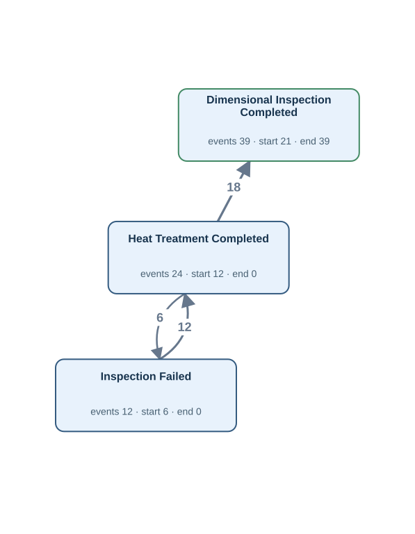</td><td width="50%"><h4>Original tables</h4>
Rows matched by event ID, activity and timestamp using the authored source bindings.

<strong><code>material_operation_history</code></strong> · 36 source rows

<code>transaction_id</code> = P005-1-HT1, <code>material_id</code> = P005-1, <code>operation_code</code> = HT, <code>started_at</code> = 2026-03-06T11:30:00Z, <code>completed_at</code> = 2026-03-06T12:00:00Z, <code>created_at</code> = 2026-03-06T12:06:00Z OP:P005-1-HT1 · Heat Treatment Completed · completed_at · P005-1

<code>transaction_id</code> = P005-2-HT1, <code>material_id</code> = P005-2, <code>operation_code</code> = HT, <code>started_at</code> = 2026-03-06T11:30:00Z, <code>completed_at</code> = 2026-03-06T12:00:00Z, <code>created_at</code> = 2026-03-06T12:06:00Z OP:P005-2-HT1 · Heat Treatment Completed · completed_at · P005-2

<code>transaction_id</code> = P006-1-IF1, <code>material_id</code> = P006-1, <code>operation_code</code> = IF, <code>started_at</code> = 2026-03-07T11:30:00Z, <code>completed_at</code> = 2026-03-07T12:00:00Z, <code>created_at</code> = 2026-03-07T12:06:00Z OP:P006-1-IF1 · Inspection Failed · completed_at · P006-1

<strong><code>plate_material</code></strong> · 39 source rows

<code>plate_material_id</code> = P004-1, <code>plate_no</code> = PLP004-1, <code>parent_as_rolled_plate_no</code> = AR004, <code>dimension_inspected_at</code> = 2026-03-05T13:36:00Z, <code>latest_operation_completed_at</code> = 2026-03-05T14:06:00Z, <code>plate_piece_identified_at</code> = 2026-03-05T12:36:00Z, <code>plate_quality_released_at</code> = 2026-03-05T14:36:00Z, <code>plate_packed_at</code> = NULL, <code>plate_quality_review_started_at</code> = 2026-03-05T14:21:00Z, <code>plate_packing_started_at</code> = NULL DIM:P004-1 · Dimensional Inspection Completed · dimension_inspected_at · P004-1

<code>plate_material_id</code> = P004-2, <code>plate_no</code> = PLP004-2, <code>parent_as_rolled_plate_no</code> = AR004, <code>dimension_inspected_at</code> = 2026-03-05T13:42:00Z, <code>latest_operation_completed_at</code> = 2026-03-05T14:12:00Z, <code>plate_piece_identified_at</code> = 2026-03-05T12:42:00Z, <code>plate_quality_released_at</code> = 2026-03-05T14:42:00Z, <code>plate_packed_at</code> = 2026-03-05T15:42:00Z, <code>plate_quality_review_started_at</code> = 2026-03-05T14:27:00Z, <code>plate_packing_started_at</code> = 2026-03-05T15:27:00Z DIM:P004-2 · Dimensional Inspection Completed · dimension_inspected_at · P004-2

<code>plate_material_id</code> = P004-3, <code>plate_no</code> = PLP004-3, <code>parent_as_rolled_plate_no</code> = AR004, <code>dimension_inspected_at</code> = 2026-03-05T13:48:00Z, <code>latest_operation_completed_at</code> = 2026-03-05T14:18:00Z, <code>plate_piece_identified_at</code> = 2026-03-05T12:48:00Z, <code>plate_quality_released_at</code> = 2026-03-05T14:48:00Z, <code>plate_packed_at</code> = 2026-03-05T15:48:00Z, <code>plate_quality_review_started_at</code> = 2026-03-05T14:33:00Z, <code>plate_packing_started_at</code> = 2026-03-05T15:33:00Z DIM:P004-3 · Dimensional Inspection Completed · dimension_inspected_at · P004-3

FK-linked row examples for case and join context

<strong>as_rolled_material</strong>

plate_material (parent_as_rolled_plate_no → as_rolled_plate_no) <code>material_id</code> = M004, <code>as_rolled_plate_no</code> = AR004, <code>slab_id</code> = SL004, <code>instruction_id</code> = RI004, <code>furnace_charged_at</code> = 2026-03-05T02:00:00Z, <code>crop_shear_passed_at</code> = 2026-03-05T09:00:00Z, <code>latest_operation_completed_at</code> = 2026-03-05T11:00:00Z, <code>created_at</code> = 2026-03-04T23:00:00Z, <code>updated_at</code> = 2026-03-05T22:00:00Z

plate_material (parent_as_rolled_plate_no → as_rolled_plate_no) <code>material_id</code> = M005, <code>as_rolled_plate_no</code> = AR005, <code>slab_id</code> = SL005, <code>instruction_id</code> = RI005, <code>furnace_charged_at</code> = 2026-03-06T04:00:00Z, <code>crop_shear_passed_at</code> = 2026-03-06T09:00:00Z, <code>latest_operation_completed_at</code> = 2026-03-06T11:00:00Z, <code>created_at</code> = 2026-03-05T23:00:00Z, <code>updated_at</code> = 2026-03-06T22:00:00Z

plate_material (parent_as_rolled_plate_no → as_rolled_plate_no) <code>material_id</code> = M006, <code>as_rolled_plate_no</code> = AR006, <code>slab_id</code> = SL006, <code>instruction_id</code> = RI006, <code>furnace_charged_at</code> = 2026-03-07T03:00:00Z, <code>crop_shear_passed_at</code> = 2026-03-07T09:00:00Z, <code>latest_operation_completed_at</code> = 2026-03-07T11:00:00Z, <code>created_at</code> = 2026-03-06T23:00:00Z, <code>updated_at</code> = 2026-03-07T22:00:00Z

<strong>planned_rolling_instruction</strong>

rolling_instruction (plan_id → plan_id) <code>plan_id</code> = PLAN004, <code>slab_id</code> = SL004, <code>planned_reheat_at</code> = 2026-03-05T02:00:00Z, <code>rolling_plan_created_at</code> = 2026-03-04T14:00:00Z, <code>rolling_plan_reviewed_at</code> = 2026-03-04T15:00:00Z, <code>rolling_plan_approved_at</code> = 2026-03-04T16:00:00Z, <code>rolling_plan_released_at</code> = 2026-03-04T17:00:00Z

rolling_instruction (plan_id → plan_id) <code>plan_id</code> = PLAN005, <code>slab_id</code> = SL005, <code>planned_reheat_at</code> = 2026-03-06T02:00:00Z, <code>rolling_plan_created_at</code> = 2026-03-05T14:00:00Z, <code>rolling_plan_reviewed_at</code> = 2026-03-05T15:00:00Z, <code>rolling_plan_approved_at</code> = 2026-03-05T16:00:00Z, <code>rolling_plan_released_at</code> = 2026-03-05T17:00:00Z

rolling_instruction (plan_id → plan_id) <code>plan_id</code> = PLAN006, <code>slab_id</code> = SL006, <code>planned_reheat_at</code> = 2026-03-07T02:00:00Z, <code>rolling_plan_created_at</code> = 2026-03-06T14:00:00Z, <code>rolling_plan_reviewed_at</code> = 2026-03-06T15:00:00Z, <code>rolling_plan_approved_at</code> = 2026-03-06T16:00:00Z, <code>rolling_plan_released_at</code> = 2026-03-06T17:00:00Z

<strong>rolling_instruction</strong>

as_rolled_material (instruction_id → instruction_id) <code>instruction_id</code> = RI004, <code>plan_id</code> = PLAN004, <code>released_at</code> = 2026-03-05T00:00:00Z, <code>rolling_instruction_acknowledged_at</code> = 2026-03-05T00:05:00Z, <code>rolling_setup_verified_at</code> = 2026-03-05T00:10:00Z, <code>rolling_work_started_at</code> = 2026-03-05T05:55:00Z, <code>rolling_instruction_closed_at</code> = 2026-03-05T06:05:00Z

as_rolled_material (instruction_id → instruction_id) <code>instruction_id</code> = RI005, <code>plan_id</code> = PLAN005, <code>released_at</code> = 2026-03-06T00:00:00Z, <code>rolling_instruction_acknowledged_at</code> = 2026-03-06T00:05:00Z, <code>rolling_setup_verified_at</code> = 2026-03-06T00:10:00Z, <code>rolling_work_started_at</code> = 2026-03-06T05:55:00Z, <code>rolling_instruction_closed_at</code> = 2026-03-06T06:05:00Z

as_rolled_material (instruction_id → instruction_id) <code>instruction_id</code> = RI006, <code>plan_id</code> = PLAN006, <code>released_at</code> = 2026-03-07T00:00:00Z, <code>rolling_instruction_acknowledged_at</code> = 2026-03-07T00:05:00Z, <code>rolling_setup_verified_at</code> = 2026-03-07T00:10:00Z, <code>rolling_work_started_at</code> = 2026-03-07T05:55:00Z, <code>rolling_instruction_closed_at</code> = 2026-03-07T06:05:00Z

<strong>slab_material</strong>

as_rolled_material (slab_id → slab_id) <code>slab_id</code> = SL004, <code>charge_id</code> = CH004, <code>slab_received_at</code> = 2026-03-04T14:00:00Z, <code>slab_identity_verified_at</code> = 2026-03-04T15:00:00Z, <code>slab_quality_checked_at</code> = 2026-03-04T16:00:00Z, <code>slab_released_for_rolling_at</code> = 2026-03-04T17:00:00Z

as_rolled_material (slab_id → slab_id) <code>slab_id</code> = SL005, <code>charge_id</code> = CH005, <code>slab_received_at</code> = 2026-03-05T14:00:00Z, <code>slab_identity_verified_at</code> = 2026-03-05T15:00:00Z, <code>slab_quality_checked_at</code> = 2026-03-05T16:00:00Z, <code>slab_released_for_rolling_at</code> = 2026-03-05T17:00:00Z

as_rolled_material (slab_id → slab_id) <code>slab_id</code> = SL006, <code>charge_id</code> = CH006, <code>slab_received_at</code> = 2026-03-06T14:00:00Z, <code>slab_identity_verified_at</code> = 2026-03-06T15:00:00Z, <code>slab_quality_checked_at</code> = 2026-03-06T16:00:00Z, <code>slab_released_for_rolling_at</code> = 2026-03-06T17:00:00Z

Other tables referenced by Gold SQL

Includes case joins and branches of shared CTEs.
<ul><li><code>as_rolled_material</code> · as_rolled_plate_no, crop_shear_passed_at, furnace_charged_at, instruction_id, material_id</li><li><code>cutting_finishing_instruction</code> · cutting_instruction_acknowledged_at, cutting_instruction_closed_at, cutting_setup_verified_at, cutting_work_started_at, instruction_id, material_id, released_at</li><li><code>furnace_charge_tracking</code> · furnace_charge_assigned_at, furnace_charge_confirmed_at, furnace_discharge_confirmed_at, material_id, tracking_id, yard_instruction_received_at</li><li><code>planned_rolling_instruction</code> · plan_id, rolling_plan_approved_at, rolling_plan_created_at, rolling_plan_released_at, rolling_plan_reviewed_at</li><li><code>rolling_instruction</code> · instruction_id, released_at, rolling_instruction_acknowledged_at, rolling_instruction_closed_at, rolling_setup_verified_at, rolling_work_started_at</li><li><code>slab_material</code> · slab_id, slab_identity_verified_at, slab_quality_checked_at, slab_received_at, slab_released_for_rolling_at</li></ul>
</td></tr></table>

[Gold CSV](../../../datasets/plateflow/private/gold_logs/OPV07E.csv)

## OPV07EP — Q2

For each cut plate piece, build a timeline of the dimensions of a cut piece being checked, heat treatment finishing, a quality check rejecting the material.

Events: **75** · Cases with events: **39** · Activities: **3** · Edges: **3**

<table><tr><td width="50%"></td><td width="50%"><h4>Original tables</h4>
Rows matched by event ID, activity and timestamp using the authored source bindings.

<strong><code>material_operation_history</code></strong> · 36 source rows

<code>transaction_id</code> = P005-1-HT1, <code>material_id</code> = P005-1, <code>operation_code</code> = HT, <code>started_at</code> = 2026-03-06T11:30:00Z, <code>completed_at</code> = 2026-03-06T12:00:00Z, <code>created_at</code> = 2026-03-06T12:06:00Z OP:P005-1-HT1 · Heat Treatment Completed · completed_at · P005-1

<code>transaction_id</code> = P005-2-HT1, <code>material_id</code> = P005-2, <code>operation_code</code> = HT, <code>started_at</code> = 2026-03-06T11:30:00Z, <code>completed_at</code> = 2026-03-06T12:00:00Z, <code>created_at</code> = 2026-03-06T12:06:00Z OP:P005-2-HT1 · Heat Treatment Completed · completed_at · P005-2

<code>transaction_id</code> = P006-1-IF1, <code>material_id</code> = P006-1, <code>operation_code</code> = IF, <code>started_at</code> = 2026-03-07T11:30:00Z, <code>completed_at</code> = 2026-03-07T12:00:00Z, <code>created_at</code> = 2026-03-07T12:06:00Z OP:P006-1-IF1 · Inspection Failed · completed_at · P006-1

<strong><code>plate_material</code></strong> · 39 source rows

<code>plate_material_id</code> = P004-1, <code>plate_no</code> = PLP004-1, <code>parent_as_rolled_plate_no</code> = AR004, <code>dimension_inspected_at</code> = 2026-03-05T13:36:00Z, <code>latest_operation_completed_at</code> = 2026-03-05T14:06:00Z, <code>plate_piece_identified_at</code> = 2026-03-05T12:36:00Z, <code>plate_quality_released_at</code> = 2026-03-05T14:36:00Z, <code>plate_packed_at</code> = NULL, <code>plate_quality_review_started_at</code> = 2026-03-05T14:21:00Z, <code>plate_packing_started_at</code> = NULL DIM:P004-1 · Dimensional Inspection Completed · dimension_inspected_at · P004-1

<code>plate_material_id</code> = P004-2, <code>plate_no</code> = PLP004-2, <code>parent_as_rolled_plate_no</code> = AR004, <code>dimension_inspected_at</code> = 2026-03-05T13:42:00Z, <code>latest_operation_completed_at</code> = 2026-03-05T14:12:00Z, <code>plate_piece_identified_at</code> = 2026-03-05T12:42:00Z, <code>plate_quality_released_at</code> = 2026-03-05T14:42:00Z, <code>plate_packed_at</code> = 2026-03-05T15:42:00Z, <code>plate_quality_review_started_at</code> = 2026-03-05T14:27:00Z, <code>plate_packing_started_at</code> = 2026-03-05T15:27:00Z DIM:P004-2 · Dimensional Inspection Completed · dimension_inspected_at · P004-2

<code>plate_material_id</code> = P004-3, <code>plate_no</code> = PLP004-3, <code>parent_as_rolled_plate_no</code> = AR004, <code>dimension_inspected_at</code> = 2026-03-05T13:48:00Z, <code>latest_operation_completed_at</code> = 2026-03-05T14:18:00Z, <code>plate_piece_identified_at</code> = 2026-03-05T12:48:00Z, <code>plate_quality_released_at</code> = 2026-03-05T14:48:00Z, <code>plate_packed_at</code> = 2026-03-05T15:48:00Z, <code>plate_quality_review_started_at</code> = 2026-03-05T14:33:00Z, <code>plate_packing_started_at</code> = 2026-03-05T15:33:00Z DIM:P004-3 · Dimensional Inspection Completed · dimension_inspected_at · P004-3

FK-linked row examples for case and join context

<strong>as_rolled_material</strong>

plate_material (parent_as_rolled_plate_no → as_rolled_plate_no) <code>material_id</code> = M004, <code>as_rolled_plate_no</code> = AR004, <code>slab_id</code> = SL004, <code>instruction_id</code> = RI004, <code>furnace_charged_at</code> = 2026-03-05T02:00:00Z, <code>crop_shear_passed_at</code> = 2026-03-05T09:00:00Z, <code>latest_operation_completed_at</code> = 2026-03-05T11:00:00Z, <code>created_at</code> = 2026-03-04T23:00:00Z, <code>updated_at</code> = 2026-03-05T22:00:00Z

plate_material (parent_as_rolled_plate_no → as_rolled_plate_no) <code>material_id</code> = M005, <code>as_rolled_plate_no</code> = AR005, <code>slab_id</code> = SL005, <code>instruction_id</code> = RI005, <code>furnace_charged_at</code> = 2026-03-06T04:00:00Z, <code>crop_shear_passed_at</code> = 2026-03-06T09:00:00Z, <code>latest_operation_completed_at</code> = 2026-03-06T11:00:00Z, <code>created_at</code> = 2026-03-05T23:00:00Z, <code>updated_at</code> = 2026-03-06T22:00:00Z

plate_material (parent_as_rolled_plate_no → as_rolled_plate_no) <code>material_id</code> = M006, <code>as_rolled_plate_no</code> = AR006, <code>slab_id</code> = SL006, <code>instruction_id</code> = RI006, <code>furnace_charged_at</code> = 2026-03-07T03:00:00Z, <code>crop_shear_passed_at</code> = 2026-03-07T09:00:00Z, <code>latest_operation_completed_at</code> = 2026-03-07T11:00:00Z, <code>created_at</code> = 2026-03-06T23:00:00Z, <code>updated_at</code> = 2026-03-07T22:00:00Z

<strong>planned_rolling_instruction</strong>

rolling_instruction (plan_id → plan_id) <code>plan_id</code> = PLAN004, <code>slab_id</code> = SL004, <code>planned_reheat_at</code> = 2026-03-05T02:00:00Z, <code>rolling_plan_created_at</code> = 2026-03-04T14:00:00Z, <code>rolling_plan_reviewed_at</code> = 2026-03-04T15:00:00Z, <code>rolling_plan_approved_at</code> = 2026-03-04T16:00:00Z, <code>rolling_plan_released_at</code> = 2026-03-04T17:00:00Z

rolling_instruction (plan_id → plan_id) <code>plan_id</code> = PLAN005, <code>slab_id</code> = SL005, <code>planned_reheat_at</code> = 2026-03-06T02:00:00Z, <code>rolling_plan_created_at</code> = 2026-03-05T14:00:00Z, <code>rolling_plan_reviewed_at</code> = 2026-03-05T15:00:00Z, <code>rolling_plan_approved_at</code> = 2026-03-05T16:00:00Z, <code>rolling_plan_released_at</code> = 2026-03-05T17:00:00Z

rolling_instruction (plan_id → plan_id) <code>plan_id</code> = PLAN006, <code>slab_id</code> = SL006, <code>planned_reheat_at</code> = 2026-03-07T02:00:00Z, <code>rolling_plan_created_at</code> = 2026-03-06T14:00:00Z, <code>rolling_plan_reviewed_at</code> = 2026-03-06T15:00:00Z, <code>rolling_plan_approved_at</code> = 2026-03-06T16:00:00Z, <code>rolling_plan_released_at</code> = 2026-03-06T17:00:00Z

<strong>rolling_instruction</strong>

as_rolled_material (instruction_id → instruction_id) <code>instruction_id</code> = RI004, <code>plan_id</code> = PLAN004, <code>released_at</code> = 2026-03-05T00:00:00Z, <code>rolling_instruction_acknowledged_at</code> = 2026-03-05T00:05:00Z, <code>rolling_setup_verified_at</code> = 2026-03-05T00:10:00Z, <code>rolling_work_started_at</code> = 2026-03-05T05:55:00Z, <code>rolling_instruction_closed_at</code> = 2026-03-05T06:05:00Z

as_rolled_material (instruction_id → instruction_id) <code>instruction_id</code> = RI005, <code>plan_id</code> = PLAN005, <code>released_at</code> = 2026-03-06T00:00:00Z, <code>rolling_instruction_acknowledged_at</code> = 2026-03-06T00:05:00Z, <code>rolling_setup_verified_at</code> = 2026-03-06T00:10:00Z, <code>rolling_work_started_at</code> = 2026-03-06T05:55:00Z, <code>rolling_instruction_closed_at</code> = 2026-03-06T06:05:00Z

as_rolled_material (instruction_id → instruction_id) <code>instruction_id</code> = RI006, <code>plan_id</code> = PLAN006, <code>released_at</code> = 2026-03-07T00:00:00Z, <code>rolling_instruction_acknowledged_at</code> = 2026-03-07T00:05:00Z, <code>rolling_setup_verified_at</code> = 2026-03-07T00:10:00Z, <code>rolling_work_started_at</code> = 2026-03-07T05:55:00Z, <code>rolling_instruction_closed_at</code> = 2026-03-07T06:05:00Z

<strong>slab_material</strong>

as_rolled_material (slab_id → slab_id) <code>slab_id</code> = SL004, <code>charge_id</code> = CH004, <code>slab_received_at</code> = 2026-03-04T14:00:00Z, <code>slab_identity_verified_at</code> = 2026-03-04T15:00:00Z, <code>slab_quality_checked_at</code> = 2026-03-04T16:00:00Z, <code>slab_released_for_rolling_at</code> = 2026-03-04T17:00:00Z

as_rolled_material (slab_id → slab_id) <code>slab_id</code> = SL005, <code>charge_id</code> = CH005, <code>slab_received_at</code> = 2026-03-05T14:00:00Z, <code>slab_identity_verified_at</code> = 2026-03-05T15:00:00Z, <code>slab_quality_checked_at</code> = 2026-03-05T16:00:00Z, <code>slab_released_for_rolling_at</code> = 2026-03-05T17:00:00Z

as_rolled_material (slab_id → slab_id) <code>slab_id</code> = SL006, <code>charge_id</code> = CH006, <code>slab_received_at</code> = 2026-03-06T14:00:00Z, <code>slab_identity_verified_at</code> = 2026-03-06T15:00:00Z, <code>slab_quality_checked_at</code> = 2026-03-06T16:00:00Z, <code>slab_released_for_rolling_at</code> = 2026-03-06T17:00:00Z

Other tables referenced by Gold SQL

Includes case joins and branches of shared CTEs.
<ul><li><code>as_rolled_material</code> · as_rolled_plate_no, crop_shear_passed_at, furnace_charged_at, instruction_id, material_id</li><li><code>cutting_finishing_instruction</code> · cutting_instruction_acknowledged_at, cutting_instruction_closed_at, cutting_setup_verified_at, cutting_work_started_at, instruction_id, material_id, released_at</li><li><code>furnace_charge_tracking</code> · furnace_charge_assigned_at, furnace_charge_confirmed_at, furnace_discharge_confirmed_at, material_id, tracking_id, yard_instruction_received_at</li><li><code>planned_rolling_instruction</code> · plan_id, rolling_plan_approved_at, rolling_plan_created_at, rolling_plan_released_at, rolling_plan_reviewed_at</li><li><code>rolling_instruction</code> · instruction_id, released_at, rolling_instruction_acknowledged_at, rolling_instruction_closed_at, rolling_setup_verified_at, rolling_work_started_at</li><li><code>slab_material</code> · slab_id, slab_identity_verified_at, slab_quality_checked_at, slab_received_at, slab_released_for_rolling_at</li></ul>
</td></tr></table>

[Gold CSV](../../../datasets/plateflow/private/gold_logs/OPV07EP.csv)

## OPV08P — Q4

Show the complete recorded history associated with each material operation record.

Events: **216** · Cases with events: **216** · Activities: **9** · Edges: **0**

<table><tr><td width="50%"></td><td width="50%"><h4>Original tables</h4>
Rows matched by event ID, activity and timestamp using the authored source bindings.

<strong><code>material_operation_history</code></strong> · 216 source rows

<code>transaction_id</code> = LC:furnace_charge_tracking:TRM003:3, <code>material_id</code> = M003, <code>operation_code</code> = HF, <code>started_at</code> = 2026-03-04T05:39:00Z, <code>completed_at</code> = 2026-03-04T05:40:00Z, <code>created_at</code> = 2026-03-04T05:39:00Z LC:furnace_charge_tracking:TRM003:3 · Heating Completed · completed_at · LC:furnace_charge_tracking:TRM003:3

<code>transaction_id</code> = LC:plate_material:P004-1:2, <code>material_id</code> = P004-1, <code>operation_code</code> = SF, <code>started_at</code> = 2026-03-05T14:05:00Z, <code>completed_at</code> = 2026-03-05T14:06:00Z, <code>created_at</code> = 2026-03-05T14:05:00Z LC:plate_material:P004-1:2 · Plate Surface Checked · completed_at · LC:plate_material:P004-1:2

<code>transaction_id</code> = M003-RL, <code>material_id</code> = M003, <code>operation_code</code> = RL, <code>started_at</code> = 2026-03-04T05:30:00Z, <code>completed_at</code> = 2026-03-04T06:00:00Z, <code>created_at</code> = 2026-03-04T06:06:00Z OP:M003-RL · Rolling Completed · completed_at · M003-RL

Other tables referenced by Gold SQL

Includes case joins and branches of shared CTEs.
<ul><li><code>as_rolled_material</code> · as_rolled_plate_no, crop_shear_passed_at, furnace_charged_at, instruction_id, material_id</li><li><code>cutting_finishing_instruction</code> · cutting_instruction_acknowledged_at, cutting_instruction_closed_at, cutting_setup_verified_at, cutting_work_started_at, instruction_id, material_id, released_at</li><li><code>furnace_charge_tracking</code> · furnace_charge_assigned_at, furnace_charge_confirmed_at, furnace_discharge_confirmed_at, material_id, tracking_id, yard_instruction_received_at</li><li><code>planned_rolling_instruction</code> · plan_id, rolling_plan_approved_at, rolling_plan_created_at, rolling_plan_released_at, rolling_plan_reviewed_at</li><li><code>plate_material</code> · dimension_inspected_at, parent_as_rolled_plate_no, plate_material_id, plate_packed_at, plate_packing_started_at, plate_piece_identified_at, plate_quality_released_at, plate_quality_review_started_at</li><li><code>rolling_instruction</code> · instruction_id, released_at, rolling_instruction_acknowledged_at, rolling_instruction_closed_at, rolling_setup_verified_at, rolling_work_started_at</li><li><code>slab_material</code> · slab_id, slab_identity_verified_at, slab_quality_checked_at, slab_received_at, slab_released_for_rolling_at</li></ul>
</td></tr></table>

[Gold CSV](../../../datasets/plateflow/private/gold_logs/OPV08P.csv)

## OPV08E — Q1

Extract Cooling Completed, Heat Treatment Completed, Heating Completed events for each material operation record.

Events: **66** · Cases with events: **66** · Activities: **3** · Edges: **0**

<table><tr><td width="50%">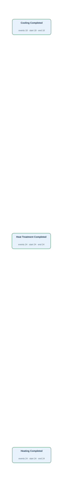</td><td width="50%"><h4>Original tables</h4>
Rows matched by event ID, activity and timestamp using the authored source bindings.

<strong><code>material_operation_history</code></strong> · 66 source rows

<code>transaction_id</code> = LC:furnace_charge_tracking:TRM003:3, <code>material_id</code> = M003, <code>operation_code</code> = HF, <code>started_at</code> = 2026-03-04T05:39:00Z, <code>completed_at</code> = 2026-03-04T05:40:00Z, <code>created_at</code> = 2026-03-04T05:39:00Z LC:furnace_charge_tracking:TRM003:3 · Heating Completed · completed_at · LC:furnace_charge_tracking:TRM003:3

<code>transaction_id</code> = M004-CO, <code>material_id</code> = M004, <code>operation_code</code> = CO, <code>started_at</code> = 2026-03-05T06:30:00Z, <code>completed_at</code> = 2026-03-05T07:00:00Z, <code>created_at</code> = 2026-03-05T07:06:00Z OP:M004-CO · Cooling Completed · completed_at · M004-CO

<code>transaction_id</code> = P005-1-HT1, <code>material_id</code> = P005-1, <code>operation_code</code> = HT, <code>started_at</code> = 2026-03-06T11:30:00Z, <code>completed_at</code> = 2026-03-06T12:00:00Z, <code>created_at</code> = 2026-03-06T12:06:00Z OP:P005-1-HT1 · Heat Treatment Completed · completed_at · P005-1-HT1

Other tables referenced by Gold SQL

Includes case joins and branches of shared CTEs.
<ul><li><code>as_rolled_material</code> · as_rolled_plate_no, crop_shear_passed_at, furnace_charged_at, instruction_id, material_id</li><li><code>cutting_finishing_instruction</code> · cutting_instruction_acknowledged_at, cutting_instruction_closed_at, cutting_setup_verified_at, cutting_work_started_at, instruction_id, material_id, released_at</li><li><code>furnace_charge_tracking</code> · furnace_charge_assigned_at, furnace_charge_confirmed_at, furnace_discharge_confirmed_at, material_id, tracking_id, yard_instruction_received_at</li><li><code>planned_rolling_instruction</code> · plan_id, rolling_plan_approved_at, rolling_plan_created_at, rolling_plan_released_at, rolling_plan_reviewed_at</li><li><code>plate_material</code> · dimension_inspected_at, parent_as_rolled_plate_no, plate_material_id, plate_packed_at, plate_packing_started_at, plate_piece_identified_at, plate_quality_released_at, plate_quality_review_started_at</li><li><code>rolling_instruction</code> · instruction_id, released_at, rolling_instruction_acknowledged_at, rolling_instruction_closed_at, rolling_setup_verified_at, rolling_work_started_at</li><li><code>slab_material</code> · slab_id, slab_identity_verified_at, slab_quality_checked_at, slab_received_at, slab_released_for_rolling_at</li></ul>
</td></tr></table>

[Gold CSV](../../../datasets/plateflow/private/gold_logs/OPV08E.csv)

## OPV08EP — Q2

For each material operation record, build a timeline of cooling finishing, heat treatment finishing, furnace heating finishing.

Events: **66** · Cases with events: **66** · Activities: **3** · Edges: **0**

<table><tr><td width="50%"></td><td width="50%"><h4>Original tables</h4>
Rows matched by event ID, activity and timestamp using the authored source bindings.

<strong><code>material_operation_history</code></strong> · 66 source rows

<code>transaction_id</code> = LC:furnace_charge_tracking:TRM003:3, <code>material_id</code> = M003, <code>operation_code</code> = HF, <code>started_at</code> = 2026-03-04T05:39:00Z, <code>completed_at</code> = 2026-03-04T05:40:00Z, <code>created_at</code> = 2026-03-04T05:39:00Z LC:furnace_charge_tracking:TRM003:3 · Heating Completed · completed_at · LC:furnace_charge_tracking:TRM003:3

<code>transaction_id</code> = M004-CO, <code>material_id</code> = M004, <code>operation_code</code> = CO, <code>started_at</code> = 2026-03-05T06:30:00Z, <code>completed_at</code> = 2026-03-05T07:00:00Z, <code>created_at</code> = 2026-03-05T07:06:00Z OP:M004-CO · Cooling Completed · completed_at · M004-CO

<code>transaction_id</code> = P005-1-HT1, <code>material_id</code> = P005-1, <code>operation_code</code> = HT, <code>started_at</code> = 2026-03-06T11:30:00Z, <code>completed_at</code> = 2026-03-06T12:00:00Z, <code>created_at</code> = 2026-03-06T12:06:00Z OP:P005-1-HT1 · Heat Treatment Completed · completed_at · P005-1-HT1

Other tables referenced by Gold SQL

Includes case joins and branches of shared CTEs.
<ul><li><code>as_rolled_material</code> · as_rolled_plate_no, crop_shear_passed_at, furnace_charged_at, instruction_id, material_id</li><li><code>cutting_finishing_instruction</code> · cutting_instruction_acknowledged_at, cutting_instruction_closed_at, cutting_setup_verified_at, cutting_work_started_at, instruction_id, material_id, released_at</li><li><code>furnace_charge_tracking</code> · furnace_charge_assigned_at, furnace_charge_confirmed_at, furnace_discharge_confirmed_at, material_id, tracking_id, yard_instruction_received_at</li><li><code>planned_rolling_instruction</code> · plan_id, rolling_plan_approved_at, rolling_plan_created_at, rolling_plan_released_at, rolling_plan_reviewed_at</li><li><code>plate_material</code> · dimension_inspected_at, parent_as_rolled_plate_no, plate_material_id, plate_packed_at, plate_packing_started_at, plate_piece_identified_at, plate_quality_released_at, plate_quality_review_started_at</li><li><code>rolling_instruction</code> · instruction_id, released_at, rolling_instruction_acknowledged_at, rolling_instruction_closed_at, rolling_setup_verified_at, rolling_work_started_at</li><li><code>slab_material</code> · slab_id, slab_identity_verified_at, slab_quality_checked_at, slab_received_at, slab_released_for_rolling_at</li></ul>
</td></tr></table>

[Gold CSV](../../../datasets/plateflow/private/gold_logs/OPV08EP.csv)
