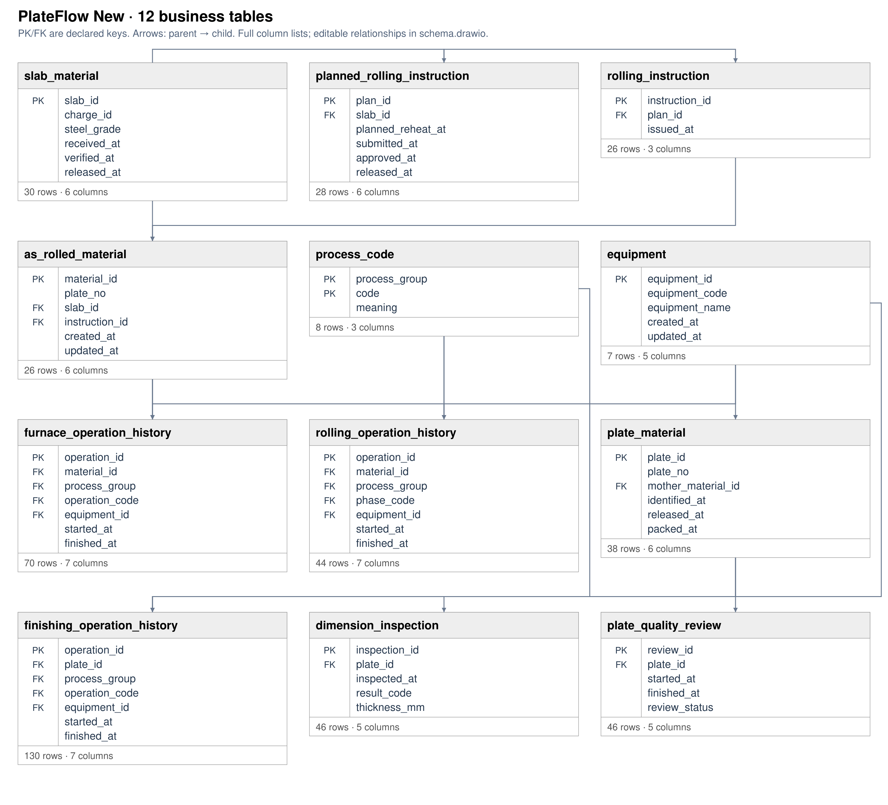

# plateflow: questions and Gold DFGs

**EVALUATION ONLY — NEVER PROVIDE TO A MODEL.**

Source commit: `a0ba4c9631d12730d60bf7720d783a3a827b88dc`. Open index.html for search, review notes and complete case traces.

Node counts = event occurrences. Edge counts = adjacent selected events within a case. Dashed amber edges touch timestamp ties and depend on the tie-break rule. DFGs are projections of the selected log, not causal models.

[Event graph inventory · tables, objects, OTs and activities](event_graph.md)

**Source tables** produced matched Gold events. **SQL tables** are all physical tables read by the Gold SQL, including join tables and shared CTE branches.

## Dataset overview

[Full DB schema](../../../datasets/plateflow/docs/schema_overview.md) · [Full-size ER diagram](../../../datasets/plateflow/docs/schema.png) · [SQL DDL](../../../datasets/plateflow/input/schema.sql)

Show all 44 questions and the schema preview

<table><tr><td width="50%" valign="top"><h3>All questions (44)</h3><table><thead><tr><th>ID</th><th>Type</th><th>Question</th></tr></thead><tbody><tr><td><a href="#v01--q1">V01</a></td><td>Q1</td><td>Extract Reheating Started, Rolling Completed, Crop Shear Passed events for each as-rolled mother material.</td></tr><tr><td><a href="#v02--q2">V02</a></td><td>Q2</td><td>For each as-rolled mother material, build a timeline of the material entering the reheating furnace, rolling finishing, the mother plate passing the crop shear.</td></tr><tr><td><a href="#v03--q1">V03</a></td><td>Q1</td><td>Extract Inspection Failed, Heat Treatment Completed, Inspection Passed events for each as-rolled mother material.</td></tr><tr><td><a href="#v04--q2">V04</a></td><td>Q2</td><td>For each as-rolled mother material, build a timeline of a quality check rejecting the material, heat treatment finishing, a quality check accepting the material.</td></tr><tr><td><a href="#v05--q3">V05</a></td><td>Q3</td><td>Extract the full recorded lifecycle event log for each as-rolled mother material.</td></tr><tr><td><a href="#v06--q4">V06</a></td><td>Q4</td><td>Show the complete recorded history associated with each as-rolled mother material.</td></tr><tr><td><a href="#v07--q1">V07</a></td><td>Q1</td><td>Extract Cutting Instruction Released, Split Cutting Completed, Dimensional Inspection Completed events for each as-rolled mother material.</td></tr><tr><td><a href="#v08--q1">V08</a></td><td>Q1</td><td>Extract Slab Cast events for each slab.</td></tr><tr><td><a href="#opv01--q3">OPV01</a></td><td>Q3</td><td>Extract the full recorded lifecycle event log for each slab.</td></tr><tr><td><a href="#opv02--q3">OPV02</a></td><td>Q3</td><td>Extract the full recorded lifecycle event log for each rolling plan.</td></tr><tr><td><a href="#opv03--q3">OPV03</a></td><td>Q3</td><td>Extract the full recorded lifecycle event log for each rolling instruction.</td></tr><tr><td><a href="#opv04--q3">OPV04</a></td><td>Q3</td><td>Extract the full recorded lifecycle event log for each mother material.</td></tr><tr><td><a href="#opv05--q3">OPV05</a></td><td>Q3</td><td>Extract the full recorded lifecycle event log for each furnace tracking record.</td></tr><tr><td><a href="#opv06--q3">OPV06</a></td><td>Q3</td><td>Extract the full recorded lifecycle event log for each cutting instruction.</td></tr><tr><td><a href="#opv07--q3">OPV07</a></td><td>Q3</td><td>Extract the full recorded lifecycle event log for each cut plate piece.</td></tr><tr><td><a href="#opv08--q3">OPV08</a></td><td>Q3</td><td>Extract the full recorded lifecycle event log for each material operation record.</td></tr><tr><td><a href="#ts01--q1">TS01</a></td><td>Q1</td><td>Extract Plate Quality Review Started, Plate Packing Started events for each cut plate piece.</td></tr><tr><td><a href="#v07p--q2">V07P</a></td><td>Q2</td><td>For each as-rolled mother material, build a timeline of the cutting work order being issued, the mother plate being cut into separate pieces, the dimensions of a cut piece being checked.</td></tr><tr><td><a href="#v08p--q2">V08P</a></td><td>Q2</td><td>For each slab, build a timeline of the initial casting of a slab.</td></tr><tr><td><a href="#ts01p--q2">TS01P</a></td><td>Q2</td><td>For each cut plate piece, build a timeline of a finished plate quality review beginning, packaging of a finished plate beginning.</td></tr><tr><td><a href="#opv01p--q4">OPV01P</a></td><td>Q4</td><td>Show the complete recorded history associated with each slab.</td></tr><tr><td><a href="#opv01e--q1">OPV01E</a></td><td>Q1</td><td>Extract Slab Received, Slab Quality Checked, Slab Released for Rolling events for each slab.</td></tr><tr><td><a href="#opv01ep--q2">OPV01EP</a></td><td>Q2</td><td>For each slab, build a timeline of an incoming slab being received, the quality of a slab being checked, a slab being authorized for rolling.</td></tr><tr><td><a href="#opv02p--q4">OPV02P</a></td><td>Q4</td><td>Show the complete recorded history associated with each rolling plan.</td></tr><tr><td><a href="#opv02e--q1">OPV02E</a></td><td>Q1</td><td>Extract Rolling Instruction Released, Rolling Plan Approved, Rolling Plan Created events for each rolling plan.</td></tr><tr><td><a href="#opv02ep--q2">OPV02EP</a></td><td>Q2</td><td>For each rolling plan, build a timeline of the rolling work order being issued, a rolling schedule being authorized, a rolling schedule being prepared.</td></tr><tr><td><a href="#opv03p--q4">OPV03P</a></td><td>Q4</td><td>Show the complete recorded history associated with each rolling instruction.</td></tr><tr><td><a href="#opv03e--q1">OPV03E</a></td><td>Q1</td><td>Extract Rolling Instruction Acknowledged, Rolling Instruction Closed, Rolling Instruction Released events for each rolling instruction.</td></tr><tr><td><a href="#opv03ep--q2">OPV03EP</a></td><td>Q2</td><td>For each rolling instruction, build a timeline of the rolling team acknowledging its work order, the rolling work order being closed, the rolling work order being issued.</td></tr><tr><td><a href="#opv04p--q4">OPV04P</a></td><td>Q4</td><td>Show the complete recorded history associated with each mother material.</td></tr><tr><td><a href="#opv04e--q1">OPV04E</a></td><td>Q1</td><td>Extract Slab Received, Slab Quality Checked, Slab Released for Rolling events for each mother material.</td></tr><tr><td><a href="#opv04ep--q2">OPV04EP</a></td><td>Q2</td><td>For each mother material, build a timeline of an incoming slab being received, the quality of a slab being checked, a slab being authorized for rolling.</td></tr><tr><td><a href="#opv05p--q4">OPV05P</a></td><td>Q4</td><td>Show the complete recorded history associated with each furnace tracking record.</td></tr><tr><td><a href="#opv05e--q1">OPV05E</a></td><td>Q1</td><td>Extract Furnace Charge Assigned, Furnace Charge Confirmed, Furnace Discharge Confirmed events for each furnace tracking record.</td></tr><tr><td><a href="#opv05ep--q2">OPV05EP</a></td><td>Q2</td><td>For each furnace tracking record, build a timeline of a furnace charge being assigned, the furnace charge being confirmed, the material leaving the furnace being confirmed.</td></tr><tr><td><a href="#opv06p--q4">OPV06P</a></td><td>Q4</td><td>Show the complete recorded history associated with each cutting instruction.</td></tr><tr><td><a href="#opv06e--q1">OPV06E</a></td><td>Q1</td><td>Extract Cutting Instruction Acknowledged, Cutting Instruction Closed, Cutting Instruction Released events for each cutting instruction.</td></tr><tr><td><a href="#opv06ep--q2">OPV06EP</a></td><td>Q2</td><td>For each cutting instruction, build a timeline of the cutting team acknowledging its work order, the cutting work order being closed, the cutting work order being issued.</td></tr><tr><td><a href="#opv07p--q4">OPV07P</a></td><td>Q4</td><td>Show the complete recorded history associated with each cut plate piece.</td></tr><tr><td><a href="#opv07e--q1">OPV07E</a></td><td>Q1</td><td>Extract Dimensional Inspection Completed, Heat Treatment Completed, Inspection Failed events for each cut plate piece.</td></tr><tr><td><a href="#opv07ep--q2">OPV07EP</a></td><td>Q2</td><td>For each cut plate piece, build a timeline of the dimensions of a cut piece being checked, heat treatment finishing, a quality check rejecting the material.</td></tr><tr><td><a href="#opv08p--q4">OPV08P</a></td><td>Q4</td><td>Show the complete recorded history associated with each material operation record.</td></tr><tr><td><a href="#opv08e--q1">OPV08E</a></td><td>Q1</td><td>Extract Cooling Completed, Heat Treatment Completed, Heating Completed events for each material operation record.</td></tr><tr><td><a href="#opv08ep--q2">OPV08EP</a></td><td>Q2</td><td>For each material operation record, build a timeline of cooling finishing, heat treatment finishing, furnace heating finishing.</td></tr></tbody></table></td><td width="50%" valign="top"><h3>Database schema</h3>

<a href="../../../datasets/plateflow/docs/schema.png">Full-size diagram</a> · <a href="../../../datasets/plateflow/input/schema.sql">Full SQL schema</a>
</td></tr></table>

## V01 — Q1

Extract Reheating Started, Rolling Completed, Crop Shear Passed events for each as-rolled mother material.

Events: **72** · Cases with events: **30** · Activities: **3** · Edges: **2** · Source tables: **2** · SQL tables: **3**

<table><tr><td width="42%" valign="top"></td><td width="58%" valign="top">
<a href="../../../datasets/plateflow/private/gold_sql/V01.sql">Gold SQL</a> · <a href="../../../datasets/plateflow/private/gold_logs/V01.csv">Gold CSV</a> · <a href="../../../datasets/plateflow/input/database.sqlite">Full source database (SQLite)</a>

<code>as_rolled_material</code> · 30 matched source rows
<table><tr><th>Column</th><th>Row 1</th><th>Row 2</th><th>Row 3</th></tr><tr><th>material_id</th><td>M002</td><td>M004</td><td>M003</td></tr><tr><th>as_rolled_plate_no</th><td>AR002</td><td>AR004</td><td>AR003</td></tr><tr><th>slab_id</th><td>SL002</td><td>SL004</td><td>SL003</td></tr><tr><th>instruction_id</th><td>RI002</td><td>RI004</td><td>RI003</td></tr><tr><th>furnace_charged_at</th><td>2026-03-03T04:00:00Z</td><td>2026-03-05T02:00:00Z</td><td>2026-03-04T03:00:00Z</td></tr><tr><th>crop_shear_passed_at</th><td><em>NULL</em></td><td>2026-03-05T09:00:00Z</td><td><em>NULL</em></td></tr><tr><th>latest_operation_completed_at</th><td><em>NULL</em></td><td>2026-03-05T11:00:00Z</td><td>2026-03-04T06:00:00Z</td></tr><tr><th>created_at</th><td>2026-03-02T23:00:00Z</td><td>2026-03-04T23:00:00Z</td><td>2026-03-03T23:00:00Z</td></tr><tr><th>updated_at</th><td>2026-03-03T22:00:00Z</td><td>2026-03-05T22:00:00Z</td><td>2026-03-04T22:00:00Z</td></tr></table>
<strong>Gold output for the same source rows</strong>
<ul><li>Row 1 → Reheating Started · event RH:M002 · case M002 · time from <code>furnace_charged_at</code></li><li>Row 2 → Crop Shear Passed · event CS:M004 · case M004 · time from <code>crop_shear_passed_at</code></li><li>Row 2 → Reheating Started · event RH:M004 · case M004 · time from <code>furnace_charged_at</code></li><li>Row 3 → Reheating Started · event RH:M003 · case M003 · time from <code>furnace_charged_at</code></li></ul>

<code>material_operation_history</code> · 24 matched source rows
<table><tr><th>Column</th><th>Row 1</th><th>Row 2</th><th>Row 3</th></tr><tr><th>transaction_id</th><td>M003-RL</td><td>M004-RL</td><td>M005-RL</td></tr><tr><th>material_id</th><td>M003</td><td>M004</td><td>M005</td></tr><tr><th>operation_code</th><td>RL</td><td>RL</td><td>RL</td></tr><tr><th>started_at</th><td>2026-03-04T05:30:00Z</td><td>2026-03-05T05:30:00Z</td><td>2026-03-06T05:30:00Z</td></tr><tr><th>completed_at</th><td>2026-03-04T06:00:00Z</td><td>2026-03-05T06:00:00Z</td><td>2026-03-06T06:00:00Z</td></tr><tr><th>created_at</th><td>2026-03-04T06:06:00Z</td><td>2026-03-05T06:06:00Z</td><td>2026-03-06T06:06:00Z</td></tr></table>
<strong>Gold output for the same source rows</strong>
<ul><li>Row 1 → Rolling Completed · event OP:M003-RL · case M003 · time from <code>completed_at</code></li><li>Row 2 → Rolling Completed · event OP:M004-RL · case M004 · time from <code>completed_at</code></li><li>Row 3 → Rolling Completed · event OP:M005-RL · case M005 · time from <code>completed_at</code></li></ul>
</td></tr></table>

## V02 — Q2

For each as-rolled mother material, build a timeline of the material entering the reheating furnace, rolling finishing, the mother plate passing the crop shear.

Events: **72** · Cases with events: **30** · Activities: **3** · Edges: **2** · Source tables: **2** · SQL tables: **3**

<table><tr><td width="42%" valign="top"></td><td width="58%" valign="top">
<a href="../../../datasets/plateflow/private/gold_sql/V02.sql">Gold SQL</a> · <a href="../../../datasets/plateflow/private/gold_logs/V02.csv">Gold CSV</a> · <a href="../../../datasets/plateflow/input/database.sqlite">Full source database (SQLite)</a>

<code>as_rolled_material</code> · 30 matched source rows
<table><tr><th>Column</th><th>Row 1</th><th>Row 2</th><th>Row 3</th></tr><tr><th>material_id</th><td>M002</td><td>M004</td><td>M003</td></tr><tr><th>as_rolled_plate_no</th><td>AR002</td><td>AR004</td><td>AR003</td></tr><tr><th>slab_id</th><td>SL002</td><td>SL004</td><td>SL003</td></tr><tr><th>instruction_id</th><td>RI002</td><td>RI004</td><td>RI003</td></tr><tr><th>furnace_charged_at</th><td>2026-03-03T04:00:00Z</td><td>2026-03-05T02:00:00Z</td><td>2026-03-04T03:00:00Z</td></tr><tr><th>crop_shear_passed_at</th><td><em>NULL</em></td><td>2026-03-05T09:00:00Z</td><td><em>NULL</em></td></tr><tr><th>latest_operation_completed_at</th><td><em>NULL</em></td><td>2026-03-05T11:00:00Z</td><td>2026-03-04T06:00:00Z</td></tr><tr><th>created_at</th><td>2026-03-02T23:00:00Z</td><td>2026-03-04T23:00:00Z</td><td>2026-03-03T23:00:00Z</td></tr><tr><th>updated_at</th><td>2026-03-03T22:00:00Z</td><td>2026-03-05T22:00:00Z</td><td>2026-03-04T22:00:00Z</td></tr></table>
<strong>Gold output for the same source rows</strong>
<ul><li>Row 1 → Reheating Started · event RH:M002 · case M002 · time from <code>furnace_charged_at</code></li><li>Row 2 → Crop Shear Passed · event CS:M004 · case M004 · time from <code>crop_shear_passed_at</code></li><li>Row 2 → Reheating Started · event RH:M004 · case M004 · time from <code>furnace_charged_at</code></li><li>Row 3 → Reheating Started · event RH:M003 · case M003 · time from <code>furnace_charged_at</code></li></ul>

<code>material_operation_history</code> · 24 matched source rows
<table><tr><th>Column</th><th>Row 1</th><th>Row 2</th><th>Row 3</th></tr><tr><th>transaction_id</th><td>M003-RL</td><td>M004-RL</td><td>M005-RL</td></tr><tr><th>material_id</th><td>M003</td><td>M004</td><td>M005</td></tr><tr><th>operation_code</th><td>RL</td><td>RL</td><td>RL</td></tr><tr><th>started_at</th><td>2026-03-04T05:30:00Z</td><td>2026-03-05T05:30:00Z</td><td>2026-03-06T05:30:00Z</td></tr><tr><th>completed_at</th><td>2026-03-04T06:00:00Z</td><td>2026-03-05T06:00:00Z</td><td>2026-03-06T06:00:00Z</td></tr><tr><th>created_at</th><td>2026-03-04T06:06:00Z</td><td>2026-03-05T06:06:00Z</td><td>2026-03-06T06:06:00Z</td></tr></table>
<strong>Gold output for the same source rows</strong>
<ul><li>Row 1 → Rolling Completed · event OP:M003-RL · case M003 · time from <code>completed_at</code></li><li>Row 2 → Rolling Completed · event OP:M004-RL · case M004 · time from <code>completed_at</code></li><li>Row 3 → Rolling Completed · event OP:M005-RL · case M005 · time from <code>completed_at</code></li></ul>
</td></tr></table>

## V03 — Q1

Extract Inspection Failed, Heat Treatment Completed, Inspection Passed events for each as-rolled mother material.

Events: **75** · Cases with events: **18** · Activities: **3** · Edges: **7** · Source tables: **1** · SQL tables: **3**

<table><tr><td width="42%" valign="top"></td><td width="58%" valign="top">
<a href="../../../datasets/plateflow/private/gold_sql/V03.sql">Gold SQL</a> · <a href="../../../datasets/plateflow/private/gold_logs/V03.csv">Gold CSV</a> · <a href="../../../datasets/plateflow/input/database.sqlite">Full source database (SQLite)</a>

<code>material_operation_history</code> · 75 matched source rows
<table><tr><th>Column</th><th>Row 1</th><th>Row 2</th><th>Row 3</th></tr><tr><th>transaction_id</th><td>P004-1-IP</td><td>P005-1-HT1</td><td>P006-1-IF1</td></tr><tr><th>material_id</th><td>P004-1</td><td>P005-1</td><td>P006-1</td></tr><tr><th>operation_code</th><td>IP</td><td>HT</td><td>IF</td></tr><tr><th>started_at</th><td>2026-03-05T12:36:00Z</td><td>2026-03-06T11:30:00Z</td><td>2026-03-07T11:30:00Z</td></tr><tr><th>completed_at</th><td>2026-03-05T13:06:00Z</td><td>2026-03-06T12:00:00Z</td><td>2026-03-07T12:00:00Z</td></tr><tr><th>created_at</th><td>2026-03-05T13:12:00Z</td><td>2026-03-06T12:06:00Z</td><td>2026-03-07T12:06:00Z</td></tr></table>
<strong>Gold output for the same source rows</strong>
<ul><li>Row 1 → Inspection Passed · event OP:P004-1-IP · case M004 · time from <code>completed_at</code></li><li>Row 2 → Heat Treatment Completed · event OP:P005-1-HT1 · case M005 · time from <code>completed_at</code></li><li>Row 3 → Inspection Failed · event OP:P006-1-IF1 · case M006 · time from <code>completed_at</code></li></ul>
</td></tr></table>

## V04 — Q2

For each as-rolled mother material, build a timeline of a quality check rejecting the material, heat treatment finishing, a quality check accepting the material.

Events: **75** · Cases with events: **18** · Activities: **3** · Edges: **7** · Source tables: **1** · SQL tables: **3**

<table><tr><td width="42%" valign="top"></td><td width="58%" valign="top">
<a href="../../../datasets/plateflow/private/gold_sql/V04.sql">Gold SQL</a> · <a href="../../../datasets/plateflow/private/gold_logs/V04.csv">Gold CSV</a> · <a href="../../../datasets/plateflow/input/database.sqlite">Full source database (SQLite)</a>

<code>material_operation_history</code> · 75 matched source rows
<table><tr><th>Column</th><th>Row 1</th><th>Row 2</th><th>Row 3</th></tr><tr><th>transaction_id</th><td>P004-1-IP</td><td>P005-1-HT1</td><td>P006-1-IF1</td></tr><tr><th>material_id</th><td>P004-1</td><td>P005-1</td><td>P006-1</td></tr><tr><th>operation_code</th><td>IP</td><td>HT</td><td>IF</td></tr><tr><th>started_at</th><td>2026-03-05T12:36:00Z</td><td>2026-03-06T11:30:00Z</td><td>2026-03-07T11:30:00Z</td></tr><tr><th>completed_at</th><td>2026-03-05T13:06:00Z</td><td>2026-03-06T12:00:00Z</td><td>2026-03-07T12:00:00Z</td></tr><tr><th>created_at</th><td>2026-03-05T13:12:00Z</td><td>2026-03-06T12:06:00Z</td><td>2026-03-07T12:06:00Z</td></tr></table>
<strong>Gold output for the same source rows</strong>
<ul><li>Row 1 → Inspection Passed · event OP:P004-1-IP · case M004 · time from <code>completed_at</code></li><li>Row 2 → Heat Treatment Completed · event OP:P005-1-HT1 · case M005 · time from <code>completed_at</code></li><li>Row 3 → Inspection Failed · event OP:P006-1-IF1 · case M006 · time from <code>completed_at</code></li></ul>
</td></tr></table>

## V05 — Q3

Extract the full recorded lifecycle event log for each as-rolled mother material.

Events: **1108** · Cases with events: **36** · Activities: **39** · Edges: **63** · Source tables: **8** · SQL tables: **8**

<table><tr><td width="42%" valign="top"></td><td width="58%" valign="top">
<a href="../../../datasets/plateflow/private/gold_sql/V05.sql">Gold SQL</a> · <a href="../../../datasets/plateflow/private/gold_logs/V05.csv">Gold CSV</a> · <a href="../../../datasets/plateflow/input/database.sqlite">Full source database (SQLite)</a>

<code>as_rolled_material</code> · 30 matched source rows
<table><tr><th>Column</th><th>Row 1</th><th>Row 2</th><th>Row 3</th></tr><tr><th>material_id</th><td>M002</td><td>M004</td><td>M003</td></tr><tr><th>as_rolled_plate_no</th><td>AR002</td><td>AR004</td><td>AR003</td></tr><tr><th>slab_id</th><td>SL002</td><td>SL004</td><td>SL003</td></tr><tr><th>instruction_id</th><td>RI002</td><td>RI004</td><td>RI003</td></tr><tr><th>furnace_charged_at</th><td>2026-03-03T04:00:00Z</td><td>2026-03-05T02:00:00Z</td><td>2026-03-04T03:00:00Z</td></tr><tr><th>crop_shear_passed_at</th><td><em>NULL</em></td><td>2026-03-05T09:00:00Z</td><td><em>NULL</em></td></tr><tr><th>latest_operation_completed_at</th><td><em>NULL</em></td><td>2026-03-05T11:00:00Z</td><td>2026-03-04T06:00:00Z</td></tr><tr><th>created_at</th><td>2026-03-02T23:00:00Z</td><td>2026-03-04T23:00:00Z</td><td>2026-03-03T23:00:00Z</td></tr><tr><th>updated_at</th><td>2026-03-03T22:00:00Z</td><td>2026-03-05T22:00:00Z</td><td>2026-03-04T22:00:00Z</td></tr></table>
<strong>Gold output for the same source rows</strong>
<ul><li>Row 1 → Reheating Started · event RH:M002 · case M002 · time from <code>furnace_charged_at</code></li><li>Row 2 → Crop Shear Passed · event CS:M004 · case M004 · time from <code>crop_shear_passed_at</code></li><li>Row 2 → Reheating Started · event RH:M004 · case M004 · time from <code>furnace_charged_at</code></li><li>Row 3 → Reheating Started · event RH:M003 · case M003 · time from <code>furnace_charged_at</code></li></ul>

<code>cutting_finishing_instruction</code> · 18 matched source rows
<table><tr><th>Column</th><th>Row 1</th><th>Row 2</th><th>Row 3</th></tr><tr><th>instruction_id</th><td>CIM004</td><td>CIM005</td><td>CIM006</td></tr><tr><th>material_id</th><td>M004</td><td>M005</td><td>M006</td></tr><tr><th>released_at</th><td>2026-03-05T10:00:00Z</td><td>2026-03-06T10:00:00Z</td><td>2026-03-07T10:00:00Z</td></tr><tr><th>cut_method</th><td>SPLIT</td><td>SPLIT</td><td>SPLIT</td></tr><tr><th>cutting_instruction_acknowledged_at</th><td>2026-03-05T10:05:00Z</td><td>2026-03-06T10:05:00Z</td><td>2026-03-07T10:05:00Z</td></tr><tr><th>cutting_setup_verified_at</th><td>2026-03-05T10:10:00Z</td><td>2026-03-06T10:10:00Z</td><td>2026-03-07T10:10:00Z</td></tr><tr><th>cutting_work_started_at</th><td>2026-03-05T10:55:00Z</td><td>2026-03-06T10:55:00Z</td><td>2026-03-07T10:55:00Z</td></tr><tr><th>cutting_instruction_closed_at</th><td><em>NULL</em></td><td>2026-03-06T11:05:00Z</td><td>2026-03-07T11:05:00Z</td></tr></table>
<strong>Gold output for the same source rows</strong>
<ul><li>Row 1 → Cutting Instruction Released · event CI:CIM004 · case M004 · time from <code>released_at</code></li><li>Row 1 → Cutting Instruction Acknowledged · event LC:cutting_finishing_instruction:CIM004:1 · case M004 · time from <code>cutting_instruction_acknowledged_at</code></li><li>Row 1 → Cutting Setup Verified · event LC:cutting_finishing_instruction:CIM004:2 · case M004 · time from <code>cutting_setup_verified_at</code></li><li>Row 1 → Cutting Work Started · event LC:cutting_finishing_instruction:CIM004:3 · case M004 · time from <code>cutting_work_started_at</code></li><li>Row 2 → Cutting Instruction Released · event CI:CIM005 · case M005 · time from <code>released_at</code></li><li>Row 2 → Cutting Instruction Acknowledged · event LC:cutting_finishing_instruction:CIM005:1 · case M005 · time from <code>cutting_instruction_acknowledged_at</code></li><li>Row 2 → Cutting Setup Verified · event LC:cutting_finishing_instruction:CIM005:2 · case M005 · time from <code>cutting_setup_verified_at</code></li><li>Row 2 → Cutting Work Started · event LC:cutting_finishing_instruction:CIM005:3 · case M005 · time from <code>cutting_work_started_at</code></li><li>Row 2 → Cutting Instruction Closed · event LC:cutting_finishing_instruction:CIM005:4 · case M005 · time from <code>cutting_instruction_closed_at</code></li><li>Row 3 → Cutting Instruction Released · event CI:CIM006 · case M006 · time from <code>released_at</code></li><li>Row 3 → Cutting Instruction Acknowledged · event LC:cutting_finishing_instruction:CIM006:1 · case M006 · time from <code>cutting_instruction_acknowledged_at</code></li><li>Row 3 → Cutting Setup Verified · event LC:cutting_finishing_instruction:CIM006:2 · case M006 · time from <code>cutting_setup_verified_at</code></li><li>Row 3 → Cutting Work Started · event LC:cutting_finishing_instruction:CIM006:3 · case M006 · time from <code>cutting_work_started_at</code></li><li>Row 3 → Cutting Instruction Closed · event LC:cutting_finishing_instruction:CIM006:4 · case M006 · time from <code>cutting_instruction_closed_at</code></li></ul>

<code>furnace_charge_tracking</code> · 30 matched source rows
<table><tr><th>Column</th><th>Row 1</th><th>Row 2</th><th>Row 3</th></tr><tr><th>tracking_id</th><td>TRM002</td><td>TRM003</td><td>TRM004</td></tr><tr><th>material_id</th><td>M002</td><td>M003</td><td>M004</td></tr><tr><th>yard_instruction_received_at</th><td>2026-03-03T01:00:00Z</td><td>2026-03-04T01:00:00Z</td><td>2026-03-05T01:00:00Z</td></tr><tr><th>lot_charging_started_at</th><td>2026-03-03T01:30:00Z</td><td>2026-03-04T01:30:00Z</td><td>2026-03-05T01:30:00Z</td></tr><tr><th>furnace_charge_assigned_at</th><td>2026-03-03T01:05:00Z</td><td>2026-03-04T01:05:00Z</td><td>2026-03-05T01:05:00Z</td></tr><tr><th>furnace_charge_confirmed_at</th><td><em>NULL</em></td><td>2026-03-04T03:01:00Z</td><td>2026-03-05T02:01:00Z</td></tr><tr><th>furnace_discharge_confirmed_at</th><td><em>NULL</em></td><td>2026-03-04T05:50:00Z</td><td>2026-03-05T05:50:00Z</td></tr></table>
<strong>Gold output for the same source rows</strong>
<ul><li>Row 1 → Furnace Charge Assigned · event LC:furnace_charge_tracking:TRM002:1 · case M002 · time from <code>furnace_charge_assigned_at</code></li><li>Row 1 → Yard Instruction Received · event YD:TRM002 · case M002 · time from <code>yard_instruction_received_at</code></li><li>Row 2 → Furnace Charge Assigned · event LC:furnace_charge_tracking:TRM003:1 · case M003 · time from <code>furnace_charge_assigned_at</code></li><li>Row 2 → Furnace Charge Confirmed · event LC:furnace_charge_tracking:TRM003:2 · case M003 · time from <code>furnace_charge_confirmed_at</code></li><li>Row 2 → Furnace Discharge Confirmed · event LC:furnace_charge_tracking:TRM003:4 · case M003 · time from <code>furnace_discharge_confirmed_at</code></li><li>Row 2 → Yard Instruction Received · event YD:TRM003 · case M003 · time from <code>yard_instruction_received_at</code></li><li>Row 3 → Furnace Charge Assigned · event LC:furnace_charge_tracking:TRM004:1 · case M004 · time from <code>furnace_charge_assigned_at</code></li><li>Row 3 → Furnace Charge Confirmed · event LC:furnace_charge_tracking:TRM004:2 · case M004 · time from <code>furnace_charge_confirmed_at</code></li><li>Row 3 → Furnace Discharge Confirmed · event LC:furnace_charge_tracking:TRM004:4 · case M004 · time from <code>furnace_discharge_confirmed_at</code></li><li>Row 3 → Yard Instruction Received · event YD:TRM004 · case M004 · time from <code>yard_instruction_received_at</code></li></ul>

<code>material_operation_history</code> · 216 matched source rows
<table><tr><th>Column</th><th>Row 1</th><th>Row 2</th><th>Row 3</th></tr><tr><th>transaction_id</th><td>LC:furnace_charge_tracking:TRM003:3</td><td>M003-RL</td><td>M004-CO</td></tr><tr><th>material_id</th><td>M003</td><td>M003</td><td>M004</td></tr><tr><th>operation_code</th><td>HF</td><td>RL</td><td>CO</td></tr><tr><th>started_at</th><td>2026-03-04T05:39:00Z</td><td>2026-03-04T05:30:00Z</td><td>2026-03-05T06:30:00Z</td></tr><tr><th>completed_at</th><td>2026-03-04T05:40:00Z</td><td>2026-03-04T06:00:00Z</td><td>2026-03-05T07:00:00Z</td></tr><tr><th>created_at</th><td>2026-03-04T05:39:00Z</td><td>2026-03-04T06:06:00Z</td><td>2026-03-05T07:06:00Z</td></tr></table>
<strong>Gold output for the same source rows</strong>
<ul><li>Row 1 → Heating Completed · event LC:furnace_charge_tracking:TRM003:3 · case M003 · time from <code>completed_at</code></li><li>Row 2 → Rolling Completed · event OP:M003-RL · case M003 · time from <code>completed_at</code></li><li>Row 3 → Cooling Completed · event OP:M004-CO · case M004 · time from <code>completed_at</code></li></ul>

<code>planned_rolling_instruction</code> · 36 matched source rows
<table><tr><th>Column</th><th>Row 1</th><th>Row 2</th><th>Row 3</th></tr><tr><th>plan_id</th><td>PLAN001</td><td>PLAN002</td><td>PLAN003</td></tr><tr><th>slab_id</th><td>SL001</td><td>SL002</td><td>SL003</td></tr><tr><th>planned_reheat_at</th><td>2026-03-02T02:00:00Z</td><td>2026-03-03T02:00:00Z</td><td>2026-03-04T02:00:00Z</td></tr><tr><th>rolling_plan_created_at</th><td>2026-03-01T14:00:00Z</td><td>2026-03-02T14:00:00Z</td><td>2026-03-03T14:00:00Z</td></tr><tr><th>rolling_plan_reviewed_at</th><td>2026-03-01T15:00:00Z</td><td>2026-03-02T15:00:00Z</td><td>2026-03-03T15:00:00Z</td></tr><tr><th>rolling_plan_approved_at</th><td>2026-03-01T16:00:00Z</td><td>2026-03-02T16:00:00Z</td><td>2026-03-03T16:00:00Z</td></tr><tr><th>rolling_plan_released_at</th><td><em>NULL</em></td><td>2026-03-02T17:00:00Z</td><td>2026-03-03T17:00:00Z</td></tr></table>
<strong>Gold output for the same source rows</strong>
<ul><li>Row 1 → Rolling Plan Created · event LC:planned_rolling_instruction:PLAN001:1 · case M001 · time from <code>rolling_plan_created_at</code></li><li>Row 1 → Rolling Plan Reviewed · event LC:planned_rolling_instruction:PLAN001:2 · case M001 · time from <code>rolling_plan_reviewed_at</code></li><li>Row 1 → Rolling Plan Approved · event LC:planned_rolling_instruction:PLAN001:3 · case M001 · time from <code>rolling_plan_approved_at</code></li><li>Row 2 → Rolling Plan Created · event LC:planned_rolling_instruction:PLAN002:1 · case M002 · time from <code>rolling_plan_created_at</code></li><li>Row 2 → Rolling Plan Reviewed · event LC:planned_rolling_instruction:PLAN002:2 · case M002 · time from <code>rolling_plan_reviewed_at</code></li><li>Row 2 → Rolling Plan Approved · event LC:planned_rolling_instruction:PLAN002:3 · case M002 · time from <code>rolling_plan_approved_at</code></li><li>Row 2 → Rolling Plan Released · event LC:planned_rolling_instruction:PLAN002:4 · case M002 · time from <code>rolling_plan_released_at</code></li><li>Row 3 → Rolling Plan Created · event LC:planned_rolling_instruction:PLAN003:1 · case M003 · time from <code>rolling_plan_created_at</code></li><li>Row 3 → Rolling Plan Reviewed · event LC:planned_rolling_instruction:PLAN003:2 · case M003 · time from <code>rolling_plan_reviewed_at</code></li><li>Row 3 → Rolling Plan Approved · event LC:planned_rolling_instruction:PLAN003:3 · case M003 · time from <code>rolling_plan_approved_at</code></li><li>Row 3 → Rolling Plan Released · event LC:planned_rolling_instruction:PLAN003:4 · case M003 · time from <code>rolling_plan_released_at</code></li></ul>

<code>plate_material</code> · 39 matched source rows
<table><tr><th>Column</th><th>Row 1</th><th>Row 2</th><th>Row 3</th></tr><tr><th>plate_material_id</th><td>P004-1</td><td>P004-2</td><td>P004-3</td></tr><tr><th>plate_no</th><td>PLP004-1</td><td>PLP004-2</td><td>PLP004-3</td></tr><tr><th>parent_as_rolled_plate_no</th><td>AR004</td><td>AR004</td><td>AR004</td></tr><tr><th>dimension_inspected_at</th><td>2026-03-05T13:36:00Z</td><td>2026-03-05T13:42:00Z</td><td>2026-03-05T13:48:00Z</td></tr><tr><th>latest_operation_completed_at</th><td>2026-03-05T14:06:00Z</td><td>2026-03-05T14:12:00Z</td><td>2026-03-05T14:18:00Z</td></tr><tr><th>plate_piece_identified_at</th><td>2026-03-05T12:36:00Z</td><td>2026-03-05T12:42:00Z</td><td>2026-03-05T12:48:00Z</td></tr><tr><th>plate_quality_released_at</th><td>2026-03-05T14:36:00Z</td><td>2026-03-05T14:42:00Z</td><td>2026-03-05T14:48:00Z</td></tr><tr><th>plate_packed_at</th><td><em>NULL</em></td><td>2026-03-05T15:42:00Z</td><td>2026-03-05T15:48:00Z</td></tr><tr><th>plate_quality_review_started_at</th><td>2026-03-05T14:21:00Z</td><td>2026-03-05T14:27:00Z</td><td>2026-03-05T14:33:00Z</td></tr><tr><th>plate_packing_started_at</th><td><em>NULL</em></td><td>2026-03-05T15:27:00Z</td><td>2026-03-05T15:33:00Z</td></tr></table>
<strong>Gold output for the same source rows</strong>
<ul><li>Row 1 → Dimensional Inspection Completed · event DIM:P004-1 · case M004 · time from <code>dimension_inspected_at</code></li><li>Row 1 → Plate Piece Identified · event LC:plate_material:P004-1:1 · case M004 · time from <code>plate_piece_identified_at</code></li><li>Row 1 → Plate Quality Released · event LC:plate_material:P004-1:3 · case M004 · time from <code>plate_quality_released_at</code></li><li>Row 1 → Plate Quality Review Started · event LC:plate_material:P004-1:5 · case M004 · time from <code>plate_quality_review_started_at</code></li><li>Row 2 → Dimensional Inspection Completed · event DIM:P004-2 · case M004 · time from <code>dimension_inspected_at</code></li><li>Row 2 → Plate Piece Identified · event LC:plate_material:P004-2:1 · case M004 · time from <code>plate_piece_identified_at</code></li><li>Row 2 → Plate Quality Released · event LC:plate_material:P004-2:3 · case M004 · time from <code>plate_quality_released_at</code></li><li>Row 2 → Plate Packed · event LC:plate_material:P004-2:4 · case M004 · time from <code>plate_packed_at</code></li><li>Row 2 → Plate Quality Review Started · event LC:plate_material:P004-2:5 · case M004 · time from <code>plate_quality_review_started_at</code></li><li>Row 2 → Plate Packing Started · event LC:plate_material:P004-2:6 · case M004 · time from <code>plate_packing_started_at</code></li><li>Row 3 → Dimensional Inspection Completed · event DIM:P004-3 · case M004 · time from <code>dimension_inspected_at</code></li><li>Row 3 → Plate Piece Identified · event LC:plate_material:P004-3:1 · case M004 · time from <code>plate_piece_identified_at</code></li><li>Row 3 → Plate Quality Released · event LC:plate_material:P004-3:3 · case M004 · time from <code>plate_quality_released_at</code></li><li>Row 3 → Plate Packed · event LC:plate_material:P004-3:4 · case M004 · time from <code>plate_packed_at</code></li><li>Row 3 → Plate Quality Review Started · event LC:plate_material:P004-3:5 · case M004 · time from <code>plate_quality_review_started_at</code></li><li>Row 3 → Plate Packing Started · event LC:plate_material:P004-3:6 · case M004 · time from <code>plate_packing_started_at</code></li></ul>

<code>rolling_instruction</code> · 36 matched source rows
<table><tr><th>Column</th><th>Row 1</th><th>Row 2</th><th>Row 3</th></tr><tr><th>instruction_id</th><td>RI001</td><td>RI002</td><td>RI003</td></tr><tr><th>plan_id</th><td>PLAN001</td><td>PLAN002</td><td>PLAN003</td></tr><tr><th>released_at</th><td>2026-03-02T00:00:00Z</td><td>2026-03-03T00:00:00Z</td><td>2026-03-04T00:00:00Z</td></tr><tr><th>rolling_instruction_acknowledged_at</th><td>2026-03-02T00:05:00Z</td><td>2026-03-03T00:05:00Z</td><td>2026-03-04T00:05:00Z</td></tr><tr><th>rolling_setup_verified_at</th><td><em>NULL</em></td><td>2026-03-03T00:10:00Z</td><td>2026-03-04T00:10:00Z</td></tr><tr><th>rolling_work_started_at</th><td><em>NULL</em></td><td><em>NULL</em></td><td>2026-03-04T05:55:00Z</td></tr><tr><th>rolling_instruction_closed_at</th><td><em>NULL</em></td><td><em>NULL</em></td><td>2026-03-04T06:05:00Z</td></tr></table>
<strong>Gold output for the same source rows</strong>
<ul><li>Row 1 → Rolling Instruction Acknowledged · event LC:rolling_instruction:RI001:1 · case M001 · time from <code>rolling_instruction_acknowledged_at</code></li><li>Row 1 → Rolling Instruction Released · event RI:RI001 · case M001 · time from <code>released_at</code></li><li>Row 2 → Rolling Instruction Acknowledged · event LC:rolling_instruction:RI002:1 · case M002 · time from <code>rolling_instruction_acknowledged_at</code></li><li>Row 2 → Rolling Setup Verified · event LC:rolling_instruction:RI002:2 · case M002 · time from <code>rolling_setup_verified_at</code></li><li>Row 2 → Rolling Instruction Released · event RI:RI002 · case M002 · time from <code>released_at</code></li><li>Row 3 → Rolling Instruction Acknowledged · event LC:rolling_instruction:RI003:1 · case M003 · time from <code>rolling_instruction_acknowledged_at</code></li><li>Row 3 → Rolling Setup Verified · event LC:rolling_instruction:RI003:2 · case M003 · time from <code>rolling_setup_verified_at</code></li><li>Row 3 → Rolling Work Started · event LC:rolling_instruction:RI003:3 · case M003 · time from <code>rolling_work_started_at</code></li><li>Row 3 → Rolling Instruction Closed · event LC:rolling_instruction:RI003:4 · case M003 · time from <code>rolling_instruction_closed_at</code></li><li>Row 3 → Rolling Instruction Released · event RI:RI003 · case M003 · time from <code>released_at</code></li></ul>

<code>slab_material</code> · 36 matched source rows
<table><tr><th>Column</th><th>Row 1</th><th>Row 2</th><th>Row 3</th></tr><tr><th>slab_id</th><td>SL001</td><td>SL002</td><td>SL003</td></tr><tr><th>charge_id</th><td>CH001</td><td>CH002</td><td>CH003</td></tr><tr><th>slab_received_at</th><td>2026-03-01T14:00:00Z</td><td>2026-03-02T14:00:00Z</td><td>2026-03-03T14:00:00Z</td></tr><tr><th>slab_identity_verified_at</th><td>2026-03-01T15:00:00Z</td><td>2026-03-02T15:00:00Z</td><td>2026-03-03T15:00:00Z</td></tr><tr><th>slab_quality_checked_at</th><td>2026-03-01T16:00:00Z</td><td>2026-03-02T16:00:00Z</td><td>2026-03-03T16:00:00Z</td></tr><tr><th>slab_released_for_rolling_at</th><td><em>NULL</em></td><td>2026-03-02T17:00:00Z</td><td>2026-03-03T17:00:00Z</td></tr></table>
<strong>Gold output for the same source rows</strong>
<ul><li>Row 1 → Slab Received · event LC:slab_material:SL001:1 · case M001 · time from <code>slab_received_at</code></li><li>Row 1 → Slab Identity Verified · event LC:slab_material:SL001:2 · case M001 · time from <code>slab_identity_verified_at</code></li><li>Row 1 → Slab Quality Checked · event LC:slab_material:SL001:3 · case M001 · time from <code>slab_quality_checked_at</code></li><li>Row 2 → Slab Received · event LC:slab_material:SL002:1 · case M002 · time from <code>slab_received_at</code></li><li>Row 2 → Slab Identity Verified · event LC:slab_material:SL002:2 · case M002 · time from <code>slab_identity_verified_at</code></li><li>Row 2 → Slab Quality Checked · event LC:slab_material:SL002:3 · case M002 · time from <code>slab_quality_checked_at</code></li><li>Row 2 → Slab Released for Rolling · event LC:slab_material:SL002:4 · case M002 · time from <code>slab_released_for_rolling_at</code></li><li>Row 3 → Slab Received · event LC:slab_material:SL003:1 · case M003 · time from <code>slab_received_at</code></li><li>Row 3 → Slab Identity Verified · event LC:slab_material:SL003:2 · case M003 · time from <code>slab_identity_verified_at</code></li><li>Row 3 → Slab Quality Checked · event LC:slab_material:SL003:3 · case M003 · time from <code>slab_quality_checked_at</code></li><li>Row 3 → Slab Released for Rolling · event LC:slab_material:SL003:4 · case M003 · time from <code>slab_released_for_rolling_at</code></li></ul>
</td></tr></table>

## V06 — Q4

Show the complete recorded history associated with each as-rolled mother material.

Events: **1108** · Cases with events: **36** · Activities: **39** · Edges: **63** · Source tables: **8** · SQL tables: **8**

<table><tr><td width="42%" valign="top"></td><td width="58%" valign="top">
<a href="../../../datasets/plateflow/private/gold_sql/V06.sql">Gold SQL</a> · <a href="../../../datasets/plateflow/private/gold_logs/V06.csv">Gold CSV</a> · <a href="../../../datasets/plateflow/input/database.sqlite">Full source database (SQLite)</a>

<code>as_rolled_material</code> · 30 matched source rows
<table><tr><th>Column</th><th>Row 1</th><th>Row 2</th><th>Row 3</th></tr><tr><th>material_id</th><td>M002</td><td>M004</td><td>M003</td></tr><tr><th>as_rolled_plate_no</th><td>AR002</td><td>AR004</td><td>AR003</td></tr><tr><th>slab_id</th><td>SL002</td><td>SL004</td><td>SL003</td></tr><tr><th>instruction_id</th><td>RI002</td><td>RI004</td><td>RI003</td></tr><tr><th>furnace_charged_at</th><td>2026-03-03T04:00:00Z</td><td>2026-03-05T02:00:00Z</td><td>2026-03-04T03:00:00Z</td></tr><tr><th>crop_shear_passed_at</th><td><em>NULL</em></td><td>2026-03-05T09:00:00Z</td><td><em>NULL</em></td></tr><tr><th>latest_operation_completed_at</th><td><em>NULL</em></td><td>2026-03-05T11:00:00Z</td><td>2026-03-04T06:00:00Z</td></tr><tr><th>created_at</th><td>2026-03-02T23:00:00Z</td><td>2026-03-04T23:00:00Z</td><td>2026-03-03T23:00:00Z</td></tr><tr><th>updated_at</th><td>2026-03-03T22:00:00Z</td><td>2026-03-05T22:00:00Z</td><td>2026-03-04T22:00:00Z</td></tr></table>
<strong>Gold output for the same source rows</strong>
<ul><li>Row 1 → Reheating Started · event RH:M002 · case M002 · time from <code>furnace_charged_at</code></li><li>Row 2 → Crop Shear Passed · event CS:M004 · case M004 · time from <code>crop_shear_passed_at</code></li><li>Row 2 → Reheating Started · event RH:M004 · case M004 · time from <code>furnace_charged_at</code></li><li>Row 3 → Reheating Started · event RH:M003 · case M003 · time from <code>furnace_charged_at</code></li></ul>

<code>cutting_finishing_instruction</code> · 18 matched source rows
<table><tr><th>Column</th><th>Row 1</th><th>Row 2</th><th>Row 3</th></tr><tr><th>instruction_id</th><td>CIM004</td><td>CIM005</td><td>CIM006</td></tr><tr><th>material_id</th><td>M004</td><td>M005</td><td>M006</td></tr><tr><th>released_at</th><td>2026-03-05T10:00:00Z</td><td>2026-03-06T10:00:00Z</td><td>2026-03-07T10:00:00Z</td></tr><tr><th>cut_method</th><td>SPLIT</td><td>SPLIT</td><td>SPLIT</td></tr><tr><th>cutting_instruction_acknowledged_at</th><td>2026-03-05T10:05:00Z</td><td>2026-03-06T10:05:00Z</td><td>2026-03-07T10:05:00Z</td></tr><tr><th>cutting_setup_verified_at</th><td>2026-03-05T10:10:00Z</td><td>2026-03-06T10:10:00Z</td><td>2026-03-07T10:10:00Z</td></tr><tr><th>cutting_work_started_at</th><td>2026-03-05T10:55:00Z</td><td>2026-03-06T10:55:00Z</td><td>2026-03-07T10:55:00Z</td></tr><tr><th>cutting_instruction_closed_at</th><td><em>NULL</em></td><td>2026-03-06T11:05:00Z</td><td>2026-03-07T11:05:00Z</td></tr></table>
<strong>Gold output for the same source rows</strong>
<ul><li>Row 1 → Cutting Instruction Released · event CI:CIM004 · case M004 · time from <code>released_at</code></li><li>Row 1 → Cutting Instruction Acknowledged · event LC:cutting_finishing_instruction:CIM004:1 · case M004 · time from <code>cutting_instruction_acknowledged_at</code></li><li>Row 1 → Cutting Setup Verified · event LC:cutting_finishing_instruction:CIM004:2 · case M004 · time from <code>cutting_setup_verified_at</code></li><li>Row 1 → Cutting Work Started · event LC:cutting_finishing_instruction:CIM004:3 · case M004 · time from <code>cutting_work_started_at</code></li><li>Row 2 → Cutting Instruction Released · event CI:CIM005 · case M005 · time from <code>released_at</code></li><li>Row 2 → Cutting Instruction Acknowledged · event LC:cutting_finishing_instruction:CIM005:1 · case M005 · time from <code>cutting_instruction_acknowledged_at</code></li><li>Row 2 → Cutting Setup Verified · event LC:cutting_finishing_instruction:CIM005:2 · case M005 · time from <code>cutting_setup_verified_at</code></li><li>Row 2 → Cutting Work Started · event LC:cutting_finishing_instruction:CIM005:3 · case M005 · time from <code>cutting_work_started_at</code></li><li>Row 2 → Cutting Instruction Closed · event LC:cutting_finishing_instruction:CIM005:4 · case M005 · time from <code>cutting_instruction_closed_at</code></li><li>Row 3 → Cutting Instruction Released · event CI:CIM006 · case M006 · time from <code>released_at</code></li><li>Row 3 → Cutting Instruction Acknowledged · event LC:cutting_finishing_instruction:CIM006:1 · case M006 · time from <code>cutting_instruction_acknowledged_at</code></li><li>Row 3 → Cutting Setup Verified · event LC:cutting_finishing_instruction:CIM006:2 · case M006 · time from <code>cutting_setup_verified_at</code></li><li>Row 3 → Cutting Work Started · event LC:cutting_finishing_instruction:CIM006:3 · case M006 · time from <code>cutting_work_started_at</code></li><li>Row 3 → Cutting Instruction Closed · event LC:cutting_finishing_instruction:CIM006:4 · case M006 · time from <code>cutting_instruction_closed_at</code></li></ul>

<code>furnace_charge_tracking</code> · 30 matched source rows
<table><tr><th>Column</th><th>Row 1</th><th>Row 2</th><th>Row 3</th></tr><tr><th>tracking_id</th><td>TRM002</td><td>TRM003</td><td>TRM004</td></tr><tr><th>material_id</th><td>M002</td><td>M003</td><td>M004</td></tr><tr><th>yard_instruction_received_at</th><td>2026-03-03T01:00:00Z</td><td>2026-03-04T01:00:00Z</td><td>2026-03-05T01:00:00Z</td></tr><tr><th>lot_charging_started_at</th><td>2026-03-03T01:30:00Z</td><td>2026-03-04T01:30:00Z</td><td>2026-03-05T01:30:00Z</td></tr><tr><th>furnace_charge_assigned_at</th><td>2026-03-03T01:05:00Z</td><td>2026-03-04T01:05:00Z</td><td>2026-03-05T01:05:00Z</td></tr><tr><th>furnace_charge_confirmed_at</th><td><em>NULL</em></td><td>2026-03-04T03:01:00Z</td><td>2026-03-05T02:01:00Z</td></tr><tr><th>furnace_discharge_confirmed_at</th><td><em>NULL</em></td><td>2026-03-04T05:50:00Z</td><td>2026-03-05T05:50:00Z</td></tr></table>
<strong>Gold output for the same source rows</strong>
<ul><li>Row 1 → Furnace Charge Assigned · event LC:furnace_charge_tracking:TRM002:1 · case M002 · time from <code>furnace_charge_assigned_at</code></li><li>Row 1 → Yard Instruction Received · event YD:TRM002 · case M002 · time from <code>yard_instruction_received_at</code></li><li>Row 2 → Furnace Charge Assigned · event LC:furnace_charge_tracking:TRM003:1 · case M003 · time from <code>furnace_charge_assigned_at</code></li><li>Row 2 → Furnace Charge Confirmed · event LC:furnace_charge_tracking:TRM003:2 · case M003 · time from <code>furnace_charge_confirmed_at</code></li><li>Row 2 → Furnace Discharge Confirmed · event LC:furnace_charge_tracking:TRM003:4 · case M003 · time from <code>furnace_discharge_confirmed_at</code></li><li>Row 2 → Yard Instruction Received · event YD:TRM003 · case M003 · time from <code>yard_instruction_received_at</code></li><li>Row 3 → Furnace Charge Assigned · event LC:furnace_charge_tracking:TRM004:1 · case M004 · time from <code>furnace_charge_assigned_at</code></li><li>Row 3 → Furnace Charge Confirmed · event LC:furnace_charge_tracking:TRM004:2 · case M004 · time from <code>furnace_charge_confirmed_at</code></li><li>Row 3 → Furnace Discharge Confirmed · event LC:furnace_charge_tracking:TRM004:4 · case M004 · time from <code>furnace_discharge_confirmed_at</code></li><li>Row 3 → Yard Instruction Received · event YD:TRM004 · case M004 · time from <code>yard_instruction_received_at</code></li></ul>

<code>material_operation_history</code> · 216 matched source rows
<table><tr><th>Column</th><th>Row 1</th><th>Row 2</th><th>Row 3</th></tr><tr><th>transaction_id</th><td>LC:furnace_charge_tracking:TRM003:3</td><td>M003-RL</td><td>M004-CO</td></tr><tr><th>material_id</th><td>M003</td><td>M003</td><td>M004</td></tr><tr><th>operation_code</th><td>HF</td><td>RL</td><td>CO</td></tr><tr><th>started_at</th><td>2026-03-04T05:39:00Z</td><td>2026-03-04T05:30:00Z</td><td>2026-03-05T06:30:00Z</td></tr><tr><th>completed_at</th><td>2026-03-04T05:40:00Z</td><td>2026-03-04T06:00:00Z</td><td>2026-03-05T07:00:00Z</td></tr><tr><th>created_at</th><td>2026-03-04T05:39:00Z</td><td>2026-03-04T06:06:00Z</td><td>2026-03-05T07:06:00Z</td></tr></table>
<strong>Gold output for the same source rows</strong>
<ul><li>Row 1 → Heating Completed · event LC:furnace_charge_tracking:TRM003:3 · case M003 · time from <code>completed_at</code></li><li>Row 2 → Rolling Completed · event OP:M003-RL · case M003 · time from <code>completed_at</code></li><li>Row 3 → Cooling Completed · event OP:M004-CO · case M004 · time from <code>completed_at</code></li></ul>

<code>planned_rolling_instruction</code> · 36 matched source rows
<table><tr><th>Column</th><th>Row 1</th><th>Row 2</th><th>Row 3</th></tr><tr><th>plan_id</th><td>PLAN001</td><td>PLAN002</td><td>PLAN003</td></tr><tr><th>slab_id</th><td>SL001</td><td>SL002</td><td>SL003</td></tr><tr><th>planned_reheat_at</th><td>2026-03-02T02:00:00Z</td><td>2026-03-03T02:00:00Z</td><td>2026-03-04T02:00:00Z</td></tr><tr><th>rolling_plan_created_at</th><td>2026-03-01T14:00:00Z</td><td>2026-03-02T14:00:00Z</td><td>2026-03-03T14:00:00Z</td></tr><tr><th>rolling_plan_reviewed_at</th><td>2026-03-01T15:00:00Z</td><td>2026-03-02T15:00:00Z</td><td>2026-03-03T15:00:00Z</td></tr><tr><th>rolling_plan_approved_at</th><td>2026-03-01T16:00:00Z</td><td>2026-03-02T16:00:00Z</td><td>2026-03-03T16:00:00Z</td></tr><tr><th>rolling_plan_released_at</th><td><em>NULL</em></td><td>2026-03-02T17:00:00Z</td><td>2026-03-03T17:00:00Z</td></tr></table>
<strong>Gold output for the same source rows</strong>
<ul><li>Row 1 → Rolling Plan Created · event LC:planned_rolling_instruction:PLAN001:1 · case M001 · time from <code>rolling_plan_created_at</code></li><li>Row 1 → Rolling Plan Reviewed · event LC:planned_rolling_instruction:PLAN001:2 · case M001 · time from <code>rolling_plan_reviewed_at</code></li><li>Row 1 → Rolling Plan Approved · event LC:planned_rolling_instruction:PLAN001:3 · case M001 · time from <code>rolling_plan_approved_at</code></li><li>Row 2 → Rolling Plan Created · event LC:planned_rolling_instruction:PLAN002:1 · case M002 · time from <code>rolling_plan_created_at</code></li><li>Row 2 → Rolling Plan Reviewed · event LC:planned_rolling_instruction:PLAN002:2 · case M002 · time from <code>rolling_plan_reviewed_at</code></li><li>Row 2 → Rolling Plan Approved · event LC:planned_rolling_instruction:PLAN002:3 · case M002 · time from <code>rolling_plan_approved_at</code></li><li>Row 2 → Rolling Plan Released · event LC:planned_rolling_instruction:PLAN002:4 · case M002 · time from <code>rolling_plan_released_at</code></li><li>Row 3 → Rolling Plan Created · event LC:planned_rolling_instruction:PLAN003:1 · case M003 · time from <code>rolling_plan_created_at</code></li><li>Row 3 → Rolling Plan Reviewed · event LC:planned_rolling_instruction:PLAN003:2 · case M003 · time from <code>rolling_plan_reviewed_at</code></li><li>Row 3 → Rolling Plan Approved · event LC:planned_rolling_instruction:PLAN003:3 · case M003 · time from <code>rolling_plan_approved_at</code></li><li>Row 3 → Rolling Plan Released · event LC:planned_rolling_instruction:PLAN003:4 · case M003 · time from <code>rolling_plan_released_at</code></li></ul>

<code>plate_material</code> · 39 matched source rows
<table><tr><th>Column</th><th>Row 1</th><th>Row 2</th><th>Row 3</th></tr><tr><th>plate_material_id</th><td>P004-1</td><td>P004-2</td><td>P004-3</td></tr><tr><th>plate_no</th><td>PLP004-1</td><td>PLP004-2</td><td>PLP004-3</td></tr><tr><th>parent_as_rolled_plate_no</th><td>AR004</td><td>AR004</td><td>AR004</td></tr><tr><th>dimension_inspected_at</th><td>2026-03-05T13:36:00Z</td><td>2026-03-05T13:42:00Z</td><td>2026-03-05T13:48:00Z</td></tr><tr><th>latest_operation_completed_at</th><td>2026-03-05T14:06:00Z</td><td>2026-03-05T14:12:00Z</td><td>2026-03-05T14:18:00Z</td></tr><tr><th>plate_piece_identified_at</th><td>2026-03-05T12:36:00Z</td><td>2026-03-05T12:42:00Z</td><td>2026-03-05T12:48:00Z</td></tr><tr><th>plate_quality_released_at</th><td>2026-03-05T14:36:00Z</td><td>2026-03-05T14:42:00Z</td><td>2026-03-05T14:48:00Z</td></tr><tr><th>plate_packed_at</th><td><em>NULL</em></td><td>2026-03-05T15:42:00Z</td><td>2026-03-05T15:48:00Z</td></tr><tr><th>plate_quality_review_started_at</th><td>2026-03-05T14:21:00Z</td><td>2026-03-05T14:27:00Z</td><td>2026-03-05T14:33:00Z</td></tr><tr><th>plate_packing_started_at</th><td><em>NULL</em></td><td>2026-03-05T15:27:00Z</td><td>2026-03-05T15:33:00Z</td></tr></table>
<strong>Gold output for the same source rows</strong>
<ul><li>Row 1 → Dimensional Inspection Completed · event DIM:P004-1 · case M004 · time from <code>dimension_inspected_at</code></li><li>Row 1 → Plate Piece Identified · event LC:plate_material:P004-1:1 · case M004 · time from <code>plate_piece_identified_at</code></li><li>Row 1 → Plate Quality Released · event LC:plate_material:P004-1:3 · case M004 · time from <code>plate_quality_released_at</code></li><li>Row 1 → Plate Quality Review Started · event LC:plate_material:P004-1:5 · case M004 · time from <code>plate_quality_review_started_at</code></li><li>Row 2 → Dimensional Inspection Completed · event DIM:P004-2 · case M004 · time from <code>dimension_inspected_at</code></li><li>Row 2 → Plate Piece Identified · event LC:plate_material:P004-2:1 · case M004 · time from <code>plate_piece_identified_at</code></li><li>Row 2 → Plate Quality Released · event LC:plate_material:P004-2:3 · case M004 · time from <code>plate_quality_released_at</code></li><li>Row 2 → Plate Packed · event LC:plate_material:P004-2:4 · case M004 · time from <code>plate_packed_at</code></li><li>Row 2 → Plate Quality Review Started · event LC:plate_material:P004-2:5 · case M004 · time from <code>plate_quality_review_started_at</code></li><li>Row 2 → Plate Packing Started · event LC:plate_material:P004-2:6 · case M004 · time from <code>plate_packing_started_at</code></li><li>Row 3 → Dimensional Inspection Completed · event DIM:P004-3 · case M004 · time from <code>dimension_inspected_at</code></li><li>Row 3 → Plate Piece Identified · event LC:plate_material:P004-3:1 · case M004 · time from <code>plate_piece_identified_at</code></li><li>Row 3 → Plate Quality Released · event LC:plate_material:P004-3:3 · case M004 · time from <code>plate_quality_released_at</code></li><li>Row 3 → Plate Packed · event LC:plate_material:P004-3:4 · case M004 · time from <code>plate_packed_at</code></li><li>Row 3 → Plate Quality Review Started · event LC:plate_material:P004-3:5 · case M004 · time from <code>plate_quality_review_started_at</code></li><li>Row 3 → Plate Packing Started · event LC:plate_material:P004-3:6 · case M004 · time from <code>plate_packing_started_at</code></li></ul>

<code>rolling_instruction</code> · 36 matched source rows
<table><tr><th>Column</th><th>Row 1</th><th>Row 2</th><th>Row 3</th></tr><tr><th>instruction_id</th><td>RI001</td><td>RI002</td><td>RI003</td></tr><tr><th>plan_id</th><td>PLAN001</td><td>PLAN002</td><td>PLAN003</td></tr><tr><th>released_at</th><td>2026-03-02T00:00:00Z</td><td>2026-03-03T00:00:00Z</td><td>2026-03-04T00:00:00Z</td></tr><tr><th>rolling_instruction_acknowledged_at</th><td>2026-03-02T00:05:00Z</td><td>2026-03-03T00:05:00Z</td><td>2026-03-04T00:05:00Z</td></tr><tr><th>rolling_setup_verified_at</th><td><em>NULL</em></td><td>2026-03-03T00:10:00Z</td><td>2026-03-04T00:10:00Z</td></tr><tr><th>rolling_work_started_at</th><td><em>NULL</em></td><td><em>NULL</em></td><td>2026-03-04T05:55:00Z</td></tr><tr><th>rolling_instruction_closed_at</th><td><em>NULL</em></td><td><em>NULL</em></td><td>2026-03-04T06:05:00Z</td></tr></table>
<strong>Gold output for the same source rows</strong>
<ul><li>Row 1 → Rolling Instruction Acknowledged · event LC:rolling_instruction:RI001:1 · case M001 · time from <code>rolling_instruction_acknowledged_at</code></li><li>Row 1 → Rolling Instruction Released · event RI:RI001 · case M001 · time from <code>released_at</code></li><li>Row 2 → Rolling Instruction Acknowledged · event LC:rolling_instruction:RI002:1 · case M002 · time from <code>rolling_instruction_acknowledged_at</code></li><li>Row 2 → Rolling Setup Verified · event LC:rolling_instruction:RI002:2 · case M002 · time from <code>rolling_setup_verified_at</code></li><li>Row 2 → Rolling Instruction Released · event RI:RI002 · case M002 · time from <code>released_at</code></li><li>Row 3 → Rolling Instruction Acknowledged · event LC:rolling_instruction:RI003:1 · case M003 · time from <code>rolling_instruction_acknowledged_at</code></li><li>Row 3 → Rolling Setup Verified · event LC:rolling_instruction:RI003:2 · case M003 · time from <code>rolling_setup_verified_at</code></li><li>Row 3 → Rolling Work Started · event LC:rolling_instruction:RI003:3 · case M003 · time from <code>rolling_work_started_at</code></li><li>Row 3 → Rolling Instruction Closed · event LC:rolling_instruction:RI003:4 · case M003 · time from <code>rolling_instruction_closed_at</code></li><li>Row 3 → Rolling Instruction Released · event RI:RI003 · case M003 · time from <code>released_at</code></li></ul>

<code>slab_material</code> · 36 matched source rows
<table><tr><th>Column</th><th>Row 1</th><th>Row 2</th><th>Row 3</th></tr><tr><th>slab_id</th><td>SL001</td><td>SL002</td><td>SL003</td></tr><tr><th>charge_id</th><td>CH001</td><td>CH002</td><td>CH003</td></tr><tr><th>slab_received_at</th><td>2026-03-01T14:00:00Z</td><td>2026-03-02T14:00:00Z</td><td>2026-03-03T14:00:00Z</td></tr><tr><th>slab_identity_verified_at</th><td>2026-03-01T15:00:00Z</td><td>2026-03-02T15:00:00Z</td><td>2026-03-03T15:00:00Z</td></tr><tr><th>slab_quality_checked_at</th><td>2026-03-01T16:00:00Z</td><td>2026-03-02T16:00:00Z</td><td>2026-03-03T16:00:00Z</td></tr><tr><th>slab_released_for_rolling_at</th><td><em>NULL</em></td><td>2026-03-02T17:00:00Z</td><td>2026-03-03T17:00:00Z</td></tr></table>
<strong>Gold output for the same source rows</strong>
<ul><li>Row 1 → Slab Received · event LC:slab_material:SL001:1 · case M001 · time from <code>slab_received_at</code></li><li>Row 1 → Slab Identity Verified · event LC:slab_material:SL001:2 · case M001 · time from <code>slab_identity_verified_at</code></li><li>Row 1 → Slab Quality Checked · event LC:slab_material:SL001:3 · case M001 · time from <code>slab_quality_checked_at</code></li><li>Row 2 → Slab Received · event LC:slab_material:SL002:1 · case M002 · time from <code>slab_received_at</code></li><li>Row 2 → Slab Identity Verified · event LC:slab_material:SL002:2 · case M002 · time from <code>slab_identity_verified_at</code></li><li>Row 2 → Slab Quality Checked · event LC:slab_material:SL002:3 · case M002 · time from <code>slab_quality_checked_at</code></li><li>Row 2 → Slab Released for Rolling · event LC:slab_material:SL002:4 · case M002 · time from <code>slab_released_for_rolling_at</code></li><li>Row 3 → Slab Received · event LC:slab_material:SL003:1 · case M003 · time from <code>slab_received_at</code></li><li>Row 3 → Slab Identity Verified · event LC:slab_material:SL003:2 · case M003 · time from <code>slab_identity_verified_at</code></li><li>Row 3 → Slab Quality Checked · event LC:slab_material:SL003:3 · case M003 · time from <code>slab_quality_checked_at</code></li><li>Row 3 → Slab Released for Rolling · event LC:slab_material:SL003:4 · case M003 · time from <code>slab_released_for_rolling_at</code></li></ul>
</td></tr></table>

## V07 — Q1

Extract Cutting Instruction Released, Split Cutting Completed, Dimensional Inspection Completed events for each as-rolled mother material.

Events: **75** · Cases with events: **18** · Activities: **3** · Edges: **3** · Source tables: **3** · SQL tables: **4**

<table><tr><td width="42%" valign="top"></td><td width="58%" valign="top">
<a href="../../../datasets/plateflow/private/gold_sql/V07.sql">Gold SQL</a> · <a href="../../../datasets/plateflow/private/gold_logs/V07.csv">Gold CSV</a> · <a href="../../../datasets/plateflow/input/database.sqlite">Full source database (SQLite)</a>

<code>cutting_finishing_instruction</code> · 18 matched source rows
<table><tr><th>Column</th><th>Row 1</th><th>Row 2</th><th>Row 3</th></tr><tr><th>instruction_id</th><td>CIM004</td><td>CIM005</td><td>CIM006</td></tr><tr><th>material_id</th><td>M004</td><td>M005</td><td>M006</td></tr><tr><th>released_at</th><td>2026-03-05T10:00:00Z</td><td>2026-03-06T10:00:00Z</td><td>2026-03-07T10:00:00Z</td></tr><tr><th>cut_method</th><td>SPLIT</td><td>SPLIT</td><td>SPLIT</td></tr><tr><th>cutting_instruction_acknowledged_at</th><td>2026-03-05T10:05:00Z</td><td>2026-03-06T10:05:00Z</td><td>2026-03-07T10:05:00Z</td></tr><tr><th>cutting_setup_verified_at</th><td>2026-03-05T10:10:00Z</td><td>2026-03-06T10:10:00Z</td><td>2026-03-07T10:10:00Z</td></tr><tr><th>cutting_work_started_at</th><td>2026-03-05T10:55:00Z</td><td>2026-03-06T10:55:00Z</td><td>2026-03-07T10:55:00Z</td></tr><tr><th>cutting_instruction_closed_at</th><td><em>NULL</em></td><td>2026-03-06T11:05:00Z</td><td>2026-03-07T11:05:00Z</td></tr></table>
<strong>Gold output for the same source rows</strong>
<ul><li>Row 1 → Cutting Instruction Released · event CI:CIM004 · case M004 · time from <code>released_at</code></li><li>Row 2 → Cutting Instruction Released · event CI:CIM005 · case M005 · time from <code>released_at</code></li><li>Row 3 → Cutting Instruction Released · event CI:CIM006 · case M006 · time from <code>released_at</code></li></ul>

<code>material_operation_history</code> · 18 matched source rows
<table><tr><th>Column</th><th>Row 1</th><th>Row 2</th><th>Row 3</th></tr><tr><th>transaction_id</th><td>M004-SC</td><td>M005-SC</td><td>M006-SC</td></tr><tr><th>material_id</th><td>M004</td><td>M005</td><td>M006</td></tr><tr><th>operation_code</th><td>SC</td><td>SC</td><td>SC</td></tr><tr><th>started_at</th><td>2026-03-05T10:30:00Z</td><td>2026-03-06T10:30:00Z</td><td>2026-03-07T10:30:00Z</td></tr><tr><th>completed_at</th><td>2026-03-05T11:00:00Z</td><td>2026-03-06T11:00:00Z</td><td>2026-03-07T11:00:00Z</td></tr><tr><th>created_at</th><td>2026-03-05T11:06:00Z</td><td>2026-03-06T11:06:00Z</td><td>2026-03-07T11:06:00Z</td></tr></table>
<strong>Gold output for the same source rows</strong>
<ul><li>Row 1 → Split Cutting Completed · event OP:M004-SC · case M004 · time from <code>completed_at</code></li><li>Row 2 → Split Cutting Completed · event OP:M005-SC · case M005 · time from <code>completed_at</code></li><li>Row 3 → Split Cutting Completed · event OP:M006-SC · case M006 · time from <code>completed_at</code></li></ul>

<code>plate_material</code> · 39 matched source rows
<table><tr><th>Column</th><th>Row 1</th><th>Row 2</th><th>Row 3</th></tr><tr><th>plate_material_id</th><td>P004-1</td><td>P004-2</td><td>P004-3</td></tr><tr><th>plate_no</th><td>PLP004-1</td><td>PLP004-2</td><td>PLP004-3</td></tr><tr><th>parent_as_rolled_plate_no</th><td>AR004</td><td>AR004</td><td>AR004</td></tr><tr><th>dimension_inspected_at</th><td>2026-03-05T13:36:00Z</td><td>2026-03-05T13:42:00Z</td><td>2026-03-05T13:48:00Z</td></tr><tr><th>latest_operation_completed_at</th><td>2026-03-05T14:06:00Z</td><td>2026-03-05T14:12:00Z</td><td>2026-03-05T14:18:00Z</td></tr><tr><th>plate_piece_identified_at</th><td>2026-03-05T12:36:00Z</td><td>2026-03-05T12:42:00Z</td><td>2026-03-05T12:48:00Z</td></tr><tr><th>plate_quality_released_at</th><td>2026-03-05T14:36:00Z</td><td>2026-03-05T14:42:00Z</td><td>2026-03-05T14:48:00Z</td></tr><tr><th>plate_packed_at</th><td><em>NULL</em></td><td>2026-03-05T15:42:00Z</td><td>2026-03-05T15:48:00Z</td></tr><tr><th>plate_quality_review_started_at</th><td>2026-03-05T14:21:00Z</td><td>2026-03-05T14:27:00Z</td><td>2026-03-05T14:33:00Z</td></tr><tr><th>plate_packing_started_at</th><td><em>NULL</em></td><td>2026-03-05T15:27:00Z</td><td>2026-03-05T15:33:00Z</td></tr></table>
<strong>Gold output for the same source rows</strong>
<ul><li>Row 1 → Dimensional Inspection Completed · event DIM:P004-1 · case M004 · time from <code>dimension_inspected_at</code></li><li>Row 2 → Dimensional Inspection Completed · event DIM:P004-2 · case M004 · time from <code>dimension_inspected_at</code></li><li>Row 3 → Dimensional Inspection Completed · event DIM:P004-3 · case M004 · time from <code>dimension_inspected_at</code></li></ul>

FK-linked case and join evidence
<ul><li><code>cutting_finishing_instruction</code> → <code>as_rolled_material</code> · material_id → material_id · material_id = M004</li></ul>
</td></tr></table>

## V08 — Q1

Extract Slab Cast events for each slab.

**No Gold log:** No casting event times in this selected schema.

## OPV01 — Q3

Extract the full recorded lifecycle event log for each slab.

Events: **1108** · Cases with events: **36** · Activities: **39** · Edges: **63** · Source tables: **8** · SQL tables: **8**

<table><tr><td width="42%" valign="top"></td><td width="58%" valign="top">
<a href="../../../datasets/plateflow/private/gold_sql/OPV01.sql">Gold SQL</a> · <a href="../../../datasets/plateflow/private/gold_logs/OPV01.csv">Gold CSV</a> · <a href="../../../datasets/plateflow/input/database.sqlite">Full source database (SQLite)</a>

<code>as_rolled_material</code> · 30 matched source rows
<table><tr><th>Column</th><th>Row 1</th><th>Row 2</th><th>Row 3</th></tr><tr><th>material_id</th><td>M002</td><td>M004</td><td>M003</td></tr><tr><th>as_rolled_plate_no</th><td>AR002</td><td>AR004</td><td>AR003</td></tr><tr><th>slab_id</th><td>SL002</td><td>SL004</td><td>SL003</td></tr><tr><th>instruction_id</th><td>RI002</td><td>RI004</td><td>RI003</td></tr><tr><th>furnace_charged_at</th><td>2026-03-03T04:00:00Z</td><td>2026-03-05T02:00:00Z</td><td>2026-03-04T03:00:00Z</td></tr><tr><th>crop_shear_passed_at</th><td><em>NULL</em></td><td>2026-03-05T09:00:00Z</td><td><em>NULL</em></td></tr><tr><th>latest_operation_completed_at</th><td><em>NULL</em></td><td>2026-03-05T11:00:00Z</td><td>2026-03-04T06:00:00Z</td></tr><tr><th>created_at</th><td>2026-03-02T23:00:00Z</td><td>2026-03-04T23:00:00Z</td><td>2026-03-03T23:00:00Z</td></tr><tr><th>updated_at</th><td>2026-03-03T22:00:00Z</td><td>2026-03-05T22:00:00Z</td><td>2026-03-04T22:00:00Z</td></tr></table>
<strong>Gold output for the same source rows</strong>
<ul><li>Row 1 → Reheating Started · event RH:M002 · case SL002 · time from <code>furnace_charged_at</code></li><li>Row 2 → Crop Shear Passed · event CS:M004 · case SL004 · time from <code>crop_shear_passed_at</code></li><li>Row 2 → Reheating Started · event RH:M004 · case SL004 · time from <code>furnace_charged_at</code></li><li>Row 3 → Reheating Started · event RH:M003 · case SL003 · time from <code>furnace_charged_at</code></li></ul>

<code>cutting_finishing_instruction</code> · 18 matched source rows
<table><tr><th>Column</th><th>Row 1</th><th>Row 2</th><th>Row 3</th></tr><tr><th>instruction_id</th><td>CIM004</td><td>CIM005</td><td>CIM006</td></tr><tr><th>material_id</th><td>M004</td><td>M005</td><td>M006</td></tr><tr><th>released_at</th><td>2026-03-05T10:00:00Z</td><td>2026-03-06T10:00:00Z</td><td>2026-03-07T10:00:00Z</td></tr><tr><th>cut_method</th><td>SPLIT</td><td>SPLIT</td><td>SPLIT</td></tr><tr><th>cutting_instruction_acknowledged_at</th><td>2026-03-05T10:05:00Z</td><td>2026-03-06T10:05:00Z</td><td>2026-03-07T10:05:00Z</td></tr><tr><th>cutting_setup_verified_at</th><td>2026-03-05T10:10:00Z</td><td>2026-03-06T10:10:00Z</td><td>2026-03-07T10:10:00Z</td></tr><tr><th>cutting_work_started_at</th><td>2026-03-05T10:55:00Z</td><td>2026-03-06T10:55:00Z</td><td>2026-03-07T10:55:00Z</td></tr><tr><th>cutting_instruction_closed_at</th><td><em>NULL</em></td><td>2026-03-06T11:05:00Z</td><td>2026-03-07T11:05:00Z</td></tr></table>
<strong>Gold output for the same source rows</strong>
<ul><li>Row 1 → Cutting Instruction Released · event CI:CIM004 · case SL004 · time from <code>released_at</code></li><li>Row 1 → Cutting Instruction Acknowledged · event LC:cutting_finishing_instruction:CIM004:1 · case SL004 · time from <code>cutting_instruction_acknowledged_at</code></li><li>Row 1 → Cutting Setup Verified · event LC:cutting_finishing_instruction:CIM004:2 · case SL004 · time from <code>cutting_setup_verified_at</code></li><li>Row 1 → Cutting Work Started · event LC:cutting_finishing_instruction:CIM004:3 · case SL004 · time from <code>cutting_work_started_at</code></li><li>Row 2 → Cutting Instruction Released · event CI:CIM005 · case SL005 · time from <code>released_at</code></li><li>Row 2 → Cutting Instruction Acknowledged · event LC:cutting_finishing_instruction:CIM005:1 · case SL005 · time from <code>cutting_instruction_acknowledged_at</code></li><li>Row 2 → Cutting Setup Verified · event LC:cutting_finishing_instruction:CIM005:2 · case SL005 · time from <code>cutting_setup_verified_at</code></li><li>Row 2 → Cutting Work Started · event LC:cutting_finishing_instruction:CIM005:3 · case SL005 · time from <code>cutting_work_started_at</code></li><li>Row 2 → Cutting Instruction Closed · event LC:cutting_finishing_instruction:CIM005:4 · case SL005 · time from <code>cutting_instruction_closed_at</code></li><li>Row 3 → Cutting Instruction Released · event CI:CIM006 · case SL006 · time from <code>released_at</code></li><li>Row 3 → Cutting Instruction Acknowledged · event LC:cutting_finishing_instruction:CIM006:1 · case SL006 · time from <code>cutting_instruction_acknowledged_at</code></li><li>Row 3 → Cutting Setup Verified · event LC:cutting_finishing_instruction:CIM006:2 · case SL006 · time from <code>cutting_setup_verified_at</code></li><li>Row 3 → Cutting Work Started · event LC:cutting_finishing_instruction:CIM006:3 · case SL006 · time from <code>cutting_work_started_at</code></li><li>Row 3 → Cutting Instruction Closed · event LC:cutting_finishing_instruction:CIM006:4 · case SL006 · time from <code>cutting_instruction_closed_at</code></li></ul>

<code>furnace_charge_tracking</code> · 30 matched source rows
<table><tr><th>Column</th><th>Row 1</th><th>Row 2</th><th>Row 3</th></tr><tr><th>tracking_id</th><td>TRM002</td><td>TRM003</td><td>TRM004</td></tr><tr><th>material_id</th><td>M002</td><td>M003</td><td>M004</td></tr><tr><th>yard_instruction_received_at</th><td>2026-03-03T01:00:00Z</td><td>2026-03-04T01:00:00Z</td><td>2026-03-05T01:00:00Z</td></tr><tr><th>lot_charging_started_at</th><td>2026-03-03T01:30:00Z</td><td>2026-03-04T01:30:00Z</td><td>2026-03-05T01:30:00Z</td></tr><tr><th>furnace_charge_assigned_at</th><td>2026-03-03T01:05:00Z</td><td>2026-03-04T01:05:00Z</td><td>2026-03-05T01:05:00Z</td></tr><tr><th>furnace_charge_confirmed_at</th><td><em>NULL</em></td><td>2026-03-04T03:01:00Z</td><td>2026-03-05T02:01:00Z</td></tr><tr><th>furnace_discharge_confirmed_at</th><td><em>NULL</em></td><td>2026-03-04T05:50:00Z</td><td>2026-03-05T05:50:00Z</td></tr></table>
<strong>Gold output for the same source rows</strong>
<ul><li>Row 1 → Furnace Charge Assigned · event LC:furnace_charge_tracking:TRM002:1 · case SL002 · time from <code>furnace_charge_assigned_at</code></li><li>Row 1 → Yard Instruction Received · event YD:TRM002 · case SL002 · time from <code>yard_instruction_received_at</code></li><li>Row 2 → Furnace Charge Assigned · event LC:furnace_charge_tracking:TRM003:1 · case SL003 · time from <code>furnace_charge_assigned_at</code></li><li>Row 2 → Furnace Charge Confirmed · event LC:furnace_charge_tracking:TRM003:2 · case SL003 · time from <code>furnace_charge_confirmed_at</code></li><li>Row 2 → Furnace Discharge Confirmed · event LC:furnace_charge_tracking:TRM003:4 · case SL003 · time from <code>furnace_discharge_confirmed_at</code></li><li>Row 2 → Yard Instruction Received · event YD:TRM003 · case SL003 · time from <code>yard_instruction_received_at</code></li><li>Row 3 → Furnace Charge Assigned · event LC:furnace_charge_tracking:TRM004:1 · case SL004 · time from <code>furnace_charge_assigned_at</code></li><li>Row 3 → Furnace Charge Confirmed · event LC:furnace_charge_tracking:TRM004:2 · case SL004 · time from <code>furnace_charge_confirmed_at</code></li><li>Row 3 → Furnace Discharge Confirmed · event LC:furnace_charge_tracking:TRM004:4 · case SL004 · time from <code>furnace_discharge_confirmed_at</code></li><li>Row 3 → Yard Instruction Received · event YD:TRM004 · case SL004 · time from <code>yard_instruction_received_at</code></li></ul>

<code>material_operation_history</code> · 216 matched source rows
<table><tr><th>Column</th><th>Row 1</th><th>Row 2</th><th>Row 3</th></tr><tr><th>transaction_id</th><td>LC:furnace_charge_tracking:TRM003:3</td><td>M003-RL</td><td>M004-CO</td></tr><tr><th>material_id</th><td>M003</td><td>M003</td><td>M004</td></tr><tr><th>operation_code</th><td>HF</td><td>RL</td><td>CO</td></tr><tr><th>started_at</th><td>2026-03-04T05:39:00Z</td><td>2026-03-04T05:30:00Z</td><td>2026-03-05T06:30:00Z</td></tr><tr><th>completed_at</th><td>2026-03-04T05:40:00Z</td><td>2026-03-04T06:00:00Z</td><td>2026-03-05T07:00:00Z</td></tr><tr><th>created_at</th><td>2026-03-04T05:39:00Z</td><td>2026-03-04T06:06:00Z</td><td>2026-03-05T07:06:00Z</td></tr></table>
<strong>Gold output for the same source rows</strong>
<ul><li>Row 1 → Heating Completed · event LC:furnace_charge_tracking:TRM003:3 · case SL003 · time from <code>completed_at</code></li><li>Row 2 → Rolling Completed · event OP:M003-RL · case SL003 · time from <code>completed_at</code></li><li>Row 3 → Cooling Completed · event OP:M004-CO · case SL004 · time from <code>completed_at</code></li></ul>

<code>planned_rolling_instruction</code> · 36 matched source rows
<table><tr><th>Column</th><th>Row 1</th><th>Row 2</th><th>Row 3</th></tr><tr><th>plan_id</th><td>PLAN001</td><td>PLAN002</td><td>PLAN003</td></tr><tr><th>slab_id</th><td>SL001</td><td>SL002</td><td>SL003</td></tr><tr><th>planned_reheat_at</th><td>2026-03-02T02:00:00Z</td><td>2026-03-03T02:00:00Z</td><td>2026-03-04T02:00:00Z</td></tr><tr><th>rolling_plan_created_at</th><td>2026-03-01T14:00:00Z</td><td>2026-03-02T14:00:00Z</td><td>2026-03-03T14:00:00Z</td></tr><tr><th>rolling_plan_reviewed_at</th><td>2026-03-01T15:00:00Z</td><td>2026-03-02T15:00:00Z</td><td>2026-03-03T15:00:00Z</td></tr><tr><th>rolling_plan_approved_at</th><td>2026-03-01T16:00:00Z</td><td>2026-03-02T16:00:00Z</td><td>2026-03-03T16:00:00Z</td></tr><tr><th>rolling_plan_released_at</th><td><em>NULL</em></td><td>2026-03-02T17:00:00Z</td><td>2026-03-03T17:00:00Z</td></tr></table>
<strong>Gold output for the same source rows</strong>
<ul><li>Row 1 → Rolling Plan Created · event LC:planned_rolling_instruction:PLAN001:1 · case SL001 · time from <code>rolling_plan_created_at</code></li><li>Row 1 → Rolling Plan Reviewed · event LC:planned_rolling_instruction:PLAN001:2 · case SL001 · time from <code>rolling_plan_reviewed_at</code></li><li>Row 1 → Rolling Plan Approved · event LC:planned_rolling_instruction:PLAN001:3 · case SL001 · time from <code>rolling_plan_approved_at</code></li><li>Row 2 → Rolling Plan Created · event LC:planned_rolling_instruction:PLAN002:1 · case SL002 · time from <code>rolling_plan_created_at</code></li><li>Row 2 → Rolling Plan Reviewed · event LC:planned_rolling_instruction:PLAN002:2 · case SL002 · time from <code>rolling_plan_reviewed_at</code></li><li>Row 2 → Rolling Plan Approved · event LC:planned_rolling_instruction:PLAN002:3 · case SL002 · time from <code>rolling_plan_approved_at</code></li><li>Row 2 → Rolling Plan Released · event LC:planned_rolling_instruction:PLAN002:4 · case SL002 · time from <code>rolling_plan_released_at</code></li><li>Row 3 → Rolling Plan Created · event LC:planned_rolling_instruction:PLAN003:1 · case SL003 · time from <code>rolling_plan_created_at</code></li><li>Row 3 → Rolling Plan Reviewed · event LC:planned_rolling_instruction:PLAN003:2 · case SL003 · time from <code>rolling_plan_reviewed_at</code></li><li>Row 3 → Rolling Plan Approved · event LC:planned_rolling_instruction:PLAN003:3 · case SL003 · time from <code>rolling_plan_approved_at</code></li><li>Row 3 → Rolling Plan Released · event LC:planned_rolling_instruction:PLAN003:4 · case SL003 · time from <code>rolling_plan_released_at</code></li></ul>

<code>plate_material</code> · 39 matched source rows
<table><tr><th>Column</th><th>Row 1</th><th>Row 2</th><th>Row 3</th></tr><tr><th>plate_material_id</th><td>P004-1</td><td>P004-2</td><td>P004-3</td></tr><tr><th>plate_no</th><td>PLP004-1</td><td>PLP004-2</td><td>PLP004-3</td></tr><tr><th>parent_as_rolled_plate_no</th><td>AR004</td><td>AR004</td><td>AR004</td></tr><tr><th>dimension_inspected_at</th><td>2026-03-05T13:36:00Z</td><td>2026-03-05T13:42:00Z</td><td>2026-03-05T13:48:00Z</td></tr><tr><th>latest_operation_completed_at</th><td>2026-03-05T14:06:00Z</td><td>2026-03-05T14:12:00Z</td><td>2026-03-05T14:18:00Z</td></tr><tr><th>plate_piece_identified_at</th><td>2026-03-05T12:36:00Z</td><td>2026-03-05T12:42:00Z</td><td>2026-03-05T12:48:00Z</td></tr><tr><th>plate_quality_released_at</th><td>2026-03-05T14:36:00Z</td><td>2026-03-05T14:42:00Z</td><td>2026-03-05T14:48:00Z</td></tr><tr><th>plate_packed_at</th><td><em>NULL</em></td><td>2026-03-05T15:42:00Z</td><td>2026-03-05T15:48:00Z</td></tr><tr><th>plate_quality_review_started_at</th><td>2026-03-05T14:21:00Z</td><td>2026-03-05T14:27:00Z</td><td>2026-03-05T14:33:00Z</td></tr><tr><th>plate_packing_started_at</th><td><em>NULL</em></td><td>2026-03-05T15:27:00Z</td><td>2026-03-05T15:33:00Z</td></tr></table>
<strong>Gold output for the same source rows</strong>
<ul><li>Row 1 → Dimensional Inspection Completed · event DIM:P004-1 · case SL004 · time from <code>dimension_inspected_at</code></li><li>Row 1 → Plate Piece Identified · event LC:plate_material:P004-1:1 · case SL004 · time from <code>plate_piece_identified_at</code></li><li>Row 1 → Plate Quality Released · event LC:plate_material:P004-1:3 · case SL004 · time from <code>plate_quality_released_at</code></li><li>Row 1 → Plate Quality Review Started · event LC:plate_material:P004-1:5 · case SL004 · time from <code>plate_quality_review_started_at</code></li><li>Row 2 → Dimensional Inspection Completed · event DIM:P004-2 · case SL004 · time from <code>dimension_inspected_at</code></li><li>Row 2 → Plate Piece Identified · event LC:plate_material:P004-2:1 · case SL004 · time from <code>plate_piece_identified_at</code></li><li>Row 2 → Plate Quality Released · event LC:plate_material:P004-2:3 · case SL004 · time from <code>plate_quality_released_at</code></li><li>Row 2 → Plate Packed · event LC:plate_material:P004-2:4 · case SL004 · time from <code>plate_packed_at</code></li><li>Row 2 → Plate Quality Review Started · event LC:plate_material:P004-2:5 · case SL004 · time from <code>plate_quality_review_started_at</code></li><li>Row 2 → Plate Packing Started · event LC:plate_material:P004-2:6 · case SL004 · time from <code>plate_packing_started_at</code></li><li>Row 3 → Dimensional Inspection Completed · event DIM:P004-3 · case SL004 · time from <code>dimension_inspected_at</code></li><li>Row 3 → Plate Piece Identified · event LC:plate_material:P004-3:1 · case SL004 · time from <code>plate_piece_identified_at</code></li><li>Row 3 → Plate Quality Released · event LC:plate_material:P004-3:3 · case SL004 · time from <code>plate_quality_released_at</code></li><li>Row 3 → Plate Packed · event LC:plate_material:P004-3:4 · case SL004 · time from <code>plate_packed_at</code></li><li>Row 3 → Plate Quality Review Started · event LC:plate_material:P004-3:5 · case SL004 · time from <code>plate_quality_review_started_at</code></li><li>Row 3 → Plate Packing Started · event LC:plate_material:P004-3:6 · case SL004 · time from <code>plate_packing_started_at</code></li></ul>

<code>rolling_instruction</code> · 36 matched source rows
<table><tr><th>Column</th><th>Row 1</th><th>Row 2</th><th>Row 3</th></tr><tr><th>instruction_id</th><td>RI001</td><td>RI002</td><td>RI003</td></tr><tr><th>plan_id</th><td>PLAN001</td><td>PLAN002</td><td>PLAN003</td></tr><tr><th>released_at</th><td>2026-03-02T00:00:00Z</td><td>2026-03-03T00:00:00Z</td><td>2026-03-04T00:00:00Z</td></tr><tr><th>rolling_instruction_acknowledged_at</th><td>2026-03-02T00:05:00Z</td><td>2026-03-03T00:05:00Z</td><td>2026-03-04T00:05:00Z</td></tr><tr><th>rolling_setup_verified_at</th><td><em>NULL</em></td><td>2026-03-03T00:10:00Z</td><td>2026-03-04T00:10:00Z</td></tr><tr><th>rolling_work_started_at</th><td><em>NULL</em></td><td><em>NULL</em></td><td>2026-03-04T05:55:00Z</td></tr><tr><th>rolling_instruction_closed_at</th><td><em>NULL</em></td><td><em>NULL</em></td><td>2026-03-04T06:05:00Z</td></tr></table>
<strong>Gold output for the same source rows</strong>
<ul><li>Row 1 → Rolling Instruction Acknowledged · event LC:rolling_instruction:RI001:1 · case SL001 · time from <code>rolling_instruction_acknowledged_at</code></li><li>Row 1 → Rolling Instruction Released · event RI:RI001 · case SL001 · time from <code>released_at</code></li><li>Row 2 → Rolling Instruction Acknowledged · event LC:rolling_instruction:RI002:1 · case SL002 · time from <code>rolling_instruction_acknowledged_at</code></li><li>Row 2 → Rolling Setup Verified · event LC:rolling_instruction:RI002:2 · case SL002 · time from <code>rolling_setup_verified_at</code></li><li>Row 2 → Rolling Instruction Released · event RI:RI002 · case SL002 · time from <code>released_at</code></li><li>Row 3 → Rolling Instruction Acknowledged · event LC:rolling_instruction:RI003:1 · case SL003 · time from <code>rolling_instruction_acknowledged_at</code></li><li>Row 3 → Rolling Setup Verified · event LC:rolling_instruction:RI003:2 · case SL003 · time from <code>rolling_setup_verified_at</code></li><li>Row 3 → Rolling Work Started · event LC:rolling_instruction:RI003:3 · case SL003 · time from <code>rolling_work_started_at</code></li><li>Row 3 → Rolling Instruction Closed · event LC:rolling_instruction:RI003:4 · case SL003 · time from <code>rolling_instruction_closed_at</code></li><li>Row 3 → Rolling Instruction Released · event RI:RI003 · case SL003 · time from <code>released_at</code></li></ul>

<code>slab_material</code> · 36 matched source rows
<table><tr><th>Column</th><th>Row 1</th><th>Row 2</th><th>Row 3</th></tr><tr><th>slab_id</th><td>SL001</td><td>SL002</td><td>SL003</td></tr><tr><th>charge_id</th><td>CH001</td><td>CH002</td><td>CH003</td></tr><tr><th>slab_received_at</th><td>2026-03-01T14:00:00Z</td><td>2026-03-02T14:00:00Z</td><td>2026-03-03T14:00:00Z</td></tr><tr><th>slab_identity_verified_at</th><td>2026-03-01T15:00:00Z</td><td>2026-03-02T15:00:00Z</td><td>2026-03-03T15:00:00Z</td></tr><tr><th>slab_quality_checked_at</th><td>2026-03-01T16:00:00Z</td><td>2026-03-02T16:00:00Z</td><td>2026-03-03T16:00:00Z</td></tr><tr><th>slab_released_for_rolling_at</th><td><em>NULL</em></td><td>2026-03-02T17:00:00Z</td><td>2026-03-03T17:00:00Z</td></tr></table>
<strong>Gold output for the same source rows</strong>
<ul><li>Row 1 → Slab Received · event LC:slab_material:SL001:1 · case SL001 · time from <code>slab_received_at</code></li><li>Row 1 → Slab Identity Verified · event LC:slab_material:SL001:2 · case SL001 · time from <code>slab_identity_verified_at</code></li><li>Row 1 → Slab Quality Checked · event LC:slab_material:SL001:3 · case SL001 · time from <code>slab_quality_checked_at</code></li><li>Row 2 → Slab Received · event LC:slab_material:SL002:1 · case SL002 · time from <code>slab_received_at</code></li><li>Row 2 → Slab Identity Verified · event LC:slab_material:SL002:2 · case SL002 · time from <code>slab_identity_verified_at</code></li><li>Row 2 → Slab Quality Checked · event LC:slab_material:SL002:3 · case SL002 · time from <code>slab_quality_checked_at</code></li><li>Row 2 → Slab Released for Rolling · event LC:slab_material:SL002:4 · case SL002 · time from <code>slab_released_for_rolling_at</code></li><li>Row 3 → Slab Received · event LC:slab_material:SL003:1 · case SL003 · time from <code>slab_received_at</code></li><li>Row 3 → Slab Identity Verified · event LC:slab_material:SL003:2 · case SL003 · time from <code>slab_identity_verified_at</code></li><li>Row 3 → Slab Quality Checked · event LC:slab_material:SL003:3 · case SL003 · time from <code>slab_quality_checked_at</code></li><li>Row 3 → Slab Released for Rolling · event LC:slab_material:SL003:4 · case SL003 · time from <code>slab_released_for_rolling_at</code></li></ul>
</td></tr></table>

## OPV02 — Q3

Extract the full recorded lifecycle event log for each rolling plan.

Events: **174** · Cases with events: **36** · Activities: **5** · Edges: **5** · Source tables: **2** · SQL tables: **8**

<table><tr><td width="42%" valign="top"></td><td width="58%" valign="top">
<a href="../../../datasets/plateflow/private/gold_sql/OPV02.sql">Gold SQL</a> · <a href="../../../datasets/plateflow/private/gold_logs/OPV02.csv">Gold CSV</a> · <a href="../../../datasets/plateflow/input/database.sqlite">Full source database (SQLite)</a>

<code>planned_rolling_instruction</code> · 36 matched source rows
<table><tr><th>Column</th><th>Row 1</th><th>Row 2</th><th>Row 3</th></tr><tr><th>plan_id</th><td>PLAN001</td><td>PLAN002</td><td>PLAN003</td></tr><tr><th>slab_id</th><td>SL001</td><td>SL002</td><td>SL003</td></tr><tr><th>planned_reheat_at</th><td>2026-03-02T02:00:00Z</td><td>2026-03-03T02:00:00Z</td><td>2026-03-04T02:00:00Z</td></tr><tr><th>rolling_plan_created_at</th><td>2026-03-01T14:00:00Z</td><td>2026-03-02T14:00:00Z</td><td>2026-03-03T14:00:00Z</td></tr><tr><th>rolling_plan_reviewed_at</th><td>2026-03-01T15:00:00Z</td><td>2026-03-02T15:00:00Z</td><td>2026-03-03T15:00:00Z</td></tr><tr><th>rolling_plan_approved_at</th><td>2026-03-01T16:00:00Z</td><td>2026-03-02T16:00:00Z</td><td>2026-03-03T16:00:00Z</td></tr><tr><th>rolling_plan_released_at</th><td><em>NULL</em></td><td>2026-03-02T17:00:00Z</td><td>2026-03-03T17:00:00Z</td></tr></table>
<strong>Gold output for the same source rows</strong>
<ul><li>Row 1 → Rolling Plan Created · event LC:planned_rolling_instruction:PLAN001:1 · case PLAN001 · time from <code>rolling_plan_created_at</code></li><li>Row 1 → Rolling Plan Reviewed · event LC:planned_rolling_instruction:PLAN001:2 · case PLAN001 · time from <code>rolling_plan_reviewed_at</code></li><li>Row 1 → Rolling Plan Approved · event LC:planned_rolling_instruction:PLAN001:3 · case PLAN001 · time from <code>rolling_plan_approved_at</code></li><li>Row 2 → Rolling Plan Created · event LC:planned_rolling_instruction:PLAN002:1 · case PLAN002 · time from <code>rolling_plan_created_at</code></li><li>Row 2 → Rolling Plan Reviewed · event LC:planned_rolling_instruction:PLAN002:2 · case PLAN002 · time from <code>rolling_plan_reviewed_at</code></li><li>Row 2 → Rolling Plan Approved · event LC:planned_rolling_instruction:PLAN002:3 · case PLAN002 · time from <code>rolling_plan_approved_at</code></li><li>Row 2 → Rolling Plan Released · event LC:planned_rolling_instruction:PLAN002:4 · case PLAN002 · time from <code>rolling_plan_released_at</code></li><li>Row 3 → Rolling Plan Created · event LC:planned_rolling_instruction:PLAN003:1 · case PLAN003 · time from <code>rolling_plan_created_at</code></li><li>Row 3 → Rolling Plan Reviewed · event LC:planned_rolling_instruction:PLAN003:2 · case PLAN003 · time from <code>rolling_plan_reviewed_at</code></li><li>Row 3 → Rolling Plan Approved · event LC:planned_rolling_instruction:PLAN003:3 · case PLAN003 · time from <code>rolling_plan_approved_at</code></li><li>Row 3 → Rolling Plan Released · event LC:planned_rolling_instruction:PLAN003:4 · case PLAN003 · time from <code>rolling_plan_released_at</code></li></ul>

<code>rolling_instruction</code> · 36 matched source rows
<table><tr><th>Column</th><th>Row 1</th><th>Row 2</th><th>Row 3</th></tr><tr><th>instruction_id</th><td>RI001</td><td>RI002</td><td>RI003</td></tr><tr><th>plan_id</th><td>PLAN001</td><td>PLAN002</td><td>PLAN003</td></tr><tr><th>released_at</th><td>2026-03-02T00:00:00Z</td><td>2026-03-03T00:00:00Z</td><td>2026-03-04T00:00:00Z</td></tr><tr><th>rolling_instruction_acknowledged_at</th><td>2026-03-02T00:05:00Z</td><td>2026-03-03T00:05:00Z</td><td>2026-03-04T00:05:00Z</td></tr><tr><th>rolling_setup_verified_at</th><td><em>NULL</em></td><td>2026-03-03T00:10:00Z</td><td>2026-03-04T00:10:00Z</td></tr><tr><th>rolling_work_started_at</th><td><em>NULL</em></td><td><em>NULL</em></td><td>2026-03-04T05:55:00Z</td></tr><tr><th>rolling_instruction_closed_at</th><td><em>NULL</em></td><td><em>NULL</em></td><td>2026-03-04T06:05:00Z</td></tr></table>
<strong>Gold output for the same source rows</strong>
<ul><li>Row 1 → Rolling Instruction Released · event RI:RI001 · case PLAN001 · time from <code>released_at</code></li><li>Row 2 → Rolling Instruction Released · event RI:RI002 · case PLAN002 · time from <code>released_at</code></li><li>Row 3 → Rolling Instruction Released · event RI:RI003 · case PLAN003 · time from <code>released_at</code></li></ul>

FK-linked case and join evidence
<ul><li><code>planned_rolling_instruction</code> → <code>slab_material</code> · slab_id → slab_id · slab_id = SL001</li></ul>
</td></tr></table>

## OPV03 — Q3

Extract the full recorded lifecycle event log for each rolling instruction.

Events: **150** · Cases with events: **36** · Activities: **5** · Edges: **4** · Source tables: **1** · SQL tables: **8**

<table><tr><td width="42%" valign="top"></td><td width="58%" valign="top">
<a href="../../../datasets/plateflow/private/gold_sql/OPV03.sql">Gold SQL</a> · <a href="../../../datasets/plateflow/private/gold_logs/OPV03.csv">Gold CSV</a> · <a href="../../../datasets/plateflow/input/database.sqlite">Full source database (SQLite)</a>

<code>rolling_instruction</code> · 36 matched source rows
<table><tr><th>Column</th><th>Row 1</th><th>Row 2</th><th>Row 3</th></tr><tr><th>instruction_id</th><td>RI001</td><td>RI002</td><td>RI003</td></tr><tr><th>plan_id</th><td>PLAN001</td><td>PLAN002</td><td>PLAN003</td></tr><tr><th>released_at</th><td>2026-03-02T00:00:00Z</td><td>2026-03-03T00:00:00Z</td><td>2026-03-04T00:00:00Z</td></tr><tr><th>rolling_instruction_acknowledged_at</th><td>2026-03-02T00:05:00Z</td><td>2026-03-03T00:05:00Z</td><td>2026-03-04T00:05:00Z</td></tr><tr><th>rolling_setup_verified_at</th><td><em>NULL</em></td><td>2026-03-03T00:10:00Z</td><td>2026-03-04T00:10:00Z</td></tr><tr><th>rolling_work_started_at</th><td><em>NULL</em></td><td><em>NULL</em></td><td>2026-03-04T05:55:00Z</td></tr><tr><th>rolling_instruction_closed_at</th><td><em>NULL</em></td><td><em>NULL</em></td><td>2026-03-04T06:05:00Z</td></tr></table>
<strong>Gold output for the same source rows</strong>
<ul><li>Row 1 → Rolling Instruction Acknowledged · event LC:rolling_instruction:RI001:1 · case RI001 · time from <code>rolling_instruction_acknowledged_at</code></li><li>Row 1 → Rolling Instruction Released · event RI:RI001 · case RI001 · time from <code>released_at</code></li><li>Row 2 → Rolling Instruction Acknowledged · event LC:rolling_instruction:RI002:1 · case RI002 · time from <code>rolling_instruction_acknowledged_at</code></li><li>Row 2 → Rolling Setup Verified · event LC:rolling_instruction:RI002:2 · case RI002 · time from <code>rolling_setup_verified_at</code></li><li>Row 2 → Rolling Instruction Released · event RI:RI002 · case RI002 · time from <code>released_at</code></li><li>Row 3 → Rolling Instruction Acknowledged · event LC:rolling_instruction:RI003:1 · case RI003 · time from <code>rolling_instruction_acknowledged_at</code></li><li>Row 3 → Rolling Setup Verified · event LC:rolling_instruction:RI003:2 · case RI003 · time from <code>rolling_setup_verified_at</code></li><li>Row 3 → Rolling Work Started · event LC:rolling_instruction:RI003:3 · case RI003 · time from <code>rolling_work_started_at</code></li><li>Row 3 → Rolling Instruction Closed · event LC:rolling_instruction:RI003:4 · case RI003 · time from <code>rolling_instruction_closed_at</code></li><li>Row 3 → Rolling Instruction Released · event RI:RI003 · case RI003 · time from <code>released_at</code></li></ul>

FK-linked case and join evidence
<ul><li><code>rolling_instruction</code> → <code>planned_rolling_instruction</code> · plan_id → plan_id · plan_id = PLAN001</li><li><code>planned_rolling_instruction</code> → <code>slab_material</code> · slab_id → slab_id · slab_id = SL001</li></ul>
</td></tr></table>

## OPV04 — Q3

Extract the full recorded lifecycle event log for each mother material.

Events: **1108** · Cases with events: **36** · Activities: **39** · Edges: **63** · Source tables: **8** · SQL tables: **8**

<table><tr><td width="42%" valign="top"></td><td width="58%" valign="top">
<a href="../../../datasets/plateflow/private/gold_sql/OPV04.sql">Gold SQL</a> · <a href="../../../datasets/plateflow/private/gold_logs/OPV04.csv">Gold CSV</a> · <a href="../../../datasets/plateflow/input/database.sqlite">Full source database (SQLite)</a>

<code>as_rolled_material</code> · 30 matched source rows
<table><tr><th>Column</th><th>Row 1</th><th>Row 2</th><th>Row 3</th></tr><tr><th>material_id</th><td>M002</td><td>M004</td><td>M003</td></tr><tr><th>as_rolled_plate_no</th><td>AR002</td><td>AR004</td><td>AR003</td></tr><tr><th>slab_id</th><td>SL002</td><td>SL004</td><td>SL003</td></tr><tr><th>instruction_id</th><td>RI002</td><td>RI004</td><td>RI003</td></tr><tr><th>furnace_charged_at</th><td>2026-03-03T04:00:00Z</td><td>2026-03-05T02:00:00Z</td><td>2026-03-04T03:00:00Z</td></tr><tr><th>crop_shear_passed_at</th><td><em>NULL</em></td><td>2026-03-05T09:00:00Z</td><td><em>NULL</em></td></tr><tr><th>latest_operation_completed_at</th><td><em>NULL</em></td><td>2026-03-05T11:00:00Z</td><td>2026-03-04T06:00:00Z</td></tr><tr><th>created_at</th><td>2026-03-02T23:00:00Z</td><td>2026-03-04T23:00:00Z</td><td>2026-03-03T23:00:00Z</td></tr><tr><th>updated_at</th><td>2026-03-03T22:00:00Z</td><td>2026-03-05T22:00:00Z</td><td>2026-03-04T22:00:00Z</td></tr></table>
<strong>Gold output for the same source rows</strong>
<ul><li>Row 1 → Reheating Started · event RH:M002 · case M002 · time from <code>furnace_charged_at</code></li><li>Row 2 → Crop Shear Passed · event CS:M004 · case M004 · time from <code>crop_shear_passed_at</code></li><li>Row 2 → Reheating Started · event RH:M004 · case M004 · time from <code>furnace_charged_at</code></li><li>Row 3 → Reheating Started · event RH:M003 · case M003 · time from <code>furnace_charged_at</code></li></ul>

<code>cutting_finishing_instruction</code> · 18 matched source rows
<table><tr><th>Column</th><th>Row 1</th><th>Row 2</th><th>Row 3</th></tr><tr><th>instruction_id</th><td>CIM004</td><td>CIM005</td><td>CIM006</td></tr><tr><th>material_id</th><td>M004</td><td>M005</td><td>M006</td></tr><tr><th>released_at</th><td>2026-03-05T10:00:00Z</td><td>2026-03-06T10:00:00Z</td><td>2026-03-07T10:00:00Z</td></tr><tr><th>cut_method</th><td>SPLIT</td><td>SPLIT</td><td>SPLIT</td></tr><tr><th>cutting_instruction_acknowledged_at</th><td>2026-03-05T10:05:00Z</td><td>2026-03-06T10:05:00Z</td><td>2026-03-07T10:05:00Z</td></tr><tr><th>cutting_setup_verified_at</th><td>2026-03-05T10:10:00Z</td><td>2026-03-06T10:10:00Z</td><td>2026-03-07T10:10:00Z</td></tr><tr><th>cutting_work_started_at</th><td>2026-03-05T10:55:00Z</td><td>2026-03-06T10:55:00Z</td><td>2026-03-07T10:55:00Z</td></tr><tr><th>cutting_instruction_closed_at</th><td><em>NULL</em></td><td>2026-03-06T11:05:00Z</td><td>2026-03-07T11:05:00Z</td></tr></table>
<strong>Gold output for the same source rows</strong>
<ul><li>Row 1 → Cutting Instruction Released · event CI:CIM004 · case M004 · time from <code>released_at</code></li><li>Row 1 → Cutting Instruction Acknowledged · event LC:cutting_finishing_instruction:CIM004:1 · case M004 · time from <code>cutting_instruction_acknowledged_at</code></li><li>Row 1 → Cutting Setup Verified · event LC:cutting_finishing_instruction:CIM004:2 · case M004 · time from <code>cutting_setup_verified_at</code></li><li>Row 1 → Cutting Work Started · event LC:cutting_finishing_instruction:CIM004:3 · case M004 · time from <code>cutting_work_started_at</code></li><li>Row 2 → Cutting Instruction Released · event CI:CIM005 · case M005 · time from <code>released_at</code></li><li>Row 2 → Cutting Instruction Acknowledged · event LC:cutting_finishing_instruction:CIM005:1 · case M005 · time from <code>cutting_instruction_acknowledged_at</code></li><li>Row 2 → Cutting Setup Verified · event LC:cutting_finishing_instruction:CIM005:2 · case M005 · time from <code>cutting_setup_verified_at</code></li><li>Row 2 → Cutting Work Started · event LC:cutting_finishing_instruction:CIM005:3 · case M005 · time from <code>cutting_work_started_at</code></li><li>Row 2 → Cutting Instruction Closed · event LC:cutting_finishing_instruction:CIM005:4 · case M005 · time from <code>cutting_instruction_closed_at</code></li><li>Row 3 → Cutting Instruction Released · event CI:CIM006 · case M006 · time from <code>released_at</code></li><li>Row 3 → Cutting Instruction Acknowledged · event LC:cutting_finishing_instruction:CIM006:1 · case M006 · time from <code>cutting_instruction_acknowledged_at</code></li><li>Row 3 → Cutting Setup Verified · event LC:cutting_finishing_instruction:CIM006:2 · case M006 · time from <code>cutting_setup_verified_at</code></li><li>Row 3 → Cutting Work Started · event LC:cutting_finishing_instruction:CIM006:3 · case M006 · time from <code>cutting_work_started_at</code></li><li>Row 3 → Cutting Instruction Closed · event LC:cutting_finishing_instruction:CIM006:4 · case M006 · time from <code>cutting_instruction_closed_at</code></li></ul>

<code>furnace_charge_tracking</code> · 30 matched source rows
<table><tr><th>Column</th><th>Row 1</th><th>Row 2</th><th>Row 3</th></tr><tr><th>tracking_id</th><td>TRM002</td><td>TRM003</td><td>TRM004</td></tr><tr><th>material_id</th><td>M002</td><td>M003</td><td>M004</td></tr><tr><th>yard_instruction_received_at</th><td>2026-03-03T01:00:00Z</td><td>2026-03-04T01:00:00Z</td><td>2026-03-05T01:00:00Z</td></tr><tr><th>lot_charging_started_at</th><td>2026-03-03T01:30:00Z</td><td>2026-03-04T01:30:00Z</td><td>2026-03-05T01:30:00Z</td></tr><tr><th>furnace_charge_assigned_at</th><td>2026-03-03T01:05:00Z</td><td>2026-03-04T01:05:00Z</td><td>2026-03-05T01:05:00Z</td></tr><tr><th>furnace_charge_confirmed_at</th><td><em>NULL</em></td><td>2026-03-04T03:01:00Z</td><td>2026-03-05T02:01:00Z</td></tr><tr><th>furnace_discharge_confirmed_at</th><td><em>NULL</em></td><td>2026-03-04T05:50:00Z</td><td>2026-03-05T05:50:00Z</td></tr></table>
<strong>Gold output for the same source rows</strong>
<ul><li>Row 1 → Furnace Charge Assigned · event LC:furnace_charge_tracking:TRM002:1 · case M002 · time from <code>furnace_charge_assigned_at</code></li><li>Row 1 → Yard Instruction Received · event YD:TRM002 · case M002 · time from <code>yard_instruction_received_at</code></li><li>Row 2 → Furnace Charge Assigned · event LC:furnace_charge_tracking:TRM003:1 · case M003 · time from <code>furnace_charge_assigned_at</code></li><li>Row 2 → Furnace Charge Confirmed · event LC:furnace_charge_tracking:TRM003:2 · case M003 · time from <code>furnace_charge_confirmed_at</code></li><li>Row 2 → Furnace Discharge Confirmed · event LC:furnace_charge_tracking:TRM003:4 · case M003 · time from <code>furnace_discharge_confirmed_at</code></li><li>Row 2 → Yard Instruction Received · event YD:TRM003 · case M003 · time from <code>yard_instruction_received_at</code></li><li>Row 3 → Furnace Charge Assigned · event LC:furnace_charge_tracking:TRM004:1 · case M004 · time from <code>furnace_charge_assigned_at</code></li><li>Row 3 → Furnace Charge Confirmed · event LC:furnace_charge_tracking:TRM004:2 · case M004 · time from <code>furnace_charge_confirmed_at</code></li><li>Row 3 → Furnace Discharge Confirmed · event LC:furnace_charge_tracking:TRM004:4 · case M004 · time from <code>furnace_discharge_confirmed_at</code></li><li>Row 3 → Yard Instruction Received · event YD:TRM004 · case M004 · time from <code>yard_instruction_received_at</code></li></ul>

<code>material_operation_history</code> · 216 matched source rows
<table><tr><th>Column</th><th>Row 1</th><th>Row 2</th><th>Row 3</th></tr><tr><th>transaction_id</th><td>LC:furnace_charge_tracking:TRM003:3</td><td>M003-RL</td><td>M004-CO</td></tr><tr><th>material_id</th><td>M003</td><td>M003</td><td>M004</td></tr><tr><th>operation_code</th><td>HF</td><td>RL</td><td>CO</td></tr><tr><th>started_at</th><td>2026-03-04T05:39:00Z</td><td>2026-03-04T05:30:00Z</td><td>2026-03-05T06:30:00Z</td></tr><tr><th>completed_at</th><td>2026-03-04T05:40:00Z</td><td>2026-03-04T06:00:00Z</td><td>2026-03-05T07:00:00Z</td></tr><tr><th>created_at</th><td>2026-03-04T05:39:00Z</td><td>2026-03-04T06:06:00Z</td><td>2026-03-05T07:06:00Z</td></tr></table>
<strong>Gold output for the same source rows</strong>
<ul><li>Row 1 → Heating Completed · event LC:furnace_charge_tracking:TRM003:3 · case M003 · time from <code>completed_at</code></li><li>Row 2 → Rolling Completed · event OP:M003-RL · case M003 · time from <code>completed_at</code></li><li>Row 3 → Cooling Completed · event OP:M004-CO · case M004 · time from <code>completed_at</code></li></ul>

<code>planned_rolling_instruction</code> · 36 matched source rows
<table><tr><th>Column</th><th>Row 1</th><th>Row 2</th><th>Row 3</th></tr><tr><th>plan_id</th><td>PLAN001</td><td>PLAN002</td><td>PLAN003</td></tr><tr><th>slab_id</th><td>SL001</td><td>SL002</td><td>SL003</td></tr><tr><th>planned_reheat_at</th><td>2026-03-02T02:00:00Z</td><td>2026-03-03T02:00:00Z</td><td>2026-03-04T02:00:00Z</td></tr><tr><th>rolling_plan_created_at</th><td>2026-03-01T14:00:00Z</td><td>2026-03-02T14:00:00Z</td><td>2026-03-03T14:00:00Z</td></tr><tr><th>rolling_plan_reviewed_at</th><td>2026-03-01T15:00:00Z</td><td>2026-03-02T15:00:00Z</td><td>2026-03-03T15:00:00Z</td></tr><tr><th>rolling_plan_approved_at</th><td>2026-03-01T16:00:00Z</td><td>2026-03-02T16:00:00Z</td><td>2026-03-03T16:00:00Z</td></tr><tr><th>rolling_plan_released_at</th><td><em>NULL</em></td><td>2026-03-02T17:00:00Z</td><td>2026-03-03T17:00:00Z</td></tr></table>
<strong>Gold output for the same source rows</strong>
<ul><li>Row 1 → Rolling Plan Created · event LC:planned_rolling_instruction:PLAN001:1 · case M001 · time from <code>rolling_plan_created_at</code></li><li>Row 1 → Rolling Plan Reviewed · event LC:planned_rolling_instruction:PLAN001:2 · case M001 · time from <code>rolling_plan_reviewed_at</code></li><li>Row 1 → Rolling Plan Approved · event LC:planned_rolling_instruction:PLAN001:3 · case M001 · time from <code>rolling_plan_approved_at</code></li><li>Row 2 → Rolling Plan Created · event LC:planned_rolling_instruction:PLAN002:1 · case M002 · time from <code>rolling_plan_created_at</code></li><li>Row 2 → Rolling Plan Reviewed · event LC:planned_rolling_instruction:PLAN002:2 · case M002 · time from <code>rolling_plan_reviewed_at</code></li><li>Row 2 → Rolling Plan Approved · event LC:planned_rolling_instruction:PLAN002:3 · case M002 · time from <code>rolling_plan_approved_at</code></li><li>Row 2 → Rolling Plan Released · event LC:planned_rolling_instruction:PLAN002:4 · case M002 · time from <code>rolling_plan_released_at</code></li><li>Row 3 → Rolling Plan Created · event LC:planned_rolling_instruction:PLAN003:1 · case M003 · time from <code>rolling_plan_created_at</code></li><li>Row 3 → Rolling Plan Reviewed · event LC:planned_rolling_instruction:PLAN003:2 · case M003 · time from <code>rolling_plan_reviewed_at</code></li><li>Row 3 → Rolling Plan Approved · event LC:planned_rolling_instruction:PLAN003:3 · case M003 · time from <code>rolling_plan_approved_at</code></li><li>Row 3 → Rolling Plan Released · event LC:planned_rolling_instruction:PLAN003:4 · case M003 · time from <code>rolling_plan_released_at</code></li></ul>

<code>plate_material</code> · 39 matched source rows
<table><tr><th>Column</th><th>Row 1</th><th>Row 2</th><th>Row 3</th></tr><tr><th>plate_material_id</th><td>P004-1</td><td>P004-2</td><td>P004-3</td></tr><tr><th>plate_no</th><td>PLP004-1</td><td>PLP004-2</td><td>PLP004-3</td></tr><tr><th>parent_as_rolled_plate_no</th><td>AR004</td><td>AR004</td><td>AR004</td></tr><tr><th>dimension_inspected_at</th><td>2026-03-05T13:36:00Z</td><td>2026-03-05T13:42:00Z</td><td>2026-03-05T13:48:00Z</td></tr><tr><th>latest_operation_completed_at</th><td>2026-03-05T14:06:00Z</td><td>2026-03-05T14:12:00Z</td><td>2026-03-05T14:18:00Z</td></tr><tr><th>plate_piece_identified_at</th><td>2026-03-05T12:36:00Z</td><td>2026-03-05T12:42:00Z</td><td>2026-03-05T12:48:00Z</td></tr><tr><th>plate_quality_released_at</th><td>2026-03-05T14:36:00Z</td><td>2026-03-05T14:42:00Z</td><td>2026-03-05T14:48:00Z</td></tr><tr><th>plate_packed_at</th><td><em>NULL</em></td><td>2026-03-05T15:42:00Z</td><td>2026-03-05T15:48:00Z</td></tr><tr><th>plate_quality_review_started_at</th><td>2026-03-05T14:21:00Z</td><td>2026-03-05T14:27:00Z</td><td>2026-03-05T14:33:00Z</td></tr><tr><th>plate_packing_started_at</th><td><em>NULL</em></td><td>2026-03-05T15:27:00Z</td><td>2026-03-05T15:33:00Z</td></tr></table>
<strong>Gold output for the same source rows</strong>
<ul><li>Row 1 → Dimensional Inspection Completed · event DIM:P004-1 · case M004 · time from <code>dimension_inspected_at</code></li><li>Row 1 → Plate Piece Identified · event LC:plate_material:P004-1:1 · case M004 · time from <code>plate_piece_identified_at</code></li><li>Row 1 → Plate Quality Released · event LC:plate_material:P004-1:3 · case M004 · time from <code>plate_quality_released_at</code></li><li>Row 1 → Plate Quality Review Started · event LC:plate_material:P004-1:5 · case M004 · time from <code>plate_quality_review_started_at</code></li><li>Row 2 → Dimensional Inspection Completed · event DIM:P004-2 · case M004 · time from <code>dimension_inspected_at</code></li><li>Row 2 → Plate Piece Identified · event LC:plate_material:P004-2:1 · case M004 · time from <code>plate_piece_identified_at</code></li><li>Row 2 → Plate Quality Released · event LC:plate_material:P004-2:3 · case M004 · time from <code>plate_quality_released_at</code></li><li>Row 2 → Plate Packed · event LC:plate_material:P004-2:4 · case M004 · time from <code>plate_packed_at</code></li><li>Row 2 → Plate Quality Review Started · event LC:plate_material:P004-2:5 · case M004 · time from <code>plate_quality_review_started_at</code></li><li>Row 2 → Plate Packing Started · event LC:plate_material:P004-2:6 · case M004 · time from <code>plate_packing_started_at</code></li><li>Row 3 → Dimensional Inspection Completed · event DIM:P004-3 · case M004 · time from <code>dimension_inspected_at</code></li><li>Row 3 → Plate Piece Identified · event LC:plate_material:P004-3:1 · case M004 · time from <code>plate_piece_identified_at</code></li><li>Row 3 → Plate Quality Released · event LC:plate_material:P004-3:3 · case M004 · time from <code>plate_quality_released_at</code></li><li>Row 3 → Plate Packed · event LC:plate_material:P004-3:4 · case M004 · time from <code>plate_packed_at</code></li><li>Row 3 → Plate Quality Review Started · event LC:plate_material:P004-3:5 · case M004 · time from <code>plate_quality_review_started_at</code></li><li>Row 3 → Plate Packing Started · event LC:plate_material:P004-3:6 · case M004 · time from <code>plate_packing_started_at</code></li></ul>

<code>rolling_instruction</code> · 36 matched source rows
<table><tr><th>Column</th><th>Row 1</th><th>Row 2</th><th>Row 3</th></tr><tr><th>instruction_id</th><td>RI001</td><td>RI002</td><td>RI003</td></tr><tr><th>plan_id</th><td>PLAN001</td><td>PLAN002</td><td>PLAN003</td></tr><tr><th>released_at</th><td>2026-03-02T00:00:00Z</td><td>2026-03-03T00:00:00Z</td><td>2026-03-04T00:00:00Z</td></tr><tr><th>rolling_instruction_acknowledged_at</th><td>2026-03-02T00:05:00Z</td><td>2026-03-03T00:05:00Z</td><td>2026-03-04T00:05:00Z</td></tr><tr><th>rolling_setup_verified_at</th><td><em>NULL</em></td><td>2026-03-03T00:10:00Z</td><td>2026-03-04T00:10:00Z</td></tr><tr><th>rolling_work_started_at</th><td><em>NULL</em></td><td><em>NULL</em></td><td>2026-03-04T05:55:00Z</td></tr><tr><th>rolling_instruction_closed_at</th><td><em>NULL</em></td><td><em>NULL</em></td><td>2026-03-04T06:05:00Z</td></tr></table>
<strong>Gold output for the same source rows</strong>
<ul><li>Row 1 → Rolling Instruction Acknowledged · event LC:rolling_instruction:RI001:1 · case M001 · time from <code>rolling_instruction_acknowledged_at</code></li><li>Row 1 → Rolling Instruction Released · event RI:RI001 · case M001 · time from <code>released_at</code></li><li>Row 2 → Rolling Instruction Acknowledged · event LC:rolling_instruction:RI002:1 · case M002 · time from <code>rolling_instruction_acknowledged_at</code></li><li>Row 2 → Rolling Setup Verified · event LC:rolling_instruction:RI002:2 · case M002 · time from <code>rolling_setup_verified_at</code></li><li>Row 2 → Rolling Instruction Released · event RI:RI002 · case M002 · time from <code>released_at</code></li><li>Row 3 → Rolling Instruction Acknowledged · event LC:rolling_instruction:RI003:1 · case M003 · time from <code>rolling_instruction_acknowledged_at</code></li><li>Row 3 → Rolling Setup Verified · event LC:rolling_instruction:RI003:2 · case M003 · time from <code>rolling_setup_verified_at</code></li><li>Row 3 → Rolling Work Started · event LC:rolling_instruction:RI003:3 · case M003 · time from <code>rolling_work_started_at</code></li><li>Row 3 → Rolling Instruction Closed · event LC:rolling_instruction:RI003:4 · case M003 · time from <code>rolling_instruction_closed_at</code></li><li>Row 3 → Rolling Instruction Released · event RI:RI003 · case M003 · time from <code>released_at</code></li></ul>

<code>slab_material</code> · 36 matched source rows
<table><tr><th>Column</th><th>Row 1</th><th>Row 2</th><th>Row 3</th></tr><tr><th>slab_id</th><td>SL001</td><td>SL002</td><td>SL003</td></tr><tr><th>charge_id</th><td>CH001</td><td>CH002</td><td>CH003</td></tr><tr><th>slab_received_at</th><td>2026-03-01T14:00:00Z</td><td>2026-03-02T14:00:00Z</td><td>2026-03-03T14:00:00Z</td></tr><tr><th>slab_identity_verified_at</th><td>2026-03-01T15:00:00Z</td><td>2026-03-02T15:00:00Z</td><td>2026-03-03T15:00:00Z</td></tr><tr><th>slab_quality_checked_at</th><td>2026-03-01T16:00:00Z</td><td>2026-03-02T16:00:00Z</td><td>2026-03-03T16:00:00Z</td></tr><tr><th>slab_released_for_rolling_at</th><td><em>NULL</em></td><td>2026-03-02T17:00:00Z</td><td>2026-03-03T17:00:00Z</td></tr></table>
<strong>Gold output for the same source rows</strong>
<ul><li>Row 1 → Slab Received · event LC:slab_material:SL001:1 · case M001 · time from <code>slab_received_at</code></li><li>Row 1 → Slab Identity Verified · event LC:slab_material:SL001:2 · case M001 · time from <code>slab_identity_verified_at</code></li><li>Row 1 → Slab Quality Checked · event LC:slab_material:SL001:3 · case M001 · time from <code>slab_quality_checked_at</code></li><li>Row 2 → Slab Received · event LC:slab_material:SL002:1 · case M002 · time from <code>slab_received_at</code></li><li>Row 2 → Slab Identity Verified · event LC:slab_material:SL002:2 · case M002 · time from <code>slab_identity_verified_at</code></li><li>Row 2 → Slab Quality Checked · event LC:slab_material:SL002:3 · case M002 · time from <code>slab_quality_checked_at</code></li><li>Row 2 → Slab Released for Rolling · event LC:slab_material:SL002:4 · case M002 · time from <code>slab_released_for_rolling_at</code></li><li>Row 3 → Slab Received · event LC:slab_material:SL003:1 · case M003 · time from <code>slab_received_at</code></li><li>Row 3 → Slab Identity Verified · event LC:slab_material:SL003:2 · case M003 · time from <code>slab_identity_verified_at</code></li><li>Row 3 → Slab Quality Checked · event LC:slab_material:SL003:3 · case M003 · time from <code>slab_quality_checked_at</code></li><li>Row 3 → Slab Released for Rolling · event LC:slab_material:SL003:4 · case M003 · time from <code>slab_released_for_rolling_at</code></li></ul>
</td></tr></table>

## OPV05 — Q3

Extract the full recorded lifecycle event log for each furnace tracking record.

Events: **133** · Cases with events: **30** · Activities: **5** · Edges: **4** · Source tables: **2** · SQL tables: **8**

<table><tr><td width="42%" valign="top"></td><td width="58%" valign="top">
<a href="../../../datasets/plateflow/private/gold_sql/OPV05.sql">Gold SQL</a> · <a href="../../../datasets/plateflow/private/gold_logs/OPV05.csv">Gold CSV</a> · <a href="../../../datasets/plateflow/input/database.sqlite">Full source database (SQLite)</a>

<code>furnace_charge_tracking</code> · 30 matched source rows
<table><tr><th>Column</th><th>Row 1</th><th>Row 2</th><th>Row 3</th></tr><tr><th>tracking_id</th><td>TRM002</td><td>TRM003</td><td>TRM004</td></tr><tr><th>material_id</th><td>M002</td><td>M003</td><td>M004</td></tr><tr><th>yard_instruction_received_at</th><td>2026-03-03T01:00:00Z</td><td>2026-03-04T01:00:00Z</td><td>2026-03-05T01:00:00Z</td></tr><tr><th>lot_charging_started_at</th><td>2026-03-03T01:30:00Z</td><td>2026-03-04T01:30:00Z</td><td>2026-03-05T01:30:00Z</td></tr><tr><th>furnace_charge_assigned_at</th><td>2026-03-03T01:05:00Z</td><td>2026-03-04T01:05:00Z</td><td>2026-03-05T01:05:00Z</td></tr><tr><th>furnace_charge_confirmed_at</th><td><em>NULL</em></td><td>2026-03-04T03:01:00Z</td><td>2026-03-05T02:01:00Z</td></tr><tr><th>furnace_discharge_confirmed_at</th><td><em>NULL</em></td><td>2026-03-04T05:50:00Z</td><td>2026-03-05T05:50:00Z</td></tr></table>
<strong>Gold output for the same source rows</strong>
<ul><li>Row 1 → Furnace Charge Assigned · event LC:furnace_charge_tracking:TRM002:1 · case TRM002 · time from <code>furnace_charge_assigned_at</code></li><li>Row 1 → Yard Instruction Received · event YD:TRM002 · case TRM002 · time from <code>yard_instruction_received_at</code></li><li>Row 2 → Furnace Charge Assigned · event LC:furnace_charge_tracking:TRM003:1 · case TRM003 · time from <code>furnace_charge_assigned_at</code></li><li>Row 2 → Furnace Charge Confirmed · event LC:furnace_charge_tracking:TRM003:2 · case TRM003 · time from <code>furnace_charge_confirmed_at</code></li><li>Row 2 → Furnace Discharge Confirmed · event LC:furnace_charge_tracking:TRM003:4 · case TRM003 · time from <code>furnace_discharge_confirmed_at</code></li><li>Row 2 → Yard Instruction Received · event YD:TRM003 · case TRM003 · time from <code>yard_instruction_received_at</code></li><li>Row 3 → Furnace Charge Assigned · event LC:furnace_charge_tracking:TRM004:1 · case TRM004 · time from <code>furnace_charge_assigned_at</code></li><li>Row 3 → Furnace Charge Confirmed · event LC:furnace_charge_tracking:TRM004:2 · case TRM004 · time from <code>furnace_charge_confirmed_at</code></li><li>Row 3 → Furnace Discharge Confirmed · event LC:furnace_charge_tracking:TRM004:4 · case TRM004 · time from <code>furnace_discharge_confirmed_at</code></li><li>Row 3 → Yard Instruction Received · event YD:TRM004 · case TRM004 · time from <code>yard_instruction_received_at</code></li></ul>

<code>material_operation_history</code> · 24 matched source rows
<table><tr><th>Column</th><th>Row 1</th><th>Row 2</th><th>Row 3</th></tr><tr><th>transaction_id</th><td>LC:furnace_charge_tracking:TRM003:3</td><td>LC:furnace_charge_tracking:TRM004:3</td><td>LC:furnace_charge_tracking:TRM005:3</td></tr><tr><th>material_id</th><td>M003</td><td>M004</td><td>M005</td></tr><tr><th>operation_code</th><td>HF</td><td>HF</td><td>HF</td></tr><tr><th>started_at</th><td>2026-03-04T05:39:00Z</td><td>2026-03-05T05:39:00Z</td><td>2026-03-06T05:39:00Z</td></tr><tr><th>completed_at</th><td>2026-03-04T05:40:00Z</td><td>2026-03-05T05:40:00Z</td><td>2026-03-06T05:40:00Z</td></tr><tr><th>created_at</th><td>2026-03-04T05:39:00Z</td><td>2026-03-05T05:39:00Z</td><td>2026-03-06T05:39:00Z</td></tr></table>
<strong>Gold output for the same source rows</strong>
<ul><li>Row 1 → Heating Completed · event LC:furnace_charge_tracking:TRM003:3 · case TRM003 · time from <code>completed_at</code></li><li>Row 2 → Heating Completed · event LC:furnace_charge_tracking:TRM004:3 · case TRM004 · time from <code>completed_at</code></li><li>Row 3 → Heating Completed · event LC:furnace_charge_tracking:TRM005:3 · case TRM005 · time from <code>completed_at</code></li></ul>

FK-linked case and join evidence
<ul><li><code>furnace_charge_tracking</code> → <code>as_rolled_material</code> · material_id → material_id · material_id = M002</li><li><code>rolling_instruction</code> → <code>planned_rolling_instruction</code> · plan_id → plan_id · plan_id = PLAN002</li><li><code>as_rolled_material</code> → <code>rolling_instruction</code> · instruction_id → instruction_id · instruction_id = RI002</li><li><code>as_rolled_material</code> → <code>slab_material</code> · slab_id → slab_id · slab_id = SL002</li></ul>
</td></tr></table>

## OPV06 — Q3

Extract the full recorded lifecycle event log for each cutting instruction.

Events: **87** · Cases with events: **18** · Activities: **5** · Edges: **4** · Source tables: **1** · SQL tables: **8**

<table><tr><td width="42%" valign="top"></td><td width="58%" valign="top">
<a href="../../../datasets/plateflow/private/gold_sql/OPV06.sql">Gold SQL</a> · <a href="../../../datasets/plateflow/private/gold_logs/OPV06.csv">Gold CSV</a> · <a href="../../../datasets/plateflow/input/database.sqlite">Full source database (SQLite)</a>

<code>cutting_finishing_instruction</code> · 18 matched source rows
<table><tr><th>Column</th><th>Row 1</th><th>Row 2</th><th>Row 3</th></tr><tr><th>instruction_id</th><td>CIM004</td><td>CIM005</td><td>CIM006</td></tr><tr><th>material_id</th><td>M004</td><td>M005</td><td>M006</td></tr><tr><th>released_at</th><td>2026-03-05T10:00:00Z</td><td>2026-03-06T10:00:00Z</td><td>2026-03-07T10:00:00Z</td></tr><tr><th>cut_method</th><td>SPLIT</td><td>SPLIT</td><td>SPLIT</td></tr><tr><th>cutting_instruction_acknowledged_at</th><td>2026-03-05T10:05:00Z</td><td>2026-03-06T10:05:00Z</td><td>2026-03-07T10:05:00Z</td></tr><tr><th>cutting_setup_verified_at</th><td>2026-03-05T10:10:00Z</td><td>2026-03-06T10:10:00Z</td><td>2026-03-07T10:10:00Z</td></tr><tr><th>cutting_work_started_at</th><td>2026-03-05T10:55:00Z</td><td>2026-03-06T10:55:00Z</td><td>2026-03-07T10:55:00Z</td></tr><tr><th>cutting_instruction_closed_at</th><td><em>NULL</em></td><td>2026-03-06T11:05:00Z</td><td>2026-03-07T11:05:00Z</td></tr></table>
<strong>Gold output for the same source rows</strong>
<ul><li>Row 1 → Cutting Instruction Released · event CI:CIM004 · case CIM004 · time from <code>released_at</code></li><li>Row 1 → Cutting Instruction Acknowledged · event LC:cutting_finishing_instruction:CIM004:1 · case CIM004 · time from <code>cutting_instruction_acknowledged_at</code></li><li>Row 1 → Cutting Setup Verified · event LC:cutting_finishing_instruction:CIM004:2 · case CIM004 · time from <code>cutting_setup_verified_at</code></li><li>Row 1 → Cutting Work Started · event LC:cutting_finishing_instruction:CIM004:3 · case CIM004 · time from <code>cutting_work_started_at</code></li><li>Row 2 → Cutting Instruction Released · event CI:CIM005 · case CIM005 · time from <code>released_at</code></li><li>Row 2 → Cutting Instruction Acknowledged · event LC:cutting_finishing_instruction:CIM005:1 · case CIM005 · time from <code>cutting_instruction_acknowledged_at</code></li><li>Row 2 → Cutting Setup Verified · event LC:cutting_finishing_instruction:CIM005:2 · case CIM005 · time from <code>cutting_setup_verified_at</code></li><li>Row 2 → Cutting Work Started · event LC:cutting_finishing_instruction:CIM005:3 · case CIM005 · time from <code>cutting_work_started_at</code></li><li>Row 2 → Cutting Instruction Closed · event LC:cutting_finishing_instruction:CIM005:4 · case CIM005 · time from <code>cutting_instruction_closed_at</code></li><li>Row 3 → Cutting Instruction Released · event CI:CIM006 · case CIM006 · time from <code>released_at</code></li><li>Row 3 → Cutting Instruction Acknowledged · event LC:cutting_finishing_instruction:CIM006:1 · case CIM006 · time from <code>cutting_instruction_acknowledged_at</code></li><li>Row 3 → Cutting Setup Verified · event LC:cutting_finishing_instruction:CIM006:2 · case CIM006 · time from <code>cutting_setup_verified_at</code></li><li>Row 3 → Cutting Work Started · event LC:cutting_finishing_instruction:CIM006:3 · case CIM006 · time from <code>cutting_work_started_at</code></li><li>Row 3 → Cutting Instruction Closed · event LC:cutting_finishing_instruction:CIM006:4 · case CIM006 · time from <code>cutting_instruction_closed_at</code></li></ul>

FK-linked case and join evidence
<ul><li><code>cutting_finishing_instruction</code> → <code>as_rolled_material</code> · material_id → material_id · material_id = M004</li><li><code>rolling_instruction</code> → <code>planned_rolling_instruction</code> · plan_id → plan_id · plan_id = PLAN004</li><li><code>as_rolled_material</code> → <code>rolling_instruction</code> · instruction_id → instruction_id · instruction_id = RI004</li><li><code>as_rolled_material</code> → <code>slab_material</code> · slab_id → slab_id · slab_id = SL004</li></ul>
</td></tr></table>

## OPV07 — Q3

Extract the full recorded lifecycle event log for each cut plate piece.

Events: **336** · Cases with events: **39** · Activities: **10** · Edges: **12** · Source tables: **2** · SQL tables: **8**

<table><tr><td width="42%" valign="top"></td><td width="58%" valign="top">
<a href="../../../datasets/plateflow/private/gold_sql/OPV07.sql">Gold SQL</a> · <a href="../../../datasets/plateflow/private/gold_logs/OPV07.csv">Gold CSV</a> · <a href="../../../datasets/plateflow/input/database.sqlite">Full source database (SQLite)</a>

<code>material_operation_history</code> · 114 matched source rows
<table><tr><th>Column</th><th>Row 1</th><th>Row 2</th><th>Row 3</th></tr><tr><th>transaction_id</th><td>P004-1-IP</td><td>LC:plate_material:P004-1:2</td><td>P005-1-HT1</td></tr><tr><th>material_id</th><td>P004-1</td><td>P004-1</td><td>P005-1</td></tr><tr><th>operation_code</th><td>IP</td><td>SF</td><td>HT</td></tr><tr><th>started_at</th><td>2026-03-05T12:36:00Z</td><td>2026-03-05T14:05:00Z</td><td>2026-03-06T11:30:00Z</td></tr><tr><th>completed_at</th><td>2026-03-05T13:06:00Z</td><td>2026-03-05T14:06:00Z</td><td>2026-03-06T12:00:00Z</td></tr><tr><th>created_at</th><td>2026-03-05T13:12:00Z</td><td>2026-03-05T14:05:00Z</td><td>2026-03-06T12:06:00Z</td></tr></table>
<strong>Gold output for the same source rows</strong>
<ul><li>Row 1 → Inspection Passed · event OP:P004-1-IP · case P004-1 · time from <code>completed_at</code></li><li>Row 2 → Plate Surface Checked · event LC:plate_material:P004-1:2 · case P004-1 · time from <code>completed_at</code></li><li>Row 3 → Heat Treatment Completed · event OP:P005-1-HT1 · case P005-1 · time from <code>completed_at</code></li></ul>

<code>plate_material</code> · 39 matched source rows
<table><tr><th>Column</th><th>Row 1</th><th>Row 2</th><th>Row 3</th></tr><tr><th>plate_material_id</th><td>P004-1</td><td>P004-2</td><td>P004-3</td></tr><tr><th>plate_no</th><td>PLP004-1</td><td>PLP004-2</td><td>PLP004-3</td></tr><tr><th>parent_as_rolled_plate_no</th><td>AR004</td><td>AR004</td><td>AR004</td></tr><tr><th>dimension_inspected_at</th><td>2026-03-05T13:36:00Z</td><td>2026-03-05T13:42:00Z</td><td>2026-03-05T13:48:00Z</td></tr><tr><th>latest_operation_completed_at</th><td>2026-03-05T14:06:00Z</td><td>2026-03-05T14:12:00Z</td><td>2026-03-05T14:18:00Z</td></tr><tr><th>plate_piece_identified_at</th><td>2026-03-05T12:36:00Z</td><td>2026-03-05T12:42:00Z</td><td>2026-03-05T12:48:00Z</td></tr><tr><th>plate_quality_released_at</th><td>2026-03-05T14:36:00Z</td><td>2026-03-05T14:42:00Z</td><td>2026-03-05T14:48:00Z</td></tr><tr><th>plate_packed_at</th><td><em>NULL</em></td><td>2026-03-05T15:42:00Z</td><td>2026-03-05T15:48:00Z</td></tr><tr><th>plate_quality_review_started_at</th><td>2026-03-05T14:21:00Z</td><td>2026-03-05T14:27:00Z</td><td>2026-03-05T14:33:00Z</td></tr><tr><th>plate_packing_started_at</th><td><em>NULL</em></td><td>2026-03-05T15:27:00Z</td><td>2026-03-05T15:33:00Z</td></tr></table>
<strong>Gold output for the same source rows</strong>
<ul><li>Row 1 → Dimensional Inspection Completed · event DIM:P004-1 · case P004-1 · time from <code>dimension_inspected_at</code></li><li>Row 1 → Plate Piece Identified · event LC:plate_material:P004-1:1 · case P004-1 · time from <code>plate_piece_identified_at</code></li><li>Row 1 → Plate Quality Released · event LC:plate_material:P004-1:3 · case P004-1 · time from <code>plate_quality_released_at</code></li><li>Row 1 → Plate Quality Review Started · event LC:plate_material:P004-1:5 · case P004-1 · time from <code>plate_quality_review_started_at</code></li><li>Row 2 → Dimensional Inspection Completed · event DIM:P004-2 · case P004-2 · time from <code>dimension_inspected_at</code></li><li>Row 2 → Plate Piece Identified · event LC:plate_material:P004-2:1 · case P004-2 · time from <code>plate_piece_identified_at</code></li><li>Row 2 → Plate Quality Released · event LC:plate_material:P004-2:3 · case P004-2 · time from <code>plate_quality_released_at</code></li><li>Row 2 → Plate Packed · event LC:plate_material:P004-2:4 · case P004-2 · time from <code>plate_packed_at</code></li><li>Row 2 → Plate Quality Review Started · event LC:plate_material:P004-2:5 · case P004-2 · time from <code>plate_quality_review_started_at</code></li><li>Row 2 → Plate Packing Started · event LC:plate_material:P004-2:6 · case P004-2 · time from <code>plate_packing_started_at</code></li><li>Row 3 → Dimensional Inspection Completed · event DIM:P004-3 · case P004-3 · time from <code>dimension_inspected_at</code></li><li>Row 3 → Plate Piece Identified · event LC:plate_material:P004-3:1 · case P004-3 · time from <code>plate_piece_identified_at</code></li><li>Row 3 → Plate Quality Released · event LC:plate_material:P004-3:3 · case P004-3 · time from <code>plate_quality_released_at</code></li><li>Row 3 → Plate Packed · event LC:plate_material:P004-3:4 · case P004-3 · time from <code>plate_packed_at</code></li><li>Row 3 → Plate Quality Review Started · event LC:plate_material:P004-3:5 · case P004-3 · time from <code>plate_quality_review_started_at</code></li><li>Row 3 → Plate Packing Started · event LC:plate_material:P004-3:6 · case P004-3 · time from <code>plate_packing_started_at</code></li></ul>

FK-linked case and join evidence
<ul><li><code>plate_material</code> → <code>as_rolled_material</code> · parent_as_rolled_plate_no → as_rolled_plate_no · as_rolled_plate_no = AR004</li><li><code>rolling_instruction</code> → <code>planned_rolling_instruction</code> · plan_id → plan_id · plan_id = PLAN004</li><li><code>as_rolled_material</code> → <code>rolling_instruction</code> · instruction_id → instruction_id · instruction_id = RI004</li><li><code>as_rolled_material</code> → <code>slab_material</code> · slab_id → slab_id · slab_id = SL004</li></ul>
</td></tr></table>

## OPV08 — Q3

Extract the full recorded lifecycle event log for each material operation record.

Events: **216** · Cases with events: **216** · Activities: **9** · Edges: **0** · Source tables: **1** · SQL tables: **8**

<table><tr><td width="42%" valign="top"></td><td width="58%" valign="top">
<a href="../../../datasets/plateflow/private/gold_sql/OPV08.sql">Gold SQL</a> · <a href="../../../datasets/plateflow/private/gold_logs/OPV08.csv">Gold CSV</a> · <a href="../../../datasets/plateflow/input/database.sqlite">Full source database (SQLite)</a>

<code>material_operation_history</code> · 216 matched source rows
<table><tr><th>Column</th><th>Row 1</th><th>Row 2</th><th>Row 3</th></tr><tr><th>transaction_id</th><td>LC:furnace_charge_tracking:TRM003:3</td><td>LC:plate_material:P004-1:2</td><td>M003-RL</td></tr><tr><th>material_id</th><td>M003</td><td>P004-1</td><td>M003</td></tr><tr><th>operation_code</th><td>HF</td><td>SF</td><td>RL</td></tr><tr><th>started_at</th><td>2026-03-04T05:39:00Z</td><td>2026-03-05T14:05:00Z</td><td>2026-03-04T05:30:00Z</td></tr><tr><th>completed_at</th><td>2026-03-04T05:40:00Z</td><td>2026-03-05T14:06:00Z</td><td>2026-03-04T06:00:00Z</td></tr><tr><th>created_at</th><td>2026-03-04T05:39:00Z</td><td>2026-03-05T14:05:00Z</td><td>2026-03-04T06:06:00Z</td></tr></table>
<strong>Gold output for the same source rows</strong>
<ul><li>Row 1 → Heating Completed · event LC:furnace_charge_tracking:TRM003:3 · case LC:furnace_charge_tracking:TRM003:3 · time from <code>completed_at</code></li><li>Row 2 → Plate Surface Checked · event LC:plate_material:P004-1:2 · case LC:plate_material:P004-1:2 · time from <code>completed_at</code></li><li>Row 3 → Rolling Completed · event OP:M003-RL · case M003-RL · time from <code>completed_at</code></li></ul>
</td></tr></table>

## TS01 — Q1

Extract Plate Quality Review Started, Plate Packing Started events for each cut plate piece.

Events: **72** · Cases with events: **39** · Activities: **2** · Edges: **1** · Source tables: **1** · SQL tables: **8**

<table><tr><td width="42%" valign="top"></td><td width="58%" valign="top">
<a href="../../../datasets/plateflow/private/gold_sql/TS01.sql">Gold SQL</a> · <a href="../../../datasets/plateflow/private/gold_logs/TS01.csv">Gold CSV</a> · <a href="../../../datasets/plateflow/input/database.sqlite">Full source database (SQLite)</a>

<code>plate_material</code> · 39 matched source rows
<table><tr><th>Column</th><th>Row 1</th><th>Row 2</th><th>Row 3</th></tr><tr><th>plate_material_id</th><td>P004-1</td><td>P004-2</td><td>P004-3</td></tr><tr><th>plate_no</th><td>PLP004-1</td><td>PLP004-2</td><td>PLP004-3</td></tr><tr><th>parent_as_rolled_plate_no</th><td>AR004</td><td>AR004</td><td>AR004</td></tr><tr><th>dimension_inspected_at</th><td>2026-03-05T13:36:00Z</td><td>2026-03-05T13:42:00Z</td><td>2026-03-05T13:48:00Z</td></tr><tr><th>latest_operation_completed_at</th><td>2026-03-05T14:06:00Z</td><td>2026-03-05T14:12:00Z</td><td>2026-03-05T14:18:00Z</td></tr><tr><th>plate_piece_identified_at</th><td>2026-03-05T12:36:00Z</td><td>2026-03-05T12:42:00Z</td><td>2026-03-05T12:48:00Z</td></tr><tr><th>plate_quality_released_at</th><td>2026-03-05T14:36:00Z</td><td>2026-03-05T14:42:00Z</td><td>2026-03-05T14:48:00Z</td></tr><tr><th>plate_packed_at</th><td><em>NULL</em></td><td>2026-03-05T15:42:00Z</td><td>2026-03-05T15:48:00Z</td></tr><tr><th>plate_quality_review_started_at</th><td>2026-03-05T14:21:00Z</td><td>2026-03-05T14:27:00Z</td><td>2026-03-05T14:33:00Z</td></tr><tr><th>plate_packing_started_at</th><td><em>NULL</em></td><td>2026-03-05T15:27:00Z</td><td>2026-03-05T15:33:00Z</td></tr></table>
<strong>Gold output for the same source rows</strong>
<ul><li>Row 1 → Plate Quality Review Started · event LC:plate_material:P004-1:5 · case P004-1 · time from <code>plate_quality_review_started_at</code></li><li>Row 2 → Plate Quality Review Started · event LC:plate_material:P004-2:5 · case P004-2 · time from <code>plate_quality_review_started_at</code></li><li>Row 2 → Plate Packing Started · event LC:plate_material:P004-2:6 · case P004-2 · time from <code>plate_packing_started_at</code></li><li>Row 3 → Plate Quality Review Started · event LC:plate_material:P004-3:5 · case P004-3 · time from <code>plate_quality_review_started_at</code></li><li>Row 3 → Plate Packing Started · event LC:plate_material:P004-3:6 · case P004-3 · time from <code>plate_packing_started_at</code></li></ul>

FK-linked case and join evidence
<ul><li><code>plate_material</code> → <code>as_rolled_material</code> · parent_as_rolled_plate_no → as_rolled_plate_no · as_rolled_plate_no = AR004</li><li><code>rolling_instruction</code> → <code>planned_rolling_instruction</code> · plan_id → plan_id · plan_id = PLAN004</li><li><code>as_rolled_material</code> → <code>rolling_instruction</code> · instruction_id → instruction_id · instruction_id = RI004</li><li><code>as_rolled_material</code> → <code>slab_material</code> · slab_id → slab_id · slab_id = SL004</li></ul>
</td></tr></table>

## V07P — Q2

For each as-rolled mother material, build a timeline of the cutting work order being issued, the mother plate being cut into separate pieces, the dimensions of a cut piece being checked.

Events: **75** · Cases with events: **18** · Activities: **3** · Edges: **3** · Source tables: **3** · SQL tables: **4**

<table><tr><td width="42%" valign="top"></td><td width="58%" valign="top">
<a href="../../../datasets/plateflow/private/gold_sql/V07P.sql">Gold SQL</a> · <a href="../../../datasets/plateflow/private/gold_logs/V07P.csv">Gold CSV</a> · <a href="../../../datasets/plateflow/input/database.sqlite">Full source database (SQLite)</a>

<code>cutting_finishing_instruction</code> · 18 matched source rows
<table><tr><th>Column</th><th>Row 1</th><th>Row 2</th><th>Row 3</th></tr><tr><th>instruction_id</th><td>CIM004</td><td>CIM005</td><td>CIM006</td></tr><tr><th>material_id</th><td>M004</td><td>M005</td><td>M006</td></tr><tr><th>released_at</th><td>2026-03-05T10:00:00Z</td><td>2026-03-06T10:00:00Z</td><td>2026-03-07T10:00:00Z</td></tr><tr><th>cut_method</th><td>SPLIT</td><td>SPLIT</td><td>SPLIT</td></tr><tr><th>cutting_instruction_acknowledged_at</th><td>2026-03-05T10:05:00Z</td><td>2026-03-06T10:05:00Z</td><td>2026-03-07T10:05:00Z</td></tr><tr><th>cutting_setup_verified_at</th><td>2026-03-05T10:10:00Z</td><td>2026-03-06T10:10:00Z</td><td>2026-03-07T10:10:00Z</td></tr><tr><th>cutting_work_started_at</th><td>2026-03-05T10:55:00Z</td><td>2026-03-06T10:55:00Z</td><td>2026-03-07T10:55:00Z</td></tr><tr><th>cutting_instruction_closed_at</th><td><em>NULL</em></td><td>2026-03-06T11:05:00Z</td><td>2026-03-07T11:05:00Z</td></tr></table>
<strong>Gold output for the same source rows</strong>
<ul><li>Row 1 → Cutting Instruction Released · event CI:CIM004 · case M004 · time from <code>released_at</code></li><li>Row 2 → Cutting Instruction Released · event CI:CIM005 · case M005 · time from <code>released_at</code></li><li>Row 3 → Cutting Instruction Released · event CI:CIM006 · case M006 · time from <code>released_at</code></li></ul>

<code>material_operation_history</code> · 18 matched source rows
<table><tr><th>Column</th><th>Row 1</th><th>Row 2</th><th>Row 3</th></tr><tr><th>transaction_id</th><td>M004-SC</td><td>M005-SC</td><td>M006-SC</td></tr><tr><th>material_id</th><td>M004</td><td>M005</td><td>M006</td></tr><tr><th>operation_code</th><td>SC</td><td>SC</td><td>SC</td></tr><tr><th>started_at</th><td>2026-03-05T10:30:00Z</td><td>2026-03-06T10:30:00Z</td><td>2026-03-07T10:30:00Z</td></tr><tr><th>completed_at</th><td>2026-03-05T11:00:00Z</td><td>2026-03-06T11:00:00Z</td><td>2026-03-07T11:00:00Z</td></tr><tr><th>created_at</th><td>2026-03-05T11:06:00Z</td><td>2026-03-06T11:06:00Z</td><td>2026-03-07T11:06:00Z</td></tr></table>
<strong>Gold output for the same source rows</strong>
<ul><li>Row 1 → Split Cutting Completed · event OP:M004-SC · case M004 · time from <code>completed_at</code></li><li>Row 2 → Split Cutting Completed · event OP:M005-SC · case M005 · time from <code>completed_at</code></li><li>Row 3 → Split Cutting Completed · event OP:M006-SC · case M006 · time from <code>completed_at</code></li></ul>

<code>plate_material</code> · 39 matched source rows
<table><tr><th>Column</th><th>Row 1</th><th>Row 2</th><th>Row 3</th></tr><tr><th>plate_material_id</th><td>P004-1</td><td>P004-2</td><td>P004-3</td></tr><tr><th>plate_no</th><td>PLP004-1</td><td>PLP004-2</td><td>PLP004-3</td></tr><tr><th>parent_as_rolled_plate_no</th><td>AR004</td><td>AR004</td><td>AR004</td></tr><tr><th>dimension_inspected_at</th><td>2026-03-05T13:36:00Z</td><td>2026-03-05T13:42:00Z</td><td>2026-03-05T13:48:00Z</td></tr><tr><th>latest_operation_completed_at</th><td>2026-03-05T14:06:00Z</td><td>2026-03-05T14:12:00Z</td><td>2026-03-05T14:18:00Z</td></tr><tr><th>plate_piece_identified_at</th><td>2026-03-05T12:36:00Z</td><td>2026-03-05T12:42:00Z</td><td>2026-03-05T12:48:00Z</td></tr><tr><th>plate_quality_released_at</th><td>2026-03-05T14:36:00Z</td><td>2026-03-05T14:42:00Z</td><td>2026-03-05T14:48:00Z</td></tr><tr><th>plate_packed_at</th><td><em>NULL</em></td><td>2026-03-05T15:42:00Z</td><td>2026-03-05T15:48:00Z</td></tr><tr><th>plate_quality_review_started_at</th><td>2026-03-05T14:21:00Z</td><td>2026-03-05T14:27:00Z</td><td>2026-03-05T14:33:00Z</td></tr><tr><th>plate_packing_started_at</th><td><em>NULL</em></td><td>2026-03-05T15:27:00Z</td><td>2026-03-05T15:33:00Z</td></tr></table>
<strong>Gold output for the same source rows</strong>
<ul><li>Row 1 → Dimensional Inspection Completed · event DIM:P004-1 · case M004 · time from <code>dimension_inspected_at</code></li><li>Row 2 → Dimensional Inspection Completed · event DIM:P004-2 · case M004 · time from <code>dimension_inspected_at</code></li><li>Row 3 → Dimensional Inspection Completed · event DIM:P004-3 · case M004 · time from <code>dimension_inspected_at</code></li></ul>

FK-linked case and join evidence
<ul><li><code>cutting_finishing_instruction</code> → <code>as_rolled_material</code> · material_id → material_id · material_id = M004</li></ul>
</td></tr></table>

## V08P — Q2

For each slab, build a timeline of the initial casting of a slab.

**No Gold log:** No casting event times in this selected schema.

## TS01P — Q2

For each cut plate piece, build a timeline of a finished plate quality review beginning, packaging of a finished plate beginning.

Events: **72** · Cases with events: **39** · Activities: **2** · Edges: **1** · Source tables: **1** · SQL tables: **8**

<table><tr><td width="42%" valign="top"></td><td width="58%" valign="top">
<a href="../../../datasets/plateflow/private/gold_sql/TS01P.sql">Gold SQL</a> · <a href="../../../datasets/plateflow/private/gold_logs/TS01P.csv">Gold CSV</a> · <a href="../../../datasets/plateflow/input/database.sqlite">Full source database (SQLite)</a>

<code>plate_material</code> · 39 matched source rows
<table><tr><th>Column</th><th>Row 1</th><th>Row 2</th><th>Row 3</th></tr><tr><th>plate_material_id</th><td>P004-1</td><td>P004-2</td><td>P004-3</td></tr><tr><th>plate_no</th><td>PLP004-1</td><td>PLP004-2</td><td>PLP004-3</td></tr><tr><th>parent_as_rolled_plate_no</th><td>AR004</td><td>AR004</td><td>AR004</td></tr><tr><th>dimension_inspected_at</th><td>2026-03-05T13:36:00Z</td><td>2026-03-05T13:42:00Z</td><td>2026-03-05T13:48:00Z</td></tr><tr><th>latest_operation_completed_at</th><td>2026-03-05T14:06:00Z</td><td>2026-03-05T14:12:00Z</td><td>2026-03-05T14:18:00Z</td></tr><tr><th>plate_piece_identified_at</th><td>2026-03-05T12:36:00Z</td><td>2026-03-05T12:42:00Z</td><td>2026-03-05T12:48:00Z</td></tr><tr><th>plate_quality_released_at</th><td>2026-03-05T14:36:00Z</td><td>2026-03-05T14:42:00Z</td><td>2026-03-05T14:48:00Z</td></tr><tr><th>plate_packed_at</th><td><em>NULL</em></td><td>2026-03-05T15:42:00Z</td><td>2026-03-05T15:48:00Z</td></tr><tr><th>plate_quality_review_started_at</th><td>2026-03-05T14:21:00Z</td><td>2026-03-05T14:27:00Z</td><td>2026-03-05T14:33:00Z</td></tr><tr><th>plate_packing_started_at</th><td><em>NULL</em></td><td>2026-03-05T15:27:00Z</td><td>2026-03-05T15:33:00Z</td></tr></table>
<strong>Gold output for the same source rows</strong>
<ul><li>Row 1 → Plate Quality Review Started · event LC:plate_material:P004-1:5 · case P004-1 · time from <code>plate_quality_review_started_at</code></li><li>Row 2 → Plate Quality Review Started · event LC:plate_material:P004-2:5 · case P004-2 · time from <code>plate_quality_review_started_at</code></li><li>Row 2 → Plate Packing Started · event LC:plate_material:P004-2:6 · case P004-2 · time from <code>plate_packing_started_at</code></li><li>Row 3 → Plate Quality Review Started · event LC:plate_material:P004-3:5 · case P004-3 · time from <code>plate_quality_review_started_at</code></li><li>Row 3 → Plate Packing Started · event LC:plate_material:P004-3:6 · case P004-3 · time from <code>plate_packing_started_at</code></li></ul>

FK-linked case and join evidence
<ul><li><code>plate_material</code> → <code>as_rolled_material</code> · parent_as_rolled_plate_no → as_rolled_plate_no · as_rolled_plate_no = AR004</li><li><code>rolling_instruction</code> → <code>planned_rolling_instruction</code> · plan_id → plan_id · plan_id = PLAN004</li><li><code>as_rolled_material</code> → <code>rolling_instruction</code> · instruction_id → instruction_id · instruction_id = RI004</li><li><code>as_rolled_material</code> → <code>slab_material</code> · slab_id → slab_id · slab_id = SL004</li></ul>
</td></tr></table>

## OPV01P — Q4

Show the complete recorded history associated with each slab.

Events: **1108** · Cases with events: **36** · Activities: **39** · Edges: **63** · Source tables: **8** · SQL tables: **8**

<table><tr><td width="42%" valign="top"></td><td width="58%" valign="top">
<a href="../../../datasets/plateflow/private/gold_sql/OPV01P.sql">Gold SQL</a> · <a href="../../../datasets/plateflow/private/gold_logs/OPV01P.csv">Gold CSV</a> · <a href="../../../datasets/plateflow/input/database.sqlite">Full source database (SQLite)</a>

<code>as_rolled_material</code> · 30 matched source rows
<table><tr><th>Column</th><th>Row 1</th><th>Row 2</th><th>Row 3</th></tr><tr><th>material_id</th><td>M002</td><td>M004</td><td>M003</td></tr><tr><th>as_rolled_plate_no</th><td>AR002</td><td>AR004</td><td>AR003</td></tr><tr><th>slab_id</th><td>SL002</td><td>SL004</td><td>SL003</td></tr><tr><th>instruction_id</th><td>RI002</td><td>RI004</td><td>RI003</td></tr><tr><th>furnace_charged_at</th><td>2026-03-03T04:00:00Z</td><td>2026-03-05T02:00:00Z</td><td>2026-03-04T03:00:00Z</td></tr><tr><th>crop_shear_passed_at</th><td><em>NULL</em></td><td>2026-03-05T09:00:00Z</td><td><em>NULL</em></td></tr><tr><th>latest_operation_completed_at</th><td><em>NULL</em></td><td>2026-03-05T11:00:00Z</td><td>2026-03-04T06:00:00Z</td></tr><tr><th>created_at</th><td>2026-03-02T23:00:00Z</td><td>2026-03-04T23:00:00Z</td><td>2026-03-03T23:00:00Z</td></tr><tr><th>updated_at</th><td>2026-03-03T22:00:00Z</td><td>2026-03-05T22:00:00Z</td><td>2026-03-04T22:00:00Z</td></tr></table>
<strong>Gold output for the same source rows</strong>
<ul><li>Row 1 → Reheating Started · event RH:M002 · case SL002 · time from <code>furnace_charged_at</code></li><li>Row 2 → Crop Shear Passed · event CS:M004 · case SL004 · time from <code>crop_shear_passed_at</code></li><li>Row 2 → Reheating Started · event RH:M004 · case SL004 · time from <code>furnace_charged_at</code></li><li>Row 3 → Reheating Started · event RH:M003 · case SL003 · time from <code>furnace_charged_at</code></li></ul>

<code>cutting_finishing_instruction</code> · 18 matched source rows
<table><tr><th>Column</th><th>Row 1</th><th>Row 2</th><th>Row 3</th></tr><tr><th>instruction_id</th><td>CIM004</td><td>CIM005</td><td>CIM006</td></tr><tr><th>material_id</th><td>M004</td><td>M005</td><td>M006</td></tr><tr><th>released_at</th><td>2026-03-05T10:00:00Z</td><td>2026-03-06T10:00:00Z</td><td>2026-03-07T10:00:00Z</td></tr><tr><th>cut_method</th><td>SPLIT</td><td>SPLIT</td><td>SPLIT</td></tr><tr><th>cutting_instruction_acknowledged_at</th><td>2026-03-05T10:05:00Z</td><td>2026-03-06T10:05:00Z</td><td>2026-03-07T10:05:00Z</td></tr><tr><th>cutting_setup_verified_at</th><td>2026-03-05T10:10:00Z</td><td>2026-03-06T10:10:00Z</td><td>2026-03-07T10:10:00Z</td></tr><tr><th>cutting_work_started_at</th><td>2026-03-05T10:55:00Z</td><td>2026-03-06T10:55:00Z</td><td>2026-03-07T10:55:00Z</td></tr><tr><th>cutting_instruction_closed_at</th><td><em>NULL</em></td><td>2026-03-06T11:05:00Z</td><td>2026-03-07T11:05:00Z</td></tr></table>
<strong>Gold output for the same source rows</strong>
<ul><li>Row 1 → Cutting Instruction Released · event CI:CIM004 · case SL004 · time from <code>released_at</code></li><li>Row 1 → Cutting Instruction Acknowledged · event LC:cutting_finishing_instruction:CIM004:1 · case SL004 · time from <code>cutting_instruction_acknowledged_at</code></li><li>Row 1 → Cutting Setup Verified · event LC:cutting_finishing_instruction:CIM004:2 · case SL004 · time from <code>cutting_setup_verified_at</code></li><li>Row 1 → Cutting Work Started · event LC:cutting_finishing_instruction:CIM004:3 · case SL004 · time from <code>cutting_work_started_at</code></li><li>Row 2 → Cutting Instruction Released · event CI:CIM005 · case SL005 · time from <code>released_at</code></li><li>Row 2 → Cutting Instruction Acknowledged · event LC:cutting_finishing_instruction:CIM005:1 · case SL005 · time from <code>cutting_instruction_acknowledged_at</code></li><li>Row 2 → Cutting Setup Verified · event LC:cutting_finishing_instruction:CIM005:2 · case SL005 · time from <code>cutting_setup_verified_at</code></li><li>Row 2 → Cutting Work Started · event LC:cutting_finishing_instruction:CIM005:3 · case SL005 · time from <code>cutting_work_started_at</code></li><li>Row 2 → Cutting Instruction Closed · event LC:cutting_finishing_instruction:CIM005:4 · case SL005 · time from <code>cutting_instruction_closed_at</code></li><li>Row 3 → Cutting Instruction Released · event CI:CIM006 · case SL006 · time from <code>released_at</code></li><li>Row 3 → Cutting Instruction Acknowledged · event LC:cutting_finishing_instruction:CIM006:1 · case SL006 · time from <code>cutting_instruction_acknowledged_at</code></li><li>Row 3 → Cutting Setup Verified · event LC:cutting_finishing_instruction:CIM006:2 · case SL006 · time from <code>cutting_setup_verified_at</code></li><li>Row 3 → Cutting Work Started · event LC:cutting_finishing_instruction:CIM006:3 · case SL006 · time from <code>cutting_work_started_at</code></li><li>Row 3 → Cutting Instruction Closed · event LC:cutting_finishing_instruction:CIM006:4 · case SL006 · time from <code>cutting_instruction_closed_at</code></li></ul>

<code>furnace_charge_tracking</code> · 30 matched source rows
<table><tr><th>Column</th><th>Row 1</th><th>Row 2</th><th>Row 3</th></tr><tr><th>tracking_id</th><td>TRM002</td><td>TRM003</td><td>TRM004</td></tr><tr><th>material_id</th><td>M002</td><td>M003</td><td>M004</td></tr><tr><th>yard_instruction_received_at</th><td>2026-03-03T01:00:00Z</td><td>2026-03-04T01:00:00Z</td><td>2026-03-05T01:00:00Z</td></tr><tr><th>lot_charging_started_at</th><td>2026-03-03T01:30:00Z</td><td>2026-03-04T01:30:00Z</td><td>2026-03-05T01:30:00Z</td></tr><tr><th>furnace_charge_assigned_at</th><td>2026-03-03T01:05:00Z</td><td>2026-03-04T01:05:00Z</td><td>2026-03-05T01:05:00Z</td></tr><tr><th>furnace_charge_confirmed_at</th><td><em>NULL</em></td><td>2026-03-04T03:01:00Z</td><td>2026-03-05T02:01:00Z</td></tr><tr><th>furnace_discharge_confirmed_at</th><td><em>NULL</em></td><td>2026-03-04T05:50:00Z</td><td>2026-03-05T05:50:00Z</td></tr></table>
<strong>Gold output for the same source rows</strong>
<ul><li>Row 1 → Furnace Charge Assigned · event LC:furnace_charge_tracking:TRM002:1 · case SL002 · time from <code>furnace_charge_assigned_at</code></li><li>Row 1 → Yard Instruction Received · event YD:TRM002 · case SL002 · time from <code>yard_instruction_received_at</code></li><li>Row 2 → Furnace Charge Assigned · event LC:furnace_charge_tracking:TRM003:1 · case SL003 · time from <code>furnace_charge_assigned_at</code></li><li>Row 2 → Furnace Charge Confirmed · event LC:furnace_charge_tracking:TRM003:2 · case SL003 · time from <code>furnace_charge_confirmed_at</code></li><li>Row 2 → Furnace Discharge Confirmed · event LC:furnace_charge_tracking:TRM003:4 · case SL003 · time from <code>furnace_discharge_confirmed_at</code></li><li>Row 2 → Yard Instruction Received · event YD:TRM003 · case SL003 · time from <code>yard_instruction_received_at</code></li><li>Row 3 → Furnace Charge Assigned · event LC:furnace_charge_tracking:TRM004:1 · case SL004 · time from <code>furnace_charge_assigned_at</code></li><li>Row 3 → Furnace Charge Confirmed · event LC:furnace_charge_tracking:TRM004:2 · case SL004 · time from <code>furnace_charge_confirmed_at</code></li><li>Row 3 → Furnace Discharge Confirmed · event LC:furnace_charge_tracking:TRM004:4 · case SL004 · time from <code>furnace_discharge_confirmed_at</code></li><li>Row 3 → Yard Instruction Received · event YD:TRM004 · case SL004 · time from <code>yard_instruction_received_at</code></li></ul>

<code>material_operation_history</code> · 216 matched source rows
<table><tr><th>Column</th><th>Row 1</th><th>Row 2</th><th>Row 3</th></tr><tr><th>transaction_id</th><td>LC:furnace_charge_tracking:TRM003:3</td><td>M003-RL</td><td>M004-CO</td></tr><tr><th>material_id</th><td>M003</td><td>M003</td><td>M004</td></tr><tr><th>operation_code</th><td>HF</td><td>RL</td><td>CO</td></tr><tr><th>started_at</th><td>2026-03-04T05:39:00Z</td><td>2026-03-04T05:30:00Z</td><td>2026-03-05T06:30:00Z</td></tr><tr><th>completed_at</th><td>2026-03-04T05:40:00Z</td><td>2026-03-04T06:00:00Z</td><td>2026-03-05T07:00:00Z</td></tr><tr><th>created_at</th><td>2026-03-04T05:39:00Z</td><td>2026-03-04T06:06:00Z</td><td>2026-03-05T07:06:00Z</td></tr></table>
<strong>Gold output for the same source rows</strong>
<ul><li>Row 1 → Heating Completed · event LC:furnace_charge_tracking:TRM003:3 · case SL003 · time from <code>completed_at</code></li><li>Row 2 → Rolling Completed · event OP:M003-RL · case SL003 · time from <code>completed_at</code></li><li>Row 3 → Cooling Completed · event OP:M004-CO · case SL004 · time from <code>completed_at</code></li></ul>

<code>planned_rolling_instruction</code> · 36 matched source rows
<table><tr><th>Column</th><th>Row 1</th><th>Row 2</th><th>Row 3</th></tr><tr><th>plan_id</th><td>PLAN001</td><td>PLAN002</td><td>PLAN003</td></tr><tr><th>slab_id</th><td>SL001</td><td>SL002</td><td>SL003</td></tr><tr><th>planned_reheat_at</th><td>2026-03-02T02:00:00Z</td><td>2026-03-03T02:00:00Z</td><td>2026-03-04T02:00:00Z</td></tr><tr><th>rolling_plan_created_at</th><td>2026-03-01T14:00:00Z</td><td>2026-03-02T14:00:00Z</td><td>2026-03-03T14:00:00Z</td></tr><tr><th>rolling_plan_reviewed_at</th><td>2026-03-01T15:00:00Z</td><td>2026-03-02T15:00:00Z</td><td>2026-03-03T15:00:00Z</td></tr><tr><th>rolling_plan_approved_at</th><td>2026-03-01T16:00:00Z</td><td>2026-03-02T16:00:00Z</td><td>2026-03-03T16:00:00Z</td></tr><tr><th>rolling_plan_released_at</th><td><em>NULL</em></td><td>2026-03-02T17:00:00Z</td><td>2026-03-03T17:00:00Z</td></tr></table>
<strong>Gold output for the same source rows</strong>
<ul><li>Row 1 → Rolling Plan Created · event LC:planned_rolling_instruction:PLAN001:1 · case SL001 · time from <code>rolling_plan_created_at</code></li><li>Row 1 → Rolling Plan Reviewed · event LC:planned_rolling_instruction:PLAN001:2 · case SL001 · time from <code>rolling_plan_reviewed_at</code></li><li>Row 1 → Rolling Plan Approved · event LC:planned_rolling_instruction:PLAN001:3 · case SL001 · time from <code>rolling_plan_approved_at</code></li><li>Row 2 → Rolling Plan Created · event LC:planned_rolling_instruction:PLAN002:1 · case SL002 · time from <code>rolling_plan_created_at</code></li><li>Row 2 → Rolling Plan Reviewed · event LC:planned_rolling_instruction:PLAN002:2 · case SL002 · time from <code>rolling_plan_reviewed_at</code></li><li>Row 2 → Rolling Plan Approved · event LC:planned_rolling_instruction:PLAN002:3 · case SL002 · time from <code>rolling_plan_approved_at</code></li><li>Row 2 → Rolling Plan Released · event LC:planned_rolling_instruction:PLAN002:4 · case SL002 · time from <code>rolling_plan_released_at</code></li><li>Row 3 → Rolling Plan Created · event LC:planned_rolling_instruction:PLAN003:1 · case SL003 · time from <code>rolling_plan_created_at</code></li><li>Row 3 → Rolling Plan Reviewed · event LC:planned_rolling_instruction:PLAN003:2 · case SL003 · time from <code>rolling_plan_reviewed_at</code></li><li>Row 3 → Rolling Plan Approved · event LC:planned_rolling_instruction:PLAN003:3 · case SL003 · time from <code>rolling_plan_approved_at</code></li><li>Row 3 → Rolling Plan Released · event LC:planned_rolling_instruction:PLAN003:4 · case SL003 · time from <code>rolling_plan_released_at</code></li></ul>

<code>plate_material</code> · 39 matched source rows
<table><tr><th>Column</th><th>Row 1</th><th>Row 2</th><th>Row 3</th></tr><tr><th>plate_material_id</th><td>P004-1</td><td>P004-2</td><td>P004-3</td></tr><tr><th>plate_no</th><td>PLP004-1</td><td>PLP004-2</td><td>PLP004-3</td></tr><tr><th>parent_as_rolled_plate_no</th><td>AR004</td><td>AR004</td><td>AR004</td></tr><tr><th>dimension_inspected_at</th><td>2026-03-05T13:36:00Z</td><td>2026-03-05T13:42:00Z</td><td>2026-03-05T13:48:00Z</td></tr><tr><th>latest_operation_completed_at</th><td>2026-03-05T14:06:00Z</td><td>2026-03-05T14:12:00Z</td><td>2026-03-05T14:18:00Z</td></tr><tr><th>plate_piece_identified_at</th><td>2026-03-05T12:36:00Z</td><td>2026-03-05T12:42:00Z</td><td>2026-03-05T12:48:00Z</td></tr><tr><th>plate_quality_released_at</th><td>2026-03-05T14:36:00Z</td><td>2026-03-05T14:42:00Z</td><td>2026-03-05T14:48:00Z</td></tr><tr><th>plate_packed_at</th><td><em>NULL</em></td><td>2026-03-05T15:42:00Z</td><td>2026-03-05T15:48:00Z</td></tr><tr><th>plate_quality_review_started_at</th><td>2026-03-05T14:21:00Z</td><td>2026-03-05T14:27:00Z</td><td>2026-03-05T14:33:00Z</td></tr><tr><th>plate_packing_started_at</th><td><em>NULL</em></td><td>2026-03-05T15:27:00Z</td><td>2026-03-05T15:33:00Z</td></tr></table>
<strong>Gold output for the same source rows</strong>
<ul><li>Row 1 → Dimensional Inspection Completed · event DIM:P004-1 · case SL004 · time from <code>dimension_inspected_at</code></li><li>Row 1 → Plate Piece Identified · event LC:plate_material:P004-1:1 · case SL004 · time from <code>plate_piece_identified_at</code></li><li>Row 1 → Plate Quality Released · event LC:plate_material:P004-1:3 · case SL004 · time from <code>plate_quality_released_at</code></li><li>Row 1 → Plate Quality Review Started · event LC:plate_material:P004-1:5 · case SL004 · time from <code>plate_quality_review_started_at</code></li><li>Row 2 → Dimensional Inspection Completed · event DIM:P004-2 · case SL004 · time from <code>dimension_inspected_at</code></li><li>Row 2 → Plate Piece Identified · event LC:plate_material:P004-2:1 · case SL004 · time from <code>plate_piece_identified_at</code></li><li>Row 2 → Plate Quality Released · event LC:plate_material:P004-2:3 · case SL004 · time from <code>plate_quality_released_at</code></li><li>Row 2 → Plate Packed · event LC:plate_material:P004-2:4 · case SL004 · time from <code>plate_packed_at</code></li><li>Row 2 → Plate Quality Review Started · event LC:plate_material:P004-2:5 · case SL004 · time from <code>plate_quality_review_started_at</code></li><li>Row 2 → Plate Packing Started · event LC:plate_material:P004-2:6 · case SL004 · time from <code>plate_packing_started_at</code></li><li>Row 3 → Dimensional Inspection Completed · event DIM:P004-3 · case SL004 · time from <code>dimension_inspected_at</code></li><li>Row 3 → Plate Piece Identified · event LC:plate_material:P004-3:1 · case SL004 · time from <code>plate_piece_identified_at</code></li><li>Row 3 → Plate Quality Released · event LC:plate_material:P004-3:3 · case SL004 · time from <code>plate_quality_released_at</code></li><li>Row 3 → Plate Packed · event LC:plate_material:P004-3:4 · case SL004 · time from <code>plate_packed_at</code></li><li>Row 3 → Plate Quality Review Started · event LC:plate_material:P004-3:5 · case SL004 · time from <code>plate_quality_review_started_at</code></li><li>Row 3 → Plate Packing Started · event LC:plate_material:P004-3:6 · case SL004 · time from <code>plate_packing_started_at</code></li></ul>

<code>rolling_instruction</code> · 36 matched source rows
<table><tr><th>Column</th><th>Row 1</th><th>Row 2</th><th>Row 3</th></tr><tr><th>instruction_id</th><td>RI001</td><td>RI002</td><td>RI003</td></tr><tr><th>plan_id</th><td>PLAN001</td><td>PLAN002</td><td>PLAN003</td></tr><tr><th>released_at</th><td>2026-03-02T00:00:00Z</td><td>2026-03-03T00:00:00Z</td><td>2026-03-04T00:00:00Z</td></tr><tr><th>rolling_instruction_acknowledged_at</th><td>2026-03-02T00:05:00Z</td><td>2026-03-03T00:05:00Z</td><td>2026-03-04T00:05:00Z</td></tr><tr><th>rolling_setup_verified_at</th><td><em>NULL</em></td><td>2026-03-03T00:10:00Z</td><td>2026-03-04T00:10:00Z</td></tr><tr><th>rolling_work_started_at</th><td><em>NULL</em></td><td><em>NULL</em></td><td>2026-03-04T05:55:00Z</td></tr><tr><th>rolling_instruction_closed_at</th><td><em>NULL</em></td><td><em>NULL</em></td><td>2026-03-04T06:05:00Z</td></tr></table>
<strong>Gold output for the same source rows</strong>
<ul><li>Row 1 → Rolling Instruction Acknowledged · event LC:rolling_instruction:RI001:1 · case SL001 · time from <code>rolling_instruction_acknowledged_at</code></li><li>Row 1 → Rolling Instruction Released · event RI:RI001 · case SL001 · time from <code>released_at</code></li><li>Row 2 → Rolling Instruction Acknowledged · event LC:rolling_instruction:RI002:1 · case SL002 · time from <code>rolling_instruction_acknowledged_at</code></li><li>Row 2 → Rolling Setup Verified · event LC:rolling_instruction:RI002:2 · case SL002 · time from <code>rolling_setup_verified_at</code></li><li>Row 2 → Rolling Instruction Released · event RI:RI002 · case SL002 · time from <code>released_at</code></li><li>Row 3 → Rolling Instruction Acknowledged · event LC:rolling_instruction:RI003:1 · case SL003 · time from <code>rolling_instruction_acknowledged_at</code></li><li>Row 3 → Rolling Setup Verified · event LC:rolling_instruction:RI003:2 · case SL003 · time from <code>rolling_setup_verified_at</code></li><li>Row 3 → Rolling Work Started · event LC:rolling_instruction:RI003:3 · case SL003 · time from <code>rolling_work_started_at</code></li><li>Row 3 → Rolling Instruction Closed · event LC:rolling_instruction:RI003:4 · case SL003 · time from <code>rolling_instruction_closed_at</code></li><li>Row 3 → Rolling Instruction Released · event RI:RI003 · case SL003 · time from <code>released_at</code></li></ul>

<code>slab_material</code> · 36 matched source rows
<table><tr><th>Column</th><th>Row 1</th><th>Row 2</th><th>Row 3</th></tr><tr><th>slab_id</th><td>SL001</td><td>SL002</td><td>SL003</td></tr><tr><th>charge_id</th><td>CH001</td><td>CH002</td><td>CH003</td></tr><tr><th>slab_received_at</th><td>2026-03-01T14:00:00Z</td><td>2026-03-02T14:00:00Z</td><td>2026-03-03T14:00:00Z</td></tr><tr><th>slab_identity_verified_at</th><td>2026-03-01T15:00:00Z</td><td>2026-03-02T15:00:00Z</td><td>2026-03-03T15:00:00Z</td></tr><tr><th>slab_quality_checked_at</th><td>2026-03-01T16:00:00Z</td><td>2026-03-02T16:00:00Z</td><td>2026-03-03T16:00:00Z</td></tr><tr><th>slab_released_for_rolling_at</th><td><em>NULL</em></td><td>2026-03-02T17:00:00Z</td><td>2026-03-03T17:00:00Z</td></tr></table>
<strong>Gold output for the same source rows</strong>
<ul><li>Row 1 → Slab Received · event LC:slab_material:SL001:1 · case SL001 · time from <code>slab_received_at</code></li><li>Row 1 → Slab Identity Verified · event LC:slab_material:SL001:2 · case SL001 · time from <code>slab_identity_verified_at</code></li><li>Row 1 → Slab Quality Checked · event LC:slab_material:SL001:3 · case SL001 · time from <code>slab_quality_checked_at</code></li><li>Row 2 → Slab Received · event LC:slab_material:SL002:1 · case SL002 · time from <code>slab_received_at</code></li><li>Row 2 → Slab Identity Verified · event LC:slab_material:SL002:2 · case SL002 · time from <code>slab_identity_verified_at</code></li><li>Row 2 → Slab Quality Checked · event LC:slab_material:SL002:3 · case SL002 · time from <code>slab_quality_checked_at</code></li><li>Row 2 → Slab Released for Rolling · event LC:slab_material:SL002:4 · case SL002 · time from <code>slab_released_for_rolling_at</code></li><li>Row 3 → Slab Received · event LC:slab_material:SL003:1 · case SL003 · time from <code>slab_received_at</code></li><li>Row 3 → Slab Identity Verified · event LC:slab_material:SL003:2 · case SL003 · time from <code>slab_identity_verified_at</code></li><li>Row 3 → Slab Quality Checked · event LC:slab_material:SL003:3 · case SL003 · time from <code>slab_quality_checked_at</code></li><li>Row 3 → Slab Released for Rolling · event LC:slab_material:SL003:4 · case SL003 · time from <code>slab_released_for_rolling_at</code></li></ul>
</td></tr></table>

## OPV01E — Q1

Extract Slab Received, Slab Quality Checked, Slab Released for Rolling events for each slab.

Events: **102** · Cases with events: **36** · Activities: **3** · Edges: **2** · Source tables: **1** · SQL tables: **8**

<table><tr><td width="42%" valign="top"></td><td width="58%" valign="top">
<a href="../../../datasets/plateflow/private/gold_sql/OPV01E.sql">Gold SQL</a> · <a href="../../../datasets/plateflow/private/gold_logs/OPV01E.csv">Gold CSV</a> · <a href="../../../datasets/plateflow/input/database.sqlite">Full source database (SQLite)</a>

<code>slab_material</code> · 36 matched source rows
<table><tr><th>Column</th><th>Row 1</th><th>Row 2</th><th>Row 3</th></tr><tr><th>slab_id</th><td>SL001</td><td>SL002</td><td>SL003</td></tr><tr><th>charge_id</th><td>CH001</td><td>CH002</td><td>CH003</td></tr><tr><th>slab_received_at</th><td>2026-03-01T14:00:00Z</td><td>2026-03-02T14:00:00Z</td><td>2026-03-03T14:00:00Z</td></tr><tr><th>slab_identity_verified_at</th><td>2026-03-01T15:00:00Z</td><td>2026-03-02T15:00:00Z</td><td>2026-03-03T15:00:00Z</td></tr><tr><th>slab_quality_checked_at</th><td>2026-03-01T16:00:00Z</td><td>2026-03-02T16:00:00Z</td><td>2026-03-03T16:00:00Z</td></tr><tr><th>slab_released_for_rolling_at</th><td><em>NULL</em></td><td>2026-03-02T17:00:00Z</td><td>2026-03-03T17:00:00Z</td></tr></table>
<strong>Gold output for the same source rows</strong>
<ul><li>Row 1 → Slab Received · event LC:slab_material:SL001:1 · case SL001 · time from <code>slab_received_at</code></li><li>Row 1 → Slab Quality Checked · event LC:slab_material:SL001:3 · case SL001 · time from <code>slab_quality_checked_at</code></li><li>Row 2 → Slab Received · event LC:slab_material:SL002:1 · case SL002 · time from <code>slab_received_at</code></li><li>Row 2 → Slab Quality Checked · event LC:slab_material:SL002:3 · case SL002 · time from <code>slab_quality_checked_at</code></li><li>Row 2 → Slab Released for Rolling · event LC:slab_material:SL002:4 · case SL002 · time from <code>slab_released_for_rolling_at</code></li><li>Row 3 → Slab Received · event LC:slab_material:SL003:1 · case SL003 · time from <code>slab_received_at</code></li><li>Row 3 → Slab Quality Checked · event LC:slab_material:SL003:3 · case SL003 · time from <code>slab_quality_checked_at</code></li><li>Row 3 → Slab Released for Rolling · event LC:slab_material:SL003:4 · case SL003 · time from <code>slab_released_for_rolling_at</code></li></ul>
</td></tr></table>

## OPV01EP — Q2

For each slab, build a timeline of an incoming slab being received, the quality of a slab being checked, a slab being authorized for rolling.

Events: **102** · Cases with events: **36** · Activities: **3** · Edges: **2** · Source tables: **1** · SQL tables: **8**

<table><tr><td width="42%" valign="top"></td><td width="58%" valign="top">
<a href="../../../datasets/plateflow/private/gold_sql/OPV01EP.sql">Gold SQL</a> · <a href="../../../datasets/plateflow/private/gold_logs/OPV01EP.csv">Gold CSV</a> · <a href="../../../datasets/plateflow/input/database.sqlite">Full source database (SQLite)</a>

<code>slab_material</code> · 36 matched source rows
<table><tr><th>Column</th><th>Row 1</th><th>Row 2</th><th>Row 3</th></tr><tr><th>slab_id</th><td>SL001</td><td>SL002</td><td>SL003</td></tr><tr><th>charge_id</th><td>CH001</td><td>CH002</td><td>CH003</td></tr><tr><th>slab_received_at</th><td>2026-03-01T14:00:00Z</td><td>2026-03-02T14:00:00Z</td><td>2026-03-03T14:00:00Z</td></tr><tr><th>slab_identity_verified_at</th><td>2026-03-01T15:00:00Z</td><td>2026-03-02T15:00:00Z</td><td>2026-03-03T15:00:00Z</td></tr><tr><th>slab_quality_checked_at</th><td>2026-03-01T16:00:00Z</td><td>2026-03-02T16:00:00Z</td><td>2026-03-03T16:00:00Z</td></tr><tr><th>slab_released_for_rolling_at</th><td><em>NULL</em></td><td>2026-03-02T17:00:00Z</td><td>2026-03-03T17:00:00Z</td></tr></table>
<strong>Gold output for the same source rows</strong>
<ul><li>Row 1 → Slab Received · event LC:slab_material:SL001:1 · case SL001 · time from <code>slab_received_at</code></li><li>Row 1 → Slab Quality Checked · event LC:slab_material:SL001:3 · case SL001 · time from <code>slab_quality_checked_at</code></li><li>Row 2 → Slab Received · event LC:slab_material:SL002:1 · case SL002 · time from <code>slab_received_at</code></li><li>Row 2 → Slab Quality Checked · event LC:slab_material:SL002:3 · case SL002 · time from <code>slab_quality_checked_at</code></li><li>Row 2 → Slab Released for Rolling · event LC:slab_material:SL002:4 · case SL002 · time from <code>slab_released_for_rolling_at</code></li><li>Row 3 → Slab Received · event LC:slab_material:SL003:1 · case SL003 · time from <code>slab_received_at</code></li><li>Row 3 → Slab Quality Checked · event LC:slab_material:SL003:3 · case SL003 · time from <code>slab_quality_checked_at</code></li><li>Row 3 → Slab Released for Rolling · event LC:slab_material:SL003:4 · case SL003 · time from <code>slab_released_for_rolling_at</code></li></ul>
</td></tr></table>

## OPV02P — Q4

Show the complete recorded history associated with each rolling plan.

Events: **174** · Cases with events: **36** · Activities: **5** · Edges: **5** · Source tables: **2** · SQL tables: **8**

<table><tr><td width="42%" valign="top"></td><td width="58%" valign="top">
<a href="../../../datasets/plateflow/private/gold_sql/OPV02P.sql">Gold SQL</a> · <a href="../../../datasets/plateflow/private/gold_logs/OPV02P.csv">Gold CSV</a> · <a href="../../../datasets/plateflow/input/database.sqlite">Full source database (SQLite)</a>

<code>planned_rolling_instruction</code> · 36 matched source rows
<table><tr><th>Column</th><th>Row 1</th><th>Row 2</th><th>Row 3</th></tr><tr><th>plan_id</th><td>PLAN001</td><td>PLAN002</td><td>PLAN003</td></tr><tr><th>slab_id</th><td>SL001</td><td>SL002</td><td>SL003</td></tr><tr><th>planned_reheat_at</th><td>2026-03-02T02:00:00Z</td><td>2026-03-03T02:00:00Z</td><td>2026-03-04T02:00:00Z</td></tr><tr><th>rolling_plan_created_at</th><td>2026-03-01T14:00:00Z</td><td>2026-03-02T14:00:00Z</td><td>2026-03-03T14:00:00Z</td></tr><tr><th>rolling_plan_reviewed_at</th><td>2026-03-01T15:00:00Z</td><td>2026-03-02T15:00:00Z</td><td>2026-03-03T15:00:00Z</td></tr><tr><th>rolling_plan_approved_at</th><td>2026-03-01T16:00:00Z</td><td>2026-03-02T16:00:00Z</td><td>2026-03-03T16:00:00Z</td></tr><tr><th>rolling_plan_released_at</th><td><em>NULL</em></td><td>2026-03-02T17:00:00Z</td><td>2026-03-03T17:00:00Z</td></tr></table>
<strong>Gold output for the same source rows</strong>
<ul><li>Row 1 → Rolling Plan Created · event LC:planned_rolling_instruction:PLAN001:1 · case PLAN001 · time from <code>rolling_plan_created_at</code></li><li>Row 1 → Rolling Plan Reviewed · event LC:planned_rolling_instruction:PLAN001:2 · case PLAN001 · time from <code>rolling_plan_reviewed_at</code></li><li>Row 1 → Rolling Plan Approved · event LC:planned_rolling_instruction:PLAN001:3 · case PLAN001 · time from <code>rolling_plan_approved_at</code></li><li>Row 2 → Rolling Plan Created · event LC:planned_rolling_instruction:PLAN002:1 · case PLAN002 · time from <code>rolling_plan_created_at</code></li><li>Row 2 → Rolling Plan Reviewed · event LC:planned_rolling_instruction:PLAN002:2 · case PLAN002 · time from <code>rolling_plan_reviewed_at</code></li><li>Row 2 → Rolling Plan Approved · event LC:planned_rolling_instruction:PLAN002:3 · case PLAN002 · time from <code>rolling_plan_approved_at</code></li><li>Row 2 → Rolling Plan Released · event LC:planned_rolling_instruction:PLAN002:4 · case PLAN002 · time from <code>rolling_plan_released_at</code></li><li>Row 3 → Rolling Plan Created · event LC:planned_rolling_instruction:PLAN003:1 · case PLAN003 · time from <code>rolling_plan_created_at</code></li><li>Row 3 → Rolling Plan Reviewed · event LC:planned_rolling_instruction:PLAN003:2 · case PLAN003 · time from <code>rolling_plan_reviewed_at</code></li><li>Row 3 → Rolling Plan Approved · event LC:planned_rolling_instruction:PLAN003:3 · case PLAN003 · time from <code>rolling_plan_approved_at</code></li><li>Row 3 → Rolling Plan Released · event LC:planned_rolling_instruction:PLAN003:4 · case PLAN003 · time from <code>rolling_plan_released_at</code></li></ul>

<code>rolling_instruction</code> · 36 matched source rows
<table><tr><th>Column</th><th>Row 1</th><th>Row 2</th><th>Row 3</th></tr><tr><th>instruction_id</th><td>RI001</td><td>RI002</td><td>RI003</td></tr><tr><th>plan_id</th><td>PLAN001</td><td>PLAN002</td><td>PLAN003</td></tr><tr><th>released_at</th><td>2026-03-02T00:00:00Z</td><td>2026-03-03T00:00:00Z</td><td>2026-03-04T00:00:00Z</td></tr><tr><th>rolling_instruction_acknowledged_at</th><td>2026-03-02T00:05:00Z</td><td>2026-03-03T00:05:00Z</td><td>2026-03-04T00:05:00Z</td></tr><tr><th>rolling_setup_verified_at</th><td><em>NULL</em></td><td>2026-03-03T00:10:00Z</td><td>2026-03-04T00:10:00Z</td></tr><tr><th>rolling_work_started_at</th><td><em>NULL</em></td><td><em>NULL</em></td><td>2026-03-04T05:55:00Z</td></tr><tr><th>rolling_instruction_closed_at</th><td><em>NULL</em></td><td><em>NULL</em></td><td>2026-03-04T06:05:00Z</td></tr></table>
<strong>Gold output for the same source rows</strong>
<ul><li>Row 1 → Rolling Instruction Released · event RI:RI001 · case PLAN001 · time from <code>released_at</code></li><li>Row 2 → Rolling Instruction Released · event RI:RI002 · case PLAN002 · time from <code>released_at</code></li><li>Row 3 → Rolling Instruction Released · event RI:RI003 · case PLAN003 · time from <code>released_at</code></li></ul>

FK-linked case and join evidence
<ul><li><code>planned_rolling_instruction</code> → <code>slab_material</code> · slab_id → slab_id · slab_id = SL001</li></ul>
</td></tr></table>

## OPV02E — Q1

Extract Rolling Instruction Released, Rolling Plan Approved, Rolling Plan Created events for each rolling plan.

Events: **108** · Cases with events: **36** · Activities: **3** · Edges: **2** · Source tables: **2** · SQL tables: **8**

<table><tr><td width="42%" valign="top"></td><td width="58%" valign="top">
<a href="../../../datasets/plateflow/private/gold_sql/OPV02E.sql">Gold SQL</a> · <a href="../../../datasets/plateflow/private/gold_logs/OPV02E.csv">Gold CSV</a> · <a href="../../../datasets/plateflow/input/database.sqlite">Full source database (SQLite)</a>

<code>planned_rolling_instruction</code> · 36 matched source rows
<table><tr><th>Column</th><th>Row 1</th><th>Row 2</th><th>Row 3</th></tr><tr><th>plan_id</th><td>PLAN001</td><td>PLAN002</td><td>PLAN003</td></tr><tr><th>slab_id</th><td>SL001</td><td>SL002</td><td>SL003</td></tr><tr><th>planned_reheat_at</th><td>2026-03-02T02:00:00Z</td><td>2026-03-03T02:00:00Z</td><td>2026-03-04T02:00:00Z</td></tr><tr><th>rolling_plan_created_at</th><td>2026-03-01T14:00:00Z</td><td>2026-03-02T14:00:00Z</td><td>2026-03-03T14:00:00Z</td></tr><tr><th>rolling_plan_reviewed_at</th><td>2026-03-01T15:00:00Z</td><td>2026-03-02T15:00:00Z</td><td>2026-03-03T15:00:00Z</td></tr><tr><th>rolling_plan_approved_at</th><td>2026-03-01T16:00:00Z</td><td>2026-03-02T16:00:00Z</td><td>2026-03-03T16:00:00Z</td></tr><tr><th>rolling_plan_released_at</th><td><em>NULL</em></td><td>2026-03-02T17:00:00Z</td><td>2026-03-03T17:00:00Z</td></tr></table>
<strong>Gold output for the same source rows</strong>
<ul><li>Row 1 → Rolling Plan Created · event LC:planned_rolling_instruction:PLAN001:1 · case PLAN001 · time from <code>rolling_plan_created_at</code></li><li>Row 1 → Rolling Plan Approved · event LC:planned_rolling_instruction:PLAN001:3 · case PLAN001 · time from <code>rolling_plan_approved_at</code></li><li>Row 2 → Rolling Plan Created · event LC:planned_rolling_instruction:PLAN002:1 · case PLAN002 · time from <code>rolling_plan_created_at</code></li><li>Row 2 → Rolling Plan Approved · event LC:planned_rolling_instruction:PLAN002:3 · case PLAN002 · time from <code>rolling_plan_approved_at</code></li><li>Row 3 → Rolling Plan Created · event LC:planned_rolling_instruction:PLAN003:1 · case PLAN003 · time from <code>rolling_plan_created_at</code></li><li>Row 3 → Rolling Plan Approved · event LC:planned_rolling_instruction:PLAN003:3 · case PLAN003 · time from <code>rolling_plan_approved_at</code></li></ul>

<code>rolling_instruction</code> · 36 matched source rows
<table><tr><th>Column</th><th>Row 1</th><th>Row 2</th><th>Row 3</th></tr><tr><th>instruction_id</th><td>RI001</td><td>RI002</td><td>RI003</td></tr><tr><th>plan_id</th><td>PLAN001</td><td>PLAN002</td><td>PLAN003</td></tr><tr><th>released_at</th><td>2026-03-02T00:00:00Z</td><td>2026-03-03T00:00:00Z</td><td>2026-03-04T00:00:00Z</td></tr><tr><th>rolling_instruction_acknowledged_at</th><td>2026-03-02T00:05:00Z</td><td>2026-03-03T00:05:00Z</td><td>2026-03-04T00:05:00Z</td></tr><tr><th>rolling_setup_verified_at</th><td><em>NULL</em></td><td>2026-03-03T00:10:00Z</td><td>2026-03-04T00:10:00Z</td></tr><tr><th>rolling_work_started_at</th><td><em>NULL</em></td><td><em>NULL</em></td><td>2026-03-04T05:55:00Z</td></tr><tr><th>rolling_instruction_closed_at</th><td><em>NULL</em></td><td><em>NULL</em></td><td>2026-03-04T06:05:00Z</td></tr></table>
<strong>Gold output for the same source rows</strong>
<ul><li>Row 1 → Rolling Instruction Released · event RI:RI001 · case PLAN001 · time from <code>released_at</code></li><li>Row 2 → Rolling Instruction Released · event RI:RI002 · case PLAN002 · time from <code>released_at</code></li><li>Row 3 → Rolling Instruction Released · event RI:RI003 · case PLAN003 · time from <code>released_at</code></li></ul>

FK-linked case and join evidence
<ul><li><code>planned_rolling_instruction</code> → <code>slab_material</code> · slab_id → slab_id · slab_id = SL001</li></ul>
</td></tr></table>

## OPV02EP — Q2

For each rolling plan, build a timeline of the rolling work order being issued, a rolling schedule being authorized, a rolling schedule being prepared.

Events: **108** · Cases with events: **36** · Activities: **3** · Edges: **2** · Source tables: **2** · SQL tables: **8**

<table><tr><td width="42%" valign="top"></td><td width="58%" valign="top">
<a href="../../../datasets/plateflow/private/gold_sql/OPV02EP.sql">Gold SQL</a> · <a href="../../../datasets/plateflow/private/gold_logs/OPV02EP.csv">Gold CSV</a> · <a href="../../../datasets/plateflow/input/database.sqlite">Full source database (SQLite)</a>

<code>planned_rolling_instruction</code> · 36 matched source rows
<table><tr><th>Column</th><th>Row 1</th><th>Row 2</th><th>Row 3</th></tr><tr><th>plan_id</th><td>PLAN001</td><td>PLAN002</td><td>PLAN003</td></tr><tr><th>slab_id</th><td>SL001</td><td>SL002</td><td>SL003</td></tr><tr><th>planned_reheat_at</th><td>2026-03-02T02:00:00Z</td><td>2026-03-03T02:00:00Z</td><td>2026-03-04T02:00:00Z</td></tr><tr><th>rolling_plan_created_at</th><td>2026-03-01T14:00:00Z</td><td>2026-03-02T14:00:00Z</td><td>2026-03-03T14:00:00Z</td></tr><tr><th>rolling_plan_reviewed_at</th><td>2026-03-01T15:00:00Z</td><td>2026-03-02T15:00:00Z</td><td>2026-03-03T15:00:00Z</td></tr><tr><th>rolling_plan_approved_at</th><td>2026-03-01T16:00:00Z</td><td>2026-03-02T16:00:00Z</td><td>2026-03-03T16:00:00Z</td></tr><tr><th>rolling_plan_released_at</th><td><em>NULL</em></td><td>2026-03-02T17:00:00Z</td><td>2026-03-03T17:00:00Z</td></tr></table>
<strong>Gold output for the same source rows</strong>
<ul><li>Row 1 → Rolling Plan Created · event LC:planned_rolling_instruction:PLAN001:1 · case PLAN001 · time from <code>rolling_plan_created_at</code></li><li>Row 1 → Rolling Plan Approved · event LC:planned_rolling_instruction:PLAN001:3 · case PLAN001 · time from <code>rolling_plan_approved_at</code></li><li>Row 2 → Rolling Plan Created · event LC:planned_rolling_instruction:PLAN002:1 · case PLAN002 · time from <code>rolling_plan_created_at</code></li><li>Row 2 → Rolling Plan Approved · event LC:planned_rolling_instruction:PLAN002:3 · case PLAN002 · time from <code>rolling_plan_approved_at</code></li><li>Row 3 → Rolling Plan Created · event LC:planned_rolling_instruction:PLAN003:1 · case PLAN003 · time from <code>rolling_plan_created_at</code></li><li>Row 3 → Rolling Plan Approved · event LC:planned_rolling_instruction:PLAN003:3 · case PLAN003 · time from <code>rolling_plan_approved_at</code></li></ul>

<code>rolling_instruction</code> · 36 matched source rows
<table><tr><th>Column</th><th>Row 1</th><th>Row 2</th><th>Row 3</th></tr><tr><th>instruction_id</th><td>RI001</td><td>RI002</td><td>RI003</td></tr><tr><th>plan_id</th><td>PLAN001</td><td>PLAN002</td><td>PLAN003</td></tr><tr><th>released_at</th><td>2026-03-02T00:00:00Z</td><td>2026-03-03T00:00:00Z</td><td>2026-03-04T00:00:00Z</td></tr><tr><th>rolling_instruction_acknowledged_at</th><td>2026-03-02T00:05:00Z</td><td>2026-03-03T00:05:00Z</td><td>2026-03-04T00:05:00Z</td></tr><tr><th>rolling_setup_verified_at</th><td><em>NULL</em></td><td>2026-03-03T00:10:00Z</td><td>2026-03-04T00:10:00Z</td></tr><tr><th>rolling_work_started_at</th><td><em>NULL</em></td><td><em>NULL</em></td><td>2026-03-04T05:55:00Z</td></tr><tr><th>rolling_instruction_closed_at</th><td><em>NULL</em></td><td><em>NULL</em></td><td>2026-03-04T06:05:00Z</td></tr></table>
<strong>Gold output for the same source rows</strong>
<ul><li>Row 1 → Rolling Instruction Released · event RI:RI001 · case PLAN001 · time from <code>released_at</code></li><li>Row 2 → Rolling Instruction Released · event RI:RI002 · case PLAN002 · time from <code>released_at</code></li><li>Row 3 → Rolling Instruction Released · event RI:RI003 · case PLAN003 · time from <code>released_at</code></li></ul>

FK-linked case and join evidence
<ul><li><code>planned_rolling_instruction</code> → <code>slab_material</code> · slab_id → slab_id · slab_id = SL001</li></ul>
</td></tr></table>

## OPV03P — Q4

Show the complete recorded history associated with each rolling instruction.

Events: **150** · Cases with events: **36** · Activities: **5** · Edges: **4** · Source tables: **1** · SQL tables: **8**

<table><tr><td width="42%" valign="top"></td><td width="58%" valign="top">
<a href="../../../datasets/plateflow/private/gold_sql/OPV03P.sql">Gold SQL</a> · <a href="../../../datasets/plateflow/private/gold_logs/OPV03P.csv">Gold CSV</a> · <a href="../../../datasets/plateflow/input/database.sqlite">Full source database (SQLite)</a>

<code>rolling_instruction</code> · 36 matched source rows
<table><tr><th>Column</th><th>Row 1</th><th>Row 2</th><th>Row 3</th></tr><tr><th>instruction_id</th><td>RI001</td><td>RI002</td><td>RI003</td></tr><tr><th>plan_id</th><td>PLAN001</td><td>PLAN002</td><td>PLAN003</td></tr><tr><th>released_at</th><td>2026-03-02T00:00:00Z</td><td>2026-03-03T00:00:00Z</td><td>2026-03-04T00:00:00Z</td></tr><tr><th>rolling_instruction_acknowledged_at</th><td>2026-03-02T00:05:00Z</td><td>2026-03-03T00:05:00Z</td><td>2026-03-04T00:05:00Z</td></tr><tr><th>rolling_setup_verified_at</th><td><em>NULL</em></td><td>2026-03-03T00:10:00Z</td><td>2026-03-04T00:10:00Z</td></tr><tr><th>rolling_work_started_at</th><td><em>NULL</em></td><td><em>NULL</em></td><td>2026-03-04T05:55:00Z</td></tr><tr><th>rolling_instruction_closed_at</th><td><em>NULL</em></td><td><em>NULL</em></td><td>2026-03-04T06:05:00Z</td></tr></table>
<strong>Gold output for the same source rows</strong>
<ul><li>Row 1 → Rolling Instruction Acknowledged · event LC:rolling_instruction:RI001:1 · case RI001 · time from <code>rolling_instruction_acknowledged_at</code></li><li>Row 1 → Rolling Instruction Released · event RI:RI001 · case RI001 · time from <code>released_at</code></li><li>Row 2 → Rolling Instruction Acknowledged · event LC:rolling_instruction:RI002:1 · case RI002 · time from <code>rolling_instruction_acknowledged_at</code></li><li>Row 2 → Rolling Setup Verified · event LC:rolling_instruction:RI002:2 · case RI002 · time from <code>rolling_setup_verified_at</code></li><li>Row 2 → Rolling Instruction Released · event RI:RI002 · case RI002 · time from <code>released_at</code></li><li>Row 3 → Rolling Instruction Acknowledged · event LC:rolling_instruction:RI003:1 · case RI003 · time from <code>rolling_instruction_acknowledged_at</code></li><li>Row 3 → Rolling Setup Verified · event LC:rolling_instruction:RI003:2 · case RI003 · time from <code>rolling_setup_verified_at</code></li><li>Row 3 → Rolling Work Started · event LC:rolling_instruction:RI003:3 · case RI003 · time from <code>rolling_work_started_at</code></li><li>Row 3 → Rolling Instruction Closed · event LC:rolling_instruction:RI003:4 · case RI003 · time from <code>rolling_instruction_closed_at</code></li><li>Row 3 → Rolling Instruction Released · event RI:RI003 · case RI003 · time from <code>released_at</code></li></ul>

FK-linked case and join evidence
<ul><li><code>rolling_instruction</code> → <code>planned_rolling_instruction</code> · plan_id → plan_id · plan_id = PLAN001</li><li><code>planned_rolling_instruction</code> → <code>slab_material</code> · slab_id → slab_id · slab_id = SL001</li></ul>
</td></tr></table>

## OPV03E — Q1

Extract Rolling Instruction Acknowledged, Rolling Instruction Closed, Rolling Instruction Released events for each rolling instruction.

Events: **92** · Cases with events: **36** · Activities: **3** · Edges: **2** · Source tables: **1** · SQL tables: **8**

<table><tr><td width="42%" valign="top"></td><td width="58%" valign="top">
<a href="../../../datasets/plateflow/private/gold_sql/OPV03E.sql">Gold SQL</a> · <a href="../../../datasets/plateflow/private/gold_logs/OPV03E.csv">Gold CSV</a> · <a href="../../../datasets/plateflow/input/database.sqlite">Full source database (SQLite)</a>

<code>rolling_instruction</code> · 36 matched source rows
<table><tr><th>Column</th><th>Row 1</th><th>Row 2</th><th>Row 3</th></tr><tr><th>instruction_id</th><td>RI001</td><td>RI003</td><td>RI002</td></tr><tr><th>plan_id</th><td>PLAN001</td><td>PLAN003</td><td>PLAN002</td></tr><tr><th>released_at</th><td>2026-03-02T00:00:00Z</td><td>2026-03-04T00:00:00Z</td><td>2026-03-03T00:00:00Z</td></tr><tr><th>rolling_instruction_acknowledged_at</th><td>2026-03-02T00:05:00Z</td><td>2026-03-04T00:05:00Z</td><td>2026-03-03T00:05:00Z</td></tr><tr><th>rolling_setup_verified_at</th><td><em>NULL</em></td><td>2026-03-04T00:10:00Z</td><td>2026-03-03T00:10:00Z</td></tr><tr><th>rolling_work_started_at</th><td><em>NULL</em></td><td>2026-03-04T05:55:00Z</td><td><em>NULL</em></td></tr><tr><th>rolling_instruction_closed_at</th><td><em>NULL</em></td><td>2026-03-04T06:05:00Z</td><td><em>NULL</em></td></tr></table>
<strong>Gold output for the same source rows</strong>
<ul><li>Row 1 → Rolling Instruction Acknowledged · event LC:rolling_instruction:RI001:1 · case RI001 · time from <code>rolling_instruction_acknowledged_at</code></li><li>Row 1 → Rolling Instruction Released · event RI:RI001 · case RI001 · time from <code>released_at</code></li><li>Row 2 → Rolling Instruction Acknowledged · event LC:rolling_instruction:RI003:1 · case RI003 · time from <code>rolling_instruction_acknowledged_at</code></li><li>Row 2 → Rolling Instruction Closed · event LC:rolling_instruction:RI003:4 · case RI003 · time from <code>rolling_instruction_closed_at</code></li><li>Row 2 → Rolling Instruction Released · event RI:RI003 · case RI003 · time from <code>released_at</code></li><li>Row 3 → Rolling Instruction Acknowledged · event LC:rolling_instruction:RI002:1 · case RI002 · time from <code>rolling_instruction_acknowledged_at</code></li><li>Row 3 → Rolling Instruction Released · event RI:RI002 · case RI002 · time from <code>released_at</code></li></ul>

FK-linked case and join evidence
<ul><li><code>rolling_instruction</code> → <code>planned_rolling_instruction</code> · plan_id → plan_id · plan_id = PLAN001</li><li><code>planned_rolling_instruction</code> → <code>slab_material</code> · slab_id → slab_id · slab_id = SL001</li></ul>
</td></tr></table>

## OPV03EP — Q2

For each rolling instruction, build a timeline of the rolling team acknowledging its work order, the rolling work order being closed, the rolling work order being issued.

Events: **92** · Cases with events: **36** · Activities: **3** · Edges: **2** · Source tables: **1** · SQL tables: **8**

<table><tr><td width="42%" valign="top"></td><td width="58%" valign="top">
<a href="../../../datasets/plateflow/private/gold_sql/OPV03EP.sql">Gold SQL</a> · <a href="../../../datasets/plateflow/private/gold_logs/OPV03EP.csv">Gold CSV</a> · <a href="../../../datasets/plateflow/input/database.sqlite">Full source database (SQLite)</a>

<code>rolling_instruction</code> · 36 matched source rows
<table><tr><th>Column</th><th>Row 1</th><th>Row 2</th><th>Row 3</th></tr><tr><th>instruction_id</th><td>RI001</td><td>RI003</td><td>RI002</td></tr><tr><th>plan_id</th><td>PLAN001</td><td>PLAN003</td><td>PLAN002</td></tr><tr><th>released_at</th><td>2026-03-02T00:00:00Z</td><td>2026-03-04T00:00:00Z</td><td>2026-03-03T00:00:00Z</td></tr><tr><th>rolling_instruction_acknowledged_at</th><td>2026-03-02T00:05:00Z</td><td>2026-03-04T00:05:00Z</td><td>2026-03-03T00:05:00Z</td></tr><tr><th>rolling_setup_verified_at</th><td><em>NULL</em></td><td>2026-03-04T00:10:00Z</td><td>2026-03-03T00:10:00Z</td></tr><tr><th>rolling_work_started_at</th><td><em>NULL</em></td><td>2026-03-04T05:55:00Z</td><td><em>NULL</em></td></tr><tr><th>rolling_instruction_closed_at</th><td><em>NULL</em></td><td>2026-03-04T06:05:00Z</td><td><em>NULL</em></td></tr></table>
<strong>Gold output for the same source rows</strong>
<ul><li>Row 1 → Rolling Instruction Acknowledged · event LC:rolling_instruction:RI001:1 · case RI001 · time from <code>rolling_instruction_acknowledged_at</code></li><li>Row 1 → Rolling Instruction Released · event RI:RI001 · case RI001 · time from <code>released_at</code></li><li>Row 2 → Rolling Instruction Acknowledged · event LC:rolling_instruction:RI003:1 · case RI003 · time from <code>rolling_instruction_acknowledged_at</code></li><li>Row 2 → Rolling Instruction Closed · event LC:rolling_instruction:RI003:4 · case RI003 · time from <code>rolling_instruction_closed_at</code></li><li>Row 2 → Rolling Instruction Released · event RI:RI003 · case RI003 · time from <code>released_at</code></li><li>Row 3 → Rolling Instruction Acknowledged · event LC:rolling_instruction:RI002:1 · case RI002 · time from <code>rolling_instruction_acknowledged_at</code></li><li>Row 3 → Rolling Instruction Released · event RI:RI002 · case RI002 · time from <code>released_at</code></li></ul>

FK-linked case and join evidence
<ul><li><code>rolling_instruction</code> → <code>planned_rolling_instruction</code> · plan_id → plan_id · plan_id = PLAN001</li><li><code>planned_rolling_instruction</code> → <code>slab_material</code> · slab_id → slab_id · slab_id = SL001</li></ul>
</td></tr></table>

## OPV04P — Q4

Show the complete recorded history associated with each mother material.

Events: **1108** · Cases with events: **36** · Activities: **39** · Edges: **63** · Source tables: **8** · SQL tables: **8**

<table><tr><td width="42%" valign="top"></td><td width="58%" valign="top">
<a href="../../../datasets/plateflow/private/gold_sql/OPV04P.sql">Gold SQL</a> · <a href="../../../datasets/plateflow/private/gold_logs/OPV04P.csv">Gold CSV</a> · <a href="../../../datasets/plateflow/input/database.sqlite">Full source database (SQLite)</a>

<code>as_rolled_material</code> · 30 matched source rows
<table><tr><th>Column</th><th>Row 1</th><th>Row 2</th><th>Row 3</th></tr><tr><th>material_id</th><td>M002</td><td>M004</td><td>M003</td></tr><tr><th>as_rolled_plate_no</th><td>AR002</td><td>AR004</td><td>AR003</td></tr><tr><th>slab_id</th><td>SL002</td><td>SL004</td><td>SL003</td></tr><tr><th>instruction_id</th><td>RI002</td><td>RI004</td><td>RI003</td></tr><tr><th>furnace_charged_at</th><td>2026-03-03T04:00:00Z</td><td>2026-03-05T02:00:00Z</td><td>2026-03-04T03:00:00Z</td></tr><tr><th>crop_shear_passed_at</th><td><em>NULL</em></td><td>2026-03-05T09:00:00Z</td><td><em>NULL</em></td></tr><tr><th>latest_operation_completed_at</th><td><em>NULL</em></td><td>2026-03-05T11:00:00Z</td><td>2026-03-04T06:00:00Z</td></tr><tr><th>created_at</th><td>2026-03-02T23:00:00Z</td><td>2026-03-04T23:00:00Z</td><td>2026-03-03T23:00:00Z</td></tr><tr><th>updated_at</th><td>2026-03-03T22:00:00Z</td><td>2026-03-05T22:00:00Z</td><td>2026-03-04T22:00:00Z</td></tr></table>
<strong>Gold output for the same source rows</strong>
<ul><li>Row 1 → Reheating Started · event RH:M002 · case M002 · time from <code>furnace_charged_at</code></li><li>Row 2 → Crop Shear Passed · event CS:M004 · case M004 · time from <code>crop_shear_passed_at</code></li><li>Row 2 → Reheating Started · event RH:M004 · case M004 · time from <code>furnace_charged_at</code></li><li>Row 3 → Reheating Started · event RH:M003 · case M003 · time from <code>furnace_charged_at</code></li></ul>

<code>cutting_finishing_instruction</code> · 18 matched source rows
<table><tr><th>Column</th><th>Row 1</th><th>Row 2</th><th>Row 3</th></tr><tr><th>instruction_id</th><td>CIM004</td><td>CIM005</td><td>CIM006</td></tr><tr><th>material_id</th><td>M004</td><td>M005</td><td>M006</td></tr><tr><th>released_at</th><td>2026-03-05T10:00:00Z</td><td>2026-03-06T10:00:00Z</td><td>2026-03-07T10:00:00Z</td></tr><tr><th>cut_method</th><td>SPLIT</td><td>SPLIT</td><td>SPLIT</td></tr><tr><th>cutting_instruction_acknowledged_at</th><td>2026-03-05T10:05:00Z</td><td>2026-03-06T10:05:00Z</td><td>2026-03-07T10:05:00Z</td></tr><tr><th>cutting_setup_verified_at</th><td>2026-03-05T10:10:00Z</td><td>2026-03-06T10:10:00Z</td><td>2026-03-07T10:10:00Z</td></tr><tr><th>cutting_work_started_at</th><td>2026-03-05T10:55:00Z</td><td>2026-03-06T10:55:00Z</td><td>2026-03-07T10:55:00Z</td></tr><tr><th>cutting_instruction_closed_at</th><td><em>NULL</em></td><td>2026-03-06T11:05:00Z</td><td>2026-03-07T11:05:00Z</td></tr></table>
<strong>Gold output for the same source rows</strong>
<ul><li>Row 1 → Cutting Instruction Released · event CI:CIM004 · case M004 · time from <code>released_at</code></li><li>Row 1 → Cutting Instruction Acknowledged · event LC:cutting_finishing_instruction:CIM004:1 · case M004 · time from <code>cutting_instruction_acknowledged_at</code></li><li>Row 1 → Cutting Setup Verified · event LC:cutting_finishing_instruction:CIM004:2 · case M004 · time from <code>cutting_setup_verified_at</code></li><li>Row 1 → Cutting Work Started · event LC:cutting_finishing_instruction:CIM004:3 · case M004 · time from <code>cutting_work_started_at</code></li><li>Row 2 → Cutting Instruction Released · event CI:CIM005 · case M005 · time from <code>released_at</code></li><li>Row 2 → Cutting Instruction Acknowledged · event LC:cutting_finishing_instruction:CIM005:1 · case M005 · time from <code>cutting_instruction_acknowledged_at</code></li><li>Row 2 → Cutting Setup Verified · event LC:cutting_finishing_instruction:CIM005:2 · case M005 · time from <code>cutting_setup_verified_at</code></li><li>Row 2 → Cutting Work Started · event LC:cutting_finishing_instruction:CIM005:3 · case M005 · time from <code>cutting_work_started_at</code></li><li>Row 2 → Cutting Instruction Closed · event LC:cutting_finishing_instruction:CIM005:4 · case M005 · time from <code>cutting_instruction_closed_at</code></li><li>Row 3 → Cutting Instruction Released · event CI:CIM006 · case M006 · time from <code>released_at</code></li><li>Row 3 → Cutting Instruction Acknowledged · event LC:cutting_finishing_instruction:CIM006:1 · case M006 · time from <code>cutting_instruction_acknowledged_at</code></li><li>Row 3 → Cutting Setup Verified · event LC:cutting_finishing_instruction:CIM006:2 · case M006 · time from <code>cutting_setup_verified_at</code></li><li>Row 3 → Cutting Work Started · event LC:cutting_finishing_instruction:CIM006:3 · case M006 · time from <code>cutting_work_started_at</code></li><li>Row 3 → Cutting Instruction Closed · event LC:cutting_finishing_instruction:CIM006:4 · case M006 · time from <code>cutting_instruction_closed_at</code></li></ul>

<code>furnace_charge_tracking</code> · 30 matched source rows
<table><tr><th>Column</th><th>Row 1</th><th>Row 2</th><th>Row 3</th></tr><tr><th>tracking_id</th><td>TRM002</td><td>TRM003</td><td>TRM004</td></tr><tr><th>material_id</th><td>M002</td><td>M003</td><td>M004</td></tr><tr><th>yard_instruction_received_at</th><td>2026-03-03T01:00:00Z</td><td>2026-03-04T01:00:00Z</td><td>2026-03-05T01:00:00Z</td></tr><tr><th>lot_charging_started_at</th><td>2026-03-03T01:30:00Z</td><td>2026-03-04T01:30:00Z</td><td>2026-03-05T01:30:00Z</td></tr><tr><th>furnace_charge_assigned_at</th><td>2026-03-03T01:05:00Z</td><td>2026-03-04T01:05:00Z</td><td>2026-03-05T01:05:00Z</td></tr><tr><th>furnace_charge_confirmed_at</th><td><em>NULL</em></td><td>2026-03-04T03:01:00Z</td><td>2026-03-05T02:01:00Z</td></tr><tr><th>furnace_discharge_confirmed_at</th><td><em>NULL</em></td><td>2026-03-04T05:50:00Z</td><td>2026-03-05T05:50:00Z</td></tr></table>
<strong>Gold output for the same source rows</strong>
<ul><li>Row 1 → Furnace Charge Assigned · event LC:furnace_charge_tracking:TRM002:1 · case M002 · time from <code>furnace_charge_assigned_at</code></li><li>Row 1 → Yard Instruction Received · event YD:TRM002 · case M002 · time from <code>yard_instruction_received_at</code></li><li>Row 2 → Furnace Charge Assigned · event LC:furnace_charge_tracking:TRM003:1 · case M003 · time from <code>furnace_charge_assigned_at</code></li><li>Row 2 → Furnace Charge Confirmed · event LC:furnace_charge_tracking:TRM003:2 · case M003 · time from <code>furnace_charge_confirmed_at</code></li><li>Row 2 → Furnace Discharge Confirmed · event LC:furnace_charge_tracking:TRM003:4 · case M003 · time from <code>furnace_discharge_confirmed_at</code></li><li>Row 2 → Yard Instruction Received · event YD:TRM003 · case M003 · time from <code>yard_instruction_received_at</code></li><li>Row 3 → Furnace Charge Assigned · event LC:furnace_charge_tracking:TRM004:1 · case M004 · time from <code>furnace_charge_assigned_at</code></li><li>Row 3 → Furnace Charge Confirmed · event LC:furnace_charge_tracking:TRM004:2 · case M004 · time from <code>furnace_charge_confirmed_at</code></li><li>Row 3 → Furnace Discharge Confirmed · event LC:furnace_charge_tracking:TRM004:4 · case M004 · time from <code>furnace_discharge_confirmed_at</code></li><li>Row 3 → Yard Instruction Received · event YD:TRM004 · case M004 · time from <code>yard_instruction_received_at</code></li></ul>

<code>material_operation_history</code> · 216 matched source rows
<table><tr><th>Column</th><th>Row 1</th><th>Row 2</th><th>Row 3</th></tr><tr><th>transaction_id</th><td>LC:furnace_charge_tracking:TRM003:3</td><td>M003-RL</td><td>M004-CO</td></tr><tr><th>material_id</th><td>M003</td><td>M003</td><td>M004</td></tr><tr><th>operation_code</th><td>HF</td><td>RL</td><td>CO</td></tr><tr><th>started_at</th><td>2026-03-04T05:39:00Z</td><td>2026-03-04T05:30:00Z</td><td>2026-03-05T06:30:00Z</td></tr><tr><th>completed_at</th><td>2026-03-04T05:40:00Z</td><td>2026-03-04T06:00:00Z</td><td>2026-03-05T07:00:00Z</td></tr><tr><th>created_at</th><td>2026-03-04T05:39:00Z</td><td>2026-03-04T06:06:00Z</td><td>2026-03-05T07:06:00Z</td></tr></table>
<strong>Gold output for the same source rows</strong>
<ul><li>Row 1 → Heating Completed · event LC:furnace_charge_tracking:TRM003:3 · case M003 · time from <code>completed_at</code></li><li>Row 2 → Rolling Completed · event OP:M003-RL · case M003 · time from <code>completed_at</code></li><li>Row 3 → Cooling Completed · event OP:M004-CO · case M004 · time from <code>completed_at</code></li></ul>

<code>planned_rolling_instruction</code> · 36 matched source rows
<table><tr><th>Column</th><th>Row 1</th><th>Row 2</th><th>Row 3</th></tr><tr><th>plan_id</th><td>PLAN001</td><td>PLAN002</td><td>PLAN003</td></tr><tr><th>slab_id</th><td>SL001</td><td>SL002</td><td>SL003</td></tr><tr><th>planned_reheat_at</th><td>2026-03-02T02:00:00Z</td><td>2026-03-03T02:00:00Z</td><td>2026-03-04T02:00:00Z</td></tr><tr><th>rolling_plan_created_at</th><td>2026-03-01T14:00:00Z</td><td>2026-03-02T14:00:00Z</td><td>2026-03-03T14:00:00Z</td></tr><tr><th>rolling_plan_reviewed_at</th><td>2026-03-01T15:00:00Z</td><td>2026-03-02T15:00:00Z</td><td>2026-03-03T15:00:00Z</td></tr><tr><th>rolling_plan_approved_at</th><td>2026-03-01T16:00:00Z</td><td>2026-03-02T16:00:00Z</td><td>2026-03-03T16:00:00Z</td></tr><tr><th>rolling_plan_released_at</th><td><em>NULL</em></td><td>2026-03-02T17:00:00Z</td><td>2026-03-03T17:00:00Z</td></tr></table>
<strong>Gold output for the same source rows</strong>
<ul><li>Row 1 → Rolling Plan Created · event LC:planned_rolling_instruction:PLAN001:1 · case M001 · time from <code>rolling_plan_created_at</code></li><li>Row 1 → Rolling Plan Reviewed · event LC:planned_rolling_instruction:PLAN001:2 · case M001 · time from <code>rolling_plan_reviewed_at</code></li><li>Row 1 → Rolling Plan Approved · event LC:planned_rolling_instruction:PLAN001:3 · case M001 · time from <code>rolling_plan_approved_at</code></li><li>Row 2 → Rolling Plan Created · event LC:planned_rolling_instruction:PLAN002:1 · case M002 · time from <code>rolling_plan_created_at</code></li><li>Row 2 → Rolling Plan Reviewed · event LC:planned_rolling_instruction:PLAN002:2 · case M002 · time from <code>rolling_plan_reviewed_at</code></li><li>Row 2 → Rolling Plan Approved · event LC:planned_rolling_instruction:PLAN002:3 · case M002 · time from <code>rolling_plan_approved_at</code></li><li>Row 2 → Rolling Plan Released · event LC:planned_rolling_instruction:PLAN002:4 · case M002 · time from <code>rolling_plan_released_at</code></li><li>Row 3 → Rolling Plan Created · event LC:planned_rolling_instruction:PLAN003:1 · case M003 · time from <code>rolling_plan_created_at</code></li><li>Row 3 → Rolling Plan Reviewed · event LC:planned_rolling_instruction:PLAN003:2 · case M003 · time from <code>rolling_plan_reviewed_at</code></li><li>Row 3 → Rolling Plan Approved · event LC:planned_rolling_instruction:PLAN003:3 · case M003 · time from <code>rolling_plan_approved_at</code></li><li>Row 3 → Rolling Plan Released · event LC:planned_rolling_instruction:PLAN003:4 · case M003 · time from <code>rolling_plan_released_at</code></li></ul>

<code>plate_material</code> · 39 matched source rows
<table><tr><th>Column</th><th>Row 1</th><th>Row 2</th><th>Row 3</th></tr><tr><th>plate_material_id</th><td>P004-1</td><td>P004-2</td><td>P004-3</td></tr><tr><th>plate_no</th><td>PLP004-1</td><td>PLP004-2</td><td>PLP004-3</td></tr><tr><th>parent_as_rolled_plate_no</th><td>AR004</td><td>AR004</td><td>AR004</td></tr><tr><th>dimension_inspected_at</th><td>2026-03-05T13:36:00Z</td><td>2026-03-05T13:42:00Z</td><td>2026-03-05T13:48:00Z</td></tr><tr><th>latest_operation_completed_at</th><td>2026-03-05T14:06:00Z</td><td>2026-03-05T14:12:00Z</td><td>2026-03-05T14:18:00Z</td></tr><tr><th>plate_piece_identified_at</th><td>2026-03-05T12:36:00Z</td><td>2026-03-05T12:42:00Z</td><td>2026-03-05T12:48:00Z</td></tr><tr><th>plate_quality_released_at</th><td>2026-03-05T14:36:00Z</td><td>2026-03-05T14:42:00Z</td><td>2026-03-05T14:48:00Z</td></tr><tr><th>plate_packed_at</th><td><em>NULL</em></td><td>2026-03-05T15:42:00Z</td><td>2026-03-05T15:48:00Z</td></tr><tr><th>plate_quality_review_started_at</th><td>2026-03-05T14:21:00Z</td><td>2026-03-05T14:27:00Z</td><td>2026-03-05T14:33:00Z</td></tr><tr><th>plate_packing_started_at</th><td><em>NULL</em></td><td>2026-03-05T15:27:00Z</td><td>2026-03-05T15:33:00Z</td></tr></table>
<strong>Gold output for the same source rows</strong>
<ul><li>Row 1 → Dimensional Inspection Completed · event DIM:P004-1 · case M004 · time from <code>dimension_inspected_at</code></li><li>Row 1 → Plate Piece Identified · event LC:plate_material:P004-1:1 · case M004 · time from <code>plate_piece_identified_at</code></li><li>Row 1 → Plate Quality Released · event LC:plate_material:P004-1:3 · case M004 · time from <code>plate_quality_released_at</code></li><li>Row 1 → Plate Quality Review Started · event LC:plate_material:P004-1:5 · case M004 · time from <code>plate_quality_review_started_at</code></li><li>Row 2 → Dimensional Inspection Completed · event DIM:P004-2 · case M004 · time from <code>dimension_inspected_at</code></li><li>Row 2 → Plate Piece Identified · event LC:plate_material:P004-2:1 · case M004 · time from <code>plate_piece_identified_at</code></li><li>Row 2 → Plate Quality Released · event LC:plate_material:P004-2:3 · case M004 · time from <code>plate_quality_released_at</code></li><li>Row 2 → Plate Packed · event LC:plate_material:P004-2:4 · case M004 · time from <code>plate_packed_at</code></li><li>Row 2 → Plate Quality Review Started · event LC:plate_material:P004-2:5 · case M004 · time from <code>plate_quality_review_started_at</code></li><li>Row 2 → Plate Packing Started · event LC:plate_material:P004-2:6 · case M004 · time from <code>plate_packing_started_at</code></li><li>Row 3 → Dimensional Inspection Completed · event DIM:P004-3 · case M004 · time from <code>dimension_inspected_at</code></li><li>Row 3 → Plate Piece Identified · event LC:plate_material:P004-3:1 · case M004 · time from <code>plate_piece_identified_at</code></li><li>Row 3 → Plate Quality Released · event LC:plate_material:P004-3:3 · case M004 · time from <code>plate_quality_released_at</code></li><li>Row 3 → Plate Packed · event LC:plate_material:P004-3:4 · case M004 · time from <code>plate_packed_at</code></li><li>Row 3 → Plate Quality Review Started · event LC:plate_material:P004-3:5 · case M004 · time from <code>plate_quality_review_started_at</code></li><li>Row 3 → Plate Packing Started · event LC:plate_material:P004-3:6 · case M004 · time from <code>plate_packing_started_at</code></li></ul>

<code>rolling_instruction</code> · 36 matched source rows
<table><tr><th>Column</th><th>Row 1</th><th>Row 2</th><th>Row 3</th></tr><tr><th>instruction_id</th><td>RI001</td><td>RI002</td><td>RI003</td></tr><tr><th>plan_id</th><td>PLAN001</td><td>PLAN002</td><td>PLAN003</td></tr><tr><th>released_at</th><td>2026-03-02T00:00:00Z</td><td>2026-03-03T00:00:00Z</td><td>2026-03-04T00:00:00Z</td></tr><tr><th>rolling_instruction_acknowledged_at</th><td>2026-03-02T00:05:00Z</td><td>2026-03-03T00:05:00Z</td><td>2026-03-04T00:05:00Z</td></tr><tr><th>rolling_setup_verified_at</th><td><em>NULL</em></td><td>2026-03-03T00:10:00Z</td><td>2026-03-04T00:10:00Z</td></tr><tr><th>rolling_work_started_at</th><td><em>NULL</em></td><td><em>NULL</em></td><td>2026-03-04T05:55:00Z</td></tr><tr><th>rolling_instruction_closed_at</th><td><em>NULL</em></td><td><em>NULL</em></td><td>2026-03-04T06:05:00Z</td></tr></table>
<strong>Gold output for the same source rows</strong>
<ul><li>Row 1 → Rolling Instruction Acknowledged · event LC:rolling_instruction:RI001:1 · case M001 · time from <code>rolling_instruction_acknowledged_at</code></li><li>Row 1 → Rolling Instruction Released · event RI:RI001 · case M001 · time from <code>released_at</code></li><li>Row 2 → Rolling Instruction Acknowledged · event LC:rolling_instruction:RI002:1 · case M002 · time from <code>rolling_instruction_acknowledged_at</code></li><li>Row 2 → Rolling Setup Verified · event LC:rolling_instruction:RI002:2 · case M002 · time from <code>rolling_setup_verified_at</code></li><li>Row 2 → Rolling Instruction Released · event RI:RI002 · case M002 · time from <code>released_at</code></li><li>Row 3 → Rolling Instruction Acknowledged · event LC:rolling_instruction:RI003:1 · case M003 · time from <code>rolling_instruction_acknowledged_at</code></li><li>Row 3 → Rolling Setup Verified · event LC:rolling_instruction:RI003:2 · case M003 · time from <code>rolling_setup_verified_at</code></li><li>Row 3 → Rolling Work Started · event LC:rolling_instruction:RI003:3 · case M003 · time from <code>rolling_work_started_at</code></li><li>Row 3 → Rolling Instruction Closed · event LC:rolling_instruction:RI003:4 · case M003 · time from <code>rolling_instruction_closed_at</code></li><li>Row 3 → Rolling Instruction Released · event RI:RI003 · case M003 · time from <code>released_at</code></li></ul>

<code>slab_material</code> · 36 matched source rows
<table><tr><th>Column</th><th>Row 1</th><th>Row 2</th><th>Row 3</th></tr><tr><th>slab_id</th><td>SL001</td><td>SL002</td><td>SL003</td></tr><tr><th>charge_id</th><td>CH001</td><td>CH002</td><td>CH003</td></tr><tr><th>slab_received_at</th><td>2026-03-01T14:00:00Z</td><td>2026-03-02T14:00:00Z</td><td>2026-03-03T14:00:00Z</td></tr><tr><th>slab_identity_verified_at</th><td>2026-03-01T15:00:00Z</td><td>2026-03-02T15:00:00Z</td><td>2026-03-03T15:00:00Z</td></tr><tr><th>slab_quality_checked_at</th><td>2026-03-01T16:00:00Z</td><td>2026-03-02T16:00:00Z</td><td>2026-03-03T16:00:00Z</td></tr><tr><th>slab_released_for_rolling_at</th><td><em>NULL</em></td><td>2026-03-02T17:00:00Z</td><td>2026-03-03T17:00:00Z</td></tr></table>
<strong>Gold output for the same source rows</strong>
<ul><li>Row 1 → Slab Received · event LC:slab_material:SL001:1 · case M001 · time from <code>slab_received_at</code></li><li>Row 1 → Slab Identity Verified · event LC:slab_material:SL001:2 · case M001 · time from <code>slab_identity_verified_at</code></li><li>Row 1 → Slab Quality Checked · event LC:slab_material:SL001:3 · case M001 · time from <code>slab_quality_checked_at</code></li><li>Row 2 → Slab Received · event LC:slab_material:SL002:1 · case M002 · time from <code>slab_received_at</code></li><li>Row 2 → Slab Identity Verified · event LC:slab_material:SL002:2 · case M002 · time from <code>slab_identity_verified_at</code></li><li>Row 2 → Slab Quality Checked · event LC:slab_material:SL002:3 · case M002 · time from <code>slab_quality_checked_at</code></li><li>Row 2 → Slab Released for Rolling · event LC:slab_material:SL002:4 · case M002 · time from <code>slab_released_for_rolling_at</code></li><li>Row 3 → Slab Received · event LC:slab_material:SL003:1 · case M003 · time from <code>slab_received_at</code></li><li>Row 3 → Slab Identity Verified · event LC:slab_material:SL003:2 · case M003 · time from <code>slab_identity_verified_at</code></li><li>Row 3 → Slab Quality Checked · event LC:slab_material:SL003:3 · case M003 · time from <code>slab_quality_checked_at</code></li><li>Row 3 → Slab Released for Rolling · event LC:slab_material:SL003:4 · case M003 · time from <code>slab_released_for_rolling_at</code></li></ul>
</td></tr></table>

## OPV04E — Q1

Extract Slab Received, Slab Quality Checked, Slab Released for Rolling events for each mother material.

Events: **102** · Cases with events: **36** · Activities: **3** · Edges: **2** · Source tables: **1** · SQL tables: **8**

<table><tr><td width="42%" valign="top"></td><td width="58%" valign="top">
<a href="../../../datasets/plateflow/private/gold_sql/OPV04E.sql">Gold SQL</a> · <a href="../../../datasets/plateflow/private/gold_logs/OPV04E.csv">Gold CSV</a> · <a href="../../../datasets/plateflow/input/database.sqlite">Full source database (SQLite)</a>

<code>slab_material</code> · 36 matched source rows
<table><tr><th>Column</th><th>Row 1</th><th>Row 2</th><th>Row 3</th></tr><tr><th>slab_id</th><td>SL001</td><td>SL002</td><td>SL003</td></tr><tr><th>charge_id</th><td>CH001</td><td>CH002</td><td>CH003</td></tr><tr><th>slab_received_at</th><td>2026-03-01T14:00:00Z</td><td>2026-03-02T14:00:00Z</td><td>2026-03-03T14:00:00Z</td></tr><tr><th>slab_identity_verified_at</th><td>2026-03-01T15:00:00Z</td><td>2026-03-02T15:00:00Z</td><td>2026-03-03T15:00:00Z</td></tr><tr><th>slab_quality_checked_at</th><td>2026-03-01T16:00:00Z</td><td>2026-03-02T16:00:00Z</td><td>2026-03-03T16:00:00Z</td></tr><tr><th>slab_released_for_rolling_at</th><td><em>NULL</em></td><td>2026-03-02T17:00:00Z</td><td>2026-03-03T17:00:00Z</td></tr></table>
<strong>Gold output for the same source rows</strong>
<ul><li>Row 1 → Slab Received · event LC:slab_material:SL001:1 · case M001 · time from <code>slab_received_at</code></li><li>Row 1 → Slab Quality Checked · event LC:slab_material:SL001:3 · case M001 · time from <code>slab_quality_checked_at</code></li><li>Row 2 → Slab Received · event LC:slab_material:SL002:1 · case M002 · time from <code>slab_received_at</code></li><li>Row 2 → Slab Quality Checked · event LC:slab_material:SL002:3 · case M002 · time from <code>slab_quality_checked_at</code></li><li>Row 2 → Slab Released for Rolling · event LC:slab_material:SL002:4 · case M002 · time from <code>slab_released_for_rolling_at</code></li><li>Row 3 → Slab Received · event LC:slab_material:SL003:1 · case M003 · time from <code>slab_received_at</code></li><li>Row 3 → Slab Quality Checked · event LC:slab_material:SL003:3 · case M003 · time from <code>slab_quality_checked_at</code></li><li>Row 3 → Slab Released for Rolling · event LC:slab_material:SL003:4 · case M003 · time from <code>slab_released_for_rolling_at</code></li></ul>
</td></tr></table>

## OPV04EP — Q2

For each mother material, build a timeline of an incoming slab being received, the quality of a slab being checked, a slab being authorized for rolling.

Events: **102** · Cases with events: **36** · Activities: **3** · Edges: **2** · Source tables: **1** · SQL tables: **8**

<table><tr><td width="42%" valign="top"></td><td width="58%" valign="top">
<a href="../../../datasets/plateflow/private/gold_sql/OPV04EP.sql">Gold SQL</a> · <a href="../../../datasets/plateflow/private/gold_logs/OPV04EP.csv">Gold CSV</a> · <a href="../../../datasets/plateflow/input/database.sqlite">Full source database (SQLite)</a>

<code>slab_material</code> · 36 matched source rows
<table><tr><th>Column</th><th>Row 1</th><th>Row 2</th><th>Row 3</th></tr><tr><th>slab_id</th><td>SL001</td><td>SL002</td><td>SL003</td></tr><tr><th>charge_id</th><td>CH001</td><td>CH002</td><td>CH003</td></tr><tr><th>slab_received_at</th><td>2026-03-01T14:00:00Z</td><td>2026-03-02T14:00:00Z</td><td>2026-03-03T14:00:00Z</td></tr><tr><th>slab_identity_verified_at</th><td>2026-03-01T15:00:00Z</td><td>2026-03-02T15:00:00Z</td><td>2026-03-03T15:00:00Z</td></tr><tr><th>slab_quality_checked_at</th><td>2026-03-01T16:00:00Z</td><td>2026-03-02T16:00:00Z</td><td>2026-03-03T16:00:00Z</td></tr><tr><th>slab_released_for_rolling_at</th><td><em>NULL</em></td><td>2026-03-02T17:00:00Z</td><td>2026-03-03T17:00:00Z</td></tr></table>
<strong>Gold output for the same source rows</strong>
<ul><li>Row 1 → Slab Received · event LC:slab_material:SL001:1 · case M001 · time from <code>slab_received_at</code></li><li>Row 1 → Slab Quality Checked · event LC:slab_material:SL001:3 · case M001 · time from <code>slab_quality_checked_at</code></li><li>Row 2 → Slab Received · event LC:slab_material:SL002:1 · case M002 · time from <code>slab_received_at</code></li><li>Row 2 → Slab Quality Checked · event LC:slab_material:SL002:3 · case M002 · time from <code>slab_quality_checked_at</code></li><li>Row 2 → Slab Released for Rolling · event LC:slab_material:SL002:4 · case M002 · time from <code>slab_released_for_rolling_at</code></li><li>Row 3 → Slab Received · event LC:slab_material:SL003:1 · case M003 · time from <code>slab_received_at</code></li><li>Row 3 → Slab Quality Checked · event LC:slab_material:SL003:3 · case M003 · time from <code>slab_quality_checked_at</code></li><li>Row 3 → Slab Released for Rolling · event LC:slab_material:SL003:4 · case M003 · time from <code>slab_released_for_rolling_at</code></li></ul>
</td></tr></table>

## OPV05P — Q4

Show the complete recorded history associated with each furnace tracking record.

Events: **133** · Cases with events: **30** · Activities: **5** · Edges: **4** · Source tables: **2** · SQL tables: **8**

<table><tr><td width="42%" valign="top"></td><td width="58%" valign="top">
<a href="../../../datasets/plateflow/private/gold_sql/OPV05P.sql">Gold SQL</a> · <a href="../../../datasets/plateflow/private/gold_logs/OPV05P.csv">Gold CSV</a> · <a href="../../../datasets/plateflow/input/database.sqlite">Full source database (SQLite)</a>

<code>furnace_charge_tracking</code> · 30 matched source rows
<table><tr><th>Column</th><th>Row 1</th><th>Row 2</th><th>Row 3</th></tr><tr><th>tracking_id</th><td>TRM002</td><td>TRM003</td><td>TRM004</td></tr><tr><th>material_id</th><td>M002</td><td>M003</td><td>M004</td></tr><tr><th>yard_instruction_received_at</th><td>2026-03-03T01:00:00Z</td><td>2026-03-04T01:00:00Z</td><td>2026-03-05T01:00:00Z</td></tr><tr><th>lot_charging_started_at</th><td>2026-03-03T01:30:00Z</td><td>2026-03-04T01:30:00Z</td><td>2026-03-05T01:30:00Z</td></tr><tr><th>furnace_charge_assigned_at</th><td>2026-03-03T01:05:00Z</td><td>2026-03-04T01:05:00Z</td><td>2026-03-05T01:05:00Z</td></tr><tr><th>furnace_charge_confirmed_at</th><td><em>NULL</em></td><td>2026-03-04T03:01:00Z</td><td>2026-03-05T02:01:00Z</td></tr><tr><th>furnace_discharge_confirmed_at</th><td><em>NULL</em></td><td>2026-03-04T05:50:00Z</td><td>2026-03-05T05:50:00Z</td></tr></table>
<strong>Gold output for the same source rows</strong>
<ul><li>Row 1 → Furnace Charge Assigned · event LC:furnace_charge_tracking:TRM002:1 · case TRM002 · time from <code>furnace_charge_assigned_at</code></li><li>Row 1 → Yard Instruction Received · event YD:TRM002 · case TRM002 · time from <code>yard_instruction_received_at</code></li><li>Row 2 → Furnace Charge Assigned · event LC:furnace_charge_tracking:TRM003:1 · case TRM003 · time from <code>furnace_charge_assigned_at</code></li><li>Row 2 → Furnace Charge Confirmed · event LC:furnace_charge_tracking:TRM003:2 · case TRM003 · time from <code>furnace_charge_confirmed_at</code></li><li>Row 2 → Furnace Discharge Confirmed · event LC:furnace_charge_tracking:TRM003:4 · case TRM003 · time from <code>furnace_discharge_confirmed_at</code></li><li>Row 2 → Yard Instruction Received · event YD:TRM003 · case TRM003 · time from <code>yard_instruction_received_at</code></li><li>Row 3 → Furnace Charge Assigned · event LC:furnace_charge_tracking:TRM004:1 · case TRM004 · time from <code>furnace_charge_assigned_at</code></li><li>Row 3 → Furnace Charge Confirmed · event LC:furnace_charge_tracking:TRM004:2 · case TRM004 · time from <code>furnace_charge_confirmed_at</code></li><li>Row 3 → Furnace Discharge Confirmed · event LC:furnace_charge_tracking:TRM004:4 · case TRM004 · time from <code>furnace_discharge_confirmed_at</code></li><li>Row 3 → Yard Instruction Received · event YD:TRM004 · case TRM004 · time from <code>yard_instruction_received_at</code></li></ul>

<code>material_operation_history</code> · 24 matched source rows
<table><tr><th>Column</th><th>Row 1</th><th>Row 2</th><th>Row 3</th></tr><tr><th>transaction_id</th><td>LC:furnace_charge_tracking:TRM003:3</td><td>LC:furnace_charge_tracking:TRM004:3</td><td>LC:furnace_charge_tracking:TRM005:3</td></tr><tr><th>material_id</th><td>M003</td><td>M004</td><td>M005</td></tr><tr><th>operation_code</th><td>HF</td><td>HF</td><td>HF</td></tr><tr><th>started_at</th><td>2026-03-04T05:39:00Z</td><td>2026-03-05T05:39:00Z</td><td>2026-03-06T05:39:00Z</td></tr><tr><th>completed_at</th><td>2026-03-04T05:40:00Z</td><td>2026-03-05T05:40:00Z</td><td>2026-03-06T05:40:00Z</td></tr><tr><th>created_at</th><td>2026-03-04T05:39:00Z</td><td>2026-03-05T05:39:00Z</td><td>2026-03-06T05:39:00Z</td></tr></table>
<strong>Gold output for the same source rows</strong>
<ul><li>Row 1 → Heating Completed · event LC:furnace_charge_tracking:TRM003:3 · case TRM003 · time from <code>completed_at</code></li><li>Row 2 → Heating Completed · event LC:furnace_charge_tracking:TRM004:3 · case TRM004 · time from <code>completed_at</code></li><li>Row 3 → Heating Completed · event LC:furnace_charge_tracking:TRM005:3 · case TRM005 · time from <code>completed_at</code></li></ul>

FK-linked case and join evidence
<ul><li><code>furnace_charge_tracking</code> → <code>as_rolled_material</code> · material_id → material_id · material_id = M002</li><li><code>rolling_instruction</code> → <code>planned_rolling_instruction</code> · plan_id → plan_id · plan_id = PLAN002</li><li><code>as_rolled_material</code> → <code>rolling_instruction</code> · instruction_id → instruction_id · instruction_id = RI002</li><li><code>as_rolled_material</code> → <code>slab_material</code> · slab_id → slab_id · slab_id = SL002</li></ul>
</td></tr></table>

## OPV05E — Q1

Extract Furnace Charge Assigned, Furnace Charge Confirmed, Furnace Discharge Confirmed events for each furnace tracking record.

Events: **79** · Cases with events: **30** · Activities: **3** · Edges: **2** · Source tables: **1** · SQL tables: **8**

<table><tr><td width="42%" valign="top"></td><td width="58%" valign="top">
<a href="../../../datasets/plateflow/private/gold_sql/OPV05E.sql">Gold SQL</a> · <a href="../../../datasets/plateflow/private/gold_logs/OPV05E.csv">Gold CSV</a> · <a href="../../../datasets/plateflow/input/database.sqlite">Full source database (SQLite)</a>

<code>furnace_charge_tracking</code> · 30 matched source rows
<table><tr><th>Column</th><th>Row 1</th><th>Row 2</th><th>Row 3</th></tr><tr><th>tracking_id</th><td>TRM002</td><td>TRM003</td><td>TRM004</td></tr><tr><th>material_id</th><td>M002</td><td>M003</td><td>M004</td></tr><tr><th>yard_instruction_received_at</th><td>2026-03-03T01:00:00Z</td><td>2026-03-04T01:00:00Z</td><td>2026-03-05T01:00:00Z</td></tr><tr><th>lot_charging_started_at</th><td>2026-03-03T01:30:00Z</td><td>2026-03-04T01:30:00Z</td><td>2026-03-05T01:30:00Z</td></tr><tr><th>furnace_charge_assigned_at</th><td>2026-03-03T01:05:00Z</td><td>2026-03-04T01:05:00Z</td><td>2026-03-05T01:05:00Z</td></tr><tr><th>furnace_charge_confirmed_at</th><td><em>NULL</em></td><td>2026-03-04T03:01:00Z</td><td>2026-03-05T02:01:00Z</td></tr><tr><th>furnace_discharge_confirmed_at</th><td><em>NULL</em></td><td>2026-03-04T05:50:00Z</td><td>2026-03-05T05:50:00Z</td></tr></table>
<strong>Gold output for the same source rows</strong>
<ul><li>Row 1 → Furnace Charge Assigned · event LC:furnace_charge_tracking:TRM002:1 · case TRM002 · time from <code>furnace_charge_assigned_at</code></li><li>Row 2 → Furnace Charge Assigned · event LC:furnace_charge_tracking:TRM003:1 · case TRM003 · time from <code>furnace_charge_assigned_at</code></li><li>Row 2 → Furnace Charge Confirmed · event LC:furnace_charge_tracking:TRM003:2 · case TRM003 · time from <code>furnace_charge_confirmed_at</code></li><li>Row 2 → Furnace Discharge Confirmed · event LC:furnace_charge_tracking:TRM003:4 · case TRM003 · time from <code>furnace_discharge_confirmed_at</code></li><li>Row 3 → Furnace Charge Assigned · event LC:furnace_charge_tracking:TRM004:1 · case TRM004 · time from <code>furnace_charge_assigned_at</code></li><li>Row 3 → Furnace Charge Confirmed · event LC:furnace_charge_tracking:TRM004:2 · case TRM004 · time from <code>furnace_charge_confirmed_at</code></li><li>Row 3 → Furnace Discharge Confirmed · event LC:furnace_charge_tracking:TRM004:4 · case TRM004 · time from <code>furnace_discharge_confirmed_at</code></li></ul>

FK-linked case and join evidence
<ul><li><code>furnace_charge_tracking</code> → <code>as_rolled_material</code> · material_id → material_id · material_id = M002</li><li><code>rolling_instruction</code> → <code>planned_rolling_instruction</code> · plan_id → plan_id · plan_id = PLAN002</li><li><code>as_rolled_material</code> → <code>rolling_instruction</code> · instruction_id → instruction_id · instruction_id = RI002</li><li><code>as_rolled_material</code> → <code>slab_material</code> · slab_id → slab_id · slab_id = SL002</li></ul>
</td></tr></table>

## OPV05EP — Q2

For each furnace tracking record, build a timeline of a furnace charge being assigned, the furnace charge being confirmed, the material leaving the furnace being confirmed.

Events: **79** · Cases with events: **30** · Activities: **3** · Edges: **2** · Source tables: **1** · SQL tables: **8**

<table><tr><td width="42%" valign="top"></td><td width="58%" valign="top">
<a href="../../../datasets/plateflow/private/gold_sql/OPV05EP.sql">Gold SQL</a> · <a href="../../../datasets/plateflow/private/gold_logs/OPV05EP.csv">Gold CSV</a> · <a href="../../../datasets/plateflow/input/database.sqlite">Full source database (SQLite)</a>

<code>furnace_charge_tracking</code> · 30 matched source rows
<table><tr><th>Column</th><th>Row 1</th><th>Row 2</th><th>Row 3</th></tr><tr><th>tracking_id</th><td>TRM002</td><td>TRM003</td><td>TRM004</td></tr><tr><th>material_id</th><td>M002</td><td>M003</td><td>M004</td></tr><tr><th>yard_instruction_received_at</th><td>2026-03-03T01:00:00Z</td><td>2026-03-04T01:00:00Z</td><td>2026-03-05T01:00:00Z</td></tr><tr><th>lot_charging_started_at</th><td>2026-03-03T01:30:00Z</td><td>2026-03-04T01:30:00Z</td><td>2026-03-05T01:30:00Z</td></tr><tr><th>furnace_charge_assigned_at</th><td>2026-03-03T01:05:00Z</td><td>2026-03-04T01:05:00Z</td><td>2026-03-05T01:05:00Z</td></tr><tr><th>furnace_charge_confirmed_at</th><td><em>NULL</em></td><td>2026-03-04T03:01:00Z</td><td>2026-03-05T02:01:00Z</td></tr><tr><th>furnace_discharge_confirmed_at</th><td><em>NULL</em></td><td>2026-03-04T05:50:00Z</td><td>2026-03-05T05:50:00Z</td></tr></table>
<strong>Gold output for the same source rows</strong>
<ul><li>Row 1 → Furnace Charge Assigned · event LC:furnace_charge_tracking:TRM002:1 · case TRM002 · time from <code>furnace_charge_assigned_at</code></li><li>Row 2 → Furnace Charge Assigned · event LC:furnace_charge_tracking:TRM003:1 · case TRM003 · time from <code>furnace_charge_assigned_at</code></li><li>Row 2 → Furnace Charge Confirmed · event LC:furnace_charge_tracking:TRM003:2 · case TRM003 · time from <code>furnace_charge_confirmed_at</code></li><li>Row 2 → Furnace Discharge Confirmed · event LC:furnace_charge_tracking:TRM003:4 · case TRM003 · time from <code>furnace_discharge_confirmed_at</code></li><li>Row 3 → Furnace Charge Assigned · event LC:furnace_charge_tracking:TRM004:1 · case TRM004 · time from <code>furnace_charge_assigned_at</code></li><li>Row 3 → Furnace Charge Confirmed · event LC:furnace_charge_tracking:TRM004:2 · case TRM004 · time from <code>furnace_charge_confirmed_at</code></li><li>Row 3 → Furnace Discharge Confirmed · event LC:furnace_charge_tracking:TRM004:4 · case TRM004 · time from <code>furnace_discharge_confirmed_at</code></li></ul>

FK-linked case and join evidence
<ul><li><code>furnace_charge_tracking</code> → <code>as_rolled_material</code> · material_id → material_id · material_id = M002</li><li><code>rolling_instruction</code> → <code>planned_rolling_instruction</code> · plan_id → plan_id · plan_id = PLAN002</li><li><code>as_rolled_material</code> → <code>rolling_instruction</code> · instruction_id → instruction_id · instruction_id = RI002</li><li><code>as_rolled_material</code> → <code>slab_material</code> · slab_id → slab_id · slab_id = SL002</li></ul>
</td></tr></table>

## OPV06P — Q4

Show the complete recorded history associated with each cutting instruction.

Events: **87** · Cases with events: **18** · Activities: **5** · Edges: **4** · Source tables: **1** · SQL tables: **8**

<table><tr><td width="42%" valign="top"></td><td width="58%" valign="top">
<a href="../../../datasets/plateflow/private/gold_sql/OPV06P.sql">Gold SQL</a> · <a href="../../../datasets/plateflow/private/gold_logs/OPV06P.csv">Gold CSV</a> · <a href="../../../datasets/plateflow/input/database.sqlite">Full source database (SQLite)</a>

<code>cutting_finishing_instruction</code> · 18 matched source rows
<table><tr><th>Column</th><th>Row 1</th><th>Row 2</th><th>Row 3</th></tr><tr><th>instruction_id</th><td>CIM004</td><td>CIM005</td><td>CIM006</td></tr><tr><th>material_id</th><td>M004</td><td>M005</td><td>M006</td></tr><tr><th>released_at</th><td>2026-03-05T10:00:00Z</td><td>2026-03-06T10:00:00Z</td><td>2026-03-07T10:00:00Z</td></tr><tr><th>cut_method</th><td>SPLIT</td><td>SPLIT</td><td>SPLIT</td></tr><tr><th>cutting_instruction_acknowledged_at</th><td>2026-03-05T10:05:00Z</td><td>2026-03-06T10:05:00Z</td><td>2026-03-07T10:05:00Z</td></tr><tr><th>cutting_setup_verified_at</th><td>2026-03-05T10:10:00Z</td><td>2026-03-06T10:10:00Z</td><td>2026-03-07T10:10:00Z</td></tr><tr><th>cutting_work_started_at</th><td>2026-03-05T10:55:00Z</td><td>2026-03-06T10:55:00Z</td><td>2026-03-07T10:55:00Z</td></tr><tr><th>cutting_instruction_closed_at</th><td><em>NULL</em></td><td>2026-03-06T11:05:00Z</td><td>2026-03-07T11:05:00Z</td></tr></table>
<strong>Gold output for the same source rows</strong>
<ul><li>Row 1 → Cutting Instruction Released · event CI:CIM004 · case CIM004 · time from <code>released_at</code></li><li>Row 1 → Cutting Instruction Acknowledged · event LC:cutting_finishing_instruction:CIM004:1 · case CIM004 · time from <code>cutting_instruction_acknowledged_at</code></li><li>Row 1 → Cutting Setup Verified · event LC:cutting_finishing_instruction:CIM004:2 · case CIM004 · time from <code>cutting_setup_verified_at</code></li><li>Row 1 → Cutting Work Started · event LC:cutting_finishing_instruction:CIM004:3 · case CIM004 · time from <code>cutting_work_started_at</code></li><li>Row 2 → Cutting Instruction Released · event CI:CIM005 · case CIM005 · time from <code>released_at</code></li><li>Row 2 → Cutting Instruction Acknowledged · event LC:cutting_finishing_instruction:CIM005:1 · case CIM005 · time from <code>cutting_instruction_acknowledged_at</code></li><li>Row 2 → Cutting Setup Verified · event LC:cutting_finishing_instruction:CIM005:2 · case CIM005 · time from <code>cutting_setup_verified_at</code></li><li>Row 2 → Cutting Work Started · event LC:cutting_finishing_instruction:CIM005:3 · case CIM005 · time from <code>cutting_work_started_at</code></li><li>Row 2 → Cutting Instruction Closed · event LC:cutting_finishing_instruction:CIM005:4 · case CIM005 · time from <code>cutting_instruction_closed_at</code></li><li>Row 3 → Cutting Instruction Released · event CI:CIM006 · case CIM006 · time from <code>released_at</code></li><li>Row 3 → Cutting Instruction Acknowledged · event LC:cutting_finishing_instruction:CIM006:1 · case CIM006 · time from <code>cutting_instruction_acknowledged_at</code></li><li>Row 3 → Cutting Setup Verified · event LC:cutting_finishing_instruction:CIM006:2 · case CIM006 · time from <code>cutting_setup_verified_at</code></li><li>Row 3 → Cutting Work Started · event LC:cutting_finishing_instruction:CIM006:3 · case CIM006 · time from <code>cutting_work_started_at</code></li><li>Row 3 → Cutting Instruction Closed · event LC:cutting_finishing_instruction:CIM006:4 · case CIM006 · time from <code>cutting_instruction_closed_at</code></li></ul>

FK-linked case and join evidence
<ul><li><code>cutting_finishing_instruction</code> → <code>as_rolled_material</code> · material_id → material_id · material_id = M004</li><li><code>rolling_instruction</code> → <code>planned_rolling_instruction</code> · plan_id → plan_id · plan_id = PLAN004</li><li><code>as_rolled_material</code> → <code>rolling_instruction</code> · instruction_id → instruction_id · instruction_id = RI004</li><li><code>as_rolled_material</code> → <code>slab_material</code> · slab_id → slab_id · slab_id = SL004</li></ul>
</td></tr></table>

## OPV06E — Q1

Extract Cutting Instruction Acknowledged, Cutting Instruction Closed, Cutting Instruction Released events for each cutting instruction.

Events: **51** · Cases with events: **18** · Activities: **3** · Edges: **2** · Source tables: **1** · SQL tables: **8**

<table><tr><td width="42%" valign="top"></td><td width="58%" valign="top">
<a href="../../../datasets/plateflow/private/gold_sql/OPV06E.sql">Gold SQL</a> · <a href="../../../datasets/plateflow/private/gold_logs/OPV06E.csv">Gold CSV</a> · <a href="../../../datasets/plateflow/input/database.sqlite">Full source database (SQLite)</a>

<code>cutting_finishing_instruction</code> · 18 matched source rows
<table><tr><th>Column</th><th>Row 1</th><th>Row 2</th><th>Row 3</th></tr><tr><th>instruction_id</th><td>CIM004</td><td>CIM005</td><td>CIM006</td></tr><tr><th>material_id</th><td>M004</td><td>M005</td><td>M006</td></tr><tr><th>released_at</th><td>2026-03-05T10:00:00Z</td><td>2026-03-06T10:00:00Z</td><td>2026-03-07T10:00:00Z</td></tr><tr><th>cut_method</th><td>SPLIT</td><td>SPLIT</td><td>SPLIT</td></tr><tr><th>cutting_instruction_acknowledged_at</th><td>2026-03-05T10:05:00Z</td><td>2026-03-06T10:05:00Z</td><td>2026-03-07T10:05:00Z</td></tr><tr><th>cutting_setup_verified_at</th><td>2026-03-05T10:10:00Z</td><td>2026-03-06T10:10:00Z</td><td>2026-03-07T10:10:00Z</td></tr><tr><th>cutting_work_started_at</th><td>2026-03-05T10:55:00Z</td><td>2026-03-06T10:55:00Z</td><td>2026-03-07T10:55:00Z</td></tr><tr><th>cutting_instruction_closed_at</th><td><em>NULL</em></td><td>2026-03-06T11:05:00Z</td><td>2026-03-07T11:05:00Z</td></tr></table>
<strong>Gold output for the same source rows</strong>
<ul><li>Row 1 → Cutting Instruction Released · event CI:CIM004 · case CIM004 · time from <code>released_at</code></li><li>Row 1 → Cutting Instruction Acknowledged · event LC:cutting_finishing_instruction:CIM004:1 · case CIM004 · time from <code>cutting_instruction_acknowledged_at</code></li><li>Row 2 → Cutting Instruction Released · event CI:CIM005 · case CIM005 · time from <code>released_at</code></li><li>Row 2 → Cutting Instruction Acknowledged · event LC:cutting_finishing_instruction:CIM005:1 · case CIM005 · time from <code>cutting_instruction_acknowledged_at</code></li><li>Row 2 → Cutting Instruction Closed · event LC:cutting_finishing_instruction:CIM005:4 · case CIM005 · time from <code>cutting_instruction_closed_at</code></li><li>Row 3 → Cutting Instruction Released · event CI:CIM006 · case CIM006 · time from <code>released_at</code></li><li>Row 3 → Cutting Instruction Acknowledged · event LC:cutting_finishing_instruction:CIM006:1 · case CIM006 · time from <code>cutting_instruction_acknowledged_at</code></li><li>Row 3 → Cutting Instruction Closed · event LC:cutting_finishing_instruction:CIM006:4 · case CIM006 · time from <code>cutting_instruction_closed_at</code></li></ul>

FK-linked case and join evidence
<ul><li><code>cutting_finishing_instruction</code> → <code>as_rolled_material</code> · material_id → material_id · material_id = M004</li><li><code>rolling_instruction</code> → <code>planned_rolling_instruction</code> · plan_id → plan_id · plan_id = PLAN004</li><li><code>as_rolled_material</code> → <code>rolling_instruction</code> · instruction_id → instruction_id · instruction_id = RI004</li><li><code>as_rolled_material</code> → <code>slab_material</code> · slab_id → slab_id · slab_id = SL004</li></ul>
</td></tr></table>

## OPV06EP — Q2

For each cutting instruction, build a timeline of the cutting team acknowledging its work order, the cutting work order being closed, the cutting work order being issued.

Events: **51** · Cases with events: **18** · Activities: **3** · Edges: **2** · Source tables: **1** · SQL tables: **8**

<table><tr><td width="42%" valign="top"></td><td width="58%" valign="top">
<a href="../../../datasets/plateflow/private/gold_sql/OPV06EP.sql">Gold SQL</a> · <a href="../../../datasets/plateflow/private/gold_logs/OPV06EP.csv">Gold CSV</a> · <a href="../../../datasets/plateflow/input/database.sqlite">Full source database (SQLite)</a>

<code>cutting_finishing_instruction</code> · 18 matched source rows
<table><tr><th>Column</th><th>Row 1</th><th>Row 2</th><th>Row 3</th></tr><tr><th>instruction_id</th><td>CIM004</td><td>CIM005</td><td>CIM006</td></tr><tr><th>material_id</th><td>M004</td><td>M005</td><td>M006</td></tr><tr><th>released_at</th><td>2026-03-05T10:00:00Z</td><td>2026-03-06T10:00:00Z</td><td>2026-03-07T10:00:00Z</td></tr><tr><th>cut_method</th><td>SPLIT</td><td>SPLIT</td><td>SPLIT</td></tr><tr><th>cutting_instruction_acknowledged_at</th><td>2026-03-05T10:05:00Z</td><td>2026-03-06T10:05:00Z</td><td>2026-03-07T10:05:00Z</td></tr><tr><th>cutting_setup_verified_at</th><td>2026-03-05T10:10:00Z</td><td>2026-03-06T10:10:00Z</td><td>2026-03-07T10:10:00Z</td></tr><tr><th>cutting_work_started_at</th><td>2026-03-05T10:55:00Z</td><td>2026-03-06T10:55:00Z</td><td>2026-03-07T10:55:00Z</td></tr><tr><th>cutting_instruction_closed_at</th><td><em>NULL</em></td><td>2026-03-06T11:05:00Z</td><td>2026-03-07T11:05:00Z</td></tr></table>
<strong>Gold output for the same source rows</strong>
<ul><li>Row 1 → Cutting Instruction Released · event CI:CIM004 · case CIM004 · time from <code>released_at</code></li><li>Row 1 → Cutting Instruction Acknowledged · event LC:cutting_finishing_instruction:CIM004:1 · case CIM004 · time from <code>cutting_instruction_acknowledged_at</code></li><li>Row 2 → Cutting Instruction Released · event CI:CIM005 · case CIM005 · time from <code>released_at</code></li><li>Row 2 → Cutting Instruction Acknowledged · event LC:cutting_finishing_instruction:CIM005:1 · case CIM005 · time from <code>cutting_instruction_acknowledged_at</code></li><li>Row 2 → Cutting Instruction Closed · event LC:cutting_finishing_instruction:CIM005:4 · case CIM005 · time from <code>cutting_instruction_closed_at</code></li><li>Row 3 → Cutting Instruction Released · event CI:CIM006 · case CIM006 · time from <code>released_at</code></li><li>Row 3 → Cutting Instruction Acknowledged · event LC:cutting_finishing_instruction:CIM006:1 · case CIM006 · time from <code>cutting_instruction_acknowledged_at</code></li><li>Row 3 → Cutting Instruction Closed · event LC:cutting_finishing_instruction:CIM006:4 · case CIM006 · time from <code>cutting_instruction_closed_at</code></li></ul>

FK-linked case and join evidence
<ul><li><code>cutting_finishing_instruction</code> → <code>as_rolled_material</code> · material_id → material_id · material_id = M004</li><li><code>rolling_instruction</code> → <code>planned_rolling_instruction</code> · plan_id → plan_id · plan_id = PLAN004</li><li><code>as_rolled_material</code> → <code>rolling_instruction</code> · instruction_id → instruction_id · instruction_id = RI004</li><li><code>as_rolled_material</code> → <code>slab_material</code> · slab_id → slab_id · slab_id = SL004</li></ul>
</td></tr></table>

## OPV07P — Q4

Show the complete recorded history associated with each cut plate piece.

Events: **336** · Cases with events: **39** · Activities: **10** · Edges: **12** · Source tables: **2** · SQL tables: **8**

<table><tr><td width="42%" valign="top"></td><td width="58%" valign="top">
<a href="../../../datasets/plateflow/private/gold_sql/OPV07P.sql">Gold SQL</a> · <a href="../../../datasets/plateflow/private/gold_logs/OPV07P.csv">Gold CSV</a> · <a href="../../../datasets/plateflow/input/database.sqlite">Full source database (SQLite)</a>

<code>material_operation_history</code> · 114 matched source rows
<table><tr><th>Column</th><th>Row 1</th><th>Row 2</th><th>Row 3</th></tr><tr><th>transaction_id</th><td>P004-1-IP</td><td>LC:plate_material:P004-1:2</td><td>P005-1-HT1</td></tr><tr><th>material_id</th><td>P004-1</td><td>P004-1</td><td>P005-1</td></tr><tr><th>operation_code</th><td>IP</td><td>SF</td><td>HT</td></tr><tr><th>started_at</th><td>2026-03-05T12:36:00Z</td><td>2026-03-05T14:05:00Z</td><td>2026-03-06T11:30:00Z</td></tr><tr><th>completed_at</th><td>2026-03-05T13:06:00Z</td><td>2026-03-05T14:06:00Z</td><td>2026-03-06T12:00:00Z</td></tr><tr><th>created_at</th><td>2026-03-05T13:12:00Z</td><td>2026-03-05T14:05:00Z</td><td>2026-03-06T12:06:00Z</td></tr></table>
<strong>Gold output for the same source rows</strong>
<ul><li>Row 1 → Inspection Passed · event OP:P004-1-IP · case P004-1 · time from <code>completed_at</code></li><li>Row 2 → Plate Surface Checked · event LC:plate_material:P004-1:2 · case P004-1 · time from <code>completed_at</code></li><li>Row 3 → Heat Treatment Completed · event OP:P005-1-HT1 · case P005-1 · time from <code>completed_at</code></li></ul>

<code>plate_material</code> · 39 matched source rows
<table><tr><th>Column</th><th>Row 1</th><th>Row 2</th><th>Row 3</th></tr><tr><th>plate_material_id</th><td>P004-1</td><td>P004-2</td><td>P004-3</td></tr><tr><th>plate_no</th><td>PLP004-1</td><td>PLP004-2</td><td>PLP004-3</td></tr><tr><th>parent_as_rolled_plate_no</th><td>AR004</td><td>AR004</td><td>AR004</td></tr><tr><th>dimension_inspected_at</th><td>2026-03-05T13:36:00Z</td><td>2026-03-05T13:42:00Z</td><td>2026-03-05T13:48:00Z</td></tr><tr><th>latest_operation_completed_at</th><td>2026-03-05T14:06:00Z</td><td>2026-03-05T14:12:00Z</td><td>2026-03-05T14:18:00Z</td></tr><tr><th>plate_piece_identified_at</th><td>2026-03-05T12:36:00Z</td><td>2026-03-05T12:42:00Z</td><td>2026-03-05T12:48:00Z</td></tr><tr><th>plate_quality_released_at</th><td>2026-03-05T14:36:00Z</td><td>2026-03-05T14:42:00Z</td><td>2026-03-05T14:48:00Z</td></tr><tr><th>plate_packed_at</th><td><em>NULL</em></td><td>2026-03-05T15:42:00Z</td><td>2026-03-05T15:48:00Z</td></tr><tr><th>plate_quality_review_started_at</th><td>2026-03-05T14:21:00Z</td><td>2026-03-05T14:27:00Z</td><td>2026-03-05T14:33:00Z</td></tr><tr><th>plate_packing_started_at</th><td><em>NULL</em></td><td>2026-03-05T15:27:00Z</td><td>2026-03-05T15:33:00Z</td></tr></table>
<strong>Gold output for the same source rows</strong>
<ul><li>Row 1 → Dimensional Inspection Completed · event DIM:P004-1 · case P004-1 · time from <code>dimension_inspected_at</code></li><li>Row 1 → Plate Piece Identified · event LC:plate_material:P004-1:1 · case P004-1 · time from <code>plate_piece_identified_at</code></li><li>Row 1 → Plate Quality Released · event LC:plate_material:P004-1:3 · case P004-1 · time from <code>plate_quality_released_at</code></li><li>Row 1 → Plate Quality Review Started · event LC:plate_material:P004-1:5 · case P004-1 · time from <code>plate_quality_review_started_at</code></li><li>Row 2 → Dimensional Inspection Completed · event DIM:P004-2 · case P004-2 · time from <code>dimension_inspected_at</code></li><li>Row 2 → Plate Piece Identified · event LC:plate_material:P004-2:1 · case P004-2 · time from <code>plate_piece_identified_at</code></li><li>Row 2 → Plate Quality Released · event LC:plate_material:P004-2:3 · case P004-2 · time from <code>plate_quality_released_at</code></li><li>Row 2 → Plate Packed · event LC:plate_material:P004-2:4 · case P004-2 · time from <code>plate_packed_at</code></li><li>Row 2 → Plate Quality Review Started · event LC:plate_material:P004-2:5 · case P004-2 · time from <code>plate_quality_review_started_at</code></li><li>Row 2 → Plate Packing Started · event LC:plate_material:P004-2:6 · case P004-2 · time from <code>plate_packing_started_at</code></li><li>Row 3 → Dimensional Inspection Completed · event DIM:P004-3 · case P004-3 · time from <code>dimension_inspected_at</code></li><li>Row 3 → Plate Piece Identified · event LC:plate_material:P004-3:1 · case P004-3 · time from <code>plate_piece_identified_at</code></li><li>Row 3 → Plate Quality Released · event LC:plate_material:P004-3:3 · case P004-3 · time from <code>plate_quality_released_at</code></li><li>Row 3 → Plate Packed · event LC:plate_material:P004-3:4 · case P004-3 · time from <code>plate_packed_at</code></li><li>Row 3 → Plate Quality Review Started · event LC:plate_material:P004-3:5 · case P004-3 · time from <code>plate_quality_review_started_at</code></li><li>Row 3 → Plate Packing Started · event LC:plate_material:P004-3:6 · case P004-3 · time from <code>plate_packing_started_at</code></li></ul>

FK-linked case and join evidence
<ul><li><code>plate_material</code> → <code>as_rolled_material</code> · parent_as_rolled_plate_no → as_rolled_plate_no · as_rolled_plate_no = AR004</li><li><code>rolling_instruction</code> → <code>planned_rolling_instruction</code> · plan_id → plan_id · plan_id = PLAN004</li><li><code>as_rolled_material</code> → <code>rolling_instruction</code> · instruction_id → instruction_id · instruction_id = RI004</li><li><code>as_rolled_material</code> → <code>slab_material</code> · slab_id → slab_id · slab_id = SL004</li></ul>
</td></tr></table>

## OPV07E — Q1

Extract Dimensional Inspection Completed, Heat Treatment Completed, Inspection Failed events for each cut plate piece.

Events: **75** · Cases with events: **39** · Activities: **3** · Edges: **3** · Source tables: **2** · SQL tables: **8**

<table><tr><td width="42%" valign="top"></td><td width="58%" valign="top">
<a href="../../../datasets/plateflow/private/gold_sql/OPV07E.sql">Gold SQL</a> · <a href="../../../datasets/plateflow/private/gold_logs/OPV07E.csv">Gold CSV</a> · <a href="../../../datasets/plateflow/input/database.sqlite">Full source database (SQLite)</a>

<code>material_operation_history</code> · 36 matched source rows
<table><tr><th>Column</th><th>Row 1</th><th>Row 2</th><th>Row 3</th></tr><tr><th>transaction_id</th><td>P005-1-HT1</td><td>P006-1-IF1</td><td>P005-2-HT1</td></tr><tr><th>material_id</th><td>P005-1</td><td>P006-1</td><td>P005-2</td></tr><tr><th>operation_code</th><td>HT</td><td>IF</td><td>HT</td></tr><tr><th>started_at</th><td>2026-03-06T11:30:00Z</td><td>2026-03-07T11:30:00Z</td><td>2026-03-06T11:30:00Z</td></tr><tr><th>completed_at</th><td>2026-03-06T12:00:00Z</td><td>2026-03-07T12:00:00Z</td><td>2026-03-06T12:00:00Z</td></tr><tr><th>created_at</th><td>2026-03-06T12:06:00Z</td><td>2026-03-07T12:06:00Z</td><td>2026-03-06T12:06:00Z</td></tr></table>
<strong>Gold output for the same source rows</strong>
<ul><li>Row 1 → Heat Treatment Completed · event OP:P005-1-HT1 · case P005-1 · time from <code>completed_at</code></li><li>Row 2 → Inspection Failed · event OP:P006-1-IF1 · case P006-1 · time from <code>completed_at</code></li><li>Row 3 → Heat Treatment Completed · event OP:P005-2-HT1 · case P005-2 · time from <code>completed_at</code></li></ul>

<code>plate_material</code> · 39 matched source rows
<table><tr><th>Column</th><th>Row 1</th><th>Row 2</th><th>Row 3</th></tr><tr><th>plate_material_id</th><td>P004-1</td><td>P004-2</td><td>P004-3</td></tr><tr><th>plate_no</th><td>PLP004-1</td><td>PLP004-2</td><td>PLP004-3</td></tr><tr><th>parent_as_rolled_plate_no</th><td>AR004</td><td>AR004</td><td>AR004</td></tr><tr><th>dimension_inspected_at</th><td>2026-03-05T13:36:00Z</td><td>2026-03-05T13:42:00Z</td><td>2026-03-05T13:48:00Z</td></tr><tr><th>latest_operation_completed_at</th><td>2026-03-05T14:06:00Z</td><td>2026-03-05T14:12:00Z</td><td>2026-03-05T14:18:00Z</td></tr><tr><th>plate_piece_identified_at</th><td>2026-03-05T12:36:00Z</td><td>2026-03-05T12:42:00Z</td><td>2026-03-05T12:48:00Z</td></tr><tr><th>plate_quality_released_at</th><td>2026-03-05T14:36:00Z</td><td>2026-03-05T14:42:00Z</td><td>2026-03-05T14:48:00Z</td></tr><tr><th>plate_packed_at</th><td><em>NULL</em></td><td>2026-03-05T15:42:00Z</td><td>2026-03-05T15:48:00Z</td></tr><tr><th>plate_quality_review_started_at</th><td>2026-03-05T14:21:00Z</td><td>2026-03-05T14:27:00Z</td><td>2026-03-05T14:33:00Z</td></tr><tr><th>plate_packing_started_at</th><td><em>NULL</em></td><td>2026-03-05T15:27:00Z</td><td>2026-03-05T15:33:00Z</td></tr></table>
<strong>Gold output for the same source rows</strong>
<ul><li>Row 1 → Dimensional Inspection Completed · event DIM:P004-1 · case P004-1 · time from <code>dimension_inspected_at</code></li><li>Row 2 → Dimensional Inspection Completed · event DIM:P004-2 · case P004-2 · time from <code>dimension_inspected_at</code></li><li>Row 3 → Dimensional Inspection Completed · event DIM:P004-3 · case P004-3 · time from <code>dimension_inspected_at</code></li></ul>

FK-linked case and join evidence
<ul><li><code>plate_material</code> → <code>as_rolled_material</code> · parent_as_rolled_plate_no → as_rolled_plate_no · as_rolled_plate_no = AR004</li><li><code>rolling_instruction</code> → <code>planned_rolling_instruction</code> · plan_id → plan_id · plan_id = PLAN004</li><li><code>as_rolled_material</code> → <code>rolling_instruction</code> · instruction_id → instruction_id · instruction_id = RI004</li><li><code>as_rolled_material</code> → <code>slab_material</code> · slab_id → slab_id · slab_id = SL004</li></ul>
</td></tr></table>

## OPV07EP — Q2

For each cut plate piece, build a timeline of the dimensions of a cut piece being checked, heat treatment finishing, a quality check rejecting the material.

Events: **75** · Cases with events: **39** · Activities: **3** · Edges: **3** · Source tables: **2** · SQL tables: **8**

<table><tr><td width="42%" valign="top"></td><td width="58%" valign="top">
<a href="../../../datasets/plateflow/private/gold_sql/OPV07EP.sql">Gold SQL</a> · <a href="../../../datasets/plateflow/private/gold_logs/OPV07EP.csv">Gold CSV</a> · <a href="../../../datasets/plateflow/input/database.sqlite">Full source database (SQLite)</a>

<code>material_operation_history</code> · 36 matched source rows
<table><tr><th>Column</th><th>Row 1</th><th>Row 2</th><th>Row 3</th></tr><tr><th>transaction_id</th><td>P005-1-HT1</td><td>P006-1-IF1</td><td>P005-2-HT1</td></tr><tr><th>material_id</th><td>P005-1</td><td>P006-1</td><td>P005-2</td></tr><tr><th>operation_code</th><td>HT</td><td>IF</td><td>HT</td></tr><tr><th>started_at</th><td>2026-03-06T11:30:00Z</td><td>2026-03-07T11:30:00Z</td><td>2026-03-06T11:30:00Z</td></tr><tr><th>completed_at</th><td>2026-03-06T12:00:00Z</td><td>2026-03-07T12:00:00Z</td><td>2026-03-06T12:00:00Z</td></tr><tr><th>created_at</th><td>2026-03-06T12:06:00Z</td><td>2026-03-07T12:06:00Z</td><td>2026-03-06T12:06:00Z</td></tr></table>
<strong>Gold output for the same source rows</strong>
<ul><li>Row 1 → Heat Treatment Completed · event OP:P005-1-HT1 · case P005-1 · time from <code>completed_at</code></li><li>Row 2 → Inspection Failed · event OP:P006-1-IF1 · case P006-1 · time from <code>completed_at</code></li><li>Row 3 → Heat Treatment Completed · event OP:P005-2-HT1 · case P005-2 · time from <code>completed_at</code></li></ul>

<code>plate_material</code> · 39 matched source rows
<table><tr><th>Column</th><th>Row 1</th><th>Row 2</th><th>Row 3</th></tr><tr><th>plate_material_id</th><td>P004-1</td><td>P004-2</td><td>P004-3</td></tr><tr><th>plate_no</th><td>PLP004-1</td><td>PLP004-2</td><td>PLP004-3</td></tr><tr><th>parent_as_rolled_plate_no</th><td>AR004</td><td>AR004</td><td>AR004</td></tr><tr><th>dimension_inspected_at</th><td>2026-03-05T13:36:00Z</td><td>2026-03-05T13:42:00Z</td><td>2026-03-05T13:48:00Z</td></tr><tr><th>latest_operation_completed_at</th><td>2026-03-05T14:06:00Z</td><td>2026-03-05T14:12:00Z</td><td>2026-03-05T14:18:00Z</td></tr><tr><th>plate_piece_identified_at</th><td>2026-03-05T12:36:00Z</td><td>2026-03-05T12:42:00Z</td><td>2026-03-05T12:48:00Z</td></tr><tr><th>plate_quality_released_at</th><td>2026-03-05T14:36:00Z</td><td>2026-03-05T14:42:00Z</td><td>2026-03-05T14:48:00Z</td></tr><tr><th>plate_packed_at</th><td><em>NULL</em></td><td>2026-03-05T15:42:00Z</td><td>2026-03-05T15:48:00Z</td></tr><tr><th>plate_quality_review_started_at</th><td>2026-03-05T14:21:00Z</td><td>2026-03-05T14:27:00Z</td><td>2026-03-05T14:33:00Z</td></tr><tr><th>plate_packing_started_at</th><td><em>NULL</em></td><td>2026-03-05T15:27:00Z</td><td>2026-03-05T15:33:00Z</td></tr></table>
<strong>Gold output for the same source rows</strong>
<ul><li>Row 1 → Dimensional Inspection Completed · event DIM:P004-1 · case P004-1 · time from <code>dimension_inspected_at</code></li><li>Row 2 → Dimensional Inspection Completed · event DIM:P004-2 · case P004-2 · time from <code>dimension_inspected_at</code></li><li>Row 3 → Dimensional Inspection Completed · event DIM:P004-3 · case P004-3 · time from <code>dimension_inspected_at</code></li></ul>

FK-linked case and join evidence
<ul><li><code>plate_material</code> → <code>as_rolled_material</code> · parent_as_rolled_plate_no → as_rolled_plate_no · as_rolled_plate_no = AR004</li><li><code>rolling_instruction</code> → <code>planned_rolling_instruction</code> · plan_id → plan_id · plan_id = PLAN004</li><li><code>as_rolled_material</code> → <code>rolling_instruction</code> · instruction_id → instruction_id · instruction_id = RI004</li><li><code>as_rolled_material</code> → <code>slab_material</code> · slab_id → slab_id · slab_id = SL004</li></ul>
</td></tr></table>

## OPV08P — Q4

Show the complete recorded history associated with each material operation record.

Events: **216** · Cases with events: **216** · Activities: **9** · Edges: **0** · Source tables: **1** · SQL tables: **8**

<table><tr><td width="42%" valign="top"></td><td width="58%" valign="top">
<a href="../../../datasets/plateflow/private/gold_sql/OPV08P.sql">Gold SQL</a> · <a href="../../../datasets/plateflow/private/gold_logs/OPV08P.csv">Gold CSV</a> · <a href="../../../datasets/plateflow/input/database.sqlite">Full source database (SQLite)</a>

<code>material_operation_history</code> · 216 matched source rows
<table><tr><th>Column</th><th>Row 1</th><th>Row 2</th><th>Row 3</th></tr><tr><th>transaction_id</th><td>LC:furnace_charge_tracking:TRM003:3</td><td>LC:plate_material:P004-1:2</td><td>M003-RL</td></tr><tr><th>material_id</th><td>M003</td><td>P004-1</td><td>M003</td></tr><tr><th>operation_code</th><td>HF</td><td>SF</td><td>RL</td></tr><tr><th>started_at</th><td>2026-03-04T05:39:00Z</td><td>2026-03-05T14:05:00Z</td><td>2026-03-04T05:30:00Z</td></tr><tr><th>completed_at</th><td>2026-03-04T05:40:00Z</td><td>2026-03-05T14:06:00Z</td><td>2026-03-04T06:00:00Z</td></tr><tr><th>created_at</th><td>2026-03-04T05:39:00Z</td><td>2026-03-05T14:05:00Z</td><td>2026-03-04T06:06:00Z</td></tr></table>
<strong>Gold output for the same source rows</strong>
<ul><li>Row 1 → Heating Completed · event LC:furnace_charge_tracking:TRM003:3 · case LC:furnace_charge_tracking:TRM003:3 · time from <code>completed_at</code></li><li>Row 2 → Plate Surface Checked · event LC:plate_material:P004-1:2 · case LC:plate_material:P004-1:2 · time from <code>completed_at</code></li><li>Row 3 → Rolling Completed · event OP:M003-RL · case M003-RL · time from <code>completed_at</code></li></ul>
</td></tr></table>

## OPV08E — Q1

Extract Cooling Completed, Heat Treatment Completed, Heating Completed events for each material operation record.

Events: **66** · Cases with events: **66** · Activities: **3** · Edges: **0** · Source tables: **1** · SQL tables: **8**

<table><tr><td width="42%" valign="top"></td><td width="58%" valign="top">
<a href="../../../datasets/plateflow/private/gold_sql/OPV08E.sql">Gold SQL</a> · <a href="../../../datasets/plateflow/private/gold_logs/OPV08E.csv">Gold CSV</a> · <a href="../../../datasets/plateflow/input/database.sqlite">Full source database (SQLite)</a>

<code>material_operation_history</code> · 66 matched source rows
<table><tr><th>Column</th><th>Row 1</th><th>Row 2</th><th>Row 3</th></tr><tr><th>transaction_id</th><td>LC:furnace_charge_tracking:TRM003:3</td><td>M004-CO</td><td>P005-1-HT1</td></tr><tr><th>material_id</th><td>M003</td><td>M004</td><td>P005-1</td></tr><tr><th>operation_code</th><td>HF</td><td>CO</td><td>HT</td></tr><tr><th>started_at</th><td>2026-03-04T05:39:00Z</td><td>2026-03-05T06:30:00Z</td><td>2026-03-06T11:30:00Z</td></tr><tr><th>completed_at</th><td>2026-03-04T05:40:00Z</td><td>2026-03-05T07:00:00Z</td><td>2026-03-06T12:00:00Z</td></tr><tr><th>created_at</th><td>2026-03-04T05:39:00Z</td><td>2026-03-05T07:06:00Z</td><td>2026-03-06T12:06:00Z</td></tr></table>
<strong>Gold output for the same source rows</strong>
<ul><li>Row 1 → Heating Completed · event LC:furnace_charge_tracking:TRM003:3 · case LC:furnace_charge_tracking:TRM003:3 · time from <code>completed_at</code></li><li>Row 2 → Cooling Completed · event OP:M004-CO · case M004-CO · time from <code>completed_at</code></li><li>Row 3 → Heat Treatment Completed · event OP:P005-1-HT1 · case P005-1-HT1 · time from <code>completed_at</code></li></ul>
</td></tr></table>

## OPV08EP — Q2

For each material operation record, build a timeline of cooling finishing, heat treatment finishing, furnace heating finishing.

Events: **66** · Cases with events: **66** · Activities: **3** · Edges: **0** · Source tables: **1** · SQL tables: **8**

<table><tr><td width="42%" valign="top"></td><td width="58%" valign="top">
<a href="../../../datasets/plateflow/private/gold_sql/OPV08EP.sql">Gold SQL</a> · <a href="../../../datasets/plateflow/private/gold_logs/OPV08EP.csv">Gold CSV</a> · <a href="../../../datasets/plateflow/input/database.sqlite">Full source database (SQLite)</a>

<code>material_operation_history</code> · 66 matched source rows
<table><tr><th>Column</th><th>Row 1</th><th>Row 2</th><th>Row 3</th></tr><tr><th>transaction_id</th><td>LC:furnace_charge_tracking:TRM003:3</td><td>M004-CO</td><td>P005-1-HT1</td></tr><tr><th>material_id</th><td>M003</td><td>M004</td><td>P005-1</td></tr><tr><th>operation_code</th><td>HF</td><td>CO</td><td>HT</td></tr><tr><th>started_at</th><td>2026-03-04T05:39:00Z</td><td>2026-03-05T06:30:00Z</td><td>2026-03-06T11:30:00Z</td></tr><tr><th>completed_at</th><td>2026-03-04T05:40:00Z</td><td>2026-03-05T07:00:00Z</td><td>2026-03-06T12:00:00Z</td></tr><tr><th>created_at</th><td>2026-03-04T05:39:00Z</td><td>2026-03-05T07:06:00Z</td><td>2026-03-06T12:06:00Z</td></tr></table>
<strong>Gold output for the same source rows</strong>
<ul><li>Row 1 → Heating Completed · event LC:furnace_charge_tracking:TRM003:3 · case LC:furnace_charge_tracking:TRM003:3 · time from <code>completed_at</code></li><li>Row 2 → Cooling Completed · event OP:M004-CO · case M004-CO · time from <code>completed_at</code></li><li>Row 3 → Heat Treatment Completed · event OP:P005-1-HT1 · case P005-1-HT1 · time from <code>completed_at</code></li></ul>
</td></tr></table>
