# plateflow_new: questions and Gold DFGs

**EVALUATION ONLY — NEVER PROVIDE TO A MODEL.**

Source commit: `a0ba4c9631d12730d60bf7720d783a3a827b88dc`. Open index.html for search, review notes and complete case traces.

Node counts = event occurrences. Edge counts = adjacent selected events within a case. Dashed amber edges touch timestamp ties and depend on the tie-break rule. DFGs are projections of the selected log, not causal models.

[Event graph inventory · tables, objects, OTs and activities](event_graph.md)

**Source tables** produced matched Gold events. **SQL tables** are all physical tables read by the Gold SQL, including join tables and shared CTE branches.

## Dataset overview

[Full DB schema](../../../datasets/plateflow_new/docs/schema_overview.md) · [Full-size ER diagram](../../../datasets/plateflow_new/docs/schema.png) · [SQL DDL](../../../datasets/plateflow_new/input/schema.sql)

Show all 54 questions and the schema preview

<table><tr><td width="50%" valign="top"><h3>All questions (54)</h3><table><thead><tr><th>ID</th><th>Type</th><th>Question</th></tr></thead><tbody><tr><td><a href="#n01--q1">N01</a></td><td>Q1</td><td>For each slab, extract Slab Received, Slab Verified and Slab Released events.</td></tr><tr><td><a href="#n01p--q2">N01P</a></td><td>Q2</td><td>Build a timeline for each slab showing its receipt, verification and release.</td></tr><tr><td><a href="#n02--q1">N02</a></td><td>Q1</td><td>For each rolling plan, extract Rolling Plan Submitted, Rolling Plan Approved and Rolling Plan Released events.</td></tr><tr><td><a href="#n02p--q2">N02P</a></td><td>Q2</td><td>For every rolling plan, show when it was submitted, approved and released.</td></tr><tr><td><a href="#n03--q1">N03</a></td><td>Q1</td><td>For each rolling instruction, extract Rolling Instruction Issued, Heating Completed and Finish Rolling Completed events.</td></tr><tr><td><a href="#n03p--q2">N03P</a></td><td>Q2</td><td>For every rolling instruction, show its issue, the completion of heating and the completion of finish rolling.</td></tr><tr><td><a href="#n04--q1">N04</a></td><td>Q1</td><td>For each mother material, extract Furnace Charged, Heating Completed, Furnace Discharged, Rough Rolling Completed and Finish Rolling Completed events.</td></tr><tr><td><a href="#n04p--q2">N04P</a></td><td>Q2</td><td>For each mother material, show the completion of charging into the furnace, heating, discharge from the furnace, rough rolling and finish rolling.</td></tr><tr><td><a href="#n05--q1">N05</a></td><td>Q1</td><td>For each mother material, extract Heat Treatment Completed, Surface Finishing Completed and Dimensional Inspection Completed events, including those of its descendant plate pieces.</td></tr><tr><td><a href="#n05p--q2">N05P</a></td><td>Q2</td><td>For every mother material, show when heat treatment, surface finishing and dimensional inspection were completed, including work on all plate pieces derived from it.</td></tr><tr><td><a href="#n06--q1">N06</a></td><td>Q1</td><td>For each plate piece, extract Leveling Completed, Heat Treatment Completed and Surface Finishing Completed events, retaining repeated occurrences.</td></tr><tr><td><a href="#n06p--q2">N06P</a></td><td>Q2</td><td>For each plate piece, show every completed leveling, heat-treatment and surface-finishing operation, including repeat work.</td></tr><tr><td><a href="#n07--q1">N07</a></td><td>Q1</td><td>For each plate piece, extract Dimensional Inspection Completed and Plate Quality Review Completed events.</td></tr><tr><td><a href="#n07p--q2">N07P</a></td><td>Q2</td><td>For every plate piece, show when its dimensional inspections and quality reviews finished.</td></tr><tr><td><a href="#n08--q1">N08</a></td><td>Q1</td><td>For each plate piece, extract Plate Identified, Plate Released and Plate Packed events.</td></tr><tr><td><a href="#n08p--q2">N08P</a></td><td>Q2</td><td>For each plate piece, show when it was identified, released and packed.</td></tr><tr><td><a href="#n09--q1">N09</a></td><td>Q1</td><td>For each dimension inspection record, extract Dimensional Inspection Completed events.</td></tr><tr><td><a href="#n09p--q2">N09P</a></td><td>Q2</td><td>For each individual dimensional inspection record, show when the inspection finished.</td></tr><tr><td><a href="#n10--q1">N10</a></td><td>Q1</td><td>For each quality review record, extract Plate Quality Review Completed events.</td></tr><tr><td><a href="#n10p--q2">N10P</a></td><td>Q2</td><td>For each individual quality review record, show when the review finished.</td></tr><tr><td><a href="#n11--q1">N11</a></td><td>Q1</td><td>For each equipment unit, extract Heating Completed and Heat Treatment Completed events.</td></tr><tr><td><a href="#n11p--q2">N11P</a></td><td>Q2</td><td>For each equipment unit, show the completion of heating and of heat treatment.</td></tr><tr><td><a href="#n12--q1">N12</a></td><td>Q1</td><td>For each furnace operation record, extract Furnace Charged, Heating Completed and Furnace Discharged events.</td></tr><tr><td><a href="#n12p--q2">N12P</a></td><td>Q2</td><td>For every furnace operation record, show the recorded completion of furnace charging, heating or furnace discharge, as applicable.</td></tr><tr><td><a href="#n13--q1">N13</a></td><td>Q1</td><td>For each rolling operation record, extract Rough Rolling Completed and Finish Rolling Completed events.</td></tr><tr><td><a href="#n13p--q2">N13P</a></td><td>Q2</td><td>For every rolling operation record, show the recorded completion of rough rolling or finish rolling, as applicable.</td></tr><tr><td><a href="#n14--q1">N14</a></td><td>Q1</td><td>For each finishing operation record, extract Leveling Completed, Heat Treatment Completed and Surface Finishing Completed events.</td></tr><tr><td><a href="#n14p--q2">N14P</a></td><td>Q2</td><td>For every finishing operation record, show the recorded completion of leveling, heat treatment or surface finishing, as applicable.</td></tr><tr><td><a href="#n15--q1">N15</a></td><td>Q1</td><td>For each slab, extract Steel Cast events.</td></tr><tr><td><a href="#n15p--q2">N15P</a></td><td>Q2</td><td>For each slab, show when the steel was cast.</td></tr><tr><td><a href="#n16--q1">N16</a></td><td>Q1</td><td>For each plate piece, extract Truck Dispatched events.</td></tr><tr><td><a href="#n16p--q2">N16P</a></td><td>Q2</td><td>For each plate piece, show when its truck was dispatched.</td></tr><tr><td><a href="#nf01--q3">NF01</a></td><td>Q3</td><td>Extract the full recorded lifecycle for each slab.</td></tr><tr><td><a href="#nf01p--q4">NF01P</a></td><td>Q4</td><td>Show the complete recorded history of each slab.</td></tr><tr><td><a href="#nf02--q3">NF02</a></td><td>Q3</td><td>Extract the full recorded lifecycle for each rolling plan.</td></tr><tr><td><a href="#nf02p--q4">NF02P</a></td><td>Q4</td><td>Build the entire recorded timeline for every rolling plan.</td></tr><tr><td><a href="#nf03--q3">NF03</a></td><td>Q3</td><td>Extract the full recorded lifecycle for each rolling instruction.</td></tr><tr><td><a href="#nf03p--q4">NF03P</a></td><td>Q4</td><td>Trace each rolling instruction through its full recorded history.</td></tr><tr><td><a href="#nf04--q3">NF04</a></td><td>Q3</td><td>Extract the full recorded lifecycle for each mother material.</td></tr><tr><td><a href="#nf04p--q4">NF04P</a></td><td>Q4</td><td>Show the whole recorded lifecycle of every mother material.</td></tr><tr><td><a href="#nf05--q3">NF05</a></td><td>Q3</td><td>Extract the full recorded lifecycle for each plate piece.</td></tr><tr><td><a href="#nf05p--q4">NF05P</a></td><td>Q4</td><td>Build a complete timeline of the recorded history of each plate piece.</td></tr><tr><td><a href="#nf06--q3">NF06</a></td><td>Q3</td><td>Extract the full recorded lifecycle for each dimension inspection record.</td></tr><tr><td><a href="#nf06p--q4">NF06P</a></td><td>Q4</td><td>Show the entire recorded history of every individual dimensional inspection record.</td></tr><tr><td><a href="#nf07--q3">NF07</a></td><td>Q3</td><td>Extract the full recorded lifecycle for each quality review record.</td></tr><tr><td><a href="#nf07p--q4">NF07P</a></td><td>Q4</td><td>Trace each individual quality review record through its complete recorded history.</td></tr><tr><td><a href="#nf08--q3">NF08</a></td><td>Q3</td><td>Extract the full recorded lifecycle for each equipment unit.</td></tr><tr><td><a href="#nf08p--q4">NF08P</a></td><td>Q4</td><td>Show the full recorded history associated with every equipment unit.</td></tr><tr><td><a href="#nf09--q3">NF09</a></td><td>Q3</td><td>Extract the full recorded lifecycle for each furnace operation record.</td></tr><tr><td><a href="#nf09p--q4">NF09P</a></td><td>Q4</td><td>Build the complete recorded timeline of each individual furnace operation record.</td></tr><tr><td><a href="#nf10--q3">NF10</a></td><td>Q3</td><td>Extract the full recorded lifecycle for each rolling operation record.</td></tr><tr><td><a href="#nf10p--q4">NF10P</a></td><td>Q4</td><td>Show the whole recorded history of each individual rolling operation record.</td></tr><tr><td><a href="#nf11--q3">NF11</a></td><td>Q3</td><td>Extract the full recorded lifecycle for each finishing operation record.</td></tr><tr><td><a href="#nf11p--q4">NF11P</a></td><td>Q4</td><td>Trace the entire recorded history of every individual finishing operation record.</td></tr></tbody></table></td><td width="50%" valign="top"><h3>Database schema</h3>
<a href="../../../datasets/plateflow_new/docs/schema.png">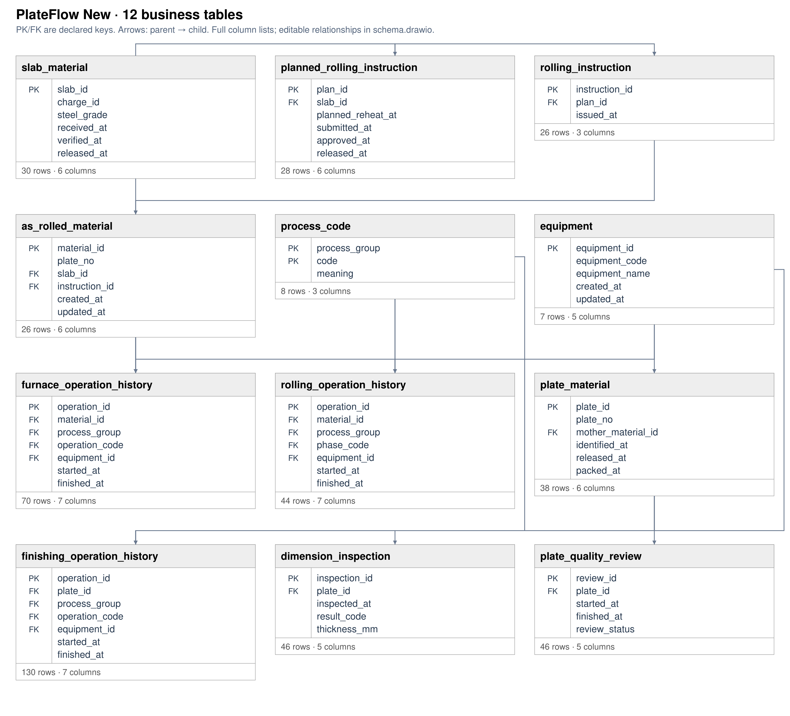</a>

<a href="../../../datasets/plateflow_new/docs/schema.png">Full-size diagram</a> · <a href="../../../datasets/plateflow_new/input/schema.sql">Full SQL schema</a>
</td></tr></table>

## N01 — Q1

For each slab, extract Slab Received, Slab Verified and Slab Released events.

Events: **86** · Cases with events: **30** · Activities: **3** · Edges: **2** · Source tables: **1** · SQL tables: **1**

<table><tr><td width="65%" valign="top"><a href="graphs/N01.svg">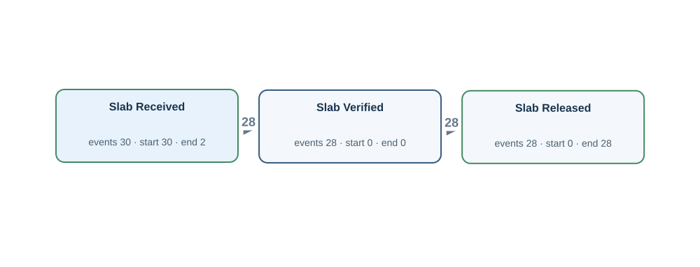</a> <a href="graphs/N01.svg">Open full-size DFG</a></td><td width="35%" valign="top"><h4>Original tables</h4>
Up to 3 matched rows per table. Shows keys, event times and carrier values.

<strong>slab_material</strong> · 30 matched rows
<table><tr><th>Row</th><th>Source values</th></tr><tr><td>1</td><td>slab_id = S001 received_at = 2026-01-04T11:20:00Z verified_at = NULL released_at = NULL</td></tr><tr><td>2</td><td>slab_id = S002 received_at = 2026-01-07T22:40:00Z verified_at = NULL released_at = NULL</td></tr><tr><td>3</td><td>slab_id = S003 received_at = 2026-01-11T10:00:00Z verified_at = 2026-01-11T10:10:00Z released_at = 2026-01-11T10:20:00Z</td></tr></table></td></tr></table>

[Gold CSV](../../../datasets/plateflow_new/private/gold_logs/N01.csv)

## N01P — Q2

Build a timeline for each slab showing its receipt, verification and release.

Events: **86** · Cases with events: **30** · Activities: **3** · Edges: **2** · Source tables: **1** · SQL tables: **1**

<table><tr><td width="65%" valign="top"> <a href="graphs/N01.svg">Open full-size DFG</a></td><td width="35%" valign="top"><h4>Original tables</h4>
Up to 3 matched rows per table. Shows keys, event times and carrier values.

<strong>slab_material</strong> · 30 matched rows
<table><tr><th>Row</th><th>Source values</th></tr><tr><td>1</td><td>slab_id = S001 received_at = 2026-01-04T11:20:00Z verified_at = NULL released_at = NULL</td></tr><tr><td>2</td><td>slab_id = S002 received_at = 2026-01-07T22:40:00Z verified_at = NULL released_at = NULL</td></tr><tr><td>3</td><td>slab_id = S003 received_at = 2026-01-11T10:00:00Z verified_at = 2026-01-11T10:10:00Z released_at = 2026-01-11T10:20:00Z</td></tr></table></td></tr></table>

[Gold CSV](../../../datasets/plateflow_new/private/gold_logs/N01P.csv)

## N02 — Q1

For each rolling plan, extract Rolling Plan Submitted, Rolling Plan Approved and Rolling Plan Released events.

Events: **80** · Cases with events: **28** · Activities: **3** · Edges: **2** · Source tables: **1** · SQL tables: **1**

<table><tr><td width="65%" valign="top"><a href="graphs/N02.svg">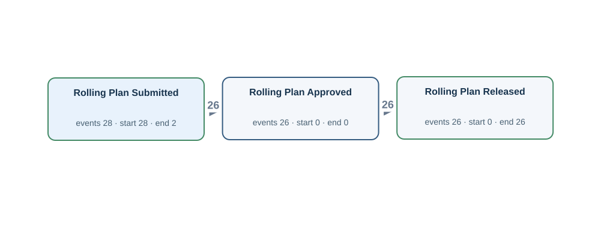</a> <a href="graphs/N02.svg">Open full-size DFG</a></td><td width="35%" valign="top"><h4>Original tables</h4>
Up to 3 matched rows per table. Shows keys, event times and carrier values.

<strong>planned_rolling_instruction</strong> · 28 matched rows
<table><tr><th>Row</th><th>Source values</th></tr><tr><td>1</td><td>plan_id = L003 submitted_at = 2026-01-11T10:30:00Z approved_at = NULL released_at = NULL</td></tr><tr><td>2</td><td>plan_id = L004 submitted_at = 2026-01-14T21:50:00Z approved_at = NULL released_at = NULL</td></tr><tr><td>3</td><td>plan_id = L005 submitted_at = 2026-01-18T09:10:00Z approved_at = 2026-01-18T09:20:00Z released_at = 2026-01-18T09:30:00Z</td></tr></table></td></tr></table>

[Gold CSV](../../../datasets/plateflow_new/private/gold_logs/N02.csv)

## N02P — Q2

For every rolling plan, show when it was submitted, approved and released.

Events: **80** · Cases with events: **28** · Activities: **3** · Edges: **2** · Source tables: **1** · SQL tables: **1**

<table><tr><td width="65%" valign="top"> <a href="graphs/N02.svg">Open full-size DFG</a></td><td width="35%" valign="top"><h4>Original tables</h4>
Up to 3 matched rows per table. Shows keys, event times and carrier values.

<strong>planned_rolling_instruction</strong> · 28 matched rows
<table><tr><th>Row</th><th>Source values</th></tr><tr><td>1</td><td>plan_id = L003 submitted_at = 2026-01-11T10:30:00Z approved_at = NULL released_at = NULL</td></tr><tr><td>2</td><td>plan_id = L004 submitted_at = 2026-01-14T21:50:00Z approved_at = NULL released_at = NULL</td></tr><tr><td>3</td><td>plan_id = L005 submitted_at = 2026-01-18T09:10:00Z approved_at = 2026-01-18T09:20:00Z released_at = 2026-01-18T09:30:00Z</td></tr></table></td></tr></table>

[Gold CSV](../../../datasets/plateflow_new/private/gold_logs/N02P.csv)

## N03 — Q1

For each rolling instruction, extract Rolling Instruction Issued, Heating Completed and Finish Rolling Completed events.

Events: **68** · Cases with events: **26** · Activities: **3** · Edges: **2** · Source tables: **3** · SQL tables: **4**

<table><tr><td width="65%" valign="top"><a href="graphs/N03.svg">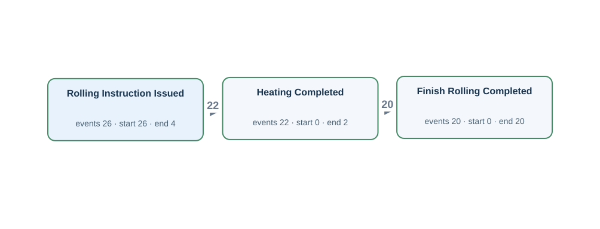</a> <a href="graphs/N03.svg">Open full-size DFG</a></td><td width="35%" valign="top"><h4>Original tables</h4>
Up to 3 matched rows per table. Shows keys, event times and carrier values.

<strong>furnace_operation_history</strong> · 22 matched rows
<table><tr><th>Row</th><th>Source values</th></tr><tr><td>1</td><td>operation_id = 0002 operation_code = HT finished_at = 2026-01-25T09:20:00Z</td></tr><tr><td>2</td><td>operation_id = 0005 operation_code = HT finished_at = 2026-01-28T20:40:00Z</td></tr><tr><td>3</td><td>operation_id = 0008 operation_code = HT finished_at = 2026-02-01T08:00:00Z</td></tr></table>
<strong>rolling_instruction</strong> · 26 matched rows
<table><tr><th>Row</th><th>Source values</th></tr><tr><td>1</td><td>instruction_id = I005 issued_at = 2026-01-18T09:40:00Z</td></tr><tr><td>2</td><td>instruction_id = I006 issued_at = 2026-01-21T21:00:00Z</td></tr><tr><td>3</td><td>instruction_id = I007 issued_at = 2026-01-25T08:20:00Z</td></tr></table>
<strong>rolling_operation_history</strong> · 20 matched rows
<table><tr><th>Row</th><th>Source values</th></tr><tr><td>1</td><td>operation_id = 0002 phase_code = FR finished_at = 2026-01-25T10:35:00Z</td></tr><tr><td>2</td><td>operation_id = 0004 phase_code = FR finished_at = 2026-01-28T21:55:00Z</td></tr><tr><td>3</td><td>operation_id = 0006 phase_code = FR finished_at = 2026-02-01T09:15:00Z</td></tr></table>

Other SQL tables

as_rolled_material

</td></tr></table>

[Gold CSV](../../../datasets/plateflow_new/private/gold_logs/N03.csv)

## N03P — Q2

For every rolling instruction, show its issue, the completion of heating and the completion of finish rolling.

Events: **68** · Cases with events: **26** · Activities: **3** · Edges: **2** · Source tables: **3** · SQL tables: **4**

<table><tr><td width="65%" valign="top"> <a href="graphs/N03.svg">Open full-size DFG</a></td><td width="35%" valign="top"><h4>Original tables</h4>
Up to 3 matched rows per table. Shows keys, event times and carrier values.

<strong>furnace_operation_history</strong> · 22 matched rows
<table><tr><th>Row</th><th>Source values</th></tr><tr><td>1</td><td>operation_id = 0002 operation_code = HT finished_at = 2026-01-25T09:20:00Z</td></tr><tr><td>2</td><td>operation_id = 0005 operation_code = HT finished_at = 2026-01-28T20:40:00Z</td></tr><tr><td>3</td><td>operation_id = 0008 operation_code = HT finished_at = 2026-02-01T08:00:00Z</td></tr></table>
<strong>rolling_instruction</strong> · 26 matched rows
<table><tr><th>Row</th><th>Source values</th></tr><tr><td>1</td><td>instruction_id = I005 issued_at = 2026-01-18T09:40:00Z</td></tr><tr><td>2</td><td>instruction_id = I006 issued_at = 2026-01-21T21:00:00Z</td></tr><tr><td>3</td><td>instruction_id = I007 issued_at = 2026-01-25T08:20:00Z</td></tr></table>
<strong>rolling_operation_history</strong> · 20 matched rows
<table><tr><th>Row</th><th>Source values</th></tr><tr><td>1</td><td>operation_id = 0002 phase_code = FR finished_at = 2026-01-25T10:35:00Z</td></tr><tr><td>2</td><td>operation_id = 0004 phase_code = FR finished_at = 2026-01-28T21:55:00Z</td></tr><tr><td>3</td><td>operation_id = 0006 phase_code = FR finished_at = 2026-02-01T09:15:00Z</td></tr></table>

Other SQL tables

as_rolled_material

</td></tr></table>

[Gold CSV](../../../datasets/plateflow_new/private/gold_logs/N03P.csv)

## N04 — Q1

For each mother material, extract Furnace Charged, Heating Completed, Furnace Discharged, Rough Rolling Completed and Finish Rolling Completed events.

Events: **110** · Cases with events: **24** · Activities: **5** · Edges: **4** · Source tables: **2** · SQL tables: **3**

<table><tr><td width="65%" valign="top"><a href="graphs/N04.svg">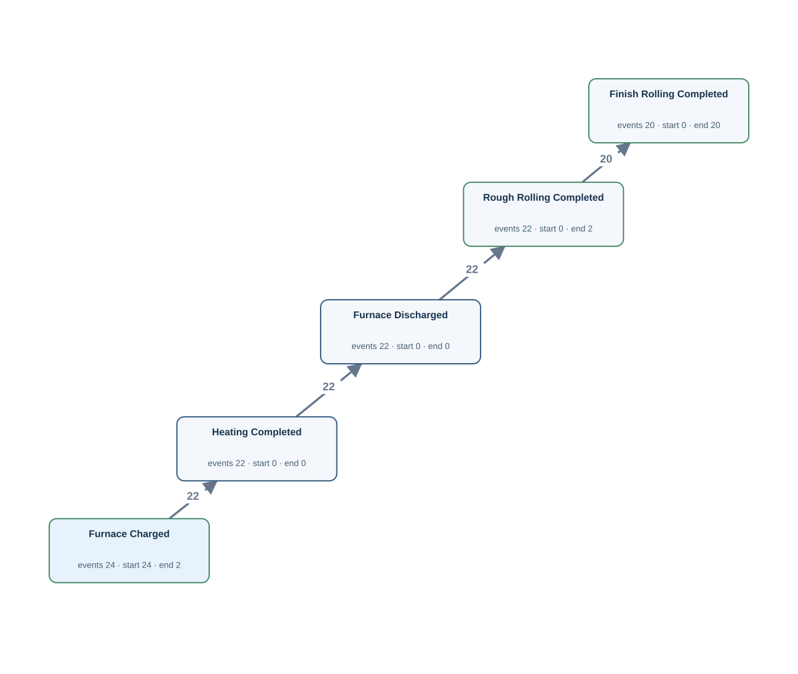</a> <a href="graphs/N04.svg">Open full-size DFG</a></td><td width="35%" valign="top"><h4>Original tables</h4>
Up to 3 matched rows per table. Shows keys, event times and carrier values.

<strong>furnace_operation_history</strong> · 68 matched rows
<table><tr><th>Row</th><th>Source values</th></tr><tr><td>1</td><td>operation_id = 0001 operation_code = CH finished_at = 2026-01-25T08:40:00Z</td></tr><tr><td>2</td><td>operation_id = 0002 operation_code = HT finished_at = 2026-01-25T09:20:00Z</td></tr><tr><td>3</td><td>operation_id = 0003 operation_code = DS finished_at = 2026-01-25T09:30:00Z</td></tr></table>
<strong>rolling_operation_history</strong> · 42 matched rows
<table><tr><th>Row</th><th>Source values</th></tr><tr><td>1</td><td>operation_id = 0001 phase_code = RR finished_at = 2026-01-25T10:00:00Z</td></tr><tr><td>2</td><td>operation_id = 0002 phase_code = FR finished_at = 2026-01-25T10:35:00Z</td></tr><tr><td>3</td><td>operation_id = 0003 phase_code = RR finished_at = 2026-01-28T21:20:00Z</td></tr></table>

Other SQL tables

as_rolled_material

</td></tr></table>

[Gold CSV](../../../datasets/plateflow_new/private/gold_logs/N04.csv)

## N04P — Q2

For each mother material, show the completion of charging into the furnace, heating, discharge from the furnace, rough rolling and finish rolling.

Events: **110** · Cases with events: **24** · Activities: **5** · Edges: **4** · Source tables: **2** · SQL tables: **3**

<table><tr><td width="65%" valign="top"> <a href="graphs/N04.svg">Open full-size DFG</a></td><td width="35%" valign="top"><h4>Original tables</h4>
Up to 3 matched rows per table. Shows keys, event times and carrier values.

<strong>furnace_operation_history</strong> · 68 matched rows
<table><tr><th>Row</th><th>Source values</th></tr><tr><td>1</td><td>operation_id = 0001 operation_code = CH finished_at = 2026-01-25T08:40:00Z</td></tr><tr><td>2</td><td>operation_id = 0002 operation_code = HT finished_at = 2026-01-25T09:20:00Z</td></tr><tr><td>3</td><td>operation_id = 0003 operation_code = DS finished_at = 2026-01-25T09:30:00Z</td></tr></table>
<strong>rolling_operation_history</strong> · 42 matched rows
<table><tr><th>Row</th><th>Source values</th></tr><tr><td>1</td><td>operation_id = 0001 phase_code = RR finished_at = 2026-01-25T10:00:00Z</td></tr><tr><td>2</td><td>operation_id = 0002 phase_code = FR finished_at = 2026-01-25T10:35:00Z</td></tr><tr><td>3</td><td>operation_id = 0003 phase_code = RR finished_at = 2026-01-28T21:20:00Z</td></tr></table>

Other SQL tables

as_rolled_material

</td></tr></table>

[Gold CSV](../../../datasets/plateflow_new/private/gold_logs/N04P.csv)

## N05 — Q1

For each mother material, extract Heat Treatment Completed, Surface Finishing Completed and Dimensional Inspection Completed events, including those of its descendant plate pieces.

Events: **138** · Cases with events: **20** · Activities: **3** · Edges: **3** · Source tables: **2** · SQL tables: **4**

<table><tr><td width="65%" valign="top"><a href="graphs/N05.svg">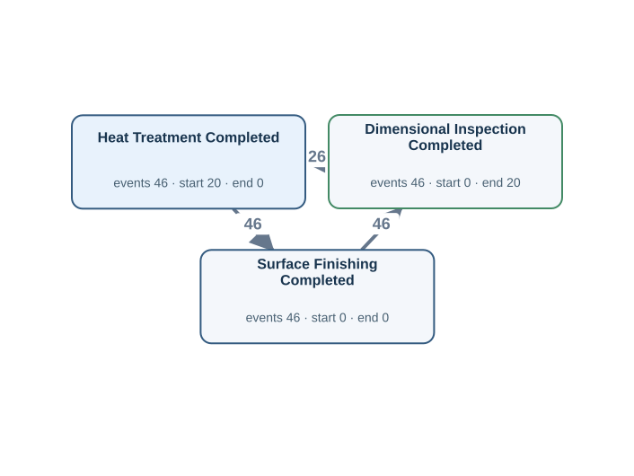</a> <a href="graphs/N05.svg">Open full-size DFG</a></td><td width="35%" valign="top"><h4>Original tables</h4>
Up to 3 matched rows per table. Shows keys, event times and carrier values.

<strong>dimension_inspection</strong> · 46 matched rows
<table><tr><th>Row</th><th>Source values</th></tr><tr><td>1</td><td>inspection_id = P007-1-1 inspected_at = 2026-01-25T20:35:00Z</td></tr><tr><td>2</td><td>inspection_id = P007-1-2 inspected_at = 2026-01-25T21:55:00Z</td></tr><tr><td>3</td><td>inspection_id = P007-2-1 inspected_at = 2026-01-26T04:55:00Z</td></tr></table>
<strong>finishing_operation_history</strong> · 92 matched rows
<table><tr><th>Row</th><th>Source values</th></tr><tr><td>1</td><td>operation_id = 0002 operation_code = HT finished_at = 2026-01-25T20:10:00Z</td></tr><tr><td>2</td><td>operation_id = 0003 operation_code = SF finished_at = 2026-01-25T20:25:00Z</td></tr><tr><td>3</td><td>operation_id = 0004 operation_code = HT finished_at = 2026-01-25T21:30:00Z</td></tr></table>

Other SQL tables

as_rolled_material, plate_material

</td></tr></table>

[Gold CSV](../../../datasets/plateflow_new/private/gold_logs/N05.csv)

## N05P — Q2

For every mother material, show when heat treatment, surface finishing and dimensional inspection were completed, including work on all plate pieces derived from it.

Events: **138** · Cases with events: **20** · Activities: **3** · Edges: **3** · Source tables: **2** · SQL tables: **4**

<table><tr><td width="65%" valign="top"> <a href="graphs/N05.svg">Open full-size DFG</a></td><td width="35%" valign="top"><h4>Original tables</h4>
Up to 3 matched rows per table. Shows keys, event times and carrier values.

<strong>dimension_inspection</strong> · 46 matched rows
<table><tr><th>Row</th><th>Source values</th></tr><tr><td>1</td><td>inspection_id = P007-1-1 inspected_at = 2026-01-25T20:35:00Z</td></tr><tr><td>2</td><td>inspection_id = P007-1-2 inspected_at = 2026-01-25T21:55:00Z</td></tr><tr><td>3</td><td>inspection_id = P007-2-1 inspected_at = 2026-01-26T04:55:00Z</td></tr></table>
<strong>finishing_operation_history</strong> · 92 matched rows
<table><tr><th>Row</th><th>Source values</th></tr><tr><td>1</td><td>operation_id = 0002 operation_code = HT finished_at = 2026-01-25T20:10:00Z</td></tr><tr><td>2</td><td>operation_id = 0003 operation_code = SF finished_at = 2026-01-25T20:25:00Z</td></tr><tr><td>3</td><td>operation_id = 0004 operation_code = HT finished_at = 2026-01-25T21:30:00Z</td></tr></table>

Other SQL tables

as_rolled_material, plate_material

</td></tr></table>

[Gold CSV](../../../datasets/plateflow_new/private/gold_logs/N05P.csv)

## N06 — Q1

For each plate piece, extract Leveling Completed, Heat Treatment Completed and Surface Finishing Completed events, retaining repeated occurrences.

Events: **130** · Cases with events: **38** · Activities: **3** · Edges: **3** · Source tables: **1** · SQL tables: **3**

<table><tr><td width="65%" valign="top"><a href="graphs/N06.svg">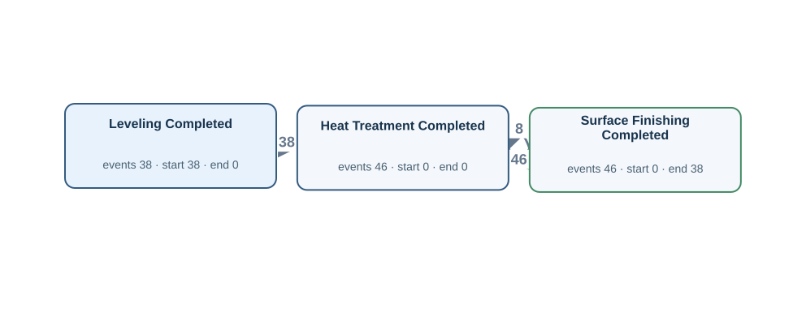</a> <a href="graphs/N06.svg">Open full-size DFG</a></td><td width="35%" valign="top"><h4>Original tables</h4>
Up to 3 matched rows per table. Shows keys, event times and carrier values.

<strong>finishing_operation_history</strong> · 130 matched rows
<table><tr><th>Row</th><th>Source values</th></tr><tr><td>1</td><td>operation_id = 0001 operation_code = LEV finished_at = 2026-01-25T19:45:00Z</td></tr><tr><td>2</td><td>operation_id = 0002 operation_code = HT finished_at = 2026-01-25T20:10:00Z</td></tr><tr><td>3</td><td>operation_id = 0003 operation_code = SF finished_at = 2026-01-25T20:25:00Z</td></tr></table>

Other SQL tables

as_rolled_material, plate_material

</td></tr></table>

[Gold CSV](../../../datasets/plateflow_new/private/gold_logs/N06.csv)

## N06P — Q2

For each plate piece, show every completed leveling, heat-treatment and surface-finishing operation, including repeat work.

Events: **130** · Cases with events: **38** · Activities: **3** · Edges: **3** · Source tables: **1** · SQL tables: **3**

<table><tr><td width="65%" valign="top"> <a href="graphs/N06.svg">Open full-size DFG</a></td><td width="35%" valign="top"><h4>Original tables</h4>
Up to 3 matched rows per table. Shows keys, event times and carrier values.

<strong>finishing_operation_history</strong> · 130 matched rows
<table><tr><th>Row</th><th>Source values</th></tr><tr><td>1</td><td>operation_id = 0001 operation_code = LEV finished_at = 2026-01-25T19:45:00Z</td></tr><tr><td>2</td><td>operation_id = 0002 operation_code = HT finished_at = 2026-01-25T20:10:00Z</td></tr><tr><td>3</td><td>operation_id = 0003 operation_code = SF finished_at = 2026-01-25T20:25:00Z</td></tr></table>

Other SQL tables

as_rolled_material, plate_material

</td></tr></table>

[Gold CSV](../../../datasets/plateflow_new/private/gold_logs/N06P.csv)

## N07 — Q1

For each plate piece, extract Dimensional Inspection Completed and Plate Quality Review Completed events.

Events: **89** · Cases with events: **38** · Activities: **2** · Edges: **2** · Source tables: **2** · SQL tables: **4**

<table><tr><td width="65%" valign="top"><a href="graphs/N07.svg">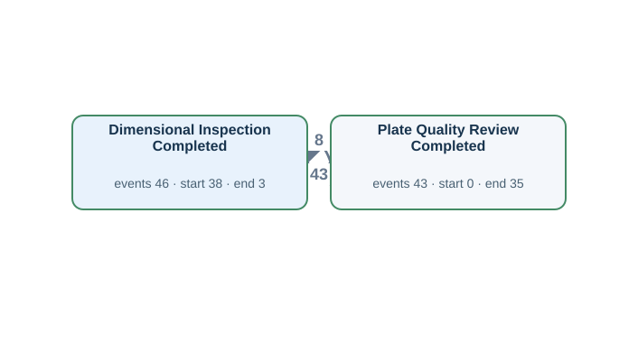</a> <a href="graphs/N07.svg">Open full-size DFG</a></td><td width="35%" valign="top"><h4>Original tables</h4>
Up to 3 matched rows per table. Shows keys, event times and carrier values.

<strong>dimension_inspection</strong> · 46 matched rows
<table><tr><th>Row</th><th>Source values</th></tr><tr><td>1</td><td>inspection_id = P007-1-1 inspected_at = 2026-01-25T20:35:00Z</td></tr><tr><td>2</td><td>inspection_id = P007-1-2 inspected_at = 2026-01-25T21:55:00Z</td></tr><tr><td>3</td><td>inspection_id = P007-2-1 inspected_at = 2026-01-26T04:55:00Z</td></tr></table>
<strong>plate_quality_review</strong> · 43 matched rows
<table><tr><th>Row</th><th>Source values</th></tr><tr><td>1</td><td>review_id = P007-1-1 finished_at = 2026-01-25T20:50:00Z</td></tr><tr><td>2</td><td>review_id = P007-1-2 finished_at = 2026-01-25T22:15:00Z</td></tr><tr><td>3</td><td>review_id = P007-2-1 finished_at = 2026-01-26T05:10:00Z</td></tr></table>

Other SQL tables

as_rolled_material, plate_material

</td></tr></table>

[Gold CSV](../../../datasets/plateflow_new/private/gold_logs/N07.csv)

## N07P — Q2

For every plate piece, show when its dimensional inspections and quality reviews finished.

Events: **89** · Cases with events: **38** · Activities: **2** · Edges: **2** · Source tables: **2** · SQL tables: **4**

<table><tr><td width="65%" valign="top"> <a href="graphs/N07.svg">Open full-size DFG</a></td><td width="35%" valign="top"><h4>Original tables</h4>
Up to 3 matched rows per table. Shows keys, event times and carrier values.

<strong>dimension_inspection</strong> · 46 matched rows
<table><tr><th>Row</th><th>Source values</th></tr><tr><td>1</td><td>inspection_id = P007-1-1 inspected_at = 2026-01-25T20:35:00Z</td></tr><tr><td>2</td><td>inspection_id = P007-1-2 inspected_at = 2026-01-25T21:55:00Z</td></tr><tr><td>3</td><td>inspection_id = P007-2-1 inspected_at = 2026-01-26T04:55:00Z</td></tr></table>
<strong>plate_quality_review</strong> · 43 matched rows
<table><tr><th>Row</th><th>Source values</th></tr><tr><td>1</td><td>review_id = P007-1-1 finished_at = 2026-01-25T20:50:00Z</td></tr><tr><td>2</td><td>review_id = P007-1-2 finished_at = 2026-01-25T22:15:00Z</td></tr><tr><td>3</td><td>review_id = P007-2-1 finished_at = 2026-01-26T05:10:00Z</td></tr></table>

Other SQL tables

as_rolled_material, plate_material

</td></tr></table>

[Gold CSV](../../../datasets/plateflow_new/private/gold_logs/N07P.csv)

## N08 — Q1

For each plate piece, extract Plate Identified, Plate Released and Plate Packed events.

Events: **99** · Cases with events: **38** · Activities: **3** · Edges: **2** · Source tables: **1** · SQL tables: **2**

<table><tr><td width="65%" valign="top"><a href="graphs/N08.svg">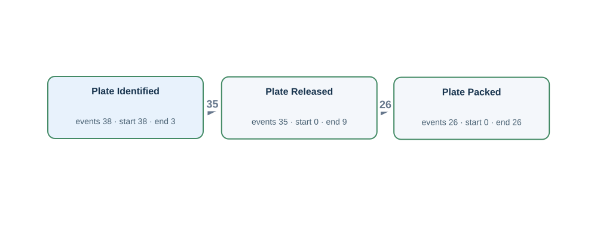</a> <a href="graphs/N08.svg">Open full-size DFG</a></td><td width="35%" valign="top"><h4>Original tables</h4>
Up to 3 matched rows per table. Shows keys, event times and carrier values.

<strong>plate_material</strong> · 38 matched rows
<table><tr><th>Row</th><th>Source values</th></tr><tr><td>1</td><td>plate_id = P007-1 identified_at = 2026-01-25T19:30:00Z released_at = 2026-01-25T22:30:00Z packed_at = 2026-01-25T22:50:00Z</td></tr><tr><td>2</td><td>plate_id = P007-2 identified_at = 2026-01-26T03:50:00Z released_at = 2026-01-26T05:30:00Z packed_at = 2026-01-26T05:50:00Z</td></tr><tr><td>3</td><td>plate_id = P008-1 identified_at = 2026-01-29T06:50:00Z released_at = 2026-01-29T08:30:00Z packed_at = 2026-01-29T08:50:00Z</td></tr></table>

Other SQL tables

as_rolled_material

</td></tr></table>

[Gold CSV](../../../datasets/plateflow_new/private/gold_logs/N08.csv)

## N08P — Q2

For each plate piece, show when it was identified, released and packed.

Events: **99** · Cases with events: **38** · Activities: **3** · Edges: **2** · Source tables: **1** · SQL tables: **2**

<table><tr><td width="65%" valign="top"> <a href="graphs/N08.svg">Open full-size DFG</a></td><td width="35%" valign="top"><h4>Original tables</h4>
Up to 3 matched rows per table. Shows keys, event times and carrier values.

<strong>plate_material</strong> · 38 matched rows
<table><tr><th>Row</th><th>Source values</th></tr><tr><td>1</td><td>plate_id = P007-1 identified_at = 2026-01-25T19:30:00Z released_at = 2026-01-25T22:30:00Z packed_at = 2026-01-25T22:50:00Z</td></tr><tr><td>2</td><td>plate_id = P007-2 identified_at = 2026-01-26T03:50:00Z released_at = 2026-01-26T05:30:00Z packed_at = 2026-01-26T05:50:00Z</td></tr><tr><td>3</td><td>plate_id = P008-1 identified_at = 2026-01-29T06:50:00Z released_at = 2026-01-29T08:30:00Z packed_at = 2026-01-29T08:50:00Z</td></tr></table>

Other SQL tables

as_rolled_material

</td></tr></table>

[Gold CSV](../../../datasets/plateflow_new/private/gold_logs/N08P.csv)

## N09 — Q1

For each dimension inspection record, extract Dimensional Inspection Completed events.

Events: **46** · Cases with events: **46** · Activities: **1** · Edges: **0** · Source tables: **1** · SQL tables: **1**

<table><tr><td width="65%" valign="top"><a href="graphs/N09.svg">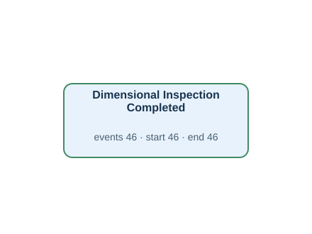</a> <a href="graphs/N09.svg">Open full-size DFG</a></td><td width="35%" valign="top"><h4>Original tables</h4>
Up to 3 matched rows per table. Shows keys, event times and carrier values.

<strong>dimension_inspection</strong> · 46 matched rows
<table><tr><th>Row</th><th>Source values</th></tr><tr><td>1</td><td>inspection_id = P007-1-1 inspected_at = 2026-01-25T20:35:00Z</td></tr><tr><td>2</td><td>inspection_id = P007-1-2 inspected_at = 2026-01-25T21:55:00Z</td></tr><tr><td>3</td><td>inspection_id = P007-2-1 inspected_at = 2026-01-26T04:55:00Z</td></tr></table></td></tr></table>

[Gold CSV](../../../datasets/plateflow_new/private/gold_logs/N09.csv)

## N09P — Q2

For each individual dimensional inspection record, show when the inspection finished.

Events: **46** · Cases with events: **46** · Activities: **1** · Edges: **0** · Source tables: **1** · SQL tables: **1**

<table><tr><td width="65%" valign="top"> <a href="graphs/N09.svg">Open full-size DFG</a></td><td width="35%" valign="top"><h4>Original tables</h4>
Up to 3 matched rows per table. Shows keys, event times and carrier values.

<strong>dimension_inspection</strong> · 46 matched rows
<table><tr><th>Row</th><th>Source values</th></tr><tr><td>1</td><td>inspection_id = P007-1-1 inspected_at = 2026-01-25T20:35:00Z</td></tr><tr><td>2</td><td>inspection_id = P007-1-2 inspected_at = 2026-01-25T21:55:00Z</td></tr><tr><td>3</td><td>inspection_id = P007-2-1 inspected_at = 2026-01-26T04:55:00Z</td></tr></table></td></tr></table>

[Gold CSV](../../../datasets/plateflow_new/private/gold_logs/N09P.csv)

## N10 — Q1

For each quality review record, extract Plate Quality Review Completed events.

Events: **43** · Cases with events: **43** · Activities: **1** · Edges: **0** · Source tables: **1** · SQL tables: **1**

<table><tr><td width="65%" valign="top"><a href="graphs/N10.svg">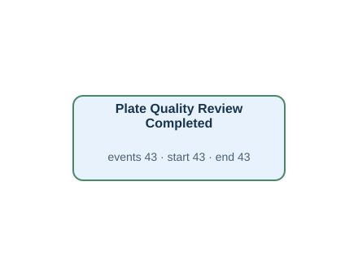</a> <a href="graphs/N10.svg">Open full-size DFG</a></td><td width="35%" valign="top"><h4>Original tables</h4>
Up to 3 matched rows per table. Shows keys, event times and carrier values.

<strong>plate_quality_review</strong> · 43 matched rows
<table><tr><th>Row</th><th>Source values</th></tr><tr><td>1</td><td>review_id = P007-1-1 finished_at = 2026-01-25T20:50:00Z</td></tr><tr><td>2</td><td>review_id = P007-1-2 finished_at = 2026-01-25T22:15:00Z</td></tr><tr><td>3</td><td>review_id = P007-2-1 finished_at = 2026-01-26T05:10:00Z</td></tr></table></td></tr></table>

[Gold CSV](../../../datasets/plateflow_new/private/gold_logs/N10.csv)

## N10P — Q2

For each individual quality review record, show when the review finished.

Events: **43** · Cases with events: **43** · Activities: **1** · Edges: **0** · Source tables: **1** · SQL tables: **1**

<table><tr><td width="65%" valign="top"> <a href="graphs/N10.svg">Open full-size DFG</a></td><td width="35%" valign="top"><h4>Original tables</h4>
Up to 3 matched rows per table. Shows keys, event times and carrier values.

<strong>plate_quality_review</strong> · 43 matched rows
<table><tr><th>Row</th><th>Source values</th></tr><tr><td>1</td><td>review_id = P007-1-1 finished_at = 2026-01-25T20:50:00Z</td></tr><tr><td>2</td><td>review_id = P007-1-2 finished_at = 2026-01-25T22:15:00Z</td></tr><tr><td>3</td><td>review_id = P007-2-1 finished_at = 2026-01-26T05:10:00Z</td></tr></table></td></tr></table>

[Gold CSV](../../../datasets/plateflow_new/private/gold_logs/N10P.csv)

## N11 — Q1

For each equipment unit, extract Heating Completed and Heat Treatment Completed events.

Events: **68** · Cases with events: **4** · Activities: **2** · Edges: **2** · Source tables: **2** · SQL tables: **2**

<table><tr><td width="65%" valign="top"><a href="graphs/N11.svg">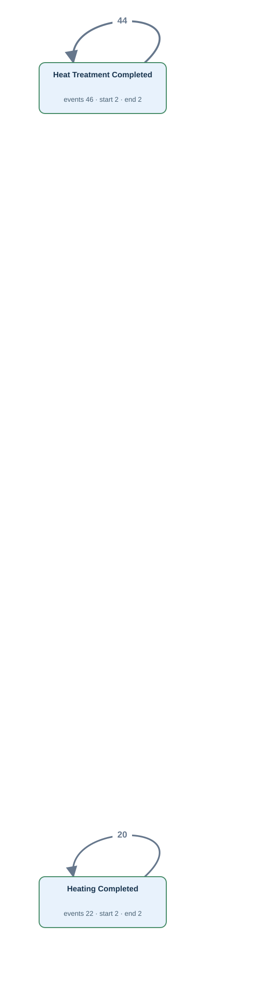</a> <a href="graphs/N11.svg">Open full-size DFG</a></td><td width="35%" valign="top"><h4>Original tables</h4>
Up to 3 matched rows per table. Shows keys, event times and carrier values.

<strong>finishing_operation_history</strong> · 46 matched rows
<table><tr><th>Row</th><th>Source values</th></tr><tr><td>1</td><td>operation_id = 0002 operation_code = HT finished_at = 2026-01-25T20:10:00Z</td></tr><tr><td>2</td><td>operation_id = 0004 operation_code = HT finished_at = 2026-01-25T21:30:00Z</td></tr><tr><td>3</td><td>operation_id = 0013 operation_code = HT finished_at = 2026-01-29T15:50:00Z</td></tr></table>
<strong>furnace_operation_history</strong> · 22 matched rows
<table><tr><th>Row</th><th>Source values</th></tr><tr><td>1</td><td>operation_id = 0005 operation_code = HT finished_at = 2026-01-28T20:40:00Z</td></tr><tr><td>2</td><td>operation_id = 0011 operation_code = HT finished_at = 2026-02-04T19:20:00Z</td></tr><tr><td>3</td><td>operation_id = 0016 operation_code = HT finished_at = 2026-02-11T18:00:00Z</td></tr></table></td></tr></table>

[Gold CSV](../../../datasets/plateflow_new/private/gold_logs/N11.csv)

## N11P — Q2

For each equipment unit, show the completion of heating and of heat treatment.

Events: **68** · Cases with events: **4** · Activities: **2** · Edges: **2** · Source tables: **2** · SQL tables: **2**

<table><tr><td width="65%" valign="top"> <a href="graphs/N11.svg">Open full-size DFG</a></td><td width="35%" valign="top"><h4>Original tables</h4>
Up to 3 matched rows per table. Shows keys, event times and carrier values.

<strong>finishing_operation_history</strong> · 46 matched rows
<table><tr><th>Row</th><th>Source values</th></tr><tr><td>1</td><td>operation_id = 0002 operation_code = HT finished_at = 2026-01-25T20:10:00Z</td></tr><tr><td>2</td><td>operation_id = 0004 operation_code = HT finished_at = 2026-01-25T21:30:00Z</td></tr><tr><td>3</td><td>operation_id = 0013 operation_code = HT finished_at = 2026-01-29T15:50:00Z</td></tr></table>
<strong>furnace_operation_history</strong> · 22 matched rows
<table><tr><th>Row</th><th>Source values</th></tr><tr><td>1</td><td>operation_id = 0005 operation_code = HT finished_at = 2026-01-28T20:40:00Z</td></tr><tr><td>2</td><td>operation_id = 0011 operation_code = HT finished_at = 2026-02-04T19:20:00Z</td></tr><tr><td>3</td><td>operation_id = 0016 operation_code = HT finished_at = 2026-02-11T18:00:00Z</td></tr></table></td></tr></table>

[Gold CSV](../../../datasets/plateflow_new/private/gold_logs/N11P.csv)

## N12 — Q1

For each furnace operation record, extract Furnace Charged, Heating Completed and Furnace Discharged events.

Events: **68** · Cases with events: **68** · Activities: **3** · Edges: **0** · Source tables: **1** · SQL tables: **1**

<table><tr><td width="65%" valign="top"><a href="graphs/N12.svg">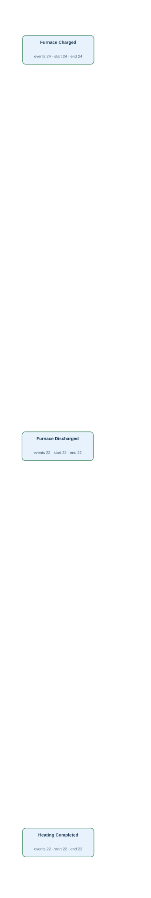</a> <a href="graphs/N12.svg">Open full-size DFG</a></td><td width="35%" valign="top"><h4>Original tables</h4>
Up to 3 matched rows per table. Shows keys, event times and carrier values.

<strong>furnace_operation_history</strong> · 68 matched rows
<table><tr><th>Row</th><th>Source values</th></tr><tr><td>1</td><td>operation_id = 0001 operation_code = CH finished_at = 2026-01-25T08:40:00Z</td></tr><tr><td>2</td><td>operation_id = 0002 operation_code = HT finished_at = 2026-01-25T09:20:00Z</td></tr><tr><td>3</td><td>operation_id = 0003 operation_code = DS finished_at = 2026-01-25T09:30:00Z</td></tr></table></td></tr></table>

[Gold CSV](../../../datasets/plateflow_new/private/gold_logs/N12.csv)

## N12P — Q2

For every furnace operation record, show the recorded completion of furnace charging, heating or furnace discharge, as applicable.

Events: **68** · Cases with events: **68** · Activities: **3** · Edges: **0** · Source tables: **1** · SQL tables: **1**

<table><tr><td width="65%" valign="top"> <a href="graphs/N12.svg">Open full-size DFG</a></td><td width="35%" valign="top"><h4>Original tables</h4>
Up to 3 matched rows per table. Shows keys, event times and carrier values.

<strong>furnace_operation_history</strong> · 68 matched rows
<table><tr><th>Row</th><th>Source values</th></tr><tr><td>1</td><td>operation_id = 0001 operation_code = CH finished_at = 2026-01-25T08:40:00Z</td></tr><tr><td>2</td><td>operation_id = 0002 operation_code = HT finished_at = 2026-01-25T09:20:00Z</td></tr><tr><td>3</td><td>operation_id = 0003 operation_code = DS finished_at = 2026-01-25T09:30:00Z</td></tr></table></td></tr></table>

[Gold CSV](../../../datasets/plateflow_new/private/gold_logs/N12P.csv)

## N13 — Q1

For each rolling operation record, extract Rough Rolling Completed and Finish Rolling Completed events.

Events: **42** · Cases with events: **42** · Activities: **2** · Edges: **0** · Source tables: **1** · SQL tables: **1**

<table><tr><td width="65%" valign="top"><a href="graphs/N13.svg">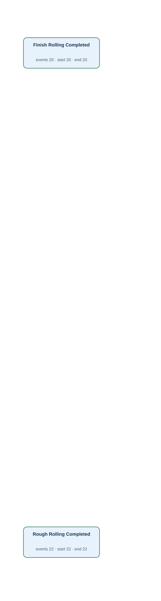</a> <a href="graphs/N13.svg">Open full-size DFG</a></td><td width="35%" valign="top"><h4>Original tables</h4>
Up to 3 matched rows per table. Shows keys, event times and carrier values.

<strong>rolling_operation_history</strong> · 42 matched rows
<table><tr><th>Row</th><th>Source values</th></tr><tr><td>1</td><td>operation_id = 0001 phase_code = RR finished_at = 2026-01-25T10:00:00Z</td></tr><tr><td>2</td><td>operation_id = 0002 phase_code = FR finished_at = 2026-01-25T10:35:00Z</td></tr><tr><td>3</td><td>operation_id = 0003 phase_code = RR finished_at = 2026-01-28T21:20:00Z</td></tr></table></td></tr></table>

[Gold CSV](../../../datasets/plateflow_new/private/gold_logs/N13.csv)

## N13P — Q2

For every rolling operation record, show the recorded completion of rough rolling or finish rolling, as applicable.

Events: **42** · Cases with events: **42** · Activities: **2** · Edges: **0** · Source tables: **1** · SQL tables: **1**

<table><tr><td width="65%" valign="top"> <a href="graphs/N13.svg">Open full-size DFG</a></td><td width="35%" valign="top"><h4>Original tables</h4>
Up to 3 matched rows per table. Shows keys, event times and carrier values.

<strong>rolling_operation_history</strong> · 42 matched rows
<table><tr><th>Row</th><th>Source values</th></tr><tr><td>1</td><td>operation_id = 0001 phase_code = RR finished_at = 2026-01-25T10:00:00Z</td></tr><tr><td>2</td><td>operation_id = 0002 phase_code = FR finished_at = 2026-01-25T10:35:00Z</td></tr><tr><td>3</td><td>operation_id = 0003 phase_code = RR finished_at = 2026-01-28T21:20:00Z</td></tr></table></td></tr></table>

[Gold CSV](../../../datasets/plateflow_new/private/gold_logs/N13P.csv)

## N14 — Q1

For each finishing operation record, extract Leveling Completed, Heat Treatment Completed and Surface Finishing Completed events.

Events: **130** · Cases with events: **130** · Activities: **3** · Edges: **0** · Source tables: **1** · SQL tables: **1**

<table><tr><td width="65%" valign="top"><a href="graphs/N14.svg">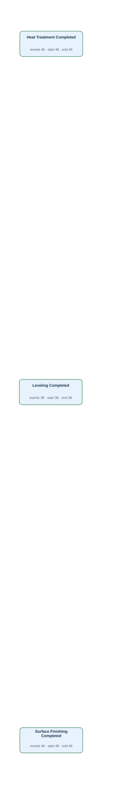</a> <a href="graphs/N14.svg">Open full-size DFG</a></td><td width="35%" valign="top"><h4>Original tables</h4>
Up to 3 matched rows per table. Shows keys, event times and carrier values.

<strong>finishing_operation_history</strong> · 130 matched rows
<table><tr><th>Row</th><th>Source values</th></tr><tr><td>1</td><td>operation_id = 0001 operation_code = LEV finished_at = 2026-01-25T19:45:00Z</td></tr><tr><td>2</td><td>operation_id = 0002 operation_code = HT finished_at = 2026-01-25T20:10:00Z</td></tr><tr><td>3</td><td>operation_id = 0003 operation_code = SF finished_at = 2026-01-25T20:25:00Z</td></tr></table></td></tr></table>

[Gold CSV](../../../datasets/plateflow_new/private/gold_logs/N14.csv)

## N14P — Q2

For every finishing operation record, show the recorded completion of leveling, heat treatment or surface finishing, as applicable.

Events: **130** · Cases with events: **130** · Activities: **3** · Edges: **0** · Source tables: **1** · SQL tables: **1**

<table><tr><td width="65%" valign="top"> <a href="graphs/N14.svg">Open full-size DFG</a></td><td width="35%" valign="top"><h4>Original tables</h4>
Up to 3 matched rows per table. Shows keys, event times and carrier values.

<strong>finishing_operation_history</strong> · 130 matched rows
<table><tr><th>Row</th><th>Source values</th></tr><tr><td>1</td><td>operation_id = 0001 operation_code = LEV finished_at = 2026-01-25T19:45:00Z</td></tr><tr><td>2</td><td>operation_id = 0002 operation_code = HT finished_at = 2026-01-25T20:10:00Z</td></tr><tr><td>3</td><td>operation_id = 0003 operation_code = SF finished_at = 2026-01-25T20:25:00Z</td></tr></table></td></tr></table>

[Gold CSV](../../../datasets/plateflow_new/private/gold_logs/N14P.csv)

## N15 — Q1

For each slab, extract Steel Cast events.

**No Gold log:** No corresponding casting or dispatch records or actual times are stored.

## N15P — Q2

For each slab, show when the steel was cast.

**No Gold log:** No corresponding casting or dispatch records or actual times are stored.

## N16 — Q1

For each plate piece, extract Truck Dispatched events.

**No Gold log:** No corresponding casting or dispatch records or actual times are stored.

## N16P — Q2

For each plate piece, show when its truck was dispatched.

**No Gold log:** No corresponding casting or dispatch records or actual times are stored.

## NF01 — Q3

Extract the full recorded lifecycle for each slab.

Events: **620** · Cases with events: **30** · Activities: **20** · Edges: **23** · Source tables: **9** · SQL tables: **10**

<table><tr><td width="65%" valign="top"><a href="graphs/NF01.svg">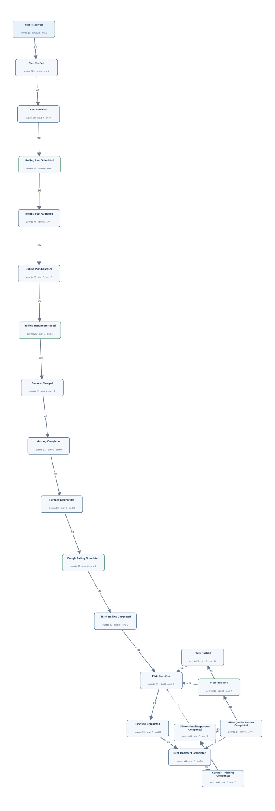</a> <a href="graphs/NF01.svg">Open full-size DFG</a></td><td width="35%" valign="top"><h4>Original tables</h4>
Up to 3 matched rows per table. Shows keys, event times and carrier values.

<strong>dimension_inspection</strong> · 46 matched rows
<table><tr><th>Row</th><th>Source values</th></tr><tr><td>1</td><td>inspection_id = P007-1-1 inspected_at = 2026-01-25T20:35:00Z</td></tr><tr><td>2</td><td>inspection_id = P007-1-2 inspected_at = 2026-01-25T21:55:00Z</td></tr><tr><td>3</td><td>inspection_id = P007-2-1 inspected_at = 2026-01-26T04:55:00Z</td></tr></table>
<strong>finishing_operation_history</strong> · 130 matched rows
<table><tr><th>Row</th><th>Source values</th></tr><tr><td>1</td><td>operation_id = 0001 operation_code = LEV finished_at = 2026-01-25T19:45:00Z</td></tr><tr><td>2</td><td>operation_id = 0002 operation_code = HT finished_at = 2026-01-25T20:10:00Z</td></tr><tr><td>3</td><td>operation_id = 0003 operation_code = SF finished_at = 2026-01-25T20:25:00Z</td></tr></table>
<strong>furnace_operation_history</strong> · 68 matched rows
<table><tr><th>Row</th><th>Source values</th></tr><tr><td>1</td><td>operation_id = 0001 operation_code = CH finished_at = 2026-01-25T08:40:00Z</td></tr><tr><td>2</td><td>operation_id = 0002 operation_code = HT finished_at = 2026-01-25T09:20:00Z</td></tr><tr><td>3</td><td>operation_id = 0003 operation_code = DS finished_at = 2026-01-25T09:30:00Z</td></tr></table>
<strong>planned_rolling_instruction</strong> · 28 matched rows
<table><tr><th>Row</th><th>Source values</th></tr><tr><td>1</td><td>plan_id = L003 submitted_at = 2026-01-11T10:30:00Z approved_at = NULL released_at = NULL</td></tr><tr><td>2</td><td>plan_id = L004 submitted_at = 2026-01-14T21:50:00Z approved_at = NULL released_at = NULL</td></tr><tr><td>3</td><td>plan_id = L005 submitted_at = 2026-01-18T09:10:00Z approved_at = 2026-01-18T09:20:00Z released_at = 2026-01-18T09:30:00Z</td></tr></table>
<strong>plate_material</strong> · 38 matched rows
<table><tr><th>Row</th><th>Source values</th></tr><tr><td>1</td><td>plate_id = P007-1 identified_at = 2026-01-25T19:30:00Z released_at = 2026-01-25T22:30:00Z packed_at = 2026-01-25T22:50:00Z</td></tr><tr><td>2</td><td>plate_id = P007-2 identified_at = 2026-01-26T03:50:00Z released_at = 2026-01-26T05:30:00Z packed_at = 2026-01-26T05:50:00Z</td></tr><tr><td>3</td><td>plate_id = P008-1 identified_at = 2026-01-29T06:50:00Z released_at = 2026-01-29T08:30:00Z packed_at = 2026-01-29T08:50:00Z</td></tr></table>
<strong>plate_quality_review</strong> · 43 matched rows
<table><tr><th>Row</th><th>Source values</th></tr><tr><td>1</td><td>review_id = P007-1-1 finished_at = 2026-01-25T20:50:00Z</td></tr><tr><td>2</td><td>review_id = P007-1-2 finished_at = 2026-01-25T22:15:00Z</td></tr><tr><td>3</td><td>review_id = P007-2-1 finished_at = 2026-01-26T05:10:00Z</td></tr></table>
<strong>rolling_instruction</strong> · 26 matched rows
<table><tr><th>Row</th><th>Source values</th></tr><tr><td>1</td><td>instruction_id = I005 issued_at = 2026-01-18T09:40:00Z</td></tr><tr><td>2</td><td>instruction_id = I006 issued_at = 2026-01-21T21:00:00Z</td></tr><tr><td>3</td><td>instruction_id = I007 issued_at = 2026-01-25T08:20:00Z</td></tr></table>
<strong>rolling_operation_history</strong> · 42 matched rows
<table><tr><th>Row</th><th>Source values</th></tr><tr><td>1</td><td>operation_id = 0001 phase_code = RR finished_at = 2026-01-25T10:00:00Z</td></tr><tr><td>2</td><td>operation_id = 0002 phase_code = FR finished_at = 2026-01-25T10:35:00Z</td></tr><tr><td>3</td><td>operation_id = 0003 phase_code = RR finished_at = 2026-01-28T21:20:00Z</td></tr></table>
<strong>slab_material</strong> · 30 matched rows
<table><tr><th>Row</th><th>Source values</th></tr><tr><td>1</td><td>slab_id = S001 received_at = 2026-01-04T11:20:00Z verified_at = NULL released_at = NULL</td></tr><tr><td>2</td><td>slab_id = S002 received_at = 2026-01-07T22:40:00Z verified_at = NULL released_at = NULL</td></tr><tr><td>3</td><td>slab_id = S003 received_at = 2026-01-11T10:00:00Z verified_at = 2026-01-11T10:10:00Z released_at = 2026-01-11T10:20:00Z</td></tr></table>

Other SQL tables

as_rolled_material

</td></tr></table>

[Gold CSV](../../../datasets/plateflow_new/private/gold_logs/NF01.csv)

## NF01P — Q4

Show the complete recorded history of each slab.

Events: **620** · Cases with events: **30** · Activities: **20** · Edges: **23** · Source tables: **9** · SQL tables: **10**

<table><tr><td width="65%" valign="top"> <a href="graphs/NF01.svg">Open full-size DFG</a></td><td width="35%" valign="top"><h4>Original tables</h4>
Up to 3 matched rows per table. Shows keys, event times and carrier values.

<strong>dimension_inspection</strong> · 46 matched rows
<table><tr><th>Row</th><th>Source values</th></tr><tr><td>1</td><td>inspection_id = P007-1-1 inspected_at = 2026-01-25T20:35:00Z</td></tr><tr><td>2</td><td>inspection_id = P007-1-2 inspected_at = 2026-01-25T21:55:00Z</td></tr><tr><td>3</td><td>inspection_id = P007-2-1 inspected_at = 2026-01-26T04:55:00Z</td></tr></table>
<strong>finishing_operation_history</strong> · 130 matched rows
<table><tr><th>Row</th><th>Source values</th></tr><tr><td>1</td><td>operation_id = 0001 operation_code = LEV finished_at = 2026-01-25T19:45:00Z</td></tr><tr><td>2</td><td>operation_id = 0002 operation_code = HT finished_at = 2026-01-25T20:10:00Z</td></tr><tr><td>3</td><td>operation_id = 0003 operation_code = SF finished_at = 2026-01-25T20:25:00Z</td></tr></table>
<strong>furnace_operation_history</strong> · 68 matched rows
<table><tr><th>Row</th><th>Source values</th></tr><tr><td>1</td><td>operation_id = 0001 operation_code = CH finished_at = 2026-01-25T08:40:00Z</td></tr><tr><td>2</td><td>operation_id = 0002 operation_code = HT finished_at = 2026-01-25T09:20:00Z</td></tr><tr><td>3</td><td>operation_id = 0003 operation_code = DS finished_at = 2026-01-25T09:30:00Z</td></tr></table>
<strong>planned_rolling_instruction</strong> · 28 matched rows
<table><tr><th>Row</th><th>Source values</th></tr><tr><td>1</td><td>plan_id = L003 submitted_at = 2026-01-11T10:30:00Z approved_at = NULL released_at = NULL</td></tr><tr><td>2</td><td>plan_id = L004 submitted_at = 2026-01-14T21:50:00Z approved_at = NULL released_at = NULL</td></tr><tr><td>3</td><td>plan_id = L005 submitted_at = 2026-01-18T09:10:00Z approved_at = 2026-01-18T09:20:00Z released_at = 2026-01-18T09:30:00Z</td></tr></table>
<strong>plate_material</strong> · 38 matched rows
<table><tr><th>Row</th><th>Source values</th></tr><tr><td>1</td><td>plate_id = P007-1 identified_at = 2026-01-25T19:30:00Z released_at = 2026-01-25T22:30:00Z packed_at = 2026-01-25T22:50:00Z</td></tr><tr><td>2</td><td>plate_id = P007-2 identified_at = 2026-01-26T03:50:00Z released_at = 2026-01-26T05:30:00Z packed_at = 2026-01-26T05:50:00Z</td></tr><tr><td>3</td><td>plate_id = P008-1 identified_at = 2026-01-29T06:50:00Z released_at = 2026-01-29T08:30:00Z packed_at = 2026-01-29T08:50:00Z</td></tr></table>
<strong>plate_quality_review</strong> · 43 matched rows
<table><tr><th>Row</th><th>Source values</th></tr><tr><td>1</td><td>review_id = P007-1-1 finished_at = 2026-01-25T20:50:00Z</td></tr><tr><td>2</td><td>review_id = P007-1-2 finished_at = 2026-01-25T22:15:00Z</td></tr><tr><td>3</td><td>review_id = P007-2-1 finished_at = 2026-01-26T05:10:00Z</td></tr></table>
<strong>rolling_instruction</strong> · 26 matched rows
<table><tr><th>Row</th><th>Source values</th></tr><tr><td>1</td><td>instruction_id = I005 issued_at = 2026-01-18T09:40:00Z</td></tr><tr><td>2</td><td>instruction_id = I006 issued_at = 2026-01-21T21:00:00Z</td></tr><tr><td>3</td><td>instruction_id = I007 issued_at = 2026-01-25T08:20:00Z</td></tr></table>
<strong>rolling_operation_history</strong> · 42 matched rows
<table><tr><th>Row</th><th>Source values</th></tr><tr><td>1</td><td>operation_id = 0001 phase_code = RR finished_at = 2026-01-25T10:00:00Z</td></tr><tr><td>2</td><td>operation_id = 0002 phase_code = FR finished_at = 2026-01-25T10:35:00Z</td></tr><tr><td>3</td><td>operation_id = 0003 phase_code = RR finished_at = 2026-01-28T21:20:00Z</td></tr></table>
<strong>slab_material</strong> · 30 matched rows
<table><tr><th>Row</th><th>Source values</th></tr><tr><td>1</td><td>slab_id = S001 received_at = 2026-01-04T11:20:00Z verified_at = NULL released_at = NULL</td></tr><tr><td>2</td><td>slab_id = S002 received_at = 2026-01-07T22:40:00Z verified_at = NULL released_at = NULL</td></tr><tr><td>3</td><td>slab_id = S003 received_at = 2026-01-11T10:00:00Z verified_at = 2026-01-11T10:10:00Z released_at = 2026-01-11T10:20:00Z</td></tr></table>

Other SQL tables

as_rolled_material

</td></tr></table>

[Gold CSV](../../../datasets/plateflow_new/private/gold_logs/NF01P.csv)

## NF02 — Q3

Extract the full recorded lifecycle for each rolling plan.

Events: **106** · Cases with events: **28** · Activities: **4** · Edges: **3** · Source tables: **2** · SQL tables: **2**

<table><tr><td width="65%" valign="top"><a href="graphs/NF02.svg">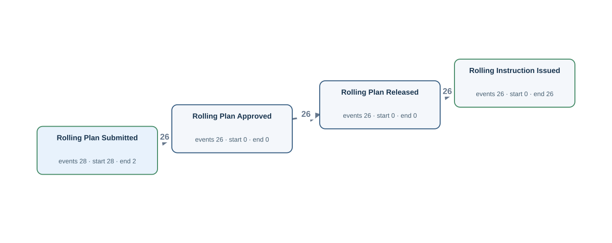</a> <a href="graphs/NF02.svg">Open full-size DFG</a></td><td width="35%" valign="top"><h4>Original tables</h4>
Up to 3 matched rows per table. Shows keys, event times and carrier values.

<strong>planned_rolling_instruction</strong> · 28 matched rows
<table><tr><th>Row</th><th>Source values</th></tr><tr><td>1</td><td>plan_id = L003 submitted_at = 2026-01-11T10:30:00Z approved_at = NULL released_at = NULL</td></tr><tr><td>2</td><td>plan_id = L004 submitted_at = 2026-01-14T21:50:00Z approved_at = NULL released_at = NULL</td></tr><tr><td>3</td><td>plan_id = L005 submitted_at = 2026-01-18T09:10:00Z approved_at = 2026-01-18T09:20:00Z released_at = 2026-01-18T09:30:00Z</td></tr></table>
<strong>rolling_instruction</strong> · 26 matched rows
<table><tr><th>Row</th><th>Source values</th></tr><tr><td>1</td><td>instruction_id = I005 issued_at = 2026-01-18T09:40:00Z</td></tr><tr><td>2</td><td>instruction_id = I006 issued_at = 2026-01-21T21:00:00Z</td></tr><tr><td>3</td><td>instruction_id = I007 issued_at = 2026-01-25T08:20:00Z</td></tr></table></td></tr></table>

[Gold CSV](../../../datasets/plateflow_new/private/gold_logs/NF02.csv)

## NF02P — Q4

Build the entire recorded timeline for every rolling plan.

Events: **106** · Cases with events: **28** · Activities: **4** · Edges: **3** · Source tables: **2** · SQL tables: **2**

<table><tr><td width="65%" valign="top"> <a href="graphs/NF02.svg">Open full-size DFG</a></td><td width="35%" valign="top"><h4>Original tables</h4>
Up to 3 matched rows per table. Shows keys, event times and carrier values.

<strong>planned_rolling_instruction</strong> · 28 matched rows
<table><tr><th>Row</th><th>Source values</th></tr><tr><td>1</td><td>plan_id = L003 submitted_at = 2026-01-11T10:30:00Z approved_at = NULL released_at = NULL</td></tr><tr><td>2</td><td>plan_id = L004 submitted_at = 2026-01-14T21:50:00Z approved_at = NULL released_at = NULL</td></tr><tr><td>3</td><td>plan_id = L005 submitted_at = 2026-01-18T09:10:00Z approved_at = 2026-01-18T09:20:00Z released_at = 2026-01-18T09:30:00Z</td></tr></table>
<strong>rolling_instruction</strong> · 26 matched rows
<table><tr><th>Row</th><th>Source values</th></tr><tr><td>1</td><td>instruction_id = I005 issued_at = 2026-01-18T09:40:00Z</td></tr><tr><td>2</td><td>instruction_id = I006 issued_at = 2026-01-21T21:00:00Z</td></tr><tr><td>3</td><td>instruction_id = I007 issued_at = 2026-01-25T08:20:00Z</td></tr></table></td></tr></table>

[Gold CSV](../../../datasets/plateflow_new/private/gold_logs/NF02P.csv)

## NF03 — Q3

Extract the full recorded lifecycle for each rolling instruction.

Events: **454** · Cases with events: **26** · Activities: **14** · Edges: **17** · Source tables: **7** · SQL tables: **8**

<table><tr><td width="65%" valign="top"><a href="graphs/NF03.svg">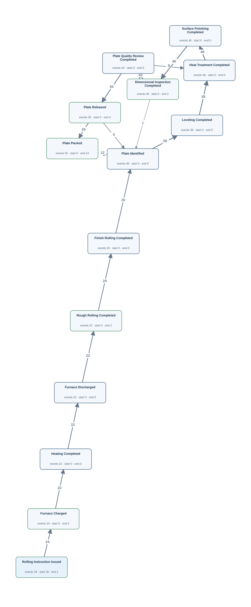</a> <a href="graphs/NF03.svg">Open full-size DFG</a></td><td width="35%" valign="top"><h4>Original tables</h4>
Up to 3 matched rows per table. Shows keys, event times and carrier values.

<strong>dimension_inspection</strong> · 46 matched rows
<table><tr><th>Row</th><th>Source values</th></tr><tr><td>1</td><td>inspection_id = P007-1-1 inspected_at = 2026-01-25T20:35:00Z</td></tr><tr><td>2</td><td>inspection_id = P007-1-2 inspected_at = 2026-01-25T21:55:00Z</td></tr><tr><td>3</td><td>inspection_id = P007-2-1 inspected_at = 2026-01-26T04:55:00Z</td></tr></table>
<strong>finishing_operation_history</strong> · 130 matched rows
<table><tr><th>Row</th><th>Source values</th></tr><tr><td>1</td><td>operation_id = 0001 operation_code = LEV finished_at = 2026-01-25T19:45:00Z</td></tr><tr><td>2</td><td>operation_id = 0002 operation_code = HT finished_at = 2026-01-25T20:10:00Z</td></tr><tr><td>3</td><td>operation_id = 0003 operation_code = SF finished_at = 2026-01-25T20:25:00Z</td></tr></table>
<strong>furnace_operation_history</strong> · 68 matched rows
<table><tr><th>Row</th><th>Source values</th></tr><tr><td>1</td><td>operation_id = 0001 operation_code = CH finished_at = 2026-01-25T08:40:00Z</td></tr><tr><td>2</td><td>operation_id = 0002 operation_code = HT finished_at = 2026-01-25T09:20:00Z</td></tr><tr><td>3</td><td>operation_id = 0003 operation_code = DS finished_at = 2026-01-25T09:30:00Z</td></tr></table>
<strong>plate_material</strong> · 38 matched rows
<table><tr><th>Row</th><th>Source values</th></tr><tr><td>1</td><td>plate_id = P007-1 identified_at = 2026-01-25T19:30:00Z released_at = 2026-01-25T22:30:00Z packed_at = 2026-01-25T22:50:00Z</td></tr><tr><td>2</td><td>plate_id = P007-2 identified_at = 2026-01-26T03:50:00Z released_at = 2026-01-26T05:30:00Z packed_at = 2026-01-26T05:50:00Z</td></tr><tr><td>3</td><td>plate_id = P008-1 identified_at = 2026-01-29T06:50:00Z released_at = 2026-01-29T08:30:00Z packed_at = 2026-01-29T08:50:00Z</td></tr></table>
<strong>plate_quality_review</strong> · 43 matched rows
<table><tr><th>Row</th><th>Source values</th></tr><tr><td>1</td><td>review_id = P007-1-1 finished_at = 2026-01-25T20:50:00Z</td></tr><tr><td>2</td><td>review_id = P007-1-2 finished_at = 2026-01-25T22:15:00Z</td></tr><tr><td>3</td><td>review_id = P007-2-1 finished_at = 2026-01-26T05:10:00Z</td></tr></table>
<strong>rolling_instruction</strong> · 26 matched rows
<table><tr><th>Row</th><th>Source values</th></tr><tr><td>1</td><td>instruction_id = I005 issued_at = 2026-01-18T09:40:00Z</td></tr><tr><td>2</td><td>instruction_id = I006 issued_at = 2026-01-21T21:00:00Z</td></tr><tr><td>3</td><td>instruction_id = I007 issued_at = 2026-01-25T08:20:00Z</td></tr></table>
<strong>rolling_operation_history</strong> · 42 matched rows
<table><tr><th>Row</th><th>Source values</th></tr><tr><td>1</td><td>operation_id = 0001 phase_code = RR finished_at = 2026-01-25T10:00:00Z</td></tr><tr><td>2</td><td>operation_id = 0002 phase_code = FR finished_at = 2026-01-25T10:35:00Z</td></tr><tr><td>3</td><td>operation_id = 0003 phase_code = RR finished_at = 2026-01-28T21:20:00Z</td></tr></table>

Other SQL tables

as_rolled_material

</td></tr></table>

[Gold CSV](../../../datasets/plateflow_new/private/gold_logs/NF03.csv)

## NF03P — Q4

Trace each rolling instruction through its full recorded history.

Events: **454** · Cases with events: **26** · Activities: **14** · Edges: **17** · Source tables: **7** · SQL tables: **8**

<table><tr><td width="65%" valign="top"> <a href="graphs/NF03.svg">Open full-size DFG</a></td><td width="35%" valign="top"><h4>Original tables</h4>
Up to 3 matched rows per table. Shows keys, event times and carrier values.

<strong>dimension_inspection</strong> · 46 matched rows
<table><tr><th>Row</th><th>Source values</th></tr><tr><td>1</td><td>inspection_id = P007-1-1 inspected_at = 2026-01-25T20:35:00Z</td></tr><tr><td>2</td><td>inspection_id = P007-1-2 inspected_at = 2026-01-25T21:55:00Z</td></tr><tr><td>3</td><td>inspection_id = P007-2-1 inspected_at = 2026-01-26T04:55:00Z</td></tr></table>
<strong>finishing_operation_history</strong> · 130 matched rows
<table><tr><th>Row</th><th>Source values</th></tr><tr><td>1</td><td>operation_id = 0001 operation_code = LEV finished_at = 2026-01-25T19:45:00Z</td></tr><tr><td>2</td><td>operation_id = 0002 operation_code = HT finished_at = 2026-01-25T20:10:00Z</td></tr><tr><td>3</td><td>operation_id = 0003 operation_code = SF finished_at = 2026-01-25T20:25:00Z</td></tr></table>
<strong>furnace_operation_history</strong> · 68 matched rows
<table><tr><th>Row</th><th>Source values</th></tr><tr><td>1</td><td>operation_id = 0001 operation_code = CH finished_at = 2026-01-25T08:40:00Z</td></tr><tr><td>2</td><td>operation_id = 0002 operation_code = HT finished_at = 2026-01-25T09:20:00Z</td></tr><tr><td>3</td><td>operation_id = 0003 operation_code = DS finished_at = 2026-01-25T09:30:00Z</td></tr></table>
<strong>plate_material</strong> · 38 matched rows
<table><tr><th>Row</th><th>Source values</th></tr><tr><td>1</td><td>plate_id = P007-1 identified_at = 2026-01-25T19:30:00Z released_at = 2026-01-25T22:30:00Z packed_at = 2026-01-25T22:50:00Z</td></tr><tr><td>2</td><td>plate_id = P007-2 identified_at = 2026-01-26T03:50:00Z released_at = 2026-01-26T05:30:00Z packed_at = 2026-01-26T05:50:00Z</td></tr><tr><td>3</td><td>plate_id = P008-1 identified_at = 2026-01-29T06:50:00Z released_at = 2026-01-29T08:30:00Z packed_at = 2026-01-29T08:50:00Z</td></tr></table>
<strong>plate_quality_review</strong> · 43 matched rows
<table><tr><th>Row</th><th>Source values</th></tr><tr><td>1</td><td>review_id = P007-1-1 finished_at = 2026-01-25T20:50:00Z</td></tr><tr><td>2</td><td>review_id = P007-1-2 finished_at = 2026-01-25T22:15:00Z</td></tr><tr><td>3</td><td>review_id = P007-2-1 finished_at = 2026-01-26T05:10:00Z</td></tr></table>
<strong>rolling_instruction</strong> · 26 matched rows
<table><tr><th>Row</th><th>Source values</th></tr><tr><td>1</td><td>instruction_id = I005 issued_at = 2026-01-18T09:40:00Z</td></tr><tr><td>2</td><td>instruction_id = I006 issued_at = 2026-01-21T21:00:00Z</td></tr><tr><td>3</td><td>instruction_id = I007 issued_at = 2026-01-25T08:20:00Z</td></tr></table>
<strong>rolling_operation_history</strong> · 42 matched rows
<table><tr><th>Row</th><th>Source values</th></tr><tr><td>1</td><td>operation_id = 0001 phase_code = RR finished_at = 2026-01-25T10:00:00Z</td></tr><tr><td>2</td><td>operation_id = 0002 phase_code = FR finished_at = 2026-01-25T10:35:00Z</td></tr><tr><td>3</td><td>operation_id = 0003 phase_code = RR finished_at = 2026-01-28T21:20:00Z</td></tr></table>

Other SQL tables

as_rolled_material

</td></tr></table>

[Gold CSV](../../../datasets/plateflow_new/private/gold_logs/NF03P.csv)

## NF04 — Q3

Extract the full recorded lifecycle for each mother material.

Events: **428** · Cases with events: **24** · Activities: **13** · Edges: **16** · Source tables: **6** · SQL tables: **7**

<table><tr><td width="65%" valign="top"><a href="graphs/NF04.svg">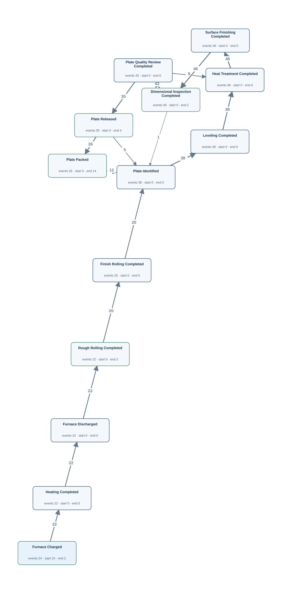</a> <a href="graphs/NF04.svg">Open full-size DFG</a></td><td width="35%" valign="top"><h4>Original tables</h4>
Up to 3 matched rows per table. Shows keys, event times and carrier values.

<strong>dimension_inspection</strong> · 46 matched rows
<table><tr><th>Row</th><th>Source values</th></tr><tr><td>1</td><td>inspection_id = P007-1-1 inspected_at = 2026-01-25T20:35:00Z</td></tr><tr><td>2</td><td>inspection_id = P007-1-2 inspected_at = 2026-01-25T21:55:00Z</td></tr><tr><td>3</td><td>inspection_id = P007-2-1 inspected_at = 2026-01-26T04:55:00Z</td></tr></table>
<strong>finishing_operation_history</strong> · 130 matched rows
<table><tr><th>Row</th><th>Source values</th></tr><tr><td>1</td><td>operation_id = 0001 operation_code = LEV finished_at = 2026-01-25T19:45:00Z</td></tr><tr><td>2</td><td>operation_id = 0002 operation_code = HT finished_at = 2026-01-25T20:10:00Z</td></tr><tr><td>3</td><td>operation_id = 0003 operation_code = SF finished_at = 2026-01-25T20:25:00Z</td></tr></table>
<strong>furnace_operation_history</strong> · 68 matched rows
<table><tr><th>Row</th><th>Source values</th></tr><tr><td>1</td><td>operation_id = 0001 operation_code = CH finished_at = 2026-01-25T08:40:00Z</td></tr><tr><td>2</td><td>operation_id = 0002 operation_code = HT finished_at = 2026-01-25T09:20:00Z</td></tr><tr><td>3</td><td>operation_id = 0003 operation_code = DS finished_at = 2026-01-25T09:30:00Z</td></tr></table>
<strong>plate_material</strong> · 38 matched rows
<table><tr><th>Row</th><th>Source values</th></tr><tr><td>1</td><td>plate_id = P007-1 identified_at = 2026-01-25T19:30:00Z released_at = 2026-01-25T22:30:00Z packed_at = 2026-01-25T22:50:00Z</td></tr><tr><td>2</td><td>plate_id = P007-2 identified_at = 2026-01-26T03:50:00Z released_at = 2026-01-26T05:30:00Z packed_at = 2026-01-26T05:50:00Z</td></tr><tr><td>3</td><td>plate_id = P008-1 identified_at = 2026-01-29T06:50:00Z released_at = 2026-01-29T08:30:00Z packed_at = 2026-01-29T08:50:00Z</td></tr></table>
<strong>plate_quality_review</strong> · 43 matched rows
<table><tr><th>Row</th><th>Source values</th></tr><tr><td>1</td><td>review_id = P007-1-1 finished_at = 2026-01-25T20:50:00Z</td></tr><tr><td>2</td><td>review_id = P007-1-2 finished_at = 2026-01-25T22:15:00Z</td></tr><tr><td>3</td><td>review_id = P007-2-1 finished_at = 2026-01-26T05:10:00Z</td></tr></table>
<strong>rolling_operation_history</strong> · 42 matched rows
<table><tr><th>Row</th><th>Source values</th></tr><tr><td>1</td><td>operation_id = 0001 phase_code = RR finished_at = 2026-01-25T10:00:00Z</td></tr><tr><td>2</td><td>operation_id = 0002 phase_code = FR finished_at = 2026-01-25T10:35:00Z</td></tr><tr><td>3</td><td>operation_id = 0003 phase_code = RR finished_at = 2026-01-28T21:20:00Z</td></tr></table>

Other SQL tables

as_rolled_material

</td></tr></table>

[Gold CSV](../../../datasets/plateflow_new/private/gold_logs/NF04.csv)

## NF04P — Q4

Show the whole recorded lifecycle of every mother material.

Events: **428** · Cases with events: **24** · Activities: **13** · Edges: **16** · Source tables: **6** · SQL tables: **7**

<table><tr><td width="65%" valign="top"> <a href="graphs/NF04.svg">Open full-size DFG</a></td><td width="35%" valign="top"><h4>Original tables</h4>
Up to 3 matched rows per table. Shows keys, event times and carrier values.

<strong>dimension_inspection</strong> · 46 matched rows
<table><tr><th>Row</th><th>Source values</th></tr><tr><td>1</td><td>inspection_id = P007-1-1 inspected_at = 2026-01-25T20:35:00Z</td></tr><tr><td>2</td><td>inspection_id = P007-1-2 inspected_at = 2026-01-25T21:55:00Z</td></tr><tr><td>3</td><td>inspection_id = P007-2-1 inspected_at = 2026-01-26T04:55:00Z</td></tr></table>
<strong>finishing_operation_history</strong> · 130 matched rows
<table><tr><th>Row</th><th>Source values</th></tr><tr><td>1</td><td>operation_id = 0001 operation_code = LEV finished_at = 2026-01-25T19:45:00Z</td></tr><tr><td>2</td><td>operation_id = 0002 operation_code = HT finished_at = 2026-01-25T20:10:00Z</td></tr><tr><td>3</td><td>operation_id = 0003 operation_code = SF finished_at = 2026-01-25T20:25:00Z</td></tr></table>
<strong>furnace_operation_history</strong> · 68 matched rows
<table><tr><th>Row</th><th>Source values</th></tr><tr><td>1</td><td>operation_id = 0001 operation_code = CH finished_at = 2026-01-25T08:40:00Z</td></tr><tr><td>2</td><td>operation_id = 0002 operation_code = HT finished_at = 2026-01-25T09:20:00Z</td></tr><tr><td>3</td><td>operation_id = 0003 operation_code = DS finished_at = 2026-01-25T09:30:00Z</td></tr></table>
<strong>plate_material</strong> · 38 matched rows
<table><tr><th>Row</th><th>Source values</th></tr><tr><td>1</td><td>plate_id = P007-1 identified_at = 2026-01-25T19:30:00Z released_at = 2026-01-25T22:30:00Z packed_at = 2026-01-25T22:50:00Z</td></tr><tr><td>2</td><td>plate_id = P007-2 identified_at = 2026-01-26T03:50:00Z released_at = 2026-01-26T05:30:00Z packed_at = 2026-01-26T05:50:00Z</td></tr><tr><td>3</td><td>plate_id = P008-1 identified_at = 2026-01-29T06:50:00Z released_at = 2026-01-29T08:30:00Z packed_at = 2026-01-29T08:50:00Z</td></tr></table>
<strong>plate_quality_review</strong> · 43 matched rows
<table><tr><th>Row</th><th>Source values</th></tr><tr><td>1</td><td>review_id = P007-1-1 finished_at = 2026-01-25T20:50:00Z</td></tr><tr><td>2</td><td>review_id = P007-1-2 finished_at = 2026-01-25T22:15:00Z</td></tr><tr><td>3</td><td>review_id = P007-2-1 finished_at = 2026-01-26T05:10:00Z</td></tr></table>
<strong>rolling_operation_history</strong> · 42 matched rows
<table><tr><th>Row</th><th>Source values</th></tr><tr><td>1</td><td>operation_id = 0001 phase_code = RR finished_at = 2026-01-25T10:00:00Z</td></tr><tr><td>2</td><td>operation_id = 0002 phase_code = FR finished_at = 2026-01-25T10:35:00Z</td></tr><tr><td>3</td><td>operation_id = 0003 phase_code = RR finished_at = 2026-01-28T21:20:00Z</td></tr></table>

Other SQL tables

as_rolled_material

</td></tr></table>

[Gold CSV](../../../datasets/plateflow_new/private/gold_logs/NF04P.csv)

## NF05 — Q3

Extract the full recorded lifecycle for each plate piece.

Events: **318** · Cases with events: **38** · Activities: **8** · Edges: **8** · Source tables: **4** · SQL tables: **5**

<table><tr><td width="65%" valign="top"><a href="graphs/NF05.svg">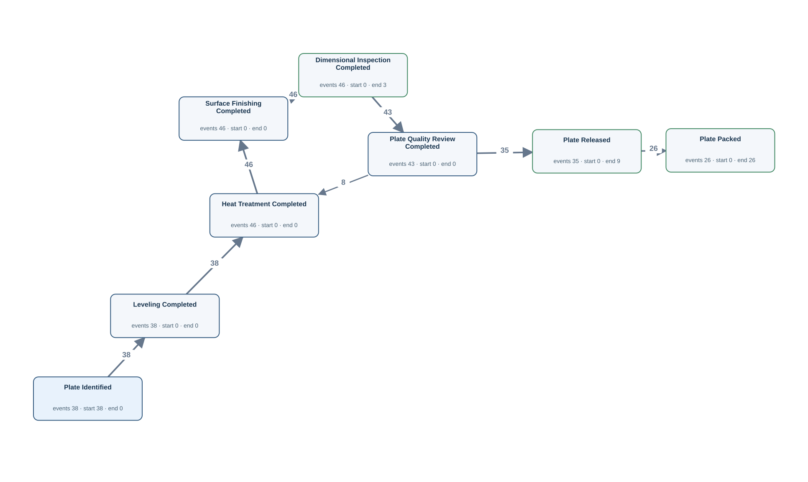</a> <a href="graphs/NF05.svg">Open full-size DFG</a></td><td width="35%" valign="top"><h4>Original tables</h4>
Up to 3 matched rows per table. Shows keys, event times and carrier values.

<strong>dimension_inspection</strong> · 46 matched rows
<table><tr><th>Row</th><th>Source values</th></tr><tr><td>1</td><td>inspection_id = P007-1-1 inspected_at = 2026-01-25T20:35:00Z</td></tr><tr><td>2</td><td>inspection_id = P007-1-2 inspected_at = 2026-01-25T21:55:00Z</td></tr><tr><td>3</td><td>inspection_id = P007-2-1 inspected_at = 2026-01-26T04:55:00Z</td></tr></table>
<strong>finishing_operation_history</strong> · 130 matched rows
<table><tr><th>Row</th><th>Source values</th></tr><tr><td>1</td><td>operation_id = 0001 operation_code = LEV finished_at = 2026-01-25T19:45:00Z</td></tr><tr><td>2</td><td>operation_id = 0002 operation_code = HT finished_at = 2026-01-25T20:10:00Z</td></tr><tr><td>3</td><td>operation_id = 0003 operation_code = SF finished_at = 2026-01-25T20:25:00Z</td></tr></table>
<strong>plate_material</strong> · 38 matched rows
<table><tr><th>Row</th><th>Source values</th></tr><tr><td>1</td><td>plate_id = P007-1 identified_at = 2026-01-25T19:30:00Z released_at = 2026-01-25T22:30:00Z packed_at = 2026-01-25T22:50:00Z</td></tr><tr><td>2</td><td>plate_id = P007-2 identified_at = 2026-01-26T03:50:00Z released_at = 2026-01-26T05:30:00Z packed_at = 2026-01-26T05:50:00Z</td></tr><tr><td>3</td><td>plate_id = P008-1 identified_at = 2026-01-29T06:50:00Z released_at = 2026-01-29T08:30:00Z packed_at = 2026-01-29T08:50:00Z</td></tr></table>
<strong>plate_quality_review</strong> · 43 matched rows
<table><tr><th>Row</th><th>Source values</th></tr><tr><td>1</td><td>review_id = P007-1-1 finished_at = 2026-01-25T20:50:00Z</td></tr><tr><td>2</td><td>review_id = P007-1-2 finished_at = 2026-01-25T22:15:00Z</td></tr><tr><td>3</td><td>review_id = P007-2-1 finished_at = 2026-01-26T05:10:00Z</td></tr></table>

Other SQL tables

as_rolled_material

</td></tr></table>

[Gold CSV](../../../datasets/plateflow_new/private/gold_logs/NF05.csv)

## NF05P — Q4

Build a complete timeline of the recorded history of each plate piece.

Events: **318** · Cases with events: **38** · Activities: **8** · Edges: **8** · Source tables: **4** · SQL tables: **5**

<table><tr><td width="65%" valign="top"> <a href="graphs/NF05.svg">Open full-size DFG</a></td><td width="35%" valign="top"><h4>Original tables</h4>
Up to 3 matched rows per table. Shows keys, event times and carrier values.

<strong>dimension_inspection</strong> · 46 matched rows
<table><tr><th>Row</th><th>Source values</th></tr><tr><td>1</td><td>inspection_id = P007-1-1 inspected_at = 2026-01-25T20:35:00Z</td></tr><tr><td>2</td><td>inspection_id = P007-1-2 inspected_at = 2026-01-25T21:55:00Z</td></tr><tr><td>3</td><td>inspection_id = P007-2-1 inspected_at = 2026-01-26T04:55:00Z</td></tr></table>
<strong>finishing_operation_history</strong> · 130 matched rows
<table><tr><th>Row</th><th>Source values</th></tr><tr><td>1</td><td>operation_id = 0001 operation_code = LEV finished_at = 2026-01-25T19:45:00Z</td></tr><tr><td>2</td><td>operation_id = 0002 operation_code = HT finished_at = 2026-01-25T20:10:00Z</td></tr><tr><td>3</td><td>operation_id = 0003 operation_code = SF finished_at = 2026-01-25T20:25:00Z</td></tr></table>
<strong>plate_material</strong> · 38 matched rows
<table><tr><th>Row</th><th>Source values</th></tr><tr><td>1</td><td>plate_id = P007-1 identified_at = 2026-01-25T19:30:00Z released_at = 2026-01-25T22:30:00Z packed_at = 2026-01-25T22:50:00Z</td></tr><tr><td>2</td><td>plate_id = P007-2 identified_at = 2026-01-26T03:50:00Z released_at = 2026-01-26T05:30:00Z packed_at = 2026-01-26T05:50:00Z</td></tr><tr><td>3</td><td>plate_id = P008-1 identified_at = 2026-01-29T06:50:00Z released_at = 2026-01-29T08:30:00Z packed_at = 2026-01-29T08:50:00Z</td></tr></table>
<strong>plate_quality_review</strong> · 43 matched rows
<table><tr><th>Row</th><th>Source values</th></tr><tr><td>1</td><td>review_id = P007-1-1 finished_at = 2026-01-25T20:50:00Z</td></tr><tr><td>2</td><td>review_id = P007-1-2 finished_at = 2026-01-25T22:15:00Z</td></tr><tr><td>3</td><td>review_id = P007-2-1 finished_at = 2026-01-26T05:10:00Z</td></tr></table>

Other SQL tables

as_rolled_material

</td></tr></table>

[Gold CSV](../../../datasets/plateflow_new/private/gold_logs/NF05P.csv)

## NF06 — Q3

Extract the full recorded lifecycle for each dimension inspection record.

Events: **46** · Cases with events: **46** · Activities: **1** · Edges: **0** · Source tables: **1** · SQL tables: **1**

<table><tr><td width="65%" valign="top"> <a href="graphs/N09.svg">Open full-size DFG</a></td><td width="35%" valign="top"><h4>Original tables</h4>
Up to 3 matched rows per table. Shows keys, event times and carrier values.

<strong>dimension_inspection</strong> · 46 matched rows
<table><tr><th>Row</th><th>Source values</th></tr><tr><td>1</td><td>inspection_id = P007-1-1 inspected_at = 2026-01-25T20:35:00Z</td></tr><tr><td>2</td><td>inspection_id = P007-1-2 inspected_at = 2026-01-25T21:55:00Z</td></tr><tr><td>3</td><td>inspection_id = P007-2-1 inspected_at = 2026-01-26T04:55:00Z</td></tr></table></td></tr></table>

[Gold CSV](../../../datasets/plateflow_new/private/gold_logs/NF06.csv)

## NF06P — Q4

Show the entire recorded history of every individual dimensional inspection record.

Events: **46** · Cases with events: **46** · Activities: **1** · Edges: **0** · Source tables: **1** · SQL tables: **1**

<table><tr><td width="65%" valign="top"> <a href="graphs/N09.svg">Open full-size DFG</a></td><td width="35%" valign="top"><h4>Original tables</h4>
Up to 3 matched rows per table. Shows keys, event times and carrier values.

<strong>dimension_inspection</strong> · 46 matched rows
<table><tr><th>Row</th><th>Source values</th></tr><tr><td>1</td><td>inspection_id = P007-1-1 inspected_at = 2026-01-25T20:35:00Z</td></tr><tr><td>2</td><td>inspection_id = P007-1-2 inspected_at = 2026-01-25T21:55:00Z</td></tr><tr><td>3</td><td>inspection_id = P007-2-1 inspected_at = 2026-01-26T04:55:00Z</td></tr></table></td></tr></table>

[Gold CSV](../../../datasets/plateflow_new/private/gold_logs/NF06P.csv)

## NF07 — Q3

Extract the full recorded lifecycle for each quality review record.

Events: **43** · Cases with events: **43** · Activities: **1** · Edges: **0** · Source tables: **1** · SQL tables: **1**

<table><tr><td width="65%" valign="top"> <a href="graphs/N10.svg">Open full-size DFG</a></td><td width="35%" valign="top"><h4>Original tables</h4>
Up to 3 matched rows per table. Shows keys, event times and carrier values.

<strong>plate_quality_review</strong> · 43 matched rows
<table><tr><th>Row</th><th>Source values</th></tr><tr><td>1</td><td>review_id = P007-1-1 finished_at = 2026-01-25T20:50:00Z</td></tr><tr><td>2</td><td>review_id = P007-1-2 finished_at = 2026-01-25T22:15:00Z</td></tr><tr><td>3</td><td>review_id = P007-2-1 finished_at = 2026-01-26T05:10:00Z</td></tr></table></td></tr></table>

[Gold CSV](../../../datasets/plateflow_new/private/gold_logs/NF07.csv)

## NF07P — Q4

Trace each individual quality review record through its complete recorded history.

Events: **43** · Cases with events: **43** · Activities: **1** · Edges: **0** · Source tables: **1** · SQL tables: **1**

<table><tr><td width="65%" valign="top"> <a href="graphs/N10.svg">Open full-size DFG</a></td><td width="35%" valign="top"><h4>Original tables</h4>
Up to 3 matched rows per table. Shows keys, event times and carrier values.

<strong>plate_quality_review</strong> · 43 matched rows
<table><tr><th>Row</th><th>Source values</th></tr><tr><td>1</td><td>review_id = P007-1-1 finished_at = 2026-01-25T20:50:00Z</td></tr><tr><td>2</td><td>review_id = P007-1-2 finished_at = 2026-01-25T22:15:00Z</td></tr><tr><td>3</td><td>review_id = P007-2-1 finished_at = 2026-01-26T05:10:00Z</td></tr></table></td></tr></table>

[Gold CSV](../../../datasets/plateflow_new/private/gold_logs/NF07P.csv)

## NF08 — Q3

Extract the full recorded lifecycle for each equipment unit.

Events: **240** · Cases with events: **6** · Activities: **8** · Edges: **11** · Source tables: **3** · SQL tables: **3**

<table><tr><td width="65%" valign="top"><a href="graphs/NF08.svg">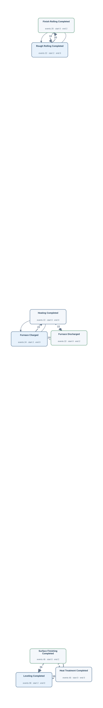</a> <a href="graphs/NF08.svg">Open full-size DFG</a></td><td width="35%" valign="top"><h4>Original tables</h4>
Up to 3 matched rows per table. Shows keys, event times and carrier values.

<strong>finishing_operation_history</strong> · 130 matched rows
<table><tr><th>Row</th><th>Source values</th></tr><tr><td>1</td><td>operation_id = 0001 operation_code = LEV finished_at = 2026-01-25T19:45:00Z</td></tr><tr><td>2</td><td>operation_id = 0002 operation_code = HT finished_at = 2026-01-25T20:10:00Z</td></tr><tr><td>3</td><td>operation_id = 0003 operation_code = SF finished_at = 2026-01-25T20:25:00Z</td></tr></table>
<strong>furnace_operation_history</strong> · 68 matched rows
<table><tr><th>Row</th><th>Source values</th></tr><tr><td>1</td><td>operation_id = 0004 operation_code = CH finished_at = 2026-01-28T20:00:00Z</td></tr><tr><td>2</td><td>operation_id = 0005 operation_code = HT finished_at = 2026-01-28T20:40:00Z</td></tr><tr><td>3</td><td>operation_id = 0006 operation_code = DS finished_at = 2026-01-28T20:50:00Z</td></tr></table>
<strong>rolling_operation_history</strong> · 42 matched rows
<table><tr><th>Row</th><th>Source values</th></tr><tr><td>1</td><td>operation_id = 0003 phase_code = RR finished_at = 2026-01-28T21:20:00Z</td></tr><tr><td>2</td><td>operation_id = 0004 phase_code = FR finished_at = 2026-01-28T21:55:00Z</td></tr><tr><td>3</td><td>operation_id = 0007 phase_code = RR finished_at = 2026-02-04T20:00:00Z</td></tr></table></td></tr></table>

[Gold CSV](../../../datasets/plateflow_new/private/gold_logs/NF08.csv)

## NF08P — Q4

Show the full recorded history associated with every equipment unit.

Events: **240** · Cases with events: **6** · Activities: **8** · Edges: **11** · Source tables: **3** · SQL tables: **3**

<table><tr><td width="65%" valign="top"> <a href="graphs/NF08.svg">Open full-size DFG</a></td><td width="35%" valign="top"><h4>Original tables</h4>
Up to 3 matched rows per table. Shows keys, event times and carrier values.

<strong>finishing_operation_history</strong> · 130 matched rows
<table><tr><th>Row</th><th>Source values</th></tr><tr><td>1</td><td>operation_id = 0001 operation_code = LEV finished_at = 2026-01-25T19:45:00Z</td></tr><tr><td>2</td><td>operation_id = 0002 operation_code = HT finished_at = 2026-01-25T20:10:00Z</td></tr><tr><td>3</td><td>operation_id = 0003 operation_code = SF finished_at = 2026-01-25T20:25:00Z</td></tr></table>
<strong>furnace_operation_history</strong> · 68 matched rows
<table><tr><th>Row</th><th>Source values</th></tr><tr><td>1</td><td>operation_id = 0004 operation_code = CH finished_at = 2026-01-28T20:00:00Z</td></tr><tr><td>2</td><td>operation_id = 0005 operation_code = HT finished_at = 2026-01-28T20:40:00Z</td></tr><tr><td>3</td><td>operation_id = 0006 operation_code = DS finished_at = 2026-01-28T20:50:00Z</td></tr></table>
<strong>rolling_operation_history</strong> · 42 matched rows
<table><tr><th>Row</th><th>Source values</th></tr><tr><td>1</td><td>operation_id = 0003 phase_code = RR finished_at = 2026-01-28T21:20:00Z</td></tr><tr><td>2</td><td>operation_id = 0004 phase_code = FR finished_at = 2026-01-28T21:55:00Z</td></tr><tr><td>3</td><td>operation_id = 0007 phase_code = RR finished_at = 2026-02-04T20:00:00Z</td></tr></table></td></tr></table>

[Gold CSV](../../../datasets/plateflow_new/private/gold_logs/NF08P.csv)

## NF09 — Q3

Extract the full recorded lifecycle for each furnace operation record.

Events: **68** · Cases with events: **68** · Activities: **3** · Edges: **0** · Source tables: **1** · SQL tables: **1**

<table><tr><td width="65%" valign="top"> <a href="graphs/N12.svg">Open full-size DFG</a></td><td width="35%" valign="top"><h4>Original tables</h4>
Up to 3 matched rows per table. Shows keys, event times and carrier values.

<strong>furnace_operation_history</strong> · 68 matched rows
<table><tr><th>Row</th><th>Source values</th></tr><tr><td>1</td><td>operation_id = 0001 operation_code = CH finished_at = 2026-01-25T08:40:00Z</td></tr><tr><td>2</td><td>operation_id = 0002 operation_code = HT finished_at = 2026-01-25T09:20:00Z</td></tr><tr><td>3</td><td>operation_id = 0003 operation_code = DS finished_at = 2026-01-25T09:30:00Z</td></tr></table></td></tr></table>

[Gold CSV](../../../datasets/plateflow_new/private/gold_logs/NF09.csv)

## NF09P — Q4

Build the complete recorded timeline of each individual furnace operation record.

Events: **68** · Cases with events: **68** · Activities: **3** · Edges: **0** · Source tables: **1** · SQL tables: **1**

<table><tr><td width="65%" valign="top"> <a href="graphs/N12.svg">Open full-size DFG</a></td><td width="35%" valign="top"><h4>Original tables</h4>
Up to 3 matched rows per table. Shows keys, event times and carrier values.

<strong>furnace_operation_history</strong> · 68 matched rows
<table><tr><th>Row</th><th>Source values</th></tr><tr><td>1</td><td>operation_id = 0001 operation_code = CH finished_at = 2026-01-25T08:40:00Z</td></tr><tr><td>2</td><td>operation_id = 0002 operation_code = HT finished_at = 2026-01-25T09:20:00Z</td></tr><tr><td>3</td><td>operation_id = 0003 operation_code = DS finished_at = 2026-01-25T09:30:00Z</td></tr></table></td></tr></table>

[Gold CSV](../../../datasets/plateflow_new/private/gold_logs/NF09P.csv)

## NF10 — Q3

Extract the full recorded lifecycle for each rolling operation record.

Events: **42** · Cases with events: **42** · Activities: **2** · Edges: **0** · Source tables: **1** · SQL tables: **1**

<table><tr><td width="65%" valign="top"> <a href="graphs/N13.svg">Open full-size DFG</a></td><td width="35%" valign="top"><h4>Original tables</h4>
Up to 3 matched rows per table. Shows keys, event times and carrier values.

<strong>rolling_operation_history</strong> · 42 matched rows
<table><tr><th>Row</th><th>Source values</th></tr><tr><td>1</td><td>operation_id = 0001 phase_code = RR finished_at = 2026-01-25T10:00:00Z</td></tr><tr><td>2</td><td>operation_id = 0002 phase_code = FR finished_at = 2026-01-25T10:35:00Z</td></tr><tr><td>3</td><td>operation_id = 0003 phase_code = RR finished_at = 2026-01-28T21:20:00Z</td></tr></table></td></tr></table>

[Gold CSV](../../../datasets/plateflow_new/private/gold_logs/NF10.csv)

## NF10P — Q4

Show the whole recorded history of each individual rolling operation record.

Events: **42** · Cases with events: **42** · Activities: **2** · Edges: **0** · Source tables: **1** · SQL tables: **1**

<table><tr><td width="65%" valign="top"> <a href="graphs/N13.svg">Open full-size DFG</a></td><td width="35%" valign="top"><h4>Original tables</h4>
Up to 3 matched rows per table. Shows keys, event times and carrier values.

<strong>rolling_operation_history</strong> · 42 matched rows
<table><tr><th>Row</th><th>Source values</th></tr><tr><td>1</td><td>operation_id = 0001 phase_code = RR finished_at = 2026-01-25T10:00:00Z</td></tr><tr><td>2</td><td>operation_id = 0002 phase_code = FR finished_at = 2026-01-25T10:35:00Z</td></tr><tr><td>3</td><td>operation_id = 0003 phase_code = RR finished_at = 2026-01-28T21:20:00Z</td></tr></table></td></tr></table>

[Gold CSV](../../../datasets/plateflow_new/private/gold_logs/NF10P.csv)

## NF11 — Q3

Extract the full recorded lifecycle for each finishing operation record.

Events: **130** · Cases with events: **130** · Activities: **3** · Edges: **0** · Source tables: **1** · SQL tables: **1**

<table><tr><td width="65%" valign="top"> <a href="graphs/N14.svg">Open full-size DFG</a></td><td width="35%" valign="top"><h4>Original tables</h4>
Up to 3 matched rows per table. Shows keys, event times and carrier values.

<strong>finishing_operation_history</strong> · 130 matched rows
<table><tr><th>Row</th><th>Source values</th></tr><tr><td>1</td><td>operation_id = 0001 operation_code = LEV finished_at = 2026-01-25T19:45:00Z</td></tr><tr><td>2</td><td>operation_id = 0002 operation_code = HT finished_at = 2026-01-25T20:10:00Z</td></tr><tr><td>3</td><td>operation_id = 0003 operation_code = SF finished_at = 2026-01-25T20:25:00Z</td></tr></table></td></tr></table>

[Gold CSV](../../../datasets/plateflow_new/private/gold_logs/NF11.csv)

## NF11P — Q4

Trace the entire recorded history of every individual finishing operation record.

Events: **130** · Cases with events: **130** · Activities: **3** · Edges: **0** · Source tables: **1** · SQL tables: **1**

<table><tr><td width="65%" valign="top"> <a href="graphs/N14.svg">Open full-size DFG</a></td><td width="35%" valign="top"><h4>Original tables</h4>
Up to 3 matched rows per table. Shows keys, event times and carrier values.

<strong>finishing_operation_history</strong> · 130 matched rows
<table><tr><th>Row</th><th>Source values</th></tr><tr><td>1</td><td>operation_id = 0001 operation_code = LEV finished_at = 2026-01-25T19:45:00Z</td></tr><tr><td>2</td><td>operation_id = 0002 operation_code = HT finished_at = 2026-01-25T20:10:00Z</td></tr><tr><td>3</td><td>operation_id = 0003 operation_code = SF finished_at = 2026-01-25T20:25:00Z</td></tr></table></td></tr></table>

[Gold CSV](../../../datasets/plateflow_new/private/gold_logs/NF11P.csv)
