# universityflow: questions and Gold DFGs

**EVALUATION ONLY — NEVER PROVIDE TO A MODEL.**

Source commit: `ed132438b2a634a39da997e733751ccf1aa6322c`. Open index.html for search, review notes and complete case traces.

Node counts = event occurrences. Edge counts = adjacent selected events within a case. Dashed amber edges touch timestamp ties and depend on the tie-break rule. DFGs are projections of the selected log, not causal models.

## U01 — Q1

Extract Degree Examination Taken events for each student.

Events: **40** · Cases with events: **30** · Activities: **1** · Edges: **1**

[Gold CSV](../../../datasets/universityflow/private/gold_logs/U01.csv)

## U02 — Q2

For each student, build a timeline of the student sitting the degree examination.

Events: **40** · Cases with events: **30** · Activities: **1** · Edges: **1**

[Gold CSV](../../../datasets/universityflow/private/gold_logs/U02.csv)

## U03 — Q1

Extract Course Registered events for each student.

Events: **47** · Cases with events: **20** · Activities: **1** · Edges: **1**

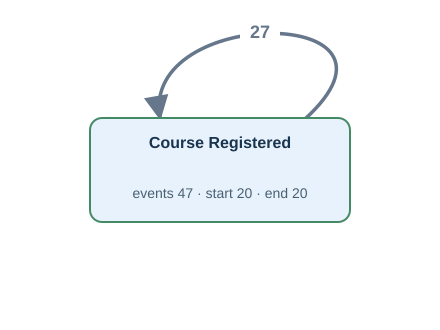

[Gold CSV](../../../datasets/universityflow/private/gold_logs/U03.csv)

## U04 — Q2

For each student, build a timeline of a successful course sign-up.

Events: **47** · Cases with events: **20** · Activities: **1** · Edges: **1**

[Gold CSV](../../../datasets/universityflow/private/gold_logs/U04.csv)

## U05 — Q3

Extract the full recorded lifecycle event log for each student.

Events: **763** · Cases with events: **30** · Activities: **29** · Edges: **62**

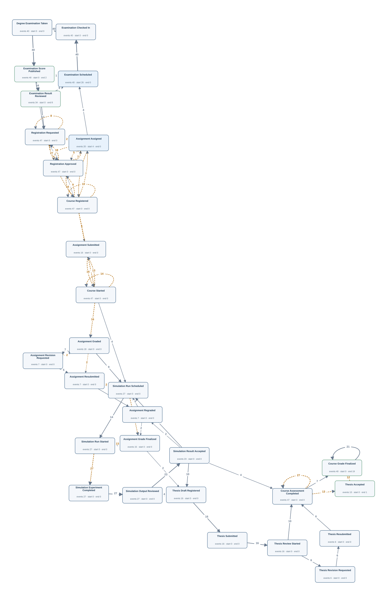

[Gold CSV](../../../datasets/universityflow/private/gold_logs/U05.csv)

## U06 — Q4

Show the complete recorded history associated with each student.

Events: **763** · Cases with events: **30** · Activities: **29** · Edges: **62**

[Gold CSV](../../../datasets/universityflow/private/gold_logs/U06.csv)

## U07 — Q1

Extract Registration Success Notification Sent events for each student.

**No Gold log:** The requirements mention notifications, but no notification records or times are stored.

## U08 — Q1

Extract Course Withdrawn events for each student.

**No Gold log:** No withdrawal times or registration-status history are recorded.

## U09 — Q1

Extract Assignment Graded events for each student.

Events: **18** · Cases with events: **16** · Activities: **1** · Edges: **1**

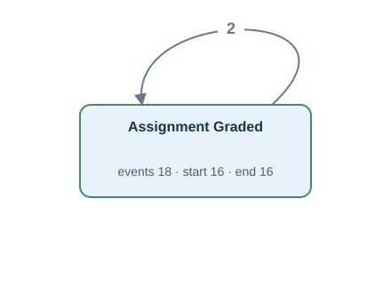

[Gold CSV](../../../datasets/universityflow/private/gold_logs/U09.csv)

## U10 — Q2

For each student, build a timeline of an instructor assessing the assignment.

Events: **18** · Cases with events: **16** · Activities: **1** · Edges: **1**

[Gold CSV](../../../datasets/universityflow/private/gold_logs/U10.csv)

## U11 — Q1

Extract Simulation Experiment Completed events for each student.

Events: **27** · Cases with events: **20** · Activities: **1** · Edges: **1**

[Gold CSV](../../../datasets/universityflow/private/gold_logs/U11.csv)

## U12 — Q2

For each student, build a timeline of a simulation run finishing.

Events: **27** · Cases with events: **20** · Activities: **1** · Edges: **1**

[Gold CSV](../../../datasets/universityflow/private/gold_logs/U12.csv)

## U13 — Q1

Extract Thesis Submitted events for each student.

Events: **16** · Cases with events: **16** · Activities: **1** · Edges: **0**

[Gold CSV](../../../datasets/universityflow/private/gold_logs/U13.csv)

## U14 — Q2

For each student, build a timeline of the student handing in a thesis.

Events: **16** · Cases with events: **16** · Activities: **1** · Edges: **0**

[Gold CSV](../../../datasets/universityflow/private/gold_logs/U14.csv)

## U15 — Q1

Extract Assignment Submitted events for each student.

Events: **16** · Cases with events: **16** · Activities: **1** · Edges: **0**

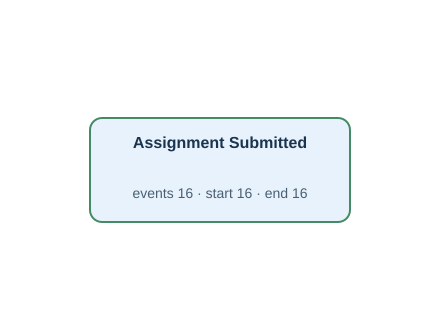

[Gold CSV](../../../datasets/universityflow/private/gold_logs/U15.csv)

## OU01 — Q3

Extract the full recorded lifecycle event log for each student.

Events: **763** · Cases with events: **30** · Activities: **29** · Edges: **62**

[Gold CSV](../../../datasets/universityflow/private/gold_logs/OU01.csv)

## OU02 — Q3

Extract the full recorded lifecycle event log for each course.

Events: **298** · Cases with events: **6** · Activities: **10** · Edges: **24**

[Gold CSV](../../../datasets/universityflow/private/gold_logs/OU02.csv)

## OU03 — Q3

Extract the full recorded lifecycle event log for each student-course registration.

Events: **275** · Cases with events: **47** · Activities: **6** · Edges: **5**

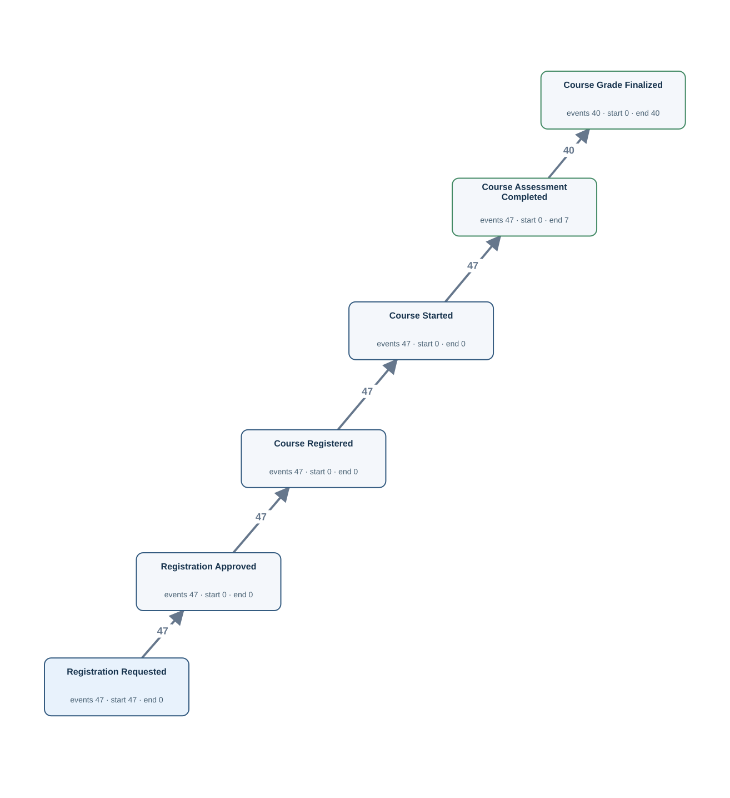

[Gold CSV](../../../datasets/universityflow/private/gold_logs/OU03.csv)

## OU04 — Q3

Extract the full recorded lifecycle event log for each examination result record.

Events: **194** · Cases with events: **40** · Activities: **5** · Edges: **4**

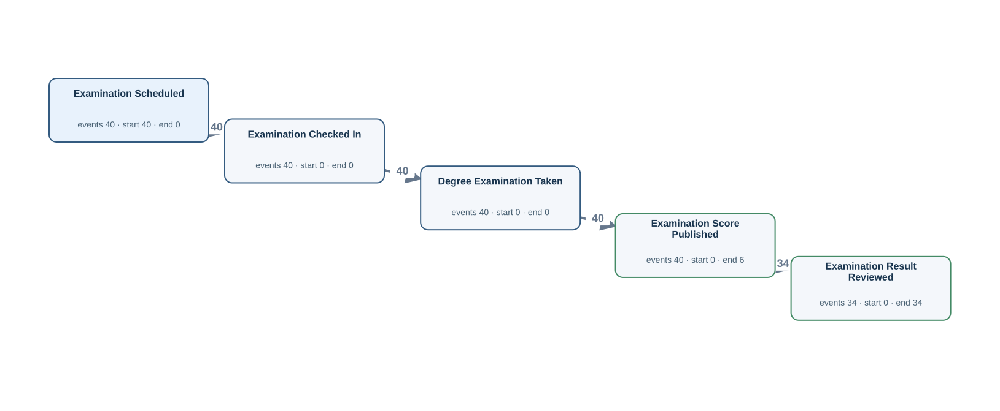

[Gold CSV](../../../datasets/universityflow/private/gold_logs/OU04.csv)

## OU05 — Q3

Extract the full recorded lifecycle event log for each simulation module.

Events: **142** · Cases with events: **3** · Activities: **9** · Edges: **10**

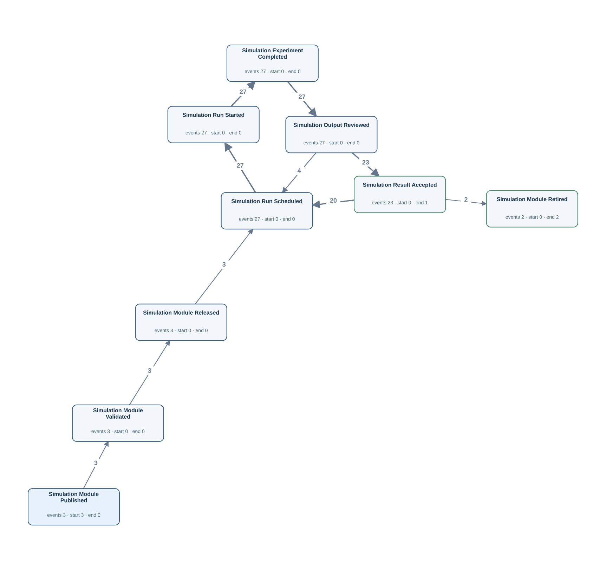

[Gold CSV](../../../datasets/universityflow/private/gold_logs/OU05.csv)

## OU06 — Q3

Extract the full recorded lifecycle event log for each thesis.

Events: **73** · Cases with events: **16** · Activities: **6** · Edges: **6**

[Gold CSV](../../../datasets/universityflow/private/gold_logs/OU06.csv)

## OU07 — Q3

Extract the full recorded lifecycle event log for each simulation experiment result record.

Events: **131** · Cases with events: **27** · Activities: **5** · Edges: **4**

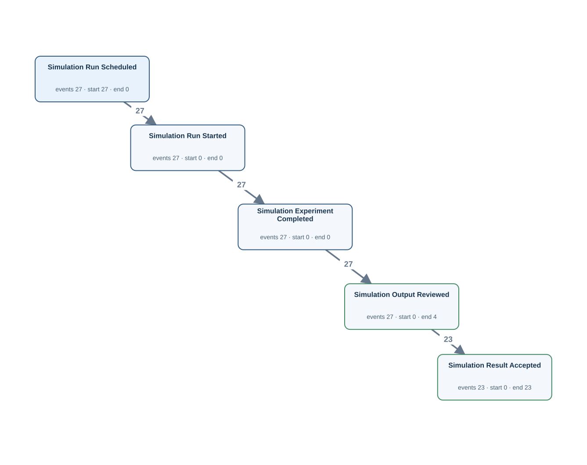

[Gold CSV](../../../datasets/universityflow/private/gold_logs/OU07.csv)

## OU08 — Q3

Extract the full recorded lifecycle event log for each assignment.

Events: **90** · Cases with events: **20** · Activities: **7** · Edges: **9**

[Gold CSV](../../../datasets/universityflow/private/gold_logs/OU08.csv)

## OU09 — Q3

Extract the full recorded lifecycle event log for each instructor.

Events: **86** · Cases with events: **3** · Activities: **7** · Edges: **18**

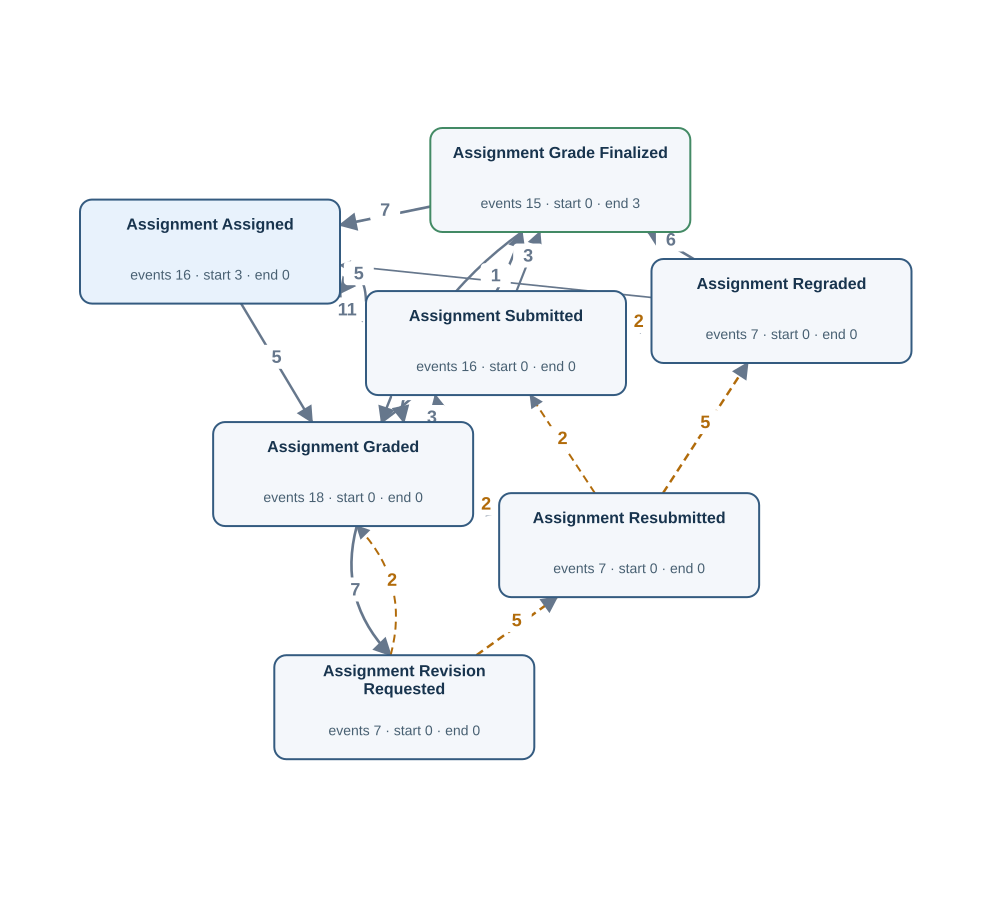

[Gold CSV](../../../datasets/universityflow/private/gold_logs/OU09.csv)

## OU10 — Q3

Extract the full recorded lifecycle event log for each assignment grading record.

Events: **25** · Cases with events: **25** · Activities: **2** · Edges: **0**

[Gold CSV](../../../datasets/universityflow/private/gold_logs/OU10.csv)

## OU11 — Q3

Extract the full recorded lifecycle event log for each course-design task.

Events: **11** · Cases with events: **3** · Activities: **4** · Edges: **3**

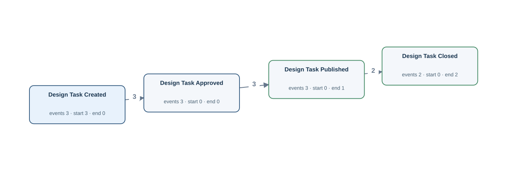

[Gold CSV](../../../datasets/universityflow/private/gold_logs/OU11.csv)

## TS01 — Q1

Extract Examination Scheduled, Examination Checked In, Examination Score Published, Examination Result Reviewed events for each student.

Events: **154** · Cases with events: **30** · Activities: **4** · Edges: **5**

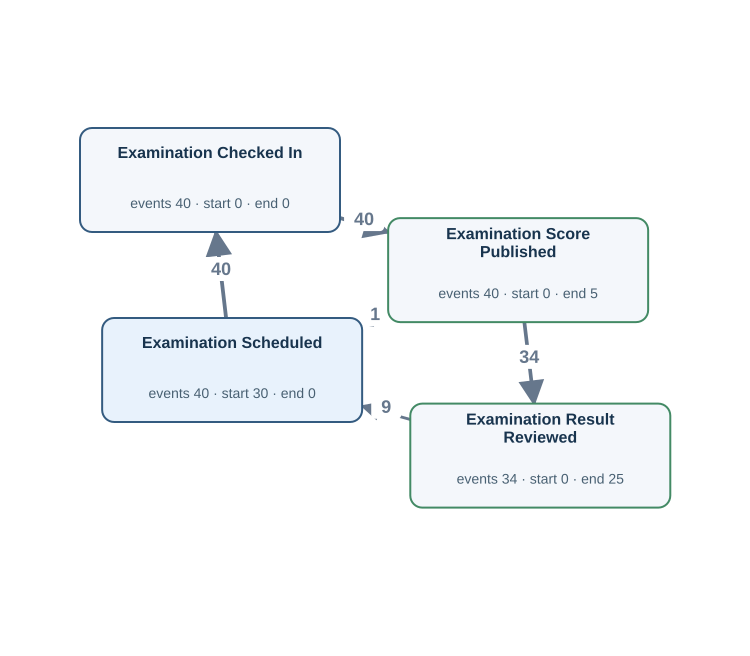

[Gold CSV](../../../datasets/universityflow/private/gold_logs/TS01.csv)

## TS02 — Q1

Extract Registration Requested, Registration Approved, Course Started, Course Assessment Completed, Course Grade Finalized events for each student-course registration.

Events: **228** · Cases with events: **47** · Activities: **5** · Edges: **4**

[Gold CSV](../../../datasets/universityflow/private/gold_logs/TS02.csv)

## TS03 — Q1

Extract Assignment Assigned, Assignment Submitted, Assignment Grade Finalized events for each assignment.

Events: **51** · Cases with events: **20** · Activities: **3** · Edges: **2**

[Gold CSV](../../../datasets/universityflow/private/gold_logs/TS03.csv)

## TS04 — Q1

Extract Thesis Draft Registered, Thesis Review Started, Thesis Accepted events for each thesis.

Events: **45** · Cases with events: **16** · Activities: **3** · Edges: **2**

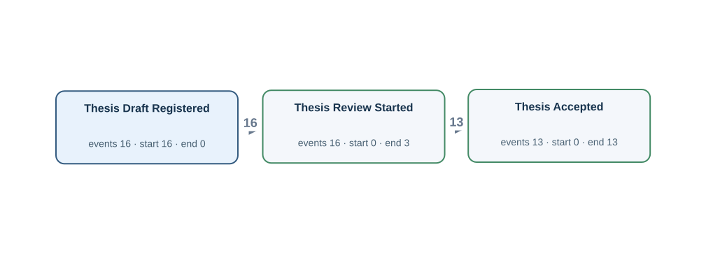

[Gold CSV](../../../datasets/universityflow/private/gold_logs/TS04.csv)

## U07P — Q2

For each student, build a timeline of confirmation messages being sent after a course sign-up.

**No Gold log:** The requirements mention notifications, but no notification records or times are stored.

## U08P — Q2

For each student, build a timeline of the student leaving a course after signing up.

**No Gold log:** No withdrawal times or registration-status history are recorded.

## U15P — Q2

For each student, build a timeline of the student handing in coursework.

Events: **16** · Cases with events: **16** · Activities: **1** · Edges: **0**

[Gold CSV](../../../datasets/universityflow/private/gold_logs/U15P.csv)

## TS01P — Q2

For each student, build a timeline of an examination sitting being arranged, the candidate checking in for the examination, the examination mark being released, the examination result being reviewed.

Events: **154** · Cases with events: **30** · Activities: **4** · Edges: **5**

[Gold CSV](../../../datasets/universityflow/private/gold_logs/TS01P.csv)

## TS02P — Q2

For each student-course registration, build a timeline of the student requesting a place on a course, the request for a course place being accepted, teaching beginning for the enrolled course, the course assessment finishing, the course mark being made final.

Events: **228** · Cases with events: **47** · Activities: **5** · Edges: **4**

[Gold CSV](../../../datasets/universityflow/private/gold_logs/TS02P.csv)

## TS03P — Q2

For each assignment, build a timeline of coursework being set for the student, the student handing in coursework, the coursework mark being made final.

Events: **51** · Cases with events: **20** · Activities: **3** · Edges: **2**

[Gold CSV](../../../datasets/universityflow/private/gold_logs/TS03P.csv)

## TS04P — Q2

For each thesis, build a timeline of a thesis draft being registered for review, the review of a thesis beginning, a thesis receiving final approval.

Events: **45** · Cases with events: **16** · Activities: **3** · Edges: **2**

[Gold CSV](../../../datasets/universityflow/private/gold_logs/TS04P.csv)

## OU01P — Q4

Show the complete recorded history associated with each student.

Events: **763** · Cases with events: **30** · Activities: **29** · Edges: **62**

[Gold CSV](../../../datasets/universityflow/private/gold_logs/OU01P.csv)

## OU01E — Q1

Extract Assignment Assigned, Assignment Submitted, Assignment Graded events for each student.

Events: **54** · Cases with events: **20** · Activities: **3** · Edges: **3**

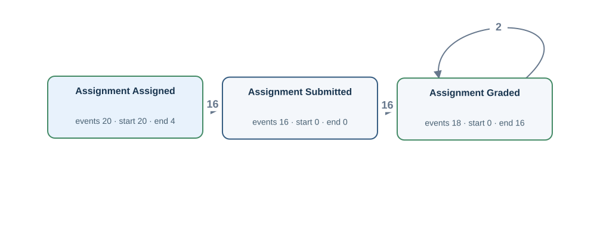

[Gold CSV](../../../datasets/universityflow/private/gold_logs/OU01E.csv)

## OU01EP — Q2

For each student, build a timeline of coursework being set for the student, the student handing in coursework, an instructor assessing the assignment.

Events: **54** · Cases with events: **20** · Activities: **3** · Edges: **3**

[Gold CSV](../../../datasets/universityflow/private/gold_logs/OU01EP.csv)

## OU02P — Q4

Show the complete recorded history associated with each course.

Events: **298** · Cases with events: **6** · Activities: **10** · Edges: **24**

[Gold CSV](../../../datasets/universityflow/private/gold_logs/OU02P.csv)

## OU02E — Q1

Extract Registration Requested, Course Registered, Course Grade Finalized events for each course.

Events: **134** · Cases with events: **6** · Activities: **3** · Edges: **5**

[Gold CSV](../../../datasets/universityflow/private/gold_logs/OU02E.csv)

## OU02EP — Q2

For each course, build a timeline of the student requesting a place on a course, a successful course sign-up, the course mark being made final.

Events: **134** · Cases with events: **6** · Activities: **3** · Edges: **5**

[Gold CSV](../../../datasets/universityflow/private/gold_logs/OU02EP.csv)

## OU03P — Q4

Show the complete recorded history associated with each student-course registration.

Events: **275** · Cases with events: **47** · Activities: **6** · Edges: **5**

[Gold CSV](../../../datasets/universityflow/private/gold_logs/OU03P.csv)

## OU03E — Q1

Extract Registration Requested, Course Registered, Course Grade Finalized events for each student-course registration.

Events: **134** · Cases with events: **47** · Activities: **3** · Edges: **2**

[Gold CSV](../../../datasets/universityflow/private/gold_logs/OU03E.csv)

## OU03EP — Q2

For each student-course registration, build a timeline of the student requesting a place on a course, a successful course sign-up, the course mark being made final.

Events: **134** · Cases with events: **47** · Activities: **3** · Edges: **2**

[Gold CSV](../../../datasets/universityflow/private/gold_logs/OU03EP.csv)

## OU04P — Q4

Show the complete recorded history associated with each examination result record.

Events: **194** · Cases with events: **40** · Activities: **5** · Edges: **4**

[Gold CSV](../../../datasets/universityflow/private/gold_logs/OU04P.csv)

## OU04E — Q1

Extract Examination Scheduled, Degree Examination Taken, Examination Score Published events for each examination result record.

Events: **120** · Cases with events: **40** · Activities: **3** · Edges: **2**

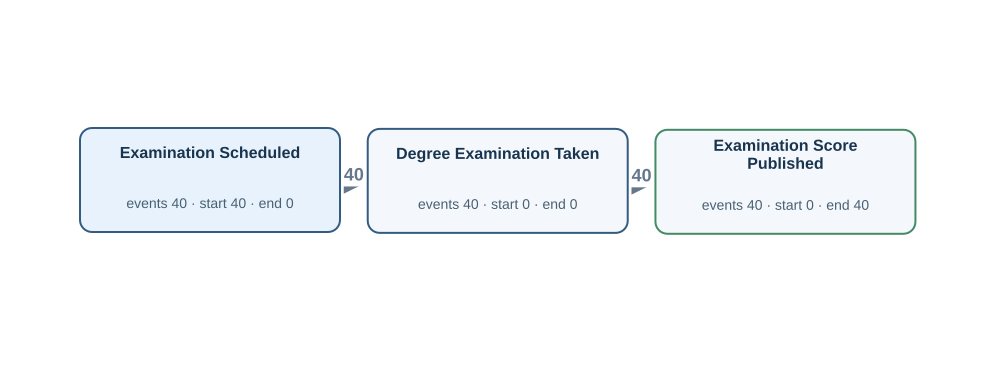

[Gold CSV](../../../datasets/universityflow/private/gold_logs/OU04E.csv)

## OU04EP — Q2

For each examination result record, build a timeline of an examination sitting being arranged, the student sitting the degree examination, the examination mark being released.

Events: **120** · Cases with events: **40** · Activities: **3** · Edges: **2**

[Gold CSV](../../../datasets/universityflow/private/gold_logs/OU04EP.csv)

## OU05P — Q4

Show the complete recorded history associated with each simulation module.

Events: **142** · Cases with events: **3** · Activities: **9** · Edges: **10**

[Gold CSV](../../../datasets/universityflow/private/gold_logs/OU05P.csv)

## OU05E — Q1

Extract Simulation Run Started, Simulation Experiment Completed, Simulation Result Accepted events for each simulation module.

Events: **77** · Cases with events: **3** · Activities: **3** · Edges: **4**

[Gold CSV](../../../datasets/universityflow/private/gold_logs/OU05E.csv)

## OU05EP — Q2

For each simulation module, build a timeline of a simulation run beginning, a simulation run finishing, the simulation results receiving approval.

Events: **77** · Cases with events: **3** · Activities: **3** · Edges: **4**

[Gold CSV](../../../datasets/universityflow/private/gold_logs/OU05EP.csv)

## OU06P — Q4

Show the complete recorded history associated with each thesis.

Events: **73** · Cases with events: **16** · Activities: **6** · Edges: **6**

[Gold CSV](../../../datasets/universityflow/private/gold_logs/OU06P.csv)

## OU06E — Q1

Extract Thesis Submitted, Thesis Review Started, Thesis Accepted events for each thesis.

Events: **45** · Cases with events: **16** · Activities: **3** · Edges: **2**

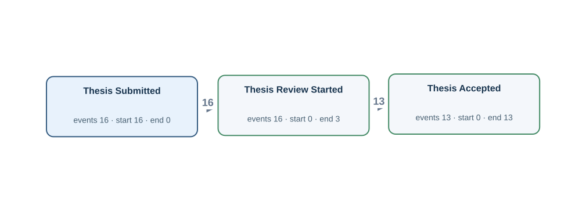

[Gold CSV](../../../datasets/universityflow/private/gold_logs/OU06E.csv)

## OU06EP — Q2

For each thesis, build a timeline of the student handing in a thesis, the review of a thesis beginning, a thesis receiving final approval.

Events: **45** · Cases with events: **16** · Activities: **3** · Edges: **2**

[Gold CSV](../../../datasets/universityflow/private/gold_logs/OU06EP.csv)

## OU07P — Q4

Show the complete recorded history associated with each simulation experiment result record.

Events: **131** · Cases with events: **27** · Activities: **5** · Edges: **4**

[Gold CSV](../../../datasets/universityflow/private/gold_logs/OU07P.csv)

## OU07E — Q1

Extract Simulation Run Started, Simulation Experiment Completed, Simulation Result Accepted events for each simulation experiment result record.

Events: **77** · Cases with events: **27** · Activities: **3** · Edges: **2**

[Gold CSV](../../../datasets/universityflow/private/gold_logs/OU07E.csv)

## OU07EP — Q2

For each simulation experiment result record, build a timeline of a simulation run beginning, a simulation run finishing, the simulation results receiving approval.

Events: **77** · Cases with events: **27** · Activities: **3** · Edges: **2**

[Gold CSV](../../../datasets/universityflow/private/gold_logs/OU07EP.csv)

## OU08P — Q4

Show the complete recorded history associated with each assignment.

Events: **90** · Cases with events: **20** · Activities: **7** · Edges: **9**

[Gold CSV](../../../datasets/universityflow/private/gold_logs/OU08P.csv)

## OU08E — Q1

Extract Assignment Assigned, Assignment Submitted, Assignment Graded events for each assignment.

Events: **54** · Cases with events: **20** · Activities: **3** · Edges: **3**

[Gold CSV](../../../datasets/universityflow/private/gold_logs/OU08E.csv)

## OU08EP — Q2

For each assignment, build a timeline of coursework being set for the student, the student handing in coursework, an instructor assessing the assignment.

Events: **54** · Cases with events: **20** · Activities: **3** · Edges: **3**

[Gold CSV](../../../datasets/universityflow/private/gold_logs/OU08EP.csv)

## OU09P — Q4

Show the complete recorded history associated with each instructor.

Events: **86** · Cases with events: **3** · Activities: **7** · Edges: **18**

[Gold CSV](../../../datasets/universityflow/private/gold_logs/OU09P.csv)

## OU09E — Q1

Extract Assignment Assigned, Assignment Submitted, Assignment Graded events for each instructor.

Events: **50** · Cases with events: **3** · Activities: **3** · Edges: **7**

[Gold CSV](../../../datasets/universityflow/private/gold_logs/OU09E.csv)

## OU09EP — Q2

For each instructor, build a timeline of coursework being set for the student, the student handing in coursework, an instructor assessing the assignment.

Events: **50** · Cases with events: **3** · Activities: **3** · Edges: **7**

[Gold CSV](../../../datasets/universityflow/private/gold_logs/OU09EP.csv)

## OU10P — Q4

Show the complete recorded history associated with each assignment grading record.

Events: **25** · Cases with events: **25** · Activities: **2** · Edges: **0**

[Gold CSV](../../../datasets/universityflow/private/gold_logs/OU10P.csv)

## OU10E — Q1

Extract Assignment Graded events for each assignment grading record.

Events: **18** · Cases with events: **18** · Activities: **1** · Edges: **0**

[Gold CSV](../../../datasets/universityflow/private/gold_logs/OU10E.csv)

## OU10EP — Q2

For each assignment grading record, build a timeline of an instructor assessing the assignment.

Events: **18** · Cases with events: **18** · Activities: **1** · Edges: **0**

[Gold CSV](../../../datasets/universityflow/private/gold_logs/OU10EP.csv)

## OU11P — Q4

Show the complete recorded history associated with each course-design task.

Events: **11** · Cases with events: **3** · Activities: **4** · Edges: **3**

[Gold CSV](../../../datasets/universityflow/private/gold_logs/OU11P.csv)

## OU11E — Q1

Extract Design Task Approved, Design Task Closed, Design Task Created events for each course-design task.

Events: **8** · Cases with events: **3** · Activities: **3** · Edges: **2**

[Gold CSV](../../../datasets/universityflow/private/gold_logs/OU11E.csv)

## OU11EP — Q2

For each course-design task, build a timeline of a design exercise receiving approval, a design exercise being closed, a design exercise being prepared.

Events: **8** · Cases with events: **3** · Activities: **3** · Edges: **2**

[Gold CSV](../../../datasets/universityflow/private/gold_logs/OU11EP.csv)
