# universityflow: questions and Gold DFGs

**EVALUATION ONLY — NEVER PROVIDE TO A MODEL.**

Source commit: `a0ba4c9631d12730d60bf7720d783a3a827b88dc`. Open index.html for search, review notes and complete case traces.

Node counts = event occurrences. Edge counts = adjacent selected events within a case. Dashed amber edges touch timestamp ties and depend on the tie-break rule. DFGs are projections of the selected log, not causal models.

[Event graph inventory · tables, objects, OTs and activities](event_graph.md)

**Source tables** produced matched Gold events. **SQL tables** are all physical tables read by the Gold SQL, including join tables and shared CTE branches.

## Dataset overview

<table><tr><td width="50%" valign="top"><h3>All questions (70)</h3><table><thead><tr><th>ID</th><th>Type</th><th>Question</th></tr></thead><tbody><tr><td><a href="#u01--q1">U01</a></td><td>Q1</td><td>Extract Degree Examination Taken events for each student.</td></tr><tr><td><a href="#u02--q2">U02</a></td><td>Q2</td><td>For each student, build a timeline of the student sitting the degree examination.</td></tr><tr><td><a href="#u03--q1">U03</a></td><td>Q1</td><td>Extract Course Registered events for each student.</td></tr><tr><td><a href="#u04--q2">U04</a></td><td>Q2</td><td>For each student, build a timeline of a successful course sign-up.</td></tr><tr><td><a href="#u05--q3">U05</a></td><td>Q3</td><td>Extract the full recorded lifecycle event log for each student.</td></tr><tr><td><a href="#u06--q4">U06</a></td><td>Q4</td><td>Show the complete recorded history associated with each student.</td></tr><tr><td><a href="#u07--q1">U07</a></td><td>Q1</td><td>Extract Registration Success Notification Sent events for each student.</td></tr><tr><td><a href="#u08--q1">U08</a></td><td>Q1</td><td>Extract Course Withdrawn events for each student.</td></tr><tr><td><a href="#u09--q1">U09</a></td><td>Q1</td><td>Extract Assignment Graded events for each student.</td></tr><tr><td><a href="#u10--q2">U10</a></td><td>Q2</td><td>For each student, build a timeline of an instructor assessing the assignment.</td></tr><tr><td><a href="#u11--q1">U11</a></td><td>Q1</td><td>Extract Simulation Experiment Completed events for each student.</td></tr><tr><td><a href="#u12--q2">U12</a></td><td>Q2</td><td>For each student, build a timeline of a simulation run finishing.</td></tr><tr><td><a href="#u13--q1">U13</a></td><td>Q1</td><td>Extract Thesis Submitted events for each student.</td></tr><tr><td><a href="#u14--q2">U14</a></td><td>Q2</td><td>For each student, build a timeline of the student handing in a thesis.</td></tr><tr><td><a href="#u15--q1">U15</a></td><td>Q1</td><td>Extract Assignment Submitted events for each student.</td></tr><tr><td><a href="#ou01--q3">OU01</a></td><td>Q3</td><td>Extract the full recorded lifecycle event log for each student.</td></tr><tr><td><a href="#ou02--q3">OU02</a></td><td>Q3</td><td>Extract the full recorded lifecycle event log for each course.</td></tr><tr><td><a href="#ou03--q3">OU03</a></td><td>Q3</td><td>Extract the full recorded lifecycle event log for each student-course registration.</td></tr><tr><td><a href="#ou04--q3">OU04</a></td><td>Q3</td><td>Extract the full recorded lifecycle event log for each examination result record.</td></tr><tr><td><a href="#ou05--q3">OU05</a></td><td>Q3</td><td>Extract the full recorded lifecycle event log for each simulation module.</td></tr><tr><td><a href="#ou06--q3">OU06</a></td><td>Q3</td><td>Extract the full recorded lifecycle event log for each thesis.</td></tr><tr><td><a href="#ou07--q3">OU07</a></td><td>Q3</td><td>Extract the full recorded lifecycle event log for each simulation experiment result record.</td></tr><tr><td><a href="#ou08--q3">OU08</a></td><td>Q3</td><td>Extract the full recorded lifecycle event log for each assignment.</td></tr><tr><td><a href="#ou09--q3">OU09</a></td><td>Q3</td><td>Extract the full recorded lifecycle event log for each instructor.</td></tr><tr><td><a href="#ou10--q3">OU10</a></td><td>Q3</td><td>Extract the full recorded lifecycle event log for each assignment grading record.</td></tr><tr><td><a href="#ou11--q3">OU11</a></td><td>Q3</td><td>Extract the full recorded lifecycle event log for each course-design task.</td></tr><tr><td><a href="#ts01--q1">TS01</a></td><td>Q1</td><td>Extract Examination Scheduled, Examination Checked In, Examination Score Published, Examination Result Reviewed events for each student.</td></tr><tr><td><a href="#ts02--q1">TS02</a></td><td>Q1</td><td>Extract Registration Requested, Registration Approved, Course Started, Course Assessment Completed, Course Grade Finalized events for each student-course registration.</td></tr><tr><td><a href="#ts03--q1">TS03</a></td><td>Q1</td><td>Extract Assignment Assigned, Assignment Submitted, Assignment Grade Finalized events for each assignment.</td></tr><tr><td><a href="#ts04--q1">TS04</a></td><td>Q1</td><td>Extract Thesis Draft Registered, Thesis Review Started, Thesis Accepted events for each thesis.</td></tr><tr><td><a href="#u07p--q2">U07P</a></td><td>Q2</td><td>For each student, build a timeline of confirmation messages being sent after a course sign-up.</td></tr><tr><td><a href="#u08p--q2">U08P</a></td><td>Q2</td><td>For each student, build a timeline of the student leaving a course after signing up.</td></tr><tr><td><a href="#u15p--q2">U15P</a></td><td>Q2</td><td>For each student, build a timeline of the student handing in coursework.</td></tr><tr><td><a href="#ts01p--q2">TS01P</a></td><td>Q2</td><td>For each student, build a timeline of an examination sitting being arranged, the candidate checking in for the examination, the examination mark being released, the examination result being reviewed.</td></tr><tr><td><a href="#ts02p--q2">TS02P</a></td><td>Q2</td><td>For each student-course registration, build a timeline of the student requesting a place on a course, the request for a course place being accepted, teaching beginning for the enrolled course, the course assessment finishing, the course mark being made final.</td></tr><tr><td><a href="#ts03p--q2">TS03P</a></td><td>Q2</td><td>For each assignment, build a timeline of coursework being set for the student, the student handing in coursework, the coursework mark being made final.</td></tr><tr><td><a href="#ts04p--q2">TS04P</a></td><td>Q2</td><td>For each thesis, build a timeline of a thesis draft being registered for review, the review of a thesis beginning, a thesis receiving final approval.</td></tr><tr><td><a href="#ou01p--q4">OU01P</a></td><td>Q4</td><td>Show the complete recorded history associated with each student.</td></tr><tr><td><a href="#ou01e--q1">OU01E</a></td><td>Q1</td><td>Extract Assignment Assigned, Assignment Submitted, Assignment Graded events for each student.</td></tr><tr><td><a href="#ou01ep--q2">OU01EP</a></td><td>Q2</td><td>For each student, build a timeline of coursework being set for the student, the student handing in coursework, an instructor assessing the assignment.</td></tr><tr><td><a href="#ou02p--q4">OU02P</a></td><td>Q4</td><td>Show the complete recorded history associated with each course.</td></tr><tr><td><a href="#ou02e--q1">OU02E</a></td><td>Q1</td><td>Extract Registration Requested, Course Registered, Course Grade Finalized events for each course.</td></tr><tr><td><a href="#ou02ep--q2">OU02EP</a></td><td>Q2</td><td>For each course, build a timeline of the student requesting a place on a course, a successful course sign-up, the course mark being made final.</td></tr><tr><td><a href="#ou03p--q4">OU03P</a></td><td>Q4</td><td>Show the complete recorded history associated with each student-course registration.</td></tr><tr><td><a href="#ou03e--q1">OU03E</a></td><td>Q1</td><td>Extract Registration Requested, Course Registered, Course Grade Finalized events for each student-course registration.</td></tr><tr><td><a href="#ou03ep--q2">OU03EP</a></td><td>Q2</td><td>For each student-course registration, build a timeline of the student requesting a place on a course, a successful course sign-up, the course mark being made final.</td></tr><tr><td><a href="#ou04p--q4">OU04P</a></td><td>Q4</td><td>Show the complete recorded history associated with each examination result record.</td></tr><tr><td><a href="#ou04e--q1">OU04E</a></td><td>Q1</td><td>Extract Examination Scheduled, Degree Examination Taken, Examination Score Published events for each examination result record.</td></tr><tr><td><a href="#ou04ep--q2">OU04EP</a></td><td>Q2</td><td>For each examination result record, build a timeline of an examination sitting being arranged, the student sitting the degree examination, the examination mark being released.</td></tr><tr><td><a href="#ou05p--q4">OU05P</a></td><td>Q4</td><td>Show the complete recorded history associated with each simulation module.</td></tr><tr><td><a href="#ou05e--q1">OU05E</a></td><td>Q1</td><td>Extract Simulation Run Started, Simulation Experiment Completed, Simulation Result Accepted events for each simulation module.</td></tr><tr><td><a href="#ou05ep--q2">OU05EP</a></td><td>Q2</td><td>For each simulation module, build a timeline of a simulation run beginning, a simulation run finishing, the simulation results receiving approval.</td></tr><tr><td><a href="#ou06p--q4">OU06P</a></td><td>Q4</td><td>Show the complete recorded history associated with each thesis.</td></tr><tr><td><a href="#ou06e--q1">OU06E</a></td><td>Q1</td><td>Extract Thesis Submitted, Thesis Review Started, Thesis Accepted events for each thesis.</td></tr><tr><td><a href="#ou06ep--q2">OU06EP</a></td><td>Q2</td><td>For each thesis, build a timeline of the student handing in a thesis, the review of a thesis beginning, a thesis receiving final approval.</td></tr><tr><td><a href="#ou07p--q4">OU07P</a></td><td>Q4</td><td>Show the complete recorded history associated with each simulation experiment result record.</td></tr><tr><td><a href="#ou07e--q1">OU07E</a></td><td>Q1</td><td>Extract Simulation Run Started, Simulation Experiment Completed, Simulation Result Accepted events for each simulation experiment result record.</td></tr><tr><td><a href="#ou07ep--q2">OU07EP</a></td><td>Q2</td><td>For each simulation experiment result record, build a timeline of a simulation run beginning, a simulation run finishing, the simulation results receiving approval.</td></tr><tr><td><a href="#ou08p--q4">OU08P</a></td><td>Q4</td><td>Show the complete recorded history associated with each assignment.</td></tr><tr><td><a href="#ou08e--q1">OU08E</a></td><td>Q1</td><td>Extract Assignment Assigned, Assignment Submitted, Assignment Graded events for each assignment.</td></tr><tr><td><a href="#ou08ep--q2">OU08EP</a></td><td>Q2</td><td>For each assignment, build a timeline of coursework being set for the student, the student handing in coursework, an instructor assessing the assignment.</td></tr><tr><td><a href="#ou09p--q4">OU09P</a></td><td>Q4</td><td>Show the complete recorded history associated with each instructor.</td></tr><tr><td><a href="#ou09e--q1">OU09E</a></td><td>Q1</td><td>Extract Assignment Assigned, Assignment Submitted, Assignment Graded events for each instructor.</td></tr><tr><td><a href="#ou09ep--q2">OU09EP</a></td><td>Q2</td><td>For each instructor, build a timeline of coursework being set for the student, the student handing in coursework, an instructor assessing the assignment.</td></tr><tr><td><a href="#ou10p--q4">OU10P</a></td><td>Q4</td><td>Show the complete recorded history associated with each assignment grading record.</td></tr><tr><td><a href="#ou10e--q1">OU10E</a></td><td>Q1</td><td>Extract Assignment Graded events for each assignment grading record.</td></tr><tr><td><a href="#ou10ep--q2">OU10EP</a></td><td>Q2</td><td>For each assignment grading record, build a timeline of an instructor assessing the assignment.</td></tr><tr><td><a href="#ou11p--q4">OU11P</a></td><td>Q4</td><td>Show the complete recorded history associated with each course-design task.</td></tr><tr><td><a href="#ou11e--q1">OU11E</a></td><td>Q1</td><td>Extract Design Task Approved, Design Task Closed, Design Task Created events for each course-design task.</td></tr><tr><td><a href="#ou11ep--q2">OU11EP</a></td><td>Q2</td><td>For each course-design task, build a timeline of a design exercise receiving approval, a design exercise being closed, a design exercise being prepared.</td></tr></tbody></table></td><td width="50%" valign="top"><h3>Database schema</h3>
<a href="../../../datasets/universityflow/docs/schema.png">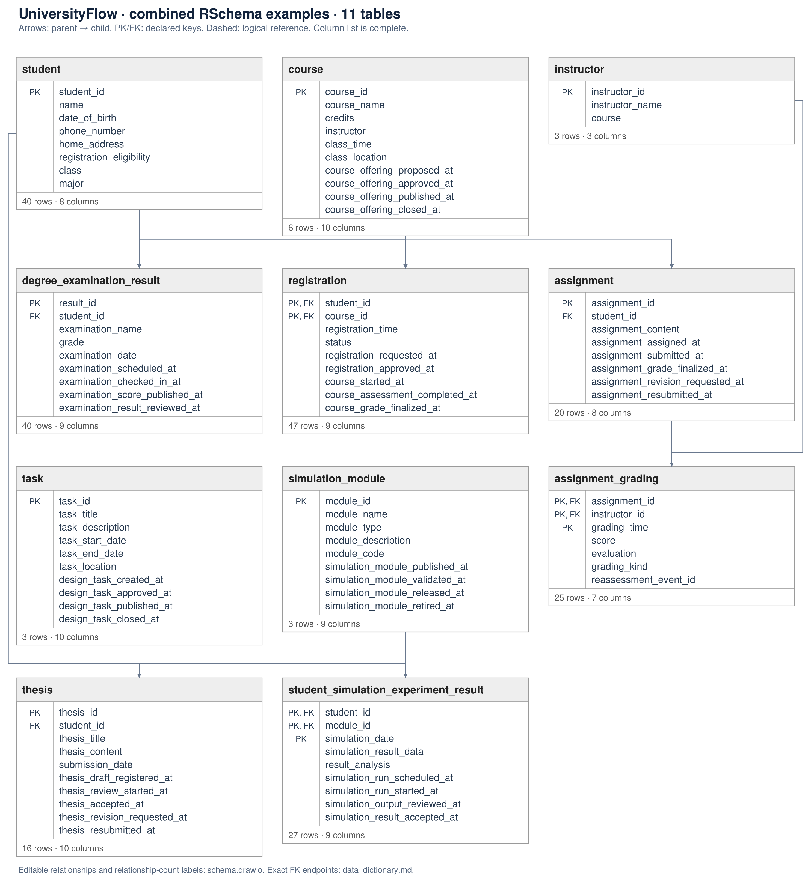</a>

<a href="../../../datasets/universityflow/docs/schema.png">Full-size diagram</a> · <a href="../../../datasets/universityflow/input/schema.sql">Full SQL schema</a>
</td></tr></table>

## U01 — Q1

Extract Degree Examination Taken events for each student.

Events: **40** · Cases with events: **30** · Activities: **1** · Edges: **1** · Source tables: **1** · SQL tables: **1**

<table><tr><td width="65%" valign="top"><a href="graphs/U01.svg">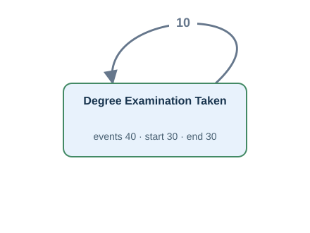</a> <a href="graphs/U01.svg">Open full-size DFG</a></td><td width="35%" valign="top"><h4>Original tables</h4>
Up to 3 matched rows per table. Shows keys, event times and carrier values.

<strong>degree_examination_result</strong> · 40 matched rows
<table><tr><th>Row</th><th>Source values</th></tr><tr><td>1</td><td>result_id = E001-1 examination_date = 2026-02-02T09:00:00Z</td></tr><tr><td>2</td><td>result_id = E002-1 examination_date = 2026-02-03T09:00:00Z</td></tr><tr><td>3</td><td>result_id = E002-2 examination_date = 2026-02-05T09:00:00Z</td></tr></table></td></tr></table>

[Gold CSV](../../../datasets/universityflow/private/gold_logs/U01.csv)

## U02 — Q2

For each student, build a timeline of the student sitting the degree examination.

Events: **40** · Cases with events: **30** · Activities: **1** · Edges: **1** · Source tables: **1** · SQL tables: **1**

<table><tr><td width="65%" valign="top"> <a href="graphs/U01.svg">Open full-size DFG</a></td><td width="35%" valign="top"><h4>Original tables</h4>
Up to 3 matched rows per table. Shows keys, event times and carrier values.

<strong>degree_examination_result</strong> · 40 matched rows
<table><tr><th>Row</th><th>Source values</th></tr><tr><td>1</td><td>result_id = E001-1 examination_date = 2026-02-02T09:00:00Z</td></tr><tr><td>2</td><td>result_id = E002-1 examination_date = 2026-02-03T09:00:00Z</td></tr><tr><td>3</td><td>result_id = E002-2 examination_date = 2026-02-05T09:00:00Z</td></tr></table></td></tr></table>

[Gold CSV](../../../datasets/universityflow/private/gold_logs/U02.csv)

## U03 — Q1

Extract Course Registered events for each student.

Events: **47** · Cases with events: **20** · Activities: **1** · Edges: **1** · Source tables: **1** · SQL tables: **1**

<table><tr><td width="65%" valign="top"> <a href="graphs/U03.svg">Open full-size DFG</a></td><td width="35%" valign="top"><h4>Original tables</h4>
Up to 3 matched rows per table. Shows keys, event times and carrier values.

<strong>registration</strong> · 47 matched rows
<table><tr><th>Row</th><th>Source values</th></tr><tr><td>1</td><td>student_id = S002 course_id = C01 registration_time = 2026-02-07T11:00:00Z</td></tr><tr><td>2</td><td>student_id = S002 course_id = C06 registration_time = 2026-02-07T16:00:00Z</td></tr><tr><td>3</td><td>student_id = S003 course_id = C02 registration_time = 2026-02-08T12:00:00Z</td></tr></table></td></tr></table>

[Gold CSV](../../../datasets/universityflow/private/gold_logs/U03.csv)

## U04 — Q2

For each student, build a timeline of a successful course sign-up.

Events: **47** · Cases with events: **20** · Activities: **1** · Edges: **1** · Source tables: **1** · SQL tables: **1**

<table><tr><td width="65%" valign="top"> <a href="graphs/U03.svg">Open full-size DFG</a></td><td width="35%" valign="top"><h4>Original tables</h4>
Up to 3 matched rows per table. Shows keys, event times and carrier values.

<strong>registration</strong> · 47 matched rows
<table><tr><th>Row</th><th>Source values</th></tr><tr><td>1</td><td>student_id = S002 course_id = C01 registration_time = 2026-02-07T11:00:00Z</td></tr><tr><td>2</td><td>student_id = S002 course_id = C06 registration_time = 2026-02-07T16:00:00Z</td></tr><tr><td>3</td><td>student_id = S003 course_id = C02 registration_time = 2026-02-08T12:00:00Z</td></tr></table></td></tr></table>

[Gold CSV](../../../datasets/universityflow/private/gold_logs/U04.csv)

## U05 — Q3

Extract the full recorded lifecycle event log for each student.

Events: **763** · Cases with events: **30** · Activities: **29** · Edges: **62** · Source tables: **6** · SQL tables: **9**

<table><tr><td width="65%" valign="top"> <a href="graphs/U05.svg">Open full-size DFG</a></td><td width="35%" valign="top"><h4>Original tables</h4>
Up to 3 matched rows per table. Shows keys, event times and carrier values.

<strong>assignment</strong> · 20 matched rows
<table><tr><th>Row</th><th>Source values</th></tr><tr><td>1</td><td>assignment_id = A002 assignment_assigned_at = 2026-02-07T14:00:00Z assignment_submitted_at = 2026-02-09T14:00:00Z assignment_grade_finalized_at = NULL assignment_revision_requested_at = 2026-02-11T15:00:00Z assignment_resubmitted_at = 2026-02-12T14:00:00Z</td></tr><tr><td>2</td><td>assignment_id = A003 assignment_assigned_at = 2026-02-08T14:00:00Z assignment_submitted_at = 2026-02-10T14:00:00Z assignment_grade_finalized_at = 2026-02-14T14:00:00Z assignment_revision_requested_at = NULL assignment_resubmitted_at = NULL</td></tr><tr><td>3</td><td>assignment_id = A006 assignment_assigned_at = 2026-02-11T14:00:00Z assignment_submitted_at = 2026-02-13T14:00:00Z assignment_grade_finalized_at = 2026-02-17T14:00:00Z assignment_revision_requested_at = NULL assignment_resubmitted_at = NULL</td></tr></table>
<strong>assignment_grading</strong> · 25 matched rows
<table><tr><th>Row</th><th>Source values</th></tr><tr><td>1</td><td>assignment_id = A002 instructor_id = I03 grading_time = 2026-02-11T14:00:00Z grading_kind = ORIGINAL</td></tr><tr><td>2</td><td>assignment_id = A002 instructor_id = I03 grading_time = 2026-02-13T02:00:00Z grading_kind = REASSESSMENT</td></tr><tr><td>3</td><td>assignment_id = A003 instructor_id = I01 grading_time = 2026-02-12T14:00:00Z grading_kind = ORIGINAL</td></tr></table>
<strong>degree_examination_result</strong> · 40 matched rows
<table><tr><th>Row</th><th>Source values</th></tr><tr><td>1</td><td>result_id = E001-1 examination_date = 2026-02-02T09:00:00Z examination_scheduled_at = 2026-02-02T07:00:00Z examination_checked_in_at = 2026-02-02T08:00:00Z examination_score_published_at = 2026-02-02T11:00:00Z examination_result_reviewed_at = NULL</td></tr><tr><td>2</td><td>result_id = E002-1 examination_date = 2026-02-03T09:00:00Z examination_scheduled_at = 2026-02-03T07:00:00Z examination_checked_in_at = 2026-02-03T08:00:00Z examination_score_published_at = 2026-02-03T11:00:00Z examination_result_reviewed_at = 2026-02-03T12:00:00Z</td></tr><tr><td>3</td><td>result_id = E002-2 examination_date = 2026-02-05T09:00:00Z examination_scheduled_at = 2026-02-05T07:00:00Z examination_checked_in_at = 2026-02-05T08:00:00Z examination_score_published_at = 2026-02-05T11:00:00Z examination_result_reviewed_at = 2026-02-05T12:00:00Z</td></tr></table>
<strong>registration</strong> · 47 matched rows
<table><tr><th>Row</th><th>Source values</th></tr><tr><td>1</td><td>student_id = S002 course_id = C01 registration_time = 2026-02-07T11:00:00Z registration_requested_at = 2026-02-07T07:00:00Z registration_approved_at = 2026-02-07T09:00:00Z course_started_at = 2026-02-09T11:00:00Z course_assessment_completed_at = 2026-02-27T11:00:00Z course_grade_finalized_at = NULL</td></tr><tr><td>2</td><td>student_id = S002 course_id = C06 registration_time = 2026-02-07T16:00:00Z registration_requested_at = 2026-02-07T12:00:00Z registration_approved_at = 2026-02-07T14:00:00Z course_started_at = 2026-02-09T16:00:00Z course_assessment_completed_at = 2026-02-27T16:00:00Z course_grade_finalized_at = 2026-03-01T16:00:00Z</td></tr><tr><td>3</td><td>student_id = S003 course_id = C02 registration_time = 2026-02-08T12:00:00Z registration_requested_at = 2026-02-08T08:00:00Z registration_approved_at = 2026-02-08T10:00:00Z course_started_at = 2026-02-10T12:00:00Z course_assessment_completed_at = 2026-02-28T12:00:00Z course_grade_finalized_at = 2026-03-02T12:00:00Z</td></tr></table>
<strong>student_simulation_experiment_result</strong> · 27 matched rows
<table><tr><th>Row</th><th>Source values</th></tr><tr><td>1</td><td>student_id = S002 module_id = M03 simulation_date = 2026-02-13T15:00:00Z simulation_run_scheduled_at = 2026-02-13T13:00:00Z simulation_run_started_at = 2026-02-13T14:00:00Z simulation_output_reviewed_at = 2026-02-13T17:00:00Z simulation_result_accepted_at = NULL</td></tr><tr><td>2</td><td>student_id = S003 module_id = M01 simulation_date = 2026-02-14T15:00:00Z simulation_run_scheduled_at = 2026-02-14T13:00:00Z simulation_run_started_at = 2026-02-14T14:00:00Z simulation_output_reviewed_at = 2026-02-14T17:00:00Z simulation_result_accepted_at = 2026-02-14T18:00:00Z</td></tr><tr><td>3</td><td>student_id = S003 module_id = M01 simulation_date = 2026-02-15T15:00:00Z simulation_run_scheduled_at = 2026-02-15T13:00:00Z simulation_run_started_at = 2026-02-15T14:00:00Z simulation_output_reviewed_at = 2026-02-15T17:00:00Z simulation_result_accepted_at = 2026-02-15T18:00:00Z</td></tr></table>
<strong>thesis</strong> · 16 matched rows
<table><tr><th>Row</th><th>Source values</th></tr><tr><td>1</td><td>thesis_id = TH002 submission_date = 2026-02-23T16:00:00Z thesis_draft_registered_at = 2026-02-19T16:00:00Z thesis_review_started_at = 2026-02-24T16:00:00Z thesis_accepted_at = NULL thesis_revision_requested_at = 2026-02-25T16:00:00Z thesis_resubmitted_at = 2026-02-26T16:00:00Z</td></tr><tr><td>2</td><td>thesis_id = TH003 submission_date = 2026-02-24T16:00:00Z thesis_draft_registered_at = 2026-02-20T16:00:00Z thesis_review_started_at = 2026-02-25T16:00:00Z thesis_accepted_at = 2026-02-28T16:00:00Z thesis_revision_requested_at = NULL thesis_resubmitted_at = NULL</td></tr><tr><td>3</td><td>thesis_id = TH006 submission_date = 2026-02-27T16:00:00Z thesis_draft_registered_at = 2026-02-23T16:00:00Z thesis_review_started_at = 2026-02-28T16:00:00Z thesis_accepted_at = 2026-03-03T16:00:00Z thesis_revision_requested_at = NULL thesis_resubmitted_at = NULL</td></tr></table>

Other SQL tables

course, simulation_module, task

</td></tr></table>

[Gold CSV](../../../datasets/universityflow/private/gold_logs/U05.csv)

## U06 — Q4

Show the complete recorded history associated with each student.

Events: **763** · Cases with events: **30** · Activities: **29** · Edges: **62** · Source tables: **6** · SQL tables: **9**

<table><tr><td width="65%" valign="top"> <a href="graphs/U05.svg">Open full-size DFG</a></td><td width="35%" valign="top"><h4>Original tables</h4>
Up to 3 matched rows per table. Shows keys, event times and carrier values.

<strong>assignment</strong> · 20 matched rows
<table><tr><th>Row</th><th>Source values</th></tr><tr><td>1</td><td>assignment_id = A002 assignment_assigned_at = 2026-02-07T14:00:00Z assignment_submitted_at = 2026-02-09T14:00:00Z assignment_grade_finalized_at = NULL assignment_revision_requested_at = 2026-02-11T15:00:00Z assignment_resubmitted_at = 2026-02-12T14:00:00Z</td></tr><tr><td>2</td><td>assignment_id = A003 assignment_assigned_at = 2026-02-08T14:00:00Z assignment_submitted_at = 2026-02-10T14:00:00Z assignment_grade_finalized_at = 2026-02-14T14:00:00Z assignment_revision_requested_at = NULL assignment_resubmitted_at = NULL</td></tr><tr><td>3</td><td>assignment_id = A006 assignment_assigned_at = 2026-02-11T14:00:00Z assignment_submitted_at = 2026-02-13T14:00:00Z assignment_grade_finalized_at = 2026-02-17T14:00:00Z assignment_revision_requested_at = NULL assignment_resubmitted_at = NULL</td></tr></table>
<strong>assignment_grading</strong> · 25 matched rows
<table><tr><th>Row</th><th>Source values</th></tr><tr><td>1</td><td>assignment_id = A002 instructor_id = I03 grading_time = 2026-02-11T14:00:00Z grading_kind = ORIGINAL</td></tr><tr><td>2</td><td>assignment_id = A002 instructor_id = I03 grading_time = 2026-02-13T02:00:00Z grading_kind = REASSESSMENT</td></tr><tr><td>3</td><td>assignment_id = A003 instructor_id = I01 grading_time = 2026-02-12T14:00:00Z grading_kind = ORIGINAL</td></tr></table>
<strong>degree_examination_result</strong> · 40 matched rows
<table><tr><th>Row</th><th>Source values</th></tr><tr><td>1</td><td>result_id = E001-1 examination_date = 2026-02-02T09:00:00Z examination_scheduled_at = 2026-02-02T07:00:00Z examination_checked_in_at = 2026-02-02T08:00:00Z examination_score_published_at = 2026-02-02T11:00:00Z examination_result_reviewed_at = NULL</td></tr><tr><td>2</td><td>result_id = E002-1 examination_date = 2026-02-03T09:00:00Z examination_scheduled_at = 2026-02-03T07:00:00Z examination_checked_in_at = 2026-02-03T08:00:00Z examination_score_published_at = 2026-02-03T11:00:00Z examination_result_reviewed_at = 2026-02-03T12:00:00Z</td></tr><tr><td>3</td><td>result_id = E002-2 examination_date = 2026-02-05T09:00:00Z examination_scheduled_at = 2026-02-05T07:00:00Z examination_checked_in_at = 2026-02-05T08:00:00Z examination_score_published_at = 2026-02-05T11:00:00Z examination_result_reviewed_at = 2026-02-05T12:00:00Z</td></tr></table>
<strong>registration</strong> · 47 matched rows
<table><tr><th>Row</th><th>Source values</th></tr><tr><td>1</td><td>student_id = S002 course_id = C01 registration_time = 2026-02-07T11:00:00Z registration_requested_at = 2026-02-07T07:00:00Z registration_approved_at = 2026-02-07T09:00:00Z course_started_at = 2026-02-09T11:00:00Z course_assessment_completed_at = 2026-02-27T11:00:00Z course_grade_finalized_at = NULL</td></tr><tr><td>2</td><td>student_id = S002 course_id = C06 registration_time = 2026-02-07T16:00:00Z registration_requested_at = 2026-02-07T12:00:00Z registration_approved_at = 2026-02-07T14:00:00Z course_started_at = 2026-02-09T16:00:00Z course_assessment_completed_at = 2026-02-27T16:00:00Z course_grade_finalized_at = 2026-03-01T16:00:00Z</td></tr><tr><td>3</td><td>student_id = S003 course_id = C02 registration_time = 2026-02-08T12:00:00Z registration_requested_at = 2026-02-08T08:00:00Z registration_approved_at = 2026-02-08T10:00:00Z course_started_at = 2026-02-10T12:00:00Z course_assessment_completed_at = 2026-02-28T12:00:00Z course_grade_finalized_at = 2026-03-02T12:00:00Z</td></tr></table>
<strong>student_simulation_experiment_result</strong> · 27 matched rows
<table><tr><th>Row</th><th>Source values</th></tr><tr><td>1</td><td>student_id = S002 module_id = M03 simulation_date = 2026-02-13T15:00:00Z simulation_run_scheduled_at = 2026-02-13T13:00:00Z simulation_run_started_at = 2026-02-13T14:00:00Z simulation_output_reviewed_at = 2026-02-13T17:00:00Z simulation_result_accepted_at = NULL</td></tr><tr><td>2</td><td>student_id = S003 module_id = M01 simulation_date = 2026-02-14T15:00:00Z simulation_run_scheduled_at = 2026-02-14T13:00:00Z simulation_run_started_at = 2026-02-14T14:00:00Z simulation_output_reviewed_at = 2026-02-14T17:00:00Z simulation_result_accepted_at = 2026-02-14T18:00:00Z</td></tr><tr><td>3</td><td>student_id = S003 module_id = M01 simulation_date = 2026-02-15T15:00:00Z simulation_run_scheduled_at = 2026-02-15T13:00:00Z simulation_run_started_at = 2026-02-15T14:00:00Z simulation_output_reviewed_at = 2026-02-15T17:00:00Z simulation_result_accepted_at = 2026-02-15T18:00:00Z</td></tr></table>
<strong>thesis</strong> · 16 matched rows
<table><tr><th>Row</th><th>Source values</th></tr><tr><td>1</td><td>thesis_id = TH002 submission_date = 2026-02-23T16:00:00Z thesis_draft_registered_at = 2026-02-19T16:00:00Z thesis_review_started_at = 2026-02-24T16:00:00Z thesis_accepted_at = NULL thesis_revision_requested_at = 2026-02-25T16:00:00Z thesis_resubmitted_at = 2026-02-26T16:00:00Z</td></tr><tr><td>2</td><td>thesis_id = TH003 submission_date = 2026-02-24T16:00:00Z thesis_draft_registered_at = 2026-02-20T16:00:00Z thesis_review_started_at = 2026-02-25T16:00:00Z thesis_accepted_at = 2026-02-28T16:00:00Z thesis_revision_requested_at = NULL thesis_resubmitted_at = NULL</td></tr><tr><td>3</td><td>thesis_id = TH006 submission_date = 2026-02-27T16:00:00Z thesis_draft_registered_at = 2026-02-23T16:00:00Z thesis_review_started_at = 2026-02-28T16:00:00Z thesis_accepted_at = 2026-03-03T16:00:00Z thesis_revision_requested_at = NULL thesis_resubmitted_at = NULL</td></tr></table>

Other SQL tables

course, simulation_module, task

</td></tr></table>

[Gold CSV](../../../datasets/universityflow/private/gold_logs/U06.csv)

## U07 — Q1

Extract Registration Success Notification Sent events for each student.

**No Gold log:** The requirements mention notifications, but no notification records or times are stored.

## U08 — Q1

Extract Course Withdrawn events for each student.

**No Gold log:** No withdrawal times or registration-status history are recorded.

## U09 — Q1

Extract Assignment Graded events for each student.

Events: **18** · Cases with events: **16** · Activities: **1** · Edges: **1** · Source tables: **1** · SQL tables: **2**

<table><tr><td width="65%" valign="top"> <a href="graphs/U09.svg">Open full-size DFG</a></td><td width="35%" valign="top"><h4>Original tables</h4>
Up to 3 matched rows per table. Shows keys, event times and carrier values.

<strong>assignment_grading</strong> · 18 matched rows
<table><tr><th>Row</th><th>Source values</th></tr><tr><td>1</td><td>assignment_id = A002 instructor_id = I03 grading_time = 2026-02-11T14:00:00Z grading_kind = ORIGINAL</td></tr><tr><td>2</td><td>assignment_id = A003 instructor_id = I01 grading_time = 2026-02-12T14:00:00Z grading_kind = ORIGINAL</td></tr><tr><td>3</td><td>assignment_id = A006 instructor_id = I01 grading_time = 2026-02-15T14:00:00Z grading_kind = ORIGINAL</td></tr></table>

Other SQL tables

assignment

</td></tr></table>

[Gold CSV](../../../datasets/universityflow/private/gold_logs/U09.csv)

## U10 — Q2

For each student, build a timeline of an instructor assessing the assignment.

Events: **18** · Cases with events: **16** · Activities: **1** · Edges: **1** · Source tables: **1** · SQL tables: **2**

<table><tr><td width="65%" valign="top"> <a href="graphs/U09.svg">Open full-size DFG</a></td><td width="35%" valign="top"><h4>Original tables</h4>
Up to 3 matched rows per table. Shows keys, event times and carrier values.

<strong>assignment_grading</strong> · 18 matched rows
<table><tr><th>Row</th><th>Source values</th></tr><tr><td>1</td><td>assignment_id = A002 instructor_id = I03 grading_time = 2026-02-11T14:00:00Z grading_kind = ORIGINAL</td></tr><tr><td>2</td><td>assignment_id = A003 instructor_id = I01 grading_time = 2026-02-12T14:00:00Z grading_kind = ORIGINAL</td></tr><tr><td>3</td><td>assignment_id = A006 instructor_id = I01 grading_time = 2026-02-15T14:00:00Z grading_kind = ORIGINAL</td></tr></table>

Other SQL tables

assignment

</td></tr></table>

[Gold CSV](../../../datasets/universityflow/private/gold_logs/U10.csv)

## U11 — Q1

Extract Simulation Experiment Completed events for each student.

Events: **27** · Cases with events: **20** · Activities: **1** · Edges: **1** · Source tables: **1** · SQL tables: **1**

<table><tr><td width="65%" valign="top"><a href="graphs/U11.svg">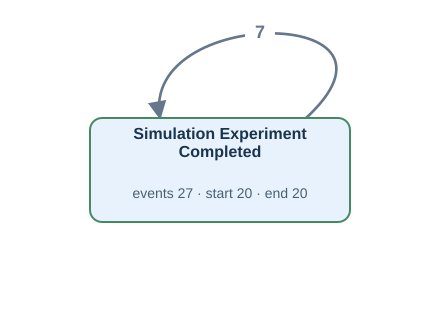</a> <a href="graphs/U11.svg">Open full-size DFG</a></td><td width="35%" valign="top"><h4>Original tables</h4>
Up to 3 matched rows per table. Shows keys, event times and carrier values.

<strong>student_simulation_experiment_result</strong> · 27 matched rows
<table><tr><th>Row</th><th>Source values</th></tr><tr><td>1</td><td>student_id = S002 module_id = M03 simulation_date = 2026-02-13T15:00:00Z</td></tr><tr><td>2</td><td>student_id = S003 module_id = M01 simulation_date = 2026-02-14T15:00:00Z</td></tr><tr><td>3</td><td>student_id = S003 module_id = M01 simulation_date = 2026-02-15T15:00:00Z</td></tr></table></td></tr></table>

[Gold CSV](../../../datasets/universityflow/private/gold_logs/U11.csv)

## U12 — Q2

For each student, build a timeline of a simulation run finishing.

Events: **27** · Cases with events: **20** · Activities: **1** · Edges: **1** · Source tables: **1** · SQL tables: **1**

<table><tr><td width="65%" valign="top"> <a href="graphs/U11.svg">Open full-size DFG</a></td><td width="35%" valign="top"><h4>Original tables</h4>
Up to 3 matched rows per table. Shows keys, event times and carrier values.

<strong>student_simulation_experiment_result</strong> · 27 matched rows
<table><tr><th>Row</th><th>Source values</th></tr><tr><td>1</td><td>student_id = S002 module_id = M03 simulation_date = 2026-02-13T15:00:00Z</td></tr><tr><td>2</td><td>student_id = S003 module_id = M01 simulation_date = 2026-02-14T15:00:00Z</td></tr><tr><td>3</td><td>student_id = S003 module_id = M01 simulation_date = 2026-02-15T15:00:00Z</td></tr></table></td></tr></table>

[Gold CSV](../../../datasets/universityflow/private/gold_logs/U12.csv)

## U13 — Q1

Extract Thesis Submitted events for each student.

Events: **16** · Cases with events: **16** · Activities: **1** · Edges: **0** · Source tables: **1** · SQL tables: **1**

<table><tr><td width="65%" valign="top"><a href="graphs/U13.svg">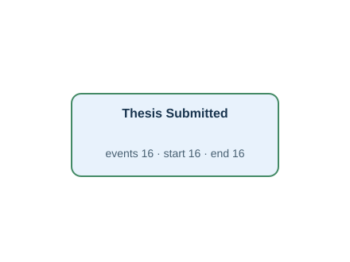</a> <a href="graphs/U13.svg">Open full-size DFG</a></td><td width="35%" valign="top"><h4>Original tables</h4>
Up to 3 matched rows per table. Shows keys, event times and carrier values.

<strong>thesis</strong> · 16 matched rows
<table><tr><th>Row</th><th>Source values</th></tr><tr><td>1</td><td>thesis_id = TH002 submission_date = 2026-02-23T16:00:00Z</td></tr><tr><td>2</td><td>thesis_id = TH003 submission_date = 2026-02-24T16:00:00Z</td></tr><tr><td>3</td><td>thesis_id = TH006 submission_date = 2026-02-27T16:00:00Z</td></tr></table></td></tr></table>

[Gold CSV](../../../datasets/universityflow/private/gold_logs/U13.csv)

## U14 — Q2

For each student, build a timeline of the student handing in a thesis.

Events: **16** · Cases with events: **16** · Activities: **1** · Edges: **0** · Source tables: **1** · SQL tables: **1**

<table><tr><td width="65%" valign="top"> <a href="graphs/U13.svg">Open full-size DFG</a></td><td width="35%" valign="top"><h4>Original tables</h4>
Up to 3 matched rows per table. Shows keys, event times and carrier values.

<strong>thesis</strong> · 16 matched rows
<table><tr><th>Row</th><th>Source values</th></tr><tr><td>1</td><td>thesis_id = TH002 submission_date = 2026-02-23T16:00:00Z</td></tr><tr><td>2</td><td>thesis_id = TH003 submission_date = 2026-02-24T16:00:00Z</td></tr><tr><td>3</td><td>thesis_id = TH006 submission_date = 2026-02-27T16:00:00Z</td></tr></table></td></tr></table>

[Gold CSV](../../../datasets/universityflow/private/gold_logs/U14.csv)

## U15 — Q1

Extract Assignment Submitted events for each student.

Events: **16** · Cases with events: **16** · Activities: **1** · Edges: **0** · Source tables: **1** · SQL tables: **1**

<table><tr><td width="65%" valign="top"> <a href="graphs/U15.svg">Open full-size DFG</a></td><td width="35%" valign="top"><h4>Original tables</h4>
Up to 3 matched rows per table. Shows keys, event times and carrier values.

<strong>assignment</strong> · 16 matched rows
<table><tr><th>Row</th><th>Source values</th></tr><tr><td>1</td><td>assignment_id = A002 assignment_submitted_at = 2026-02-09T14:00:00Z</td></tr><tr><td>2</td><td>assignment_id = A003 assignment_submitted_at = 2026-02-10T14:00:00Z</td></tr><tr><td>3</td><td>assignment_id = A006 assignment_submitted_at = 2026-02-13T14:00:00Z</td></tr></table></td></tr></table>

[Gold CSV](../../../datasets/universityflow/private/gold_logs/U15.csv)

## OU01 — Q3

Extract the full recorded lifecycle event log for each student.

Events: **763** · Cases with events: **30** · Activities: **29** · Edges: **62** · Source tables: **6** · SQL tables: **9**

<table><tr><td width="65%" valign="top"> <a href="graphs/U05.svg">Open full-size DFG</a></td><td width="35%" valign="top"><h4>Original tables</h4>
Up to 3 matched rows per table. Shows keys, event times and carrier values.

<strong>assignment</strong> · 20 matched rows
<table><tr><th>Row</th><th>Source values</th></tr><tr><td>1</td><td>assignment_id = A002 assignment_assigned_at = 2026-02-07T14:00:00Z assignment_submitted_at = 2026-02-09T14:00:00Z assignment_grade_finalized_at = NULL assignment_revision_requested_at = 2026-02-11T15:00:00Z assignment_resubmitted_at = 2026-02-12T14:00:00Z</td></tr><tr><td>2</td><td>assignment_id = A003 assignment_assigned_at = 2026-02-08T14:00:00Z assignment_submitted_at = 2026-02-10T14:00:00Z assignment_grade_finalized_at = 2026-02-14T14:00:00Z assignment_revision_requested_at = NULL assignment_resubmitted_at = NULL</td></tr><tr><td>3</td><td>assignment_id = A006 assignment_assigned_at = 2026-02-11T14:00:00Z assignment_submitted_at = 2026-02-13T14:00:00Z assignment_grade_finalized_at = 2026-02-17T14:00:00Z assignment_revision_requested_at = NULL assignment_resubmitted_at = NULL</td></tr></table>
<strong>assignment_grading</strong> · 25 matched rows
<table><tr><th>Row</th><th>Source values</th></tr><tr><td>1</td><td>assignment_id = A002 instructor_id = I03 grading_time = 2026-02-11T14:00:00Z grading_kind = ORIGINAL</td></tr><tr><td>2</td><td>assignment_id = A002 instructor_id = I03 grading_time = 2026-02-13T02:00:00Z grading_kind = REASSESSMENT</td></tr><tr><td>3</td><td>assignment_id = A003 instructor_id = I01 grading_time = 2026-02-12T14:00:00Z grading_kind = ORIGINAL</td></tr></table>
<strong>degree_examination_result</strong> · 40 matched rows
<table><tr><th>Row</th><th>Source values</th></tr><tr><td>1</td><td>result_id = E001-1 examination_date = 2026-02-02T09:00:00Z examination_scheduled_at = 2026-02-02T07:00:00Z examination_checked_in_at = 2026-02-02T08:00:00Z examination_score_published_at = 2026-02-02T11:00:00Z examination_result_reviewed_at = NULL</td></tr><tr><td>2</td><td>result_id = E002-1 examination_date = 2026-02-03T09:00:00Z examination_scheduled_at = 2026-02-03T07:00:00Z examination_checked_in_at = 2026-02-03T08:00:00Z examination_score_published_at = 2026-02-03T11:00:00Z examination_result_reviewed_at = 2026-02-03T12:00:00Z</td></tr><tr><td>3</td><td>result_id = E002-2 examination_date = 2026-02-05T09:00:00Z examination_scheduled_at = 2026-02-05T07:00:00Z examination_checked_in_at = 2026-02-05T08:00:00Z examination_score_published_at = 2026-02-05T11:00:00Z examination_result_reviewed_at = 2026-02-05T12:00:00Z</td></tr></table>
<strong>registration</strong> · 47 matched rows
<table><tr><th>Row</th><th>Source values</th></tr><tr><td>1</td><td>student_id = S002 course_id = C01 registration_time = 2026-02-07T11:00:00Z registration_requested_at = 2026-02-07T07:00:00Z registration_approved_at = 2026-02-07T09:00:00Z course_started_at = 2026-02-09T11:00:00Z course_assessment_completed_at = 2026-02-27T11:00:00Z course_grade_finalized_at = NULL</td></tr><tr><td>2</td><td>student_id = S002 course_id = C06 registration_time = 2026-02-07T16:00:00Z registration_requested_at = 2026-02-07T12:00:00Z registration_approved_at = 2026-02-07T14:00:00Z course_started_at = 2026-02-09T16:00:00Z course_assessment_completed_at = 2026-02-27T16:00:00Z course_grade_finalized_at = 2026-03-01T16:00:00Z</td></tr><tr><td>3</td><td>student_id = S003 course_id = C02 registration_time = 2026-02-08T12:00:00Z registration_requested_at = 2026-02-08T08:00:00Z registration_approved_at = 2026-02-08T10:00:00Z course_started_at = 2026-02-10T12:00:00Z course_assessment_completed_at = 2026-02-28T12:00:00Z course_grade_finalized_at = 2026-03-02T12:00:00Z</td></tr></table>
<strong>student_simulation_experiment_result</strong> · 27 matched rows
<table><tr><th>Row</th><th>Source values</th></tr><tr><td>1</td><td>student_id = S002 module_id = M03 simulation_date = 2026-02-13T15:00:00Z simulation_run_scheduled_at = 2026-02-13T13:00:00Z simulation_run_started_at = 2026-02-13T14:00:00Z simulation_output_reviewed_at = 2026-02-13T17:00:00Z simulation_result_accepted_at = NULL</td></tr><tr><td>2</td><td>student_id = S003 module_id = M01 simulation_date = 2026-02-14T15:00:00Z simulation_run_scheduled_at = 2026-02-14T13:00:00Z simulation_run_started_at = 2026-02-14T14:00:00Z simulation_output_reviewed_at = 2026-02-14T17:00:00Z simulation_result_accepted_at = 2026-02-14T18:00:00Z</td></tr><tr><td>3</td><td>student_id = S003 module_id = M01 simulation_date = 2026-02-15T15:00:00Z simulation_run_scheduled_at = 2026-02-15T13:00:00Z simulation_run_started_at = 2026-02-15T14:00:00Z simulation_output_reviewed_at = 2026-02-15T17:00:00Z simulation_result_accepted_at = 2026-02-15T18:00:00Z</td></tr></table>
<strong>thesis</strong> · 16 matched rows
<table><tr><th>Row</th><th>Source values</th></tr><tr><td>1</td><td>thesis_id = TH002 submission_date = 2026-02-23T16:00:00Z thesis_draft_registered_at = 2026-02-19T16:00:00Z thesis_review_started_at = 2026-02-24T16:00:00Z thesis_accepted_at = NULL thesis_revision_requested_at = 2026-02-25T16:00:00Z thesis_resubmitted_at = 2026-02-26T16:00:00Z</td></tr><tr><td>2</td><td>thesis_id = TH003 submission_date = 2026-02-24T16:00:00Z thesis_draft_registered_at = 2026-02-20T16:00:00Z thesis_review_started_at = 2026-02-25T16:00:00Z thesis_accepted_at = 2026-02-28T16:00:00Z thesis_revision_requested_at = NULL thesis_resubmitted_at = NULL</td></tr><tr><td>3</td><td>thesis_id = TH006 submission_date = 2026-02-27T16:00:00Z thesis_draft_registered_at = 2026-02-23T16:00:00Z thesis_review_started_at = 2026-02-28T16:00:00Z thesis_accepted_at = 2026-03-03T16:00:00Z thesis_revision_requested_at = NULL thesis_resubmitted_at = NULL</td></tr></table>

Other SQL tables

course, simulation_module, task

</td></tr></table>

[Gold CSV](../../../datasets/universityflow/private/gold_logs/OU01.csv)

## OU02 — Q3

Extract the full recorded lifecycle event log for each course.

Events: **298** · Cases with events: **6** · Activities: **10** · Edges: **24** · Source tables: **2** · SQL tables: **9**

<table><tr><td width="65%" valign="top"><a href="graphs/OU02.svg">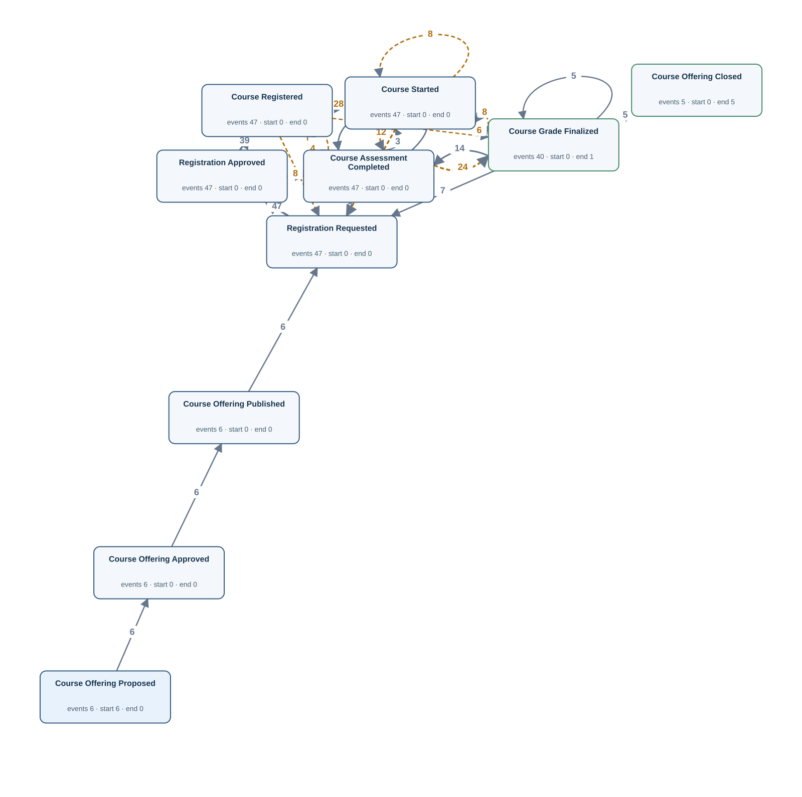</a> <a href="graphs/OU02.svg">Open full-size DFG</a></td><td width="35%" valign="top"><h4>Original tables</h4>
Up to 3 matched rows per table. Shows keys, event times and carrier values.

<strong>course</strong> · 6 matched rows
<table><tr><th>Row</th><th>Source values</th></tr><tr><td>1</td><td>course_id = C01 course_offering_proposed_at = 2026-02-04T11:00:00Z course_offering_approved_at = 2026-02-05T11:00:00Z course_offering_published_at = 2026-02-06T11:00:00Z course_offering_closed_at = NULL</td></tr><tr><td>2</td><td>course_id = C02 course_offering_proposed_at = 2026-02-05T12:00:00Z course_offering_approved_at = 2026-02-06T12:00:00Z course_offering_published_at = 2026-02-07T12:00:00Z course_offering_closed_at = 2026-04-07T12:00:00Z</td></tr><tr><td>3</td><td>course_id = C03 course_offering_proposed_at = 2026-02-24T13:00:00Z course_offering_approved_at = 2026-02-25T13:00:00Z course_offering_published_at = 2026-02-26T13:00:00Z course_offering_closed_at = 2026-04-07T13:00:00Z</td></tr></table>
<strong>registration</strong> · 47 matched rows
<table><tr><th>Row</th><th>Source values</th></tr><tr><td>1</td><td>student_id = S002 course_id = C01 registration_time = 2026-02-07T11:00:00Z registration_requested_at = 2026-02-07T07:00:00Z registration_approved_at = 2026-02-07T09:00:00Z course_started_at = 2026-02-09T11:00:00Z course_assessment_completed_at = 2026-02-27T11:00:00Z course_grade_finalized_at = NULL</td></tr><tr><td>2</td><td>student_id = S007 course_id = C01 registration_time = 2026-02-12T11:00:00Z registration_requested_at = 2026-02-12T07:00:00Z registration_approved_at = 2026-02-12T09:00:00Z course_started_at = 2026-02-14T11:00:00Z course_assessment_completed_at = 2026-03-04T11:00:00Z course_grade_finalized_at = 2026-03-06T11:00:00Z</td></tr><tr><td>3</td><td>student_id = S011 course_id = C01 registration_time = 2026-02-16T11:00:00Z registration_requested_at = 2026-02-16T07:00:00Z registration_approved_at = 2026-02-16T09:00:00Z course_started_at = 2026-02-18T11:00:00Z course_assessment_completed_at = 2026-03-08T11:00:00Z course_grade_finalized_at = 2026-03-10T11:00:00Z</td></tr></table>

Other SQL tables

assignment, assignment_grading, degree_examination_result, simulation_module, student_simulation_experiment_result, task, thesis

</td></tr></table>

[Gold CSV](../../../datasets/universityflow/private/gold_logs/OU02.csv)

## OU03 — Q3

Extract the full recorded lifecycle event log for each student-course registration.

Events: **275** · Cases with events: **47** · Activities: **6** · Edges: **5** · Source tables: **1** · SQL tables: **9**

<table><tr><td width="65%" valign="top"> <a href="graphs/OU03.svg">Open full-size DFG</a></td><td width="35%" valign="top"><h4>Original tables</h4>
Up to 3 matched rows per table. Shows keys, event times and carrier values.

<strong>registration</strong> · 47 matched rows
<table><tr><th>Row</th><th>Source values</th></tr><tr><td>1</td><td>student_id = S002 course_id = C01 registration_time = 2026-02-07T11:00:00Z registration_requested_at = 2026-02-07T07:00:00Z registration_approved_at = 2026-02-07T09:00:00Z course_started_at = 2026-02-09T11:00:00Z course_assessment_completed_at = 2026-02-27T11:00:00Z course_grade_finalized_at = NULL</td></tr><tr><td>2</td><td>student_id = S002 course_id = C06 registration_time = 2026-02-07T16:00:00Z registration_requested_at = 2026-02-07T12:00:00Z registration_approved_at = 2026-02-07T14:00:00Z course_started_at = 2026-02-09T16:00:00Z course_assessment_completed_at = 2026-02-27T16:00:00Z course_grade_finalized_at = 2026-03-01T16:00:00Z</td></tr><tr><td>3</td><td>student_id = S003 course_id = C02 registration_time = 2026-02-08T12:00:00Z registration_requested_at = 2026-02-08T08:00:00Z registration_approved_at = 2026-02-08T10:00:00Z course_started_at = 2026-02-10T12:00:00Z course_assessment_completed_at = 2026-02-28T12:00:00Z course_grade_finalized_at = 2026-03-02T12:00:00Z</td></tr></table>

Other SQL tables

assignment, assignment_grading, course, degree_examination_result, simulation_module, student_simulation_experiment_result, task, thesis

</td></tr></table>

[Gold CSV](../../../datasets/universityflow/private/gold_logs/OU03.csv)

## OU04 — Q3

Extract the full recorded lifecycle event log for each examination result record.

Events: **194** · Cases with events: **40** · Activities: **5** · Edges: **4** · Source tables: **1** · SQL tables: **9**

<table><tr><td width="65%" valign="top"> <a href="graphs/OU04.svg">Open full-size DFG</a></td><td width="35%" valign="top"><h4>Original tables</h4>
Up to 3 matched rows per table. Shows keys, event times and carrier values.

<strong>degree_examination_result</strong> · 40 matched rows
<table><tr><th>Row</th><th>Source values</th></tr><tr><td>1</td><td>result_id = E001-1 examination_date = 2026-02-02T09:00:00Z examination_scheduled_at = 2026-02-02T07:00:00Z examination_checked_in_at = 2026-02-02T08:00:00Z examination_score_published_at = 2026-02-02T11:00:00Z examination_result_reviewed_at = NULL</td></tr><tr><td>2</td><td>result_id = E002-1 examination_date = 2026-02-03T09:00:00Z examination_scheduled_at = 2026-02-03T07:00:00Z examination_checked_in_at = 2026-02-03T08:00:00Z examination_score_published_at = 2026-02-03T11:00:00Z examination_result_reviewed_at = 2026-02-03T12:00:00Z</td></tr><tr><td>3</td><td>result_id = E002-2 examination_date = 2026-02-05T09:00:00Z examination_scheduled_at = 2026-02-05T07:00:00Z examination_checked_in_at = 2026-02-05T08:00:00Z examination_score_published_at = 2026-02-05T11:00:00Z examination_result_reviewed_at = 2026-02-05T12:00:00Z</td></tr></table>

Other SQL tables

assignment, assignment_grading, course, registration, simulation_module, student_simulation_experiment_result, task, thesis

</td></tr></table>

[Gold CSV](../../../datasets/universityflow/private/gold_logs/OU04.csv)

## OU05 — Q3

Extract the full recorded lifecycle event log for each simulation module.

Events: **142** · Cases with events: **3** · Activities: **9** · Edges: **10** · Source tables: **2** · SQL tables: **9**

<table><tr><td width="65%" valign="top"> <a href="graphs/OU05.svg">Open full-size DFG</a></td><td width="35%" valign="top"><h4>Original tables</h4>
Up to 3 matched rows per table. Shows keys, event times and carrier values.

<strong>simulation_module</strong> · 3 matched rows
<table><tr><th>Row</th><th>Source values</th></tr><tr><td>1</td><td>module_id = M01 simulation_module_published_at = 2026-02-11T15:00:00Z simulation_module_validated_at = 2026-02-12T15:00:00Z simulation_module_released_at = 2026-02-13T15:00:00Z simulation_module_retired_at = NULL</td></tr><tr><td>2</td><td>module_id = M02 simulation_module_published_at = 2026-02-15T15:00:00Z simulation_module_validated_at = 2026-02-16T15:00:00Z simulation_module_released_at = 2026-02-17T15:00:00Z simulation_module_retired_at = 2026-04-16T15:00:00Z</td></tr><tr><td>3</td><td>module_id = M03 simulation_module_published_at = 2026-02-10T15:00:00Z simulation_module_validated_at = 2026-02-11T15:00:00Z simulation_module_released_at = 2026-02-12T15:00:00Z simulation_module_retired_at = 2026-04-20T15:00:00Z</td></tr></table>
<strong>student_simulation_experiment_result</strong> · 27 matched rows
<table><tr><th>Row</th><th>Source values</th></tr><tr><td>1</td><td>student_id = S003 module_id = M01 simulation_date = 2026-02-14T15:00:00Z simulation_run_scheduled_at = 2026-02-14T13:00:00Z simulation_run_started_at = 2026-02-14T14:00:00Z simulation_output_reviewed_at = 2026-02-14T17:00:00Z simulation_result_accepted_at = 2026-02-14T18:00:00Z</td></tr><tr><td>2</td><td>student_id = S003 module_id = M01 simulation_date = 2026-02-15T15:00:00Z simulation_run_scheduled_at = 2026-02-15T13:00:00Z simulation_run_started_at = 2026-02-15T14:00:00Z simulation_output_reviewed_at = 2026-02-15T17:00:00Z simulation_result_accepted_at = 2026-02-15T18:00:00Z</td></tr><tr><td>3</td><td>student_id = S006 module_id = M01 simulation_date = 2026-02-17T15:00:00Z simulation_run_scheduled_at = 2026-02-17T13:00:00Z simulation_run_started_at = 2026-02-17T14:00:00Z simulation_output_reviewed_at = 2026-02-17T17:00:00Z simulation_result_accepted_at = 2026-02-17T18:00:00Z</td></tr></table>

Other SQL tables

assignment, assignment_grading, course, degree_examination_result, registration, task, thesis

</td></tr></table>

[Gold CSV](../../../datasets/universityflow/private/gold_logs/OU05.csv)

## OU06 — Q3

Extract the full recorded lifecycle event log for each thesis.

Events: **73** · Cases with events: **16** · Activities: **6** · Edges: **6** · Source tables: **1** · SQL tables: **9**

<table><tr><td width="65%" valign="top"><a href="graphs/OU06.svg">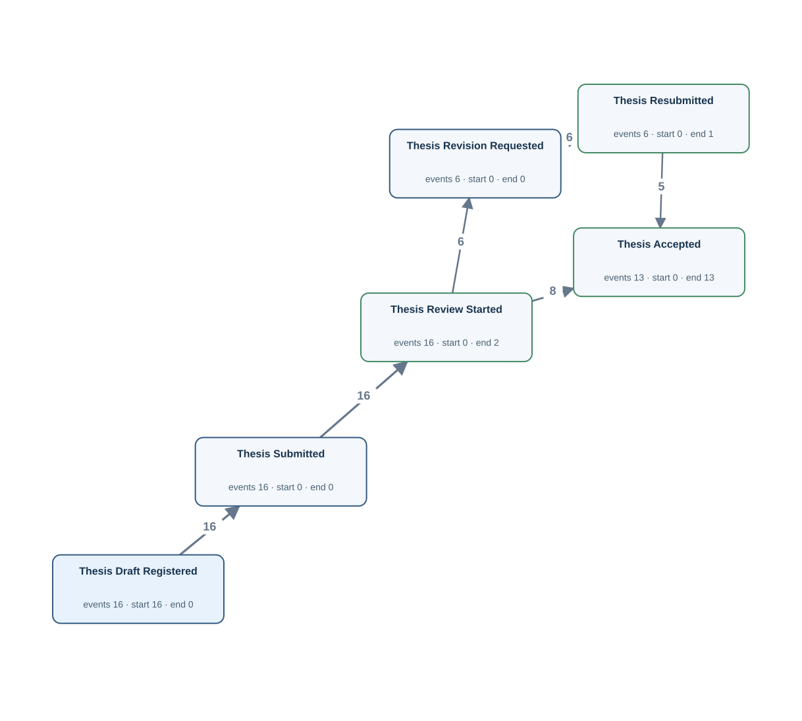</a> <a href="graphs/OU06.svg">Open full-size DFG</a></td><td width="35%" valign="top"><h4>Original tables</h4>
Up to 3 matched rows per table. Shows keys, event times and carrier values.

<strong>thesis</strong> · 16 matched rows
<table><tr><th>Row</th><th>Source values</th></tr><tr><td>1</td><td>thesis_id = TH002 submission_date = 2026-02-23T16:00:00Z thesis_draft_registered_at = 2026-02-19T16:00:00Z thesis_review_started_at = 2026-02-24T16:00:00Z thesis_accepted_at = NULL thesis_revision_requested_at = 2026-02-25T16:00:00Z thesis_resubmitted_at = 2026-02-26T16:00:00Z</td></tr><tr><td>2</td><td>thesis_id = TH003 submission_date = 2026-02-24T16:00:00Z thesis_draft_registered_at = 2026-02-20T16:00:00Z thesis_review_started_at = 2026-02-25T16:00:00Z thesis_accepted_at = 2026-02-28T16:00:00Z thesis_revision_requested_at = NULL thesis_resubmitted_at = NULL</td></tr><tr><td>3</td><td>thesis_id = TH006 submission_date = 2026-02-27T16:00:00Z thesis_draft_registered_at = 2026-02-23T16:00:00Z thesis_review_started_at = 2026-02-28T16:00:00Z thesis_accepted_at = 2026-03-03T16:00:00Z thesis_revision_requested_at = NULL thesis_resubmitted_at = NULL</td></tr></table>

Other SQL tables

assignment, assignment_grading, course, degree_examination_result, registration, simulation_module, student_simulation_experiment_result, task

</td></tr></table>

[Gold CSV](../../../datasets/universityflow/private/gold_logs/OU06.csv)

## OU07 — Q3

Extract the full recorded lifecycle event log for each simulation experiment result record.

Events: **131** · Cases with events: **27** · Activities: **5** · Edges: **4** · Source tables: **1** · SQL tables: **9**

<table><tr><td width="65%" valign="top"> <a href="graphs/OU07.svg">Open full-size DFG</a></td><td width="35%" valign="top"><h4>Original tables</h4>
Up to 3 matched rows per table. Shows keys, event times and carrier values.

<strong>student_simulation_experiment_result</strong> · 27 matched rows
<table><tr><th>Row</th><th>Source values</th></tr><tr><td>1</td><td>student_id = S002 module_id = M03 simulation_date = 2026-02-13T15:00:00Z simulation_run_scheduled_at = 2026-02-13T13:00:00Z simulation_run_started_at = 2026-02-13T14:00:00Z simulation_output_reviewed_at = 2026-02-13T17:00:00Z simulation_result_accepted_at = NULL</td></tr><tr><td>2</td><td>student_id = S003 module_id = M01 simulation_date = 2026-02-14T15:00:00Z simulation_run_scheduled_at = 2026-02-14T13:00:00Z simulation_run_started_at = 2026-02-14T14:00:00Z simulation_output_reviewed_at = 2026-02-14T17:00:00Z simulation_result_accepted_at = 2026-02-14T18:00:00Z</td></tr><tr><td>3</td><td>student_id = S003 module_id = M01 simulation_date = 2026-02-15T15:00:00Z simulation_run_scheduled_at = 2026-02-15T13:00:00Z simulation_run_started_at = 2026-02-15T14:00:00Z simulation_output_reviewed_at = 2026-02-15T17:00:00Z simulation_result_accepted_at = 2026-02-15T18:00:00Z</td></tr></table>

Other SQL tables

assignment, assignment_grading, course, degree_examination_result, registration, simulation_module, task, thesis

</td></tr></table>

[Gold CSV](../../../datasets/universityflow/private/gold_logs/OU07.csv)

## OU08 — Q3

Extract the full recorded lifecycle event log for each assignment.

Events: **90** · Cases with events: **20** · Activities: **7** · Edges: **9** · Source tables: **2** · SQL tables: **9**

<table><tr><td width="65%" valign="top"><a href="graphs/OU08.svg">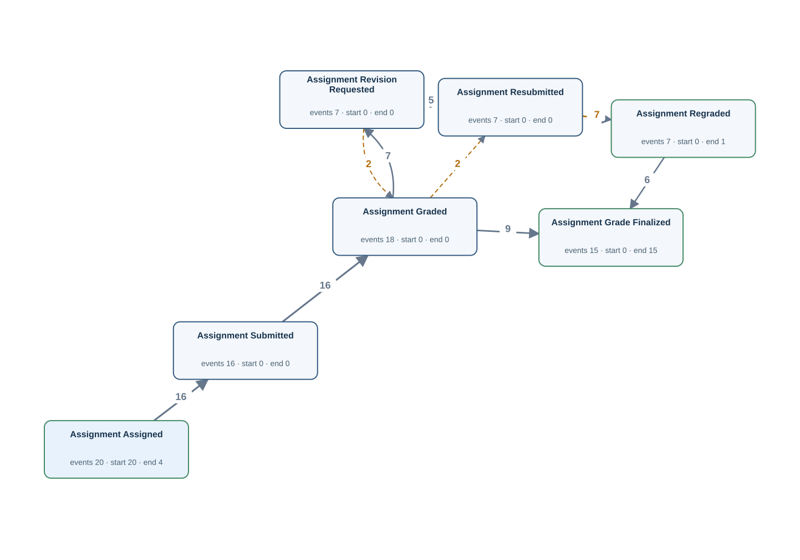</a> <a href="graphs/OU08.svg">Open full-size DFG</a></td><td width="35%" valign="top"><h4>Original tables</h4>
Up to 3 matched rows per table. Shows keys, event times and carrier values.

<strong>assignment</strong> · 20 matched rows
<table><tr><th>Row</th><th>Source values</th></tr><tr><td>1</td><td>assignment_id = A002 assignment_assigned_at = 2026-02-07T14:00:00Z assignment_submitted_at = 2026-02-09T14:00:00Z assignment_grade_finalized_at = NULL assignment_revision_requested_at = 2026-02-11T15:00:00Z assignment_resubmitted_at = 2026-02-12T14:00:00Z</td></tr><tr><td>2</td><td>assignment_id = A003 assignment_assigned_at = 2026-02-08T14:00:00Z assignment_submitted_at = 2026-02-10T14:00:00Z assignment_grade_finalized_at = 2026-02-14T14:00:00Z assignment_revision_requested_at = NULL assignment_resubmitted_at = NULL</td></tr><tr><td>3</td><td>assignment_id = A006 assignment_assigned_at = 2026-02-11T14:00:00Z assignment_submitted_at = 2026-02-13T14:00:00Z assignment_grade_finalized_at = 2026-02-17T14:00:00Z assignment_revision_requested_at = NULL assignment_resubmitted_at = NULL</td></tr></table>
<strong>assignment_grading</strong> · 25 matched rows
<table><tr><th>Row</th><th>Source values</th></tr><tr><td>1</td><td>assignment_id = A002 instructor_id = I03 grading_time = 2026-02-11T14:00:00Z grading_kind = ORIGINAL</td></tr><tr><td>2</td><td>assignment_id = A002 instructor_id = I03 grading_time = 2026-02-13T02:00:00Z grading_kind = REASSESSMENT</td></tr><tr><td>3</td><td>assignment_id = A003 instructor_id = I01 grading_time = 2026-02-12T14:00:00Z grading_kind = ORIGINAL</td></tr></table>

Other SQL tables

course, degree_examination_result, registration, simulation_module, student_simulation_experiment_result, task, thesis

</td></tr></table>

[Gold CSV](../../../datasets/universityflow/private/gold_logs/OU08.csv)

## OU09 — Q3

Extract the full recorded lifecycle event log for each instructor.

Events: **86** · Cases with events: **3** · Activities: **7** · Edges: **18** · Source tables: **2** · SQL tables: **9**

<table><tr><td width="65%" valign="top"> <a href="graphs/OU09.svg">Open full-size DFG</a></td><td width="35%" valign="top"><h4>Original tables</h4>
Up to 3 matched rows per table. Shows keys, event times and carrier values.

<strong>assignment</strong> · 16 matched rows
<table><tr><th>Row</th><th>Source values</th></tr><tr><td>1</td><td>assignment_id = A003 assignment_assigned_at = 2026-02-08T14:00:00Z assignment_submitted_at = 2026-02-10T14:00:00Z assignment_grade_finalized_at = 2026-02-14T14:00:00Z</td></tr><tr><td>2</td><td>assignment_id = A006 assignment_assigned_at = 2026-02-11T14:00:00Z assignment_submitted_at = 2026-02-13T14:00:00Z assignment_grade_finalized_at = 2026-02-17T14:00:00Z</td></tr><tr><td>3</td><td>assignment_id = A018 assignment_assigned_at = 2026-02-23T14:00:00Z assignment_submitted_at = 2026-02-25T14:00:00Z assignment_grade_finalized_at = 2026-03-01T14:00:00Z</td></tr></table>
<strong>assignment_grading</strong> · 25 matched rows
<table><tr><th>Row</th><th>Source values</th></tr><tr><td>1</td><td>assignment_id = A003 instructor_id = I01 grading_time = 2026-02-12T14:00:00Z grading_kind = ORIGINAL</td></tr><tr><td>2</td><td>assignment_id = A006 instructor_id = I01 grading_time = 2026-02-15T14:00:00Z grading_kind = ORIGINAL</td></tr><tr><td>3</td><td>assignment_id = A018 instructor_id = I01 grading_time = 2026-02-27T14:00:00Z grading_kind = ORIGINAL</td></tr></table>

Other SQL tables

course, degree_examination_result, registration, simulation_module, student_simulation_experiment_result, task, thesis

</td></tr></table>

[Gold CSV](../../../datasets/universityflow/private/gold_logs/OU09.csv)

## OU10 — Q3

Extract the full recorded lifecycle event log for each assignment grading record.

Events: **25** · Cases with events: **25** · Activities: **2** · Edges: **0** · Source tables: **1** · SQL tables: **9**

<table><tr><td width="65%" valign="top"><a href="graphs/OU10.svg">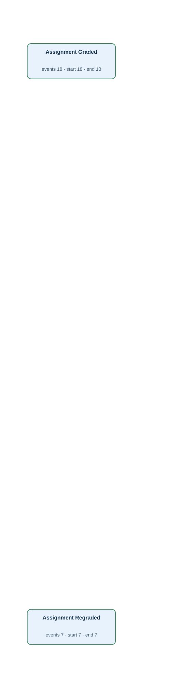</a> <a href="graphs/OU10.svg">Open full-size DFG</a></td><td width="35%" valign="top"><h4>Original tables</h4>
Up to 3 matched rows per table. Shows keys, event times and carrier values.

<strong>assignment_grading</strong> · 25 matched rows
<table><tr><th>Row</th><th>Source values</th></tr><tr><td>1</td><td>assignment_id = A002 instructor_id = I03 grading_time = 2026-02-11T14:00:00Z grading_kind = ORIGINAL</td></tr><tr><td>2</td><td>assignment_id = A002 instructor_id = I03 grading_time = 2026-02-13T02:00:00Z grading_kind = REASSESSMENT</td></tr><tr><td>3</td><td>assignment_id = A003 instructor_id = I01 grading_time = 2026-02-12T14:00:00Z grading_kind = ORIGINAL</td></tr></table>

Other SQL tables

assignment, course, degree_examination_result, registration, simulation_module, student_simulation_experiment_result, task, thesis

</td></tr></table>

[Gold CSV](../../../datasets/universityflow/private/gold_logs/OU10.csv)

## OU11 — Q3

Extract the full recorded lifecycle event log for each course-design task.

Events: **11** · Cases with events: **3** · Activities: **4** · Edges: **3** · Source tables: **1** · SQL tables: **9**

<table><tr><td width="65%" valign="top"> <a href="graphs/OU11.svg">Open full-size DFG</a></td><td width="35%" valign="top"><h4>Original tables</h4>
Up to 3 matched rows per table. Shows keys, event times and carrier values.

<strong>task</strong> · 3 matched rows
<table><tr><th>Row</th><th>Source values</th></tr><tr><td>1</td><td>task_id = T01 design_task_created_at = 2025-12-31T00:00:00Z design_task_approved_at = 2026-01-01T00:00:00Z design_task_published_at = 2026-01-02T00:00:00Z design_task_closed_at = NULL</td></tr><tr><td>2</td><td>task_id = T02 design_task_created_at = 2026-01-01T00:00:00Z design_task_approved_at = 2026-01-02T00:00:00Z design_task_published_at = 2026-01-03T00:00:00Z design_task_closed_at = 2026-02-03T00:00:00Z</td></tr><tr><td>3</td><td>task_id = T03 design_task_created_at = 2026-01-02T00:00:00Z design_task_approved_at = 2026-01-03T00:00:00Z design_task_published_at = 2026-01-04T00:00:00Z design_task_closed_at = 2026-02-04T00:00:00Z</td></tr></table>

Other SQL tables

assignment, assignment_grading, course, degree_examination_result, registration, simulation_module, student_simulation_experiment_result, thesis

</td></tr></table>

[Gold CSV](../../../datasets/universityflow/private/gold_logs/OU11.csv)

## TS01 — Q1

Extract Examination Scheduled, Examination Checked In, Examination Score Published, Examination Result Reviewed events for each student.

Events: **154** · Cases with events: **30** · Activities: **4** · Edges: **5** · Source tables: **1** · SQL tables: **9**

<table><tr><td width="65%" valign="top"> <a href="graphs/TS01.svg">Open full-size DFG</a></td><td width="35%" valign="top"><h4>Original tables</h4>
Up to 3 matched rows per table. Shows keys, event times and carrier values.

<strong>degree_examination_result</strong> · 40 matched rows
<table><tr><th>Row</th><th>Source values</th></tr><tr><td>1</td><td>result_id = E001-1 examination_scheduled_at = 2026-02-02T07:00:00Z examination_checked_in_at = 2026-02-02T08:00:00Z examination_score_published_at = 2026-02-02T11:00:00Z examination_result_reviewed_at = NULL</td></tr><tr><td>2</td><td>result_id = E002-1 examination_scheduled_at = 2026-02-03T07:00:00Z examination_checked_in_at = 2026-02-03T08:00:00Z examination_score_published_at = 2026-02-03T11:00:00Z examination_result_reviewed_at = 2026-02-03T12:00:00Z</td></tr><tr><td>3</td><td>result_id = E002-2 examination_scheduled_at = 2026-02-05T07:00:00Z examination_checked_in_at = 2026-02-05T08:00:00Z examination_score_published_at = 2026-02-05T11:00:00Z examination_result_reviewed_at = 2026-02-05T12:00:00Z</td></tr></table>

Other SQL tables

assignment, assignment_grading, course, registration, simulation_module, student_simulation_experiment_result, task, thesis

</td></tr></table>

[Gold CSV](../../../datasets/universityflow/private/gold_logs/TS01.csv)

## TS02 — Q1

Extract Registration Requested, Registration Approved, Course Started, Course Assessment Completed, Course Grade Finalized events for each student-course registration.

Events: **228** · Cases with events: **47** · Activities: **5** · Edges: **4** · Source tables: **1** · SQL tables: **9**

<table><tr><td width="65%" valign="top"><a href="graphs/TS02.svg">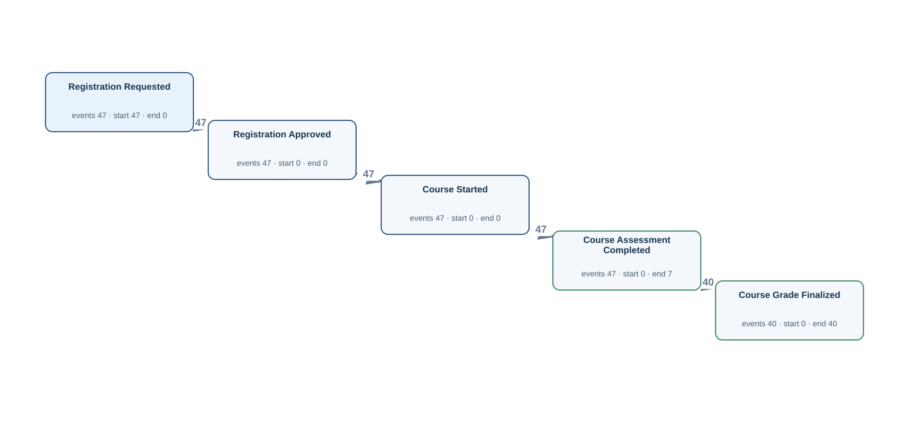</a> <a href="graphs/TS02.svg">Open full-size DFG</a></td><td width="35%" valign="top"><h4>Original tables</h4>
Up to 3 matched rows per table. Shows keys, event times and carrier values.

<strong>registration</strong> · 47 matched rows
<table><tr><th>Row</th><th>Source values</th></tr><tr><td>1</td><td>student_id = S002 course_id = C01 registration_requested_at = 2026-02-07T07:00:00Z registration_approved_at = 2026-02-07T09:00:00Z course_started_at = 2026-02-09T11:00:00Z course_assessment_completed_at = 2026-02-27T11:00:00Z course_grade_finalized_at = NULL</td></tr><tr><td>2</td><td>student_id = S002 course_id = C06 registration_requested_at = 2026-02-07T12:00:00Z registration_approved_at = 2026-02-07T14:00:00Z course_started_at = 2026-02-09T16:00:00Z course_assessment_completed_at = 2026-02-27T16:00:00Z course_grade_finalized_at = 2026-03-01T16:00:00Z</td></tr><tr><td>3</td><td>student_id = S003 course_id = C02 registration_requested_at = 2026-02-08T08:00:00Z registration_approved_at = 2026-02-08T10:00:00Z course_started_at = 2026-02-10T12:00:00Z course_assessment_completed_at = 2026-02-28T12:00:00Z course_grade_finalized_at = 2026-03-02T12:00:00Z</td></tr></table>

Other SQL tables

assignment, assignment_grading, course, degree_examination_result, simulation_module, student_simulation_experiment_result, task, thesis

</td></tr></table>

[Gold CSV](../../../datasets/universityflow/private/gold_logs/TS02.csv)

## TS03 — Q1

Extract Assignment Assigned, Assignment Submitted, Assignment Grade Finalized events for each assignment.

Events: **51** · Cases with events: **20** · Activities: **3** · Edges: **2** · Source tables: **1** · SQL tables: **9**

<table><tr><td width="65%" valign="top"><a href="graphs/TS03.svg">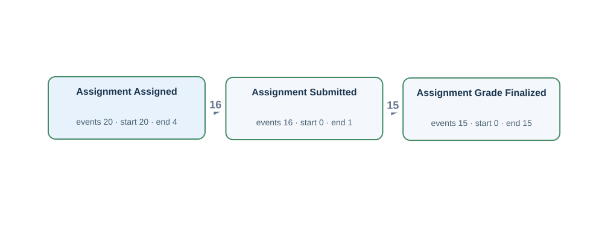</a> <a href="graphs/TS03.svg">Open full-size DFG</a></td><td width="35%" valign="top"><h4>Original tables</h4>
Up to 3 matched rows per table. Shows keys, event times and carrier values.

<strong>assignment</strong> · 20 matched rows
<table><tr><th>Row</th><th>Source values</th></tr><tr><td>1</td><td>assignment_id = A002 assignment_assigned_at = 2026-02-07T14:00:00Z assignment_submitted_at = 2026-02-09T14:00:00Z assignment_grade_finalized_at = NULL</td></tr><tr><td>2</td><td>assignment_id = A003 assignment_assigned_at = 2026-02-08T14:00:00Z assignment_submitted_at = 2026-02-10T14:00:00Z assignment_grade_finalized_at = 2026-02-14T14:00:00Z</td></tr><tr><td>3</td><td>assignment_id = A006 assignment_assigned_at = 2026-02-11T14:00:00Z assignment_submitted_at = 2026-02-13T14:00:00Z assignment_grade_finalized_at = 2026-02-17T14:00:00Z</td></tr></table>

Other SQL tables

assignment_grading, course, degree_examination_result, registration, simulation_module, student_simulation_experiment_result, task, thesis

</td></tr></table>

[Gold CSV](../../../datasets/universityflow/private/gold_logs/TS03.csv)

## TS04 — Q1

Extract Thesis Draft Registered, Thesis Review Started, Thesis Accepted events for each thesis.

Events: **45** · Cases with events: **16** · Activities: **3** · Edges: **2** · Source tables: **1** · SQL tables: **9**

<table><tr><td width="65%" valign="top"> <a href="graphs/TS04.svg">Open full-size DFG</a></td><td width="35%" valign="top"><h4>Original tables</h4>
Up to 3 matched rows per table. Shows keys, event times and carrier values.

<strong>thesis</strong> · 16 matched rows
<table><tr><th>Row</th><th>Source values</th></tr><tr><td>1</td><td>thesis_id = TH002 thesis_draft_registered_at = 2026-02-19T16:00:00Z thesis_review_started_at = 2026-02-24T16:00:00Z thesis_accepted_at = NULL</td></tr><tr><td>2</td><td>thesis_id = TH003 thesis_draft_registered_at = 2026-02-20T16:00:00Z thesis_review_started_at = 2026-02-25T16:00:00Z thesis_accepted_at = 2026-02-28T16:00:00Z</td></tr><tr><td>3</td><td>thesis_id = TH006 thesis_draft_registered_at = 2026-02-23T16:00:00Z thesis_review_started_at = 2026-02-28T16:00:00Z thesis_accepted_at = 2026-03-03T16:00:00Z</td></tr></table>

Other SQL tables

assignment, assignment_grading, course, degree_examination_result, registration, simulation_module, student_simulation_experiment_result, task

</td></tr></table>

[Gold CSV](../../../datasets/universityflow/private/gold_logs/TS04.csv)

## U07P — Q2

For each student, build a timeline of confirmation messages being sent after a course sign-up.

**No Gold log:** The requirements mention notifications, but no notification records or times are stored.

## U08P — Q2

For each student, build a timeline of the student leaving a course after signing up.

**No Gold log:** No withdrawal times or registration-status history are recorded.

## U15P — Q2

For each student, build a timeline of the student handing in coursework.

Events: **16** · Cases with events: **16** · Activities: **1** · Edges: **0** · Source tables: **1** · SQL tables: **1**

<table><tr><td width="65%" valign="top"> <a href="graphs/U15.svg">Open full-size DFG</a></td><td width="35%" valign="top"><h4>Original tables</h4>
Up to 3 matched rows per table. Shows keys, event times and carrier values.

<strong>assignment</strong> · 16 matched rows
<table><tr><th>Row</th><th>Source values</th></tr><tr><td>1</td><td>assignment_id = A002 assignment_submitted_at = 2026-02-09T14:00:00Z</td></tr><tr><td>2</td><td>assignment_id = A003 assignment_submitted_at = 2026-02-10T14:00:00Z</td></tr><tr><td>3</td><td>assignment_id = A006 assignment_submitted_at = 2026-02-13T14:00:00Z</td></tr></table></td></tr></table>

[Gold CSV](../../../datasets/universityflow/private/gold_logs/U15P.csv)

## TS01P — Q2

For each student, build a timeline of an examination sitting being arranged, the candidate checking in for the examination, the examination mark being released, the examination result being reviewed.

Events: **154** · Cases with events: **30** · Activities: **4** · Edges: **5** · Source tables: **1** · SQL tables: **9**

<table><tr><td width="65%" valign="top"> <a href="graphs/TS01.svg">Open full-size DFG</a></td><td width="35%" valign="top"><h4>Original tables</h4>
Up to 3 matched rows per table. Shows keys, event times and carrier values.

<strong>degree_examination_result</strong> · 40 matched rows
<table><tr><th>Row</th><th>Source values</th></tr><tr><td>1</td><td>result_id = E001-1 examination_scheduled_at = 2026-02-02T07:00:00Z examination_checked_in_at = 2026-02-02T08:00:00Z examination_score_published_at = 2026-02-02T11:00:00Z examination_result_reviewed_at = NULL</td></tr><tr><td>2</td><td>result_id = E002-1 examination_scheduled_at = 2026-02-03T07:00:00Z examination_checked_in_at = 2026-02-03T08:00:00Z examination_score_published_at = 2026-02-03T11:00:00Z examination_result_reviewed_at = 2026-02-03T12:00:00Z</td></tr><tr><td>3</td><td>result_id = E002-2 examination_scheduled_at = 2026-02-05T07:00:00Z examination_checked_in_at = 2026-02-05T08:00:00Z examination_score_published_at = 2026-02-05T11:00:00Z examination_result_reviewed_at = 2026-02-05T12:00:00Z</td></tr></table>

Other SQL tables

assignment, assignment_grading, course, registration, simulation_module, student_simulation_experiment_result, task, thesis

</td></tr></table>

[Gold CSV](../../../datasets/universityflow/private/gold_logs/TS01P.csv)

## TS02P — Q2

For each student-course registration, build a timeline of the student requesting a place on a course, the request for a course place being accepted, teaching beginning for the enrolled course, the course assessment finishing, the course mark being made final.

Events: **228** · Cases with events: **47** · Activities: **5** · Edges: **4** · Source tables: **1** · SQL tables: **9**

<table><tr><td width="65%" valign="top"> <a href="graphs/TS02.svg">Open full-size DFG</a></td><td width="35%" valign="top"><h4>Original tables</h4>
Up to 3 matched rows per table. Shows keys, event times and carrier values.

<strong>registration</strong> · 47 matched rows
<table><tr><th>Row</th><th>Source values</th></tr><tr><td>1</td><td>student_id = S002 course_id = C01 registration_requested_at = 2026-02-07T07:00:00Z registration_approved_at = 2026-02-07T09:00:00Z course_started_at = 2026-02-09T11:00:00Z course_assessment_completed_at = 2026-02-27T11:00:00Z course_grade_finalized_at = NULL</td></tr><tr><td>2</td><td>student_id = S002 course_id = C06 registration_requested_at = 2026-02-07T12:00:00Z registration_approved_at = 2026-02-07T14:00:00Z course_started_at = 2026-02-09T16:00:00Z course_assessment_completed_at = 2026-02-27T16:00:00Z course_grade_finalized_at = 2026-03-01T16:00:00Z</td></tr><tr><td>3</td><td>student_id = S003 course_id = C02 registration_requested_at = 2026-02-08T08:00:00Z registration_approved_at = 2026-02-08T10:00:00Z course_started_at = 2026-02-10T12:00:00Z course_assessment_completed_at = 2026-02-28T12:00:00Z course_grade_finalized_at = 2026-03-02T12:00:00Z</td></tr></table>

Other SQL tables

assignment, assignment_grading, course, degree_examination_result, simulation_module, student_simulation_experiment_result, task, thesis

</td></tr></table>

[Gold CSV](../../../datasets/universityflow/private/gold_logs/TS02P.csv)

## TS03P — Q2

For each assignment, build a timeline of coursework being set for the student, the student handing in coursework, the coursework mark being made final.

Events: **51** · Cases with events: **20** · Activities: **3** · Edges: **2** · Source tables: **1** · SQL tables: **9**

<table><tr><td width="65%" valign="top"> <a href="graphs/TS03.svg">Open full-size DFG</a></td><td width="35%" valign="top"><h4>Original tables</h4>
Up to 3 matched rows per table. Shows keys, event times and carrier values.

<strong>assignment</strong> · 20 matched rows
<table><tr><th>Row</th><th>Source values</th></tr><tr><td>1</td><td>assignment_id = A002 assignment_assigned_at = 2026-02-07T14:00:00Z assignment_submitted_at = 2026-02-09T14:00:00Z assignment_grade_finalized_at = NULL</td></tr><tr><td>2</td><td>assignment_id = A003 assignment_assigned_at = 2026-02-08T14:00:00Z assignment_submitted_at = 2026-02-10T14:00:00Z assignment_grade_finalized_at = 2026-02-14T14:00:00Z</td></tr><tr><td>3</td><td>assignment_id = A006 assignment_assigned_at = 2026-02-11T14:00:00Z assignment_submitted_at = 2026-02-13T14:00:00Z assignment_grade_finalized_at = 2026-02-17T14:00:00Z</td></tr></table>

Other SQL tables

assignment_grading, course, degree_examination_result, registration, simulation_module, student_simulation_experiment_result, task, thesis

</td></tr></table>

[Gold CSV](../../../datasets/universityflow/private/gold_logs/TS03P.csv)

## TS04P — Q2

For each thesis, build a timeline of a thesis draft being registered for review, the review of a thesis beginning, a thesis receiving final approval.

Events: **45** · Cases with events: **16** · Activities: **3** · Edges: **2** · Source tables: **1** · SQL tables: **9**

<table><tr><td width="65%" valign="top"> <a href="graphs/TS04.svg">Open full-size DFG</a></td><td width="35%" valign="top"><h4>Original tables</h4>
Up to 3 matched rows per table. Shows keys, event times and carrier values.

<strong>thesis</strong> · 16 matched rows
<table><tr><th>Row</th><th>Source values</th></tr><tr><td>1</td><td>thesis_id = TH002 thesis_draft_registered_at = 2026-02-19T16:00:00Z thesis_review_started_at = 2026-02-24T16:00:00Z thesis_accepted_at = NULL</td></tr><tr><td>2</td><td>thesis_id = TH003 thesis_draft_registered_at = 2026-02-20T16:00:00Z thesis_review_started_at = 2026-02-25T16:00:00Z thesis_accepted_at = 2026-02-28T16:00:00Z</td></tr><tr><td>3</td><td>thesis_id = TH006 thesis_draft_registered_at = 2026-02-23T16:00:00Z thesis_review_started_at = 2026-02-28T16:00:00Z thesis_accepted_at = 2026-03-03T16:00:00Z</td></tr></table>

Other SQL tables

assignment, assignment_grading, course, degree_examination_result, registration, simulation_module, student_simulation_experiment_result, task

</td></tr></table>

[Gold CSV](../../../datasets/universityflow/private/gold_logs/TS04P.csv)

## OU01P — Q4

Show the complete recorded history associated with each student.

Events: **763** · Cases with events: **30** · Activities: **29** · Edges: **62** · Source tables: **6** · SQL tables: **9**

<table><tr><td width="65%" valign="top"> <a href="graphs/U05.svg">Open full-size DFG</a></td><td width="35%" valign="top"><h4>Original tables</h4>
Up to 3 matched rows per table. Shows keys, event times and carrier values.

<strong>assignment</strong> · 20 matched rows
<table><tr><th>Row</th><th>Source values</th></tr><tr><td>1</td><td>assignment_id = A002 assignment_assigned_at = 2026-02-07T14:00:00Z assignment_submitted_at = 2026-02-09T14:00:00Z assignment_grade_finalized_at = NULL assignment_revision_requested_at = 2026-02-11T15:00:00Z assignment_resubmitted_at = 2026-02-12T14:00:00Z</td></tr><tr><td>2</td><td>assignment_id = A003 assignment_assigned_at = 2026-02-08T14:00:00Z assignment_submitted_at = 2026-02-10T14:00:00Z assignment_grade_finalized_at = 2026-02-14T14:00:00Z assignment_revision_requested_at = NULL assignment_resubmitted_at = NULL</td></tr><tr><td>3</td><td>assignment_id = A006 assignment_assigned_at = 2026-02-11T14:00:00Z assignment_submitted_at = 2026-02-13T14:00:00Z assignment_grade_finalized_at = 2026-02-17T14:00:00Z assignment_revision_requested_at = NULL assignment_resubmitted_at = NULL</td></tr></table>
<strong>assignment_grading</strong> · 25 matched rows
<table><tr><th>Row</th><th>Source values</th></tr><tr><td>1</td><td>assignment_id = A002 instructor_id = I03 grading_time = 2026-02-11T14:00:00Z grading_kind = ORIGINAL</td></tr><tr><td>2</td><td>assignment_id = A002 instructor_id = I03 grading_time = 2026-02-13T02:00:00Z grading_kind = REASSESSMENT</td></tr><tr><td>3</td><td>assignment_id = A003 instructor_id = I01 grading_time = 2026-02-12T14:00:00Z grading_kind = ORIGINAL</td></tr></table>
<strong>degree_examination_result</strong> · 40 matched rows
<table><tr><th>Row</th><th>Source values</th></tr><tr><td>1</td><td>result_id = E001-1 examination_date = 2026-02-02T09:00:00Z examination_scheduled_at = 2026-02-02T07:00:00Z examination_checked_in_at = 2026-02-02T08:00:00Z examination_score_published_at = 2026-02-02T11:00:00Z examination_result_reviewed_at = NULL</td></tr><tr><td>2</td><td>result_id = E002-1 examination_date = 2026-02-03T09:00:00Z examination_scheduled_at = 2026-02-03T07:00:00Z examination_checked_in_at = 2026-02-03T08:00:00Z examination_score_published_at = 2026-02-03T11:00:00Z examination_result_reviewed_at = 2026-02-03T12:00:00Z</td></tr><tr><td>3</td><td>result_id = E002-2 examination_date = 2026-02-05T09:00:00Z examination_scheduled_at = 2026-02-05T07:00:00Z examination_checked_in_at = 2026-02-05T08:00:00Z examination_score_published_at = 2026-02-05T11:00:00Z examination_result_reviewed_at = 2026-02-05T12:00:00Z</td></tr></table>
<strong>registration</strong> · 47 matched rows
<table><tr><th>Row</th><th>Source values</th></tr><tr><td>1</td><td>student_id = S002 course_id = C01 registration_time = 2026-02-07T11:00:00Z registration_requested_at = 2026-02-07T07:00:00Z registration_approved_at = 2026-02-07T09:00:00Z course_started_at = 2026-02-09T11:00:00Z course_assessment_completed_at = 2026-02-27T11:00:00Z course_grade_finalized_at = NULL</td></tr><tr><td>2</td><td>student_id = S002 course_id = C06 registration_time = 2026-02-07T16:00:00Z registration_requested_at = 2026-02-07T12:00:00Z registration_approved_at = 2026-02-07T14:00:00Z course_started_at = 2026-02-09T16:00:00Z course_assessment_completed_at = 2026-02-27T16:00:00Z course_grade_finalized_at = 2026-03-01T16:00:00Z</td></tr><tr><td>3</td><td>student_id = S003 course_id = C02 registration_time = 2026-02-08T12:00:00Z registration_requested_at = 2026-02-08T08:00:00Z registration_approved_at = 2026-02-08T10:00:00Z course_started_at = 2026-02-10T12:00:00Z course_assessment_completed_at = 2026-02-28T12:00:00Z course_grade_finalized_at = 2026-03-02T12:00:00Z</td></tr></table>
<strong>student_simulation_experiment_result</strong> · 27 matched rows
<table><tr><th>Row</th><th>Source values</th></tr><tr><td>1</td><td>student_id = S002 module_id = M03 simulation_date = 2026-02-13T15:00:00Z simulation_run_scheduled_at = 2026-02-13T13:00:00Z simulation_run_started_at = 2026-02-13T14:00:00Z simulation_output_reviewed_at = 2026-02-13T17:00:00Z simulation_result_accepted_at = NULL</td></tr><tr><td>2</td><td>student_id = S003 module_id = M01 simulation_date = 2026-02-14T15:00:00Z simulation_run_scheduled_at = 2026-02-14T13:00:00Z simulation_run_started_at = 2026-02-14T14:00:00Z simulation_output_reviewed_at = 2026-02-14T17:00:00Z simulation_result_accepted_at = 2026-02-14T18:00:00Z</td></tr><tr><td>3</td><td>student_id = S003 module_id = M01 simulation_date = 2026-02-15T15:00:00Z simulation_run_scheduled_at = 2026-02-15T13:00:00Z simulation_run_started_at = 2026-02-15T14:00:00Z simulation_output_reviewed_at = 2026-02-15T17:00:00Z simulation_result_accepted_at = 2026-02-15T18:00:00Z</td></tr></table>
<strong>thesis</strong> · 16 matched rows
<table><tr><th>Row</th><th>Source values</th></tr><tr><td>1</td><td>thesis_id = TH002 submission_date = 2026-02-23T16:00:00Z thesis_draft_registered_at = 2026-02-19T16:00:00Z thesis_review_started_at = 2026-02-24T16:00:00Z thesis_accepted_at = NULL thesis_revision_requested_at = 2026-02-25T16:00:00Z thesis_resubmitted_at = 2026-02-26T16:00:00Z</td></tr><tr><td>2</td><td>thesis_id = TH003 submission_date = 2026-02-24T16:00:00Z thesis_draft_registered_at = 2026-02-20T16:00:00Z thesis_review_started_at = 2026-02-25T16:00:00Z thesis_accepted_at = 2026-02-28T16:00:00Z thesis_revision_requested_at = NULL thesis_resubmitted_at = NULL</td></tr><tr><td>3</td><td>thesis_id = TH006 submission_date = 2026-02-27T16:00:00Z thesis_draft_registered_at = 2026-02-23T16:00:00Z thesis_review_started_at = 2026-02-28T16:00:00Z thesis_accepted_at = 2026-03-03T16:00:00Z thesis_revision_requested_at = NULL thesis_resubmitted_at = NULL</td></tr></table>

Other SQL tables

course, simulation_module, task

</td></tr></table>

[Gold CSV](../../../datasets/universityflow/private/gold_logs/OU01P.csv)

## OU01E — Q1

Extract Assignment Assigned, Assignment Submitted, Assignment Graded events for each student.

Events: **54** · Cases with events: **20** · Activities: **3** · Edges: **3** · Source tables: **2** · SQL tables: **9**

<table><tr><td width="65%" valign="top"> <a href="graphs/OU01E.svg">Open full-size DFG</a></td><td width="35%" valign="top"><h4>Original tables</h4>
Up to 3 matched rows per table. Shows keys, event times and carrier values.

<strong>assignment</strong> · 20 matched rows
<table><tr><th>Row</th><th>Source values</th></tr><tr><td>1</td><td>assignment_id = A002 assignment_assigned_at = 2026-02-07T14:00:00Z assignment_submitted_at = 2026-02-09T14:00:00Z</td></tr><tr><td>2</td><td>assignment_id = A003 assignment_assigned_at = 2026-02-08T14:00:00Z assignment_submitted_at = 2026-02-10T14:00:00Z</td></tr><tr><td>3</td><td>assignment_id = A006 assignment_assigned_at = 2026-02-11T14:00:00Z assignment_submitted_at = 2026-02-13T14:00:00Z</td></tr></table>
<strong>assignment_grading</strong> · 18 matched rows
<table><tr><th>Row</th><th>Source values</th></tr><tr><td>1</td><td>assignment_id = A002 instructor_id = I03 grading_time = 2026-02-11T14:00:00Z grading_kind = ORIGINAL</td></tr><tr><td>2</td><td>assignment_id = A003 instructor_id = I01 grading_time = 2026-02-12T14:00:00Z grading_kind = ORIGINAL</td></tr><tr><td>3</td><td>assignment_id = A006 instructor_id = I01 grading_time = 2026-02-15T14:00:00Z grading_kind = ORIGINAL</td></tr></table>

Other SQL tables

course, degree_examination_result, registration, simulation_module, student_simulation_experiment_result, task, thesis

</td></tr></table>

[Gold CSV](../../../datasets/universityflow/private/gold_logs/OU01E.csv)

## OU01EP — Q2

For each student, build a timeline of coursework being set for the student, the student handing in coursework, an instructor assessing the assignment.

Events: **54** · Cases with events: **20** · Activities: **3** · Edges: **3** · Source tables: **2** · SQL tables: **9**

<table><tr><td width="65%" valign="top"> <a href="graphs/OU01E.svg">Open full-size DFG</a></td><td width="35%" valign="top"><h4>Original tables</h4>
Up to 3 matched rows per table. Shows keys, event times and carrier values.

<strong>assignment</strong> · 20 matched rows
<table><tr><th>Row</th><th>Source values</th></tr><tr><td>1</td><td>assignment_id = A002 assignment_assigned_at = 2026-02-07T14:00:00Z assignment_submitted_at = 2026-02-09T14:00:00Z</td></tr><tr><td>2</td><td>assignment_id = A003 assignment_assigned_at = 2026-02-08T14:00:00Z assignment_submitted_at = 2026-02-10T14:00:00Z</td></tr><tr><td>3</td><td>assignment_id = A006 assignment_assigned_at = 2026-02-11T14:00:00Z assignment_submitted_at = 2026-02-13T14:00:00Z</td></tr></table>
<strong>assignment_grading</strong> · 18 matched rows
<table><tr><th>Row</th><th>Source values</th></tr><tr><td>1</td><td>assignment_id = A002 instructor_id = I03 grading_time = 2026-02-11T14:00:00Z grading_kind = ORIGINAL</td></tr><tr><td>2</td><td>assignment_id = A003 instructor_id = I01 grading_time = 2026-02-12T14:00:00Z grading_kind = ORIGINAL</td></tr><tr><td>3</td><td>assignment_id = A006 instructor_id = I01 grading_time = 2026-02-15T14:00:00Z grading_kind = ORIGINAL</td></tr></table>

Other SQL tables

course, degree_examination_result, registration, simulation_module, student_simulation_experiment_result, task, thesis

</td></tr></table>

[Gold CSV](../../../datasets/universityflow/private/gold_logs/OU01EP.csv)

## OU02P — Q4

Show the complete recorded history associated with each course.

Events: **298** · Cases with events: **6** · Activities: **10** · Edges: **24** · Source tables: **2** · SQL tables: **9**

<table><tr><td width="65%" valign="top"> <a href="graphs/OU02.svg">Open full-size DFG</a></td><td width="35%" valign="top"><h4>Original tables</h4>
Up to 3 matched rows per table. Shows keys, event times and carrier values.

<strong>course</strong> · 6 matched rows
<table><tr><th>Row</th><th>Source values</th></tr><tr><td>1</td><td>course_id = C01 course_offering_proposed_at = 2026-02-04T11:00:00Z course_offering_approved_at = 2026-02-05T11:00:00Z course_offering_published_at = 2026-02-06T11:00:00Z course_offering_closed_at = NULL</td></tr><tr><td>2</td><td>course_id = C02 course_offering_proposed_at = 2026-02-05T12:00:00Z course_offering_approved_at = 2026-02-06T12:00:00Z course_offering_published_at = 2026-02-07T12:00:00Z course_offering_closed_at = 2026-04-07T12:00:00Z</td></tr><tr><td>3</td><td>course_id = C03 course_offering_proposed_at = 2026-02-24T13:00:00Z course_offering_approved_at = 2026-02-25T13:00:00Z course_offering_published_at = 2026-02-26T13:00:00Z course_offering_closed_at = 2026-04-07T13:00:00Z</td></tr></table>
<strong>registration</strong> · 47 matched rows
<table><tr><th>Row</th><th>Source values</th></tr><tr><td>1</td><td>student_id = S002 course_id = C01 registration_time = 2026-02-07T11:00:00Z registration_requested_at = 2026-02-07T07:00:00Z registration_approved_at = 2026-02-07T09:00:00Z course_started_at = 2026-02-09T11:00:00Z course_assessment_completed_at = 2026-02-27T11:00:00Z course_grade_finalized_at = NULL</td></tr><tr><td>2</td><td>student_id = S007 course_id = C01 registration_time = 2026-02-12T11:00:00Z registration_requested_at = 2026-02-12T07:00:00Z registration_approved_at = 2026-02-12T09:00:00Z course_started_at = 2026-02-14T11:00:00Z course_assessment_completed_at = 2026-03-04T11:00:00Z course_grade_finalized_at = 2026-03-06T11:00:00Z</td></tr><tr><td>3</td><td>student_id = S011 course_id = C01 registration_time = 2026-02-16T11:00:00Z registration_requested_at = 2026-02-16T07:00:00Z registration_approved_at = 2026-02-16T09:00:00Z course_started_at = 2026-02-18T11:00:00Z course_assessment_completed_at = 2026-03-08T11:00:00Z course_grade_finalized_at = 2026-03-10T11:00:00Z</td></tr></table>

Other SQL tables

assignment, assignment_grading, degree_examination_result, simulation_module, student_simulation_experiment_result, task, thesis

</td></tr></table>

[Gold CSV](../../../datasets/universityflow/private/gold_logs/OU02P.csv)

## OU02E — Q1

Extract Registration Requested, Course Registered, Course Grade Finalized events for each course.

Events: **134** · Cases with events: **6** · Activities: **3** · Edges: **5** · Source tables: **1** · SQL tables: **9**

<table><tr><td width="65%" valign="top"><a href="graphs/OU02E.svg">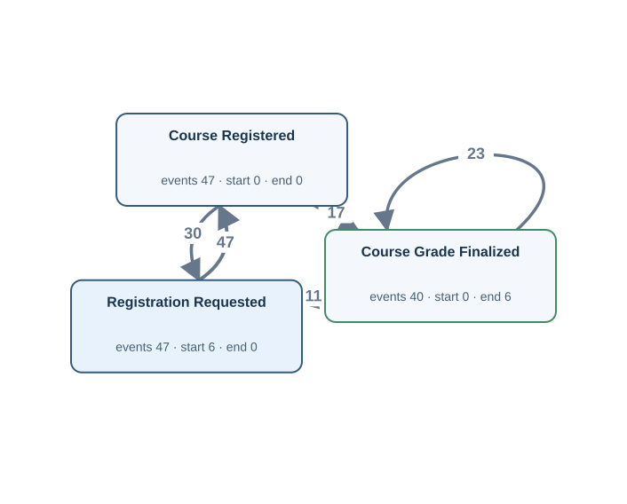</a> <a href="graphs/OU02E.svg">Open full-size DFG</a></td><td width="35%" valign="top"><h4>Original tables</h4>
Up to 3 matched rows per table. Shows keys, event times and carrier values.

<strong>registration</strong> · 47 matched rows
<table><tr><th>Row</th><th>Source values</th></tr><tr><td>1</td><td>student_id = S002 course_id = C01 registration_time = 2026-02-07T11:00:00Z registration_requested_at = 2026-02-07T07:00:00Z course_grade_finalized_at = NULL</td></tr><tr><td>2</td><td>student_id = S007 course_id = C01 registration_time = 2026-02-12T11:00:00Z registration_requested_at = 2026-02-12T07:00:00Z course_grade_finalized_at = 2026-03-06T11:00:00Z</td></tr><tr><td>3</td><td>student_id = S011 course_id = C01 registration_time = 2026-02-16T11:00:00Z registration_requested_at = 2026-02-16T07:00:00Z course_grade_finalized_at = 2026-03-10T11:00:00Z</td></tr></table>

Other SQL tables

assignment, assignment_grading, course, degree_examination_result, simulation_module, student_simulation_experiment_result, task, thesis

</td></tr></table>

[Gold CSV](../../../datasets/universityflow/private/gold_logs/OU02E.csv)

## OU02EP — Q2

For each course, build a timeline of the student requesting a place on a course, a successful course sign-up, the course mark being made final.

Events: **134** · Cases with events: **6** · Activities: **3** · Edges: **5** · Source tables: **1** · SQL tables: **9**

<table><tr><td width="65%" valign="top"> <a href="graphs/OU02E.svg">Open full-size DFG</a></td><td width="35%" valign="top"><h4>Original tables</h4>
Up to 3 matched rows per table. Shows keys, event times and carrier values.

<strong>registration</strong> · 47 matched rows
<table><tr><th>Row</th><th>Source values</th></tr><tr><td>1</td><td>student_id = S002 course_id = C01 registration_time = 2026-02-07T11:00:00Z registration_requested_at = 2026-02-07T07:00:00Z course_grade_finalized_at = NULL</td></tr><tr><td>2</td><td>student_id = S007 course_id = C01 registration_time = 2026-02-12T11:00:00Z registration_requested_at = 2026-02-12T07:00:00Z course_grade_finalized_at = 2026-03-06T11:00:00Z</td></tr><tr><td>3</td><td>student_id = S011 course_id = C01 registration_time = 2026-02-16T11:00:00Z registration_requested_at = 2026-02-16T07:00:00Z course_grade_finalized_at = 2026-03-10T11:00:00Z</td></tr></table>

Other SQL tables

assignment, assignment_grading, course, degree_examination_result, simulation_module, student_simulation_experiment_result, task, thesis

</td></tr></table>

[Gold CSV](../../../datasets/universityflow/private/gold_logs/OU02EP.csv)

## OU03P — Q4

Show the complete recorded history associated with each student-course registration.

Events: **275** · Cases with events: **47** · Activities: **6** · Edges: **5** · Source tables: **1** · SQL tables: **9**

<table><tr><td width="65%" valign="top"> <a href="graphs/OU03.svg">Open full-size DFG</a></td><td width="35%" valign="top"><h4>Original tables</h4>
Up to 3 matched rows per table. Shows keys, event times and carrier values.

<strong>registration</strong> · 47 matched rows
<table><tr><th>Row</th><th>Source values</th></tr><tr><td>1</td><td>student_id = S002 course_id = C01 registration_time = 2026-02-07T11:00:00Z registration_requested_at = 2026-02-07T07:00:00Z registration_approved_at = 2026-02-07T09:00:00Z course_started_at = 2026-02-09T11:00:00Z course_assessment_completed_at = 2026-02-27T11:00:00Z course_grade_finalized_at = NULL</td></tr><tr><td>2</td><td>student_id = S002 course_id = C06 registration_time = 2026-02-07T16:00:00Z registration_requested_at = 2026-02-07T12:00:00Z registration_approved_at = 2026-02-07T14:00:00Z course_started_at = 2026-02-09T16:00:00Z course_assessment_completed_at = 2026-02-27T16:00:00Z course_grade_finalized_at = 2026-03-01T16:00:00Z</td></tr><tr><td>3</td><td>student_id = S003 course_id = C02 registration_time = 2026-02-08T12:00:00Z registration_requested_at = 2026-02-08T08:00:00Z registration_approved_at = 2026-02-08T10:00:00Z course_started_at = 2026-02-10T12:00:00Z course_assessment_completed_at = 2026-02-28T12:00:00Z course_grade_finalized_at = 2026-03-02T12:00:00Z</td></tr></table>

Other SQL tables

assignment, assignment_grading, course, degree_examination_result, simulation_module, student_simulation_experiment_result, task, thesis

</td></tr></table>

[Gold CSV](../../../datasets/universityflow/private/gold_logs/OU03P.csv)

## OU03E — Q1

Extract Registration Requested, Course Registered, Course Grade Finalized events for each student-course registration.

Events: **134** · Cases with events: **47** · Activities: **3** · Edges: **2** · Source tables: **1** · SQL tables: **9**

<table><tr><td width="65%" valign="top"><a href="graphs/OU03E.svg">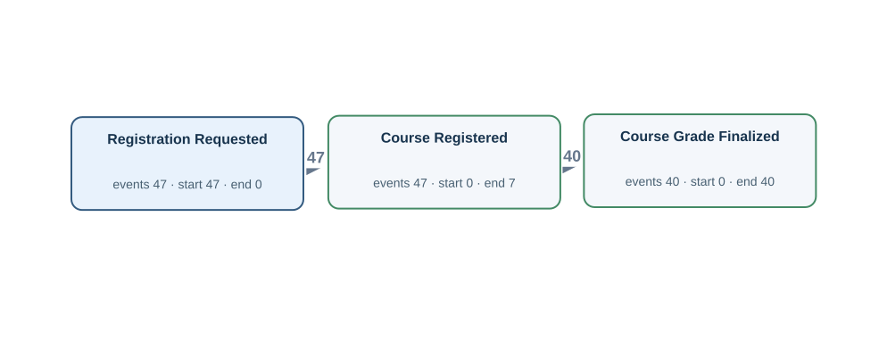</a> <a href="graphs/OU03E.svg">Open full-size DFG</a></td><td width="35%" valign="top"><h4>Original tables</h4>
Up to 3 matched rows per table. Shows keys, event times and carrier values.

<strong>registration</strong> · 47 matched rows
<table><tr><th>Row</th><th>Source values</th></tr><tr><td>1</td><td>student_id = S002 course_id = C01 registration_time = 2026-02-07T11:00:00Z registration_requested_at = 2026-02-07T07:00:00Z course_grade_finalized_at = NULL</td></tr><tr><td>2</td><td>student_id = S002 course_id = C06 registration_time = 2026-02-07T16:00:00Z registration_requested_at = 2026-02-07T12:00:00Z course_grade_finalized_at = 2026-03-01T16:00:00Z</td></tr><tr><td>3</td><td>student_id = S003 course_id = C02 registration_time = 2026-02-08T12:00:00Z registration_requested_at = 2026-02-08T08:00:00Z course_grade_finalized_at = 2026-03-02T12:00:00Z</td></tr></table>

Other SQL tables

assignment, assignment_grading, course, degree_examination_result, simulation_module, student_simulation_experiment_result, task, thesis

</td></tr></table>

[Gold CSV](../../../datasets/universityflow/private/gold_logs/OU03E.csv)

## OU03EP — Q2

For each student-course registration, build a timeline of the student requesting a place on a course, a successful course sign-up, the course mark being made final.

Events: **134** · Cases with events: **47** · Activities: **3** · Edges: **2** · Source tables: **1** · SQL tables: **9**

<table><tr><td width="65%" valign="top"> <a href="graphs/OU03E.svg">Open full-size DFG</a></td><td width="35%" valign="top"><h4>Original tables</h4>
Up to 3 matched rows per table. Shows keys, event times and carrier values.

<strong>registration</strong> · 47 matched rows
<table><tr><th>Row</th><th>Source values</th></tr><tr><td>1</td><td>student_id = S002 course_id = C01 registration_time = 2026-02-07T11:00:00Z registration_requested_at = 2026-02-07T07:00:00Z course_grade_finalized_at = NULL</td></tr><tr><td>2</td><td>student_id = S002 course_id = C06 registration_time = 2026-02-07T16:00:00Z registration_requested_at = 2026-02-07T12:00:00Z course_grade_finalized_at = 2026-03-01T16:00:00Z</td></tr><tr><td>3</td><td>student_id = S003 course_id = C02 registration_time = 2026-02-08T12:00:00Z registration_requested_at = 2026-02-08T08:00:00Z course_grade_finalized_at = 2026-03-02T12:00:00Z</td></tr></table>

Other SQL tables

assignment, assignment_grading, course, degree_examination_result, simulation_module, student_simulation_experiment_result, task, thesis

</td></tr></table>

[Gold CSV](../../../datasets/universityflow/private/gold_logs/OU03EP.csv)

## OU04P — Q4

Show the complete recorded history associated with each examination result record.

Events: **194** · Cases with events: **40** · Activities: **5** · Edges: **4** · Source tables: **1** · SQL tables: **9**

<table><tr><td width="65%" valign="top"> <a href="graphs/OU04.svg">Open full-size DFG</a></td><td width="35%" valign="top"><h4>Original tables</h4>
Up to 3 matched rows per table. Shows keys, event times and carrier values.

<strong>degree_examination_result</strong> · 40 matched rows
<table><tr><th>Row</th><th>Source values</th></tr><tr><td>1</td><td>result_id = E001-1 examination_date = 2026-02-02T09:00:00Z examination_scheduled_at = 2026-02-02T07:00:00Z examination_checked_in_at = 2026-02-02T08:00:00Z examination_score_published_at = 2026-02-02T11:00:00Z examination_result_reviewed_at = NULL</td></tr><tr><td>2</td><td>result_id = E002-1 examination_date = 2026-02-03T09:00:00Z examination_scheduled_at = 2026-02-03T07:00:00Z examination_checked_in_at = 2026-02-03T08:00:00Z examination_score_published_at = 2026-02-03T11:00:00Z examination_result_reviewed_at = 2026-02-03T12:00:00Z</td></tr><tr><td>3</td><td>result_id = E002-2 examination_date = 2026-02-05T09:00:00Z examination_scheduled_at = 2026-02-05T07:00:00Z examination_checked_in_at = 2026-02-05T08:00:00Z examination_score_published_at = 2026-02-05T11:00:00Z examination_result_reviewed_at = 2026-02-05T12:00:00Z</td></tr></table>

Other SQL tables

assignment, assignment_grading, course, registration, simulation_module, student_simulation_experiment_result, task, thesis

</td></tr></table>

[Gold CSV](../../../datasets/universityflow/private/gold_logs/OU04P.csv)

## OU04E — Q1

Extract Examination Scheduled, Degree Examination Taken, Examination Score Published events for each examination result record.

Events: **120** · Cases with events: **40** · Activities: **3** · Edges: **2** · Source tables: **1** · SQL tables: **9**

<table><tr><td width="65%" valign="top"> <a href="graphs/OU04E.svg">Open full-size DFG</a></td><td width="35%" valign="top"><h4>Original tables</h4>
Up to 3 matched rows per table. Shows keys, event times and carrier values.

<strong>degree_examination_result</strong> · 40 matched rows
<table><tr><th>Row</th><th>Source values</th></tr><tr><td>1</td><td>result_id = E001-1 examination_date = 2026-02-02T09:00:00Z examination_scheduled_at = 2026-02-02T07:00:00Z examination_score_published_at = 2026-02-02T11:00:00Z</td></tr><tr><td>2</td><td>result_id = E002-1 examination_date = 2026-02-03T09:00:00Z examination_scheduled_at = 2026-02-03T07:00:00Z examination_score_published_at = 2026-02-03T11:00:00Z</td></tr><tr><td>3</td><td>result_id = E002-2 examination_date = 2026-02-05T09:00:00Z examination_scheduled_at = 2026-02-05T07:00:00Z examination_score_published_at = 2026-02-05T11:00:00Z</td></tr></table>

Other SQL tables

assignment, assignment_grading, course, registration, simulation_module, student_simulation_experiment_result, task, thesis

</td></tr></table>

[Gold CSV](../../../datasets/universityflow/private/gold_logs/OU04E.csv)

## OU04EP — Q2

For each examination result record, build a timeline of an examination sitting being arranged, the student sitting the degree examination, the examination mark being released.

Events: **120** · Cases with events: **40** · Activities: **3** · Edges: **2** · Source tables: **1** · SQL tables: **9**

<table><tr><td width="65%" valign="top"> <a href="graphs/OU04E.svg">Open full-size DFG</a></td><td width="35%" valign="top"><h4>Original tables</h4>
Up to 3 matched rows per table. Shows keys, event times and carrier values.

<strong>degree_examination_result</strong> · 40 matched rows
<table><tr><th>Row</th><th>Source values</th></tr><tr><td>1</td><td>result_id = E001-1 examination_date = 2026-02-02T09:00:00Z examination_scheduled_at = 2026-02-02T07:00:00Z examination_score_published_at = 2026-02-02T11:00:00Z</td></tr><tr><td>2</td><td>result_id = E002-1 examination_date = 2026-02-03T09:00:00Z examination_scheduled_at = 2026-02-03T07:00:00Z examination_score_published_at = 2026-02-03T11:00:00Z</td></tr><tr><td>3</td><td>result_id = E002-2 examination_date = 2026-02-05T09:00:00Z examination_scheduled_at = 2026-02-05T07:00:00Z examination_score_published_at = 2026-02-05T11:00:00Z</td></tr></table>

Other SQL tables

assignment, assignment_grading, course, registration, simulation_module, student_simulation_experiment_result, task, thesis

</td></tr></table>

[Gold CSV](../../../datasets/universityflow/private/gold_logs/OU04EP.csv)

## OU05P — Q4

Show the complete recorded history associated with each simulation module.

Events: **142** · Cases with events: **3** · Activities: **9** · Edges: **10** · Source tables: **2** · SQL tables: **9**

<table><tr><td width="65%" valign="top"> <a href="graphs/OU05.svg">Open full-size DFG</a></td><td width="35%" valign="top"><h4>Original tables</h4>
Up to 3 matched rows per table. Shows keys, event times and carrier values.

<strong>simulation_module</strong> · 3 matched rows
<table><tr><th>Row</th><th>Source values</th></tr><tr><td>1</td><td>module_id = M01 simulation_module_published_at = 2026-02-11T15:00:00Z simulation_module_validated_at = 2026-02-12T15:00:00Z simulation_module_released_at = 2026-02-13T15:00:00Z simulation_module_retired_at = NULL</td></tr><tr><td>2</td><td>module_id = M02 simulation_module_published_at = 2026-02-15T15:00:00Z simulation_module_validated_at = 2026-02-16T15:00:00Z simulation_module_released_at = 2026-02-17T15:00:00Z simulation_module_retired_at = 2026-04-16T15:00:00Z</td></tr><tr><td>3</td><td>module_id = M03 simulation_module_published_at = 2026-02-10T15:00:00Z simulation_module_validated_at = 2026-02-11T15:00:00Z simulation_module_released_at = 2026-02-12T15:00:00Z simulation_module_retired_at = 2026-04-20T15:00:00Z</td></tr></table>
<strong>student_simulation_experiment_result</strong> · 27 matched rows
<table><tr><th>Row</th><th>Source values</th></tr><tr><td>1</td><td>student_id = S003 module_id = M01 simulation_date = 2026-02-14T15:00:00Z simulation_run_scheduled_at = 2026-02-14T13:00:00Z simulation_run_started_at = 2026-02-14T14:00:00Z simulation_output_reviewed_at = 2026-02-14T17:00:00Z simulation_result_accepted_at = 2026-02-14T18:00:00Z</td></tr><tr><td>2</td><td>student_id = S003 module_id = M01 simulation_date = 2026-02-15T15:00:00Z simulation_run_scheduled_at = 2026-02-15T13:00:00Z simulation_run_started_at = 2026-02-15T14:00:00Z simulation_output_reviewed_at = 2026-02-15T17:00:00Z simulation_result_accepted_at = 2026-02-15T18:00:00Z</td></tr><tr><td>3</td><td>student_id = S006 module_id = M01 simulation_date = 2026-02-17T15:00:00Z simulation_run_scheduled_at = 2026-02-17T13:00:00Z simulation_run_started_at = 2026-02-17T14:00:00Z simulation_output_reviewed_at = 2026-02-17T17:00:00Z simulation_result_accepted_at = 2026-02-17T18:00:00Z</td></tr></table>

Other SQL tables

assignment, assignment_grading, course, degree_examination_result, registration, task, thesis

</td></tr></table>

[Gold CSV](../../../datasets/universityflow/private/gold_logs/OU05P.csv)

## OU05E — Q1

Extract Simulation Run Started, Simulation Experiment Completed, Simulation Result Accepted events for each simulation module.

Events: **77** · Cases with events: **3** · Activities: **3** · Edges: **4** · Source tables: **1** · SQL tables: **9**

<table><tr><td width="65%" valign="top"><a href="graphs/OU05E.svg">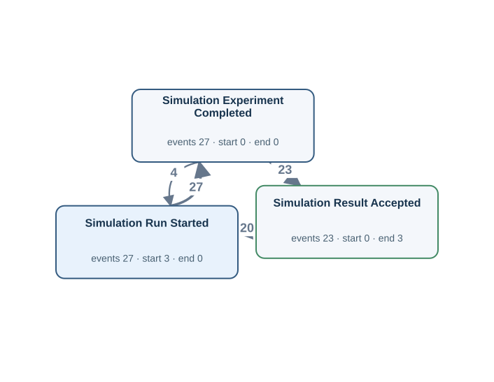</a> <a href="graphs/OU05E.svg">Open full-size DFG</a></td><td width="35%" valign="top"><h4>Original tables</h4>
Up to 3 matched rows per table. Shows keys, event times and carrier values.

<strong>student_simulation_experiment_result</strong> · 27 matched rows
<table><tr><th>Row</th><th>Source values</th></tr><tr><td>1</td><td>student_id = S003 module_id = M01 simulation_date = 2026-02-14T15:00:00Z simulation_run_started_at = 2026-02-14T14:00:00Z simulation_result_accepted_at = 2026-02-14T18:00:00Z</td></tr><tr><td>2</td><td>student_id = S003 module_id = M01 simulation_date = 2026-02-15T15:00:00Z simulation_run_started_at = 2026-02-15T14:00:00Z simulation_result_accepted_at = 2026-02-15T18:00:00Z</td></tr><tr><td>3</td><td>student_id = S006 module_id = M01 simulation_date = 2026-02-17T15:00:00Z simulation_run_started_at = 2026-02-17T14:00:00Z simulation_result_accepted_at = 2026-02-17T18:00:00Z</td></tr></table>

Other SQL tables

assignment, assignment_grading, course, degree_examination_result, registration, simulation_module, task, thesis

</td></tr></table>

[Gold CSV](../../../datasets/universityflow/private/gold_logs/OU05E.csv)

## OU05EP — Q2

For each simulation module, build a timeline of a simulation run beginning, a simulation run finishing, the simulation results receiving approval.

Events: **77** · Cases with events: **3** · Activities: **3** · Edges: **4** · Source tables: **1** · SQL tables: **9**

<table><tr><td width="65%" valign="top"> <a href="graphs/OU05E.svg">Open full-size DFG</a></td><td width="35%" valign="top"><h4>Original tables</h4>
Up to 3 matched rows per table. Shows keys, event times and carrier values.

<strong>student_simulation_experiment_result</strong> · 27 matched rows
<table><tr><th>Row</th><th>Source values</th></tr><tr><td>1</td><td>student_id = S003 module_id = M01 simulation_date = 2026-02-14T15:00:00Z simulation_run_started_at = 2026-02-14T14:00:00Z simulation_result_accepted_at = 2026-02-14T18:00:00Z</td></tr><tr><td>2</td><td>student_id = S003 module_id = M01 simulation_date = 2026-02-15T15:00:00Z simulation_run_started_at = 2026-02-15T14:00:00Z simulation_result_accepted_at = 2026-02-15T18:00:00Z</td></tr><tr><td>3</td><td>student_id = S006 module_id = M01 simulation_date = 2026-02-17T15:00:00Z simulation_run_started_at = 2026-02-17T14:00:00Z simulation_result_accepted_at = 2026-02-17T18:00:00Z</td></tr></table>

Other SQL tables

assignment, assignment_grading, course, degree_examination_result, registration, simulation_module, task, thesis

</td></tr></table>

[Gold CSV](../../../datasets/universityflow/private/gold_logs/OU05EP.csv)

## OU06P — Q4

Show the complete recorded history associated with each thesis.

Events: **73** · Cases with events: **16** · Activities: **6** · Edges: **6** · Source tables: **1** · SQL tables: **9**

<table><tr><td width="65%" valign="top"> <a href="graphs/OU06.svg">Open full-size DFG</a></td><td width="35%" valign="top"><h4>Original tables</h4>
Up to 3 matched rows per table. Shows keys, event times and carrier values.

<strong>thesis</strong> · 16 matched rows
<table><tr><th>Row</th><th>Source values</th></tr><tr><td>1</td><td>thesis_id = TH002 submission_date = 2026-02-23T16:00:00Z thesis_draft_registered_at = 2026-02-19T16:00:00Z thesis_review_started_at = 2026-02-24T16:00:00Z thesis_accepted_at = NULL thesis_revision_requested_at = 2026-02-25T16:00:00Z thesis_resubmitted_at = 2026-02-26T16:00:00Z</td></tr><tr><td>2</td><td>thesis_id = TH003 submission_date = 2026-02-24T16:00:00Z thesis_draft_registered_at = 2026-02-20T16:00:00Z thesis_review_started_at = 2026-02-25T16:00:00Z thesis_accepted_at = 2026-02-28T16:00:00Z thesis_revision_requested_at = NULL thesis_resubmitted_at = NULL</td></tr><tr><td>3</td><td>thesis_id = TH006 submission_date = 2026-02-27T16:00:00Z thesis_draft_registered_at = 2026-02-23T16:00:00Z thesis_review_started_at = 2026-02-28T16:00:00Z thesis_accepted_at = 2026-03-03T16:00:00Z thesis_revision_requested_at = NULL thesis_resubmitted_at = NULL</td></tr></table>

Other SQL tables

assignment, assignment_grading, course, degree_examination_result, registration, simulation_module, student_simulation_experiment_result, task

</td></tr></table>

[Gold CSV](../../../datasets/universityflow/private/gold_logs/OU06P.csv)

## OU06E — Q1

Extract Thesis Submitted, Thesis Review Started, Thesis Accepted events for each thesis.

Events: **45** · Cases with events: **16** · Activities: **3** · Edges: **2** · Source tables: **1** · SQL tables: **9**

<table><tr><td width="65%" valign="top"> <a href="graphs/OU06E.svg">Open full-size DFG</a></td><td width="35%" valign="top"><h4>Original tables</h4>
Up to 3 matched rows per table. Shows keys, event times and carrier values.

<strong>thesis</strong> · 16 matched rows
<table><tr><th>Row</th><th>Source values</th></tr><tr><td>1</td><td>thesis_id = TH002 submission_date = 2026-02-23T16:00:00Z thesis_review_started_at = 2026-02-24T16:00:00Z thesis_accepted_at = NULL</td></tr><tr><td>2</td><td>thesis_id = TH003 submission_date = 2026-02-24T16:00:00Z thesis_review_started_at = 2026-02-25T16:00:00Z thesis_accepted_at = 2026-02-28T16:00:00Z</td></tr><tr><td>3</td><td>thesis_id = TH006 submission_date = 2026-02-27T16:00:00Z thesis_review_started_at = 2026-02-28T16:00:00Z thesis_accepted_at = 2026-03-03T16:00:00Z</td></tr></table>

Other SQL tables

assignment, assignment_grading, course, degree_examination_result, registration, simulation_module, student_simulation_experiment_result, task

</td></tr></table>

[Gold CSV](../../../datasets/universityflow/private/gold_logs/OU06E.csv)

## OU06EP — Q2

For each thesis, build a timeline of the student handing in a thesis, the review of a thesis beginning, a thesis receiving final approval.

Events: **45** · Cases with events: **16** · Activities: **3** · Edges: **2** · Source tables: **1** · SQL tables: **9**

<table><tr><td width="65%" valign="top"> <a href="graphs/OU06E.svg">Open full-size DFG</a></td><td width="35%" valign="top"><h4>Original tables</h4>
Up to 3 matched rows per table. Shows keys, event times and carrier values.

<strong>thesis</strong> · 16 matched rows
<table><tr><th>Row</th><th>Source values</th></tr><tr><td>1</td><td>thesis_id = TH002 submission_date = 2026-02-23T16:00:00Z thesis_review_started_at = 2026-02-24T16:00:00Z thesis_accepted_at = NULL</td></tr><tr><td>2</td><td>thesis_id = TH003 submission_date = 2026-02-24T16:00:00Z thesis_review_started_at = 2026-02-25T16:00:00Z thesis_accepted_at = 2026-02-28T16:00:00Z</td></tr><tr><td>3</td><td>thesis_id = TH006 submission_date = 2026-02-27T16:00:00Z thesis_review_started_at = 2026-02-28T16:00:00Z thesis_accepted_at = 2026-03-03T16:00:00Z</td></tr></table>

Other SQL tables

assignment, assignment_grading, course, degree_examination_result, registration, simulation_module, student_simulation_experiment_result, task

</td></tr></table>

[Gold CSV](../../../datasets/universityflow/private/gold_logs/OU06EP.csv)

## OU07P — Q4

Show the complete recorded history associated with each simulation experiment result record.

Events: **131** · Cases with events: **27** · Activities: **5** · Edges: **4** · Source tables: **1** · SQL tables: **9**

<table><tr><td width="65%" valign="top"> <a href="graphs/OU07.svg">Open full-size DFG</a></td><td width="35%" valign="top"><h4>Original tables</h4>
Up to 3 matched rows per table. Shows keys, event times and carrier values.

<strong>student_simulation_experiment_result</strong> · 27 matched rows
<table><tr><th>Row</th><th>Source values</th></tr><tr><td>1</td><td>student_id = S002 module_id = M03 simulation_date = 2026-02-13T15:00:00Z simulation_run_scheduled_at = 2026-02-13T13:00:00Z simulation_run_started_at = 2026-02-13T14:00:00Z simulation_output_reviewed_at = 2026-02-13T17:00:00Z simulation_result_accepted_at = NULL</td></tr><tr><td>2</td><td>student_id = S003 module_id = M01 simulation_date = 2026-02-14T15:00:00Z simulation_run_scheduled_at = 2026-02-14T13:00:00Z simulation_run_started_at = 2026-02-14T14:00:00Z simulation_output_reviewed_at = 2026-02-14T17:00:00Z simulation_result_accepted_at = 2026-02-14T18:00:00Z</td></tr><tr><td>3</td><td>student_id = S003 module_id = M01 simulation_date = 2026-02-15T15:00:00Z simulation_run_scheduled_at = 2026-02-15T13:00:00Z simulation_run_started_at = 2026-02-15T14:00:00Z simulation_output_reviewed_at = 2026-02-15T17:00:00Z simulation_result_accepted_at = 2026-02-15T18:00:00Z</td></tr></table>

Other SQL tables

assignment, assignment_grading, course, degree_examination_result, registration, simulation_module, task, thesis

</td></tr></table>

[Gold CSV](../../../datasets/universityflow/private/gold_logs/OU07P.csv)

## OU07E — Q1

Extract Simulation Run Started, Simulation Experiment Completed, Simulation Result Accepted events for each simulation experiment result record.

Events: **77** · Cases with events: **27** · Activities: **3** · Edges: **2** · Source tables: **1** · SQL tables: **9**

<table><tr><td width="65%" valign="top"><a href="graphs/OU07E.svg">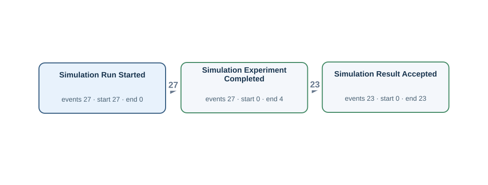</a> <a href="graphs/OU07E.svg">Open full-size DFG</a></td><td width="35%" valign="top"><h4>Original tables</h4>
Up to 3 matched rows per table. Shows keys, event times and carrier values.

<strong>student_simulation_experiment_result</strong> · 27 matched rows
<table><tr><th>Row</th><th>Source values</th></tr><tr><td>1</td><td>student_id = S002 module_id = M03 simulation_date = 2026-02-13T15:00:00Z simulation_run_started_at = 2026-02-13T14:00:00Z simulation_result_accepted_at = NULL</td></tr><tr><td>2</td><td>student_id = S003 module_id = M01 simulation_date = 2026-02-14T15:00:00Z simulation_run_started_at = 2026-02-14T14:00:00Z simulation_result_accepted_at = 2026-02-14T18:00:00Z</td></tr><tr><td>3</td><td>student_id = S003 module_id = M01 simulation_date = 2026-02-15T15:00:00Z simulation_run_started_at = 2026-02-15T14:00:00Z simulation_result_accepted_at = 2026-02-15T18:00:00Z</td></tr></table>

Other SQL tables

assignment, assignment_grading, course, degree_examination_result, registration, simulation_module, task, thesis

</td></tr></table>

[Gold CSV](../../../datasets/universityflow/private/gold_logs/OU07E.csv)

## OU07EP — Q2

For each simulation experiment result record, build a timeline of a simulation run beginning, a simulation run finishing, the simulation results receiving approval.

Events: **77** · Cases with events: **27** · Activities: **3** · Edges: **2** · Source tables: **1** · SQL tables: **9**

<table><tr><td width="65%" valign="top"> <a href="graphs/OU07E.svg">Open full-size DFG</a></td><td width="35%" valign="top"><h4>Original tables</h4>
Up to 3 matched rows per table. Shows keys, event times and carrier values.

<strong>student_simulation_experiment_result</strong> · 27 matched rows
<table><tr><th>Row</th><th>Source values</th></tr><tr><td>1</td><td>student_id = S002 module_id = M03 simulation_date = 2026-02-13T15:00:00Z simulation_run_started_at = 2026-02-13T14:00:00Z simulation_result_accepted_at = NULL</td></tr><tr><td>2</td><td>student_id = S003 module_id = M01 simulation_date = 2026-02-14T15:00:00Z simulation_run_started_at = 2026-02-14T14:00:00Z simulation_result_accepted_at = 2026-02-14T18:00:00Z</td></tr><tr><td>3</td><td>student_id = S003 module_id = M01 simulation_date = 2026-02-15T15:00:00Z simulation_run_started_at = 2026-02-15T14:00:00Z simulation_result_accepted_at = 2026-02-15T18:00:00Z</td></tr></table>

Other SQL tables

assignment, assignment_grading, course, degree_examination_result, registration, simulation_module, task, thesis

</td></tr></table>

[Gold CSV](../../../datasets/universityflow/private/gold_logs/OU07EP.csv)

## OU08P — Q4

Show the complete recorded history associated with each assignment.

Events: **90** · Cases with events: **20** · Activities: **7** · Edges: **9** · Source tables: **2** · SQL tables: **9**

<table><tr><td width="65%" valign="top"> <a href="graphs/OU08.svg">Open full-size DFG</a></td><td width="35%" valign="top"><h4>Original tables</h4>
Up to 3 matched rows per table. Shows keys, event times and carrier values.

<strong>assignment</strong> · 20 matched rows
<table><tr><th>Row</th><th>Source values</th></tr><tr><td>1</td><td>assignment_id = A002 assignment_assigned_at = 2026-02-07T14:00:00Z assignment_submitted_at = 2026-02-09T14:00:00Z assignment_grade_finalized_at = NULL assignment_revision_requested_at = 2026-02-11T15:00:00Z assignment_resubmitted_at = 2026-02-12T14:00:00Z</td></tr><tr><td>2</td><td>assignment_id = A003 assignment_assigned_at = 2026-02-08T14:00:00Z assignment_submitted_at = 2026-02-10T14:00:00Z assignment_grade_finalized_at = 2026-02-14T14:00:00Z assignment_revision_requested_at = NULL assignment_resubmitted_at = NULL</td></tr><tr><td>3</td><td>assignment_id = A006 assignment_assigned_at = 2026-02-11T14:00:00Z assignment_submitted_at = 2026-02-13T14:00:00Z assignment_grade_finalized_at = 2026-02-17T14:00:00Z assignment_revision_requested_at = NULL assignment_resubmitted_at = NULL</td></tr></table>
<strong>assignment_grading</strong> · 25 matched rows
<table><tr><th>Row</th><th>Source values</th></tr><tr><td>1</td><td>assignment_id = A002 instructor_id = I03 grading_time = 2026-02-11T14:00:00Z grading_kind = ORIGINAL</td></tr><tr><td>2</td><td>assignment_id = A002 instructor_id = I03 grading_time = 2026-02-13T02:00:00Z grading_kind = REASSESSMENT</td></tr><tr><td>3</td><td>assignment_id = A003 instructor_id = I01 grading_time = 2026-02-12T14:00:00Z grading_kind = ORIGINAL</td></tr></table>

Other SQL tables

course, degree_examination_result, registration, simulation_module, student_simulation_experiment_result, task, thesis

</td></tr></table>

[Gold CSV](../../../datasets/universityflow/private/gold_logs/OU08P.csv)

## OU08E — Q1

Extract Assignment Assigned, Assignment Submitted, Assignment Graded events for each assignment.

Events: **54** · Cases with events: **20** · Activities: **3** · Edges: **3** · Source tables: **2** · SQL tables: **9**

<table><tr><td width="65%" valign="top"> <a href="graphs/OU08E.svg">Open full-size DFG</a></td><td width="35%" valign="top"><h4>Original tables</h4>
Up to 3 matched rows per table. Shows keys, event times and carrier values.

<strong>assignment</strong> · 20 matched rows
<table><tr><th>Row</th><th>Source values</th></tr><tr><td>1</td><td>assignment_id = A002 assignment_assigned_at = 2026-02-07T14:00:00Z assignment_submitted_at = 2026-02-09T14:00:00Z</td></tr><tr><td>2</td><td>assignment_id = A003 assignment_assigned_at = 2026-02-08T14:00:00Z assignment_submitted_at = 2026-02-10T14:00:00Z</td></tr><tr><td>3</td><td>assignment_id = A006 assignment_assigned_at = 2026-02-11T14:00:00Z assignment_submitted_at = 2026-02-13T14:00:00Z</td></tr></table>
<strong>assignment_grading</strong> · 18 matched rows
<table><tr><th>Row</th><th>Source values</th></tr><tr><td>1</td><td>assignment_id = A002 instructor_id = I03 grading_time = 2026-02-11T14:00:00Z grading_kind = ORIGINAL</td></tr><tr><td>2</td><td>assignment_id = A003 instructor_id = I01 grading_time = 2026-02-12T14:00:00Z grading_kind = ORIGINAL</td></tr><tr><td>3</td><td>assignment_id = A006 instructor_id = I01 grading_time = 2026-02-15T14:00:00Z grading_kind = ORIGINAL</td></tr></table>

Other SQL tables

course, degree_examination_result, registration, simulation_module, student_simulation_experiment_result, task, thesis

</td></tr></table>

[Gold CSV](../../../datasets/universityflow/private/gold_logs/OU08E.csv)

## OU08EP — Q2

For each assignment, build a timeline of coursework being set for the student, the student handing in coursework, an instructor assessing the assignment.

Events: **54** · Cases with events: **20** · Activities: **3** · Edges: **3** · Source tables: **2** · SQL tables: **9**

<table><tr><td width="65%" valign="top"> <a href="graphs/OU08E.svg">Open full-size DFG</a></td><td width="35%" valign="top"><h4>Original tables</h4>
Up to 3 matched rows per table. Shows keys, event times and carrier values.

<strong>assignment</strong> · 20 matched rows
<table><tr><th>Row</th><th>Source values</th></tr><tr><td>1</td><td>assignment_id = A002 assignment_assigned_at = 2026-02-07T14:00:00Z assignment_submitted_at = 2026-02-09T14:00:00Z</td></tr><tr><td>2</td><td>assignment_id = A003 assignment_assigned_at = 2026-02-08T14:00:00Z assignment_submitted_at = 2026-02-10T14:00:00Z</td></tr><tr><td>3</td><td>assignment_id = A006 assignment_assigned_at = 2026-02-11T14:00:00Z assignment_submitted_at = 2026-02-13T14:00:00Z</td></tr></table>
<strong>assignment_grading</strong> · 18 matched rows
<table><tr><th>Row</th><th>Source values</th></tr><tr><td>1</td><td>assignment_id = A002 instructor_id = I03 grading_time = 2026-02-11T14:00:00Z grading_kind = ORIGINAL</td></tr><tr><td>2</td><td>assignment_id = A003 instructor_id = I01 grading_time = 2026-02-12T14:00:00Z grading_kind = ORIGINAL</td></tr><tr><td>3</td><td>assignment_id = A006 instructor_id = I01 grading_time = 2026-02-15T14:00:00Z grading_kind = ORIGINAL</td></tr></table>

Other SQL tables

course, degree_examination_result, registration, simulation_module, student_simulation_experiment_result, task, thesis

</td></tr></table>

[Gold CSV](../../../datasets/universityflow/private/gold_logs/OU08EP.csv)

## OU09P — Q4

Show the complete recorded history associated with each instructor.

Events: **86** · Cases with events: **3** · Activities: **7** · Edges: **18** · Source tables: **2** · SQL tables: **9**

<table><tr><td width="65%" valign="top"> <a href="graphs/OU09.svg">Open full-size DFG</a></td><td width="35%" valign="top"><h4>Original tables</h4>
Up to 3 matched rows per table. Shows keys, event times and carrier values.

<strong>assignment</strong> · 16 matched rows
<table><tr><th>Row</th><th>Source values</th></tr><tr><td>1</td><td>assignment_id = A003 assignment_assigned_at = 2026-02-08T14:00:00Z assignment_submitted_at = 2026-02-10T14:00:00Z assignment_grade_finalized_at = 2026-02-14T14:00:00Z</td></tr><tr><td>2</td><td>assignment_id = A006 assignment_assigned_at = 2026-02-11T14:00:00Z assignment_submitted_at = 2026-02-13T14:00:00Z assignment_grade_finalized_at = 2026-02-17T14:00:00Z</td></tr><tr><td>3</td><td>assignment_id = A018 assignment_assigned_at = 2026-02-23T14:00:00Z assignment_submitted_at = 2026-02-25T14:00:00Z assignment_grade_finalized_at = 2026-03-01T14:00:00Z</td></tr></table>
<strong>assignment_grading</strong> · 25 matched rows
<table><tr><th>Row</th><th>Source values</th></tr><tr><td>1</td><td>assignment_id = A003 instructor_id = I01 grading_time = 2026-02-12T14:00:00Z grading_kind = ORIGINAL</td></tr><tr><td>2</td><td>assignment_id = A006 instructor_id = I01 grading_time = 2026-02-15T14:00:00Z grading_kind = ORIGINAL</td></tr><tr><td>3</td><td>assignment_id = A018 instructor_id = I01 grading_time = 2026-02-27T14:00:00Z grading_kind = ORIGINAL</td></tr></table>

Other SQL tables

course, degree_examination_result, registration, simulation_module, student_simulation_experiment_result, task, thesis

</td></tr></table>

[Gold CSV](../../../datasets/universityflow/private/gold_logs/OU09P.csv)

## OU09E — Q1

Extract Assignment Assigned, Assignment Submitted, Assignment Graded events for each instructor.

Events: **50** · Cases with events: **3** · Activities: **3** · Edges: **7** · Source tables: **2** · SQL tables: **9**

<table><tr><td width="65%" valign="top"><a href="graphs/OU09E.svg">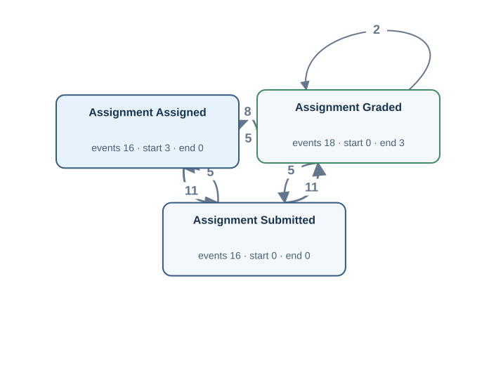</a> <a href="graphs/OU09E.svg">Open full-size DFG</a></td><td width="35%" valign="top"><h4>Original tables</h4>
Up to 3 matched rows per table. Shows keys, event times and carrier values.

<strong>assignment</strong> · 16 matched rows
<table><tr><th>Row</th><th>Source values</th></tr><tr><td>1</td><td>assignment_id = A003 assignment_assigned_at = 2026-02-08T14:00:00Z assignment_submitted_at = 2026-02-10T14:00:00Z</td></tr><tr><td>2</td><td>assignment_id = A006 assignment_assigned_at = 2026-02-11T14:00:00Z assignment_submitted_at = 2026-02-13T14:00:00Z</td></tr><tr><td>3</td><td>assignment_id = A018 assignment_assigned_at = 2026-02-23T14:00:00Z assignment_submitted_at = 2026-02-25T14:00:00Z</td></tr></table>
<strong>assignment_grading</strong> · 18 matched rows
<table><tr><th>Row</th><th>Source values</th></tr><tr><td>1</td><td>assignment_id = A003 instructor_id = I01 grading_time = 2026-02-12T14:00:00Z grading_kind = ORIGINAL</td></tr><tr><td>2</td><td>assignment_id = A006 instructor_id = I01 grading_time = 2026-02-15T14:00:00Z grading_kind = ORIGINAL</td></tr><tr><td>3</td><td>assignment_id = A018 instructor_id = I01 grading_time = 2026-02-27T14:00:00Z grading_kind = ORIGINAL</td></tr></table>

Other SQL tables

course, degree_examination_result, registration, simulation_module, student_simulation_experiment_result, task, thesis

</td></tr></table>

[Gold CSV](../../../datasets/universityflow/private/gold_logs/OU09E.csv)

## OU09EP — Q2

For each instructor, build a timeline of coursework being set for the student, the student handing in coursework, an instructor assessing the assignment.

Events: **50** · Cases with events: **3** · Activities: **3** · Edges: **7** · Source tables: **2** · SQL tables: **9**

<table><tr><td width="65%" valign="top"> <a href="graphs/OU09E.svg">Open full-size DFG</a></td><td width="35%" valign="top"><h4>Original tables</h4>
Up to 3 matched rows per table. Shows keys, event times and carrier values.

<strong>assignment</strong> · 16 matched rows
<table><tr><th>Row</th><th>Source values</th></tr><tr><td>1</td><td>assignment_id = A003 assignment_assigned_at = 2026-02-08T14:00:00Z assignment_submitted_at = 2026-02-10T14:00:00Z</td></tr><tr><td>2</td><td>assignment_id = A006 assignment_assigned_at = 2026-02-11T14:00:00Z assignment_submitted_at = 2026-02-13T14:00:00Z</td></tr><tr><td>3</td><td>assignment_id = A018 assignment_assigned_at = 2026-02-23T14:00:00Z assignment_submitted_at = 2026-02-25T14:00:00Z</td></tr></table>
<strong>assignment_grading</strong> · 18 matched rows
<table><tr><th>Row</th><th>Source values</th></tr><tr><td>1</td><td>assignment_id = A003 instructor_id = I01 grading_time = 2026-02-12T14:00:00Z grading_kind = ORIGINAL</td></tr><tr><td>2</td><td>assignment_id = A006 instructor_id = I01 grading_time = 2026-02-15T14:00:00Z grading_kind = ORIGINAL</td></tr><tr><td>3</td><td>assignment_id = A018 instructor_id = I01 grading_time = 2026-02-27T14:00:00Z grading_kind = ORIGINAL</td></tr></table>

Other SQL tables

course, degree_examination_result, registration, simulation_module, student_simulation_experiment_result, task, thesis

</td></tr></table>

[Gold CSV](../../../datasets/universityflow/private/gold_logs/OU09EP.csv)

## OU10P — Q4

Show the complete recorded history associated with each assignment grading record.

Events: **25** · Cases with events: **25** · Activities: **2** · Edges: **0** · Source tables: **1** · SQL tables: **9**

<table><tr><td width="65%" valign="top"> <a href="graphs/OU10.svg">Open full-size DFG</a></td><td width="35%" valign="top"><h4>Original tables</h4>
Up to 3 matched rows per table. Shows keys, event times and carrier values.

<strong>assignment_grading</strong> · 25 matched rows
<table><tr><th>Row</th><th>Source values</th></tr><tr><td>1</td><td>assignment_id = A002 instructor_id = I03 grading_time = 2026-02-11T14:00:00Z grading_kind = ORIGINAL</td></tr><tr><td>2</td><td>assignment_id = A002 instructor_id = I03 grading_time = 2026-02-13T02:00:00Z grading_kind = REASSESSMENT</td></tr><tr><td>3</td><td>assignment_id = A003 instructor_id = I01 grading_time = 2026-02-12T14:00:00Z grading_kind = ORIGINAL</td></tr></table>

Other SQL tables

assignment, course, degree_examination_result, registration, simulation_module, student_simulation_experiment_result, task, thesis

</td></tr></table>

[Gold CSV](../../../datasets/universityflow/private/gold_logs/OU10P.csv)

## OU10E — Q1

Extract Assignment Graded events for each assignment grading record.

Events: **18** · Cases with events: **18** · Activities: **1** · Edges: **0** · Source tables: **1** · SQL tables: **9**

<table><tr><td width="65%" valign="top"><a href="graphs/OU10E.svg">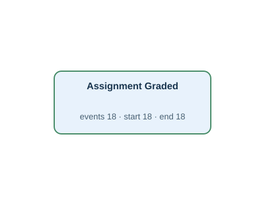</a> <a href="graphs/OU10E.svg">Open full-size DFG</a></td><td width="35%" valign="top"><h4>Original tables</h4>
Up to 3 matched rows per table. Shows keys, event times and carrier values.

<strong>assignment_grading</strong> · 18 matched rows
<table><tr><th>Row</th><th>Source values</th></tr><tr><td>1</td><td>assignment_id = A002 instructor_id = I03 grading_time = 2026-02-11T14:00:00Z grading_kind = ORIGINAL</td></tr><tr><td>2</td><td>assignment_id = A003 instructor_id = I01 grading_time = 2026-02-12T14:00:00Z grading_kind = ORIGINAL</td></tr><tr><td>3</td><td>assignment_id = A006 instructor_id = I01 grading_time = 2026-02-15T14:00:00Z grading_kind = ORIGINAL</td></tr></table>

Other SQL tables

assignment, course, degree_examination_result, registration, simulation_module, student_simulation_experiment_result, task, thesis

</td></tr></table>

[Gold CSV](../../../datasets/universityflow/private/gold_logs/OU10E.csv)

## OU10EP — Q2

For each assignment grading record, build a timeline of an instructor assessing the assignment.

Events: **18** · Cases with events: **18** · Activities: **1** · Edges: **0** · Source tables: **1** · SQL tables: **9**

<table><tr><td width="65%" valign="top"> <a href="graphs/OU10E.svg">Open full-size DFG</a></td><td width="35%" valign="top"><h4>Original tables</h4>
Up to 3 matched rows per table. Shows keys, event times and carrier values.

<strong>assignment_grading</strong> · 18 matched rows
<table><tr><th>Row</th><th>Source values</th></tr><tr><td>1</td><td>assignment_id = A002 instructor_id = I03 grading_time = 2026-02-11T14:00:00Z grading_kind = ORIGINAL</td></tr><tr><td>2</td><td>assignment_id = A003 instructor_id = I01 grading_time = 2026-02-12T14:00:00Z grading_kind = ORIGINAL</td></tr><tr><td>3</td><td>assignment_id = A006 instructor_id = I01 grading_time = 2026-02-15T14:00:00Z grading_kind = ORIGINAL</td></tr></table>

Other SQL tables

assignment, course, degree_examination_result, registration, simulation_module, student_simulation_experiment_result, task, thesis

</td></tr></table>

[Gold CSV](../../../datasets/universityflow/private/gold_logs/OU10EP.csv)

## OU11P — Q4

Show the complete recorded history associated with each course-design task.

Events: **11** · Cases with events: **3** · Activities: **4** · Edges: **3** · Source tables: **1** · SQL tables: **9**

<table><tr><td width="65%" valign="top"> <a href="graphs/OU11.svg">Open full-size DFG</a></td><td width="35%" valign="top"><h4>Original tables</h4>
Up to 3 matched rows per table. Shows keys, event times and carrier values.

<strong>task</strong> · 3 matched rows
<table><tr><th>Row</th><th>Source values</th></tr><tr><td>1</td><td>task_id = T01 design_task_created_at = 2025-12-31T00:00:00Z design_task_approved_at = 2026-01-01T00:00:00Z design_task_published_at = 2026-01-02T00:00:00Z design_task_closed_at = NULL</td></tr><tr><td>2</td><td>task_id = T02 design_task_created_at = 2026-01-01T00:00:00Z design_task_approved_at = 2026-01-02T00:00:00Z design_task_published_at = 2026-01-03T00:00:00Z design_task_closed_at = 2026-02-03T00:00:00Z</td></tr><tr><td>3</td><td>task_id = T03 design_task_created_at = 2026-01-02T00:00:00Z design_task_approved_at = 2026-01-03T00:00:00Z design_task_published_at = 2026-01-04T00:00:00Z design_task_closed_at = 2026-02-04T00:00:00Z</td></tr></table>

Other SQL tables

assignment, assignment_grading, course, degree_examination_result, registration, simulation_module, student_simulation_experiment_result, thesis

</td></tr></table>

[Gold CSV](../../../datasets/universityflow/private/gold_logs/OU11P.csv)

## OU11E — Q1

Extract Design Task Approved, Design Task Closed, Design Task Created events for each course-design task.

Events: **8** · Cases with events: **3** · Activities: **3** · Edges: **2** · Source tables: **1** · SQL tables: **9**

<table><tr><td width="65%" valign="top"><a href="graphs/OU11E.svg">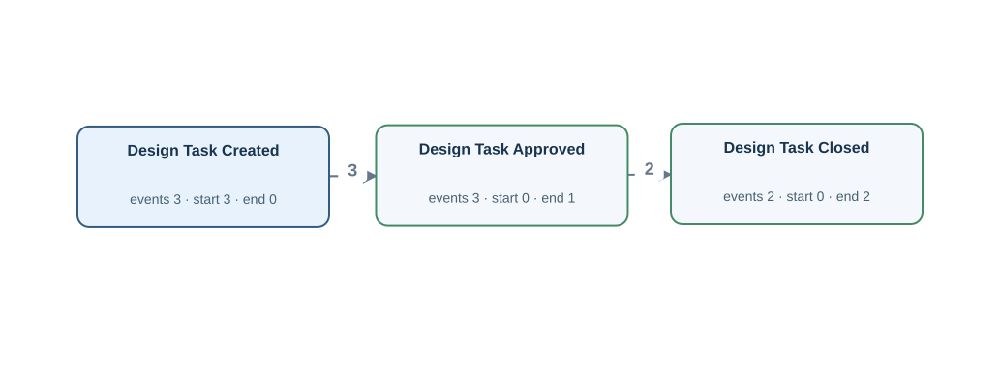</a> <a href="graphs/OU11E.svg">Open full-size DFG</a></td><td width="35%" valign="top"><h4>Original tables</h4>
Up to 3 matched rows per table. Shows keys, event times and carrier values.

<strong>task</strong> · 3 matched rows
<table><tr><th>Row</th><th>Source values</th></tr><tr><td>1</td><td>task_id = T01 design_task_created_at = 2025-12-31T00:00:00Z design_task_approved_at = 2026-01-01T00:00:00Z design_task_closed_at = NULL</td></tr><tr><td>2</td><td>task_id = T02 design_task_created_at = 2026-01-01T00:00:00Z design_task_approved_at = 2026-01-02T00:00:00Z design_task_closed_at = 2026-02-03T00:00:00Z</td></tr><tr><td>3</td><td>task_id = T03 design_task_created_at = 2026-01-02T00:00:00Z design_task_approved_at = 2026-01-03T00:00:00Z design_task_closed_at = 2026-02-04T00:00:00Z</td></tr></table>

Other SQL tables

assignment, assignment_grading, course, degree_examination_result, registration, simulation_module, student_simulation_experiment_result, thesis

</td></tr></table>

[Gold CSV](../../../datasets/universityflow/private/gold_logs/OU11E.csv)

## OU11EP — Q2

For each course-design task, build a timeline of a design exercise receiving approval, a design exercise being closed, a design exercise being prepared.

Events: **8** · Cases with events: **3** · Activities: **3** · Edges: **2** · Source tables: **1** · SQL tables: **9**

<table><tr><td width="65%" valign="top"> <a href="graphs/OU11E.svg">Open full-size DFG</a></td><td width="35%" valign="top"><h4>Original tables</h4>
Up to 3 matched rows per table. Shows keys, event times and carrier values.

<strong>task</strong> · 3 matched rows
<table><tr><th>Row</th><th>Source values</th></tr><tr><td>1</td><td>task_id = T01 design_task_created_at = 2025-12-31T00:00:00Z design_task_approved_at = 2026-01-01T00:00:00Z design_task_closed_at = NULL</td></tr><tr><td>2</td><td>task_id = T02 design_task_created_at = 2026-01-01T00:00:00Z design_task_approved_at = 2026-01-02T00:00:00Z design_task_closed_at = 2026-02-03T00:00:00Z</td></tr><tr><td>3</td><td>task_id = T03 design_task_created_at = 2026-01-02T00:00:00Z design_task_approved_at = 2026-01-03T00:00:00Z design_task_closed_at = 2026-02-04T00:00:00Z</td></tr></table>

Other SQL tables

assignment, assignment_grading, course, degree_examination_result, registration, simulation_module, student_simulation_experiment_result, thesis

</td></tr></table>

[Gold CSV](../../../datasets/universityflow/private/gold_logs/OU11EP.csv)
