# warehouseflow: questions and Gold DFGs

**EVALUATION ONLY — NEVER PROVIDE TO A MODEL.**

Source commit: `a0ba4c9631d12730d60bf7720d783a3a827b88dc`. Open index.html for search, review notes and complete case traces.

Node counts = event occurrences. Edge counts = adjacent selected events within a case. Dashed amber edges touch timestamp ties and depend on the tie-break rule. DFGs are projections of the selected log, not causal models.

## R01 — Q1

Extract Goods Received events for each warehouse.

Events: **45** · Cases with events: **4** · Activities: **1** · Edges: **1**

<table><tr><td width="50%"></td><td width="50%"><h4>Original tables</h4>
Rows matched by event ID, activity and timestamp using the authored source bindings.

<strong><code>transaction_record</code></strong> · 45 source rows

<code>transaction_id</code> = T001, <code>occurred_at</code> = 2026-04-01T01:00:00Z, <code>warehouse_number</code> = W1, <code>transaction_type</code> = IN TX:T001 · Goods Received · occurred_at · W1

<code>transaction_id</code> = T005, <code>occurred_at</code> = 2026-04-01T05:00:00Z, <code>warehouse_number</code> = W1, <code>transaction_type</code> = IN TX:T005 · Goods Received · occurred_at · W1

<code>transaction_id</code> = T009, <code>occurred_at</code> = 2026-04-01T09:00:00Z, <code>warehouse_number</code> = W1, <code>transaction_type</code> = IN TX:T009 · Goods Received · occurred_at · W1
</td></tr></table>

[Gold CSV](../../../datasets/warehouseflow/private/gold_logs/R01.csv)

## R02 — Q2

For each warehouse, build a timeline of goods arriving at the warehouse.

Events: **45** · Cases with events: **4** · Activities: **1** · Edges: **1**

<table><tr><td width="50%"></td><td width="50%"><h4>Original tables</h4>
Rows matched by event ID, activity and timestamp using the authored source bindings.

<strong><code>transaction_record</code></strong> · 45 source rows

<code>transaction_id</code> = T001, <code>occurred_at</code> = 2026-04-01T01:00:00Z, <code>warehouse_number</code> = W1, <code>transaction_type</code> = IN TX:T001 · Goods Received · occurred_at · W1

<code>transaction_id</code> = T005, <code>occurred_at</code> = 2026-04-01T05:00:00Z, <code>warehouse_number</code> = W1, <code>transaction_type</code> = IN TX:T005 · Goods Received · occurred_at · W1

<code>transaction_id</code> = T009, <code>occurred_at</code> = 2026-04-01T09:00:00Z, <code>warehouse_number</code> = W1, <code>transaction_type</code> = IN TX:T009 · Goods Received · occurred_at · W1
</td></tr></table>

[Gold CSV](../../../datasets/warehouseflow/private/gold_logs/R02.csv)

## R03 — Q1

Extract Goods Dispatched events for each warehouse.

Events: **35** · Cases with events: **4** · Activities: **1** · Edges: **1**

<table><tr><td width="50%">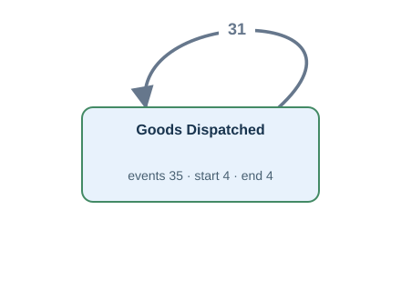</td><td width="50%"><h4>Original tables</h4>
Rows matched by event ID, activity and timestamp using the authored source bindings.

<strong><code>transaction_record</code></strong> · 35 source rows

<code>transaction_id</code> = T013, <code>occurred_at</code> = 2026-04-01T13:00:00Z, <code>warehouse_number</code> = W1, <code>transaction_type</code> = OUT TX:T013 · Goods Dispatched · occurred_at · W1

<code>transaction_id</code> = T021, <code>occurred_at</code> = 2026-04-01T21:00:00Z, <code>warehouse_number</code> = W1, <code>transaction_type</code> = OUT TX:T021 · Goods Dispatched · occurred_at · W1

<code>transaction_id</code> = T029, <code>occurred_at</code> = 2026-04-02T05:00:00Z, <code>warehouse_number</code> = W1, <code>transaction_type</code> = OUT TX:T029 · Goods Dispatched · occurred_at · W1
</td></tr></table>

[Gold CSV](../../../datasets/warehouseflow/private/gold_logs/R03.csv)

## R04 — Q2

For each warehouse, build a timeline of goods leaving the warehouse.

Events: **35** · Cases with events: **4** · Activities: **1** · Edges: **1**

<table><tr><td width="50%"></td><td width="50%"><h4>Original tables</h4>
Rows matched by event ID, activity and timestamp using the authored source bindings.

<strong><code>transaction_record</code></strong> · 35 source rows

<code>transaction_id</code> = T013, <code>occurred_at</code> = 2026-04-01T13:00:00Z, <code>warehouse_number</code> = W1, <code>transaction_type</code> = OUT TX:T013 · Goods Dispatched · occurred_at · W1

<code>transaction_id</code> = T021, <code>occurred_at</code> = 2026-04-01T21:00:00Z, <code>warehouse_number</code> = W1, <code>transaction_type</code> = OUT TX:T021 · Goods Dispatched · occurred_at · W1

<code>transaction_id</code> = T029, <code>occurred_at</code> = 2026-04-02T05:00:00Z, <code>warehouse_number</code> = W1, <code>transaction_type</code> = OUT TX:T029 · Goods Dispatched · occurred_at · W1
</td></tr></table>

[Gold CSV](../../../datasets/warehouseflow/private/gold_logs/R04.csv)

## R05 — Q3

Extract the full recorded lifecycle event log for each warehouse.

Events: **394** · Cases with events: **4** · Activities: **10** · Edges: **17**

<table><tr><td width="50%">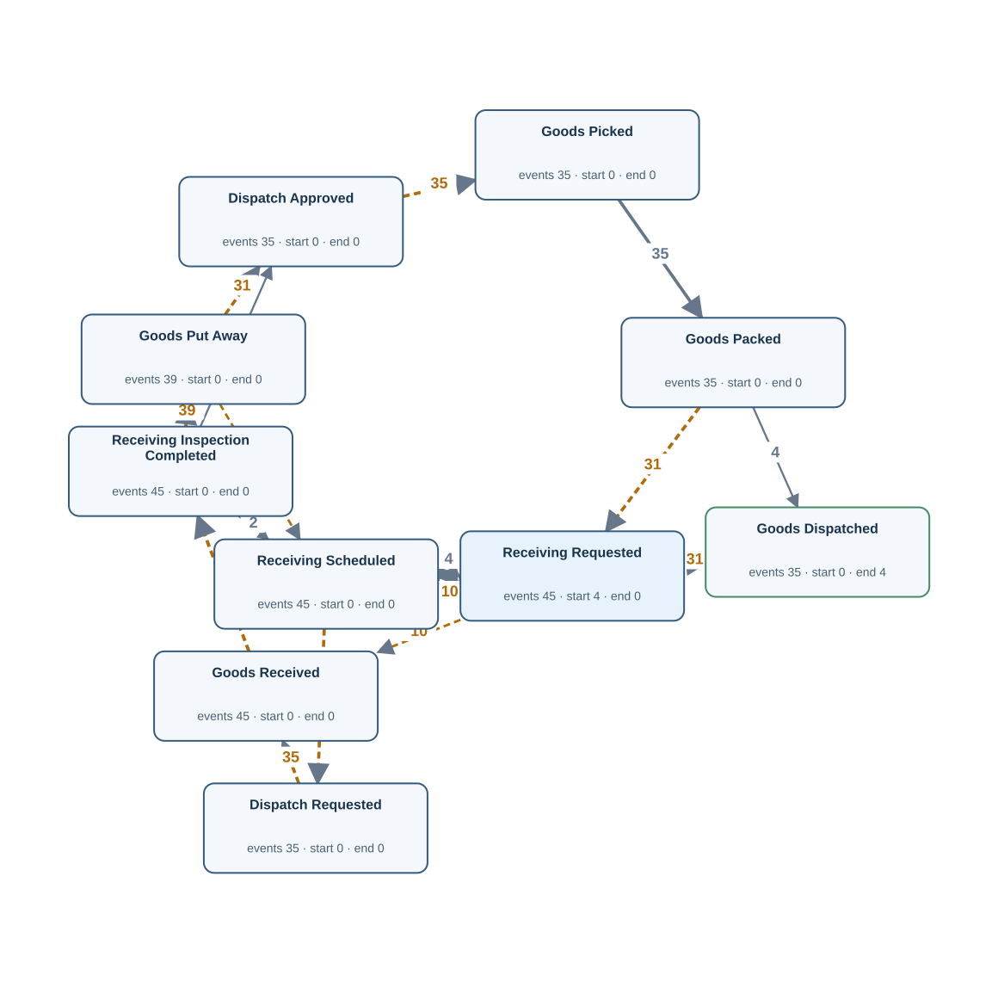</td><td width="50%"><h4>Original tables</h4>
Rows matched by event ID, activity and timestamp using the authored source bindings.

<strong><code>transaction_record</code></strong> · 80 source rows

<code>transaction_id</code> = T001, <code>occurred_at</code> = 2026-04-01T01:00:00Z, <code>warehouse_number</code> = W1, <code>transaction_type</code> = IN TX:T001 · Goods Received · occurred_at · W1

<code>transaction_id</code> = T005, <code>occurred_at</code> = 2026-04-01T05:00:00Z, <code>warehouse_number</code> = W1, <code>transaction_type</code> = IN TX:T005 · Goods Received · occurred_at · W1

<code>transaction_id</code> = T013, <code>occurred_at</code> = 2026-04-01T13:00:00Z, <code>warehouse_number</code> = W1, <code>transaction_type</code> = OUT TX:T013 · Goods Dispatched · occurred_at · W1

<strong><code>transaction_record_activity</code></strong> · 314 source rows

<code>event_id</code> = LC:transaction_record:T001:1, <code>transaction_id</code> = T001, <code>activity</code> = Receiving Requested, <code>occurred_at</code> = 2026-03-31T21:00:00Z, <code>outcome</code> = COMPLETED LC:transaction_record:T001:1 · Receiving Requested · occurred_at · W1

<code>event_id</code> = LC:transaction_record:T001:2, <code>transaction_id</code> = T001, <code>activity</code> = Receiving Scheduled, <code>occurred_at</code> = 2026-03-31T22:00:00Z, <code>outcome</code> = COMPLETED LC:transaction_record:T001:2 · Receiving Scheduled · occurred_at · W1

<code>event_id</code> = LC:transaction_record:T001:3, <code>transaction_id</code> = T001, <code>activity</code> = Receiving Inspection Completed, <code>occurred_at</code> = 2026-04-01T01:30:00Z, <code>outcome</code> = COMPLETED LC:transaction_record:T001:3 · Receiving Inspection Completed · occurred_at · W1

Other tables referenced by Gold SQL

Includes case joins and branches of shared CTEs.
<ul><li><code>lifecycle_case_link</code> · case_id, case_table, event_id</li></ul>
</td></tr></table>

[Gold CSV](../../../datasets/warehouseflow/private/gold_logs/R05.csv)

## R06 — Q4

Show the complete recorded history associated with each warehouse.

Events: **394** · Cases with events: **4** · Activities: **10** · Edges: **17**

<table><tr><td width="50%"></td><td width="50%"><h4>Original tables</h4>
Rows matched by event ID, activity and timestamp using the authored source bindings.

<strong><code>transaction_record</code></strong> · 80 source rows

<code>transaction_id</code> = T001, <code>occurred_at</code> = 2026-04-01T01:00:00Z, <code>warehouse_number</code> = W1, <code>transaction_type</code> = IN TX:T001 · Goods Received · occurred_at · W1

<code>transaction_id</code> = T005, <code>occurred_at</code> = 2026-04-01T05:00:00Z, <code>warehouse_number</code> = W1, <code>transaction_type</code> = IN TX:T005 · Goods Received · occurred_at · W1

<code>transaction_id</code> = T013, <code>occurred_at</code> = 2026-04-01T13:00:00Z, <code>warehouse_number</code> = W1, <code>transaction_type</code> = OUT TX:T013 · Goods Dispatched · occurred_at · W1

<strong><code>transaction_record_activity</code></strong> · 314 source rows

<code>event_id</code> = LC:transaction_record:T001:1, <code>transaction_id</code> = T001, <code>activity</code> = Receiving Requested, <code>occurred_at</code> = 2026-03-31T21:00:00Z, <code>outcome</code> = COMPLETED LC:transaction_record:T001:1 · Receiving Requested · occurred_at · W1

<code>event_id</code> = LC:transaction_record:T001:2, <code>transaction_id</code> = T001, <code>activity</code> = Receiving Scheduled, <code>occurred_at</code> = 2026-03-31T22:00:00Z, <code>outcome</code> = COMPLETED LC:transaction_record:T001:2 · Receiving Scheduled · occurred_at · W1

<code>event_id</code> = LC:transaction_record:T001:3, <code>transaction_id</code> = T001, <code>activity</code> = Receiving Inspection Completed, <code>occurred_at</code> = 2026-04-01T01:30:00Z, <code>outcome</code> = COMPLETED LC:transaction_record:T001:3 · Receiving Inspection Completed · occurred_at · W1

Other tables referenced by Gold SQL

Includes case joins and branches of shared CTEs.
<ul><li><code>lifecycle_case_link</code> · case_id, case_table, event_id</li></ul>
</td></tr></table>

[Gold CSV](../../../datasets/warehouseflow/private/gold_logs/R06.csv)

## R07 — Q1

Extract Warehouse Task Started events for each warehouse.

**No Gold log:** Only one task time is stored, defined as completion. Task start times are not recorded.

## OW01 — Q3

Extract the full recorded lifecycle event log for each warehouse.

Events: **394** · Cases with events: **4** · Activities: **10** · Edges: **17**

<table><tr><td width="50%"></td><td width="50%"><h4>Original tables</h4>
Rows matched by event ID, activity and timestamp using the authored source bindings.

<strong><code>transaction_record</code></strong> · 80 source rows

<code>transaction_id</code> = T001, <code>occurred_at</code> = 2026-04-01T01:00:00Z, <code>warehouse_number</code> = W1, <code>transaction_type</code> = IN TX:T001 · Goods Received · occurred_at · W1

<code>transaction_id</code> = T005, <code>occurred_at</code> = 2026-04-01T05:00:00Z, <code>warehouse_number</code> = W1, <code>transaction_type</code> = IN TX:T005 · Goods Received · occurred_at · W1

<code>transaction_id</code> = T013, <code>occurred_at</code> = 2026-04-01T13:00:00Z, <code>warehouse_number</code> = W1, <code>transaction_type</code> = OUT TX:T013 · Goods Dispatched · occurred_at · W1

<strong><code>transaction_record_activity</code></strong> · 314 source rows

<code>event_id</code> = LC:transaction_record:T001:1, <code>transaction_id</code> = T001, <code>activity</code> = Receiving Requested, <code>occurred_at</code> = 2026-03-31T21:00:00Z, <code>outcome</code> = COMPLETED LC:transaction_record:T001:1 · Receiving Requested · occurred_at · W1

<code>event_id</code> = LC:transaction_record:T001:2, <code>transaction_id</code> = T001, <code>activity</code> = Receiving Scheduled, <code>occurred_at</code> = 2026-03-31T22:00:00Z, <code>outcome</code> = COMPLETED LC:transaction_record:T001:2 · Receiving Scheduled · occurred_at · W1

<code>event_id</code> = LC:transaction_record:T001:3, <code>transaction_id</code> = T001, <code>activity</code> = Receiving Inspection Completed, <code>occurred_at</code> = 2026-04-01T01:30:00Z, <code>outcome</code> = COMPLETED LC:transaction_record:T001:3 · Receiving Inspection Completed · occurred_at · W1

Other tables referenced by Gold SQL

Includes case joins and branches of shared CTEs.
<ul><li><code>lifecycle_case_link</code> · case_id, case_table, event_id</li></ul>
</td></tr></table>

[Gold CSV](../../../datasets/warehouseflow/private/gold_logs/OW01.csv)

## OW02 — Q3

Extract the full recorded lifecycle event log for each goods.

Events: **679** · Cases with events: **6** · Activities: **10** · Edges: **53**

<table><tr><td width="50%">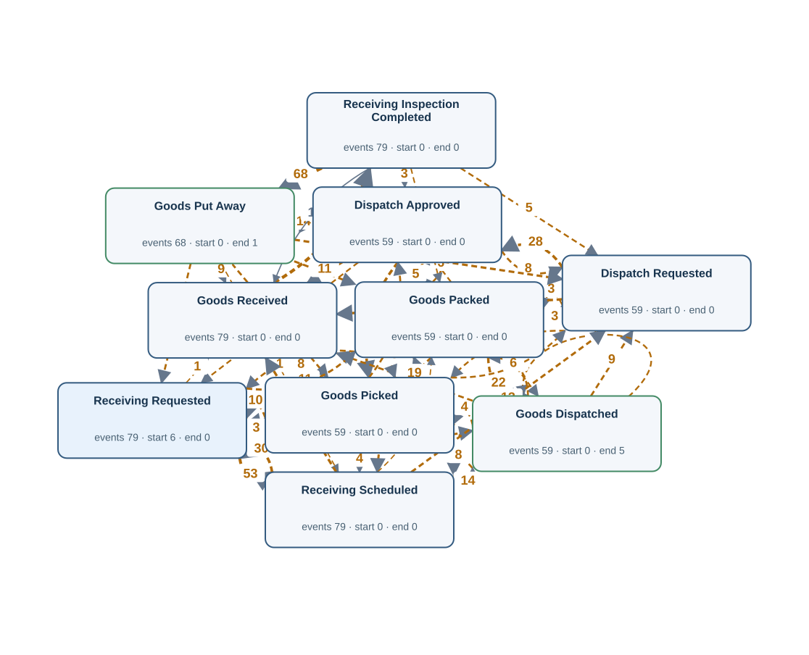</td><td width="50%"><h4>Original tables</h4>
Rows matched by event ID, activity and timestamp using the authored source bindings.

<strong><code>transaction_record</code></strong> · 80 source rows

<code>transaction_id</code> = T004, <code>occurred_at</code> = 2026-04-01T04:00:00Z, <code>warehouse_number</code> = W4, <code>transaction_type</code> = IN TX:T004 · Goods Received · occurred_at · G1 | TX:T004 · Goods Received · occurred_at · G2

<code>transaction_id</code> = T009, <code>occurred_at</code> = 2026-04-01T09:00:00Z, <code>warehouse_number</code> = W1, <code>transaction_type</code> = IN TX:T009 · Goods Received · occurred_at · G1 | TX:T009 · Goods Received · occurred_at · G3 | TX:T009 · Goods Received · occurred_at · G6

<code>transaction_id</code> = T016, <code>occurred_at</code> = 2026-04-01T16:00:00Z, <code>warehouse_number</code> = W4, <code>transaction_type</code> = OUT TX:T016 · Goods Dispatched · occurred_at · G1

<strong><code>transaction_record_activity</code></strong> · 314 source rows

<code>event_id</code> = LC:transaction_record:T004:1, <code>transaction_id</code> = T004, <code>activity</code> = Receiving Requested, <code>occurred_at</code> = 2026-04-01T00:00:00Z, <code>outcome</code> = COMPLETED LC:transaction_record:T004:1 · Receiving Requested · occurred_at · G1 | LC:transaction_record:T004:1 · Receiving Requested · occurred_at · G2

<code>event_id</code> = LC:transaction_record:T004:2, <code>transaction_id</code> = T004, <code>activity</code> = Receiving Scheduled, <code>occurred_at</code> = 2026-04-01T01:00:00Z, <code>outcome</code> = COMPLETED LC:transaction_record:T004:2 · Receiving Scheduled · occurred_at · G1 | LC:transaction_record:T004:2 · Receiving Scheduled · occurred_at · G2

<code>event_id</code> = LC:transaction_record:T004:3, <code>transaction_id</code> = T004, <code>activity</code> = Receiving Inspection Completed, <code>occurred_at</code> = 2026-04-01T04:30:00Z, <code>outcome</code> = COMPLETED LC:transaction_record:T004:3 · Receiving Inspection Completed · occurred_at · G1 | LC:transaction_record:T004:3 · Receiving Inspection Completed · occurred_at · G2

Other tables referenced by Gold SQL

Includes case joins and branches of shared CTEs.
<ul><li><code>goods_transaction_detail</code> · goods_id, transaction_id</li><li><code>lifecycle_case_link</code> · case_id, case_table, event_id</li></ul>
</td></tr></table>

[Gold CSV](../../../datasets/warehouseflow/private/gold_logs/OW02.csv)

## OW03 — Q3

Extract the full recorded lifecycle event log for each worker.

Events: **823** · Cases with events: **5** · Activities: **10** · Edges: **56**

<table><tr><td width="50%">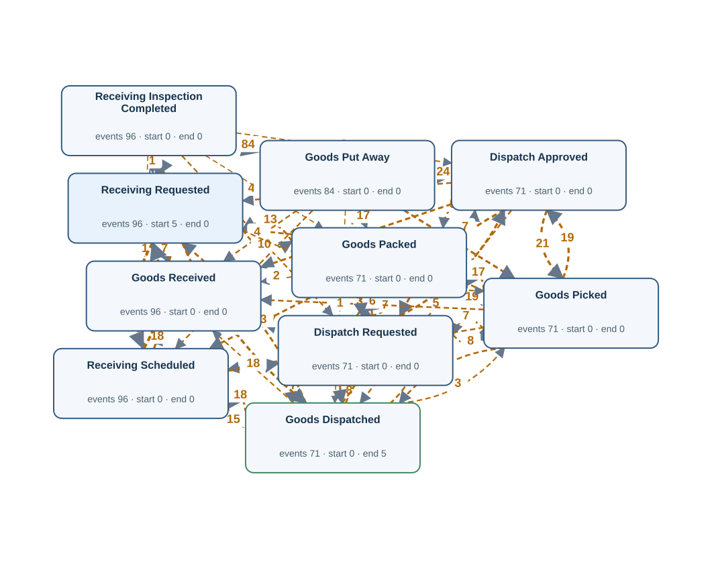</td><td width="50%"><h4>Original tables</h4>
Rows matched by event ID, activity and timestamp using the authored source bindings.

<strong><code>transaction_record</code></strong> · 80 source rows

<code>transaction_id</code> = T002, <code>occurred_at</code> = 2026-04-01T02:00:00Z, <code>warehouse_number</code> = W2, <code>transaction_type</code> = IN TX:T002 · Goods Received · occurred_at · L1 | TX:T002 · Goods Received · occurred_at · L2

<code>transaction_id</code> = T003, <code>occurred_at</code> = 2026-04-01T03:00:00Z, <code>warehouse_number</code> = W3, <code>transaction_type</code> = IN TX:T003 · Goods Received · occurred_at · L1 | TX:T003 · Goods Received · occurred_at · L2 | TX:T003 · Goods Received · occurred_at · L3

<code>transaction_id</code> = T006, <code>occurred_at</code> = 2026-04-01T06:00:00Z, <code>warehouse_number</code> = W2, <code>transaction_type</code> = OUT TX:T006 · Goods Dispatched · occurred_at · L1 | TX:T006 · Goods Dispatched · occurred_at · L3

<strong><code>transaction_record_activity</code></strong> · 314 source rows

<code>event_id</code> = LC:transaction_record:T002:1, <code>transaction_id</code> = T002, <code>activity</code> = Receiving Requested, <code>occurred_at</code> = 2026-03-31T22:00:00Z, <code>outcome</code> = COMPLETED LC:transaction_record:T002:1 · Receiving Requested · occurred_at · L1 | LC:transaction_record:T002:1 · Receiving Requested · occurred_at · L2

<code>event_id</code> = LC:transaction_record:T002:2, <code>transaction_id</code> = T002, <code>activity</code> = Receiving Scheduled, <code>occurred_at</code> = 2026-03-31T23:00:00Z, <code>outcome</code> = COMPLETED LC:transaction_record:T002:2 · Receiving Scheduled · occurred_at · L1 | LC:transaction_record:T002:2 · Receiving Scheduled · occurred_at · L2

<code>event_id</code> = LC:transaction_record:T006:1, <code>transaction_id</code> = T006, <code>activity</code> = Dispatch Requested, <code>occurred_at</code> = 2026-04-01T02:00:00Z, <code>outcome</code> = COMPLETED LC:transaction_record:T006:1 · Dispatch Requested · occurred_at · L1 | LC:transaction_record:T006:1 · Dispatch Requested · occurred_at · L3

Other tables referenced by Gold SQL

Includes case joins and branches of shared CTEs.
<ul><li><code>lifecycle_case_link</code> · case_id, case_table, event_id</li><li><code>loader_transaction</code> · loader_id, transaction_id</li></ul>
</td></tr></table>

[Gold CSV](../../../datasets/warehouseflow/private/gold_logs/OW03.csv)

## OW04 — Q3

Extract the full recorded lifecycle event log for each warehouse transaction.

Events: **394** · Cases with events: **80** · Activities: **10** · Edges: **8**

<table><tr><td width="50%">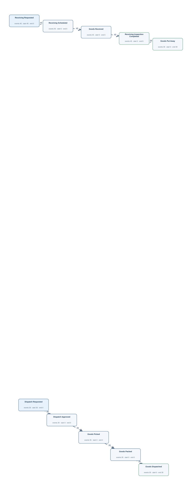</td><td width="50%"><h4>Original tables</h4>
Rows matched by event ID, activity and timestamp using the authored source bindings.

<strong><code>transaction_record</code></strong> · 80 source rows

<code>transaction_id</code> = T001, <code>occurred_at</code> = 2026-04-01T01:00:00Z, <code>warehouse_number</code> = W1, <code>transaction_type</code> = IN TX:T001 · Goods Received · occurred_at · T001

<code>transaction_id</code> = T002, <code>occurred_at</code> = 2026-04-01T02:00:00Z, <code>warehouse_number</code> = W2, <code>transaction_type</code> = IN TX:T002 · Goods Received · occurred_at · T002

<code>transaction_id</code> = T006, <code>occurred_at</code> = 2026-04-01T06:00:00Z, <code>warehouse_number</code> = W2, <code>transaction_type</code> = OUT TX:T006 · Goods Dispatched · occurred_at · T006

<strong><code>transaction_record_activity</code></strong> · 314 source rows

<code>event_id</code> = LC:transaction_record:T001:1, <code>transaction_id</code> = T001, <code>activity</code> = Receiving Requested, <code>occurred_at</code> = 2026-03-31T21:00:00Z, <code>outcome</code> = COMPLETED LC:transaction_record:T001:1 · Receiving Requested · occurred_at · T001

<code>event_id</code> = LC:transaction_record:T001:2, <code>transaction_id</code> = T001, <code>activity</code> = Receiving Scheduled, <code>occurred_at</code> = 2026-03-31T22:00:00Z, <code>outcome</code> = COMPLETED LC:transaction_record:T001:2 · Receiving Scheduled · occurred_at · T001

<code>event_id</code> = LC:transaction_record:T001:3, <code>transaction_id</code> = T001, <code>activity</code> = Receiving Inspection Completed, <code>occurred_at</code> = 2026-04-01T01:30:00Z, <code>outcome</code> = COMPLETED LC:transaction_record:T001:3 · Receiving Inspection Completed · occurred_at · T001

Other tables referenced by Gold SQL

Includes case joins and branches of shared CTEs.
<ul><li><code>lifecycle_case_link</code> · case_id, case_table, event_id</li></ul>
</td></tr></table>

[Gold CSV](../../../datasets/warehouseflow/private/gold_logs/OW04.csv)

## OW05 — Q3

Extract the full recorded lifecycle event log for each goods transaction line.

Events: **679** · Cases with events: **138** · Activities: **10** · Edges: **8**

<table><tr><td width="50%">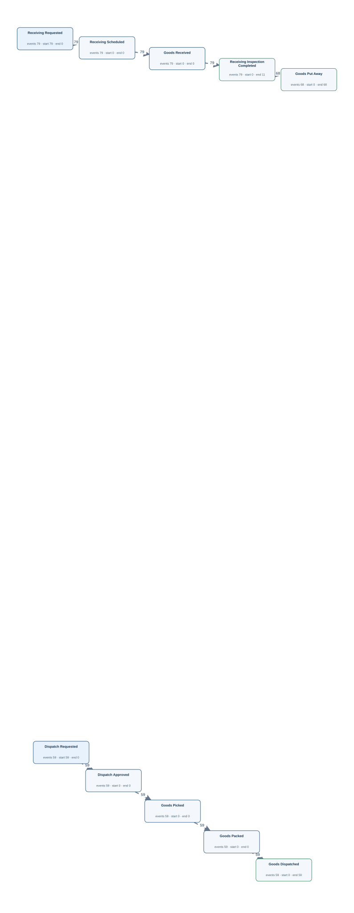</td><td width="50%"><h4>Original tables</h4>
Rows matched by event ID, activity and timestamp using the authored source bindings.

<strong><code>transaction_record</code></strong> · 80 source rows

<code>transaction_id</code> = T004, <code>occurred_at</code> = 2026-04-01T04:00:00Z, <code>warehouse_number</code> = W4, <code>transaction_type</code> = IN TX:T004 · Goods Received · occurred_at · G1:T004 | TX:T004 · Goods Received · occurred_at · G2:T004

<code>transaction_id</code> = T009, <code>occurred_at</code> = 2026-04-01T09:00:00Z, <code>warehouse_number</code> = W1, <code>transaction_type</code> = IN TX:T009 · Goods Received · occurred_at · G1:T009 | TX:T009 · Goods Received · occurred_at · G3:T009 | TX:T009 · Goods Received · occurred_at · G6:T009

<code>transaction_id</code> = T016, <code>occurred_at</code> = 2026-04-01T16:00:00Z, <code>warehouse_number</code> = W4, <code>transaction_type</code> = OUT TX:T016 · Goods Dispatched · occurred_at · G1:T016

<strong><code>transaction_record_activity</code></strong> · 314 source rows

<code>event_id</code> = LC:transaction_record:T004:1, <code>transaction_id</code> = T004, <code>activity</code> = Receiving Requested, <code>occurred_at</code> = 2026-04-01T00:00:00Z, <code>outcome</code> = COMPLETED LC:transaction_record:T004:1 · Receiving Requested · occurred_at · G1:T004 | LC:transaction_record:T004:1 · Receiving Requested · occurred_at · G2:T004

<code>event_id</code> = LC:transaction_record:T004:2, <code>transaction_id</code> = T004, <code>activity</code> = Receiving Scheduled, <code>occurred_at</code> = 2026-04-01T01:00:00Z, <code>outcome</code> = COMPLETED LC:transaction_record:T004:2 · Receiving Scheduled · occurred_at · G1:T004 | LC:transaction_record:T004:2 · Receiving Scheduled · occurred_at · G2:T004

<code>event_id</code> = LC:transaction_record:T004:3, <code>transaction_id</code> = T004, <code>activity</code> = Receiving Inspection Completed, <code>occurred_at</code> = 2026-04-01T04:30:00Z, <code>outcome</code> = COMPLETED LC:transaction_record:T004:3 · Receiving Inspection Completed · occurred_at · G1:T004 | LC:transaction_record:T004:3 · Receiving Inspection Completed · occurred_at · G2:T004

Other tables referenced by Gold SQL

Includes case joins and branches of shared CTEs.
<ul><li><code>goods_transaction_detail</code> · goods_id, transaction_id</li><li><code>lifecycle_case_link</code> · case_id, case_table, event_id</li></ul>
</td></tr></table>

[Gold CSV](../../../datasets/warehouseflow/private/gold_logs/OW05.csv)

## OW06 — Q3

Extract the full recorded lifecycle event log for each worker transaction assignment.

Events: **823** · Cases with events: **167** · Activities: **10** · Edges: **8**

<table><tr><td width="50%">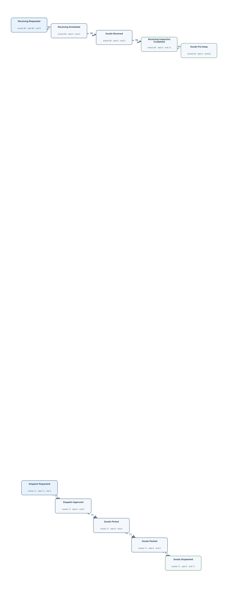</td><td width="50%"><h4>Original tables</h4>
Rows matched by event ID, activity and timestamp using the authored source bindings.

<strong><code>transaction_record</code></strong> · 80 source rows

<code>transaction_id</code> = T002, <code>occurred_at</code> = 2026-04-01T02:00:00Z, <code>warehouse_number</code> = W2, <code>transaction_type</code> = IN TX:T002 · Goods Received · occurred_at · L1:T002 | TX:T002 · Goods Received · occurred_at · L2:T002

<code>transaction_id</code> = T003, <code>occurred_at</code> = 2026-04-01T03:00:00Z, <code>warehouse_number</code> = W3, <code>transaction_type</code> = IN TX:T003 · Goods Received · occurred_at · L1:T003 | TX:T003 · Goods Received · occurred_at · L2:T003 | TX:T003 · Goods Received · occurred_at · L3:T003

<code>transaction_id</code> = T006, <code>occurred_at</code> = 2026-04-01T06:00:00Z, <code>warehouse_number</code> = W2, <code>transaction_type</code> = OUT TX:T006 · Goods Dispatched · occurred_at · L1:T006 | TX:T006 · Goods Dispatched · occurred_at · L3:T006

<strong><code>transaction_record_activity</code></strong> · 314 source rows

<code>event_id</code> = LC:transaction_record:T002:1, <code>transaction_id</code> = T002, <code>activity</code> = Receiving Requested, <code>occurred_at</code> = 2026-03-31T22:00:00Z, <code>outcome</code> = COMPLETED LC:transaction_record:T002:1 · Receiving Requested · occurred_at · L1:T002 | LC:transaction_record:T002:1 · Receiving Requested · occurred_at · L2:T002

<code>event_id</code> = LC:transaction_record:T002:2, <code>transaction_id</code> = T002, <code>activity</code> = Receiving Scheduled, <code>occurred_at</code> = 2026-03-31T23:00:00Z, <code>outcome</code> = COMPLETED LC:transaction_record:T002:2 · Receiving Scheduled · occurred_at · L1:T002 | LC:transaction_record:T002:2 · Receiving Scheduled · occurred_at · L2:T002

<code>event_id</code> = LC:transaction_record:T002:3, <code>transaction_id</code> = T002, <code>activity</code> = Receiving Inspection Completed, <code>occurred_at</code> = 2026-04-01T02:30:00Z, <code>outcome</code> = COMPLETED LC:transaction_record:T002:3 · Receiving Inspection Completed · occurred_at · L1:T002 | LC:transaction_record:T002:3 · Receiving Inspection Completed · occurred_at · L2:T002

Other tables referenced by Gold SQL

Includes case joins and branches of shared CTEs.
<ul><li><code>lifecycle_case_link</code> · case_id, case_table, event_id</li><li><code>loader_transaction</code> · loader_id, transaction_id</li></ul>
</td></tr></table>

[Gold CSV](../../../datasets/warehouseflow/private/gold_logs/OW06.csv)

## TS01 — Q1

Extract Receiving Requested, Receiving Scheduled, Dispatch Requested, Dispatch Approved events for each warehouse transaction.

Events: **160** · Cases with events: **80** · Activities: **4** · Edges: **2**

<table><tr><td width="50%">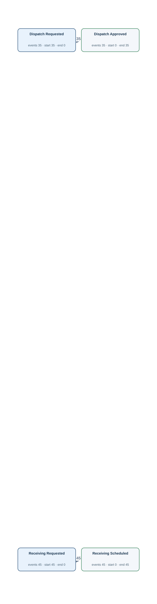</td><td width="50%"><h4>Original tables</h4>
Rows matched by event ID, activity and timestamp using the authored source bindings.

<strong><code>transaction_record_activity</code></strong> · 160 source rows

<code>event_id</code> = LC:transaction_record:T001:1, <code>transaction_id</code> = T001, <code>activity</code> = Receiving Requested, <code>occurred_at</code> = 2026-03-31T21:00:00Z, <code>outcome</code> = COMPLETED LC:transaction_record:T001:1 · Receiving Requested · occurred_at · T001

<code>event_id</code> = LC:transaction_record:T001:2, <code>transaction_id</code> = T001, <code>activity</code> = Receiving Scheduled, <code>occurred_at</code> = 2026-03-31T22:00:00Z, <code>outcome</code> = COMPLETED LC:transaction_record:T001:2 · Receiving Scheduled · occurred_at · T001

<code>event_id</code> = LC:transaction_record:T006:1, <code>transaction_id</code> = T006, <code>activity</code> = Dispatch Requested, <code>occurred_at</code> = 2026-04-01T02:00:00Z, <code>outcome</code> = COMPLETED LC:transaction_record:T006:1 · Dispatch Requested · occurred_at · T006

FK-linked row examples for case and join context

<strong>transaction_record</strong>

transaction_record_activity (transaction_id → transaction_id) <code>transaction_id</code> = T001, <code>occurred_at</code> = 2026-04-01T01:00:00Z, <code>warehouse_number</code> = W1, <code>transaction_type</code> = IN

transaction_record_activity (transaction_id → transaction_id) <code>transaction_id</code> = T002, <code>occurred_at</code> = 2026-04-01T02:00:00Z, <code>warehouse_number</code> = W2, <code>transaction_type</code> = IN

transaction_record_activity (transaction_id → transaction_id) <code>transaction_id</code> = T003, <code>occurred_at</code> = 2026-04-01T03:00:00Z, <code>warehouse_number</code> = W3, <code>transaction_type</code> = IN

Other tables referenced by Gold SQL

Includes case joins and branches of shared CTEs.
<ul><li><code>lifecycle_case_link</code> · case_id, case_table, event_id</li><li><code>transaction_record</code> · occurred_at, transaction_id, transaction_type, warehouse_number</li></ul>
</td></tr></table>

[Gold CSV](../../../datasets/warehouseflow/private/gold_logs/TS01.csv)

## R07P — Q2

For each warehouse, build a timeline of the beginning of warehouse handling jobs.

**No Gold log:** Only one task time is stored, defined as completion. Task start times are not recorded.

## TS01P — Q2

For each warehouse transaction, build a timeline of a request to take goods into storage, an inbound handling appointment being arranged, a request to send goods out, permission being granted to send goods out.

Events: **160** · Cases with events: **80** · Activities: **4** · Edges: **2**

<table><tr><td width="50%"></td><td width="50%"><h4>Original tables</h4>
Rows matched by event ID, activity and timestamp using the authored source bindings.

<strong><code>transaction_record_activity</code></strong> · 160 source rows

<code>event_id</code> = LC:transaction_record:T001:1, <code>transaction_id</code> = T001, <code>activity</code> = Receiving Requested, <code>occurred_at</code> = 2026-03-31T21:00:00Z, <code>outcome</code> = COMPLETED LC:transaction_record:T001:1 · Receiving Requested · occurred_at · T001

<code>event_id</code> = LC:transaction_record:T001:2, <code>transaction_id</code> = T001, <code>activity</code> = Receiving Scheduled, <code>occurred_at</code> = 2026-03-31T22:00:00Z, <code>outcome</code> = COMPLETED LC:transaction_record:T001:2 · Receiving Scheduled · occurred_at · T001

<code>event_id</code> = LC:transaction_record:T006:1, <code>transaction_id</code> = T006, <code>activity</code> = Dispatch Requested, <code>occurred_at</code> = 2026-04-01T02:00:00Z, <code>outcome</code> = COMPLETED LC:transaction_record:T006:1 · Dispatch Requested · occurred_at · T006

FK-linked row examples for case and join context

<strong>transaction_record</strong>

transaction_record_activity (transaction_id → transaction_id) <code>transaction_id</code> = T001, <code>occurred_at</code> = 2026-04-01T01:00:00Z, <code>warehouse_number</code> = W1, <code>transaction_type</code> = IN

transaction_record_activity (transaction_id → transaction_id) <code>transaction_id</code> = T002, <code>occurred_at</code> = 2026-04-01T02:00:00Z, <code>warehouse_number</code> = W2, <code>transaction_type</code> = IN

transaction_record_activity (transaction_id → transaction_id) <code>transaction_id</code> = T003, <code>occurred_at</code> = 2026-04-01T03:00:00Z, <code>warehouse_number</code> = W3, <code>transaction_type</code> = IN

Other tables referenced by Gold SQL

Includes case joins and branches of shared CTEs.
<ul><li><code>lifecycle_case_link</code> · case_id, case_table, event_id</li><li><code>transaction_record</code> · occurred_at, transaction_id, transaction_type, warehouse_number</li></ul>
</td></tr></table>

[Gold CSV](../../../datasets/warehouseflow/private/gold_logs/TS01P.csv)

## OW01P — Q4

Show the complete recorded history associated with each warehouse.

Events: **394** · Cases with events: **4** · Activities: **10** · Edges: **17**

<table><tr><td width="50%"></td><td width="50%"><h4>Original tables</h4>
Rows matched by event ID, activity and timestamp using the authored source bindings.

<strong><code>transaction_record</code></strong> · 80 source rows

<code>transaction_id</code> = T001, <code>occurred_at</code> = 2026-04-01T01:00:00Z, <code>warehouse_number</code> = W1, <code>transaction_type</code> = IN TX:T001 · Goods Received · occurred_at · W1

<code>transaction_id</code> = T005, <code>occurred_at</code> = 2026-04-01T05:00:00Z, <code>warehouse_number</code> = W1, <code>transaction_type</code> = IN TX:T005 · Goods Received · occurred_at · W1

<code>transaction_id</code> = T013, <code>occurred_at</code> = 2026-04-01T13:00:00Z, <code>warehouse_number</code> = W1, <code>transaction_type</code> = OUT TX:T013 · Goods Dispatched · occurred_at · W1

<strong><code>transaction_record_activity</code></strong> · 314 source rows

<code>event_id</code> = LC:transaction_record:T001:1, <code>transaction_id</code> = T001, <code>activity</code> = Receiving Requested, <code>occurred_at</code> = 2026-03-31T21:00:00Z, <code>outcome</code> = COMPLETED LC:transaction_record:T001:1 · Receiving Requested · occurred_at · W1

<code>event_id</code> = LC:transaction_record:T001:2, <code>transaction_id</code> = T001, <code>activity</code> = Receiving Scheduled, <code>occurred_at</code> = 2026-03-31T22:00:00Z, <code>outcome</code> = COMPLETED LC:transaction_record:T001:2 · Receiving Scheduled · occurred_at · W1

<code>event_id</code> = LC:transaction_record:T001:3, <code>transaction_id</code> = T001, <code>activity</code> = Receiving Inspection Completed, <code>occurred_at</code> = 2026-04-01T01:30:00Z, <code>outcome</code> = COMPLETED LC:transaction_record:T001:3 · Receiving Inspection Completed · occurred_at · W1

Other tables referenced by Gold SQL

Includes case joins and branches of shared CTEs.
<ul><li><code>lifecycle_case_link</code> · case_id, case_table, event_id</li></ul>
</td></tr></table>

[Gold CSV](../../../datasets/warehouseflow/private/gold_logs/OW01P.csv)

## OW01E — Q1

Extract Receiving Requested, Goods Received, Goods Put Away events for each warehouse.

Events: **129** · Cases with events: **4** · Activities: **3** · Edges: **7**

<table><tr><td width="50%">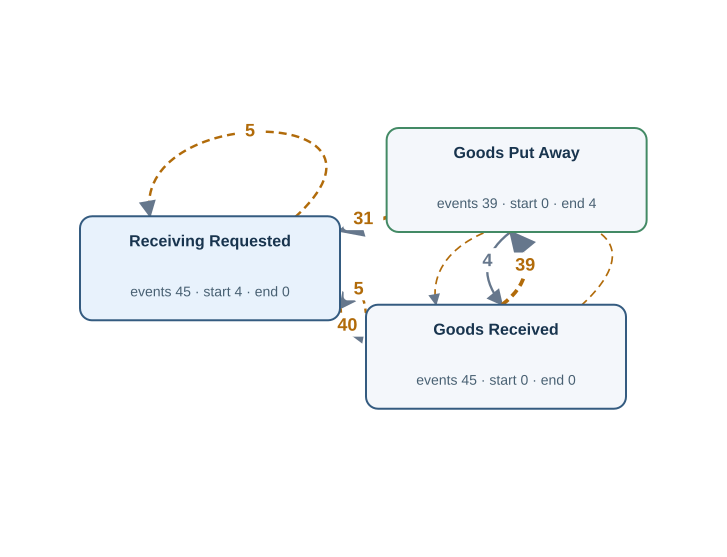</td><td width="50%"><h4>Original tables</h4>
Rows matched by event ID, activity and timestamp using the authored source bindings.

<strong><code>transaction_record</code></strong> · 45 source rows

<code>transaction_id</code> = T001, <code>occurred_at</code> = 2026-04-01T01:00:00Z, <code>warehouse_number</code> = W1, <code>transaction_type</code> = IN TX:T001 · Goods Received · occurred_at · W1

<code>transaction_id</code> = T005, <code>occurred_at</code> = 2026-04-01T05:00:00Z, <code>warehouse_number</code> = W1, <code>transaction_type</code> = IN TX:T005 · Goods Received · occurred_at · W1

<code>transaction_id</code> = T009, <code>occurred_at</code> = 2026-04-01T09:00:00Z, <code>warehouse_number</code> = W1, <code>transaction_type</code> = IN TX:T009 · Goods Received · occurred_at · W1

<strong><code>transaction_record_activity</code></strong> · 84 source rows

<code>event_id</code> = LC:transaction_record:T001:1, <code>transaction_id</code> = T001, <code>activity</code> = Receiving Requested, <code>occurred_at</code> = 2026-03-31T21:00:00Z, <code>outcome</code> = COMPLETED LC:transaction_record:T001:1 · Receiving Requested · occurred_at · W1

<code>event_id</code> = LC:transaction_record:T005:1, <code>transaction_id</code> = T005, <code>activity</code> = Receiving Requested, <code>occurred_at</code> = 2026-04-01T01:00:00Z, <code>outcome</code> = COMPLETED LC:transaction_record:T005:1 · Receiving Requested · occurred_at · W1

<code>event_id</code> = LC:transaction_record:T005:4, <code>transaction_id</code> = T005, <code>activity</code> = Goods Put Away, <code>occurred_at</code> = 2026-04-01T06:00:00Z, <code>outcome</code> = COMPLETED LC:transaction_record:T005:4 · Goods Put Away · occurred_at · W1

Other tables referenced by Gold SQL

Includes case joins and branches of shared CTEs.
<ul><li><code>lifecycle_case_link</code> · case_id, case_table, event_id</li></ul>
</td></tr></table>

[Gold CSV](../../../datasets/warehouseflow/private/gold_logs/OW01E.csv)

## OW01EP — Q2

For each warehouse, build a timeline of a request to take goods into storage, goods arriving at the warehouse, goods being placed into their storage locations.

Events: **129** · Cases with events: **4** · Activities: **3** · Edges: **7**

<table><tr><td width="50%"></td><td width="50%"><h4>Original tables</h4>
Rows matched by event ID, activity and timestamp using the authored source bindings.

<strong><code>transaction_record</code></strong> · 45 source rows

<code>transaction_id</code> = T001, <code>occurred_at</code> = 2026-04-01T01:00:00Z, <code>warehouse_number</code> = W1, <code>transaction_type</code> = IN TX:T001 · Goods Received · occurred_at · W1

<code>transaction_id</code> = T005, <code>occurred_at</code> = 2026-04-01T05:00:00Z, <code>warehouse_number</code> = W1, <code>transaction_type</code> = IN TX:T005 · Goods Received · occurred_at · W1

<code>transaction_id</code> = T009, <code>occurred_at</code> = 2026-04-01T09:00:00Z, <code>warehouse_number</code> = W1, <code>transaction_type</code> = IN TX:T009 · Goods Received · occurred_at · W1

<strong><code>transaction_record_activity</code></strong> · 84 source rows

<code>event_id</code> = LC:transaction_record:T001:1, <code>transaction_id</code> = T001, <code>activity</code> = Receiving Requested, <code>occurred_at</code> = 2026-03-31T21:00:00Z, <code>outcome</code> = COMPLETED LC:transaction_record:T001:1 · Receiving Requested · occurred_at · W1

<code>event_id</code> = LC:transaction_record:T005:1, <code>transaction_id</code> = T005, <code>activity</code> = Receiving Requested, <code>occurred_at</code> = 2026-04-01T01:00:00Z, <code>outcome</code> = COMPLETED LC:transaction_record:T005:1 · Receiving Requested · occurred_at · W1

<code>event_id</code> = LC:transaction_record:T005:4, <code>transaction_id</code> = T005, <code>activity</code> = Goods Put Away, <code>occurred_at</code> = 2026-04-01T06:00:00Z, <code>outcome</code> = COMPLETED LC:transaction_record:T005:4 · Goods Put Away · occurred_at · W1

Other tables referenced by Gold SQL

Includes case joins and branches of shared CTEs.
<ul><li><code>lifecycle_case_link</code> · case_id, case_table, event_id</li></ul>
</td></tr></table>

[Gold CSV](../../../datasets/warehouseflow/private/gold_logs/OW01EP.csv)

## OW02P — Q4

Show the complete recorded history associated with each goods.

Events: **679** · Cases with events: **6** · Activities: **10** · Edges: **53**

<table><tr><td width="50%"></td><td width="50%"><h4>Original tables</h4>
Rows matched by event ID, activity and timestamp using the authored source bindings.

<strong><code>transaction_record</code></strong> · 80 source rows

<code>transaction_id</code> = T004, <code>occurred_at</code> = 2026-04-01T04:00:00Z, <code>warehouse_number</code> = W4, <code>transaction_type</code> = IN TX:T004 · Goods Received · occurred_at · G1 | TX:T004 · Goods Received · occurred_at · G2

<code>transaction_id</code> = T009, <code>occurred_at</code> = 2026-04-01T09:00:00Z, <code>warehouse_number</code> = W1, <code>transaction_type</code> = IN TX:T009 · Goods Received · occurred_at · G1 | TX:T009 · Goods Received · occurred_at · G3 | TX:T009 · Goods Received · occurred_at · G6

<code>transaction_id</code> = T016, <code>occurred_at</code> = 2026-04-01T16:00:00Z, <code>warehouse_number</code> = W4, <code>transaction_type</code> = OUT TX:T016 · Goods Dispatched · occurred_at · G1

<strong><code>transaction_record_activity</code></strong> · 314 source rows

<code>event_id</code> = LC:transaction_record:T004:1, <code>transaction_id</code> = T004, <code>activity</code> = Receiving Requested, <code>occurred_at</code> = 2026-04-01T00:00:00Z, <code>outcome</code> = COMPLETED LC:transaction_record:T004:1 · Receiving Requested · occurred_at · G1 | LC:transaction_record:T004:1 · Receiving Requested · occurred_at · G2

<code>event_id</code> = LC:transaction_record:T004:2, <code>transaction_id</code> = T004, <code>activity</code> = Receiving Scheduled, <code>occurred_at</code> = 2026-04-01T01:00:00Z, <code>outcome</code> = COMPLETED LC:transaction_record:T004:2 · Receiving Scheduled · occurred_at · G1 | LC:transaction_record:T004:2 · Receiving Scheduled · occurred_at · G2

<code>event_id</code> = LC:transaction_record:T004:3, <code>transaction_id</code> = T004, <code>activity</code> = Receiving Inspection Completed, <code>occurred_at</code> = 2026-04-01T04:30:00Z, <code>outcome</code> = COMPLETED LC:transaction_record:T004:3 · Receiving Inspection Completed · occurred_at · G1 | LC:transaction_record:T004:3 · Receiving Inspection Completed · occurred_at · G2

Other tables referenced by Gold SQL

Includes case joins and branches of shared CTEs.
<ul><li><code>goods_transaction_detail</code> · goods_id, transaction_id</li><li><code>lifecycle_case_link</code> · case_id, case_table, event_id</li></ul>
</td></tr></table>

[Gold CSV](../../../datasets/warehouseflow/private/gold_logs/OW02P.csv)

## OW02E — Q1

Extract Receiving Requested, Goods Received, Goods Put Away events for each goods.

Events: **226** · Cases with events: **6** · Activities: **3** · Edges: **7**

<table><tr><td width="50%">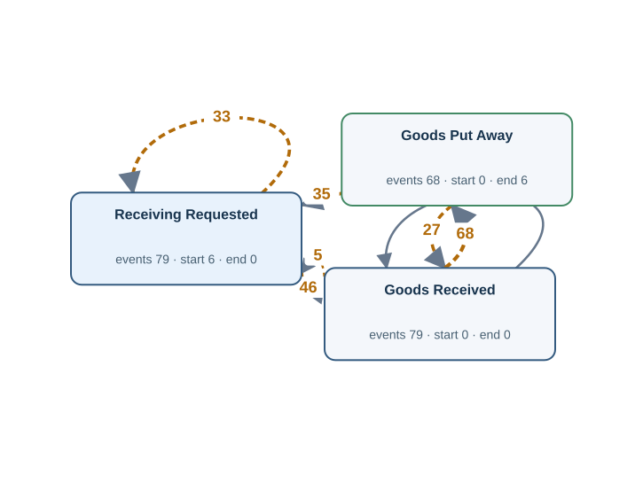</td><td width="50%"><h4>Original tables</h4>
Rows matched by event ID, activity and timestamp using the authored source bindings.

<strong><code>transaction_record</code></strong> · 45 source rows

<code>transaction_id</code> = T004, <code>occurred_at</code> = 2026-04-01T04:00:00Z, <code>warehouse_number</code> = W4, <code>transaction_type</code> = IN TX:T004 · Goods Received · occurred_at · G1 | TX:T004 · Goods Received · occurred_at · G2

<code>transaction_id</code> = T009, <code>occurred_at</code> = 2026-04-01T09:00:00Z, <code>warehouse_number</code> = W1, <code>transaction_type</code> = IN TX:T009 · Goods Received · occurred_at · G1 | TX:T009 · Goods Received · occurred_at · G3 | TX:T009 · Goods Received · occurred_at · G6

<code>transaction_id</code> = T012, <code>occurred_at</code> = 2026-04-01T12:00:00Z, <code>warehouse_number</code> = W4, <code>transaction_type</code> = IN TX:T012 · Goods Received · occurred_at · G1

<strong><code>transaction_record_activity</code></strong> · 84 source rows

<code>event_id</code> = LC:transaction_record:T004:1, <code>transaction_id</code> = T004, <code>activity</code> = Receiving Requested, <code>occurred_at</code> = 2026-04-01T00:00:00Z, <code>outcome</code> = COMPLETED LC:transaction_record:T004:1 · Receiving Requested · occurred_at · G1 | LC:transaction_record:T004:1 · Receiving Requested · occurred_at · G2

<code>event_id</code> = LC:transaction_record:T004:4, <code>transaction_id</code> = T004, <code>activity</code> = Goods Put Away, <code>occurred_at</code> = 2026-04-01T05:00:00Z, <code>outcome</code> = COMPLETED LC:transaction_record:T004:4 · Goods Put Away · occurred_at · G1 | LC:transaction_record:T004:4 · Goods Put Away · occurred_at · G2

<code>event_id</code> = LC:transaction_record:T009:1, <code>transaction_id</code> = T009, <code>activity</code> = Receiving Requested, <code>occurred_at</code> = 2026-04-01T05:00:00Z, <code>outcome</code> = COMPLETED LC:transaction_record:T009:1 · Receiving Requested · occurred_at · G1 | LC:transaction_record:T009:1 · Receiving Requested · occurred_at · G3 | LC:transaction_record:T009:1 · Receiving Requested · occurred_at · G6

Other tables referenced by Gold SQL

Includes case joins and branches of shared CTEs.
<ul><li><code>goods_transaction_detail</code> · goods_id, transaction_id</li><li><code>lifecycle_case_link</code> · case_id, case_table, event_id</li></ul>
</td></tr></table>

[Gold CSV](../../../datasets/warehouseflow/private/gold_logs/OW02E.csv)

## OW02EP — Q2

For each goods, build a timeline of a request to take goods into storage, goods arriving at the warehouse, goods being placed into their storage locations.

Events: **226** · Cases with events: **6** · Activities: **3** · Edges: **7**

<table><tr><td width="50%"></td><td width="50%"><h4>Original tables</h4>
Rows matched by event ID, activity and timestamp using the authored source bindings.

<strong><code>transaction_record</code></strong> · 45 source rows

<code>transaction_id</code> = T004, <code>occurred_at</code> = 2026-04-01T04:00:00Z, <code>warehouse_number</code> = W4, <code>transaction_type</code> = IN TX:T004 · Goods Received · occurred_at · G1 | TX:T004 · Goods Received · occurred_at · G2

<code>transaction_id</code> = T009, <code>occurred_at</code> = 2026-04-01T09:00:00Z, <code>warehouse_number</code> = W1, <code>transaction_type</code> = IN TX:T009 · Goods Received · occurred_at · G1 | TX:T009 · Goods Received · occurred_at · G3 | TX:T009 · Goods Received · occurred_at · G6

<code>transaction_id</code> = T012, <code>occurred_at</code> = 2026-04-01T12:00:00Z, <code>warehouse_number</code> = W4, <code>transaction_type</code> = IN TX:T012 · Goods Received · occurred_at · G1

<strong><code>transaction_record_activity</code></strong> · 84 source rows

<code>event_id</code> = LC:transaction_record:T004:1, <code>transaction_id</code> = T004, <code>activity</code> = Receiving Requested, <code>occurred_at</code> = 2026-04-01T00:00:00Z, <code>outcome</code> = COMPLETED LC:transaction_record:T004:1 · Receiving Requested · occurred_at · G1 | LC:transaction_record:T004:1 · Receiving Requested · occurred_at · G2

<code>event_id</code> = LC:transaction_record:T004:4, <code>transaction_id</code> = T004, <code>activity</code> = Goods Put Away, <code>occurred_at</code> = 2026-04-01T05:00:00Z, <code>outcome</code> = COMPLETED LC:transaction_record:T004:4 · Goods Put Away · occurred_at · G1 | LC:transaction_record:T004:4 · Goods Put Away · occurred_at · G2

<code>event_id</code> = LC:transaction_record:T009:1, <code>transaction_id</code> = T009, <code>activity</code> = Receiving Requested, <code>occurred_at</code> = 2026-04-01T05:00:00Z, <code>outcome</code> = COMPLETED LC:transaction_record:T009:1 · Receiving Requested · occurred_at · G1 | LC:transaction_record:T009:1 · Receiving Requested · occurred_at · G3 | LC:transaction_record:T009:1 · Receiving Requested · occurred_at · G6

Other tables referenced by Gold SQL

Includes case joins and branches of shared CTEs.
<ul><li><code>goods_transaction_detail</code> · goods_id, transaction_id</li><li><code>lifecycle_case_link</code> · case_id, case_table, event_id</li></ul>
</td></tr></table>

[Gold CSV](../../../datasets/warehouseflow/private/gold_logs/OW02EP.csv)

## OW03P — Q4

Show the complete recorded history associated with each worker.

Events: **823** · Cases with events: **5** · Activities: **10** · Edges: **56**

<table><tr><td width="50%"></td><td width="50%"><h4>Original tables</h4>
Rows matched by event ID, activity and timestamp using the authored source bindings.

<strong><code>transaction_record</code></strong> · 80 source rows

<code>transaction_id</code> = T002, <code>occurred_at</code> = 2026-04-01T02:00:00Z, <code>warehouse_number</code> = W2, <code>transaction_type</code> = IN TX:T002 · Goods Received · occurred_at · L1 | TX:T002 · Goods Received · occurred_at · L2

<code>transaction_id</code> = T003, <code>occurred_at</code> = 2026-04-01T03:00:00Z, <code>warehouse_number</code> = W3, <code>transaction_type</code> = IN TX:T003 · Goods Received · occurred_at · L1 | TX:T003 · Goods Received · occurred_at · L2 | TX:T003 · Goods Received · occurred_at · L3

<code>transaction_id</code> = T006, <code>occurred_at</code> = 2026-04-01T06:00:00Z, <code>warehouse_number</code> = W2, <code>transaction_type</code> = OUT TX:T006 · Goods Dispatched · occurred_at · L1 | TX:T006 · Goods Dispatched · occurred_at · L3

<strong><code>transaction_record_activity</code></strong> · 314 source rows

<code>event_id</code> = LC:transaction_record:T002:1, <code>transaction_id</code> = T002, <code>activity</code> = Receiving Requested, <code>occurred_at</code> = 2026-03-31T22:00:00Z, <code>outcome</code> = COMPLETED LC:transaction_record:T002:1 · Receiving Requested · occurred_at · L1 | LC:transaction_record:T002:1 · Receiving Requested · occurred_at · L2

<code>event_id</code> = LC:transaction_record:T002:2, <code>transaction_id</code> = T002, <code>activity</code> = Receiving Scheduled, <code>occurred_at</code> = 2026-03-31T23:00:00Z, <code>outcome</code> = COMPLETED LC:transaction_record:T002:2 · Receiving Scheduled · occurred_at · L1 | LC:transaction_record:T002:2 · Receiving Scheduled · occurred_at · L2

<code>event_id</code> = LC:transaction_record:T006:1, <code>transaction_id</code> = T006, <code>activity</code> = Dispatch Requested, <code>occurred_at</code> = 2026-04-01T02:00:00Z, <code>outcome</code> = COMPLETED LC:transaction_record:T006:1 · Dispatch Requested · occurred_at · L1 | LC:transaction_record:T006:1 · Dispatch Requested · occurred_at · L3

Other tables referenced by Gold SQL

Includes case joins and branches of shared CTEs.
<ul><li><code>lifecycle_case_link</code> · case_id, case_table, event_id</li><li><code>loader_transaction</code> · loader_id, transaction_id</li></ul>
</td></tr></table>

[Gold CSV](../../../datasets/warehouseflow/private/gold_logs/OW03P.csv)

## OW03E — Q1

Extract Receiving Requested, Goods Received, Goods Put Away events for each worker.

Events: **276** · Cases with events: **5** · Activities: **3** · Edges: **7**

<table><tr><td width="50%">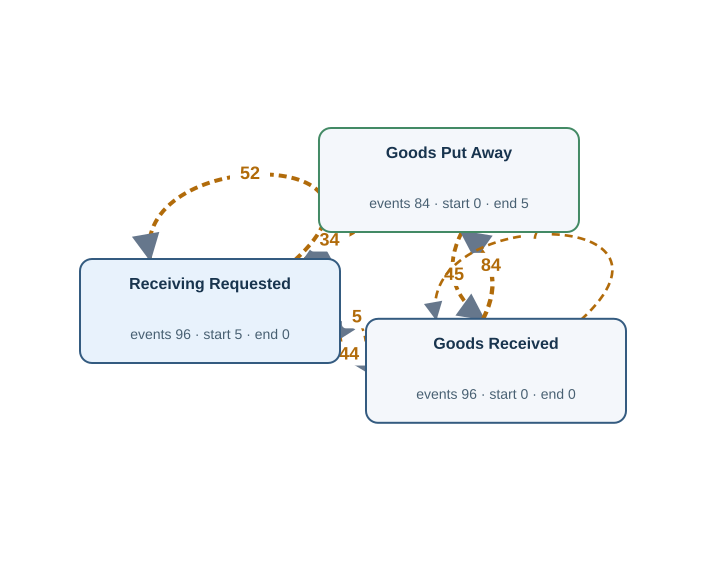</td><td width="50%"><h4>Original tables</h4>
Rows matched by event ID, activity and timestamp using the authored source bindings.

<strong><code>transaction_record</code></strong> · 45 source rows

<code>transaction_id</code> = T002, <code>occurred_at</code> = 2026-04-01T02:00:00Z, <code>warehouse_number</code> = W2, <code>transaction_type</code> = IN TX:T002 · Goods Received · occurred_at · L1 | TX:T002 · Goods Received · occurred_at · L2

<code>transaction_id</code> = T003, <code>occurred_at</code> = 2026-04-01T03:00:00Z, <code>warehouse_number</code> = W3, <code>transaction_type</code> = IN TX:T003 · Goods Received · occurred_at · L1 | TX:T003 · Goods Received · occurred_at · L2 | TX:T003 · Goods Received · occurred_at · L3

<code>transaction_id</code> = T004, <code>occurred_at</code> = 2026-04-01T04:00:00Z, <code>warehouse_number</code> = W4, <code>transaction_type</code> = IN TX:T004 · Goods Received · occurred_at · L1

<strong><code>transaction_record_activity</code></strong> · 84 source rows

<code>event_id</code> = LC:transaction_record:T002:1, <code>transaction_id</code> = T002, <code>activity</code> = Receiving Requested, <code>occurred_at</code> = 2026-03-31T22:00:00Z, <code>outcome</code> = COMPLETED LC:transaction_record:T002:1 · Receiving Requested · occurred_at · L1 | LC:transaction_record:T002:1 · Receiving Requested · occurred_at · L2

<code>event_id</code> = LC:transaction_record:T003:1, <code>transaction_id</code> = T003, <code>activity</code> = Receiving Requested, <code>occurred_at</code> = 2026-03-31T23:00:00Z, <code>outcome</code> = COMPLETED LC:transaction_record:T003:1 · Receiving Requested · occurred_at · L1 | LC:transaction_record:T003:1 · Receiving Requested · occurred_at · L2 | LC:transaction_record:T003:1 · Receiving Requested · occurred_at · L3

<code>event_id</code> = LC:transaction_record:T002:4, <code>transaction_id</code> = T002, <code>activity</code> = Goods Put Away, <code>occurred_at</code> = 2026-04-01T03:00:00Z, <code>outcome</code> = COMPLETED LC:transaction_record:T002:4 · Goods Put Away · occurred_at · L1 | LC:transaction_record:T002:4 · Goods Put Away · occurred_at · L2

Other tables referenced by Gold SQL

Includes case joins and branches of shared CTEs.
<ul><li><code>lifecycle_case_link</code> · case_id, case_table, event_id</li><li><code>loader_transaction</code> · loader_id, transaction_id</li></ul>
</td></tr></table>

[Gold CSV](../../../datasets/warehouseflow/private/gold_logs/OW03E.csv)

## OW03EP — Q2

For each worker, build a timeline of a request to take goods into storage, goods arriving at the warehouse, goods being placed into their storage locations.

Events: **276** · Cases with events: **5** · Activities: **3** · Edges: **7**

<table><tr><td width="50%"></td><td width="50%"><h4>Original tables</h4>
Rows matched by event ID, activity and timestamp using the authored source bindings.

<strong><code>transaction_record</code></strong> · 45 source rows

<code>transaction_id</code> = T002, <code>occurred_at</code> = 2026-04-01T02:00:00Z, <code>warehouse_number</code> = W2, <code>transaction_type</code> = IN TX:T002 · Goods Received · occurred_at · L1 | TX:T002 · Goods Received · occurred_at · L2

<code>transaction_id</code> = T003, <code>occurred_at</code> = 2026-04-01T03:00:00Z, <code>warehouse_number</code> = W3, <code>transaction_type</code> = IN TX:T003 · Goods Received · occurred_at · L1 | TX:T003 · Goods Received · occurred_at · L2 | TX:T003 · Goods Received · occurred_at · L3

<code>transaction_id</code> = T004, <code>occurred_at</code> = 2026-04-01T04:00:00Z, <code>warehouse_number</code> = W4, <code>transaction_type</code> = IN TX:T004 · Goods Received · occurred_at · L1

<strong><code>transaction_record_activity</code></strong> · 84 source rows

<code>event_id</code> = LC:transaction_record:T002:1, <code>transaction_id</code> = T002, <code>activity</code> = Receiving Requested, <code>occurred_at</code> = 2026-03-31T22:00:00Z, <code>outcome</code> = COMPLETED LC:transaction_record:T002:1 · Receiving Requested · occurred_at · L1 | LC:transaction_record:T002:1 · Receiving Requested · occurred_at · L2

<code>event_id</code> = LC:transaction_record:T003:1, <code>transaction_id</code> = T003, <code>activity</code> = Receiving Requested, <code>occurred_at</code> = 2026-03-31T23:00:00Z, <code>outcome</code> = COMPLETED LC:transaction_record:T003:1 · Receiving Requested · occurred_at · L1 | LC:transaction_record:T003:1 · Receiving Requested · occurred_at · L2 | LC:transaction_record:T003:1 · Receiving Requested · occurred_at · L3

<code>event_id</code> = LC:transaction_record:T002:4, <code>transaction_id</code> = T002, <code>activity</code> = Goods Put Away, <code>occurred_at</code> = 2026-04-01T03:00:00Z, <code>outcome</code> = COMPLETED LC:transaction_record:T002:4 · Goods Put Away · occurred_at · L1 | LC:transaction_record:T002:4 · Goods Put Away · occurred_at · L2

Other tables referenced by Gold SQL

Includes case joins and branches of shared CTEs.
<ul><li><code>lifecycle_case_link</code> · case_id, case_table, event_id</li><li><code>loader_transaction</code> · loader_id, transaction_id</li></ul>
</td></tr></table>

[Gold CSV](../../../datasets/warehouseflow/private/gold_logs/OW03EP.csv)

## OW04P — Q4

Show the complete recorded history associated with each warehouse transaction.

Events: **394** · Cases with events: **80** · Activities: **10** · Edges: **8**

<table><tr><td width="50%"></td><td width="50%"><h4>Original tables</h4>
Rows matched by event ID, activity and timestamp using the authored source bindings.

<strong><code>transaction_record</code></strong> · 80 source rows

<code>transaction_id</code> = T001, <code>occurred_at</code> = 2026-04-01T01:00:00Z, <code>warehouse_number</code> = W1, <code>transaction_type</code> = IN TX:T001 · Goods Received · occurred_at · T001

<code>transaction_id</code> = T002, <code>occurred_at</code> = 2026-04-01T02:00:00Z, <code>warehouse_number</code> = W2, <code>transaction_type</code> = IN TX:T002 · Goods Received · occurred_at · T002

<code>transaction_id</code> = T006, <code>occurred_at</code> = 2026-04-01T06:00:00Z, <code>warehouse_number</code> = W2, <code>transaction_type</code> = OUT TX:T006 · Goods Dispatched · occurred_at · T006

<strong><code>transaction_record_activity</code></strong> · 314 source rows

<code>event_id</code> = LC:transaction_record:T001:1, <code>transaction_id</code> = T001, <code>activity</code> = Receiving Requested, <code>occurred_at</code> = 2026-03-31T21:00:00Z, <code>outcome</code> = COMPLETED LC:transaction_record:T001:1 · Receiving Requested · occurred_at · T001

<code>event_id</code> = LC:transaction_record:T001:2, <code>transaction_id</code> = T001, <code>activity</code> = Receiving Scheduled, <code>occurred_at</code> = 2026-03-31T22:00:00Z, <code>outcome</code> = COMPLETED LC:transaction_record:T001:2 · Receiving Scheduled · occurred_at · T001

<code>event_id</code> = LC:transaction_record:T001:3, <code>transaction_id</code> = T001, <code>activity</code> = Receiving Inspection Completed, <code>occurred_at</code> = 2026-04-01T01:30:00Z, <code>outcome</code> = COMPLETED LC:transaction_record:T001:3 · Receiving Inspection Completed · occurred_at · T001

Other tables referenced by Gold SQL

Includes case joins and branches of shared CTEs.
<ul><li><code>lifecycle_case_link</code> · case_id, case_table, event_id</li></ul>
</td></tr></table>

[Gold CSV](../../../datasets/warehouseflow/private/gold_logs/OW04P.csv)

## OW04E — Q1

Extract Receiving Requested, Goods Received, Goods Put Away events for each warehouse transaction.

Events: **129** · Cases with events: **45** · Activities: **3** · Edges: **2**

<table><tr><td width="50%">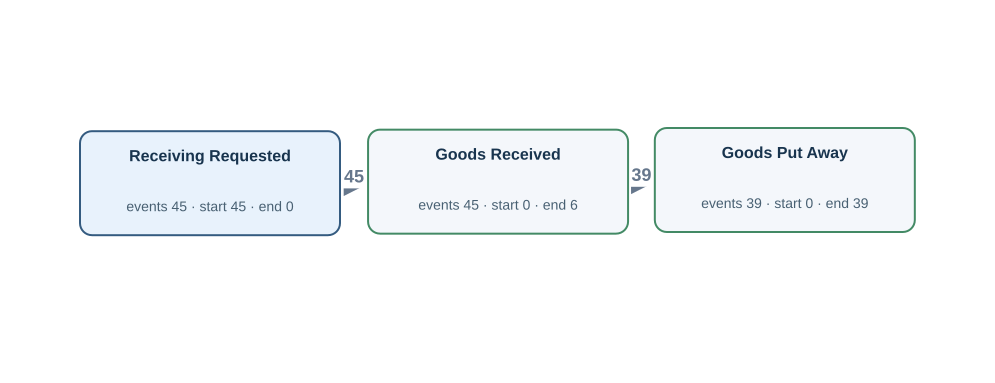</td><td width="50%"><h4>Original tables</h4>
Rows matched by event ID, activity and timestamp using the authored source bindings.

<strong><code>transaction_record</code></strong> · 45 source rows

<code>transaction_id</code> = T001, <code>occurred_at</code> = 2026-04-01T01:00:00Z, <code>warehouse_number</code> = W1, <code>transaction_type</code> = IN TX:T001 · Goods Received · occurred_at · T001

<code>transaction_id</code> = T002, <code>occurred_at</code> = 2026-04-01T02:00:00Z, <code>warehouse_number</code> = W2, <code>transaction_type</code> = IN TX:T002 · Goods Received · occurred_at · T002

<code>transaction_id</code> = T003, <code>occurred_at</code> = 2026-04-01T03:00:00Z, <code>warehouse_number</code> = W3, <code>transaction_type</code> = IN TX:T003 · Goods Received · occurred_at · T003

<strong><code>transaction_record_activity</code></strong> · 84 source rows

<code>event_id</code> = LC:transaction_record:T001:1, <code>transaction_id</code> = T001, <code>activity</code> = Receiving Requested, <code>occurred_at</code> = 2026-03-31T21:00:00Z, <code>outcome</code> = COMPLETED LC:transaction_record:T001:1 · Receiving Requested · occurred_at · T001

<code>event_id</code> = LC:transaction_record:T002:1, <code>transaction_id</code> = T002, <code>activity</code> = Receiving Requested, <code>occurred_at</code> = 2026-03-31T22:00:00Z, <code>outcome</code> = COMPLETED LC:transaction_record:T002:1 · Receiving Requested · occurred_at · T002

<code>event_id</code> = LC:transaction_record:T002:4, <code>transaction_id</code> = T002, <code>activity</code> = Goods Put Away, <code>occurred_at</code> = 2026-04-01T03:00:00Z, <code>outcome</code> = COMPLETED LC:transaction_record:T002:4 · Goods Put Away · occurred_at · T002

Other tables referenced by Gold SQL

Includes case joins and branches of shared CTEs.
<ul><li><code>lifecycle_case_link</code> · case_id, case_table, event_id</li></ul>
</td></tr></table>

[Gold CSV](../../../datasets/warehouseflow/private/gold_logs/OW04E.csv)

## OW04EP — Q2

For each warehouse transaction, build a timeline of a request to take goods into storage, goods arriving at the warehouse, goods being placed into their storage locations.

Events: **129** · Cases with events: **45** · Activities: **3** · Edges: **2**

<table><tr><td width="50%"></td><td width="50%"><h4>Original tables</h4>
Rows matched by event ID, activity and timestamp using the authored source bindings.

<strong><code>transaction_record</code></strong> · 45 source rows

<code>transaction_id</code> = T001, <code>occurred_at</code> = 2026-04-01T01:00:00Z, <code>warehouse_number</code> = W1, <code>transaction_type</code> = IN TX:T001 · Goods Received · occurred_at · T001

<code>transaction_id</code> = T002, <code>occurred_at</code> = 2026-04-01T02:00:00Z, <code>warehouse_number</code> = W2, <code>transaction_type</code> = IN TX:T002 · Goods Received · occurred_at · T002

<code>transaction_id</code> = T003, <code>occurred_at</code> = 2026-04-01T03:00:00Z, <code>warehouse_number</code> = W3, <code>transaction_type</code> = IN TX:T003 · Goods Received · occurred_at · T003

<strong><code>transaction_record_activity</code></strong> · 84 source rows

<code>event_id</code> = LC:transaction_record:T001:1, <code>transaction_id</code> = T001, <code>activity</code> = Receiving Requested, <code>occurred_at</code> = 2026-03-31T21:00:00Z, <code>outcome</code> = COMPLETED LC:transaction_record:T001:1 · Receiving Requested · occurred_at · T001

<code>event_id</code> = LC:transaction_record:T002:1, <code>transaction_id</code> = T002, <code>activity</code> = Receiving Requested, <code>occurred_at</code> = 2026-03-31T22:00:00Z, <code>outcome</code> = COMPLETED LC:transaction_record:T002:1 · Receiving Requested · occurred_at · T002

<code>event_id</code> = LC:transaction_record:T002:4, <code>transaction_id</code> = T002, <code>activity</code> = Goods Put Away, <code>occurred_at</code> = 2026-04-01T03:00:00Z, <code>outcome</code> = COMPLETED LC:transaction_record:T002:4 · Goods Put Away · occurred_at · T002

Other tables referenced by Gold SQL

Includes case joins and branches of shared CTEs.
<ul><li><code>lifecycle_case_link</code> · case_id, case_table, event_id</li></ul>
</td></tr></table>

[Gold CSV](../../../datasets/warehouseflow/private/gold_logs/OW04EP.csv)

## OW05P — Q4

Show the complete recorded history associated with each goods transaction line.

Events: **679** · Cases with events: **138** · Activities: **10** · Edges: **8**

<table><tr><td width="50%"></td><td width="50%"><h4>Original tables</h4>
Rows matched by event ID, activity and timestamp using the authored source bindings.

<strong><code>transaction_record</code></strong> · 80 source rows

<code>transaction_id</code> = T004, <code>occurred_at</code> = 2026-04-01T04:00:00Z, <code>warehouse_number</code> = W4, <code>transaction_type</code> = IN TX:T004 · Goods Received · occurred_at · G1:T004 | TX:T004 · Goods Received · occurred_at · G2:T004

<code>transaction_id</code> = T009, <code>occurred_at</code> = 2026-04-01T09:00:00Z, <code>warehouse_number</code> = W1, <code>transaction_type</code> = IN TX:T009 · Goods Received · occurred_at · G1:T009 | TX:T009 · Goods Received · occurred_at · G3:T009 | TX:T009 · Goods Received · occurred_at · G6:T009

<code>transaction_id</code> = T016, <code>occurred_at</code> = 2026-04-01T16:00:00Z, <code>warehouse_number</code> = W4, <code>transaction_type</code> = OUT TX:T016 · Goods Dispatched · occurred_at · G1:T016

<strong><code>transaction_record_activity</code></strong> · 314 source rows

<code>event_id</code> = LC:transaction_record:T004:1, <code>transaction_id</code> = T004, <code>activity</code> = Receiving Requested, <code>occurred_at</code> = 2026-04-01T00:00:00Z, <code>outcome</code> = COMPLETED LC:transaction_record:T004:1 · Receiving Requested · occurred_at · G1:T004 | LC:transaction_record:T004:1 · Receiving Requested · occurred_at · G2:T004

<code>event_id</code> = LC:transaction_record:T004:2, <code>transaction_id</code> = T004, <code>activity</code> = Receiving Scheduled, <code>occurred_at</code> = 2026-04-01T01:00:00Z, <code>outcome</code> = COMPLETED LC:transaction_record:T004:2 · Receiving Scheduled · occurred_at · G1:T004 | LC:transaction_record:T004:2 · Receiving Scheduled · occurred_at · G2:T004

<code>event_id</code> = LC:transaction_record:T004:3, <code>transaction_id</code> = T004, <code>activity</code> = Receiving Inspection Completed, <code>occurred_at</code> = 2026-04-01T04:30:00Z, <code>outcome</code> = COMPLETED LC:transaction_record:T004:3 · Receiving Inspection Completed · occurred_at · G1:T004 | LC:transaction_record:T004:3 · Receiving Inspection Completed · occurred_at · G2:T004

Other tables referenced by Gold SQL

Includes case joins and branches of shared CTEs.
<ul><li><code>goods_transaction_detail</code> · goods_id, transaction_id</li><li><code>lifecycle_case_link</code> · case_id, case_table, event_id</li></ul>
</td></tr></table>

[Gold CSV](../../../datasets/warehouseflow/private/gold_logs/OW05P.csv)

## OW05E — Q1

Extract Receiving Requested, Goods Received, Goods Put Away events for each goods transaction line.

Events: **226** · Cases with events: **79** · Activities: **3** · Edges: **2**

<table><tr><td width="50%"></td><td width="50%"><h4>Original tables</h4>
Rows matched by event ID, activity and timestamp using the authored source bindings.

<strong><code>transaction_record</code></strong> · 45 source rows

<code>transaction_id</code> = T004, <code>occurred_at</code> = 2026-04-01T04:00:00Z, <code>warehouse_number</code> = W4, <code>transaction_type</code> = IN TX:T004 · Goods Received · occurred_at · G1:T004 | TX:T004 · Goods Received · occurred_at · G2:T004

<code>transaction_id</code> = T009, <code>occurred_at</code> = 2026-04-01T09:00:00Z, <code>warehouse_number</code> = W1, <code>transaction_type</code> = IN TX:T009 · Goods Received · occurred_at · G1:T009 | TX:T009 · Goods Received · occurred_at · G3:T009 | TX:T009 · Goods Received · occurred_at · G6:T009

<code>transaction_id</code> = T012, <code>occurred_at</code> = 2026-04-01T12:00:00Z, <code>warehouse_number</code> = W4, <code>transaction_type</code> = IN TX:T012 · Goods Received · occurred_at · G1:T012

<strong><code>transaction_record_activity</code></strong> · 84 source rows

<code>event_id</code> = LC:transaction_record:T004:1, <code>transaction_id</code> = T004, <code>activity</code> = Receiving Requested, <code>occurred_at</code> = 2026-04-01T00:00:00Z, <code>outcome</code> = COMPLETED LC:transaction_record:T004:1 · Receiving Requested · occurred_at · G1:T004 | LC:transaction_record:T004:1 · Receiving Requested · occurred_at · G2:T004

<code>event_id</code> = LC:transaction_record:T004:4, <code>transaction_id</code> = T004, <code>activity</code> = Goods Put Away, <code>occurred_at</code> = 2026-04-01T05:00:00Z, <code>outcome</code> = COMPLETED LC:transaction_record:T004:4 · Goods Put Away · occurred_at · G1:T004 | LC:transaction_record:T004:4 · Goods Put Away · occurred_at · G2:T004

<code>event_id</code> = LC:transaction_record:T009:1, <code>transaction_id</code> = T009, <code>activity</code> = Receiving Requested, <code>occurred_at</code> = 2026-04-01T05:00:00Z, <code>outcome</code> = COMPLETED LC:transaction_record:T009:1 · Receiving Requested · occurred_at · G1:T009 | LC:transaction_record:T009:1 · Receiving Requested · occurred_at · G3:T009 | LC:transaction_record:T009:1 · Receiving Requested · occurred_at · G6:T009

Other tables referenced by Gold SQL

Includes case joins and branches of shared CTEs.
<ul><li><code>goods_transaction_detail</code> · goods_id, transaction_id</li><li><code>lifecycle_case_link</code> · case_id, case_table, event_id</li></ul>
</td></tr></table>

[Gold CSV](../../../datasets/warehouseflow/private/gold_logs/OW05E.csv)

## OW05EP — Q2

For each goods transaction line, build a timeline of a request to take goods into storage, goods arriving at the warehouse, goods being placed into their storage locations.

Events: **226** · Cases with events: **79** · Activities: **3** · Edges: **2**

<table><tr><td width="50%"></td><td width="50%"><h4>Original tables</h4>
Rows matched by event ID, activity and timestamp using the authored source bindings.

<strong><code>transaction_record</code></strong> · 45 source rows

<code>transaction_id</code> = T004, <code>occurred_at</code> = 2026-04-01T04:00:00Z, <code>warehouse_number</code> = W4, <code>transaction_type</code> = IN TX:T004 · Goods Received · occurred_at · G1:T004 | TX:T004 · Goods Received · occurred_at · G2:T004

<code>transaction_id</code> = T009, <code>occurred_at</code> = 2026-04-01T09:00:00Z, <code>warehouse_number</code> = W1, <code>transaction_type</code> = IN TX:T009 · Goods Received · occurred_at · G1:T009 | TX:T009 · Goods Received · occurred_at · G3:T009 | TX:T009 · Goods Received · occurred_at · G6:T009

<code>transaction_id</code> = T012, <code>occurred_at</code> = 2026-04-01T12:00:00Z, <code>warehouse_number</code> = W4, <code>transaction_type</code> = IN TX:T012 · Goods Received · occurred_at · G1:T012

<strong><code>transaction_record_activity</code></strong> · 84 source rows

<code>event_id</code> = LC:transaction_record:T004:1, <code>transaction_id</code> = T004, <code>activity</code> = Receiving Requested, <code>occurred_at</code> = 2026-04-01T00:00:00Z, <code>outcome</code> = COMPLETED LC:transaction_record:T004:1 · Receiving Requested · occurred_at · G1:T004 | LC:transaction_record:T004:1 · Receiving Requested · occurred_at · G2:T004

<code>event_id</code> = LC:transaction_record:T004:4, <code>transaction_id</code> = T004, <code>activity</code> = Goods Put Away, <code>occurred_at</code> = 2026-04-01T05:00:00Z, <code>outcome</code> = COMPLETED LC:transaction_record:T004:4 · Goods Put Away · occurred_at · G1:T004 | LC:transaction_record:T004:4 · Goods Put Away · occurred_at · G2:T004

<code>event_id</code> = LC:transaction_record:T009:1, <code>transaction_id</code> = T009, <code>activity</code> = Receiving Requested, <code>occurred_at</code> = 2026-04-01T05:00:00Z, <code>outcome</code> = COMPLETED LC:transaction_record:T009:1 · Receiving Requested · occurred_at · G1:T009 | LC:transaction_record:T009:1 · Receiving Requested · occurred_at · G3:T009 | LC:transaction_record:T009:1 · Receiving Requested · occurred_at · G6:T009

Other tables referenced by Gold SQL

Includes case joins and branches of shared CTEs.
<ul><li><code>goods_transaction_detail</code> · goods_id, transaction_id</li><li><code>lifecycle_case_link</code> · case_id, case_table, event_id</li></ul>
</td></tr></table>

[Gold CSV](../../../datasets/warehouseflow/private/gold_logs/OW05EP.csv)

## OW06P — Q4

Show the complete recorded history associated with each worker transaction assignment.

Events: **823** · Cases with events: **167** · Activities: **10** · Edges: **8**

<table><tr><td width="50%"></td><td width="50%"><h4>Original tables</h4>
Rows matched by event ID, activity and timestamp using the authored source bindings.

<strong><code>transaction_record</code></strong> · 80 source rows

<code>transaction_id</code> = T002, <code>occurred_at</code> = 2026-04-01T02:00:00Z, <code>warehouse_number</code> = W2, <code>transaction_type</code> = IN TX:T002 · Goods Received · occurred_at · L1:T002 | TX:T002 · Goods Received · occurred_at · L2:T002

<code>transaction_id</code> = T003, <code>occurred_at</code> = 2026-04-01T03:00:00Z, <code>warehouse_number</code> = W3, <code>transaction_type</code> = IN TX:T003 · Goods Received · occurred_at · L1:T003 | TX:T003 · Goods Received · occurred_at · L2:T003 | TX:T003 · Goods Received · occurred_at · L3:T003

<code>transaction_id</code> = T006, <code>occurred_at</code> = 2026-04-01T06:00:00Z, <code>warehouse_number</code> = W2, <code>transaction_type</code> = OUT TX:T006 · Goods Dispatched · occurred_at · L1:T006 | TX:T006 · Goods Dispatched · occurred_at · L3:T006

<strong><code>transaction_record_activity</code></strong> · 314 source rows

<code>event_id</code> = LC:transaction_record:T002:1, <code>transaction_id</code> = T002, <code>activity</code> = Receiving Requested, <code>occurred_at</code> = 2026-03-31T22:00:00Z, <code>outcome</code> = COMPLETED LC:transaction_record:T002:1 · Receiving Requested · occurred_at · L1:T002 | LC:transaction_record:T002:1 · Receiving Requested · occurred_at · L2:T002

<code>event_id</code> = LC:transaction_record:T002:2, <code>transaction_id</code> = T002, <code>activity</code> = Receiving Scheduled, <code>occurred_at</code> = 2026-03-31T23:00:00Z, <code>outcome</code> = COMPLETED LC:transaction_record:T002:2 · Receiving Scheduled · occurred_at · L1:T002 | LC:transaction_record:T002:2 · Receiving Scheduled · occurred_at · L2:T002

<code>event_id</code> = LC:transaction_record:T002:3, <code>transaction_id</code> = T002, <code>activity</code> = Receiving Inspection Completed, <code>occurred_at</code> = 2026-04-01T02:30:00Z, <code>outcome</code> = COMPLETED LC:transaction_record:T002:3 · Receiving Inspection Completed · occurred_at · L1:T002 | LC:transaction_record:T002:3 · Receiving Inspection Completed · occurred_at · L2:T002

Other tables referenced by Gold SQL

Includes case joins and branches of shared CTEs.
<ul><li><code>lifecycle_case_link</code> · case_id, case_table, event_id</li><li><code>loader_transaction</code> · loader_id, transaction_id</li></ul>
</td></tr></table>

[Gold CSV](../../../datasets/warehouseflow/private/gold_logs/OW06P.csv)

## OW06E — Q1

Extract Receiving Requested, Goods Received, Goods Put Away events for each worker transaction assignment.

Events: **276** · Cases with events: **96** · Activities: **3** · Edges: **2**

<table><tr><td width="50%">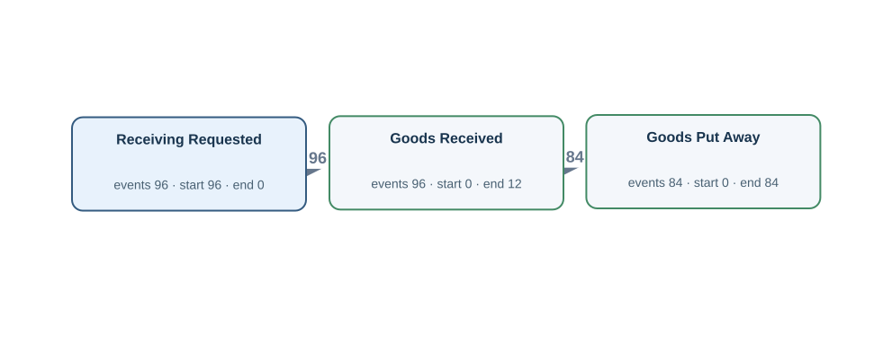</td><td width="50%"><h4>Original tables</h4>
Rows matched by event ID, activity and timestamp using the authored source bindings.

<strong><code>transaction_record</code></strong> · 45 source rows

<code>transaction_id</code> = T002, <code>occurred_at</code> = 2026-04-01T02:00:00Z, <code>warehouse_number</code> = W2, <code>transaction_type</code> = IN TX:T002 · Goods Received · occurred_at · L1:T002 | TX:T002 · Goods Received · occurred_at · L2:T002

<code>transaction_id</code> = T003, <code>occurred_at</code> = 2026-04-01T03:00:00Z, <code>warehouse_number</code> = W3, <code>transaction_type</code> = IN TX:T003 · Goods Received · occurred_at · L1:T003 | TX:T003 · Goods Received · occurred_at · L2:T003 | TX:T003 · Goods Received · occurred_at · L3:T003

<code>transaction_id</code> = T004, <code>occurred_at</code> = 2026-04-01T04:00:00Z, <code>warehouse_number</code> = W4, <code>transaction_type</code> = IN TX:T004 · Goods Received · occurred_at · L1:T004

<strong><code>transaction_record_activity</code></strong> · 84 source rows

<code>event_id</code> = LC:transaction_record:T002:1, <code>transaction_id</code> = T002, <code>activity</code> = Receiving Requested, <code>occurred_at</code> = 2026-03-31T22:00:00Z, <code>outcome</code> = COMPLETED LC:transaction_record:T002:1 · Receiving Requested · occurred_at · L1:T002 | LC:transaction_record:T002:1 · Receiving Requested · occurred_at · L2:T002

<code>event_id</code> = LC:transaction_record:T002:4, <code>transaction_id</code> = T002, <code>activity</code> = Goods Put Away, <code>occurred_at</code> = 2026-04-01T03:00:00Z, <code>outcome</code> = COMPLETED LC:transaction_record:T002:4 · Goods Put Away · occurred_at · L1:T002 | LC:transaction_record:T002:4 · Goods Put Away · occurred_at · L2:T002

<code>event_id</code> = LC:transaction_record:T003:1, <code>transaction_id</code> = T003, <code>activity</code> = Receiving Requested, <code>occurred_at</code> = 2026-03-31T23:00:00Z, <code>outcome</code> = COMPLETED LC:transaction_record:T003:1 · Receiving Requested · occurred_at · L1:T003 | LC:transaction_record:T003:1 · Receiving Requested · occurred_at · L2:T003 | LC:transaction_record:T003:1 · Receiving Requested · occurred_at · L3:T003

Other tables referenced by Gold SQL

Includes case joins and branches of shared CTEs.
<ul><li><code>lifecycle_case_link</code> · case_id, case_table, event_id</li><li><code>loader_transaction</code> · loader_id, transaction_id</li></ul>
</td></tr></table>

[Gold CSV](../../../datasets/warehouseflow/private/gold_logs/OW06E.csv)

## OW06EP — Q2

For each worker transaction assignment, build a timeline of a request to take goods into storage, goods arriving at the warehouse, goods being placed into their storage locations.

Events: **276** · Cases with events: **96** · Activities: **3** · Edges: **2**

<table><tr><td width="50%"></td><td width="50%"><h4>Original tables</h4>
Rows matched by event ID, activity and timestamp using the authored source bindings.

<strong><code>transaction_record</code></strong> · 45 source rows

<code>transaction_id</code> = T002, <code>occurred_at</code> = 2026-04-01T02:00:00Z, <code>warehouse_number</code> = W2, <code>transaction_type</code> = IN TX:T002 · Goods Received · occurred_at · L1:T002 | TX:T002 · Goods Received · occurred_at · L2:T002

<code>transaction_id</code> = T003, <code>occurred_at</code> = 2026-04-01T03:00:00Z, <code>warehouse_number</code> = W3, <code>transaction_type</code> = IN TX:T003 · Goods Received · occurred_at · L1:T003 | TX:T003 · Goods Received · occurred_at · L2:T003 | TX:T003 · Goods Received · occurred_at · L3:T003

<code>transaction_id</code> = T004, <code>occurred_at</code> = 2026-04-01T04:00:00Z, <code>warehouse_number</code> = W4, <code>transaction_type</code> = IN TX:T004 · Goods Received · occurred_at · L1:T004

<strong><code>transaction_record_activity</code></strong> · 84 source rows

<code>event_id</code> = LC:transaction_record:T002:1, <code>transaction_id</code> = T002, <code>activity</code> = Receiving Requested, <code>occurred_at</code> = 2026-03-31T22:00:00Z, <code>outcome</code> = COMPLETED LC:transaction_record:T002:1 · Receiving Requested · occurred_at · L1:T002 | LC:transaction_record:T002:1 · Receiving Requested · occurred_at · L2:T002

<code>event_id</code> = LC:transaction_record:T002:4, <code>transaction_id</code> = T002, <code>activity</code> = Goods Put Away, <code>occurred_at</code> = 2026-04-01T03:00:00Z, <code>outcome</code> = COMPLETED LC:transaction_record:T002:4 · Goods Put Away · occurred_at · L1:T002 | LC:transaction_record:T002:4 · Goods Put Away · occurred_at · L2:T002

<code>event_id</code> = LC:transaction_record:T003:1, <code>transaction_id</code> = T003, <code>activity</code> = Receiving Requested, <code>occurred_at</code> = 2026-03-31T23:00:00Z, <code>outcome</code> = COMPLETED LC:transaction_record:T003:1 · Receiving Requested · occurred_at · L1:T003 | LC:transaction_record:T003:1 · Receiving Requested · occurred_at · L2:T003 | LC:transaction_record:T003:1 · Receiving Requested · occurred_at · L3:T003

Other tables referenced by Gold SQL

Includes case joins and branches of shared CTEs.
<ul><li><code>lifecycle_case_link</code> · case_id, case_table, event_id</li><li><code>loader_transaction</code> · loader_id, transaction_id</li></ul>
</td></tr></table>

[Gold CSV](../../../datasets/warehouseflow/private/gold_logs/OW06EP.csv)
