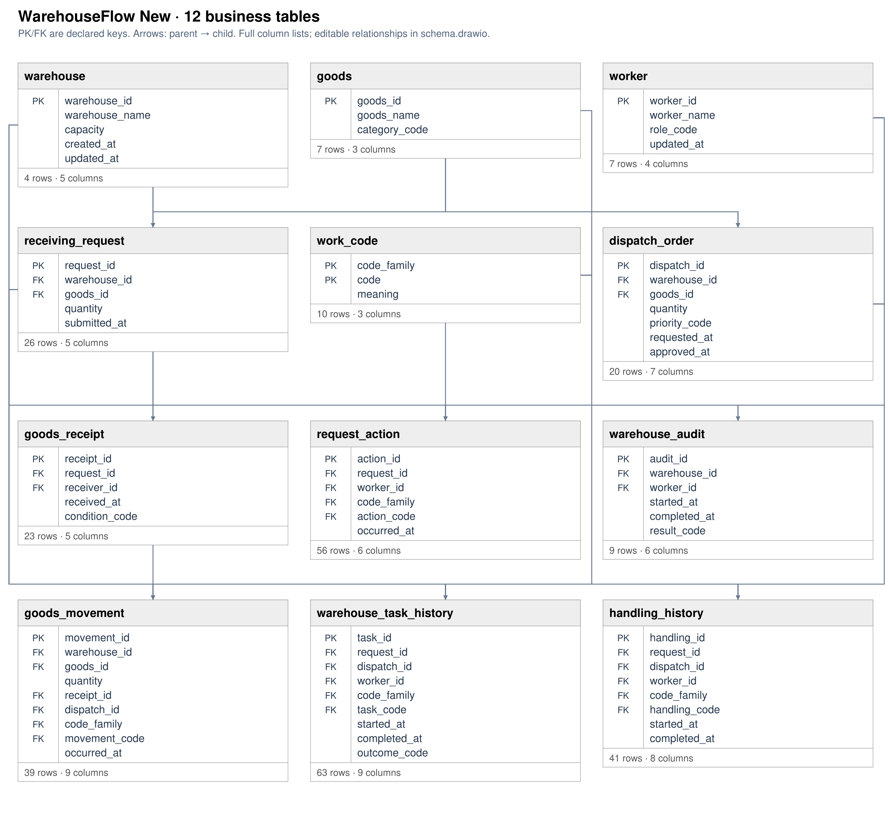

# warehouseflow: questions and Gold DFGs

**EVALUATION ONLY — NEVER PROVIDE TO A MODEL.**

Source commit: `a0ba4c9631d12730d60bf7720d783a3a827b88dc`. Open index.html for search, review notes and complete case traces.

Node counts = event occurrences. Edge counts = adjacent selected events within a case. Dashed amber edges touch timestamp ties and depend on the tie-break rule. DFGs are projections of the selected log, not causal models.

[Event graph inventory · tables, objects, OTs and activities](event_graph.md)

**Source tables** produced matched Gold events. **SQL tables** are all physical tables read by the Gold SQL, including join tables and shared CTE branches.

## Dataset overview

<table><tr><td width="50%" valign="top"><h3>All questions (34)</h3><table><thead><tr><th>ID</th><th>Type</th><th>Question</th></tr></thead><tbody><tr><td><a href="#r01--q1">R01</a></td><td>Q1</td><td>Extract Goods Received events for each warehouse.</td></tr><tr><td><a href="#r02--q2">R02</a></td><td>Q2</td><td>For each warehouse, build a timeline of goods arriving at the warehouse.</td></tr><tr><td><a href="#r03--q1">R03</a></td><td>Q1</td><td>Extract Goods Dispatched events for each warehouse.</td></tr><tr><td><a href="#r04--q2">R04</a></td><td>Q2</td><td>For each warehouse, build a timeline of goods leaving the warehouse.</td></tr><tr><td><a href="#r05--q3">R05</a></td><td>Q3</td><td>Extract the full recorded lifecycle event log for each warehouse.</td></tr><tr><td><a href="#r06--q4">R06</a></td><td>Q4</td><td>Show the complete recorded history associated with each warehouse.</td></tr><tr><td><a href="#r07--q1">R07</a></td><td>Q1</td><td>Extract Warehouse Task Started events for each warehouse.</td></tr><tr><td><a href="#ow01--q3">OW01</a></td><td>Q3</td><td>Extract the full recorded lifecycle event log for each warehouse.</td></tr><tr><td><a href="#ow02--q3">OW02</a></td><td>Q3</td><td>Extract the full recorded lifecycle event log for each goods.</td></tr><tr><td><a href="#ow03--q3">OW03</a></td><td>Q3</td><td>Extract the full recorded lifecycle event log for each worker.</td></tr><tr><td><a href="#ow04--q3">OW04</a></td><td>Q3</td><td>Extract the full recorded lifecycle event log for each warehouse transaction.</td></tr><tr><td><a href="#ow05--q3">OW05</a></td><td>Q3</td><td>Extract the full recorded lifecycle event log for each goods transaction line.</td></tr><tr><td><a href="#ow06--q3">OW06</a></td><td>Q3</td><td>Extract the full recorded lifecycle event log for each worker transaction assignment.</td></tr><tr><td><a href="#ts01--q1">TS01</a></td><td>Q1</td><td>Extract Receiving Requested, Receiving Scheduled, Dispatch Requested, Dispatch Approved events for each warehouse transaction.</td></tr><tr><td><a href="#r07p--q2">R07P</a></td><td>Q2</td><td>For each warehouse, build a timeline of the beginning of warehouse handling jobs.</td></tr><tr><td><a href="#ts01p--q2">TS01P</a></td><td>Q2</td><td>For each warehouse transaction, build a timeline of a request to take goods into storage, an inbound handling appointment being arranged, a request to send goods out, permission being granted to send goods out.</td></tr><tr><td><a href="#ow01p--q4">OW01P</a></td><td>Q4</td><td>Show the complete recorded history associated with each warehouse.</td></tr><tr><td><a href="#ow01e--q1">OW01E</a></td><td>Q1</td><td>Extract Receiving Requested, Goods Received, Goods Put Away events for each warehouse.</td></tr><tr><td><a href="#ow01ep--q2">OW01EP</a></td><td>Q2</td><td>For each warehouse, build a timeline of a request to take goods into storage, goods arriving at the warehouse, goods being placed into their storage locations.</td></tr><tr><td><a href="#ow02p--q4">OW02P</a></td><td>Q4</td><td>Show the complete recorded history associated with each goods.</td></tr><tr><td><a href="#ow02e--q1">OW02E</a></td><td>Q1</td><td>Extract Receiving Requested, Goods Received, Goods Put Away events for each goods.</td></tr><tr><td><a href="#ow02ep--q2">OW02EP</a></td><td>Q2</td><td>For each goods, build a timeline of a request to take goods into storage, goods arriving at the warehouse, goods being placed into their storage locations.</td></tr><tr><td><a href="#ow03p--q4">OW03P</a></td><td>Q4</td><td>Show the complete recorded history associated with each worker.</td></tr><tr><td><a href="#ow03e--q1">OW03E</a></td><td>Q1</td><td>Extract Receiving Requested, Goods Received, Goods Put Away events for each worker.</td></tr><tr><td><a href="#ow03ep--q2">OW03EP</a></td><td>Q2</td><td>For each worker, build a timeline of a request to take goods into storage, goods arriving at the warehouse, goods being placed into their storage locations.</td></tr><tr><td><a href="#ow04p--q4">OW04P</a></td><td>Q4</td><td>Show the complete recorded history associated with each warehouse transaction.</td></tr><tr><td><a href="#ow04e--q1">OW04E</a></td><td>Q1</td><td>Extract Receiving Requested, Goods Received, Goods Put Away events for each warehouse transaction.</td></tr><tr><td><a href="#ow04ep--q2">OW04EP</a></td><td>Q2</td><td>For each warehouse transaction, build a timeline of a request to take goods into storage, goods arriving at the warehouse, goods being placed into their storage locations.</td></tr><tr><td><a href="#ow05p--q4">OW05P</a></td><td>Q4</td><td>Show the complete recorded history associated with each goods transaction line.</td></tr><tr><td><a href="#ow05e--q1">OW05E</a></td><td>Q1</td><td>Extract Receiving Requested, Goods Received, Goods Put Away events for each goods transaction line.</td></tr><tr><td><a href="#ow05ep--q2">OW05EP</a></td><td>Q2</td><td>For each goods transaction line, build a timeline of a request to take goods into storage, goods arriving at the warehouse, goods being placed into their storage locations.</td></tr><tr><td><a href="#ow06p--q4">OW06P</a></td><td>Q4</td><td>Show the complete recorded history associated with each worker transaction assignment.</td></tr><tr><td><a href="#ow06e--q1">OW06E</a></td><td>Q1</td><td>Extract Receiving Requested, Goods Received, Goods Put Away events for each worker transaction assignment.</td></tr><tr><td><a href="#ow06ep--q2">OW06EP</a></td><td>Q2</td><td>For each worker transaction assignment, build a timeline of a request to take goods into storage, goods arriving at the warehouse, goods being placed into their storage locations.</td></tr></tbody></table></td><td width="50%" valign="top"><h3>Database schema</h3>

<a href="../../../datasets/warehouseflow/docs/schema.png">Full-size diagram</a> · <a href="../../../datasets/warehouseflow/input/schema.sql">Full SQL schema</a>
</td></tr></table>

## R01 — Q1

Extract Goods Received events for each warehouse.

Events: **45** · Cases with events: **4** · Activities: **1** · Edges: **1** · Source tables: **1** · SQL tables: **1**

<table><tr><td width="65%" valign="top"> <a href="graphs/R01.svg">Open full-size DFG</a></td><td width="35%" valign="top"><h4>Original tables</h4>
Up to 3 matched rows per table. Shows keys, event times and carrier values.

<strong>transaction_record</strong> · 45 matched rows
<table><tr><th>Row</th><th>Source values</th></tr><tr><td>1</td><td>transaction_id = T001 occurred_at = 2026-04-01T01:00:00Z transaction_type = IN</td></tr><tr><td>2</td><td>transaction_id = T005 occurred_at = 2026-04-01T05:00:00Z transaction_type = IN</td></tr><tr><td>3</td><td>transaction_id = T009 occurred_at = 2026-04-01T09:00:00Z transaction_type = IN</td></tr></table></td></tr></table>

[Gold CSV](../../../datasets/warehouseflow/private/gold_logs/R01.csv)

## R02 — Q2

For each warehouse, build a timeline of goods arriving at the warehouse.

Events: **45** · Cases with events: **4** · Activities: **1** · Edges: **1** · Source tables: **1** · SQL tables: **1**

<table><tr><td width="65%" valign="top"> <a href="graphs/R01.svg">Open full-size DFG</a></td><td width="35%" valign="top"><h4>Original tables</h4>
Up to 3 matched rows per table. Shows keys, event times and carrier values.

<strong>transaction_record</strong> · 45 matched rows
<table><tr><th>Row</th><th>Source values</th></tr><tr><td>1</td><td>transaction_id = T001 occurred_at = 2026-04-01T01:00:00Z transaction_type = IN</td></tr><tr><td>2</td><td>transaction_id = T005 occurred_at = 2026-04-01T05:00:00Z transaction_type = IN</td></tr><tr><td>3</td><td>transaction_id = T009 occurred_at = 2026-04-01T09:00:00Z transaction_type = IN</td></tr></table></td></tr></table>

[Gold CSV](../../../datasets/warehouseflow/private/gold_logs/R02.csv)

## R03 — Q1

Extract Goods Dispatched events for each warehouse.

Events: **35** · Cases with events: **4** · Activities: **1** · Edges: **1** · Source tables: **1** · SQL tables: **1**

<table><tr><td width="65%" valign="top"> <a href="graphs/R03.svg">Open full-size DFG</a></td><td width="35%" valign="top"><h4>Original tables</h4>
Up to 3 matched rows per table. Shows keys, event times and carrier values.

<strong>transaction_record</strong> · 35 matched rows
<table><tr><th>Row</th><th>Source values</th></tr><tr><td>1</td><td>transaction_id = T013 occurred_at = 2026-04-01T13:00:00Z transaction_type = OUT</td></tr><tr><td>2</td><td>transaction_id = T021 occurred_at = 2026-04-01T21:00:00Z transaction_type = OUT</td></tr><tr><td>3</td><td>transaction_id = T029 occurred_at = 2026-04-02T05:00:00Z transaction_type = OUT</td></tr></table></td></tr></table>

[Gold CSV](../../../datasets/warehouseflow/private/gold_logs/R03.csv)

## R04 — Q2

For each warehouse, build a timeline of goods leaving the warehouse.

Events: **35** · Cases with events: **4** · Activities: **1** · Edges: **1** · Source tables: **1** · SQL tables: **1**

<table><tr><td width="65%" valign="top"> <a href="graphs/R03.svg">Open full-size DFG</a></td><td width="35%" valign="top"><h4>Original tables</h4>
Up to 3 matched rows per table. Shows keys, event times and carrier values.

<strong>transaction_record</strong> · 35 matched rows
<table><tr><th>Row</th><th>Source values</th></tr><tr><td>1</td><td>transaction_id = T013 occurred_at = 2026-04-01T13:00:00Z transaction_type = OUT</td></tr><tr><td>2</td><td>transaction_id = T021 occurred_at = 2026-04-01T21:00:00Z transaction_type = OUT</td></tr><tr><td>3</td><td>transaction_id = T029 occurred_at = 2026-04-02T05:00:00Z transaction_type = OUT</td></tr></table></td></tr></table>

[Gold CSV](../../../datasets/warehouseflow/private/gold_logs/R04.csv)

## R05 — Q3

Extract the full recorded lifecycle event log for each warehouse.

Events: **394** · Cases with events: **4** · Activities: **10** · Edges: **17** · Source tables: **2** · SQL tables: **3**

<table><tr><td width="65%" valign="top"> <a href="graphs/R05.svg">Open full-size DFG</a></td><td width="35%" valign="top"><h4>Original tables</h4>
Up to 3 matched rows per table. Shows keys, event times and carrier values.

<strong>transaction_record</strong> · 80 matched rows
<table><tr><th>Row</th><th>Source values</th></tr><tr><td>1</td><td>transaction_id = T001 occurred_at = 2026-04-01T01:00:00Z transaction_type = IN</td></tr><tr><td>2</td><td>transaction_id = T005 occurred_at = 2026-04-01T05:00:00Z transaction_type = IN</td></tr><tr><td>3</td><td>transaction_id = T009 occurred_at = 2026-04-01T09:00:00Z transaction_type = IN</td></tr></table>
<strong>transaction_record_activity</strong> · 314 matched rows
<table><tr><th>Row</th><th>Source values</th></tr><tr><td>1</td><td>event_id = LC:transaction_record:T001:1 activity = Receiving Requested occurred_at = 2026-03-31T21:00:00Z</td></tr><tr><td>2</td><td>event_id = LC:transaction_record:T001:2 activity = Receiving Scheduled occurred_at = 2026-03-31T22:00:00Z</td></tr><tr><td>3</td><td>event_id = LC:transaction_record:T005:1 activity = Receiving Requested occurred_at = 2026-04-01T01:00:00Z</td></tr></table>

Other SQL tables

lifecycle_case_link

</td></tr></table>

[Gold CSV](../../../datasets/warehouseflow/private/gold_logs/R05.csv)

## R06 — Q4

Show the complete recorded history associated with each warehouse.

Events: **394** · Cases with events: **4** · Activities: **10** · Edges: **17** · Source tables: **2** · SQL tables: **3**

<table><tr><td width="65%" valign="top"> <a href="graphs/R05.svg">Open full-size DFG</a></td><td width="35%" valign="top"><h4>Original tables</h4>
Up to 3 matched rows per table. Shows keys, event times and carrier values.

<strong>transaction_record</strong> · 80 matched rows
<table><tr><th>Row</th><th>Source values</th></tr><tr><td>1</td><td>transaction_id = T001 occurred_at = 2026-04-01T01:00:00Z transaction_type = IN</td></tr><tr><td>2</td><td>transaction_id = T005 occurred_at = 2026-04-01T05:00:00Z transaction_type = IN</td></tr><tr><td>3</td><td>transaction_id = T009 occurred_at = 2026-04-01T09:00:00Z transaction_type = IN</td></tr></table>
<strong>transaction_record_activity</strong> · 314 matched rows
<table><tr><th>Row</th><th>Source values</th></tr><tr><td>1</td><td>event_id = LC:transaction_record:T001:1 activity = Receiving Requested occurred_at = 2026-03-31T21:00:00Z</td></tr><tr><td>2</td><td>event_id = LC:transaction_record:T001:2 activity = Receiving Scheduled occurred_at = 2026-03-31T22:00:00Z</td></tr><tr><td>3</td><td>event_id = LC:transaction_record:T005:1 activity = Receiving Requested occurred_at = 2026-04-01T01:00:00Z</td></tr></table>

Other SQL tables

lifecycle_case_link

</td></tr></table>

[Gold CSV](../../../datasets/warehouseflow/private/gold_logs/R06.csv)

## R07 — Q1

Extract Warehouse Task Started events for each warehouse.

**No Gold log:** Only one task time is stored, defined as completion. Task start times are not recorded.

## OW01 — Q3

Extract the full recorded lifecycle event log for each warehouse.

Events: **394** · Cases with events: **4** · Activities: **10** · Edges: **17** · Source tables: **2** · SQL tables: **3**

<table><tr><td width="65%" valign="top"> <a href="graphs/R05.svg">Open full-size DFG</a></td><td width="35%" valign="top"><h4>Original tables</h4>
Up to 3 matched rows per table. Shows keys, event times and carrier values.

<strong>transaction_record</strong> · 80 matched rows
<table><tr><th>Row</th><th>Source values</th></tr><tr><td>1</td><td>transaction_id = T001 occurred_at = 2026-04-01T01:00:00Z transaction_type = IN</td></tr><tr><td>2</td><td>transaction_id = T005 occurred_at = 2026-04-01T05:00:00Z transaction_type = IN</td></tr><tr><td>3</td><td>transaction_id = T009 occurred_at = 2026-04-01T09:00:00Z transaction_type = IN</td></tr></table>
<strong>transaction_record_activity</strong> · 314 matched rows
<table><tr><th>Row</th><th>Source values</th></tr><tr><td>1</td><td>event_id = LC:transaction_record:T001:1 activity = Receiving Requested occurred_at = 2026-03-31T21:00:00Z</td></tr><tr><td>2</td><td>event_id = LC:transaction_record:T001:2 activity = Receiving Scheduled occurred_at = 2026-03-31T22:00:00Z</td></tr><tr><td>3</td><td>event_id = LC:transaction_record:T005:1 activity = Receiving Requested occurred_at = 2026-04-01T01:00:00Z</td></tr></table>

Other SQL tables

lifecycle_case_link

</td></tr></table>

[Gold CSV](../../../datasets/warehouseflow/private/gold_logs/OW01.csv)

## OW02 — Q3

Extract the full recorded lifecycle event log for each goods.

Events: **679** · Cases with events: **6** · Activities: **10** · Edges: **53** · Source tables: **2** · SQL tables: **4**

<table><tr><td width="65%" valign="top"> <a href="graphs/OW02.svg">Open full-size DFG</a></td><td width="35%" valign="top"><h4>Original tables</h4>
Up to 3 matched rows per table. Shows keys, event times and carrier values.

<strong>transaction_record</strong> · 80 matched rows
<table><tr><th>Row</th><th>Source values</th></tr><tr><td>1</td><td>transaction_id = T004 occurred_at = 2026-04-01T04:00:00Z transaction_type = IN</td></tr><tr><td>2</td><td>transaction_id = T009 occurred_at = 2026-04-01T09:00:00Z transaction_type = IN</td></tr><tr><td>3</td><td>transaction_id = T012 occurred_at = 2026-04-01T12:00:00Z transaction_type = IN</td></tr></table>
<strong>transaction_record_activity</strong> · 314 matched rows
<table><tr><th>Row</th><th>Source values</th></tr><tr><td>1</td><td>event_id = LC:transaction_record:T004:1 activity = Receiving Requested occurred_at = 2026-04-01T00:00:00Z</td></tr><tr><td>2</td><td>event_id = LC:transaction_record:T004:2 activity = Receiving Scheduled occurred_at = 2026-04-01T01:00:00Z</td></tr><tr><td>3</td><td>event_id = LC:transaction_record:T004:3 activity = Receiving Inspection Completed occurred_at = 2026-04-01T04:30:00Z</td></tr></table>

Other SQL tables

goods_transaction_detail, lifecycle_case_link

</td></tr></table>

[Gold CSV](../../../datasets/warehouseflow/private/gold_logs/OW02.csv)

## OW03 — Q3

Extract the full recorded lifecycle event log for each worker.

Events: **823** · Cases with events: **5** · Activities: **10** · Edges: **56** · Source tables: **2** · SQL tables: **4**

<table><tr><td width="65%" valign="top"> <a href="graphs/OW03.svg">Open full-size DFG</a></td><td width="35%" valign="top"><h4>Original tables</h4>
Up to 3 matched rows per table. Shows keys, event times and carrier values.

<strong>transaction_record</strong> · 80 matched rows
<table><tr><th>Row</th><th>Source values</th></tr><tr><td>1</td><td>transaction_id = T002 occurred_at = 2026-04-01T02:00:00Z transaction_type = IN</td></tr><tr><td>2</td><td>transaction_id = T003 occurred_at = 2026-04-01T03:00:00Z transaction_type = IN</td></tr><tr><td>3</td><td>transaction_id = T004 occurred_at = 2026-04-01T04:00:00Z transaction_type = IN</td></tr></table>
<strong>transaction_record_activity</strong> · 314 matched rows
<table><tr><th>Row</th><th>Source values</th></tr><tr><td>1</td><td>event_id = LC:transaction_record:T002:1 activity = Receiving Requested occurred_at = 2026-03-31T22:00:00Z</td></tr><tr><td>2</td><td>event_id = LC:transaction_record:T002:2 activity = Receiving Scheduled occurred_at = 2026-03-31T23:00:00Z</td></tr><tr><td>3</td><td>event_id = LC:transaction_record:T003:1 activity = Receiving Requested occurred_at = 2026-03-31T23:00:00Z</td></tr></table>

Other SQL tables

lifecycle_case_link, loader_transaction

</td></tr></table>

[Gold CSV](../../../datasets/warehouseflow/private/gold_logs/OW03.csv)

## OW04 — Q3

Extract the full recorded lifecycle event log for each warehouse transaction.

Events: **394** · Cases with events: **80** · Activities: **10** · Edges: **8** · Source tables: **2** · SQL tables: **3**

<table><tr><td width="65%" valign="top"> <a href="graphs/OW04.svg">Open full-size DFG</a></td><td width="35%" valign="top"><h4>Original tables</h4>
Up to 3 matched rows per table. Shows keys, event times and carrier values.

<strong>transaction_record</strong> · 80 matched rows
<table><tr><th>Row</th><th>Source values</th></tr><tr><td>1</td><td>transaction_id = T001 occurred_at = 2026-04-01T01:00:00Z transaction_type = IN</td></tr><tr><td>2</td><td>transaction_id = T002 occurred_at = 2026-04-01T02:00:00Z transaction_type = IN</td></tr><tr><td>3</td><td>transaction_id = T003 occurred_at = 2026-04-01T03:00:00Z transaction_type = IN</td></tr></table>
<strong>transaction_record_activity</strong> · 314 matched rows
<table><tr><th>Row</th><th>Source values</th></tr><tr><td>1</td><td>event_id = LC:transaction_record:T001:1 activity = Receiving Requested occurred_at = 2026-03-31T21:00:00Z</td></tr><tr><td>2</td><td>event_id = LC:transaction_record:T001:2 activity = Receiving Scheduled occurred_at = 2026-03-31T22:00:00Z</td></tr><tr><td>3</td><td>event_id = LC:transaction_record:T001:3 activity = Receiving Inspection Completed occurred_at = 2026-04-01T01:30:00Z</td></tr></table>

Other SQL tables

lifecycle_case_link

</td></tr></table>

[Gold CSV](../../../datasets/warehouseflow/private/gold_logs/OW04.csv)

## OW05 — Q3

Extract the full recorded lifecycle event log for each goods transaction line.

Events: **679** · Cases with events: **138** · Activities: **10** · Edges: **8** · Source tables: **2** · SQL tables: **4**

<table><tr><td width="65%" valign="top"> <a href="graphs/OW05.svg">Open full-size DFG</a></td><td width="35%" valign="top"><h4>Original tables</h4>
Up to 3 matched rows per table. Shows keys, event times and carrier values.

<strong>transaction_record</strong> · 80 matched rows
<table><tr><th>Row</th><th>Source values</th></tr><tr><td>1</td><td>transaction_id = T004 occurred_at = 2026-04-01T04:00:00Z transaction_type = IN</td></tr><tr><td>2</td><td>transaction_id = T009 occurred_at = 2026-04-01T09:00:00Z transaction_type = IN</td></tr><tr><td>3</td><td>transaction_id = T012 occurred_at = 2026-04-01T12:00:00Z transaction_type = IN</td></tr></table>
<strong>transaction_record_activity</strong> · 314 matched rows
<table><tr><th>Row</th><th>Source values</th></tr><tr><td>1</td><td>event_id = LC:transaction_record:T004:1 activity = Receiving Requested occurred_at = 2026-04-01T00:00:00Z</td></tr><tr><td>2</td><td>event_id = LC:transaction_record:T004:2 activity = Receiving Scheduled occurred_at = 2026-04-01T01:00:00Z</td></tr><tr><td>3</td><td>event_id = LC:transaction_record:T004:3 activity = Receiving Inspection Completed occurred_at = 2026-04-01T04:30:00Z</td></tr></table>

Other SQL tables

goods_transaction_detail, lifecycle_case_link

</td></tr></table>

[Gold CSV](../../../datasets/warehouseflow/private/gold_logs/OW05.csv)

## OW06 — Q3

Extract the full recorded lifecycle event log for each worker transaction assignment.

Events: **823** · Cases with events: **167** · Activities: **10** · Edges: **8** · Source tables: **2** · SQL tables: **4**

<table><tr><td width="65%" valign="top"> <a href="graphs/OW06.svg">Open full-size DFG</a></td><td width="35%" valign="top"><h4>Original tables</h4>
Up to 3 matched rows per table. Shows keys, event times and carrier values.

<strong>transaction_record</strong> · 80 matched rows
<table><tr><th>Row</th><th>Source values</th></tr><tr><td>1</td><td>transaction_id = T002 occurred_at = 2026-04-01T02:00:00Z transaction_type = IN</td></tr><tr><td>2</td><td>transaction_id = T003 occurred_at = 2026-04-01T03:00:00Z transaction_type = IN</td></tr><tr><td>3</td><td>transaction_id = T004 occurred_at = 2026-04-01T04:00:00Z transaction_type = IN</td></tr></table>
<strong>transaction_record_activity</strong> · 314 matched rows
<table><tr><th>Row</th><th>Source values</th></tr><tr><td>1</td><td>event_id = LC:transaction_record:T002:1 activity = Receiving Requested occurred_at = 2026-03-31T22:00:00Z</td></tr><tr><td>2</td><td>event_id = LC:transaction_record:T002:2 activity = Receiving Scheduled occurred_at = 2026-03-31T23:00:00Z</td></tr><tr><td>3</td><td>event_id = LC:transaction_record:T002:3 activity = Receiving Inspection Completed occurred_at = 2026-04-01T02:30:00Z</td></tr></table>

Other SQL tables

lifecycle_case_link, loader_transaction

</td></tr></table>

[Gold CSV](../../../datasets/warehouseflow/private/gold_logs/OW06.csv)

## TS01 — Q1

Extract Receiving Requested, Receiving Scheduled, Dispatch Requested, Dispatch Approved events for each warehouse transaction.

Events: **160** · Cases with events: **80** · Activities: **4** · Edges: **2** · Source tables: **1** · SQL tables: **3**

<table><tr><td width="65%" valign="top"> <a href="graphs/TS01.svg">Open full-size DFG</a></td><td width="35%" valign="top"><h4>Original tables</h4>
Up to 3 matched rows per table. Shows keys, event times and carrier values.

<strong>transaction_record_activity</strong> · 160 matched rows
<table><tr><th>Row</th><th>Source values</th></tr><tr><td>1</td><td>event_id = LC:transaction_record:T001:1 activity = Receiving Requested occurred_at = 2026-03-31T21:00:00Z</td></tr><tr><td>2</td><td>event_id = LC:transaction_record:T001:2 activity = Receiving Scheduled occurred_at = 2026-03-31T22:00:00Z</td></tr><tr><td>3</td><td>event_id = LC:transaction_record:T002:1 activity = Receiving Requested occurred_at = 2026-03-31T22:00:00Z</td></tr></table>

Other SQL tables

lifecycle_case_link, transaction_record

</td></tr></table>

[Gold CSV](../../../datasets/warehouseflow/private/gold_logs/TS01.csv)

## R07P — Q2

For each warehouse, build a timeline of the beginning of warehouse handling jobs.

**No Gold log:** Only one task time is stored, defined as completion. Task start times are not recorded.

## TS01P — Q2

For each warehouse transaction, build a timeline of a request to take goods into storage, an inbound handling appointment being arranged, a request to send goods out, permission being granted to send goods out.

Events: **160** · Cases with events: **80** · Activities: **4** · Edges: **2** · Source tables: **1** · SQL tables: **3**

<table><tr><td width="65%" valign="top"> <a href="graphs/TS01.svg">Open full-size DFG</a></td><td width="35%" valign="top"><h4>Original tables</h4>
Up to 3 matched rows per table. Shows keys, event times and carrier values.

<strong>transaction_record_activity</strong> · 160 matched rows
<table><tr><th>Row</th><th>Source values</th></tr><tr><td>1</td><td>event_id = LC:transaction_record:T001:1 activity = Receiving Requested occurred_at = 2026-03-31T21:00:00Z</td></tr><tr><td>2</td><td>event_id = LC:transaction_record:T001:2 activity = Receiving Scheduled occurred_at = 2026-03-31T22:00:00Z</td></tr><tr><td>3</td><td>event_id = LC:transaction_record:T002:1 activity = Receiving Requested occurred_at = 2026-03-31T22:00:00Z</td></tr></table>

Other SQL tables

lifecycle_case_link, transaction_record

</td></tr></table>

[Gold CSV](../../../datasets/warehouseflow/private/gold_logs/TS01P.csv)

## OW01P — Q4

Show the complete recorded history associated with each warehouse.

Events: **394** · Cases with events: **4** · Activities: **10** · Edges: **17** · Source tables: **2** · SQL tables: **3**

<table><tr><td width="65%" valign="top"> <a href="graphs/R05.svg">Open full-size DFG</a></td><td width="35%" valign="top"><h4>Original tables</h4>
Up to 3 matched rows per table. Shows keys, event times and carrier values.

<strong>transaction_record</strong> · 80 matched rows
<table><tr><th>Row</th><th>Source values</th></tr><tr><td>1</td><td>transaction_id = T001 occurred_at = 2026-04-01T01:00:00Z transaction_type = IN</td></tr><tr><td>2</td><td>transaction_id = T005 occurred_at = 2026-04-01T05:00:00Z transaction_type = IN</td></tr><tr><td>3</td><td>transaction_id = T009 occurred_at = 2026-04-01T09:00:00Z transaction_type = IN</td></tr></table>
<strong>transaction_record_activity</strong> · 314 matched rows
<table><tr><th>Row</th><th>Source values</th></tr><tr><td>1</td><td>event_id = LC:transaction_record:T001:1 activity = Receiving Requested occurred_at = 2026-03-31T21:00:00Z</td></tr><tr><td>2</td><td>event_id = LC:transaction_record:T001:2 activity = Receiving Scheduled occurred_at = 2026-03-31T22:00:00Z</td></tr><tr><td>3</td><td>event_id = LC:transaction_record:T005:1 activity = Receiving Requested occurred_at = 2026-04-01T01:00:00Z</td></tr></table>

Other SQL tables

lifecycle_case_link

</td></tr></table>

[Gold CSV](../../../datasets/warehouseflow/private/gold_logs/OW01P.csv)

## OW01E — Q1

Extract Receiving Requested, Goods Received, Goods Put Away events for each warehouse.

Events: **129** · Cases with events: **4** · Activities: **3** · Edges: **7** · Source tables: **2** · SQL tables: **3**

<table><tr><td width="65%" valign="top"> <a href="graphs/OW01E.svg">Open full-size DFG</a></td><td width="35%" valign="top"><h4>Original tables</h4>
Up to 3 matched rows per table. Shows keys, event times and carrier values.

<strong>transaction_record</strong> · 45 matched rows
<table><tr><th>Row</th><th>Source values</th></tr><tr><td>1</td><td>transaction_id = T001 occurred_at = 2026-04-01T01:00:00Z transaction_type = IN</td></tr><tr><td>2</td><td>transaction_id = T005 occurred_at = 2026-04-01T05:00:00Z transaction_type = IN</td></tr><tr><td>3</td><td>transaction_id = T009 occurred_at = 2026-04-01T09:00:00Z transaction_type = IN</td></tr></table>
<strong>transaction_record_activity</strong> · 84 matched rows
<table><tr><th>Row</th><th>Source values</th></tr><tr><td>1</td><td>event_id = LC:transaction_record:T001:1 activity = Receiving Requested occurred_at = 2026-03-31T21:00:00Z</td></tr><tr><td>2</td><td>event_id = LC:transaction_record:T005:1 activity = Receiving Requested occurred_at = 2026-04-01T01:00:00Z</td></tr><tr><td>3</td><td>event_id = LC:transaction_record:T009:1 activity = Receiving Requested occurred_at = 2026-04-01T05:00:00Z</td></tr></table>

Other SQL tables

lifecycle_case_link

</td></tr></table>

[Gold CSV](../../../datasets/warehouseflow/private/gold_logs/OW01E.csv)

## OW01EP — Q2

For each warehouse, build a timeline of a request to take goods into storage, goods arriving at the warehouse, goods being placed into their storage locations.

Events: **129** · Cases with events: **4** · Activities: **3** · Edges: **7** · Source tables: **2** · SQL tables: **3**

<table><tr><td width="65%" valign="top"> <a href="graphs/OW01E.svg">Open full-size DFG</a></td><td width="35%" valign="top"><h4>Original tables</h4>
Up to 3 matched rows per table. Shows keys, event times and carrier values.

<strong>transaction_record</strong> · 45 matched rows
<table><tr><th>Row</th><th>Source values</th></tr><tr><td>1</td><td>transaction_id = T001 occurred_at = 2026-04-01T01:00:00Z transaction_type = IN</td></tr><tr><td>2</td><td>transaction_id = T005 occurred_at = 2026-04-01T05:00:00Z transaction_type = IN</td></tr><tr><td>3</td><td>transaction_id = T009 occurred_at = 2026-04-01T09:00:00Z transaction_type = IN</td></tr></table>
<strong>transaction_record_activity</strong> · 84 matched rows
<table><tr><th>Row</th><th>Source values</th></tr><tr><td>1</td><td>event_id = LC:transaction_record:T001:1 activity = Receiving Requested occurred_at = 2026-03-31T21:00:00Z</td></tr><tr><td>2</td><td>event_id = LC:transaction_record:T005:1 activity = Receiving Requested occurred_at = 2026-04-01T01:00:00Z</td></tr><tr><td>3</td><td>event_id = LC:transaction_record:T009:1 activity = Receiving Requested occurred_at = 2026-04-01T05:00:00Z</td></tr></table>

Other SQL tables

lifecycle_case_link

</td></tr></table>

[Gold CSV](../../../datasets/warehouseflow/private/gold_logs/OW01EP.csv)

## OW02P — Q4

Show the complete recorded history associated with each goods.

Events: **679** · Cases with events: **6** · Activities: **10** · Edges: **53** · Source tables: **2** · SQL tables: **4**

<table><tr><td width="65%" valign="top"> <a href="graphs/OW02.svg">Open full-size DFG</a></td><td width="35%" valign="top"><h4>Original tables</h4>
Up to 3 matched rows per table. Shows keys, event times and carrier values.

<strong>transaction_record</strong> · 80 matched rows
<table><tr><th>Row</th><th>Source values</th></tr><tr><td>1</td><td>transaction_id = T004 occurred_at = 2026-04-01T04:00:00Z transaction_type = IN</td></tr><tr><td>2</td><td>transaction_id = T009 occurred_at = 2026-04-01T09:00:00Z transaction_type = IN</td></tr><tr><td>3</td><td>transaction_id = T012 occurred_at = 2026-04-01T12:00:00Z transaction_type = IN</td></tr></table>
<strong>transaction_record_activity</strong> · 314 matched rows
<table><tr><th>Row</th><th>Source values</th></tr><tr><td>1</td><td>event_id = LC:transaction_record:T004:1 activity = Receiving Requested occurred_at = 2026-04-01T00:00:00Z</td></tr><tr><td>2</td><td>event_id = LC:transaction_record:T004:2 activity = Receiving Scheduled occurred_at = 2026-04-01T01:00:00Z</td></tr><tr><td>3</td><td>event_id = LC:transaction_record:T004:3 activity = Receiving Inspection Completed occurred_at = 2026-04-01T04:30:00Z</td></tr></table>

Other SQL tables

goods_transaction_detail, lifecycle_case_link

</td></tr></table>

[Gold CSV](../../../datasets/warehouseflow/private/gold_logs/OW02P.csv)

## OW02E — Q1

Extract Receiving Requested, Goods Received, Goods Put Away events for each goods.

Events: **226** · Cases with events: **6** · Activities: **3** · Edges: **7** · Source tables: **2** · SQL tables: **4**

<table><tr><td width="65%" valign="top"> <a href="graphs/OW02E.svg">Open full-size DFG</a></td><td width="35%" valign="top"><h4>Original tables</h4>
Up to 3 matched rows per table. Shows keys, event times and carrier values.

<strong>transaction_record</strong> · 45 matched rows
<table><tr><th>Row</th><th>Source values</th></tr><tr><td>1</td><td>transaction_id = T004 occurred_at = 2026-04-01T04:00:00Z transaction_type = IN</td></tr><tr><td>2</td><td>transaction_id = T009 occurred_at = 2026-04-01T09:00:00Z transaction_type = IN</td></tr><tr><td>3</td><td>transaction_id = T012 occurred_at = 2026-04-01T12:00:00Z transaction_type = IN</td></tr></table>
<strong>transaction_record_activity</strong> · 84 matched rows
<table><tr><th>Row</th><th>Source values</th></tr><tr><td>1</td><td>event_id = LC:transaction_record:T004:1 activity = Receiving Requested occurred_at = 2026-04-01T00:00:00Z</td></tr><tr><td>2</td><td>event_id = LC:transaction_record:T004:4 activity = Goods Put Away occurred_at = 2026-04-01T05:00:00Z</td></tr><tr><td>3</td><td>event_id = LC:transaction_record:T009:1 activity = Receiving Requested occurred_at = 2026-04-01T05:00:00Z</td></tr></table>

Other SQL tables

goods_transaction_detail, lifecycle_case_link

</td></tr></table>

[Gold CSV](../../../datasets/warehouseflow/private/gold_logs/OW02E.csv)

## OW02EP — Q2

For each goods, build a timeline of a request to take goods into storage, goods arriving at the warehouse, goods being placed into their storage locations.

Events: **226** · Cases with events: **6** · Activities: **3** · Edges: **7** · Source tables: **2** · SQL tables: **4**

<table><tr><td width="65%" valign="top"> <a href="graphs/OW02E.svg">Open full-size DFG</a></td><td width="35%" valign="top"><h4>Original tables</h4>
Up to 3 matched rows per table. Shows keys, event times and carrier values.

<strong>transaction_record</strong> · 45 matched rows
<table><tr><th>Row</th><th>Source values</th></tr><tr><td>1</td><td>transaction_id = T004 occurred_at = 2026-04-01T04:00:00Z transaction_type = IN</td></tr><tr><td>2</td><td>transaction_id = T009 occurred_at = 2026-04-01T09:00:00Z transaction_type = IN</td></tr><tr><td>3</td><td>transaction_id = T012 occurred_at = 2026-04-01T12:00:00Z transaction_type = IN</td></tr></table>
<strong>transaction_record_activity</strong> · 84 matched rows
<table><tr><th>Row</th><th>Source values</th></tr><tr><td>1</td><td>event_id = LC:transaction_record:T004:1 activity = Receiving Requested occurred_at = 2026-04-01T00:00:00Z</td></tr><tr><td>2</td><td>event_id = LC:transaction_record:T004:4 activity = Goods Put Away occurred_at = 2026-04-01T05:00:00Z</td></tr><tr><td>3</td><td>event_id = LC:transaction_record:T009:1 activity = Receiving Requested occurred_at = 2026-04-01T05:00:00Z</td></tr></table>

Other SQL tables

goods_transaction_detail, lifecycle_case_link

</td></tr></table>

[Gold CSV](../../../datasets/warehouseflow/private/gold_logs/OW02EP.csv)

## OW03P — Q4

Show the complete recorded history associated with each worker.

Events: **823** · Cases with events: **5** · Activities: **10** · Edges: **56** · Source tables: **2** · SQL tables: **4**

<table><tr><td width="65%" valign="top"> <a href="graphs/OW03.svg">Open full-size DFG</a></td><td width="35%" valign="top"><h4>Original tables</h4>
Up to 3 matched rows per table. Shows keys, event times and carrier values.

<strong>transaction_record</strong> · 80 matched rows
<table><tr><th>Row</th><th>Source values</th></tr><tr><td>1</td><td>transaction_id = T002 occurred_at = 2026-04-01T02:00:00Z transaction_type = IN</td></tr><tr><td>2</td><td>transaction_id = T003 occurred_at = 2026-04-01T03:00:00Z transaction_type = IN</td></tr><tr><td>3</td><td>transaction_id = T004 occurred_at = 2026-04-01T04:00:00Z transaction_type = IN</td></tr></table>
<strong>transaction_record_activity</strong> · 314 matched rows
<table><tr><th>Row</th><th>Source values</th></tr><tr><td>1</td><td>event_id = LC:transaction_record:T002:1 activity = Receiving Requested occurred_at = 2026-03-31T22:00:00Z</td></tr><tr><td>2</td><td>event_id = LC:transaction_record:T002:2 activity = Receiving Scheduled occurred_at = 2026-03-31T23:00:00Z</td></tr><tr><td>3</td><td>event_id = LC:transaction_record:T003:1 activity = Receiving Requested occurred_at = 2026-03-31T23:00:00Z</td></tr></table>

Other SQL tables

lifecycle_case_link, loader_transaction

</td></tr></table>

[Gold CSV](../../../datasets/warehouseflow/private/gold_logs/OW03P.csv)

## OW03E — Q1

Extract Receiving Requested, Goods Received, Goods Put Away events for each worker.

Events: **276** · Cases with events: **5** · Activities: **3** · Edges: **7** · Source tables: **2** · SQL tables: **4**

<table><tr><td width="65%" valign="top"> <a href="graphs/OW03E.svg">Open full-size DFG</a></td><td width="35%" valign="top"><h4>Original tables</h4>
Up to 3 matched rows per table. Shows keys, event times and carrier values.

<strong>transaction_record</strong> · 45 matched rows
<table><tr><th>Row</th><th>Source values</th></tr><tr><td>1</td><td>transaction_id = T002 occurred_at = 2026-04-01T02:00:00Z transaction_type = IN</td></tr><tr><td>2</td><td>transaction_id = T003 occurred_at = 2026-04-01T03:00:00Z transaction_type = IN</td></tr><tr><td>3</td><td>transaction_id = T004 occurred_at = 2026-04-01T04:00:00Z transaction_type = IN</td></tr></table>
<strong>transaction_record_activity</strong> · 84 matched rows
<table><tr><th>Row</th><th>Source values</th></tr><tr><td>1</td><td>event_id = LC:transaction_record:T002:1 activity = Receiving Requested occurred_at = 2026-03-31T22:00:00Z</td></tr><tr><td>2</td><td>event_id = LC:transaction_record:T003:1 activity = Receiving Requested occurred_at = 2026-03-31T23:00:00Z</td></tr><tr><td>3</td><td>event_id = LC:transaction_record:T004:1 activity = Receiving Requested occurred_at = 2026-04-01T00:00:00Z</td></tr></table>

Other SQL tables

lifecycle_case_link, loader_transaction

</td></tr></table>

[Gold CSV](../../../datasets/warehouseflow/private/gold_logs/OW03E.csv)

## OW03EP — Q2

For each worker, build a timeline of a request to take goods into storage, goods arriving at the warehouse, goods being placed into their storage locations.

Events: **276** · Cases with events: **5** · Activities: **3** · Edges: **7** · Source tables: **2** · SQL tables: **4**

<table><tr><td width="65%" valign="top"> <a href="graphs/OW03E.svg">Open full-size DFG</a></td><td width="35%" valign="top"><h4>Original tables</h4>
Up to 3 matched rows per table. Shows keys, event times and carrier values.

<strong>transaction_record</strong> · 45 matched rows
<table><tr><th>Row</th><th>Source values</th></tr><tr><td>1</td><td>transaction_id = T002 occurred_at = 2026-04-01T02:00:00Z transaction_type = IN</td></tr><tr><td>2</td><td>transaction_id = T003 occurred_at = 2026-04-01T03:00:00Z transaction_type = IN</td></tr><tr><td>3</td><td>transaction_id = T004 occurred_at = 2026-04-01T04:00:00Z transaction_type = IN</td></tr></table>
<strong>transaction_record_activity</strong> · 84 matched rows
<table><tr><th>Row</th><th>Source values</th></tr><tr><td>1</td><td>event_id = LC:transaction_record:T002:1 activity = Receiving Requested occurred_at = 2026-03-31T22:00:00Z</td></tr><tr><td>2</td><td>event_id = LC:transaction_record:T003:1 activity = Receiving Requested occurred_at = 2026-03-31T23:00:00Z</td></tr><tr><td>3</td><td>event_id = LC:transaction_record:T004:1 activity = Receiving Requested occurred_at = 2026-04-01T00:00:00Z</td></tr></table>

Other SQL tables

lifecycle_case_link, loader_transaction

</td></tr></table>

[Gold CSV](../../../datasets/warehouseflow/private/gold_logs/OW03EP.csv)

## OW04P — Q4

Show the complete recorded history associated with each warehouse transaction.

Events: **394** · Cases with events: **80** · Activities: **10** · Edges: **8** · Source tables: **2** · SQL tables: **3**

<table><tr><td width="65%" valign="top"> <a href="graphs/OW04.svg">Open full-size DFG</a></td><td width="35%" valign="top"><h4>Original tables</h4>
Up to 3 matched rows per table. Shows keys, event times and carrier values.

<strong>transaction_record</strong> · 80 matched rows
<table><tr><th>Row</th><th>Source values</th></tr><tr><td>1</td><td>transaction_id = T001 occurred_at = 2026-04-01T01:00:00Z transaction_type = IN</td></tr><tr><td>2</td><td>transaction_id = T002 occurred_at = 2026-04-01T02:00:00Z transaction_type = IN</td></tr><tr><td>3</td><td>transaction_id = T003 occurred_at = 2026-04-01T03:00:00Z transaction_type = IN</td></tr></table>
<strong>transaction_record_activity</strong> · 314 matched rows
<table><tr><th>Row</th><th>Source values</th></tr><tr><td>1</td><td>event_id = LC:transaction_record:T001:1 activity = Receiving Requested occurred_at = 2026-03-31T21:00:00Z</td></tr><tr><td>2</td><td>event_id = LC:transaction_record:T001:2 activity = Receiving Scheduled occurred_at = 2026-03-31T22:00:00Z</td></tr><tr><td>3</td><td>event_id = LC:transaction_record:T001:3 activity = Receiving Inspection Completed occurred_at = 2026-04-01T01:30:00Z</td></tr></table>

Other SQL tables

lifecycle_case_link

</td></tr></table>

[Gold CSV](../../../datasets/warehouseflow/private/gold_logs/OW04P.csv)

## OW04E — Q1

Extract Receiving Requested, Goods Received, Goods Put Away events for each warehouse transaction.

Events: **129** · Cases with events: **45** · Activities: **3** · Edges: **2** · Source tables: **2** · SQL tables: **3**

<table><tr><td width="65%" valign="top"> <a href="graphs/OW04E.svg">Open full-size DFG</a></td><td width="35%" valign="top"><h4>Original tables</h4>
Up to 3 matched rows per table. Shows keys, event times and carrier values.

<strong>transaction_record</strong> · 45 matched rows
<table><tr><th>Row</th><th>Source values</th></tr><tr><td>1</td><td>transaction_id = T001 occurred_at = 2026-04-01T01:00:00Z transaction_type = IN</td></tr><tr><td>2</td><td>transaction_id = T002 occurred_at = 2026-04-01T02:00:00Z transaction_type = IN</td></tr><tr><td>3</td><td>transaction_id = T003 occurred_at = 2026-04-01T03:00:00Z transaction_type = IN</td></tr></table>
<strong>transaction_record_activity</strong> · 84 matched rows
<table><tr><th>Row</th><th>Source values</th></tr><tr><td>1</td><td>event_id = LC:transaction_record:T001:1 activity = Receiving Requested occurred_at = 2026-03-31T21:00:00Z</td></tr><tr><td>2</td><td>event_id = LC:transaction_record:T002:1 activity = Receiving Requested occurred_at = 2026-03-31T22:00:00Z</td></tr><tr><td>3</td><td>event_id = LC:transaction_record:T002:4 activity = Goods Put Away occurred_at = 2026-04-01T03:00:00Z</td></tr></table>

Other SQL tables

lifecycle_case_link

</td></tr></table>

[Gold CSV](../../../datasets/warehouseflow/private/gold_logs/OW04E.csv)

## OW04EP — Q2

For each warehouse transaction, build a timeline of a request to take goods into storage, goods arriving at the warehouse, goods being placed into their storage locations.

Events: **129** · Cases with events: **45** · Activities: **3** · Edges: **2** · Source tables: **2** · SQL tables: **3**

<table><tr><td width="65%" valign="top"> <a href="graphs/OW04E.svg">Open full-size DFG</a></td><td width="35%" valign="top"><h4>Original tables</h4>
Up to 3 matched rows per table. Shows keys, event times and carrier values.

<strong>transaction_record</strong> · 45 matched rows
<table><tr><th>Row</th><th>Source values</th></tr><tr><td>1</td><td>transaction_id = T001 occurred_at = 2026-04-01T01:00:00Z transaction_type = IN</td></tr><tr><td>2</td><td>transaction_id = T002 occurred_at = 2026-04-01T02:00:00Z transaction_type = IN</td></tr><tr><td>3</td><td>transaction_id = T003 occurred_at = 2026-04-01T03:00:00Z transaction_type = IN</td></tr></table>
<strong>transaction_record_activity</strong> · 84 matched rows
<table><tr><th>Row</th><th>Source values</th></tr><tr><td>1</td><td>event_id = LC:transaction_record:T001:1 activity = Receiving Requested occurred_at = 2026-03-31T21:00:00Z</td></tr><tr><td>2</td><td>event_id = LC:transaction_record:T002:1 activity = Receiving Requested occurred_at = 2026-03-31T22:00:00Z</td></tr><tr><td>3</td><td>event_id = LC:transaction_record:T002:4 activity = Goods Put Away occurred_at = 2026-04-01T03:00:00Z</td></tr></table>

Other SQL tables

lifecycle_case_link

</td></tr></table>

[Gold CSV](../../../datasets/warehouseflow/private/gold_logs/OW04EP.csv)

## OW05P — Q4

Show the complete recorded history associated with each goods transaction line.

Events: **679** · Cases with events: **138** · Activities: **10** · Edges: **8** · Source tables: **2** · SQL tables: **4**

<table><tr><td width="65%" valign="top"> <a href="graphs/OW05.svg">Open full-size DFG</a></td><td width="35%" valign="top"><h4>Original tables</h4>
Up to 3 matched rows per table. Shows keys, event times and carrier values.

<strong>transaction_record</strong> · 80 matched rows
<table><tr><th>Row</th><th>Source values</th></tr><tr><td>1</td><td>transaction_id = T004 occurred_at = 2026-04-01T04:00:00Z transaction_type = IN</td></tr><tr><td>2</td><td>transaction_id = T009 occurred_at = 2026-04-01T09:00:00Z transaction_type = IN</td></tr><tr><td>3</td><td>transaction_id = T012 occurred_at = 2026-04-01T12:00:00Z transaction_type = IN</td></tr></table>
<strong>transaction_record_activity</strong> · 314 matched rows
<table><tr><th>Row</th><th>Source values</th></tr><tr><td>1</td><td>event_id = LC:transaction_record:T004:1 activity = Receiving Requested occurred_at = 2026-04-01T00:00:00Z</td></tr><tr><td>2</td><td>event_id = LC:transaction_record:T004:2 activity = Receiving Scheduled occurred_at = 2026-04-01T01:00:00Z</td></tr><tr><td>3</td><td>event_id = LC:transaction_record:T004:3 activity = Receiving Inspection Completed occurred_at = 2026-04-01T04:30:00Z</td></tr></table>

Other SQL tables

goods_transaction_detail, lifecycle_case_link

</td></tr></table>

[Gold CSV](../../../datasets/warehouseflow/private/gold_logs/OW05P.csv)

## OW05E — Q1

Extract Receiving Requested, Goods Received, Goods Put Away events for each goods transaction line.

Events: **226** · Cases with events: **79** · Activities: **3** · Edges: **2** · Source tables: **2** · SQL tables: **4**

<table><tr><td width="65%" valign="top"> <a href="graphs/OW05E.svg">Open full-size DFG</a></td><td width="35%" valign="top"><h4>Original tables</h4>
Up to 3 matched rows per table. Shows keys, event times and carrier values.

<strong>transaction_record</strong> · 45 matched rows
<table><tr><th>Row</th><th>Source values</th></tr><tr><td>1</td><td>transaction_id = T004 occurred_at = 2026-04-01T04:00:00Z transaction_type = IN</td></tr><tr><td>2</td><td>transaction_id = T009 occurred_at = 2026-04-01T09:00:00Z transaction_type = IN</td></tr><tr><td>3</td><td>transaction_id = T012 occurred_at = 2026-04-01T12:00:00Z transaction_type = IN</td></tr></table>
<strong>transaction_record_activity</strong> · 84 matched rows
<table><tr><th>Row</th><th>Source values</th></tr><tr><td>1</td><td>event_id = LC:transaction_record:T004:1 activity = Receiving Requested occurred_at = 2026-04-01T00:00:00Z</td></tr><tr><td>2</td><td>event_id = LC:transaction_record:T004:4 activity = Goods Put Away occurred_at = 2026-04-01T05:00:00Z</td></tr><tr><td>3</td><td>event_id = LC:transaction_record:T009:1 activity = Receiving Requested occurred_at = 2026-04-01T05:00:00Z</td></tr></table>

Other SQL tables

goods_transaction_detail, lifecycle_case_link

</td></tr></table>

[Gold CSV](../../../datasets/warehouseflow/private/gold_logs/OW05E.csv)

## OW05EP — Q2

For each goods transaction line, build a timeline of a request to take goods into storage, goods arriving at the warehouse, goods being placed into their storage locations.

Events: **226** · Cases with events: **79** · Activities: **3** · Edges: **2** · Source tables: **2** · SQL tables: **4**

<table><tr><td width="65%" valign="top"> <a href="graphs/OW05E.svg">Open full-size DFG</a></td><td width="35%" valign="top"><h4>Original tables</h4>
Up to 3 matched rows per table. Shows keys, event times and carrier values.

<strong>transaction_record</strong> · 45 matched rows
<table><tr><th>Row</th><th>Source values</th></tr><tr><td>1</td><td>transaction_id = T004 occurred_at = 2026-04-01T04:00:00Z transaction_type = IN</td></tr><tr><td>2</td><td>transaction_id = T009 occurred_at = 2026-04-01T09:00:00Z transaction_type = IN</td></tr><tr><td>3</td><td>transaction_id = T012 occurred_at = 2026-04-01T12:00:00Z transaction_type = IN</td></tr></table>
<strong>transaction_record_activity</strong> · 84 matched rows
<table><tr><th>Row</th><th>Source values</th></tr><tr><td>1</td><td>event_id = LC:transaction_record:T004:1 activity = Receiving Requested occurred_at = 2026-04-01T00:00:00Z</td></tr><tr><td>2</td><td>event_id = LC:transaction_record:T004:4 activity = Goods Put Away occurred_at = 2026-04-01T05:00:00Z</td></tr><tr><td>3</td><td>event_id = LC:transaction_record:T009:1 activity = Receiving Requested occurred_at = 2026-04-01T05:00:00Z</td></tr></table>

Other SQL tables

goods_transaction_detail, lifecycle_case_link

</td></tr></table>

[Gold CSV](../../../datasets/warehouseflow/private/gold_logs/OW05EP.csv)

## OW06P — Q4

Show the complete recorded history associated with each worker transaction assignment.

Events: **823** · Cases with events: **167** · Activities: **10** · Edges: **8** · Source tables: **2** · SQL tables: **4**

<table><tr><td width="65%" valign="top"> <a href="graphs/OW06.svg">Open full-size DFG</a></td><td width="35%" valign="top"><h4>Original tables</h4>
Up to 3 matched rows per table. Shows keys, event times and carrier values.

<strong>transaction_record</strong> · 80 matched rows
<table><tr><th>Row</th><th>Source values</th></tr><tr><td>1</td><td>transaction_id = T002 occurred_at = 2026-04-01T02:00:00Z transaction_type = IN</td></tr><tr><td>2</td><td>transaction_id = T003 occurred_at = 2026-04-01T03:00:00Z transaction_type = IN</td></tr><tr><td>3</td><td>transaction_id = T004 occurred_at = 2026-04-01T04:00:00Z transaction_type = IN</td></tr></table>
<strong>transaction_record_activity</strong> · 314 matched rows
<table><tr><th>Row</th><th>Source values</th></tr><tr><td>1</td><td>event_id = LC:transaction_record:T002:1 activity = Receiving Requested occurred_at = 2026-03-31T22:00:00Z</td></tr><tr><td>2</td><td>event_id = LC:transaction_record:T002:2 activity = Receiving Scheduled occurred_at = 2026-03-31T23:00:00Z</td></tr><tr><td>3</td><td>event_id = LC:transaction_record:T002:3 activity = Receiving Inspection Completed occurred_at = 2026-04-01T02:30:00Z</td></tr></table>

Other SQL tables

lifecycle_case_link, loader_transaction

</td></tr></table>

[Gold CSV](../../../datasets/warehouseflow/private/gold_logs/OW06P.csv)

## OW06E — Q1

Extract Receiving Requested, Goods Received, Goods Put Away events for each worker transaction assignment.

Events: **276** · Cases with events: **96** · Activities: **3** · Edges: **2** · Source tables: **2** · SQL tables: **4**

<table><tr><td width="65%" valign="top"> <a href="graphs/OW06E.svg">Open full-size DFG</a></td><td width="35%" valign="top"><h4>Original tables</h4>
Up to 3 matched rows per table. Shows keys, event times and carrier values.

<strong>transaction_record</strong> · 45 matched rows
<table><tr><th>Row</th><th>Source values</th></tr><tr><td>1</td><td>transaction_id = T002 occurred_at = 2026-04-01T02:00:00Z transaction_type = IN</td></tr><tr><td>2</td><td>transaction_id = T003 occurred_at = 2026-04-01T03:00:00Z transaction_type = IN</td></tr><tr><td>3</td><td>transaction_id = T004 occurred_at = 2026-04-01T04:00:00Z transaction_type = IN</td></tr></table>
<strong>transaction_record_activity</strong> · 84 matched rows
<table><tr><th>Row</th><th>Source values</th></tr><tr><td>1</td><td>event_id = LC:transaction_record:T002:1 activity = Receiving Requested occurred_at = 2026-03-31T22:00:00Z</td></tr><tr><td>2</td><td>event_id = LC:transaction_record:T002:4 activity = Goods Put Away occurred_at = 2026-04-01T03:00:00Z</td></tr><tr><td>3</td><td>event_id = LC:transaction_record:T003:1 activity = Receiving Requested occurred_at = 2026-03-31T23:00:00Z</td></tr></table>

Other SQL tables

lifecycle_case_link, loader_transaction

</td></tr></table>

[Gold CSV](../../../datasets/warehouseflow/private/gold_logs/OW06E.csv)

## OW06EP — Q2

For each worker transaction assignment, build a timeline of a request to take goods into storage, goods arriving at the warehouse, goods being placed into their storage locations.

Events: **276** · Cases with events: **96** · Activities: **3** · Edges: **2** · Source tables: **2** · SQL tables: **4**

<table><tr><td width="65%" valign="top"> <a href="graphs/OW06E.svg">Open full-size DFG</a></td><td width="35%" valign="top"><h4>Original tables</h4>
Up to 3 matched rows per table. Shows keys, event times and carrier values.

<strong>transaction_record</strong> · 45 matched rows
<table><tr><th>Row</th><th>Source values</th></tr><tr><td>1</td><td>transaction_id = T002 occurred_at = 2026-04-01T02:00:00Z transaction_type = IN</td></tr><tr><td>2</td><td>transaction_id = T003 occurred_at = 2026-04-01T03:00:00Z transaction_type = IN</td></tr><tr><td>3</td><td>transaction_id = T004 occurred_at = 2026-04-01T04:00:00Z transaction_type = IN</td></tr></table>
<strong>transaction_record_activity</strong> · 84 matched rows
<table><tr><th>Row</th><th>Source values</th></tr><tr><td>1</td><td>event_id = LC:transaction_record:T002:1 activity = Receiving Requested occurred_at = 2026-03-31T22:00:00Z</td></tr><tr><td>2</td><td>event_id = LC:transaction_record:T002:4 activity = Goods Put Away occurred_at = 2026-04-01T03:00:00Z</td></tr><tr><td>3</td><td>event_id = LC:transaction_record:T003:1 activity = Receiving Requested occurred_at = 2026-03-31T23:00:00Z</td></tr></table>

Other SQL tables

lifecycle_case_link, loader_transaction

</td></tr></table>

[Gold CSV](../../../datasets/warehouseflow/private/gold_logs/OW06EP.csv)
